# Queensland Storm Tide Resilience Building Guidelines (December 2019)

> **Source**: Queensland Reconstruction Authority
> **URL**: https://www.qra.qld.gov.au/sites/default/files/2019-12/storm_tide_resilience_building_guidelines_-_dec19.pdf
> **Licence**: © State of Queensland; emergency-management practitioner reference
> **Retrieved**: 2026-05-07T23:43:36Z
> **SHA-256**: `22f3b13d1a4cdcaf6d84c71e602d33976666af1d472e60506a3afc51788c9a8e`
> *Converted from PDF to Markdown format.*

---
## Page 1

Storm Tide Resilient 
Building Guidance 
for Queensland Homes
Get Ready Queensland
Preparing for a stronger, more Resilient Queensland

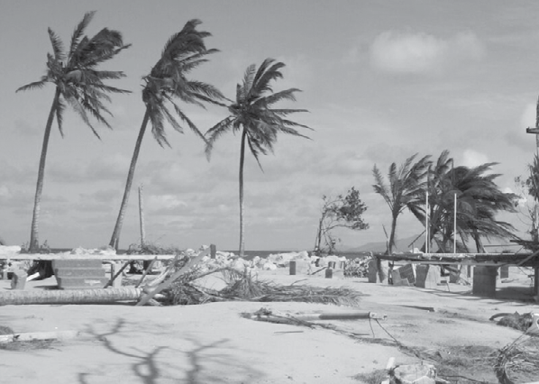

---
## Page 2

2
Storm Tide Resilient Building Guidance for Queensland Homes
More information
Visit www.qra.qld.gov.au/Resilient-Homes.
Contact the Queensland Reconstruction Authority on 1800 
110 841 
Mailing address 
Queensland Reconstruction Authority 
PO Box 15428 
City East Q 4002 
Alternatively, contact the Queensland Reconstruction 
Authority by emailing: 
info@qra.qld.gov.au.
Licence 
This material is licensed by the State of Queensland under 
a Creative Commons Attribution (CC BY) 4.0 International 
licence.
To view a copy of the licence visit:
www.creativecommons.org/licenses/by/4.0/.
The Queensland Reconstruction Authority requests 
attribution in the following manner: 
© The State of Queensland (Queensland Reconstruction 
Authority) 2019. 
Information security 
This document has been classified using the Queensland 
Government Information Security Classification 
Framework (QGISCF).
Document details 
Security classification 
Public
Date of review of security classification
December 2019
Authority
Queensland Reconstruction Authority
Author
Chief Executive Officer
Document status
Final
Version
1.0
QRA Reference
QRA 2635/GD 0320
Do you need an interpreter?
If you need an interpreter to assist you in understanding this 
document, please call 13 QGOV (13 74 68).

---
## Page 3

3
Storm Tide Resilient Building Guidance for Queensland Homes
Introduction
Living with natural disasters is a part of life in Queensland. From time to time we experience tropical 
cyclones, severe storms and flooding, and as a community we need to be informed, ready and 
resilient. 
Incorporating resilient building design can significantly reduce the effort, cost and time to return people to their 
homes and workplaces following natural disasters. It is one of the many ways Queenslanders can build their 
resilience to natural disasters.
The Storm Tide Resilient Building Guidance for Queensland Homes (Guide) provides information about improving 
the resilience of new and existing Queensland homes in storm tide prone areas.  
The benefits of resilient design are far reaching and 
support the economic, social and environmental recovery 
of a community following cyclones and storm tide. 
This Guide is designed for use by home owners as well as the building, design and construction industry.  
Further guides are available at www.qra.qld.gov.au/Resilient-Homes and include:
•	Cyclone Resilient Building Guidance for Queensland Homes
•	Flood Resilient Building Guidance for Queensland Homes.
Building the resilience of Queensland homes is another way we can work together to make 
Queensland the most disaster resilient state in Australia. 
Get Ready Queensland
It is vital you understand your disaster risk so that 
you can stay safe during a cyclone or storm tide. 
During a cyclone, you must evacuate your home 
if you live in a storm tide prone area and are 
directed to leave by emergency services. 
For more information visit 
getready.qld.gov.au/natural-disasters/cyclones.

---
## Page 4

4
Storm Tide Resilient Building Guidance for Queensland Homes
Acknowledgements
This Guide was developed by the Cyclone Testing Station at James Cook University in conjunction 
with Systems Engineering Australia Pty Ltd (SEA).
Thank you to the following organisations for 
contributing to the development of this Guide:
•	Queensland Government
•	Bureau of Meterology
•	Master Builders Queensland
•	Insurance Council of Australia
•	Housing Institute of Australia
•	Bushfire and Natural Hazards Cooperative 
Research Centre
•	Local Government Association of Queensland
•	Queensland Building and Construction 
Commission
•	Australian Institute of Building Surveyors
•	Suncorp Insurance
•	Cassowary Coast Regional Council
•	Douglas Shire Council
•	Hopevale Aboriginal Shire Council
•	Isaac Regional Council
•	Livingstone Shire Council
•	Mackay Regional Council
•	Rockhampton Regional Council
•	Townsville City Council
•	Whitsunday Regional Council
•	James Davidson Architect.

---
## Page 5

5
Storm Tide Resilient Building Guidance for Queensland Homes
Contents
	
Understanding your risk
	
1.	
Introduction to storm tide resilient housing............................................................6
	
2.	
Storm surges and storm tide................................................................................... 7
	
3.	
Understanding impacts from storm tide inundation...............................................11
	
4.	
Understanding your risk.........................................................................................14
	
Storm tide resilient building strategies 
	
5.	
Risk-based design.................................................................................................16
	
6.	
Resilient building design principles......................................................................20
	
7.	
Building new homes in a storm tide prone area.................................................... 24
	
8.	
Resilient building materials..................................................................................30
	
9.	
Improving the resilience of existing homes........................................................... 36
	
10.	
Repairing or rebuilding after a storm tide..............................................................38
	
Appendices 
	
11.	
Building approvals, codes and standards.............................................................40
	
12.	
Definitions............................................................................................................ 42
	
13.	
Resources............................................................................................................. 43

---
## Page 6

6
Storm Tide Resilient Building Guidance for Queensland Homes
1. Introduction to storm tide resilient housing
This Guide provides information about designing and building storm tide resilient homes including: 
•	key issues associated with living in or building in storm tide prone areas
•	design and building advice to minimise damage caused by storm tide inundation. 
This Guide is non-mandatory and can be considered in line with the Building Assessment Provisions contained 
in the Building Act 1975 and Queensland Development Code Mandatory Part MP 3.5.
This Guide does not replace the possible need to evacuate prior to a storm tide event. If you live in a storm tide 
prone area it is important to always be prepared in case you need to evacuate. 
Visit www.getready.qld.gov.au.
If you live in, or are planning to build in a storm tide 
prone area, it is recommended you refer this Guide to contractors 
involved in the design, building or repair 
of your home to increase your resilience to storm tide. 
1.1 Design standards for homes
This Guide provides design considerations for improving the storm tide resilience of homes to complement 
existing Australian standards for wind loads. Water is approximately 1000 times denser than air, which means 
that fast moving water generates larger forces on structures than wind.
State and council planning actively seeks to avoid development in low-lying coastal areas or imposes minimum 
floor levels on building approvals. However, there are no Australian housing design standards for resisting 
storm tide loads. 
1.2 Building Assessment Provisions for Building Certifiers
The Building Assessment Provisions contained in Section 30 of the Building Act 1975 dictate the laws and other 
documents under which building work must be assessed by a building certifier to allow a building development 
approval to be issued.
These include the Building Act 1975, Building Regulation 2006, Queensland Development Code (QDC) MP 3.5 
and other relevant parts, and the National Construction Code (Building Code of Australia).
1.3 Queensland Development Code MP 3.5
The structural building measures contained in Queensland Development Code MP 3.5 specifically address the 
construction of buildings in flood prone areas and many of the principles may apply to houses in some storm 
tide prone areas.

---
## Page 7

7
Storm Tide Resilient Building Guidance for Queensland Homes
2. Storm surges and storm tide
The Queensland coast is susceptible to storm surge generated by tropical cyclones. Depending on 
the tide levels, sea levels can rise considerably causing water to flood onto normally dry, low-lying 
coastal areas.
2.1 Storm surge
A storm surge is a persistent rise above the normally expected water level along a shoreline due to strong 
onshore winds and/or reduced atmospheric pressure typically caused by large-scale severe weather events. 
Storm surge is expressed as a magnitude (height) above the normal tide level. It takes several hours to fully rise 
and then fall.
The most damaging storm surges accompany tropical cyclones that come ashore or pass close to the shore. The 
rise in water level may be gradual at first. However, in severe events the water level can rise several metres per 
hour and be accompanied by destructive winds. The potential for a rapid rise in water levels accompanied by 
dangerous wind conditions means the only way to keep people safe is through early evacuation.
Storm surges of lesser magnitude may also form due to intense low-pressure systems in non-tropical areas and 
can also be caused by severe thunderstorms in some shallow water regions.
The storm surge from Cyclone Yasi ripped pieces out of the Bruce Highway at Cardwell, closing the northern artery for 
several days.

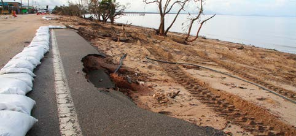

---
## Page 8

8
Storm Tide Resilient Building Guidance for Queensland Homes
2.2 Storm tide
Storm tide is the term used to describe the combined effect of a storm surge and astronomical tide levels as 
shown below. The greatest impact occurs when the peak storm surge coincides with a high tide. 
The diagram below compares normal conditions with those occurring during a cyclone. Normally the sea 
level varies between the local Highest Astronomical Tide (HAT) and the Lowest Astronomical Tide (LAT) levels. 
Breaking waves are in addition to HAT and LAT levels. 
Illustration of a storm tide event (before and during).
The height of the storm tide is measured above the Australian Height Datum (AHD), which is close to the Mean 
Sea Level or mid-tide height.
The combined effects of the storm tide and waves can damage or destroy buildings and wash roads away. 
Pounding waves on top of the storm tide are generated by powerful winds, which can increase water levels even 
further through a process called Breaking Wave Setup. The extent of sea water flooding from a storm tide can 
span up to 100 kilometres along the coastline and up to several kilometres inland in low-lying areas, lasting for 
several hours.
STORM TIDE
STORM 
TIDE
STORM 
SURGE
NORMAL TIDE 
LEVEL
AHD
AHD
HAT
LAT
CYCLONIC WIND
BEFORE
AFTER
CURRENTS
BREAKING WAVES

---
## Page 9

9
Storm Tide Resilient Building Guidance for Queensland Homes
Storm tide damage following cyclones
Damage to houses at beachside communities caused by storm tide inundation during Cyclone Yasi in 2011 and 
Cyclone Debbie in 2017. Some houses were battered by waters and pushed off their stumps, others remained in place 
despite extensive damage.

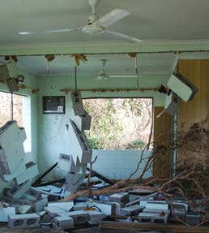

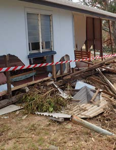

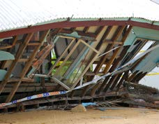

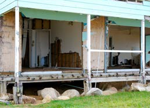

---
## Page 10

10
Storm Tide Resilient Building Guidance for Queensland Homes
History of storm tide events in Queensland
Since to the 1900s, Queensland has recorded more than a dozen tropical cyclones resulting in storm tides 
reaching at least one metre above the HAT level.
1850
1900
1950
2000
In 1918, two storm tide events 
peaked at high tide, approximately 
seven weeks apart. The first storm 
tide reached 5.5 metres in Mackay, 
causing the loss of 30 lives. The 
second storm tide occurred at 
Mission Beach and reached an 
estimated 3.9 metres and hundreds 
of metres inland.
In 2006, Cyclone Larry impacted 
the Innisfail – Tully area to a similar 
degree to Cyclone Althea and five 
years later Cyclone Yasi generated 
the highest reliably measured storm 
surge of 5.3 metres, which combined 
with a falling tide to reach a storm 
tide level of 4.5 metres at Cardwell.
In 1899, possibly the most significant 
storm tide to affect the east coast of 
Queensland was caused by Cyclone 
Mahina at the remote Princess Charlotte 
Bay on Cape York Peninsula. Cyclone 
Mahina devastated a pearling fleet 
sheltering in the region. The estimated 
highest water level was reported to be 
around 14 metres above Mean Sea Level, 
extending five kilometres inland. While 
the accuracy of that height has been 
questioned, more than 400 people were 
killed and 100 boats and ships sank.
In 1971, Cyclone Althea impacted 
the Townsville region, with a peak 
storm surge of over three metres. 
Fortunately the event occurred during 
a low tide, which limited inundation 
to approximately half a metre above 
Highest Astronomical Tide, sparing the 
community from major inundation and 
damage.
In 2017, Cyclone Debbie 
crossed the coast at Airlie 
Beach and the storm tide 
inundated several low-lying 
communities in the northern 
part of Repulse Bay.

---
## Page 11

11
Storm Tide Resilient Building Guidance for Queensland Homes
3. Understanding impacts from storm tide inundation
Storm tides can impact coastal homes in the following ways: 
3.1 Water height above ground
Water inundation can extend into areas wherever the height of the storm tide exceeds the height 
of the land. Seawater will inundate homes when the ground floor height is lower than the height of the storm 
tide, often causing water damage to floor coverings, internal walls and fixtures, furniture and appliances. 
In some sheltered coastal locations, seawater inundation can occur with small variations in wave or current 
activity. In other locations the impacts from waves and currents can be highly destructive, even before the water 
level rises above floor level.
3.2 Waves
Waves increase at the peak of the storm tide when the depth of water is at its highest, causing greater damage 
to homes. The height of a storm tide refers to a theoretical Stillwater Level without any waves. However, unless 
there is significant shelter against sea or wind, waves will always be present.
Wave forces can be significant. Most wall construction is usually unable to resist waves around one metre high. 
Even if the load on freestanding piers or stumps is not sufficient to cause structural failure, the crest of the wave 
may cause entry of seawater at the floor level well before the storm tide level reaches that height. The greatest 
wave force will be experienced when a wave breaks against a part of the home.
3.3 Debris
Debris from damaged buildings, fences and other structures can accumulate in the flood waters. Waves, wind 
and currents can forcefully drive debris into homes, causing further damage. 
3.4 Flooding currents
As the storm tide begins to flood the land, currents can erode the typically-sandy soils of beach 
side homes. Erosion tends to occur in and around the supporting structures, walls and piers, 
which can undermine the integrity of the structure. In addition, when the water is deep enough the breaking 
waves produce strong currents that can rapidly scour out sandy soil in and around the base of homes.
3.5 Ebbing currents
As the storm tide recedes, currents returning to the sea can create further damage. Their effect depends on the 
extent of inundation, local topography and the rate at which the sea level returns to normal. In the absence 
of natural creeks and waterways to distribute the ebb currents, streets often become the waterway and can 
channel strong currents through and around homes located in low lying areas. These ebbing currents can cause 
severe erosion and structurally-dangerous scouring around house foundations.

---
## Page 12

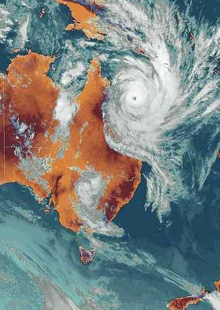

---
## Page 13

Case study – storm tide from Tropical Cyclone Yasi
Just after midnight on 3 February 2011, Severe Tropical Cyclone Yasi crossed the coast near Mission Beach, 
approximately 138 kilometres south of Cairns and 30 kilometres north of Cardwell. The storm surge during 
Cyclone Yasi raised the ocean level to more than five metres above the normal tide at Cardwell and up to three 
metres higher at the Clump Point tide gauge. The small coastal communities of Tully Heads and Hull Heads 
located between these two tide gauges were significantly affected.
The following graph shows the reconstructed record from the Cardwell storm tide gauge during Yasi, where the 
red line is the actual water level (storm tide) that was experienced (4.5 metres AHD) and the dashed black line 
is the predicted tide variation for that day. The difference between these is the green dashed line (storm surge), 
which reached 5.3 metres in magnitude and is the highest reliable storm surge ever recorded in Queensland. The 
black horizontal dashed line is the HAT level, which was exceeded by more than two metres.
Reconstructed Yasi storm tide event based on the Cardwell tide gauge.
If Cyclone Yasi had crossed the coast nine hours later, at the time of the highest tide of the day, the storm tide 
could have risen another two metres.
In terms of risk, the area was subjected to a rare event, measuring up to a 0.1% (1 in 1000) Annual Exceedance 
Probability (AEP) risk level.
 
13

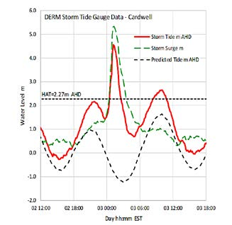

---
## Page 14

14
Storm Tide Resilient Building Guidance for Queensland Homes
4. Understanding your risk 
The preferred long-term defence against storm tide effects on new communities is avoidance of the risk through 
land use planning. However, where communities are already established in areas of storm tide risk, flood 
resilient design and construction can limit the long-term costs for home owners by reducing expected costs 
associated with flood damage and insurance premiums.
The National Construction Code adopts an implied level of risk and includes mandatory minimum standards 
for construction to resist events due to fire, wind and earthquakes, and address many other functional, health 
and safety considerations. There is no national standard or guideline that outlines building considerations for a 
storm tide.
4.1 Understanding your storm tide risk
The first step to making a home storm tide resilient is to understand the level of storm tide risk. It is also 
important to find out what council planning considerations or building regulations apply to your property.
Contact your council to understand your storm tide risk, including what impact a Defined Storm Tide Event 
(DSTE) would have on your home and to confirm any specified minimum planning considerations that apply to 
your residence such as building heights. 
Once storm tide risk is understood, you can start to factor in the benefits of investing in storm tide resilient 
measures for your home. 
The map of Queensland below shows the variation in the estimated 0.2% (1 in 500) AEP storm tide risk level.*
The red markers in the Gulf of Carpentaria indicate where the storm tide level is estimated to be more than 
three metres above the HAT level. The red and orange markers indicate higher storm tide levels in areas such as 
Hervey Bay and the coast between Townsville and Cairns.
The blue markers indicate areas of low storm tide risk. In these areas the 0.2% (1 in 500) AEP storm tide level 
may not even be as high as the HAT level. 
* The storm tide risk levels (including wave setup) are expressed as a height relative to the HAT  to account for tidal plane variations.

---
## Page 15

15
Storm Tide Resilient Building Guidance for Queensland Homes
Image of the HAT level at the Beach Club: Lizard Island Resort as detailed in the Storm Tide Reference Landmarks Report.
Image provided by Systems Engineering Australia.
Cyclone storm tide hazard in Queensland
The risk of storm tides varies across Queensland depending on the intensity and frequency of tropical cyclones 
and differences in coastal features such as shallow nearshore waters and adjacent low-lying land. 
Extensive studies have been undertaken into cyclone storm tide hazard across Queensland. To help residents 
appreciate storm tide Australian Height Datum (AHD) elevations in their local community, the Queensland 
Government produced the Storm Tide Reference Landmarks Report, which contains site-specific landmark 
photographs across Queensland showing their indicated Australian Height Datum elevation and HAT level.
This map of Queensland below shows the variation in the estimated 0.2% (1 in 500) AEP storm tide risk level.*
The red markers in the Gulf of Carpentaria indicate where the storm tide level is estimated to be more than 
three metres above the HAT level. The red and orange markers indicate higher storm tide levels in areas such as 
Hervey Bay and the coast between Townsville and Cairns.
The blue markers indicate areas of low storm tide risk. In these areas the 0.2% (1 in 500) AEP storm tide level 
may not even be as high as the HAT level. 
* The storm tide risk levels (including wave setup) are expressed as a height relative to the HAT  to account for tidal plane variations.

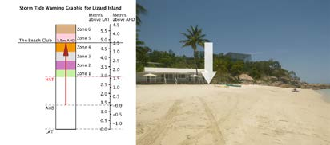

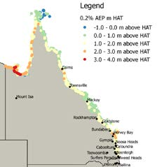

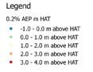

---
## Page 16

16
5. Risk-based design
Building outside of storm tide prone areas is not always possible. If you choose to accept this risk, careful 
consideration of your house design and location can reduce the extent of damage to your home and properties 
around you during a storm tide.
The impacts of a storm tide depend on the elevation of your property, proximity of your home to the shoreline, 
shape of surrounding land and roads, and height of the waves. Most storm tide damage is experienced by 
properties directly exposed to incoming ocean waves, which is typically those within 100 to 200 metres of the 
open shoreline. The presence of foreshore erosion protection (revetments or seawalls) or vegetation is unlikely 
to provide significant protection from storm tide impacts. The first line of houses along the shoreline is likely to 
experience the greatest impact. 
5.1 Seeking professional advice
Councils adopt a minimum planning water level for storm tide inundation in accordance with the guidelines 
outlined in the Coastal Management Plan. The plan currently considers water heights, but does not allow extra 
height for waves. Contact your council to determine the minimum floor height you need to adopt. Depending on 
your level of risk, you may consider designing your home to a higher storm tide level than the minimum prescribed 
level. 
A professional coastal engineer can confirm whether your property is likely to be affected during a storm tide 
and the associated level of risk you may be accepting. 
Finding a licensed professional
Ensure only licensed professionals are involved in the repair or rebuild of your home by checking 
their credentials. Visit the following websites to find a licensed professional in your area: 
Licensed builders, 
tradespersons, and 
building certifiers 
and designers
Queensland Building and 
Construction Commission
www.qbcc.qld.gov.au 
Licensed coastal  
and structural engineers 
Board of Professional  
Engineers Queensland 
www.bpeq.qld.gov.au
Licensed  
architects 
Queensland Board  
of Architects 
www.boaq.qld.gov.au

---
## Page 17

17
Storm Tide Resilient Building Guidance for Queensland Homes
5.2 Site planning – location and orientation of building 
structures and landscaping
The initial destructive forces from a storm tide come from the open waterfront and in most cases travel at right-
angles to the shoreline. The impact of associated waves may be affected by the height of foreshore dunes and 
surge resistant vegetation, although these defences may be washed away in severe inundation events.
Careful consideration should be taken when locating structures on your property. Above ground structures are at 
risk of being dragged away and in turn causing further damage to surrounding homes. Fences can catch debris, 
be dragged from the ground and then swept against houses. Plastic or metal water tanks may similarly be 
moved by waves or the ebbing water as it returns to the sea.
These structures should incorporate resilient building principles to minimise their exposure to wave forces. For 
example, reinforcing concrete tanks with footings or supports that are able to resist wave forces.
Mature and healthy coastal tree species may reinforce soft dunes against storm erosion. It is important to 
maintain the healthy condition of trees so they don’t become damaged from heavy winds and waters, and 
become dangerous debris.
Fences, sheds and light-weight  water tanks may be swept away and may become a risk to you and your 
neighbour’s home. 
PROPERTY
PROPERTY
NOT 
RECOMMENDED
RECOMMENDED

---
## Page 18

18
Storm Tide Resilient Building Guidance for Queensland Homes
Greater than 1m and 
significant damage to 
unreinforced masonry.
If less than 200mm, only minimal 
structural damage but possible 
water damage to flooring and 
plasterwalls.
Approximately 600mm and 
minimal structural damage 
to reinforced concrete 
block construction, but still 
significant damage to the 
interior fixtures and fittings.
If more than 1m, significant 
damage to interior of 
house, fixtures and fittings.
Minimal structural damage 
if floor heights are above 
level of water inundation.
Storm tide level (approx)
 Photos courtesy of the Cyclone Testing Station.
The following images show damage to homes relative to the level of water through the property.

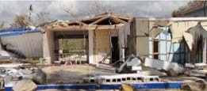

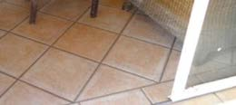

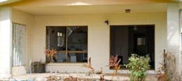

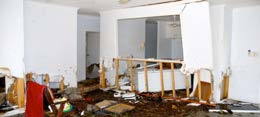

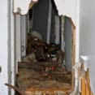

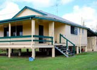

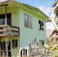

---
## Page 19

19
Storm Tide Resilient Building Guidance for Queensland Homes
5.3 Building resilience to storm tide
The National Construction Code requires that a building or structure must perform adequately under all 
reasonably expected design loads and actions and withstand extreme or frequently repeated design events. In 
a storm tide prone area this can be inferred to include scour, seawater currents and wave forces.
Single storey homes must withstand considerable seawater current and wave forces, which usually requires a 
reinforced concrete construction. The lower storey of double storey homes must be strong enough to support 
the upper level under extreme forces.
Building options that allow seawater to flow through buildings are provided in the following sections.

---
## Page 20

20
Storm Tide Resilient Building Guidance for Queensland Homes
6. Resilient building design principles
All new homes in cyclone-prone areas must be designed in accordance with Australian Standards to withstand 
wind loads to at least the 0.2% (1 in 500) AEP wind event. 
In addition, new homes in storm tide areas should be designed to minimise the potential damage caused by 
storm tide and breaking waves.
Cyclone-generated waves can be extremely powerful 
and are capable of moving heavy objects such as 
cars, caravans, boats on trailers, trees, fences and 
sheds, causing damage to anything in their path.
Protect your home and possessions from storm tide by locating habitable 
spaces as high as possible above the estimated maximum storm tide 
level identified for your location.
Building design to avoid waves and water
The habitable floor level of homes in storm tide areas should be set as high as possible and 
adopted storm tide level above the maximum estimated storm tide level for that location. In 
building design terms, the level of hazard exposure for storm tide is categorised as Exposure I or 
W. Assume your home has Exposure W unless advised by an experienced coastal engineer. 
•	Exposure I (Inundation) – homes located further from the beach front or close to tidal creeks 
that are likely to be inundated by storm tide.
•	Exposure W (Waves) – homes located closer to the beach front that are likely to be both 
inundated by storm tide and affected by waves.

---
## Page 21

21
Storm Tide Resilient Building Guidance for Queensland Homes
6.1 Storm tide loads on houses
In addition to the wind loads, homes inundated by storm tide can experience:
•	drag forces due to moving water
•	impact forces from waves and debris
•	buoyancy forces if the water rises above floor level.
6.2 Breakaway Walls
Breakaway Walls are expendable walls that are designed to fail when impacted by fast flowing water during a 
storm surge. The connection point between the Breakaway Walls must be the weak point so that they break 
away cleanly on all sides without damaging the rest of the home. They are suitable to enclose garages, storage 
or work areas under high-set houses, or as non-load bearing walls in the lower level of two storey homes.
Some examples of Breakaway Walls include lattice, flyscreen or light-weight framed walls with weak 
connections to the stumps. Breakaway Walls should not have any wiring or plumbing attached to them that 
could anchor the walls to the house or ground and prevent them from breaking away cleanly.
Examples of Breakaway Walls
DIRECTION OF 
WATER FLOW

---
## Page 22

22
Storm Tide Resilient Building Guidance for Queensland Homes
6.3 Corrosion resistant metal fittings
Coastal environments can accelerate corrosion in metal fasteners and fittings. It is important that appropriate 
connectors and fittings are installed in your home to ensure they remain serviceable before, during and after a 
storm tide event. If connections have corroded, pieces of the home may break away during a storm tide or wind 
event.
Metal elements can be protected from corrosion by heavy galvanising on thicker pieces of steel or the use of 
316 Grade stainless steel connectors.
Consult an engineer with experience in corrosion 
protection for advice on the most suitable metal 
connections and fittings for your home.
Some metal elements can corrode when in contact with one other, which is why it is important to ensure that 
metals are compatible. For example, stainless steel frame anchors should only be fixed to timber using stainless 
steel screws or nails, or plastic-coated screws. 
Compatibility of metals 
Contacting metal
Metal
Aluminium
Copper
Stainless steel 
(300 series)
Zinc-coated steel
Aluminium*
Yes
No
No
Yes
Copper*
No
Yes
No
No
Stainless steel (300)
No
No
Yes
No
Zinc-coated steel
Yes
No
Yes
Yes
* including alloys
6.4 Concrete in storm tide areas
In storm tide areas, concrete in and around homes needs to be resilient to immersion in sea water. Sea water 
resistant concrete has the following attributes:
•	low water-cement ratios – generally used in N32 concretes
•	additional concrete cover over the reinforcement
•	galvanised reinforcement.
If steel reinforcement starts to corrode, the concrete could split and crumble, significantly decreasing the 
concrete’s strength.

---
## Page 23

23
Storm Tide Resilient Building Guidance for Queensland Homes
6.5 Protection of slabs, footings and foundations
Footings and stumps such as piles, piers and columns need to be protected from the effects of scour and 
erosion by storm tide currents and waves. The depth of erosion and scour will vary depending on the soil type 
and foundations as follows:
•	depth of scour around stumps could reach twice the diameter of the stumps
•	depth of  scour beside walls or concrete slabs could be 0.15 times the length of the wall or slab.
Scour protection can be achieved by:
•	increasing the embedment depth of stumps and piles. Note: increasing the diameter of stumps will not 
provide protection from scour or erosion
•	burying strip footings under walls
•	providing protection around the edges of concrete slabs with a wall below the level of the slab that is at 
least 600 mm deep.
Properly designed and constructed footings can withstand limited scour and erosion impacts during a storm 
tide. 
Protection of concrete slab edges against scour.
STRIP FOOTINGS 
UNDER WALLS

---
## Page 24

24
Storm Tide Resilient Building Guidance for Queensland Homes
7. Building new homes in a storm tide prone area
A well designed home can withstand the impacts of storm tide with minimal damage and is easier to clean 
afterwards.  Building within a potential storm tide inundation area may also have implications for your home 
and contents insurance. The following recommended strategies and resilient building materials should be 
considered when building a new home in a storm tide prone area. 
1.  The best strategy is to build the habitable floor level as high as possible from the ground. In addition, 
the building elements below the habitable floor level should provide as little resistance as possible to the 
flow of seawater. 
2.  Use appropriate materials and ensure they are properly maintained. 
Home floor level above storm tide.
The following design principles will help minimise damage from storm tide and reduce clean-up and repair 
costs:
•	Understand the potential height range of storm tides in your location.
•	Understand the exposure category (I or W) of your home (Refer Section 6). Assume your home has 
Exposure W unless advised otherwise by an experienced coastal engineer.
•	Select a suitable design such as:
	- high-set home on stumps
	- low-set home on stumps
	- two-storey home.
•	Select suitable building materials (Refer Section 8).
•	Select a suitable layout for parts of the home located below the adopted storm tide level such as:
	- for Exposure W homes, minimise the number of solid walls for any part of the home below the 
adopted storm tide level
	- where possible, align solid or load-bearing walls below the potential water level perpendicular to the 
coastline so they offer the least possible resistance to storm tide and waves
	- design walls in parallel to the coastline as non-load-bearing breakaway walls.
1
2
3
4
STORM TIDE
HIGH TIDE

---
## Page 25

25
Storm Tide Resilient Building Guidance for Queensland Homes
7.1 Issues to raise with your builder or coastal engineer
Discuss the following checklist with a qualified professional:
	
□
wind classification for your home
	
□
storm tide height
	
□
storm tide exposure classification (I or W)
	
□
home type – high-set, low-set, two storey etc
	
□
habitable  floor level height
	
□
location of services such as electricity and plumbing
	
□
building materials suitable for above and below the adopted storm tide level
	
□
foundation systems suitable for withstanding scour and erosion by storm tide
	
□
strength of building to resist loads from both wind and storm tide.
7.2 High-set home on stumps
High-set homes on stumps are generally considered the most effective design to minimise storm tide damage 
in high-risk areas. The habitable floor level should be higher than the maximum estimated storm tide level, 
including an allowance for waves if classified as an Exposure W home. This design allows water to flow through 
the space under the house. It is therefore recommended the lower level of the home be used for parking or 
temporary storage.
General principles for consideration to enable waters to flow through or under the home:
•	Use materials recommended in Section 8
•	Construct Exposure W homes using resilient materials that can resist wave action and withstand 
inundation
•	Construct Exposure I homes using building materials that can withstand inundation
•	Do not permanently enclose the lower storey. Areas underneath the habitable floor level should be 
designed to enable water to flow through without being trapped or impeded. 
Design considerations include:
•	install conventional garage doors that close for day-to-day use and can be opened before a potential 
storm tide event
•	plan to remove all items stored under the main habitable floor before a potential storm tide event to 
protect those items and prevent them from damaging the stumps or sub-floor bracing
•	design small laundries and workshops located under the main habitable floor level to be as compact as 
possible so they provide minimal resistance to moving water
•	install stairs that are not closed in underneath, and with open risers so that water can move freely under 
and through them 
•	use ramps that are open underneath
•	ensure stumps including those that support stairs and ramps are embedded at least one metre into the 
ground.
•	Walls installed in the lower storey of Exposure W homes, and aligned parallel to the coastline, should be 
breakaway walls.
Subfloor supports should have:
•	scour protection for stumps and footings 
•	capacity to withstand storm tide forces and impact from debris in moving water while still supporting the 
weight of the house
•	steel cross-bracing that is at right angles to the shoreline.
•	Provide edge protection to any ground level slabs to prevent damage from scouring and erosion.

---
## Page 26

26
Storm Tide Resilient Building Guidance for Queensland Homes
7.3 Low-set home on stumps
A low-set home on stumps is an option for Exposure I homes with low inundation levels that will enable ramp 
access for people with mobility issues. 
It is still recommended that the habitable floor level be raised as high as practicable above the maximum 
estimated storm tide level. Other design strategies include:
•	Use materials recommended in Section 8.
•	Construct Exposure W homes using building materials that can resist waves and 
water inundation.
•	Construct Exposure I homes using building materials that can withstand water inundation
BEACH
BEACH
BEACH
Design the ground level of high-set homes to support the 
floors above, while allowing water to flow through the lower level.
Design for clear flow of water under a high-set home

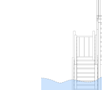

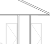

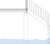

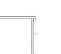

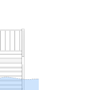

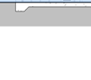

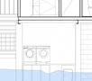

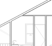

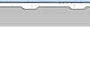

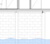

---
## Page 27

27
Storm Tide Resilient Building Guidance for Queensland Homes
•	Use open foundations systems such as stumps or piles.
•	Do not enclose the subfloor area with brick or concrete walls.
•	Avoid any lightweight cladding unless it is a breakaway wall.
•	Where possible, position stairs and ramps with the smallest dimension facing perpendicular to the 
shoreline and build ramps using open piles. 
Subfloor supports should have:
•	scour protection for footings 
•	capacity to support the home and withstand storm tide forces and impact from debris in the moving water
•	steel cross bracing at right angles to the shoreline.  
7.4 Two-storey homes
Two-storey homes built on a concrete slab on ground will experience seawater flowing through the lower level 
during a storm tide. Two-storey homes can also be built on an elevated platform above the adopted storm tide 
level (Refer to high-set homes on stumps).
Exposure W homes should incorporate strong impact resistant stumps 
and deep foundations. External wall cladding should be able to 
withstand the impacts from waves. Sufficient bracing is also required 
below the habitable floor level to resist wind loads and waves that may 
hit the side of the house during a storm tide.
BEACH
BEACH
BEACH
Design for clear flow of water 
under a low-set home
Two-storey flow through design for Exposure W homes

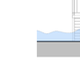

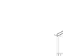

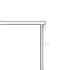

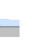

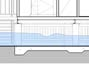

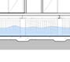

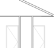

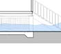

---
## Page 28

28
Storm Tide Resilient Building Guidance for Queensland Homes
7.4.1 Upper storey
Use the recommendations provided for high-set homes.
Where the upper storey is above the estimated maximum storm tide level, possessions can be moved from the 
lower storey to the upper storey before a storm tide approaches to protect them from water damage. To facilitate 
this, it is important to design the stairs so that furniture and larger items can be easily and quickly moved to the 
upper storey. 
7.4.2 Lower storey slab on ground
Provide protection from scour and erosion around the edges of the concrete slab as referred to in Section 6 of 
this Guide. Choose resilient floor coverings and wall linings.
Exposure W homes – assume seawater will flow through the lower storey with wave impacts. Design 
recommendations include: 
•	use the building materials recommended in Section 8 
•	incorporate large windows or doors in the walls facing towards and away from the shoreline, and use an 
open plan design to allow seawater and debris to flow through the lower storey with as little resistance as 
possible
•	alternatively, design as many walls as possible that are parallel to the shoreline as breakaway walls.
Exposure I homes – assume water inundation will occur on the lower level, but will mostly be protected from the 
effects of the storm surge currents and breaking waves.
Where maximaum storm tide inundation is estimated to be less than one metre above the habitable floor level, 
the lower storey can be designed to force the water to flow around the building. To do this, design strong walls 
with small windows that are well protected by heavy storm shutters to withstand the impact of wind-borne 
debris. The shutters may also resist water currents, but will still allow water to flow through the lower level of the 
home. 
Where storm tide inundation is estimated to be more than one metre above the habitable floor level, currents in 
the deeper water may have sufficient strength to break heavy shutters on full length windows. In this case, sea 
water will flow through the lower storey and consequently the lower storey should be designed the same as for 
Exposure W Homes.

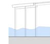

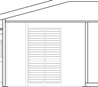

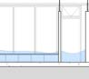

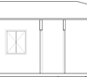

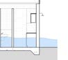

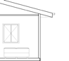

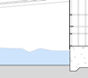

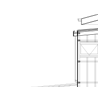

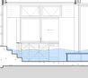

---
## Page 29

29
Storm Tide Resilient Building Guidance for Queensland Homes
7.5 Single storey slab on ground homes
Single storey slab on ground construction should not be used for Exposure W homes. During a storm surge, 
water and waves can flow through the entire home causing significant damage to home and contents.
This type of construction is also not recommended for Exposure I homes, as inundation from seawater is likely, 
causing significant damage to home and contents. 
If a single storey slab on ground home is the only option:
•	refer to the design guidelines in the section on lower storey slab on ground
•	avoid mounting mechanical or electrical equipment such as air conditioners below the estimated 
maximum storm tide level
•	design decks using the same sub-floor system as the house – concrete decks require reinforcement that 
is corrosion resistant
•	decking boards should have gaps between them to allow water to flow through, and for air to circulate 
around them to dry them out after the water has subsided. 
Single storey flow through design for Exposure W homes
BEACH

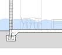

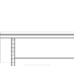

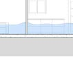

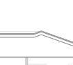

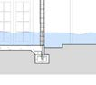

---
## Page 30

30
Storm Tide Resilient Building Guidance for Queensland Homes
8. Resilient building materials
8.1 Materials for homes above the adopted storm tide level
Exposure W and I homes – external and internal materials should withstand wind actions expected in tropical 
cyclones and soaking from sea water and rain. Plasterboard or particle board are not recommended for use 
in structural elements such as floors and load bearing walls. Water resistant plasterboard or particle board is 
however recommended for non-structural fixtures such as kitchen cupboards or built-in wardrobes. 
Exposure W homes – external building materials must be designed to withstand waves that are high enough to 
affect the upper parts of the home.
It is important to note, it is not safe to shelter in your home during a storm tide 
event, even if your house is designed using the strategies outlined in this Guide. 
You should evacuate when advised, leaving plenty of time to avoid rising water on 
access roads.

---
## Page 31

31
Storm Tide Resilient Building Guidance for Queensland Homes
Cyclone Resilient Building Guidance for Queensland Homes
8.2 Materials for homes below the adopted storm tide level
Exposure W homes – materials should withstand impacts from waves and debris, hold their strength when wet, 
dry easily and be resistant to deterioration after inundation by seawater.
Exposure I homes – materials should be resistant to moisture damage, maintain their strength when wet and 
dry easily after inundation.
Recommended materials for homes below the adopted storm tide level
Exposure W
Exposure I
Subfloor structure
Concrete timber or steel stumps with a deep embedment to protect from scour
Floor
Concrete
Load bearing walls
Reinforced and fully core-filled concrete 
masonry or standard concrete panels
Reinforced and fully core-filled concrete 
masonry, standard concrete panels or 
light-weight concrete panels*
Non-load bearing walls
Breakaway walls
No special requirements
Internal wall and ceiling 
linings
Timber or fibre-cement panelling
Wall insulation
Closed cell insulation
Doors
Solid timber with waterproof adhesive 
in galvanised steel frames and corrosion 
resistant heavy-duty hinges and latches
Solid timber with waterproof adhesive, 
flush marine plywood with closed cell 
foam aluminium or galvanised steel 
frame (rather than hollow core or particle 
board)
Windows
Tempered (toughened) or laminated 
glass that can break away cleanly under 
wave action. Shutters should not be 
used on windows below the storm tide 
level to allow unimpeded seawater flow
Aluminium frames with corrosion-
resistant fittings. 
Floor coverings
Tiles, polished concrete
Tiles, polished concrete or some vinyl 
flooring systems
Structural fasteners 
(including nails)
Heavily galvanised or stainless steel 
Reinforcing for concrete 
and masonry
Heavily galvanised to minimise corrosion 
Structural timber
Treated to at least Hazard Class 3 (H3) 
level to resist moderate decay, borers 
and termites, and suitable for outside 
above-ground use
* If cavity construction is used, install resilient cladding on the outside and extra deep skirting boards on the inside so 
they can be removed after storm tide inundation for access to remove mud and debris from inside the wall cavity and 
assist in drying.

---
## Page 32

32
Storm Tide Resilient Building Guidance for Queensland Homes
8.2.2 Further information about the performance of building materials located 
below the adopted storm tide level
Materials or products are relatively unaffected by submersion in seawater and may remain in 
place after some wave actions. They are the best available for the particular application.
Materials or products are only mildly affected by seawater inundation and wave action, and are 
the next best choice if the most suitable materials or products are too expensive or unavailable.
Materials or products are more likely to be damaged by seawater and/or wave action than the 
above category.
Materials or products are seriously affected by seawater and waves, and will need to be replaced 
if inundated.
Performance of building materials in Exposure W homes
Component
Suitable
Mild effects
Moderate effects
Severe effects
Floor, 
sub-floor 
structure
• slab on ground
• suspended concrete
• standard grade 
plywood
• timber tongue and 
groove (ends only 
epoxy sealed and 
gaps between boards 
to allow for swelling)
• particle board 
flooring close to the 
ground
Wall 
structure
• reinforced concrete
• reinforced 
block masonry
• full brick or 
block masonry 
(unreinforced)
• brick or block veneer 
with venting (stud 
frame)
• cavity brick
Wall and 
ceiling 
linings
• face brick or block 
work
• cement render
• ceramic wall tiles
• stone, solid or veneer
• standard bricks
• solid timber (fully 
sealed)
• exterior grade 
plywood (fully 
sealed)
• fibre cement sheet 
thicker than 10 mm
• exterior grade 
particleboard 
hardboard
• solid timber with 
allowance for 
swelling
• exterior grade 
plywood
• galvanised steel 
sheet, plastic 
sheeting or tiles with 
waterproof adhesive, 
glass blocks
• particleboard, 
fibreboard or 
strawboard
• wallpaper
• cloth wall coverings
• standard plywood
• gypsum plaster and 
plasterboard
• fibre cement sheet 
thinner than 10 mm
Suitable
Mild effects
Moderate effects
Severe effects

---
## Page 33

33
Storm Tide Resilient Building Guidance for Queensland Homes
Component
Suitable
Mild effects
Moderate effects
Severe effects
Doors
• no doors can be 
regarded as suitable 
to resist wave action
• flush or single panel 
marine ply with 
waterproof adhesive
• painted metal 
timber frame fully 
epoxy sealed before 
assembly
• solid panel with 
waterproof adhesive
• flush marine plywood 
with closed cell foam
• aluminium or 
galvanised steel 
frame
• standard timber 
frame
• painted metal frame
• standard flush 
hollow core with 
PVA adhesives and 
honeycomb paper 
core 
Note: lowest cost to 
replace
Window 
frames
• aluminium frame
• timber frame (fully 
epoxy sealed before 
assembly, with 
stainless steel or 
brass fittings)
• UPVC frames
• timber with PVA 
glues
• mild steel fittings
Insulation
• plastic or polystyrene 
boards
• closed cell solid 
insulation
• open-celled 
insulation – 
materials which store 
water and take a long 
time to dry out  e.g. 
batts
• reflective foil 
perforated with holes 
to drain water if used 
under timber floors
Bolts, 
hinges, 
fittings
• brass, nylon and 
stainless steel, 
removable pin hinges
• galvanised steel
• aluminium
• mild steel
Connections 
– nails and 
screws, etc.
• stainless steel
• galvanised steel
• mild steel

---
## Page 34

34
Storm Tide Resilient Building Guidance for Queensland Homes
Component
Suitable
Mild effects
Moderate effects
Severe effects
Floor 
coverings
• clay and concrete 
tiles
• epoxy or cement floor 
toppings on concrete
• terrazzo
• ceramic tiles
• rubber or vinyl 
sheets or rubber tiles 
(with chemically set 
adhesives)
• polished timber floor
• floor rugs and mats
• loose fitting nylon or 
acrylic carpet (with 
closed cell rubber 
underlay)
• wall-to-wall carpet or 
seagrass matting
• cork
• linoleum
• timber overlay floors
Floor, 
sub-floor 
structure
• slab on ground
• suspended concrete
• timber tongue and 
groove (ends only 
epoxy sealed and 
gaps between boards 
to allow for swelling)
• plywood
• standard grade 
plywood
• particle board 
flooring close to the 
ground
Performance of building material in houses with Exposure I
Wall 
structure 
• reinforced concrete
• full brick or block 
masonry
• brick or block veneer 
with venting (stud 
frame) 
• cavity brick
Wall and 
ceiling 
linings
• fibre cement sheet 
thicker than 10 mm
• face brick or block 
work
• cement render
• ceramic wall tiles
• stone, solid or veneer
• standard bricks
• solid timber (fully 
sealed)
• exterior grade 
plywood (fully 
sealed)
• fibre cement sheet 
thinner than 10 mm
• exterior grade 
hardboard
• solid timber with 
allowance for 
swelling
• exterior grade 
plywood
• galvanised steel 
sheet
• glass blocks
• plastic sheeting or 
tiles with waterproof 
adhesive
• particleboard, 
fibreboard or 
strawboard
• wallpaper
• cloth wall coverings
• standard plywood
• gypsum plaster and 
plasterboard
Doors
• solid panel with 
waterproof adhesive
• flush marine plywood 
with closed cell foam
• aluminium or 
galvanised steel 
frame
• flush or single panel 
marine ply with 
waterproof adhesive
• timber frame fully 
epoxy sealed before 
assembly
• standard timber 
frame
• painted metal frame
• standard flush 
hollow core with 
PVA adhesives and 
honeycomb paper 
core. Note: lowest 
cost to replace.

---
## Page 35

35
Storm Tide Resilient Building Guidance for Queensland Homes
Window 
frames
• aluminium frame 
with stainless steel 
or brass rollers
• UPVC frames
• timber frame (fully 
epoxy sealed before 
assembly, with 
stainless steel or 
brass fittings)
• timber with PVA 
glues
• mild steel fittings
Insulation
• plastic or polystyrene 
boards
• closed cell solid 
insulation
• reflective foil 
perforated with holes 
to drain water if used 
under timber floors
• open-celled 
insulation (materials 
which store water 
and take a long time 
to dry out e.g. batts)
Bolts, 
hinges, 
fittings
• brass, nylon/
stainless steel, 
removable pin hinges
• galvanised steel
• aluminium
• mild steel
Connections 
– nails and 
screws, etc.
• stainless steel
• galvanised steel
• mild steel
Floor 
coverings
• clay and concrete 
tiles
• epoxy or cement floor 
toppings on concrete
• rubber or vinyl sheets 
(with chemically set 
adhesives)
• terrazzo
• rubber tiles (with 
chemically set 
adhesives)
• polished timber floor
• floor rugs and mats
• ceramic tiles
• loose fitting nylon or 
acrylic carpet (with 
closed cell rubber 
underlay)
• wall-to-wall carpet or 
seagrass matting
• cork
• linoleum
• timber overlay floors
 
Recommended materials for use with framed wall systems below storm tide level.
H3 TREATED 
TIMBER FRAMING
REMOVABLE 
TIMBER BOARD 
SHEETING
ELEVATED 
POWER 
OUTLET
CLOSED CELL 
INSULATION
FIBRE CEMENT SHEET 
THICKER THAN 10 MM
REMOVABLE 
SKIRTING 
BOARDS

---
## Page 36

36
Storm Tide Resilient Building Guidance for Queensland Homes
9. Improving the resilience of existing homes
The resilience of homes located in storm tide prone areas can be improved with regular maintenance or 
upgrades.
9.1 Maintenance
The salt-laden and moist air in coastal areas can quickly corrode metal connections, degrade concrete 
and accelerate the decay of timber. Homes built close to the ocean require more frequent inspection and 
maintenance than those built further inland. 
Recommended maintenance includes hosing the house with fresh water and inspecting and replacing 
deteriorated members and connections. It is important to ensure that replacement connections do not trap 
water and that only durable materials are used. Refer to Section 6.3 for information about corrosion resistance 
of metal fittings.
Checklist for maintaining homes 
High-set and low-set homes on stumps
	
□
ensure objects stored under the main habitable floor level that can impede water flow can be easily 
removed if required, before imminent storm tide
	
□
check that breakaway walls can still break away cleanly from the main house
	
□
replace corroded connections located below the main habitable floor level with corrosion resistant 
connections. Note: galvanised items that change colour to red or brown have reached the end of their 
service life.
	
□
ensure the deck support structure and decking is in good condition and repair or replace as necessary
	
□
check that stumps and piles are well protected from scour or erosion and repair 
as necessary
Two-storey slab on ground homes
in addition to the above, check the slab edge details to ensure protection from erosion and that scour 
has not been compromised by landscaping.

---
## Page 37

37
Storm Tide Resilient Building Guidance for Queensland Homes
9.2 Upgrades – general information
General recommendations for non-structural upgrades include:
•	replace less resilient materials with the resilient building materials listed in Section 8
•	relocate all electrical wiring, meter box and other installations above the adopted storm tide level
•	ensure building cavities are well ventilated by making parts of the lining easily removable. E.g. use deep 
skirting boards to minimise rot and corrosion prior to a storm tide event and to accelerate drying out after 
an event.
If a home is likely to be exposed to waves during a storm tide, consider upgrading the footings and concrete 
slabs on ground to be more resilient to scour damage from potential storm surge. Grout injection under footings 
may be an affordable way of improving resistance to scour. 
All structural upgrades must comply with the current requirements of the National Construction Code, which 
refers, to relevant Australian Standards and provide resistance to wind loads.
9.3 Upgrades for homes on stumps
Resilient measures include:
•	raise the habitable floor level to above the adopted storm tide level for the location
•	relocate the home to an area that is not prone to storm tide or to a higher position on the same block
•	check the depth of embedment of the stumps and replace if necessary
•	replace non load bearing concrete or masonry walls below floor level with breakaway walls to allow surge 
water and debris to flow below floor level with as little resistance as possible.
9.4 Upgrades for two–storey slab on ground homes
Resilient measures include:
•	replace carpet on the lower level with tiles
•	if a home is likely to be exposed to waves, replace the lower storey solid walls located parallel to the 
shorefront with large windows or breakaway walls. 
9.5 Additions and extensions
All additions and extensions must comply with the current requirements of the National Construction Code, 
which refers to relevant Australian Standards. The existing home may require upgrades to ensure it doesn’t 
compromise the addition or extension in a future storm tide event.

---
## Page 38

38
Storm Tide Resilient Building Guidance for Queensland Homes
10. Repairing or rebuilding after a storm tide 
10.1 Repairs checklist
Significant clean-up and maintenance checks are needed following a storm tide. Once the storm tide has 
subsided, mud and debris inside and around the home must be removed 
and the house should be washed thoroughly with fresh water. The following should also 
be considered:
Seek appropriate advice
	
□
contact a qualified electrician to check all electrical wiring before using lights and appliances
	
□
contact a qualified plumber to ensure waste pipes are not damaged or blocked
	
□
contact a registered engineer if there is any sign of foundation movement orstructural cracking. 
Clean up
	
□
dry out timber wall and ceiling linings, and floor boards as quickly as possible to prevent uptake of 
moisture, swelling and mould
	
□
remove all mud and debris from the cavity spaces behind double brick walls or brick veneer
	
□
replace hollow or open cell insulation e.g. batts (closed cell insulation may still be serviceable)
	
□
remove trapped mud and debris from hidden areas such as the bottom of kitchen cupboards and 
bathroom vanities
	
□
replace carpets and plasterboard wall linings with more resilient materials
	
□
replace timber floorboards that have swelled
	
□
ensure solid walls such as masonry and concrete are completely dry before repainting. 
10.2 Reconstruction
Approval  is required if your home requires demolition. Building and planning approval is also required before 
rebuilding (Refer Section 11). 
The reconstructed home must comply with the current requirements of the National Construction Code whilst 
considering the non-mandatory resilient design principles and materials outlined in this Guide.

---
## Page 39

39
Finding a licensed professional
Ensure only licensed professionals are involved in the repair or rebuild of your home by checking 
their credentials. Visit the following websites to find a licensed professional in your area: 
Licensed builders, 
tradespersons, and 
building certifiers 
and designers
Queensland Building and 
Construction Commission
www.qbcc.qld.gov.au 
Licensed coastal  
and structural engineers 
Board of Professional  
Engineers Queensland 
www.bpeq.qld.gov.au
Licensed  
architects 
Queensland Board  
of Architects 
www.boaq.qld.gov.au

---
## Page 40

40
Storm Tide Resilient Building Guidance for Queensland Homes
11. Building approvals, codes and standards
A building development approval is required from a local council or private building certifier before building a 
new home or upgrading and repairing an existing home. 
Buildings in areas prone to cyclones should be 
designed in accordance with relevant Codes and 
Standards as indicated in this Guide. Builders should 
refer to a Building Certifier or local council to confirm 
the individual requirements for your home.  
11.1 Planning approvals
A planning approval may be required for most construction work. They determine what uses and activities can 
occur on the land to minimise any potential impact on surrounding properties. An application for a planning 
approval is assessed against your council planning scheme. 
11.2 Building approvals
A building development approval  from a council or private building certifier is required for a new home 
or upgrading and repairing an existing home. A private building certifier is required to lodge the approval 
documents with the relevant council. 
Exemptions apply for minor renovations that do not affect more than 20 per cent of the building’s structural 
components of the same type. Refer to your local council for advice on whether a building approval is required 
for any planned work on your home. 
Building surveyors assess the plans submitted to council to confirm they comply with the relevant codes and 
standards such as the National Construction Code and Queensland Development Code. This ensures that 
appropriate materials, products and details used in the design and construction of your home comply with the 
necessary standards. 
A building approval is granted by a building certifier and/or your local council. The role of the Building Certifier is 
to confirm the proposed building complies with the relevant building codes and standards before construction 
can commence. They are also required during construction to inspect that the work is being built to the relevant 
codes and standards.
Ensure all designers, architects, builders and contractors 
are aware of the storm tide issues raised in this Guide.

---
## Page 41

41
Storm Tide Resilient Building Guidance for Queensland Homes
11.3 Building Codes and Standards
New construction, major renovations and repairs all require building approval and must comply with the current 
Codes and Standards. Using the current Codes and Standards for any repairs or rebuilding after a cyclone and 
storm tide will also give your home the best chance of performing well and safeguarding the lives of you and your 
family during future cyclones. 
The following Codes and Standards may be used by your designer or builder:
1. 	 National Construction Code; Volume 2: Building Code of Australia, Class 1 and Class 10 Buildings, 
Australian Building Codes Board, Canberra.
2. 	 AS/NZS 1170.2 Structural design actions Part 2: Wind actions. Standards Australia, Sydney NSW.
3. 	 AS 4055 Wind Loads for Housing. Standards Australia, Sydney, NSW.
4. 	 AS 1684.3 Residential timber-framed construction – Cyclonic areas. Standards Australia, Sydney, NSW. 
5.	
HB 39 Installation code for metal roof and wall cladding. Standards Australia, Sydney, NSW.
6. 	 AS 2050 Installation of roof tiles. Standards Australia, Sydney, NSW.
7. 	 HB 132.2 Structural upgrading of older houses - Part 2: Cyclone areas. Standards Australia, Sydney, NSW. 
8. 	 AS/NZS 4505 Garage doors and other large access doors Standards Australia, Sydney, NSW.

---
## Page 42

42
Storm Tide Resilient Building Guidance for Queensland Homes
12. Definitions
Astronomical tide
The periodic rise and fall of the oceans, resulting from the gravitational attraction of the 
moon, sun and other astronomical bodies acting upon the rotating earth.
Australian Height 
Datum (AHD)
Australian Height Datum is the datum (adopted by the National Mapping Council of 
Australia) to which all vertical control for topographic mapping is to be referred. AHD is 
close to Mean Sea Level on an open coast.
Annual Exceedance 
Probability (AEP)
The AEP is normally expressed as a percentage and refers to the probability of an event 
(flood, wind or storm tide) of the nominated magnitude or larger occurring in any given 
year. For example, a 1% AEP describes an event that has a 1 in 100 chance of being 
equalled or exceeded in any given year and a ten per cent chance of occurring in any ten 
year period. 
Coastal engineer
A Registered Professional Engineer Queensland (RPEQ) with specialist expertise in 
coastal processes.
Highest Astronomical 
Tide (HAT)
The highest water level predicted to occur under average meteorological conditions and 
any combination of astronomical conditions.
Lowest Astronomical 
Tide (LAT)
The lowest water level predicted to occur under average meteorological conditions 
and any combination of astronomical conditions. Tide tables are referenced to LAT in 
Queensland and typically refers to “Chart Datum”.
Mean sea level
A tidal datum; the arithmetic mean of hourly heights of the sea at the tidal station 
observed over a period of time (preferably at least 19 years).
Storm surge
A localised increase (or decrease) in ocean water levels caused by high winds and 
reduced atmospheric pressures associated with a severe storm event.
Storm tide
The effect on coastal water of a storm surge and associated breaking wave set-up 
combined with the normally occurring astronomical tide.
Storm tide 
inundation area
The area of land determined to be at risk from inundation associated with a storm tide.
Defined Storm Tide 
Event (DSTE)
The event (measured in terms of likelihood of recurrence) and associated inundation level 
adopted to manage the development of a particular area. The defined storm tide event 
is the 1% AEP storm tide unless otherwise indicated for essential community service 
infrastructure.
Breaking Wave Set-up
An increase in the mean water level towards the shoreline caused by breaking wave 
action. It can be very important during storm events as it results in a further increase in 
water level above the tide and surge levels.
Stillwater Level
The average coastal water level ignoring the presence of intermittent passing waves.

---
## Page 43

43
Storm Tide Resilient Building Guidance for Queensland Homes
13. Resources
Useful links for homeowners
Bureau of Meteorology
Australian Government
www.bom.gov.au.
Rebuilding after a disaster
Queensland Building and Construction Commission
www.qbcc.qld.gov.au/home-maintenance/rebuilding-after-natural-disaster.
Cyclone Testing Station videos on building, maintaining and renovating houses in cyclone areas
www.jcu.edu.au/cyclone-testing-station/education/educational-videos.
Housing and Public Works – Building Legislation and Policy
www.hpw.qld.gov.au/services/building-plumbing.
Technical resources – Queensland specific
Cyclone Testing Station Technical Reports
James Cook University
www.jcu.edu.au/cyclone-testing-station/research/reports.
Natural Disaster Resilience Program Storm Tide Hazard Interpolation Series
Department of Environment and Science
www.data.qld.gov.au/dataset/ndrp-storm-tide-hazard-interpolation-series.
Coastal Hazards and Mapping
Department of Environment and Science
www.qld.gov.au/environment/coasts-waterways/plans/hazards.
Storm tide monitoring sites in Queensland
Department of Environment and Science
www.qld.gov.au/environment/coasts-waterways/beach/storm/storm-sites.
National Committee on Coastal and Ocean Engineering - Publications and resources
Engineers Australia
www.engineersaustralia.org.au/Communities-And-Groups/National-Committees-And-Panels/Coastal-And-
Ocean-Engineering/Publications-Resources.
Queensland Climate Change and Community Vulnerability to Tropical Cyclones – Ocean Hazards Assessment  
– stage 1 report, March 2001
Queensland Government
data.longpaddock.qld.gov.au/static/publications/vulnerability-to-cyclones/synthesisreport.pdf.
Guidelines for Responding to the Effects of Climate Change in Coastal and Ocean Engineering
Engineers Australia
www.eabooks.com.au/Guidelines-for-Responding-to-the-Effects-of-Climate-Change-in-Coastal-and-Ocean-
Engineering.
Technical resources – international
US Geological Survey - National Assessment of Storm-Induced Coastal Change Hazards
coastal.er.usgs.gov/hurricanes/
US Federal Emergency Management Agency
www.fema.gov/media-library/assets/documents/3293.
FEMA Coastal Construction Manual Volume II US
US Federal Emergency Management Agency
www.fema.gov/sites/default/files/2020-08/fema55_volii_combined_rev.pdf.

---
## Page 44

More information
Queensland Reconstruction Authority
Web  
www.qra.qld.gov.au/Resilient-Homes
Email 
info@qra.qld.gov.au
Phone 1800 110 841

