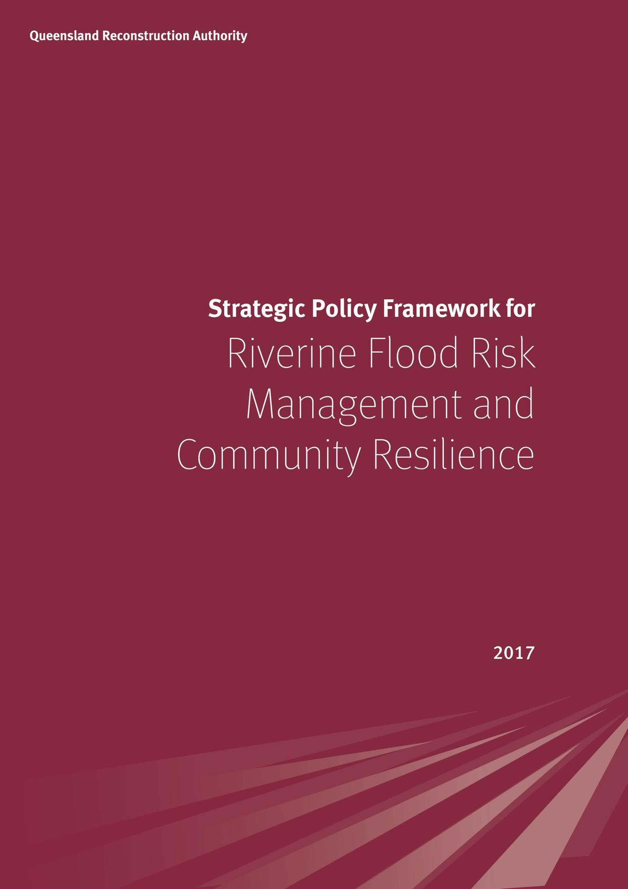
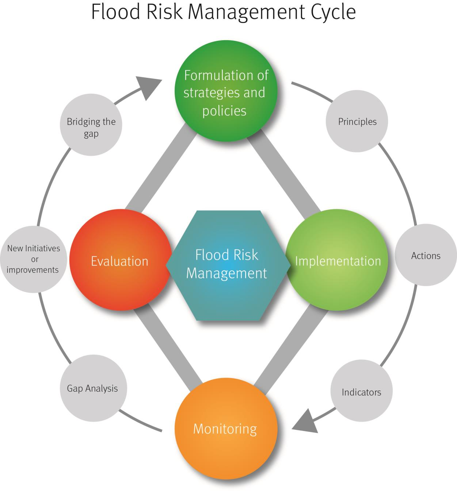
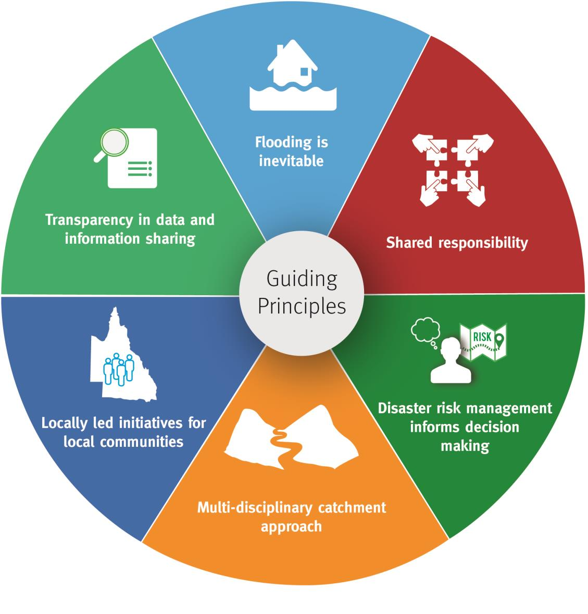
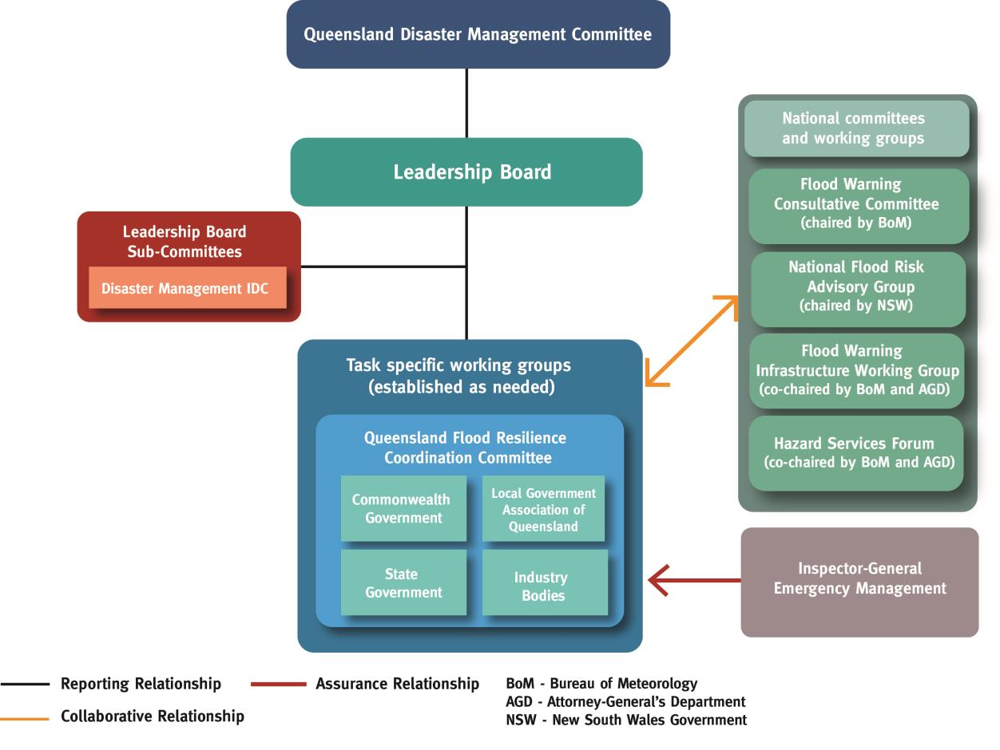

# Strategic Policy Framework for Riverine Flood Risk Management (2018)

> **Source**: Queensland Reconstruction Authority
> **URL**: https://www.qra.qld.gov.au/sites/default/files/2018-11/strategic_policy_framework_for_riverine_flood_risk_management.pdf
> **Licence**: © State of Queensland; emergency-management practitioner reference
> **Retrieved**: 2026-05-07T23:43:31Z
> **SHA-256**: `952a71e714ec0b3a15d33d36ca42dab83f749860904321b566391516b2a6b2d9`
> *Converted from PDF to Markdown format.*

---
## Page 1

---
## Page 2

 
 
 
 
 
 
 
 
 
 
 
 
 
 
 
 
Table of Contents 
 
Introduction ................................................................................................................................... 1 
Purpose .......................................................................................................................................... 1 
Related Projects and Programs…………………………………………………………………………………………………………3 
Vision ............................................................................................................................................. 3 
Legislation and Policy Framework .................................................................................................... 3 
Target Audience .............................................................................................................................. 4 
Guiding Principles ........................................................................................................................... 5 
Governance .................................................................................................................................... 6 
Roles and Responsibilities ............................................................................................................... 7 
Key Objectives ................................................................................................................................ 8 
Conclusion .................................................................................................................................... 10 
References .................................................................................................................................... 11 
Appendix A - Legislation relevant to the Framework ...................................................................... 13 
Appendix B - Terms of Reference of the Queensland Flood Resilience Coordination Committee ...... 14 
Appendix C – Flood Risk Management Roles and Responsibilities ................................................... 17

---
## Page 3

 
1 | P a g e  
Strategic Policy Framework for Riverine Flood Risk Management and Community Resilience 2017 
Introduction 
The vast majority of Queensland towns have been established in or near floodplains, resulting in a long 
history of flooding across Queensland communities. Flooding events can lead to serious injury or loss 
of life, disrupt the social fabric of a community, impact economic activity and cause damage and 
destruction to the natural and built environment. Queensland is the most disaster prone state in 
Australia with more than $13 billion damage to public infrastructure since 2010.1  The tangible and 
intangible costs of the 2010-11 Queensland floods alone are estimated at $14.1 billion.2 The impacts of 
climate change are likely to further exacerbate flooding in Queensland and will require an agile and 
adaptive approach by all sectors of the community to reduce flood risk.3  Although flooding cannot be 
prevented, effective evidence-based flood risk management can reduce the impacts on communities. 
Traditionally, flood risk management has focused primarily on mitigating flooding through structural 
defence systems such as levees, dams and diversion channels.4 More recently, flood risk 
management has evolved into a longer term, multi-disciplinary, catchment wide approach that 
focuses on building community resilience based on risk.4 Contemporary flood risk management 
strategies include land use planning controls, improved warning systems, stronger building codes 
and community education and training.4 This shift in thinking embeds a continuous process of 
evaluation and adaptation that is distinct from the traditional approach of simply building flood 
mitigation structures.4  
 
Purpose 
A range of flood risk management activities are currently being implemented by numerous 
stakeholders throughout the state, however it is evident that a consolidated and coordinated 
approach to flood risk management is critical. The Strategic Policy Framework (the Framework) 
recognises the research that shows locally led and supported initiatives gain most traction and are 
most sustainable for enhancing Riverine Flood Risk Management and Community Resilience. The 
Framework will guide riverine flood risk management in Queensland and provide strategic direction 
for state government policy. Due to the high risk of riverine flooding across the state the Framework 
does not consider other types of flooding such as coastal flooding, tsunami flooding and overland 
flow which will be addressed separately. 
Consistent with the Organisation for Economic Co-operation and Development’s Flood Risk 
Management Cycle (Figure 1), the Framework recognises that flood risk management is a continuous 
process that relies on the formulation of strategies, implementation of key policy directions and 
monitoring and evaluation of outcomes.  The Framework aligns to the Queensland Strategy for 
Disaster Resilience and contributes to its vision of making Queensland the most disaster resilient 
state in Australia.5 It clarifies roles and responsibilities of stakeholders and establishes a governance 
framework for implementing Queensland-specific flood risk management. The Framework is the 
foundation for developing a comprehensive, multi-disciplinary flood risk management approach to 
the strategic management of Queensland’s floodplains. It will be followed by an implementation plan 
which will outline how the Framework’s key objectives will be delivered.1 
                                                          
1 Queensland Reconstruction Authority. 2016. September 2016 NDRRA Estimates Review. 
2 Deloitte Access Economics. 2016. The economic cost of the social impact of natural disasters. Sydney: Deloitte Access Economics.  
3 Department of Environment and Energy. 2016. Climate change impacts in Queensland.  
https://www.environment.gov.au/climate-change/climate-science/impacts/qld  
4 P. Sayers, Y. L.i, G. Galloway, E. Penning-Rowsell, F. Shen, K. Wen, Y. Chen, and T. Le Quesne. 2013. Flood Risk Management: A Strategic Approach. Paris: UNESCO. 
5 Queensland Reconstruction Authority. 2017. Queensland Strategy for Disaster Resilience. Brisbane: Queensland Government.

---
## Page 4

 
2 | P a g e  
Strategic Policy Framework for Riverine Flood Risk Management and Community Resilience 2017 
 
Figure 1: Flood Risk Management Cycle 
 
For the purpose of the Framework, flood risk management is defined as: 
“The process of data and information gathering, risk analysis and 
evaluation, appraisal of options and making, implementing and reviewing 
decisions to reduce, control, accept or redistribute flood risk. It is a 
continuous process of analysis, adjustment and adaptation of policies and 
actions taken to reduce flood risk.”6 
 
                                                          
6 P. Sayers, Y. L.i, G. Galloway, E. Penning-Rowsell, F. Shen, K. Wen, Y. Chen, and T. Le Quesne. 2013. Flood Risk Management: A Strategic Approach. Paris, UNESCO.

---
## Page 5

 
3 | P a g e  
Strategic Policy Framework for Riverine Flood Risk Management and Community Resilience 2017 
Related Projects and Programs  
The Framework is designed to provide guidance on riverine flood risk management in Queensland. 
For other types of flooding, a number of flood risk management projects, programs and activities are 
currently underway across the State. These include but are not limited to: 
 
QCoast 2100 Program 
 
Coastal flooding warnings (including storm tide and tsunami) 
 
Flash Flood Advisory Resource 
 
Extreme Event Advice and Support 
 
Coastal Advice Science and Engineering 
 
Coastal Monitoring 
 
Physical Modelling of Coastal Structures. 
 
Vision 
 
Legislation and Policy Framework 
The Framework is consistent with existing legislation and policy including the Disaster Management 
Act 2003, the Queensland Disaster Management Strategic Policy Statement and the State Planning 
Policy. In addition, the Framework is supported by the following foundational legislation:  
Disaster Management Act 2003 
S3(a) help communities 
(i) 
mitigate the potential adverse effects of an event; and 
(ii) 
prepare for managing the effects of an event; and 
(iii) 
effectively respond to, and recover from, a disaster or an emergency 
situation 
Sustainable Planning Act 2009 
S3- The purpose of this Act is to seek to achieve ecological sustainability by  
(a) managing the process by which development takes place, including ensuring the 
process is accountable, effective and efficient and delivers sustainable 
outcomes; and  
(b) managing the effects of development on the environment, including managing 
the use of premises; and 
(c) continuing the coordination and integration of planning at the local, regional 
and state levels 
Queenslanders understand flood risk, 
adapt to changing circumstances and take 
action to mitigate and build resilience

---
## Page 6

 
4 | P a g e  
Strategic Policy Framework for Riverine Flood Risk Management and Community Resilience 2017 
Planning Act 2016: Due to come into effect July 2017  
 
3 (1) The purpose of this Act is to establish an efficient, effective, transparent, integrated, 
coordinated, and accountable system of land use planning (planning), development 
assessment and related matters that facilitates the achievement of ecological sustainability. 
 
3 (3)(c) maintaining the cultural, economic, physical and social wellbeing of people and 
communities includes 
(i) 
creating and maintaining well serviced, healthy, prosperous, liveable and 
resilient communities with affordable, efficient, safe and sustainable 
development; and 
(iv) 
accounting for potential adverse impacts of development on climate change, 
and seeking to address the impacts through sustainable development 
(sustainable settlement patterns or sustainable urban design, for example).
 
  
Nationally, the Framework is aligned with the National Strategy for Disaster Resilience in its aim of 
building the resilience of our nation to disasters. In addition, the framework supports: 
Water Act 2007 
 
S3 (a) to enable the Commonwealth, in conjunction with the Basin States, to manage the 
Basin water resources in the national interest. 
 
Additional legislation relevant to the Framework is at Appendix A. The Framework will be updated in 
response to legislation amendments designed to promote and influence the delivery of flood risk 
management and resilience activities across the State. 
 
Target Audience 
The Framework informs riverine flood risk management activities of the following stakeholders: 
 
Communities and individuals 
 
Local governments 
 
State Government agencies 
 
Government owned corporations 
 
Non-government owned corporations 
 
Disaster management and disaster recovery groups 
 
Natural resource management and water management bodies 
 
Insurance industry 
 
Building and construction industry  
 
Property development and land use planning bodies  
 
River catchment and environmental interest groups 
 
Academic institutions.

---
## Page 7

 
5 | P a g e  
Strategic Policy Framework for Riverine Flood Risk Management and Community Resilience 2017 
Guiding Principles  
Consistent with the elements of the flood risk management cycle, the following guiding principles 
underpin the formulation of policy, implementation and the monitoring and evaluation of outcomes.  
 
Flooding is inevitable  
 
Community accepts that flooding is an inevitable natural process, which in many 
circumstances is beneficial for fisheries, agriculture, ecosystems and water storages. 
 
Resilience and mitigation activities do not eliminate the risk of flood. 
 
Acknowledgement of the risk of flooding focuses government and the community on 
managing risk and building resilience to flood related impacts. 
Managing flood risk is a shared responsibility 
 
Managing flood risk is a cooperative and coordinated effort between all sectors of the 
community including individuals, businesses, non-government organisations and 
governments.  
 
Innovative partnership approaches for delivery of riverine flood risk management 
activities are promoted and supported.  
 
All levels of government investigate opportunities to improve existing infrastructure and 
design innovative solutions to reduce riverine flood risk.

---
## Page 8

 
6 | P a g e  
Strategic Policy Framework for Riverine Flood Risk Management and Community Resilience 2017 
Disaster risk management informs decision making  
 
Decisions by individuals, industry, community and government are made based on the 
understanding of the natural landscape and extent of historical and predicted flooding, 
exposure and vulnerability at the local level to ensure investment is made where it is 
needed most. 
 
Land use is compatible with the level of flood risk. 
 
Flood risk management initiatives and activities are informed by fit-for-purpose data, 
information, analysis and research.  
Multi-disciplinary catchment approach that spans council boundaries  
 
State Government identifies and prioritises areas across the state that would benefit from 
a catchment wide approach to flood risk management in an effort to better coordinate 
flood resilience activities and funding at a state and catchment level 
 
Local governments coordinate and prioritise riverine flood risk management activities at 
the catchment scale balancing upstream and downstream risks.  
 
Jurisdictions work together to minimise the impact of floods that cross state/territory 
boundaries.  
Locally led initiatives for local communities  
 
Informed by risk, local communities, supported by government when necessary, accept 
responsibility for leading local initiatives and drive the development of a selection of fit-
for-purpose resilience and mitigation activities.  
 
Riverine flood risk management initiatives are tailored to local conditions and context 
through a locally led consultative approach. 
 
All sectors of the community recognise that flood risk management initiatives and 
activities need to be adaptable and informed by current and future risk profiles. 
Transparency in data and information sharing  
 
All stakeholders release and share relevant data and information.  
 
Governance 
Governance arrangements that promote collaborative partnerships and identify clear lines of 
reporting and accountability are required for the successful delivery of riverine flood risk 
management activities. The governance arrangements for riverine flood risk management in 
Queensland are consistent with Queensland’s current arrangements for disaster management.  
As stated in its Terms of Reference (Appendix B), the Queensland Flood Resilience Coordination 
Committee (QFRCC) was established to enhance community resilience, safety, mitigation and 
prevention capability across Queensland communities in relation to the impact of freshwater floods. 
The QFRCC is responsible for the oversight of flood risk management activities and can establish 
working groups to address specific flood-related issues as required. The QFRCC is comprised of 
representatives from Commonwealth, State, Local Government Association of Queensland and other 
relevant stakeholders such as the Insurance Council of Australia. It reports to the Queensland 
Disaster Management Committee on flood projects, policy and priorities through the Leadership 
Board and collaborates with relevant national committees and working groups to promote flood risk 
management in Queensland (Figure 2).  
The Inspector-General Emergency Management (IGEM) will assess the delivery of flood risk 
management initiatives, including the effectiveness of outcomes, through IGEM’s assurance 
activities consistent with the Standards in the Emergency Management Assurance Framework 
(https://www.igem.qld.gov.au/assurance-framework/Pages/default.aspx).

---
## Page 9

 
7 | P a g e  
Strategic Policy Framework for Riverine Flood Risk Management and Community Resilience 2017 
 
Figure 2: Flood Risk Management Governance Arrangements 
 
Roles and Responsibilities 
The Queensland Reconstruction Authority (QRA) is the lead agency responsible for disaster recovery, 
resilience and mitigation policy in Queensland and has responsibility for the coordination of whole of 
government flood risk management planning and implementation. Although the QRA has assumed 
this coordination role, effective flood risk management requires collaborative action through a 
shared responsibility approach by Commonwealth, state and local governments and the community.  
The Australian Government provides a number of services designed to support flood risk 
management. These services include the provision of flood prediction and warning services, data 
management and analysis, flood warning gauge network management and advice and conservation 
of natural resources and environmental values of national significance.7 The recently endorsed 
National Agreement on the Provision of Bureau of Meteorology Hazard Services to the States and 
Territories provides detail on the operating context for riverine flood warning and forecasting 
services in Queensland and includes agreed responsibilities for all levels of government. 2 
The Queensland Government is primarily responsible for developing governance arrangements, 
legislative frameworks and providing logistical support for the coordination of flood risk 
                                                          
7 Attorney-General’s Department. (2013). Managing the floodplain: a guide to best practice in flood risk management in Australia, Handbook 7. Canberra: Australian 
Government.

---
## Page 10

 
8 | P a g e  
Strategic Policy Framework for Riverine Flood Risk Management and Community Resilience 2017 
management in the state.7 This includes promoting appropriate land use planning and building 
controls, referable dam management, coordination of mitigation programs and emergency 
management planning and response. The Queensland Government also contributes to national flood 
risk management and resilience initiatives through its membership on interjurisdictional committees 
and working groups (refer Figure 2).  
Local governments are primarily responsible for the delivery of flood risk management at the local 
level. This includes the completion of flood studies and planning schemes, management of local 
disaster operations, dissemination of flood warnings to local communities, provision of advice to 
communities on disaster preparedness and the development of local disaster management plans. 
Queensland communities are diverse in nature and possess differing levels of capability and 
capacity. Communities are encouraged to remain informed of flood risk and, to the best of their 
ability, take appropriate action based on their relative exposure. With assistance from stakeholders, 
communities should prepare and plan for the onset of flooding and where possible actively engage 
in activities that reduce their exposure and build their resilience. 
The key elements of flood risk management governance include:8 
Information Management:  Adequate provision and sharing of data for flood related modelling and   
planning 
Built Environment:  Flood mitigation planning and strategic planning related to flood 
Natural Environment:  Natural resource and environmental planning related to flood 
Disaster Management:  Risk assessment, planning, disaster management, response and recovery   
related to flood. 
The specific roles and responsibilities for flood risk management across these elements can be found 
at Appendix C. 
 
Key Objectives 
The QFRCC will have ultimate responsibility for the delivery of the following key objectives, working 
collaboratively and through stakeholders to undertake resilience planning and deliver appropriate 
flood risk management initiatives at local, district and state levels: 
 
Whole of Catchment Approach  
To manage riverine flood risk on a catchment basis across local boundaries.3 
 
 
 
                                                          
7 Attorney-General’s Department. (2013). Managing the floodplain: a guide to best practice in flood risk management in Australia, Handbook 7. Canberra: Australian 
Government. 
8 PricewaterhouseCoopers. 2015. Review of Flood Risk Management Arrangements in Queensland: Final Report. http://www.disaster.qld.gov.au/Disaster-
Resources/Documents/ReviewOfFloodplainRiskManagementArrangements.PDF

---
## Page 11

 
9 | P a g e  
Strategic Policy Framework for Riverine Flood Risk Management and Community Resilience 2017 
Develop Capability & Capacity   
To establish an agreed approach for supporting local governments and communities through 
collaborative engagement, education, training, allocation of government resources and 
dissemination of guidance material. 
 
Enhance Community Flood Awareness and Readiness 
To provide access to up-to-date information on riverine flood risk that promotes community 
preparedness prior to an event.   
 
Build Community Resilience 
To prepare and plan for the onset of flooding and where possible actively engage in activities that 
reduce exposure, minimise impact and build resilience. 
 
Resilient Land Use Planning  
To manage growth and change in settlements using a risk-based approach that minimises flood risk 
to future development, and proactively reduces or limits risk to existing settlements where 
required.  
 
Align Funding Guidelines to Flood Mitigation and Resilience Priorities 
To more clearly link funding guidelines to state-wide resilience goals and to advise on the 
prioritisation of funds for mitigation projects based on evidence.  
 
Risk Based Infrastructure Delivery  
To promote a collaborative understanding of riverine flood risk and ensure that new and modified 
infrastructure does not adversely increase the impacts of floods and that appropriate flood risk 
reduction and resilience measures are implemented. 
 
Maintain Consistent Flood Risk Knowledge Base and Information  
To obtain an up-to-date knowledge base of riverine flood risk data and management measures and 
to establish a consistent and strategic approach to provide flood risk information to local 
communities.  
 
Promote Information Sharing and Consultation  
To promote information sharing and consultation processes amongst stakeholders to support 
riverine flood risk management activities across the state.

---
## Page 12

 
10 | P a g e  
Strategic Policy Framework for Riverine Flood Risk Management and Community Resilience 2017 
Practice Integrated Policy Development & Implementation  
To ensure policy frameworks and implementation of activities achieve collective flood risk 
management and resilience goals.  
 
Enhance Flood Warning Capability and Infrastructure 
To establish and progress a consistent approach to mitigating residual risks through warning systems 
that are timely, relevant, easily understood by community, fit-for-purpose and underpinned by 
sustainable flood warning infrastructure.  
 
Develop a Culture of Continuous Improvement  
To monitor and evaluate the effectiveness of flood mitigation strategies and schemes to inform 
future planning and investment. 
 
Promote a Coordinated Multi-Disciplinary Approach 
To ensure riverine flood risk is managed using a multi-disciplinary and multi-objective approach to 
deliver on the range of objectives outlined above in a coordinated manner. 
 
Conclusion 
Although flooding in Queensland is inevitable, stakeholders can be proactive in understanding flood 
risk and engaging in activities that reduce exposure and minimise the impact of flooding. An 
effective approach to flood risk management enhances the safety of persons and property, makes 
communities more resilient to flood risks and impacts and reduces tangible and intangible costs 
from future flood events. Through a shared-responsibility approach, the Framework provides 
guidance on best practice riverine flood risk management in Queensland and lays the platform for 
the development of policies that build community resilience to flooding.

---
## Page 13

 
11 | P a g e  
Strategic Policy Framework for Riverine Flood Risk Management and Community Resilience 2017 
References 
Attorney-General’s Department. (2013). Managing the floodplain: a guide to best practice in 
flood risk management in Australia, Handbook 7. Canberra: Australian Government. 
Attorney-General’s Department. (2011). National Strategy for Disaster Resilience. Canberra: 
Australian Government.  
Australia-New Zealand Emergency Management Committee (ANZEMC). (2017)  National 
Agreement on the Provision of Bureau of Meteorology Hazard Services to the States and 
Territories.  
Brisbane City Council. (2013). Brisbane’s floodsmart future strategy 2012-2031. Brisbane: 
Brisbane City Council. 
Deloitte Access Economics. (2016). The economic cost of the social impact of natural disasters. 
Sydney: Deloitte Access Economics.  
Department of Communities, Child Safety and Disability Services. (2016). People with 
vulnerabilities in disasters: a framework for an effective local response. Brisbane: Queensland 
Government. 
Department of Environment and Energy. (2016). Climate Change Impacts in Queensland. 
Retrieved https://www.environment.gov.au/climate-change/climate-science/impacts/qld 
Department of Infrastructure, Local Government and Planning. (2016). State Infrastructure Plan. 
Brisbane: Queensland Government. 
Department of Infrastructure, Local Government and Planning. (2016). State Planning Policy. 
Brisbane: Queensland Government. 
Department of Natural Resources and Mines. (2016). Guide for flood studies and mapping in 
Queensland. Brisbane: Queensland Government.  
Department of Natural Resources and Mines. (2014). Queensland Flood Mapping Program: 
Flood mapping implementation kit. Brisbane: Queensland Government. 
Department of Premier and Cabinet. (2016). Queensland Disaster Management Strategic Policy 
Statement. Brisbane: Queensland Government. 
Geoscience Australia. (2016). Household experiences of flooding in Brisbane and Ipswich, 
Queensland: Results of Geoscience Australia surveys following flooding in South East Queensland 
in 2011 and 2013. Canberra: Australian Government 
Inspector-General Emergency Management. (2015). 2015 Callide Creek Flood Review Volume 1: 
Report. Brisbane: Queensland Government.  
Inspector-General Emergency Management. (2014). Emergency Management Assurance 
Framework. Brisbane: Queensland Government. 
Inspector-General Emergency Management. (2015). Review of Local Governments’ Emergency 
Warning Capability. Brisbane: Queensland Government.

---
## Page 14

 
12 | P a g e  
Strategic Policy Framework for Riverine Flood Risk Management and Community Resilience 2017 
Inspector-General Emergency Management. (2015). Review of SEQwater and SunWater 
Warnings Communications. Brisbane: Queensland Government. 
Organisation for Economic Co-operation and Development. (2015). OECD Principles on Water 
Governance. Paris: OECD Publishing. 
PricewaterhouseCoopers. (2015). Review of Flood Risk Management Arrangements in 
Queensland: Final Report. 
PricewaterhouseCoopers. (2015). Review of Queensland Flood Warning and Flood Risk 
Management Arrangements.   
Queensland Audit Office. (2016). Flood resilience of river catchments: Report 16: 2015-16. 
Brisbane: Queensland Government. 
Queensland Fire and Emergency Services. (2015). Queensland Emergency Alert Guidelines: 
Version 2. Brisbane: Queensland Government. 
Queensland Floods Commission of Inquiry. (2011). Queensland Floods Commission of Inquiry: 
Interim Report. Brisbane: Queensland Government. 
Queensland Floods Commission of Inquiry. (2012). Queensland Floods Commission of Inquiry: 
Final Report. Brisbane: Queensland Government. 
Queensland Police Service. (2015). Queensland State Disaster Management Plan: Reviewed May 
2015. Brisbane: Queensland Government. 
Queensland Reconstruction Authority. (2017). Queensland Strategy for Disaster Resilience. 
Brisbane: Queensland Government. 
Queensland Reconstruction Authority. (2016). September 2016 NDRRA Estimates Review. 
Sayers, P., Li, Y., Galloway, G., Penning-Roswell, E., Shen, F., Wen, K., Chen, Y., & Le Quesne, T. 
(2013). Flood Risk Management: A Strategic Approach. Paris: UNESCO. 
Seher,W., & Loschner, L. (2016). Balancing upstream-downstream interests in flood risk 
management: experiences from a catchment-based approach in Austria. Vienna: Journal of 
Flood Risk Management. 
The National Flood Risk Advisory Group. (2008). Flood Risk Management in Australia. Canberra: 
Australian Journal of Emergency Management. 
United Nations. (2015). Sendai Framework for Disaster Risk Reduction 2015-2030. Geneva: 
United Nations Office for Disaster Risk Reduction.

---
## Page 15

 
13 | P a g e  
Strategic Policy Framework for Riverine Flood Risk Management and Community Resilience 2017 
Appendix A 
Legislation relevant to the Framework 
 
Building Act 1975 
 
Coastal Protection and 
Management Act 1995 
 
Disaster Management Act 
2003 
Local Government Act 2009 
 
 
Queensland Reconstruction 
Authority Act 2011 
 
Meteorology Act 1955 
(Cmth) 
 
River Improvement Trust Act 
1940 
Planning Act 2016 
 
 
Sustainable Planning Act 
2009 
 
Transport Infrastructure Act 
1994 
 
Water Supply (Safety and 
Reliability) Act 2008 
 
 
Water Act 2000 
 
 
 
Water Act 2007 (Cmth)

---
## Page 16

 
14 | P a g e  
Strategic Policy Framework for Riverine Flood Risk Management and Community Resilience 2017 
Appendix B 
Terms of Reference  
Queensland Flood Resilience Coordination Committee 
 
Role 
 
Contribute to the enhancement of community resilience, safety, mitigation and prevention 
capability across all Queensland communities in relation to the impact of fresh water floods. 
 
Functions 
 
 To provide recommendations and advice to the Leadership Board on flood projects, flood 
policy and priorities and matters relevant to the good management of flood risk in 
Queensland and delivery of economic and community resilience. 
 
 To advise and consult government agencies (Commonwealth, state and local) and other 
organisations on the measures necessary to reduce the impacts of flooding in Queensland. 
 
 To monitor and facilitate the implementation of flood risk management related 
recommendations from the Queensland Floods Commission of Inquiry, reviews considered 
by the Disaster Management Interdepartmental Committee (IDC), and other reviews as they 
arise. 
 
 To promote the development of a Queensland Flood Resilience and Risk Management policy 
and associated guidelines with attention to cross boundary issues affecting multiple agencies. 
 
 To identify and promote Queensland flood related projects that could be implemented under 
the disaster resilience programs, and coordinate available funding to address priorities. 
 
 To contribute to the improvement of operational arrangements for flood warning services in 
conjunction with the Queensland Flood Warning Consultative Committee. 
 
 To consider the potential effects of climate change on flooding in Queensland. 
 
 To contribute to national, state, regional and catchment scale strategic policy or planning 
frameworks relating to the impact of floods such as the National Flood Risk Advisory Group. 
 
 To advise on roles, responsibilities and priorities of entities involved in the management of 
flood impacts. 
 
Out of Scope 
 
Tidal influences and storm surge.

---
## Page 17

 
15 | P a g e  
Strategic Policy Framework for Riverine Flood Risk Management and Community Resilience 2017 
Membership 
 
The committee will comprise representatives from: 
 DILGP 
 QRA 
 Department of the Premier and Cabinet 
 Queensland Police Service 
 Queensland Fire and Emergency Services 
 Department of Science, Information Technology and Innovation 
 Department of Energy and Water Supply 
 Department of Natural Resources and Mines  
 Department of Transport and Main Roads 
 The Department of Housing and Public Works  
 The Department of Communities, Child Safety and Disability Services 
 The Department of Environment and Heritage Protection 
 Inspector General Emergency Management (Observer) 
 Bureau of Meteorology 
 Insurance Council of Australia 
 Local Government Association of Queensland. 
 
QRA will chair the Committee. 
 
QRA will provide secretariat support to the Committee. 
 
Reporting 
 
The Committee will report through the Department of Infrastructure, Local Government and 
Planning (DILGP) in conjunction with the Queensland Reconstruction Authority (QRA) to the 
Queensland Disaster Management Committee through the Leadership Board, comprising all 
chief executives of every State Government agency.  
 
Meetings 
 
Committee meetings are to be held no more than six months apart. 
 
A quorum will comprise five members, one of which is either of the co-chairs. 
 
The chair can call extra meetings if there is a critical matter that cannot be adequately dealt 
with out-of-session. The Committee should convene after major flood events to analyse the 
impacts of the event. 
 
The Committee can establish working groups to address specific flood related issues. 
 
Out of Session Endorsement 
 
Out of session endorsement will be sought through flying minutes as required.

---
## Page 18

 
16 | P a g e  
Strategic Policy Framework for Riverine Flood Risk Management and Community Resilience 2017 
External Consultation 
 
The Committee will liaise with other flood related committees such as the Queensland Tropical 
Cyclone Consultative Committee, Queensland Flood Warning Consultative Committee, National 
Flood Risk Advisory Group and industry groups such as the Floodplain Management Australia, 
and the Flood Risk Management Community of Practice. 
 
Amendments 
 
The terms of reference will be reviewed annually.

---
## Page 19

 
17 | P a g e  
Strategic Policy Framework for Riverine Flood Risk Management and Community Resilience 2017 
Appendix C – Flood Risk Management Roles and Responsibilities 
 
Information 
Management 
 
 
Built 
Environment 
 
Natural 
Environment 
 
Disaster 
Management 
 
 
 
Information 
Management  
Built 
Environment  
Natural 
Environment  
Disaster 
Management  
Queensland 
Reconstruction 
Authority  
• Contribute to 
national, regional 
and catchment policy 
or planning frame- 
works relating to the 
assessment and 
management of flood 
risk. 
• Promote best 
practice approach to 
flood studies and 
floodplain mitigation 
and lead 
development of flood 
mitigation strategies. 
• Promote best 
practice approach to 
the collection, 
sharing and 
accessibility of  
information which 
support flood risk 
management 
activities. 
• Identify and prioritise 
areas for catchment 
wide/trans-boundary 
flood studies and 
floodplain 
management studies. 
• Through the QFRCC, 
coordinate the 
provision of state 
government 
resources to support 
local governments in 
flood risk 
management 
activities. 
• Brisbane River 
Floodplain 
Management Study. 
• Strategic Floodplain 
Management Plan. 
• Hydrometric gauge 
network policy. 
• Identify priority 
flood mitigation, 
betterment and 
resilience activities 
and funding sources. 
• Queensland 
Betterment 
Program. 
 
 
• Promote best 
practice approaches 
to flood studies and 
floodplain mitigation 
and development of 
flood mitigation 
strategies. 
 
• Designated 
responsibility for 
developing strategic 
flood risk management 
policy and coordinating 
whole-of-government 
response to policy. 
• Disaster recovery policy, 
planning and 
coordination. 
• Coordination of disaster 
resilience across the 
state. 
• Manage the state’s 
Natural Disaster Relief 
and Recovery 
Arrangements (NDRRA) 
and State Disaster Relief 
Arrangements (SDRA) 
funding programs with 
key stakeholders.

---
## Page 20

 
18 | P a g e  
Strategic Policy Framework for Riverine Flood Risk Management and Community Resilience 2017 
 
Information 
Management  
Built 
Environment  
Natural 
Environment  
Disaster 
Management  
Queensland Fire 
and Emergency 
Services 
• Coordinate whole-
of-government 
disaster 
management data 
and lead data 
management 
policy. 
• State level data, 
information and 
planning reference 
resource – Disaster 
Management 
Portal. 
 
 
• Flood disaster 
response and 
emergency response 
and rescue. 
• Activation of the 
State Operations 
Coordination Centre 
and State Disaster 
Coordination Centre 
in response to 
potential flood 
disaster events. 
• Deployment and 
coordination of 
response and rescue 
personnel, including 
SES for mitigation 
activities. 
• Community education 
and training in 
collaboration with 
local governments and 
state agencies. 
• Management of the 
QDMC endorsed 
natural hazard risk 
methodology to 
support disaster 
management planning 
across PPRR at the 
state and district level, 
incorporating in-
principle consideration 
and application of 
NERAG based on the 
needs of the state. 
• In consultation with 
LGAQ and at the 
request of individual 
local governments, 
provide the enabling 
advice and support for 
Local Disaster 
Management Groups 
to integrate the QDMC 
endorsed natural 
hazard risk 
methodology into 
their disaster 
management planning. 
• Activation and 
dissemination of 
Emergency Alert 
messages. 
 Functional agency 
plans (emergency 
supply).

---
## Page 21

 
19 | P a g e  
Strategic Policy Framework for Riverine Flood Risk Management and Community Resilience 2017 
 
Information 
Management  
Built 
Environment  
Natural 
Environment  
Disaster 
Management  
Department of 
Environment and 
Heritage 
Protection  
 
• Sewage treatment, 
pumping stations 
and sewage 
systems. 
 
• Coastal hazards and 
mapping. 
• Storm tide 
inundation. 
• Wetland 
protections, 
programs, planning 
and approvals. 
• Biological and 
habitat monitoring. 
• Riparian protection. 
• Ecosystem health 
monitoring 
program. 
• Land use planning  
guidelines for 
environment and 
conservation 
interests.  
• Environmental 
planning guidelines 
for the SEQ Regional 
Plan 2009-2031 and 
FNQ Regional Plan 
2009-2031. 
• Water quality and 
ecosystem health. 
• Healthy waters 
management plans 
and water quality 
improvement. 
 
• Environmental 
recovery planning. 
Department of 
Energy and Water 
Supply 
 
• Queensland Urban 
Drainage Manual. 
• Dam safety - 
referable dams. 
• Identification of 
referable and flood 
mitigation dams. 
• Guidelines on 
acceptable flood 
capacity for dams. 
• Approval of 
Emergency Action 
Plans for referable 
dams, including dam 
owner notifications 
and alerts. 
• Approval of flood 
mitigation manuals. 
• Dam optimisation 
studies. 
• Flood mitigation 
infrastructure 
investigation 
 – Brisbane and 
Ipswich. 
 
 Provision of advice 
about temporary 
full supply levels 
 
• Functional agency 
plans for electricity, 
fuel, gas and 
reticulated water 
supply.

---
## Page 22

 
20 | P a g e  
Strategic Policy Framework for Riverine Flood Risk Management and Community Resilience 2017 
 
Information 
Management  
Built 
Environment  
Natural 
Environment  
Disaster 
Management  
for flood mitigation 
dams. 
 
Department of 
Natural Resources 
and Mines  
• Ownership and 
operation of stream 
gauges (surface 
water monitoring). 
• Flood mapping 
implementation 
toolkit. 
• Maintenance of flood 
portal and Flood 
Check website. 
• Maintenance and 
distribution of 
modelling and flood 
studies.  
• Capture of spatial 
imagery and spatial 
information analysis 
and product 
generation. 
 
• Regulation of the 
construction and 
modification of 
levees. 
• Riverine Quarry 
management. 
 
• Water resource 
management 
planning and use. 
• Integration of 
surface and 
groundwater 
management. 
• Groundwater impact 
assessments. 
• Activities in water 
course. 
• Authorisations in 
water areas. 
• Removal of quarry 
materials from 
watercourse. 
• River improvement 
trusts. 
• Natural Resource 
Management 
Programs. 
 
 
 
Bureau of 
Meteorology 
• The taking and 
recording of 
meteorological 
observations and 
other observations 
required for the 
purposes of 
meteorology. 
• Collection, 
interpretation and 
dissemination of 
water information. 
• Provision of design 
rainfall estimates 
and probable 
maximum 
precipitation 
estimates for the 
Australian Rainfall 
and Runoff flood 
estimation 
guidelines.  
 
 
 
• Forecasting of weather 
and of the state of the 
atmosphere. 
• The issue of warnings 
of gales, storms and 
other weather 
conditions likely to 
endanger life or 
property, including 
weather conditions 
likely to give rise to 
floods or bushfires. 
• Responsible for flood 
monitoring and 
prediction and for the 
dissemination of flood 
forecasts and warnings 
for riverine flooding.

---
## Page 23

 
21 | P a g e  
Strategic Policy Framework for Riverine Flood Risk Management and Community Resilience 2017 
 
Information 
Management  
Built 
Environment  
Natural 
Environment  
Disaster 
Management  
Department of 
Infrastructure, 
Local Government 
and Planning  
 
• Land use planning. 
• Planning 
instruments. 
• Community 
infrastructure 
designation. 
• Mitigation and 
Resilience Funding - 
Community 
Resilience Fund, 
Natural Disaster 
Resilience Program 
and Local 
Government Grants 
and Subsidies 
Program. 
• Infrastructure 
Portfolio Office (IPO) 
- established to plan 
and coordinate 
infrastructure, and 
integrate the links 
between economic, 
regional and 
infrastructure 
planning. 
 
 Planning for the 
delivery of 
infrastructure that is 
more resilient and 
adaptive, particularly 
to climate change 
and extreme 
weather events 
including floods. 
 
Department of 
Science, 
Information 
Technology and 
Innovation  
• Hydrological and 
hydraulic modelling. 
• Coastal impacts 
monitoring and 
assessment. 
• Provide access to 
data captured from 
agency owned 
infrastructure (e.g. 
tide gauges) and 
agency lead research 
products to support 
informed decision 
making. 
 
 
• Scientific support for 
natural resource and 
environmental 
monitoring and 
assessment. 
• Monitor storm tides. 
 
• Functional lead agency 
for telecommunications 
industry liaison relevant 
to disaster response 
and recovery. 
• Environmental 
monitoring that 
supports response and 
recovery activities. 
• Delivery of government 
contact centre and 
web- based services 
focused on supporting 
the community. 
• Delivery of whole-of-
government ICT 
infrastructure. 
 
Local 
Governments 
• Completion of flood 
studies. 
• Establishment of 
flood class levels. 
• Interpretation of 
BOM flood warnings 
and prediction of 
local impacts. 
• Dissemination of 
flood warnings to 
communities. 
 
• Local government 
planning schemes, 
storm water drains 
and storm water 
installations. 
 
• Local Disaster 
Management Plans. 
• Community education 
programs. 
• Emergency response.  
• Manage and control 
local infrastructure.

---
## Page 24

 
22 | P a g e  
Strategic Policy Framework for Riverine Flood Risk Management and Community Resilience 2017 
 
Information 
Management  
Built 
Environment  
Natural 
Environment  
Disaster 
Management  
Office of the 
Inspector-General 
Emergency 
Management 
• Monitors and 
promotes 
opportunities for 
information-sharing 
to foster greater 
interoperability 
across the sector. 
 
 
• Reviews and assesses 
state and local 
government on flood 
risk management 
activities. 
• Identifies opportunities 
to improve outcomes. 
• Assurance framework 
for emergency 
management 
arrangements. 
Department of 
Transport and 
Main Roads 
 
• Community 
infrastructure 
planning and 
delivery of state 
transport 
infrastructure. 
 
• Transportation 
infrastructure, 
providers and 
regulation, roads and 
transport recovery.  
• Ship-sourced pollution 
planning taking the 
lead for response to 
ship-sourced pollution. 
• Temporary closure of 
roads. 
Queensland 
Police Service 
 
 
 
• Functional agency 
plans (search and 
rescue) in conjunction 
with QFES as required 
i.e. swiftwater rescue. 
• Coordination of flood 
disaster response, 
emergency response 
and rescue. 
Department of 
Communities, 
Child Safety and 
Disability Services  
 Development of 
guidelines and tools 
to support local 
governments in 
engaging with 
vulnerable persons.  
 
 
• Functional agency 
plans (human and 
social recovery 
services). 
• Coordination of 
district and state 
human and social 
recovery resources 
and operations. 
Department of 
Housing and 
Public Works  
 
• Building regulation. 
 
• Functional lead agency 
(building and 
engineering services). 
Department of 
Agriculture and 
Fisheries 
 
 
• Protection and 
management of 
mangroves. 
 
Queensland 
Ambulance 
Service  
 
 
 
• Emergency response 
and rescue.

