# South Australia's Disaster Strategy

> **Source**: Government of South Australia
> **URL**: https://resources-production.safecom.sa.gov.au/current/docs/SA%27s%20Disaster%20Strategy%20FINAL%20CABINET%20VERSION.pdf
> **Licence**: © Government of South Australia; emergency-management practitioner reference
> **Retrieved**: 2026-05-07T23:44:49Z
> **SHA-256**: `350ee1a7f0c265e287fde77933cfbf8b8e1906f49b9ef30630d388be2aeb9b0b`
> *Converted from PDF to Markdown format.*

---
## Page 1

SOUTH 
AUSTRALIA’S 
DISASTER 
 RESILIENCE 
STRATEGY 
 2019-2024
 VERSION 1.4
STRONGER
TOGETHER.

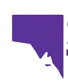

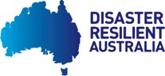

---
## Page 2

SOUTH AUSTRALIA’S DISASTER RESILIENCE STRATEGY	
CONTENTS
1. Introduction 	
4
Definitions	
4
Vision	
4
Process  	
5
2. Why we need a disaster resilience strategy 	
6
Our changing world	
6
Our State 	
7
Why resilience?	
8
3. Who is this Strategy for? 	
9
Ways of contributing to disaster resilience	
9
4. Understanding disaster resilience 	
10
Disaster resilience	
10
Community resilience	
10
Cross-cutting themes	
11
Diversity and inclusion	
11
Health and wellbeing	
12
5. Guiding principles for building disaster resilience 	
13 
6. Focus areas	
14
Focus area 1: Neighbourhoods and communities	
 15
Goal	
 15
Context	
 15
Actions and recommendations	
 16
Focus area 2: Small Businesses	
 18 
Goal	
 18
Context	
 18
Actions and recommendations	
 18
Focus area 3: Children and young people	
 20
Goal	
 20
Context	
 20
Actions and recommendations	
 21
Focus area 4: Strategic and connected networks	
 22
Goal	
 22
Context	
 22
Actions and recommendations	
 23
7. Public information campaign 	
 25 
8. Summary of projects and recommendations 	
 26
9. References 	
 27

---
## Page 3

SOUTH AUSTRALIA’S DISASTER RESILIENCE STRATEGY	
3
  
South Australia’s Disaster Resilience Strategy 
has been developed, on behalf of the State 
Emergency Management Committee by the South 
Australian Fire and Emergency Services Commission 
(SAFECOM).
We acknowledge the many individuals and 
organisations that contributed their thoughts and 
knowledge to inform this work.
Version 1.4, February 2019
Strategic alignment 
South Australia’s Disaster Resilience Strategy intends to 
support the work of, and align to the following:
•	The National Strategy for Disaster Resilience (NSDR), Council 
of Australian Governments (COAG), 2011 
•	The Sendai Framework for Disaster Risk Reduction 2015- 
2030
•	The National Disaster Risk Reduction Framework, 
Commonwealth of Australia, 2018
•	The Fire and Emergency Services Act 2005 
•	The Emergency Management Act 2004
•	The State Emergency Management Plan (SEMP)
•	The State Emergency Management Committee (SEMC) 
Strategic Plan 2017-2022
•	People at Risk in Emergencies Framework for South 
Australia, and the associated Implementation Plan and 
Communication Plan, Australian Red Cross, 2017
•	The Local Government Act, 1999 
•	Towards a Resilient State, the South Australian 
Government’s Climate Change Adaptation Plan
•	The Planning, Development and Infrastructure Act 2016 and 
related reforms 
•	State Public Health Plan 2019-2024, Government of South 
Australia
•	The National Partnership Agreement on Natural Disaster 
Resilience 2015-18
We acknowledge South Australia’s Aboriginal 
peoples and pay respect to Aboriginal Elders 
past and present. We recognise the intrinsic and 
enduring connection of Traditional Owners to 
Country and long history of contributing to culture 
and traditions in this State.
Through understanding the significant knowledge 
and practice of Caring for Country by Aboriginal 
South Australians, together we can build a more 
resilient and prosperous state.
This project was funded under the Natural Disaster Resilience Program by the South Australian State Government and the 
Commonwealth Department of Home Affairs.

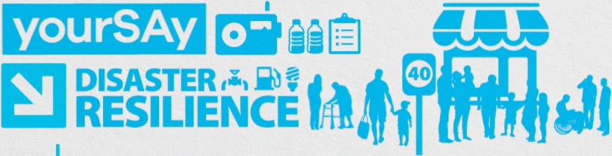

---
## Page 4

SOUTH AUSTRALIA’S DISASTER RESILIENCE STRATEGY	
4
1. INTRODUCTION 
DEFINITIONS
The following terms and definitions are used throughout this 
document:
Small Businesses 
Small businesses, including farming 
and agriculture, are categorised 
as those employing 0-19 full time 
positions
Co-design/user 
centred design 
Stakeholders and/or consumers are 
central to the design process 
Community
A group that shares common 
characteristics
Community 
resilience
A community that works together 
to understand and manage the 
risk it confronts1
Disaster
A disaster is a serious disruption of 
the functioning of a community 
or a society involving widespread 
human, material, economic or 
environmental losses and impacts, 
exceeding the ability of the 
affected community or society to 
cope using its own resources and 
therefore requiring urgent action 
Disaster resilience
The ability to survive, adapt and 
grow, no matter what happens
Emergency
An event, actual or imminent, 
which endangers or threatens 
to endanger life, property or the 
environment, and which requires 
a significant and coordinated 
response2 
Emergency 
management sector
All people, agencies, organisations 
and groups that contribute 
to emergency management 
across resilience, prevention, 
preparedness, response, relief and 
recovery efforts
Neighbourhood
A population living in close 
proximity geographically
VISION
The first of its kind for our State, the Disaster Resilience 
Strategy (the Strategy) provides a foundation upon which 
state and local government, non-government organisations, 
businesses, and communities can work together to make a 
more resilient South Australia (SA). 
The Strategy has been led by the Government of South Australia 
through the SA Fire and Emergency Services Commission 
(SAFECOM) but, most importantly, has been shaped by the 
thoughts and experiences of over 500 South Australians 
through co-design – a collaborative process undertaken with 
community members, businesses, state and local government, 
and organisations.
Developed with these stakeholders, the vision for the Strategy is:
Working together towards a safe  
and resilient South Australia. 
In providing a roadmap toward achieving this vision, the 
Strategy aims to:
•	 enable a shared understanding of disaster resilience 
that can be adopted and applied across the emergency 
management sector
•	 identify priority areas of focus for disaster resilience effort 
and investment
•	 identify practical, evidence-based pilot projects and 
recommendations to guide action that will contribute to a 
safe and resilient SA.
In the context of this Strategy, disaster resilience is:
The ability to survive, adapt and grow,  
no matter what happens.

---
## Page 5

SOUTH AUSTRALIA’S DISASTER RESILIENCE STRATEGY	
5
Over 500 people…* 
• State & Commonwealth 
Government: 157 
• Community members: 151
• Business / private sector: 93 
• Local Government: 68 
• Non-government: 37	
• Other jurisdictions: 6	
  
contributed through…
• In-depth interviews (32)
• Workshops (18)
• Online surveys (75) 
• Guided conversations (20)
to develop, test and 
refine…
• 42 initial concepts and 
ideas
• 21 ideas for 
communication tools	
to create South Australia’s 
Disaster Resilience 
Strategy:
• 4 Focus areas
• 6 Projects
• 12 Recommendations
• 8 Guiding principles
*Contributions from an additional 300 people who participated in a related Red Cross project, focussing on non-government 
organisations and local government, were included in this research.
PROCESS
Improving disaster resilience is complex and can only be achieved through working effectively across organisational and sectoral 
boundaries.
Acknowledging this, representatives of government and non-government agencies, businesses, and community members were 
closely engaged in developing the Strategy. Participants were directly involved in establishing the context for the Strategy, identifying 
and exploring key issues, and determining the Strategy’s vision and recommended actions. 
A review of current research and best practice also informed the Strategy.
A Project Report is available from SAFECOM that outlines the co-design process, detailed research findings, and how action areas 
and recommendations were identified.

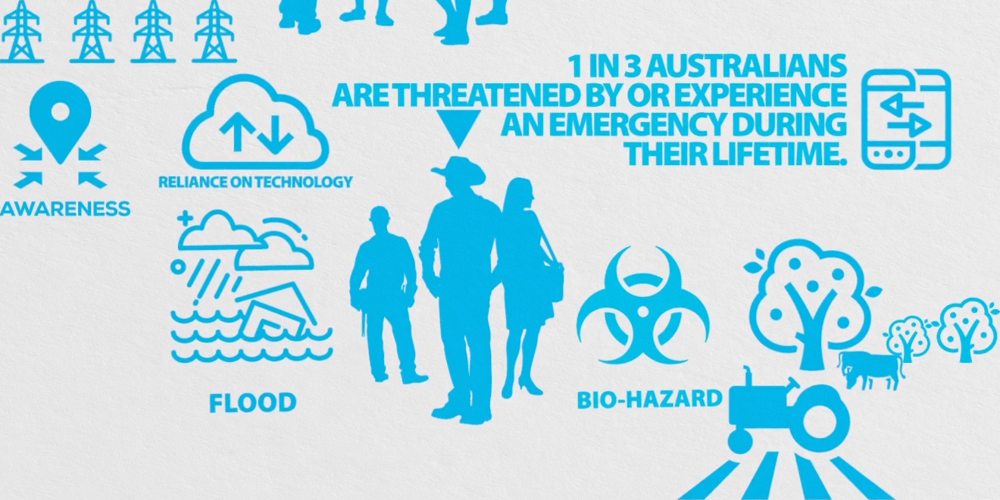

---
## Page 6

SOUTH AUSTRALIA’S DISASTER RESILIENCE STRATEGY	
6
2. WHY WE NEED A DISASTER RESILIENCE STRATEGY  
OUR CHANGING WORLD
Our world is changing, and with change comes the 
opportunity to reflect on the way we live and what is 
important to us.
In Australia, we are experienced at preparing for and 
responding to natural hazards such as bushfire and extreme 
weather. Now and into the future, such events will be 
experienced at a greater intensity and frequency, amplifying 
the impacts and placing increased pressure on our capacity to 
respond.
The types of threats we face are also changing, with our 
reliance on technology increasing our vulnerability to 
cyberattack, while the relative ease of global travel, and our 
expanding cities, can increase the spread of infectious disease 
and the risk of pandemics. 
As a State, we need to better understand these risks, and 
how to live with an increased threat of disaster in a way that 
not only prepares us to protect what is most important, but 
also to forge a path forward, thrive, and grow. 
Working together – as communities, businesses, and 
government and non-government organisations – we can 
build our own resilience and contribute to the resilience of the 
State as a whole.
Our changing climate
• 	 Since 1900, more people in Australia have died as a 
result of extreme heat than from the effects of all 
other natural hazards combined.I
• 	 The number of  hot days per year have doubled in 
Australia over the last 50 years.II
• 	 Hot weather in Adelaide, Melbourne and Canberra 
has already reached the levels previously predicted 
for 2030.III
• 	 Forest Fire Danger Index values demonstrate that 
over many parts of Australia there has been an 
increase in extreme fire weather and the length 
of the fire season since the 1970s. This increase 
is especially pronounced in southern and eastern 
Australia, driven by higher temperatures and 
reductions in cool-season rainfall.
•	 A global sea level rise of 0.2m has already increased 
the incidence of storm surge impacting along the 
coasts of South Australia.IV

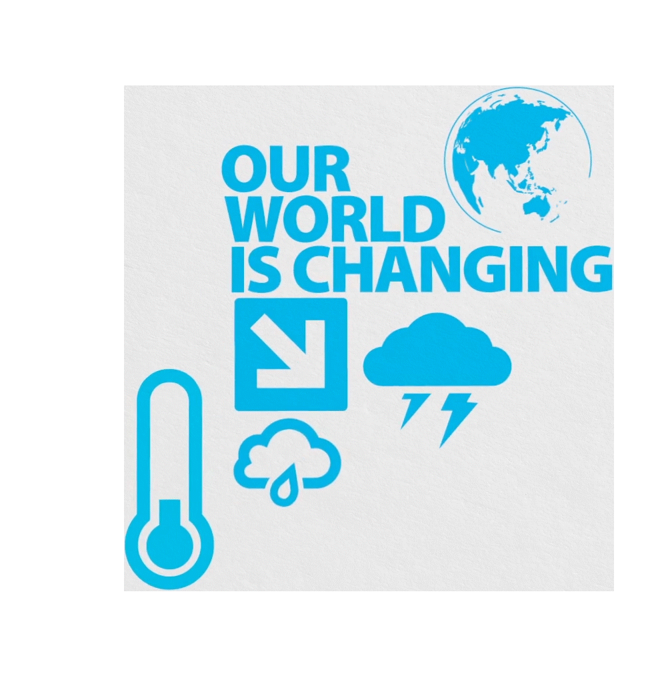

---
## Page 7

SOUTH AUSTRALIA’S DISASTER RESILIENCE STRATEGY	
7
OUR STATE
While changes are happening globally, the nature of the 
threats that we face is also specific and unique to the 
community in which we live.
SA has 7.25% of Australia's 
 population and is one of the least  
densely populated states in the world. 3
The State’s population continues to change and grow. 
Between 2011 and 2016, the population increased at an 
average of 0.9% per year 2  while over the same period, 
regional areas experienced growth at a slower rate of 0.4% 
per year.3
17% of residents are 
in regional SA 4
75% of residents are 
in greater Adelaide 
or along southern 
coast 5
Population: 
1.67 million
SA’s economy is dominated by the services sector: 6
HEALTH CARE
RETAIL 
CONSTRUCTION 
EDUCATION 
& TRAINING 
AGRICULTURE 
MINING
TOURISM
 AQUACULTURE 
& RECREATIONAL 
FISHING 
FORESTRY

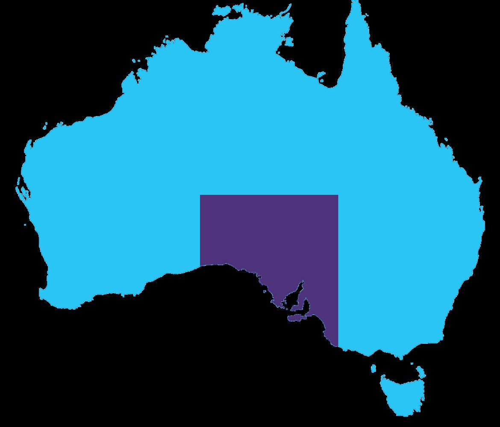

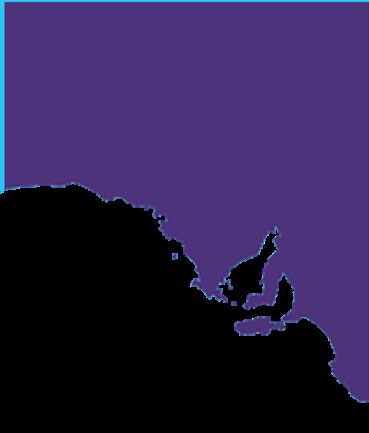

---
## Page 8

SOUTH AUSTRALIA’S DISASTER RESILIENCE STRATEGY	
8
The State’s landscape varies from rugged outback wilderness 
and desert, including some of the most arid parts of the 
continent, to mountain ranges and a coastline stretching more 
than 3,700 kilometres.7
Compared to some other parts of the Australia, SA tends to 
have less sudden-impact disasters. It does, however, have the 
highest number of heat-related deaths per capita of any other 
state or territory.8
The table below shows the relationship between some of 
these characteristics and disaster risk and resilience.
Characteristic of SA
Link to disaster risk and resilience
Known for its hot, dry 
summers, particularly 
in the north, SA is 
the driest state on 
the driest inhabited 
continent on earth.
High temperatures and extended 
heatwaves can impact on day-to-
day activity as well as lead to serious 
health issues. Long dry summers also 
increase the risk of bushfires across 
the State. 
A relatively small 
regional population 
is distributed across 
a large geographical 
area.
Regional, remote or isolated areas 
may be more vulnerable to the 
impacts of natural disasters due to less 
readily available resources to mitigate 
risks, respond in an event, and recover 
in the aftermath. This gives individuals 
and communities an important role in 
contributing to disaster resilience. 
A very large 
concentration of 
population lives in 
the Greater Adelaide 
area.
A concentrated population may be 
more vulnerable to health-related 
events such as a pandemic. Acts of 
terrorism are more likely to occur in 
densely populated and/or high-profile 
locations. 
A large proportion of 
the population lives 
on the coast.
With expected rises in sea level, 
coastal areas will experience increased 
risk of coastal inundation and extreme 
weather. Communities need to 
consider their populations, assets and 
infrastructure along the coastline. 
Economic activity 
occurs in agriculture, 
mining, tourism, 
fisheries, aquaculture 
and forestry.
These industries generally support 
regional economies and are vulnerable 
to climate impacts including extreme 
weather, fire, flood, heat waves and 
natural disasters. 
WHY RESILIENCE?
Directions in national policy, recent experience of extreme 
weather and state-wide blackout, and the impacts of 
climate change have led to a change in thinking about 
how we prevent, prepare for, respond to, and recover from 
emergencies. 
A key element of the new approach is investment in disaster 
resilience - the ability of our State to survive, adapt and grow, 
no matter what happens. 
Building disaster resilience requires:
•	 sharing responsibility for emergency management beyond 
traditional emergency response agencies, including 
supporting individuals to be more self-reliant
•	 involving all parts and levels of government and non-
government agencies, businesses and the community 
•	 taking decisions and action based on evidence
•	 communicating clearly and consistently about disasters, risk 
and response.
In supporting this direction, the Strategy complements and 
adds to the following bodies of work contributing to SA’s 
disaster resilience: 
•	 State Emergency Management Committee (SEMC) Strategic 
Plan 2017-2022
•	 SA’s State and zone-level emergency risk management 
programs that have identified building disaster resilience at 
an organisational and community level as one of the top ten 
risk treatments
•	 The findings of the Burns Review into the arrangements 
surrounding the extreme weather event and associated state-
wide power blackout in September and October 2016 9
•	 The National Strategy for Disaster Resilience 2011
•	 United Nations International Strategy for Disaster Reduction 
(UNISDR) Sendai Framework for Disaster Risk Reduction 
2015-2030.
The cost of not building resilience
• 	 The total economic cost of natural disasters in 
Australia over the 10 years to 2016 averaged $18.2 
billion per year.
• 	 This cost is expected to more than double in real 
terms to average $39 billion per year by  2050.
• 	 The Australian Business Roundtable’s report on the 
social and economic impact of disasters found that 
carefully targeted investment in effective resilience 
measures now can reduce estimated expenditure 
on natural disaster relief and recovery by more than 
50% by 2050.V

---
## Page 9

SOUTH AUSTRALIA’S DISASTER RESILIENCE STRATEGY	
9
3. WHO IS THE STRATEGY FOR?
The Strategy is for everyone involved in emergency 
management. This includes all of the people, agencies, 
organisations and groups that contribute to emergency 
management across resilience, prevention, preparedness, 
response, relief and recovery efforts.
Put simply, everyone has a role to play in building disaster 
resilience. 
It is clear there are different levels of responsibility and capacity 
across the emergency management sector. Development 
of the Strategy has identified an interest from community 
members and groups in taking on a greater role, as well as the 
need to broaden involvement and understanding of who is 
responsible for what, and how everyone can contribute. 
An implementation plan, to be developed in 2019, will aim to 
assign lead agencies to the actions contained in the Strategy, 
while continuing to emphasise an inclusive partnership 
approach to their delivery. These actions, and others, will be 
tracked, monitored and reported on over time, to demonstrate 
SA’s progress. 
Summarised below are some of the ways partners in the 
emergency management sector can and do contribute to 
disaster resilience. 
Partner
Ways of contributing to disaster resilience
Commonwealth 
Government
- Set national strategic directions through the National Strategy for Disaster Resilience (NSDR) and National 
Disaster Risk Reduction Framework
- Distribute funding to embed and build resilience nationally, through the National Partnership Agreement on 
Natural Disaster Resilience.
State 
Government
- Facilitate collaboration between all services, communities and individuals across prevention, preparing, 
responding and recovering
- Lead activities to mitigate against potential disasters
- Manage risks through asset management, land-use planning, development controls, building regulations 
and natural resources management
- Facilitate public education, including reliable and accessible risk information and risk reduction options 
- Develop strategy and policy to build resilience across all sectors of the community
- Support and apply research to make evidence-based decisions
- Maintain policies, legislation and planning for potential emergencies (natural or caused by humans)
- Coordinate State response and recovery efforts
- Plan effective business continuity to maintain Government services during and after emergencies and 
disasters
Local 
Government
- Provide localised risk information to the public
- Undertake measures to mitigate the impacts of emergencies on local communities
- Plan effective business continuity to maintain Local Government services during and after significant events
- Assist in planning and preparing for emergencies as part of SA emergency management arrangements
- Represent community interests to different levels of government
- Support communication and coordination between local organisations in disaster recovery
- Facilitate public education and awareness before, during and after emergencies
- Support individuals and community organisations to manage the risks they face
- Manage risks through asset management, land-use planning, development controls and building regulations
Businesses
- Understand their exposure to risks
- Consider prevention and reduction of risk as part of their core activities in preparing business continuity plans
- Participate in the social and economic recovery of the local community
- Consider the benefits and opportunities in partnering with government in disaster resilience initiatives
Non-
government  
and not-
for-profit 
organisations
- Plan for business continuity 
- Incorporate emergency preparedness messaging into existing service delivery for people at risk
- Contribute to prevention, preparedness, response and recovery activities
- Connect people at risk with information and support services
- Understand what clients and customers expect of them 
Communities 
and individuals
- Understand the risks in the local area
- Plan and prepare for all hazards
- Work with others to support the local community
- Encourage others to be prepared
- Understand what clients and customers expect of them in relation to emergencies and disasters

---
## Page 10

SOUTH AUSTRALIA’S DISASTER RESILIENCE STRATEGY	
10
4. UNDERSTANDING DISASTER RESILIENCE
DISASTER RESILIENCE
In this Strategy, disaster resilience is defined as the ability to 
survive, adapt and grow, no matter what happens.10 
Like the Strategy itself, this definition was developed with 
reference to best-practice research, and with the participation 
of stakeholders.
COMMUNITY RESILIENCE
Development of the Strategy identified building the resilience 
of people and communities to be the highest priority at this 
point in time. 
The National Strategy for Disaster Resilience defines a disaster 
resilient community as:
‘One that works together to understand and manage 
the risk that it confronts. Disaster resilience is the 
collective responsibility of all sectors of society, 
including all levels of government, business, the non-
government sector and individuals.’ 11
Importantly, resilience looks different in each community, 
based on its unique experience and attributes, including the 
types of risks it faces, and the characteristics of the people, 
organisations and places it contains.
The Torrens Resilience Institute’s model of community 
resilience (Figure 2) identifies domains similar to the focus 
areas that emerged through the consultations for the Strategy. 
Other projects building SA’s resilience
While building disaster resilience within communities 
is the focus of the Strategy, disaster resilience is 
influenced by other areas such as built infrastructure, 
the natural environment, health and wellbeing, and 
socio-economic factors. Important bodies of work in 
these areas are underway in SA; they complement the 
Strategy and also contribute to the resilience of the 
State. They include:
•	 reforms under the Planning, Development and 
Infrastructure Act 2016 that will make significant 
changes to planning regulations, policies, and 
processes for planning approvals
•	 Regional Climate Change Adaptation Plans 
developed by councils across SA that identify 
opportunities to mitigate the impact of climate 
change risks through adapting and building 
resilience
•	 the State’s Health in All Policies initiative. Working 
across the policy development process of different 
agencies, the Government is able to better address 
the social determinants of health and health 
inequities in a systematic manner
•	 the Local Government Association of SA’s Council 
Ready program that provides a coordinated 
approach to local government emergency 
management planning
•	 the SA Lifelines Capability Plan that identifies key 
lifelines such as cash, fuel and food, and describes 
arrangements for their provision
•	 The emergency management sector’s planning and 
exercising for catastrophic events and building of 
internal capability to prepare for, respond to, and 
recover from emergencies
•	 The Emergency Management Workforce Capability 
Development Framework that identifies the 
workforce capabilities required to fulfil the state’s 
emergency management
COMMUNITY
CONNECTEDNESS
PLANNING  
AND PROCEDURES
RESILIENCE
AVAILABLE
RESOURCES
RISK AND 
VULNERABILITY
Figure 2 – Domains of disaster resilience

---
## Page 11

SOUTH AUSTRALIA’S DISASTER RESILIENCE STRATEGY	
11
CROSS-CUTTING THEMES 
Within the overarching priority of community resilience, 
development of the Strategy further identified two cross-
cutting themes that were important both within documented 
research and amongst stakeholders, namely:
• diversity and inclusion
• health and wellbeing
While building resilience has many elements, these themes 
emerged as essential considerations to guide the Strategy as a 
whole, including its implementation.
Diversity and inclusion
Diversity refers to all the ways people are different and 
unique, including age, ethnicity, culture, ability, religion, 
gender and gender identity, sexuality and more.
Diversity enriches groups, workplaces and communities 
through challenging assumptions and bringing new ideas and 
experiences. Diverse organisations are better connected to 
their communities, more innovative, productive, supportive 
and harmonious.12
Inclusion is about valuing and accepting the different qualities 
diversity can bring and celebrating and embracing these 
differences.
Inclusivity contributes to disaster resilience by deliberately 
empowering a greater number and greater diversity of 
those involved. As a result, disaster resilience messages are 
spread more broadly and effectively, including to those 
with potentially higher levels of vulnerability to the impacts 
of emergency events (e.g. older people, people from non-
English speaking backgrounds) who might otherwise be 
excluded. 
Recognising Aboriginal and Torres Strait Islander 
Peoples’ knowledge
•	 Aboriginal and Torres Strait Islander peoples have 
lived in this country for tens of thousands of years, 
witnessing droughts, floods, fires and sea levels 
rising and falling.
•	 Aboriginal and Torres Strait Islander peoples have 
shown resilience to adversity and the importance of 
family and community, connectedness, sharing, role 
models and leadership.VI
•	 Acceptance and understanding of the knowledge 
and practices of Aboriginal and Torres Strait 
Islander peoples will contribute to decreasing the 
impacts of emergencies and disasters. VII
•	 Remote Aboriginal communities are particularly 
vulnerable to the impacts of climate change 
because of their relative isolation and limited access 
to support facilities.VIII
•	 Following consultations and desktop research IX 
concern for the landscape and risk of wildfires was 
identified as a key issue for Aboriginal peoples.

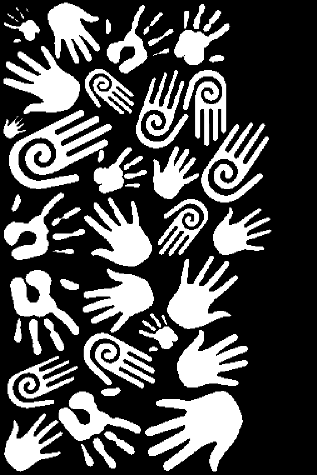

---
## Page 12

SOUTH AUSTRALIA’S DISASTER RESILIENCE STRATEGY	
12
People at risk
•	 A review of 16 international case studies 
examining the impacts of natural disasters and 
conflicts found that regardless of the level of 
prosperity of a country, those most affected 
tended to be economically disadvantaged, had a 
disability or were frail, female, socially isolated, or 
caregivers of family members X
•	 Despite people from minority groups being 
over-represented in mortality and injury rates 
for disasters, they are often on the peripheral of 
planning and responding.XI
•	 Everyone experiences elements of vulnerability 
and resilience and has knowledge, experiences 
and capabilities to draw upon.XII
•	 People most at risk are best supported to prepare 
for and respond to emergencies by the people 
closest to them.XII
•	 The incidence of domestic and family violence 
significantly increases in the wake of natural 
disasters.XIII
Health and wellbeing
General resilience through good health and positive 
wellbeing make an important contribution to disaster 
resilience. Strong, healthy communities are more resilient 
to shocks and stressors. Conversely, physical, economic, 
social and environmental factors linked to lower levels of 
health and wellbeing can make people more vulnerable, and 
impact how they prepare for emergencies and disasters.13
Good mental health is defined as a state of wellbeing in 
which individuals realise their potential, cope with the usual 
stresses of life, work productively and are able to contribute to 
their community, all of which strengthen their ability to cope 
with challenges and to support others to do the same.14
Many factors impact the general health and wellbeing of 
individuals and communities, including where they live, 
their environment, genetics, income, education level, and 
relationships with friends and family.
Workplace wellbeing 
Workplaces can play a key role in contributing to the 
wellbeing of employees and a more resilient society, 
for example, through flexible leave days, adapting 
work arrangements on days of extreme weather, 
providing space at work for prayer or breastfeeding, 
welcoming children at work, and encouraging both 
fathers and mothers to take paid parental leave. 
These initiatives support resilience in employees as 
individuals both in and outside the workplace, and as 
members of the communities they belong to.

---
## Page 13

SOUTH AUSTRALIA’S DISASTER RESILIENCE STRATEGY	
13
5. GUIDING PRINCIPLES FOR BUILDING DISASTER RESILIENCE  
1
Invest and commit 
for the long term   
Everyone has a 
role to play
Resilience is 
dynamic and 
changing  
Build upon  
strengths
Involve, respect 
and respond to 
diversity
Support and 
promote health 
and wellbeing
8
Ask, listen and 
learn 
Apply a strategic,  
and collaborative 
approach
2
3
4
5
6
7
These Guiding Principles 
emerged from the research and 
engagement that has informed the 
Strategy. 
They are intended to inform and support the 
actions of all individuals, agencies, organisations 
and groups that collectively contribute to the 
resilience of the State.
Organisations and individuals are encouraged 
to embed these principles in the planning, 
design and implementation of their 
work.
1: Everyone has a role to play
The increasing frequency and severity of disasters is placing 
pressure on services and exceeding the capacity for emergency 
services to act alone. Building disaster resilience can reduce this 
pressure, through an inclusive process that recognises the roles 
that can be played by all.
2: Resilience is dynamic and changing
Building disaster resilience is best viewed as an ongoing process, 
rather than an end-state or outcome. The ability of people, 
communities, and organisations to prepare for, cope with and 
recover can change over time based on their experiences, 
resources, wellbeing, and other factors. Because of this, tailored 
or iterative approaches may be most effective.
3: Build upon strengths 
Resilience-building is most effective when it is opportunity-
focused and strength-based, drawing on the knowledge, skills 
and abilities of those involved.
4: Involve, respect and respond to diversity 
Diversity refers to the ways people are different and unique, 
including age, ethnicity, culture, ability, religion, gender and 
gender identity, sexuality and more. Applying an understanding 
of and respect for diversity leads to better outcomes and enriches 
groups, workplaces and communities through challenging 
assumptions and bringing new ideas and experiences. 
5: Support and promote health and wellbeing
Strong, healthy communities are more resilient to shocks and 
stressors. On an individual level, good health and wellbeing build 
people’s general resilience and their ability to be resilient when 
faced with disaster. 
6: Ask, listen and learn 
Sharing experiences, listening to others and being open to 
learning from a range of sources adds significant value to 
resilience-building activities. Activities that are evidence-based 
and which adapt existing successful solutions will be more 
effective and efficient than ‘reinventing the wheel’. In addition, 
seeking local knowledge, experience and ideas will lead to better 
outcomes and levels of participation.
7: Apply a strategic and collaborative approach
Forming new partnerships with diverse stakeholders can generate 
new insights, solutions and ways of thinking.  We need to 
consciously break down silos and work collaboratively towards 
common goals across agencies, sectors and communities.
8: Invest and commit for the long term 
Understanding and building disaster resilience in communities 
and across society will take time and intergenerational cultural 
change. Communities, all levels of government, businesses, non-
government organisations and emergency services can contribute 
to this change by applying and embedding the principles of 
disaster resilience in their day-to-day activities and operations.
1

---
## Page 14

SOUTH AUSTRALIA’S DISASTER RESILIENCE STRATEGY	
14
6.	
FOCUS AREAS
The participatory co-design process described on page 
4 (Process) engaged over 500 community members, 
businesses, representatives of state and local government, 
and non-government organisations to explore the strategic 
opportunities to build disaster resilience in SA.
Four focus areas emerged as fundamental to building  
resilience in SA:
1.	Informed and connected neighbourhoods and 
communities working together
2.	Prepared and adaptable businesses that can continue 
to operate during and after an emergency or disaster, 
maintaining their livelihood while supporting their 
community
3.	Children and young people actively engaged in 
reducing their risks and increasing their self-reliance
4.	Strategic and connected networks that broaden the 
emergency management sector, working towards common 
goals and shared outcomes
The following sections address each focus area, summarising 
the insights – from research and consultation – that informed 
the development of concepts and ideas. These concepts were 
further refined, in collaboration with stakeholders, to develop 
initial actions that will practically and effectively support 
disaster resilience across our State.
Strategic
and
Connected
Networks
Small
Businesses
Neighbourhoods
and
Communities
Children
and
Young People
Community
Resilience
Di
v
er
si
ty
 a
n
d 
In
cl
u
si
o
n
H
e
al
th
 a
n
d 
W
el
lb
ei
n
g

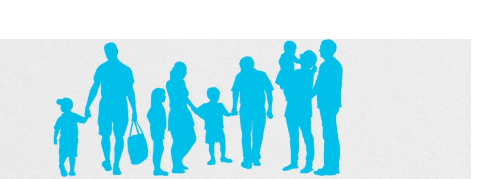

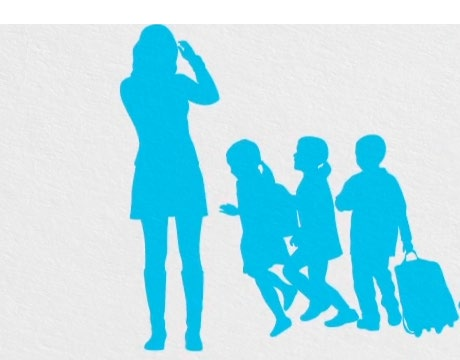

---
## Page 15

SOUTH AUSTRALIA’S DISASTER RESILIENCE STRATEGY	
15
FOCUS AREA 1: 
NEIGHBOURHOODS AND 
COMMUNITIES
GOAL 
Informed and connected neighbourhoods and 
communities working together.
In the context of the Strategy, neighbourhoods refer 
to populations living in close proximity geographically, 
while communities can include groups that share 
common characteristics (e.g. religion or age group) or 
interests (e.g. playing a sport, or volunteering).
CONTEXT
Insights from research and consultation summarised 
below informed the development of actions to support 
neighbourhoods and communities to build disaster resilience.  
Insights from research
•	 In the future, we will more frequently experience demand 
on services in an emergency exceeding the capacity to 
respond.
•	 When disasters strike, local residents and neighbours 
support each other until trained emergency personnel 
arrive.15
•	 Community sector organisations, businesses and 
community groups can lead positive change by building 
resilience for emergencies as part of regular services and 
supports, particularly for people at risk.16
•	 To contribute to resilience, it is important that relationships 
and networks are established prior to events.
•	 An effective recovery does not only depend on the overall 
amount of damage caused by an event, or the money 
invested in response and recovery. Social capital - the 
connections that people have with each other, are shown 
to have the most impact and influence on the recovery 
process.15
•	 Financially resilient households, those with the ability to 
draw on resources and financial products and services, 
including insurance, recover faster and more effectively after 
an emergency.17
•	 Volunteering improves community health and wellbeing 
and is essential in providing many community services. 
Formal volunteering rates across Australia are declining 
for the first time in 20 years and this is impacting many 
sectors, including emergency management.18 Barriers to 
volunteering include changing demographics and family 
and work demands.19 
•	 Building disaster resilience requires long-term commitment 
and cultural change in organisations and communities, and 
a multi-faceted approach across multiple sectors.
Insights from consultation
•	 By building the resilience of communities, we can build a 
more resilient SA. 
•	 A resilient community is a well-connected community. This 
includes people having connections to each other as well 
as with local and state government and non-government 
agencies, organisations and community groups.
•	 Shared responsibility is not about giving up areas of 
responsibility. It means emergency management agencies 
working more closely with non-traditional partners (whole 
of government, local government, non-government, 
community and businesses).
•	 Community members and professionals, such as vets 
and engineers, have an interest in taking on a greater 
role in emergency management. There are examples 
of community members self-organising and playing an 
active role in their emergency management planning and 
recovery, following a significant event. Approaches should 
be developed at the community level and tailored to unique 
local needs and wants.
•	 There is an expectation by the public that first responders 
can be there to help everyone during and after significant 
events.
•	 Behavioural, cultural and attitudinal barriers to community 
resilience include lack of time, money, and interest, with 
people believing ‘it’ will not happen to them and expecting 
that help will arrive when it is needed. 
•	 Some services are perceived as potentially creating 
dependency rather than building resilience. For example, 
if people receive a targeted text message telling them that 
they need to evacuate, an expectation may be set. Rather 
than assessing their own risk, in future events, they may 
wait to receive a text message before they evacuate.

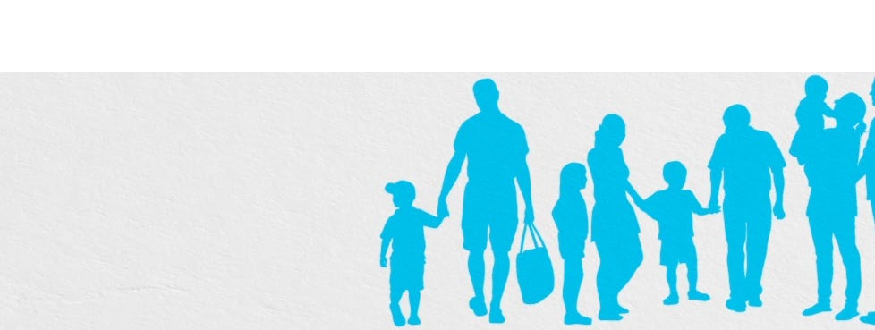

---
## Page 16

SOUTH AUSTRALIA’S DISASTER RESILIENCE STRATEGY	
16
•	 In addition to plans, other elements of preparing and 
building resilience can be promoted and acknowledged, 
such as changes in behaviour, having conversations about 
preparing for events or hosting a street party to connect 
with neighbours. 
•	 There must be strong motivators in place for households 
to actively engage in risk management and resilience 
at a household and neighborhood level. This requires 
creative thinking about how to engage individuals and 
communities.
•	 Information and resources that support communities to 
play a stronger role need to be tailored to the local context 
and be more accessible.
•	 There are many existing tools and programs in SA and 
other jurisdictions that can be built upon for community-
based emergency management initiatives. Neighbourhood 
Watch is one example that has an existing structure 
in place for working with communities, disseminating 
information and building social capital.
Community Disaster Resilience
A disaster resilient community is one where we:
•	
understand the risks we face based on our location 
and situation
•	
take action where we can to prepare for and 
manage these risks
•	
know our neighbours and those who might need 
more help in an emergency or disaster
•	
know how and where to get the information we 
need in a range of situations
•	
know how to link into services that are there to 
support us
•	
understand the importance of coming together 
as a community to help emergency and support 
services understand our needs after an emergency 
or disaster
•	
are as self-reliant as we can be because we know 
that in a significant event, emergency services can’t 
be everywhere
•	
have the ability to withstand and recover from a 
disaster or emergency event.
All participants in the research were asked what disaster 
reslience meant to them. Their answers were grouped as 
illustrated here.
ACTIONS AND RECOMMENDATIONS
PROJECT 1: 
Community-based emergency management
Develop and pilot a collaborative model for community-based 
emergency management.
This project will work towards SA having a strategic joined-up 
model for community-based emergency management. The 
model is to be piloted in three locations that face different 
risks, contexts and experiences, supporting communities to 
work together to identify their local priorities and develop 
tailored and appropriate solutions for each location.
The recommendation is for a co-design approach with broad 
participation from established community groups, state 
and local government, non-government organisations and 
businesses.
Further considerations for the pilot include:
•	 development of an online portal with an interactive map of 
SA for communities to share resources and information for 
their region with one another and the sector
•	 exploration of the use of Neighbourhood Watch groups 
as an existing structure that brings community members 
together. Building community resilience could reinvigorate 
the work of Neighbourhood Watch groups
•	 involvement of universities for rigour around collecting an 
evidence base and evaluating approaches
•	 ensuring people at risk are involved and that the outcomes 
address their needs. 
Some organisations and community groups in SA have 
recognised the importance of community-based emergency 
management, with initiatives gaining momentum. However, 
these are taking place alongside one another without a 
collaborative and strategic approach.

---
## Page 17

SOUTH AUSTRALIA’S DISASTER RESILIENCE STRATEGY	
17
PROJECT 2: 
Develop innovative insurance initiatives for businesses 
and households
Develop initiatives to increase financial resilience and stability 
for businesses and community members and to reduce levels 
of financial hardship after an emergency or disaster. Learn 
from existing innovations including the related work of the 
Resilient Melbourne strategy.20
RECOMMENDATION 1: 
Innovate to strengthen a culture of volunteering
Build on existing initiatives that aim to increase volunteer 
participation, such as:
•	 Volunteering Strategy for SA 2014-2020 21
•	 Fostering a Culture of Giving - lesson plans developed by 
Volunteering Australia that promote volunteering to young 
children.22
Other jurisdictions
•	
Emergency Management Victoria’s approach that 
enables community volunteers and organisations 
to build relationships by working together to 
identify priorities and develop solutions with 
involvement from government, emergency 
services, businesses, industry and non- government 
organisations.XIV
•	
The Torrens Resilience Institute (TRI) Community 
Disaster Resilience Scorecard Toolkit.XV This toolkit 
has been developed for communities interested in 
self-assessment of their potential resilience and to 
develop an action plan to strengthen community 
resilience.
•	
The New South Wales Government is funding a 
‘Get Ready’ Pilot that uses a co-design, community-
led, all-hazards approach to community-based 
emergency management. This is currently being 
piloted across three communities.
•	
The Wellington Region Emergency Management 
Office (WREMO) in New Zealand has dozens of 
pre-identified ‘community emergency hubs’ for 
the community to coordinate their efforts to help 
each other during and after a disaster.XVI The hubs 
are located in primary schools, community centres 
or other public gathering locations. WREMO works 
with communities to identify community strengths, 
resources, vulnerabilities and potential solutions 
to the challenges a community will face during a 
disaster.

---
## Page 18

SOUTH AUSTRALIA’S DISASTER RESILIENCE STRATEGY	
18
FOCUS AREA 2:  
SMALL BUSINESSES
GOAL 
Prepared and adaptable businesses that can continue 
to operate during and after an emergency or disaster, 
maintaining their livelihood while supporting their 
community.
In the context of the Strategy, small businesses are 
categorised as those employing 0-19 full time equivalent 
positions.
CONTEXT
Insights from research and consultation summarised below 
informed the development of actions to support small 
businesses to build disaster resilience. 
Small businesses are the focus as SA is a small business state, 
with over 140,000 small businesses representing about 98% of 
all South Australian businesses.23  
Insights from research
•	 SA’s small businesses employ about 34% of the workforce 
and contribute $34 billion to the economy annually. They 
have the highest survival rate of businesses for mainland 
Australia.23 
•	 Thirty percent of small-to-medium businesses close and never 
re-open following a disaster.24
•	 Most small businesses are underprepared for an emergency 
or disaster. A national survey found that 79% of small 
businesses in Australia did not have a business continuity 
plan.25
•	 A survey of Business SA members conducted following the 
state-wide blackout in 2016 showed that:
-	 12% of businesses had a back-up generator
-	 83% of businesses had to cease operating temporarily as a 
result of the blackout
-	 37% of businesses had interruption insurance. Of these, 
more than half were not covered for any costs associated 
with the blackout and only 12% were fully covered for 
their costs associated with the blackout.26
Insights from consultation
•	 Despite seeing emergency planning as important, business 
owners cite lack of time, money and expertise as barriers to 
being prepared.
•	 Regional businesses, including agriculture and industry, face 
unique challenges such as limited access to services and their 
livelihoods being more vulnerable to the impacts of severe 
weather.
•	 Providing incentives or communicating the cost benefits 
of planning for emergencies or disasters, may motivate 
businesses to prepare.
•	 Support for small businesses, such as business planning and 
financial literacy, must be accessible for regional businesses 
and farmers.  
•	 Despite the availability of business continuity planning 
information and online templates, the uptake of these 
resources is limited.27
•	 Businesses could play a stronger role in supporting the 
resilience of their communities.
•	 Businesses can play a key role in introducing innovation and 
new technology to the sector.
ACTIONS AND RECOMMENDATIONS
PROJECT 3: 
Small business resilience
Develop and pilot programs or services that build small business 
resilience.
The majority of small businesses are underprepared for disasters, 
and many close when impacted. These closures have flow-on 
effects for business owners and employees as well as the local 
community.

---
## Page 19

SOUTH AUSTRALIA’S DISASTER RESILIENCE STRATEGY	
19
Although there is some support available, such as online 
business continuity planning templates, a greater level of 
engagement with small business is required to support them 
to build resilience and contribute to the resilience of the 
neighbourhoods and communities in which they operate.
The first stage of this project will aim to:
•	 provide a better understanding of the drivers and barriers to 
small business preparedness and resilience
•	 develop usable and creative solutions so that taking steps 
to be disaster ready is considered part of normal business 
operations
•	 contribute to an environment that supports government 
and businesses to collaborate to reduce disaster risk and 
strengthen resilience.
This project will bring together relevant stakeholders including:
•	 South Australian small businesses
•	 Business SA
•	 Primary Industries and Regions SA
•	 the South Australian Small Business Commissioner
•	 the Department for Industry and Skills
•	 other jurisdictions working in this space, for example, 
Resilient Melbourne.
RECOMMENDATION 2:  
Ensure grant funding is targeted
Expand the Natural Disaster Resilience Program (NDRP)28 grant 
funding to enable businesses to apply, and encourage joint 
applications with other organisations, such as government or 
non-government agencies. 
To encourage uptake, a business representative should be 
included on the NDRP assessment panel and the program 
promoted through the business sector.
RECOMMENDATION 3:
Strengthen business sector engagement
Identify opportunities to strengthen the emergency 
management sector’s engagement with the business sector, 
involving business and relevant peak bodies and organisations 
in planning and decision making across resilience, prevention, 
preparedness, response and recovery.

---
## Page 20

SOUTH AUSTRALIA’S DISASTER RESILIENCE STRATEGY	
20
FOCUS AREA 3:  
CHILDREN AND YOUNG 
PEOPLE
GOAL 
Children and young people actively engaged in 
reducing their risks and increasing their self-reliance.
CONTEXT
Insights from research and consultation summarised below 
informed the development of actions to support children and 
young people to actively engage in reducing their risks and 
increase their self-reliance.   
Insights from research
•	 Article 12 of the UN Convention on the Rights of the Child 
(OHCHR 1989), states that children and young people have 
the right to express their views and be heard on matters 
that affect them.29
•	 Children can be positive change agents in their households 
and communities. If given the opportunity to participate, 
they can make a very real and positive difference before, 
during and after an emergency.30
•	 Mental health was the top issue of national concern 
for over 24,000 young people responding to Mission 
Australia's Youth Survey in 2017. Coping with stress was 
the top issue of concern identified by South Australian 
respondents, potentially reducing their ability to cope when 
things go wrong.31  
•	 There are many existing tools and resources available to 
engage with young people.
•	 Disaster resilience education (DRE) (i.e. teaching disaster 
resilience in schools) is a proven way to engage with 
children and young people.32
Young people are worried that if they don’t get to 
contribute they won’t learn the ‘adult’ skills they 
need. They are an experiential generation. They 
are hard wired for hands-on learning and doing it 
themselves. Young people will not learn by osmosis 
and they won’t value things just because previous 
generations have.
Helen Connolly, Commissioner for Children and Young People SA
Insights from consultation
•	 Working with young people is key to sustainable and 
intergenerational cultural change. Children will take learnt 
behaviour and attitudes through to their adult years.
•	 Adults perceive children and young people as losing 
practical skills that support resilience and self-reliance and 
being over-protected, leaving them inexperienced and less 
able to deal with adversity and failure. 
•	 The perspectives, and contributions, of young people are 
generally overlooked in emergency management.
•	 Disaster resilience messaging for children and young people 
must be engaging, constructive and targeted.
•	 DRE is an obvious starting point to effect behaviour change 
through embedding disaster resilience into the school 
curriculum.
•	 Schools currently implement many resilience and wellbeing 
initiatives through existing frameworks. There is a question 
about where to draw the line between the responsibility of 
schools and parents to ‘teach’ disaster resilience.
•	 The importance of professional development for teachers 
and educators and strengthening the links to disaster 
resilience in the curriculum is in the context of an over-
crowded curriculum, with teachers being stretched to 
support children with higher-priority aspects of resilience 
building such as suicide prevention, self-harm and bullying.
•	 Some schools may have the appetite for further DRE, while 
others may not.

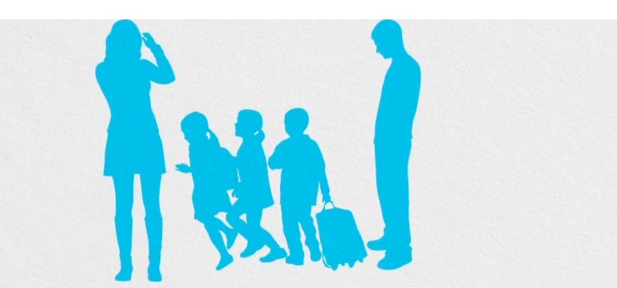

---
## Page 21

SOUTH AUSTRALIA’S DISASTER RESILIENCE STRATEGY	
21
ACTIONS AND RECOMMENDATIONS
PROJECT 4:
Scoping exercise with children and young people
Engage with children and young people to better understand 
how they can play an active role in building their resilience.
Although a wide range of relevant stakeholders were consulted 
in developing the Strategy, only a small number of these 
were children and young people. Rather than leading to clear 
solutions, the user research raised questions, challenges and 
differing opinions of how to enable children and young people 
to build resilience.
Before further projects are developed, specific engagement 
with children and young people, including those who have 
experienced a disaster, is necessary to learn more about 
what resilience means to them, how resilient they consider 
themselves to be, what the barriers are and how they would 
like to contribute to building the resilience of their communities 
and neighbourhoods.
This exercise could be conducted in collaboration with the 
Commissioner for Children and Young People.
RECOMMENDATION 4: 
A consistent approach to disaster resilience education
Work with the AIDR (Australian Institute for Disaster Resilience), 
DRANZSEN (Disaster Resilient Australia-New Zealand School 
Education Network) and sector leaders to promote a consistent 
approach to disaster resilience education.
Leverage existing international and national approaches and 
best practice, including:
•	 child-centred disaster risk reduction research produced 
through the BNHCRC (Bushfire Natural Hazards Cooperative 
Research Centre), including the Practice Framework for 
disaster resilience education
•	 the United Nations Office for Disaster Risk Reduction 
Comprehensive School Safety Framework as a basis for 
integrating disaster resilience education and building safer 
and more resilient school communities.
Frameworks, guidelines and resources 
•	
The Australian Institute for Disaster Resilience 
(AIDR) Education for Young People ProgramXVII 
promotes the development of DRE. Leadership 
and support is being provided for schools and 
communities through the DRESGXVIII Strategy 
group and DRANZSENXIX national network. Major 
resources include a national DRE strategy for 
Australia (in development), DRE mapping of the 
curriculum and a national website providing links 
to all key international and national resources and 
activities.
•	
The BNHCRC research project Child-Centred 
Disaster Risk Reduction has developed a Practice 
Framework for DRE for Australian Emergency 
Management Agencies.XX The project is conducting 
a nationwide evaluation of programs and 
strategies and will develop programs that increase 
resilience for children, schools, households and 
communities.
•	
Macquarie University has partnered with 
Incept LabsXXI to develop a ‘Business Innovation 
Challenge’. Secondary school students are 
presented with real world business problems to 
solve. The Challenge is designed to teach complex 
problem solving and creativity, self-directed 
learning and build the student’s capacity for 
handling ambiguity.

---
## Page 22

SOUTH AUSTRALIA’S DISASTER RESILIENCE STRATEGY	
22
FOCUS AREA 4:  
STRATEGIC AND CONNECTED 
NETWORKS
GOAL 
Strategic and connected networks that broaden the 
emergency management sector and work toward 
common goals and shared outcomes.
In the context of the Strategy, the emergency 
management sector is considered in the broadest 
sense, inclusive of all people, agencies, organisations 
and groups that contribute to emergency 
management across resilience, prevention, 
preparedness, response, relief and recovery efforts.
CONTEXT
Insights from research and consultation summarised below 
informed the development of actions to support strategic and 
connected networks.
Insights from research
•	 To manage the increasing frequency, complexity and 
uncertainty of emergencies, the emergency management 
sector needs to strengthen and build new partnerships, 
working with organisations and individuals that can 
contribute to and effect change.
•	 Disaster resilience is complex with many influencing 
factors sitting outside the traditional domain of emergency 
management. For example, strong employment levels and a 
strong economy, urban spaces that encourage community 
interaction, land-use planning and development control 
can all contribute to a resilient community. A single agency 
or sector in isolation will not achieve the levels of resilience 
that can be built by many in partnership.
•	 SEMC’s Strategic Plan (2017-2022) calls for better synergy 
across government through collaboration and knowledge 
sharing that places public value at the centre of decision-
making, and strengthens partnerships that promote 
innovation and knowledge integration.34 
•	 The emergency management sector has an obligation to 
inform the public of the risks that they face, but information 
alone does not lead to action. The public need to know 
how to reduce their risk and have the ability to do so.35 
•	 The emergency management sector can benefit from local 
knowledge and practice through establishing and building 
on relationships with local government, non-government 
organisations, community groups and traditional owners, 
prior to events.
Insights from consultation
•	 There are many existing champions of resilience and disaster 
resilience both within and outside of the emergency 
management sector in SA. Bodies of work with a resilience 
focus exist in the areas of climate change, mental health, 
public health and business. There is an opportunity to share 
learnings and work towards a common vision of resilience.
•	 Strong leadership is required in the emergency 
management sector. The future of training and 
development in SA’s emergency management sector needs 
to introduce new non-operational modules to reflect 
a more holistic and contemporary view of emergency 
management.
•	 Command and control and hierarchical structures in 
emergency management agencies are important and 
necessary, particularly in the response stage of events. 
However, in building community resilience, such structures 
can create barriers to collaboration and problem-solving.
•	 There is a view that government can be risk averse and 
resistant to change.
•	 The public are looking for ‘real’ and honest communication 
from governments. For example:
-	 Emergencies will happen.
-	 Government cannot always be there for everyone.
-	 There are things being done by governments to support 
you.
-	 There are things that you can do to support yourself – 
and here is some further guidance/information etc.
Quick tips for resilience
•	
Prepare your household to be self- sufficient for 
72 hours. 
•	
Involve children in planning by preparing a stay 
or go bag with toys, entertainment, appropriate 
clothing etc. 
•	
Always have at least half a tank of petrol in your 
car and some cash in your wallet.
•	
Keep your freezer door closed in a blackout.
•	
Have the name and number of your neighbours 
handy. Identify those that may need help during 
an event.
•	
Use camping equipment as your starter kit eg. 
A small cooker/bbq, torch, water cannisters and 
wind up radio.

---
## Page 23

SOUTH AUSTRALIA’S DISASTER RESILIENCE STRATEGY	
23
ACTIONS AND RECOMMENDATIONS
PROJECT 5: 
Emergency management capability development
Develop additional training modules for the emergency 
management sector reflecting an all hazards resilience-based 
approach.
SEMC’s five-year strategic plan signals a shift in approach 
for emergency management. Broadening out from a more 
traditional view of prevention, preparedness, response and 
recovery, the Plan sets out a comprehensive, all-hazards 
resilience-based approach. Shared responsibility, working 
across whole of government and a focus on consequence 
management, including considerations of the secondary 
effects of emergencies is encouraged, as is listening to views, 
experiences and ideas from the community.
Steps are being taken to support this transition and integrate 
this approach throughout the sector’s plans, strategies, policies, 
organisational structures and discourse.
It is suggested that the existing Introduction to Emergency 
Management online training is broadened to include additional 
modules and concepts such as disaster risk reduction, climate 
change and consequence management, underpinned by a 
resilience-based approach, as outlined in the SEMC strategic 
plan.
This needs to be considered in the context of the Capability 
Development Advisory Group.36 
RECOMMENDATION 5: 
Avenues to network and share
Convene resilience forums to share lessons and form new 
partnerships and connections
Convene regular forums open to all members of the sector to 
exchange information and create and reinforce relationships. 
The design of forums should consider:
•	 strong regional representation and inclusion of community 
members/groups
•	 incorporating workshop sessions to progress or contribute to 
bodies of work
•	 inviting people from across Australia who contribute to 
disaster resilience
•	 establishing an information flow for learnings and outcomes 
•	 combining the forum with the People at Risk implementation 
plan action item, Action 11: ‘Deliver a showcase event to 
share successes and learnings’.
RECOMMENDATION 6:
Increase collaboration between disaster resilience and 
recovery functions
The user research highlighted the opportunity to further 
support communities to move from recovery following an 
event, to building their resilience for future events.
To support this, the disaster resilience and recovery functions 
would benefit from a closer working relationship.
RECOMMENDATION 7:  
Undertake a strategic review of the Natural Disaster 
Resilience Program (NDRP)
The next National Partnership Agreement (NPA) for the Natural 
Disaster Resilience Program is likely to undergo changes in 
strategic direction to reflect the priority activities of the National 
Disaster Risk Reduction Framework. Recommended changes in 
this area will be subject to the NPA change in direction.
It is recommended that SAFECOM, as the administrator of the 
NDRP Program in SA:
•	 develop a marketing and promotions strategy for NDRP 
in SA
•	 refine the monitoring and evaluation framework for NDRP  
in SA
•	 review the next NPA implementation plan to consider the 
review findings conducted on the NDRP program in SA in 
2017, including consideration of revised strategic realignment 
with key State strategies and the development of a resilience 
and innovation stream
•	 ensure projects funded are inclusive of the needs at people 
at risk and represent the diversity of our community
•	 advocate for the South Australian Government’s contribution 
to the NPA to be increased to match the Commonwealth 
contribution (50:50) to align with other jurisdictions’ funding 
commitment and to demonstrate shared responsibility.
RECOMMENDATION 8: 
Partner with local government and build on the 
everyday work of councils to strengthen disaster 
resilience
Local governments are key partners in strengthening disaster 
resilience within communities. Councils are the closest level 
of government to the community, and contribute strong local 
relationships, knowledge of hazard, risk, and locally available 
resources and experience in mitigating, responding to and 
recovering from emergencies. 
The everyday work of councils in areas such as community 
development, infrastructure management, public health and 
community leadership can be leveraged to strengthen disaster 
resilience.

---
## Page 24

SOUTH AUSTRALIA’S DISASTER RESILIENCE STRATEGY	
24
RECOMMENDATION 9:  
Diversity and inclusion 
Support greater diversity and inclusion in emergency 
management e.g. through a dedicated taskforce. 
RECOMMENDATION 10:  
Support strategies that better prepare people at risk for 
emergencies
Support the work of the Australian Red Cross projects aimed at 
embedding policy and practice in preparing and responding to 
emergencies in a way that is inclusive of the diverse make-up 
and needs of our community.
•	 People at Risk in Emergencies Framework for SA 
Implementation Plan
•	 Community Services Organisations: A Shared Responsibility.
RECOMMENDATION 11:  
Recognise local knowledge 
Recognise local knowledge, including partnering with 
Aboriginal and Torres Strait Islander peoples.
RECOMMENDATION 12:  
Build resilience through health and wellbeing
Build on existing public health and wellbeing programs and 
policies across agencies that contribute to community resilience, 
such as the State’s Health in All Policies and the State Public 
Health Plan 2019-2014.

---
## Page 25

SOUTH AUSTRALIA’S DISASTER RESILIENCE STRATEGY	
25
7.	
PUBLIC INFORMATION CAMPAIGN
Within the scope of developing the Disaster Resilience Strategy 
was to explore the role of a public information campaign aimed 
at building a stronger culture of self-reliance and preparedness 
across SA.
Where people are motivated and supported to understand and 
manage the risks they face, and to take action to reduce these 
risks, they:
•	 experience better outcomes when emergencies and disasters 
occur 
•	 reduce demand on response and recovery agencies, allowing 
support to be provided to those who need it most.
Research into a possible public information campaign generated 
the following insights:
•	 Progress toward a more disaster-resilient population requires 
the active participation of community members.
•	 Public information campaigns can play a key role in generating 
public awareness on an issue and shifting attitudes and 
behaviours.
•	 Long-term behaviour change generally requires more than just 
a public information campaign.37 Public information should be 
part of a broader strategy and paired with programs, services, 
legislation and incentives that all support the desired outcome.
•	 Achieving long-term sustainable behaviour change will take 
many years of commitment and bi-partisan support.
•	 A 72-hour model, based on being prepared to take care of 
yourself and others for three days following an event, has 
been successfully adopted internationally, including in the 
United States, Canada, Spain, New Zealand and other parts of 
Australia.
•	 Before public materials are developed on disaster resilience, 
the emergency management sector should establish a shared 
and consistent understanding of disaster resilience.
•	 The viability of developing a new campaign would need 
to be considered in the context of existing hazard-specific 
campaigns, with care taken not to duplicate messaging or 
confuse the target audience.
•	 A broad public information campaign would be most effective 
complemented by tailored local-level activities and messaging.
•	 A public information campaign would require additional 
dedicated resources for its development and management, 
and significant ongoing investment to support widespread 
advertising and media communications.
PROJECT 6: 
Disaster Resilience Public Information Campaign
Undertake research to determine the viability and need for an all-
hazards disaster resilience public information campaign.
If it is determined a disaster resilience campaign should proceed, 
the following steps would be required:
•	 secure funding that covers an ongoing or defined period of 
time to cover strategic, production, advertising and evaluation 
costs
•	 draw on existing research and user experience from previous 
resilience-related campaigns and establish a brief for creative 
strategy development and media planning built around 
achieving community behavioural change
•	 engage a creative agency to develop the campaign concept 
and materials
•	 implement focus group concept testing for the campaign and 
materials
•	 identify campaign elements that can be delivered within 
agency resources through embedding messages and actions 
through existing channels, programs and services such as 
emergency service volunteers, local government, or non-
government organisations
•	 explore partnerships with other states and territories to 
encourage a consistent campaign.

---
## Page 26

SOUTH AUSTRALIA’S DISASTER RESILIENCE STRATEGY	
26
8. SUMMARY OF PROJECTS AND RECOMMENDATIONS
FOCUS AREA 1:
NEIGHBOURHOODS AND COMMUNITIES  
PROJECT 1 – Community-based emergency management
Develop and pilot a collaborative model for community-based emergency management.
PROJECT 2 – Innovative insurance options
Develop initiatives to increase financial resilience and stability for businesses and community members and to reduce levels of financial hardship 
after an emergency or disaster. 
RECOMMENDATION 1 – Innovate to strengthen a culture of volunteering
Build on existing initiatives that aim to increase volunteer participation.
FOCUS AREA 2:
SMALL BUSINESSES
PROJECT 3 – Small business resilience
Develop and pilot programs or services that build small business resilience.
RECOMMENDATION 2 – Targeted grant funding
Expand the Natural Disaster Resilience Program (NDRP) grant funding to enable businesses to apply.
RECOMMENDATION 3 – Strengthen business sector engagement
The emergency management sector to strengthen engagement with business across resilience, prevention, preparedness, response and recovery. 
FOCUS AREA 3:
CHILDREN AND YOUNG PEOPLE
PROJECT 4 – Scoping exercise with children and young people 
Engage with children and young people to better understand how they can play an active role in building their resilience.
RECOMMENDATION 4 – A consistent approach to disaster resilience education
Work with the AIDR (Australian Institute for Disaster Resilience), DRANZSEN (Disaster Resilient Australia-New Zealand School Education Network) 
and sector leaders to promote a consistent approach to disaster resilience education.
FOCUS AREA 4: 
STRATEGIC AND CONNECTED NETWORKS 
PROJECT 5 – Emergency management capability development
Develop additional training modules for the emergency management sector reflecting an all-hazards resilience based approach.
RECOMMENDATION 5 – Avenues to network and share
Convene regular forums open to all members of the sector to exchange information and create and reinforce relationships.
RECOMMENDATION 6 – Disaster resilience and recovery 
Increase collaboration between disaster resilience and recovery functions.
RECOMMENDATION 7 – Natural disaster resilience program 
Undertake a strategic review of the Natural Disaster Resilience Program (NDRP).
RECOMMENDATION 8 – Relationship with local government
Partner with local government and build on the everyday work of councils to strengthen disaster resilience.
RECOMMENDATION 9 – Diversity and inclusion 
Support greater diversity and inclusion in emergency management e.g. through a dedicated taskforce.
RECOMMENDATION 10 – Support strategies that better prepare people at risk for emergencies
Support the work of the Australian Red Cross projects aimed at embedding policy and practice in preparing and responding to emergencies 
(specifically the People at Risk in Emergencies Framework and the Community Services Organisations project).
RECOMMENDATION 11 – Recognise local knowledge
Recognise local knowledge, including partnering with Aboriginal and Torres Strait Islander peoples.
RECOMMENDATION 12 – Build resilience through health and wellbeing 
Build on existing public health and wellbeing programs and policies across agencies that contribute to community resilience, such as the State’s 
Health in All Policies and the State Public Health Plan 2019-2014.
ADDITIONAL AREA OF CONSIDERATION: PUBLIC INFORMATION 
PROJECT 6 – Public information campaign
Undertake research to determine the viability and need for an all-hazards disaster resilience public information campaign.

---
## Page 27

SOUTH AUSTRALIA’S DISASTER RESILIENCE STRATEGY	
27
REFERENCES
1	 Council of Australian Governments (COAG), National Strategy for Disaster 
Resilience, 2011, p iv
2	 Australian Institute for Disaster Resilience: Australian Disaster Resilience 
Knowledge Hub, Australian Disaster Resilience Glossary (online), https://
knowledge.aidr.org.au/glossary
3	 SA Planning Portal, Population projections and demographics, http://www.
saplanningportal.sa.gov.au/data_and_research/population_projections_and_
demographics#population-change-2011-2016
4	 Population Australia, Population of South Australia 2018, http://www.population.
net.au/population-of-south-australia
5	 Australian Bureau of Statistics (ABS), 2016 Census QuickStats, http://
quickstats.censusdata.abs.gov.au/census_services/getproduct/census/2016/
quickstat/4GADE?opendocument
6	 .id the population experts, Australia: Industry sector of employment, https://
profile.id.com.au/australia/industries
7	 SA.GOV.AU, Living in South Australia, https://www.sa.gov.au/topics/about-sa/
about-sa
8	 Coates, L., Haynes, K., O’Brien, J., et al, Exploring 167 years of vulnerability: 
An examination of extreme heat events in Australia 1844-2010, Environmental 
Science & Policy v 42 October 2014, pp 33-44
9	 Burns, G., Adams, L., Buckley, G., Independent Review of the Extreme Weather 
Event South Australia, 28 September – 5 October 2016, 2017 
	
Develop practical policy outcomes to support resilience (eg the 72 hour model) 
and promote this broadly to community through media, awareness campaigns, 
policies etc. Research should be undertaken to gain insight into the types of 
messaging and activities that have the most impact on sustained behaviour 
change within the community before committing to a particular model.
10	 Adapted from the Rockefeller Foundation’s 100 Resilient Cities program definition 
of disaster resilience ‘the capacity of individuals, communities, institutions, 
businesses, and systems within a city to survive, adapt, and grow no matter what 
kinds of chronic stresses and acute shocks they experience.’
11	 Council of Australian Governments (COAG), NSDR, 2011, p v
12	 Emergency Management Victoria (EMV), The Emergency management diversity 
and inclusion framework: Respect and inclusion for all, 2016
13	 United Nations Office for Disaster Risk Reduction (UNISDR), Vulnerability, https://
www.preventionweb.net/risk/vulnerability
14	 World Health Organization, Mental health: strengthening our response, http://
www.who.int/en/news-room/fact-sheets/detail/mental-health-strengthening-our-
response
15	 Aldrich, D., Fixing recovery: Social capital in post-crisis resilience, Journal of 
homeland security and emergency management, May 2010
16	 Australian Red Cross, People at risk in emergencies framework for South 
Australia, 2017, p 14
17	 Victoria State Government, Health and Human Services, Promoting financial 
resilience to emergencies through home and content insurance, 2017
18	 ABS, 4159.0 - General social summary: Summary results, Australia 2014, http://
www.abs.gov.au/AUSSTATS/abs@.nsf/mf/4159.0
19	 Volunteering in Australia, State of volunteering in Australia: Help create 
happiness, 2016, p 12
20	 Resilient Melbourne Delivery Office, Annual report 2017-18, https://
resilientmelbourne.com.au/strategy
21	 Volunteering SA&NT, Volunteering strategy for South Australia, http://www.
savolunteeringstrategy.org.au/the-strategy
22	 Volunteering Australia, Volunteering and the Australian curriculum, https://www.
volunteeringaustralia.org/resources/australian-curriculum
23	 SA Small Business Centre, South Australia. Made by small business, 2016 Annual 
small business statement, 2016
24	 City of Melbourne, Can you futureproof your business, http://commail.monkii.
com/campaigns/reports/viewCampaign.aspx?d=r&c=340D8EC4173F6446&ID=99
0B8D4C497A90DD2540EF23F30FEDED
25	 BNHCRC, Risk and warning communication that supports women during 
disasters, https://www.bnhcrc.com.au/news/blogpost/amisha-mehta/2018/risk-
and-warning-communication-supports-women-during-disasters
26	 Business SA, Chamber of Commerce and Industry Blackout survey results: 
Understanding the effects of South Australia’s state-wide blackout on Wednesday 
28 September 2016, n.d.
27	 Online business continuity plans provided by the SA Department for Industry and 
Skills have been downloaded 120 times. (As at August 2018).
28	 Commonwealth and State funding provided for disaster resilience initiatives.
29	 United Nations, Human Rights Office of the High Commissioner Convention on 
the Rights of the Child, 1989
30	 Australian Red Cross, Pillowcase project, https://www.redcross.org.au/get-help/
emergencies/resources-about-disasters/resources-for-parents-and-teachers/
pillowcase-project
31	 Mission Australia, Mission Australia’s 2017 youth survey report, n.d.
32	 The development of knowledge and skills which enable learners to assess danger 
in the environment and take protective action before, during and after a potential 
disaster or emergency event. Refer to AIDR, What is disaster resilience education?, 
https://schools.aidr.org.au/disaster-resilience-education/what-is-dre
33	 BNHCRC, Disaster resilience education, A practice framework for Australian 
Emergency Management Agencies, 2017, https://www.bnhcrc.com.au/
publications/biblio/bnh-2803
34	 Government of South Australia, State Emergency Management Committee 
Strategic Plan 2017-2022, 2016
35	 International Federation of Red Cross and Red Crescent Societies, Public 
awareness and public education for disaster risk reduction: a guide, 2011
36	 Chaired by SA Health, this group has been established to finalise work from the 
State Emergency Service (SES) capability project.
37	 Australian Public Service Commission, Changing behaviour: A public policy 
perspective, https://www.apsc.gov.au/changing-behaviour-public-policy-
perspective
REFERENCES IN BOXES
I	
Van den Honert, R., Coates, L., Haynes, K., et al, A century of natural disasters 
- what are the costs? Fire Australia Magazine, Summer 2014-2015, pp 30-33
II 	
Hot days are days with a maximum temperature > 35°C; Bureau of 
Meteorology, About the climate change extremes analyses, http://www.bom.
gov.au/climate/change/about/extremes.shtml Australian Research Council, Are 
heatwaves ‘worsening’ and have ‘hot days’ in Australia doubled in the last 
50 years?, https://www.climatescience.org.au/content/1146-are-heatwaves-
worsening-and-have-hot-days-australia-doubled-last-50-years
III 	
Climate Council of Australia, Heatwaves: Hotter, longer, more often, 2014, p 
50
IV 	
Climate Council of Australia, Relevant, immediate, local: Guide to 
communicating climate change in Australia, 2014, p 19
V 	
Australian Business Roundtable for Disaster Resilience & Safer Communities, 
The economic cost of the social impact of natural disasters, March 2016
VI 	
McLennan, V., Family and community resilience in an Australian Indigenous 
community. Australian Indigenous Health Bulletin v 15 no 3, 2015
VII 	
Sendai Framework. Refer to https://www.unisdr.org/we/coordinate/sendai-
framework
VIII 	 ABS, 4613.0 - Australia’s Environment: Issues and Trends, Jan 2010, http://
www.abs.gov.au/AUSSTATS/abs@.nsf/Lookup/4613.0Feature+Article1Jan+201
0
IX 	
Anangu Pitjantjatjara Yankunytjatjara (APY) Lands; emergency management 
counterparts other states and territories; land management; and Indigenous 
groups.
X 	
Powell, S., Plouffe, L., Gorr; P., When ageing & disasters collide: lessons from 
16 international case studies, Radiation Protection Dosimetry, v 134 no 3-4, 1 
June 2009, pp 202-206
XI 	
Diversity in Disaster Collaborative, Diversity in disaster conference issues paper, 
January 2018
XII 	
Australian Red Cross, People at risk in emergencies framework for South 
Australia, 2017
XIII 	 Gender & Disaster Pod, The National gender and emergency management 
guidelines, 2016
XIV	 Emergency Management Victoria (EMV), Community based emergency 
management, May 2016
XV	
TRI, Household Resilience Toolkit, http://www.flinders.edu.au/torrens-resilience-
institute/projects/household-resilience-toolkit.cfm
XVI	 Refer to https://getprepared.nz/my-community/community-emergency-hubs
XVII	 Refer to https://schools.aidr.org.au/disaster-resilience-education/strategy
XVIII	 The National Disaster Resilience Education Strategy Group (DRESG) provides 
leadership in the development of strategies and opportunities for disaster 
resilience education (DRE).
XIX	 Refer to https://schools.aidr.org.au/resources/disaster-resilient-australia-new-
zealand-school-education-network
XX	
BNHCRC, Disaster resilience education, A practice framework for Australian 
Emergency Management Agencies, 2017, https://www.bnhcrc.com.au/
publications/biblio/bnh-2803
XXI	 Refer to http://www.inceptlabs.com.au

