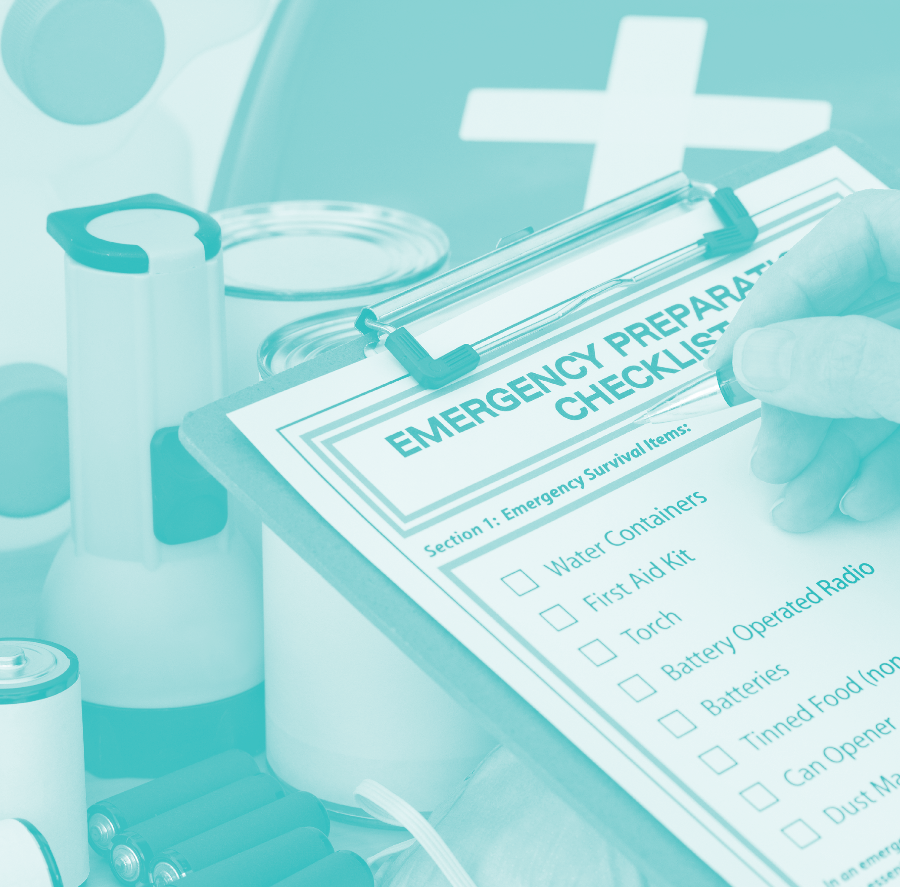
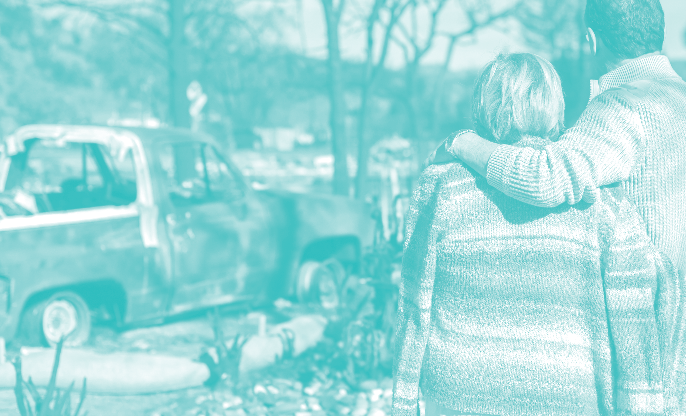
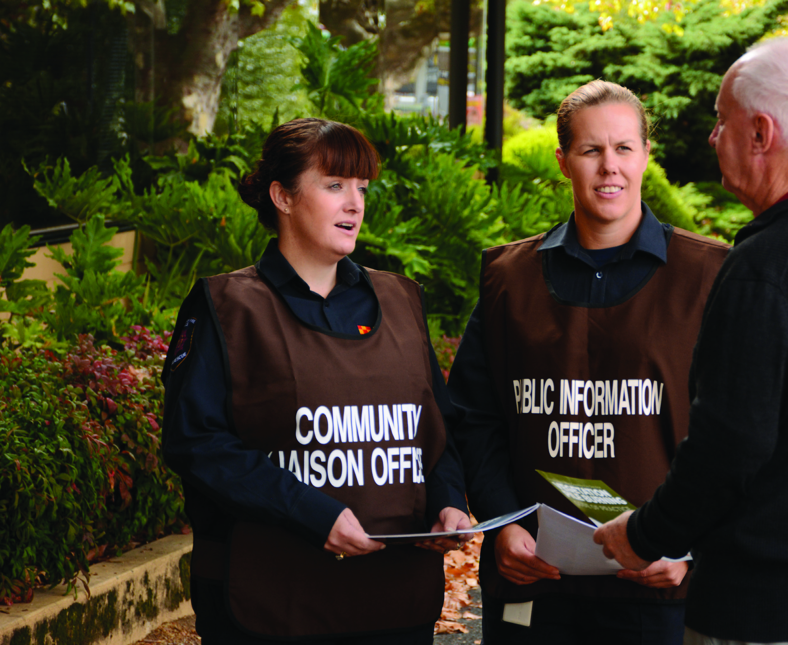
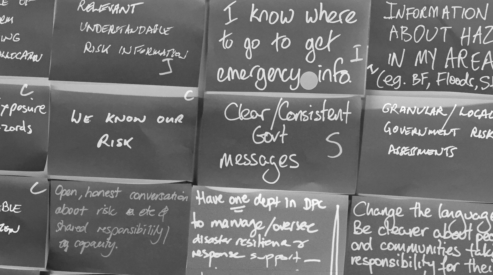
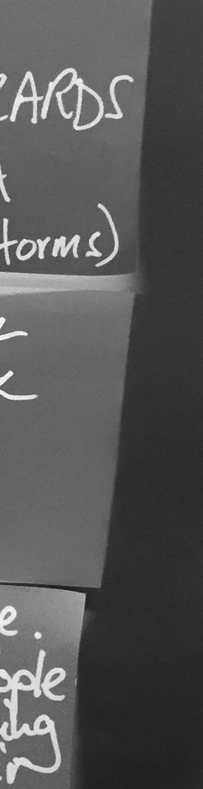
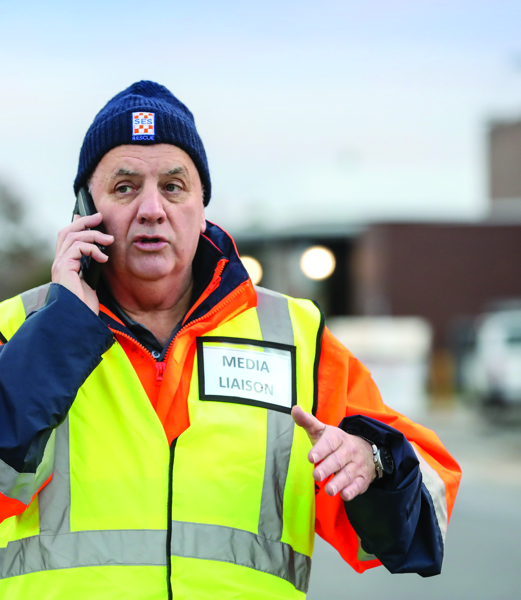
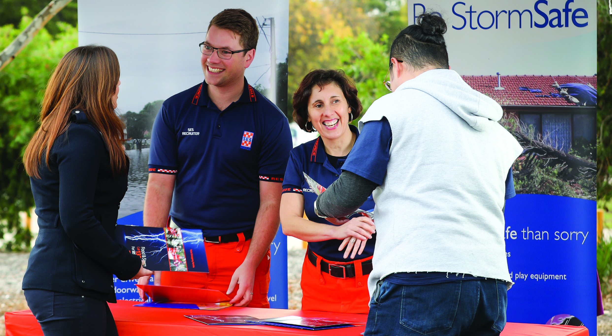
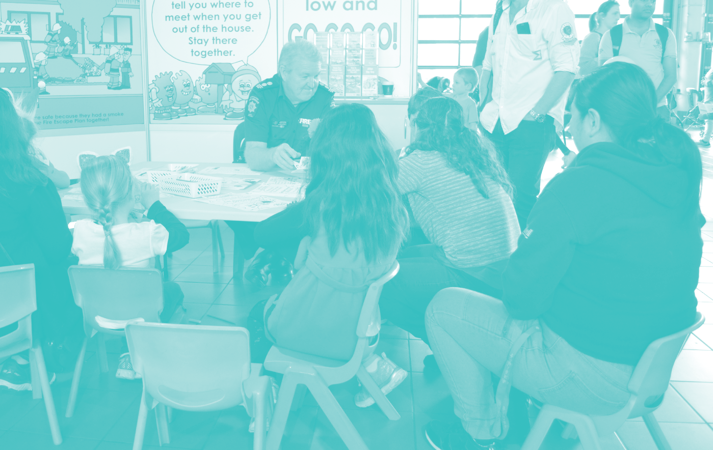
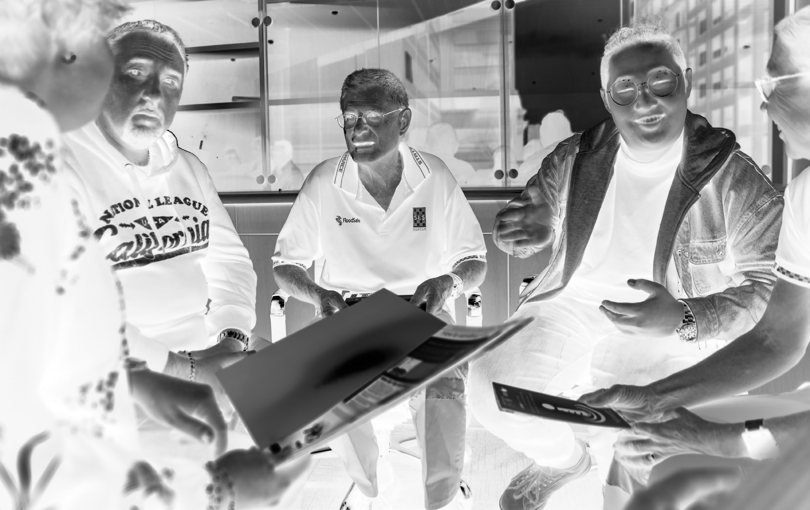

# South Australia's Emergency Management Communication and Engagement Framework

> **Source**: SA SAFECOM
> **URL**: https://resources-production.safecom.sa.gov.au/current/docs/South%20Australia%27s%20Emergency%20Management%20Communication%20and%20Engagement%20Framework%20%28A1426446%29.pdf
> **Licence**: © Government of South Australia; emergency-management practitioner reference
> **Retrieved**: 2026-05-07T23:45:01Z
> **SHA-256**: `e6237fe22237b4f012c5ea5e7f5f834135bd5aa2f1cfbff350ee1e4c7a46e13e`
> *Converted from PDF to Markdown format.*

---
## Page 1

SOUTH AUSTRALIA’S
EMERGENCY
MANAGEMENT
COMMUNICATION
AND ENGAGEMENT
FRAMEWORK

---
## Page 2

This project was funded under the  
Natural Disaster Resilience Program by the  
South Australian State Government and the 
Commonwealth Department of Home Affairs.
June 2020

---
## Page 3

This Framework has been developed, 
on behalf of the State Emergency 
Management Committee by the  
South Australian Fire and Emergency 
Services Commission (SAFECOM).  
We acknowledge the individuals  
and organisations that  
contributed their thoughts  
and knowledge to  
inform this work.
CONTENTS
1.0
Context
1
The Communication Cycle
3
2.0
Framework purpose
4
Communication and Engagement Framework
5
3.0
Key messages
9
4.0
Shared practices
12
5.0
Communication roles 
16
6.0
Further support
18
Appendix A
Message Construction Roadmap
23
Appendix B
Further information and resources
28

---
## Page 4

1.0 CONTEXT
iv  //  SOUTH AUSTRALIA’S EMERGENCY MANAGEMENT COMMUNICATIONS AND ENGAGEMENT FRAMEWORK

---
## Page 5

Our world is changing rapidly and 
significantly, with impacts that 
are both global and local. 
South Australia’s climate has changed and 
further change is expected. As a result, 
natural hazards such as bushfires, floods and 
extreme weather are increasing in severity and 
frequency. The impacts for people experiencing 
these events will continue to intensify placing 
increased pressure on our capacity to respond. 
At the same time, new threats are emerging; 
our reliance on technology has increased 
our vulnerability to cyberattack. Changes to 
social demographics, mobility patterns, and 
environmental conditions have changed our 
exposure to infectious disease and pandemics.
In this context, there needs to be a shift from 
thinking of emergencies and disasters as  
unlikely events that happen to other people,  
to an understanding that emergencies will 
happen, and will touch the lives of each of 
us. This shift in perception enables people to 
engage with and act on information to support 
preparedness, empowering them to live with and 
survive emergencies. 
There needs to be a shift from 
thinking of emergencies and disasters 
as unlikely events that happen to 
other people, to an understanding 
that emergencies will happen, and  
will touch the lives of each of us.
GOVERNMENT OF SOUTH AUSTRALIA  //  1

---
## Page 6

WHAT WE CAN DO
The Emergency Management Act 2004  
prescribes the establishment of strategies and 
systems for the management of emergencies 
in the State. South Australia’s Emergency 
Management Communications and Engagement 
Framework (the Framework) delivers on that 
intention by fostering consistency and  
co-ordination in communication practises 
regarding emergency management.
South Australia’s emergency management 
sector plays a crucial role in informing and 
engaging with the public about living with 
emergencies – including how to prevent, 
prepare, respond, and recover.
Amongst numerous state government 
agencies, local government, businesses and 
non-government organisations (NGOs) there 
exists a pool of knowledge and support that is 
of huge and potentially life-saving benefit to the 
community. If this benefit is to be realised, the 
right information must get to the right people in 
the right way, to maximise the chance of it being 
not only heard and understood but acted upon. 
This Framework is underpinned by the 
principle that effective communication about 
emergencies and disasters in all phases is a  
two way process. It is essential that as 
emergency management communicators 
we; take the time to listen to need, identify 
the appropriate message to share, the most 
effective way to share it and then check and 
validate that the message has been understood 
by the intended audience. This type of 
communication should be seen as a continuous 
cycle, an ongoing conversation.
Emergency Management Sector
This Framework has been developed to support 
the emergency management sector. 
This includes all of the people, agencies, 
organisations and groups that contribute to 
emergency management through resilience 
building, prevention, preparedness, response, 
relief and recovery efforts.
2  //  SOUTH AUSTRALIA’S EMERGENCY MANAGEMENT COMMUNICATIONS AND ENGAGEMENT FRAMEWORK

---
## Page 7

THE COMMUNICATION CYCLE
IDENTIFY
Mode and  
message
VALIDATE
Message  
reception
LISTEN
Listen  
to need
LISTEN
Analyse 
feedback
VALIDATE
Message  
reception
RESPOND
Adapt mode  
and message
GOVERNMENT OF SOUTH AUSTRALIA  //  3

---
## Page 8

2.0
FRAMEWORK 
PURPOSE
This Framework has been developed in recognition that communication 
and engagement are fundamental emergency management activities 
whether they occur before, during, or after an emergency. 
1	
Government of South Australia, Stronger Together, South Australia’s Disaster Resilience Strategy 2019-2024, p.16
The Framework aims to strengthen 
communication and engagement between 
emergency managers and the public, in relation 
to preparing to experience or recover from an 
emergency or disaster. It provides guidance for 
the use of communications to build community 
resilience state-wide, in line with the aims of 
Stronger Together, South Australia’s Disaster 
Resilience Strategy. 
The Framework aims to support the emergency 
management sector to: 
	
• Develop and deliver public information that is 
clear, accessible and consistent
	
• Work together to achieve consistency, avoid 
confusion, overcome “message fatigue” and 
incite action amongst members of the public
	
• Embed messaging that contributes to 
community disaster resilience across multiple 
sources and communication channels
	
• Participate in a streamlined communications 
model that clearly identifies the trusted 
primary sources of information for hazards, 
supported by “amplification” of that message 
by sector partners and stakeholders.
To this end, the Framework sets out:
	
• Overarching key messages to help guide 
communication content before and after events
	
• Shared practices to define and guide how the 
sector communicates with the public
	
• Organisations responsible for developing 
content for hazards and organisations, 
groups and individuals that support and 
amplify this content 
	
• A checklist that organisations can use to 
align planned communication projects and 
initiatives to the Framework, and
	
• Projects and initiatives proposed to further 
the Framework aims and implement the key 
messages and shared practices on the ground.
Development of the Framework has been 
informed by:
	
• An understanding of how disaster resilience 
can be supported in the community, where it 
is understood to mean 
The ability to survive, adapt, and grow,  
no matter what happens.1
	
• The user research conducted to develop 
Stronger Together, South Australia’s Disaster 
Resilience Strategy 
	
• Engagement with staff and volunteers in the 
emergency management sector in community 
education, media and communications, and 
emergency planning and response roles
	
• The International Association of  
Public Participation (IAP2) Public  
Participation Spectrum
	
• Australasian Fire and Emergency Service 
Authorities Council (AFAC) Doctrine
	
• Review of the evidence for best-practice 
emergency management communication 
practices, and
	
• The People at Risk in Emergencies Framework 
developed by Australian Red Cross.
4  //  SOUTH AUSTRALIA’S EMERGENCY MANAGEMENT COMMUNICATIONS AND ENGAGEMENT FRAMEWORK

---
## Page 9

COMMUNICATION AND 
ENGAGEMENT FRAMEWORK
South Australia’s Emergency  
Management Communications Toolkit
Response
Recovery
RESILIENCE
Preparedness
South Australia’s Emergency  
Management Communications and 
Engagement Framework
South Australia’s Framework for 
Communications During Emergencies
GOVERNMENT OF SOUTH AUSTRALIA  //  5

---
## Page 10

SCOPE OF FRAMEWORK
The Framework is focussed on preparedness 
messaging. It does not provide guidance on 
warnings, alerts, or other communication that 
happens in the operational response phase of 
emergency management. 
Guidance for communicating during operational 
response will be contained in South Australia’s 
Framework for Communication During 
Emergencies scheduled for release in 2020. 
Both Frameworks are supported by South 
Australia’s Emergency Management 
Communication Tool Kit, also scheduled for 
release in 2020. The tool kit is a collection of 
practical how-tos, starter guides, templates and 
work sheets designed to help communicators 
plan and execute their roles. 
The development of this Framework is 
addressing a strategic task (1.5.2) from the State 
Emergency Management Committee’s (SEMC) 
Strategic Plan 2017-2022 that provides for 
development of:
“A state EM communications plan including 
recommendations on a centralised online 
presence which supports overall resilience 
based on community engagement.”
SAPOL is leading delivery of an associated task 
1.5.1: An integrated holistic communication 
framework for communication during 
emergencies. 
The Framework aims to  
strengthen communication  
between emergency managers  
and the public who are preparing  
to experience or to recover from  
an emergency event or disaster.
6  //  SOUTH AUSTRALIA’S EMERGENCY MANAGEMENT COMMUNICATIONS AND ENGAGEMENT FRAMEWORK

---
## Page 11

GOVERNMENT OF SOUTH AUSTRALIA  //  7

---
## Page 12

WHY 
RESILIENCE?
An objective of the South Australian Emergency Management Act 2004  
is to promote community resilience and reduce community vulnerability 
in the event of an emergency.
The need to increase the resilience and hazard 
preparedness of all South Australians, was 
a key finding of the independent inquiry into 
South Australia’s extreme weather event, 
including the state-wide blackout in 2016.  
The development of Stronger Together,  
South Australia’s Disaster Resilience Strategy 
has been one response.
Stronger Together describes a disaster 
resilient community as one where, amongst 
other factors we:
	
• Understand the risks we face based on our 
location and situation
	
• Take action where we can, to prepare for and 
manage these risks
	
• Know our neighbours and those who might 
need more help in an emergency or disaster
	
• Know how and where to get the information 
we need in a range of situations
	
• Know how to link into services that are there 
to support us
	
• Understand the importance of coming 
together as a community to help emergency 
and support services understand our needs 
after an emergency or disaster
	
• Are as self-reliant as we can be because we 
know that in a significant event, emergency 
services can’t be everywhere
	
• Have the ability to withstand and recover 
from a disaster or emergency event.
Achieving any of these attributes relies on 
communication to engage with, inform, and 
encourage people to foster their connections 
with each other. The resilience focus of the 
Framework reflects not only government policy, 
but the real link between communications and 
better outcomes for South Australians living 
with emergencies.
A Climate Smart South Australia
As the climate changes, risks associated 
with natural hazards, such as bushfire, are 
increasing. The 2019-20 bushfires that 
occurred across Australia were exacerbated 
by drought, very dry fuels and soils, and 
record-breaking heat. In South Australia there 
were three fatalities, numerous injuries and 
significant property loss and damage, with 
approximately 278,603 hectares burnt, 194 
houses lost, 67,928 reported livestock losses 
and impacts on 63 vineyards and 414 beehives.  
The impact of these bushfires was also felt by 
many people and businesses located far from 
the fires. Such events place into sharp focus on 
the urgency of the need for action.  
The emergency services sector is committed 
to engaging with the community about 
the increasing frequency and severity of 
emergencies and disasters to create greater 
awareness and understanding to support 
communities to be more hazard ready.
The resilience focus of the Framework 
reflects not only government 
policy, but the real link between 
communications and better 
outcomes for South Australians living 
with emergencies.
8  //  SOUTH AUSTRALIA’S EMERGENCY MANAGEMENT COMMUNICATIONS AND ENGAGEMENT FRAMEWORK

---
## Page 13

3.0 KEY MESSAGES
The meaning of these key messages captures what we fundamentally 
want people to understand about living with emergencies and building 
community resilience.
All communications with the public about living 
with emergencies should reflect the intent of 
the key messages – but this does not mean they 
need to be used word for word. Consider the 
key messages your starting point for working 
out how to best communicate the intent of the 
message to the communities and audiences you 
work with.
Described below, along with each message, is 
an explanation of why the message’s meaning 
is important, and the desired outcome of it 
reaching the public 
GOVERNMENT OF SOUTH AUSTRALIA  //  9

---
## Page 14

1.
KEY MESSAGES
Emergencies and disasters take many forms, ranging 
from natural disasters to disease pandemics and acts  
of terror. 
With the impacts of climate change, there is ample 
evidence that disasters are happening more often and 
impact more of us.
In recent years, South Australians have experienced, 
fires, floods, a major blackout, extreme heat events and 
a global pandemic.
Despite these facts, people’s belief that it won’t happen 
to me is the major barrier to engaging with emergency 
preparedness information, let alone acting on it. 
By communicating the intent of this message, we 
want everyone to understand that they are exposed 
to risks, and understand what these risks are.
Every one of us is at risk
Every South Australian could be 
impacted by an emergency, disasters 
don’t discriminate.
10  //  SOUTH AUSTRALIA’S EMERGENCY MANAGEMENT COMMUNICATIONS AND ENGAGEMENT FRAMEWORK

---
## Page 15

A separate factor to people’s awareness of risk, is 
whether people have the resources, knowledge, skills 
and confidence to reduce or prepare for the risk.
Basic household and business/organisational 
preparedness can significantly reduce the impact of  
an emergency, and even be the difference between life 
and death.
In the event of a disaster, emergency services may not be 
able to respond to everyone. We must feel empowered 
to protect ourselves, our businesses and our loved ones, 
and believe that doing so is within our reach. 
By communicating the intent of this message, we 
want people to make time for having conversations 
and completing simple tasks in preparation for 
surviving an emergency and recovering from one, 
knowing that preparedness and planning can make 
a life-changing difference to the outcome.
Being ready is your 
superpower
As individuals we have the power to 
change the outcome of an emergency 
for ourselves and our loved ones.
Research has shown that the connections that people 
have with each other are the most important factor in 
recovering from emergencies and disasters. 
Connections with each other and organisations 
(government and non-government) facilitate a sense 
of common interest and responsibility for each other’s 
wellbeing as well as access to information. 
Communities where people know and can rely on each 
other have a larger safety net than those in which people 
rely on themselves and/or emergency services.
By communicating the intent of this message,  
we want people to get to know their neighbours and 
become more involved in their local community.
When we help each other, 
we help ourselves
As members of a connected 
community, we have people to call on to 
help us in an emergency, and we know 
who might need our help and how we 
can assist.
2.
3.
We must feel empowered to  
protect ourselves and our loved  
ones and believe that doing so is 
within our reach.
GOVERNMENT OF SOUTH AUSTRALIA  //  11

---
## Page 16

The shared practices for emergency management 
communication and engagement have been 
developed based on an understanding that 
effective communication is as much about how 
information is transmitted, as what is conveyed. 
This is particularly important where the intended result of that 
communication is action, or behaviour change.
As such, the shared practices are intended to inform the way in which 
the emergency management sector approaches and engages in 
communications activities.
Coordination
The practice of coordinating messages and effort is essential to both 
developing consistent communication that builds the credibility of the 
sector as a trusted information source, and using the limited resources 
available for the greatest impact.
People are more likely to change their behaviour if the information 
received is from a trusted source. 
Best practice shows that individuals will seek verification from multiple 
sources to confirm information they receive about emergencies.
Having multiple channels and sources of information is important.  
If audiences receive a consistent message from multiple trusted 
sources, they are more likely to believe it and act on it.
In contrast, receiving conflicting information destroys the public’s trust, 
undermines credibility, and impedes decision making.
We know from experience that many people only access preparedness 
information when an emergency is approaching. It is therefore 
important to have this ‘just in time’ information available in accessible, 
easy to digest and consistent formats. 
By engaging in this practice as a sector, we want preparedness 
messaging to be coordinated between organisations to maximise 
reach and value, and maintain consistency and public trust.  
We want to make the best use of established structures 
to simplify how messages for the public are developed, 
communicated, and amplified amongst others in our sector. 
4.0 SHARED PRACTICES
12  //  SOUTH AUSTRALIA’S EMERGENCY MANAGEMENT COMMUNICATIONS AND ENGAGEMENT FRAMEWORK

---
## Page 17

Councils are well placed to work with 
emergency management organisations at 
a grass roots level to help amplify disaster 
resilience and preparedness messaging. Early and 
frequent engagement with local government is 
encouraged as a key way to reach communities.
GOVERNMENT OF SOUTH AUSTRALIA  //  13

---
## Page 18

SHARED PRACTICES
Collaboration
The practice of working together, rather than in 
organisational siloes, opens up opportunities and 
overcomes barriers to effective communication.
Collaboration can create efficiencies, cost 
savings, and a better return on investment  
when it avoids duplicated effort. A simple 
example is where an organisation is looking to 
deliver a message: understanding the campaigns 
that are in place may create the opportunity 
to partner with or amplify the existing activity, 
rather than expending the time and resources to 
“start from scratch.” 
Collaboration also allows for greater reach, as 
shared messages are distributed amongst the 
networks of everyone involved, and enables the 
benefits of shared knowledge and experience 
that each person brings.
Opportunities exist through the sector to partner 
with other agencies, groups and organisations 
to align objectives, share resources, access 
networks, and leverage engagement opportunities. 
State Government agencies, local government 
and NGOs continue to be positive conduits for 
disaster resilience and preparedness messaging, 
with more opportunities to explore this 
connection to be realised. Partnerships with the 
private sector are a largely untapped opportunity 
to broaden the reach of important messages. 
By engaging in this practice as a sector,  
we want communicating about emergencies 
to be a whole of sector collaborative 
process with every initiative starting with; 
a review of community need, possible 
partners, allies, and opportunities to 
leverage existing investments and amplify 
existing messages.
14  //  SOUTH AUSTRALIA’S EMERGENCY MANAGEMENT COMMUNICATIONS AND ENGAGEMENT FRAMEWORK

---
## Page 19

Contextual awareness
The practice of contextual awareness in 
communications involves being cognisant of 
the ways in which messages and methods can 
be used to achieve different objectives and 
converse with different target audiences.
Communications in emergency management 
seeks to encourage or support a change in 
people’s behaviour, or a decision to act. A range 
of social factors such as beliefs, experiences  
and preferences influence peoples’ decisions 
and behaviour, so communicating effectively 
about living with emergencies is not a case of 
one size fits all. 
Achieving behavioural change is complex. 
When developing strategies, it is important 
to understand that provision of information 
alone is unlikely to incite action or change. 
Researching your audience and building upon 
what has worked previously, pairing information 
with community engagement, and starting with 
those that are ready to take action, are some of 
the ways understanding the context can lead to 
improved outcomes. 
While opportunities exist to use technology 
more effectively in the sector (e.g. social media, 
campaigns, apps), grass roots community 
education will continue to be an important part 
of emergency management. It is imperative that 
communicators also target specific sections of 
the community such as people who are potentially 
more at risk e.g. people with a language barrier, 
who are mobility impaired, socially isolated, or 
people living in a high-risk location. 
Effective community engagement strategies also 
seek to understand and build upon the inherent 
strengths of individuals and communities rather 
than focussing on deficits and vulnerability. For 
example, an assumption could be made that 
someone with a disability will be more vulnerable 
in the event of an emergency, when in fact they 
may have done more planning than most as part 
of their day to day life, have structured support 
networks and plans in place, and be more 
experienced in dealing with adverse situations. 
By engaging in this practice as a sector, we 
want communicating about preparedness 
for and recovery from emergencies to 
be considered and contextualised to 
recognise diversity, and to be planned and 
implemented in inclusive ways. 
For guidance on inclusive design when 
developing public information, visit  
www.accessibility.sa.gov.au.
Communications in emergency 
management seeks to encourage 
or support a change in people’s 
behaviour, or a decision to act ... 
communicating effectively about 
living with emergencies is not a  
case of one size fits all”. 
GOVERNMENT OF SOUTH AUSTRALIA  //  15

---
## Page 20

Under the State Emergency Management Plan (SEMP) the top 10 
identified hazards are designated a Hazard Leader and a Control Agency.
Depending on the nature and scale of the 
incident, many agencies and organisations play 
an essential role in communicating information 
to the public.
In relation to communication and engagement:
	
• Hazard Leaders are the lead agency 
responsible for providing prevention and 
preparedness information, and are the  
source of core messaging before and after  
an emergency.
	
• Control Agencies are the lead agency 
responsible for providing response 
information and warnings, and are the source 
of core messaging during an emergency.
	
• The State Recovery Office (Department of 
the Premier and Cabinet) with support from 
the Public Information Functional Support 
Group are responsible for providing recovery 
information after an emergency. 
Other agencies contribute to and or support the 
amplification of public information. This means 
sharing the message broadly amongst networks 
and communications channels.
Contributors and amplifiers:
	
• Support Agencies as identified in the SEMP
	
• Other government agencies, federal and state
	
• Local Governments
	
• Not for profit organisations and charities 
	
• Community organisations and groups 
	
• Corporate stakeholders and small businesses
In practice, agencies or organisations may:
	
• Share or reproduce messages developed by 
the Hazard Leader or Control Agency
	
• Adapt messages for local areas
	
• Adapt messages for specific issues
	
• Adapt messages for specific audiences
The table shown details the designated Hazard 
Leaders in SA. These agencies should be 
considered as the source of truth and content 
creators for each hazard.
Agencies and organisations that intend to 
develop hazard specific communication materials 
should make contact with the Hazard Leader and 
Control Agency to ensure that they are:
	
• amplifying core messages 
	
• co-ordinating their message 
	
• collaborating and considering  
contextual awareness.
Hazard 
Hazard Leader*
Animal and  
Plant Disease
PIRSA
Earthquake
DPTI
Extreme Weather 
	
• Heatwave
	
• Storm
SES
Fire - Rural
CFS
Fire - Urban
MFS
Flood
DEW
(and SES as  
Control Agency) 
Hazardous materials
Safe Work SA
(and SAPOL as 
Control Agency) 
Human Disease
SA Health
Terrorist Incident 
SAPOL
Black system event
SAPOL
* Voice/source of truth for Prevention  
and Preparedness
5.0
COMMUNICATION 
ROLES
16  //  SOUTH AUSTRALIA’S EMERGENCY MANAGEMENT COMMUNICATIONS AND ENGAGEMENT FRAMEWORK

---
## Page 21

Public Information Functional 
Support Group
Hazard Leaders who wish to disseminate 
information to sector amplifiers are encouraged to 
contact the Public Information Functional Support 
Group (PIFSG) to arrange distribution and or group 
briefings on specific campaigns or incidents. 
The Contact details are:
State Command Centre Public Information
Ph: 8207 4460
E: SEC.PublicInfo@sa.gov.au
Hazard Leaders  
and Control Agencies 
should be considered 
as the source of  
truth and core 
message creators
GOVERNMENT OF SOUTH AUSTRALIA  //  17

---
## Page 22

6.0 FURTHER SUPPORT
Resources are available to support the sector with communication  
and engagement.
Appendix A of the Framework contains a 
detailed message construction roadmap 
providing step by step guidance relevant to any 
kind of emergency management preparedness 
or recovery communication activities.
Appendix B lists sources of best practice 
including plans, guides and websites.
South Australia’s Emergency Management 
Communication Tool Kit is scheduled for 
release in 2020 and will provide further  
detailed guidance to support implementation  
of this Communication and Engagement of  
this Framework.
18  //  SOUTH AUSTRALIA’S EMERGENCY MANAGEMENT COMMUNICATIONS AND ENGAGEMENT FRAMEWORK

---
## Page 23

Approaches for community engagement for disaster resilience
Who Leads  
the Process
Basis of engagement
Stated or implied, contract between 
external partner and community
Methods of engagement
Examples of actions or  
activities that reflect methods
Partner 
Designs and 
Delivers to 
Community
Partner provides 
community with 
information, options, 
solutions or services  
for a given situation  
or issue.
Partner understands the issue or 
situation, provides community with 
what they need, and keeps community 
informed through the process.
	
• Meetings
	
• Presentations
	
• Training and seminars
	
• Fact sheets
	
• Brochures
	
• Newsletters
	
• Letter box drops
	
• Online instruction videos or information
	
• Social media
	
• Disaster preparation, response or 
recovery briefings
	
• Information sessions or meetings
	
• Information based public safety 
campaigns
	
• Instructional style training sessions
Partner 
Leads with 
Community 
Input
Partner provides 
leadership to community. 
Community provides  
input to the process.
Partner provides guidance and ensures 
a result, listens to community concerns 
and issues and takes them into account. 
Community input is considered necessary 
to ensure success.
	
• Seminars Consultations
	
• Online or analogue surveys
	
• Workshops and focus groups
	
• Social media
	
• Partner led planning and recovery 
processes
	
• Partner led focus groups and workshops.
	
• Partner led surveys and feedback 
sessions
Community 
and Partner 
Work Together
Community and partner 
form a partnership. 
Together they participate 
or collaborate to  
co-design and develop 
options and solutions.
Both community and partner bring 
expertise to the relationship. Mutual 
participation or collaboration is  
necessary to ensure success.
	
• Co-chaired committees and working groups
	
• Highly participative workshops
	
• Online collaborative spaces
	
• Shared research projects
	
• Collaborative community-based projects
	
• Social Media
	
• Collaborative planning processes
	
• Deliberative or participatory workshops
	
• Joint Working Groups to address issues 
or implement projects
	
• Joint Working Groups to deliver 
community-based projects
Community 
Leads with 
Partner 
Support
Community provides 
leadership to partner.  
The partner provides  
input to the process.
Community understands its own context 
and situation. Partner offers expertise 
and knowledge. This input is offered to 
support community led action.
	
• Meetings
	
• Presentations
	
• Community based projects
	
• Social media
	
• Community led planning processes, 
recovery committees, meetings 
, and projects, that involve partner 
provided support
Community 
Designs and 
Delivers
Community designs, 
decides and implements  
all actions. There may  
be minimal or no 
engagement necessary 
from any partner.
Community has a thorough understanding 
of its own context and situation and the 
hazards that may affect the community. 
Community will ask for support when and 
if needed. External organisations may not 
be aware of projects at all.
	
• Meetings
	
• Working groups
	
• Community based projects
	
• Social media
	
• Community led, resourced and 
implemented planning processes  
and projects
NB: Many of the methods of engagement can be either online, face to face, or both.
Excerpt from the Australian Institute of Disaster Resilience (AIDR) Community Engagement and Inclusion Handbook
GOVERNMENT OF SOUTH AUSTRALIA  //  19

---
## Page 24

FURTHER SUPPORT
Forms of community engagement
Form of engagement
What does it involve?
Considerations
Information
Information is shared 
between communities 
and partners to increase 
understanding. This 
information is considered in 
subsequent decisions and 
actions.
	
• Is information relevant, timely, accurate, 
targeted, credible and consistent, accessible 
to diverse audiences?
	
• Information can be provided in one direction  
or two-way.
	
• Key messages can be repeated as often as 
is necessary for the audience to be able to 
absorb the information.
Consultation
Consultation involves 
providing opportunities  
for opinions to be heard 
so that a number of 
perspectives influence 
decisions and action.  
	
• Is sufficient time allowed for the participants to 
consider an issue, to ask questions and provide 
input and for this feedback to be considered?
	
• Opportunities are created so that many  
diverse voices can be heard.
	
• Is information received from those consulted 
recorded, stored and used in a way that will 
enable the community to continually access it?
	
• Advise those consulted about how their  
input will be considered and how it will  
influence outcomes.
Participation and 
collaboration
Participation and 
collaboration occur when 
communities and partners 
work together to identify 
issues, develop solutions, 
discuss alternatives and 
support action.
	
• There are many ways to participate and 
participants have the opportunity to influence 
how they want to participate.
	
• Opportunities are created for all members of 
the community and for partners to participate 
in discussions and actions.
	
• Relationships are developed where partners 
and communities work together each 
contributing their expertise.
	
• There is recognition and communication of  
the needs and interests of all participants.
	
• The community is actively involved in 
decisions, planning and actions that  
potentially affect or interest them.
	
• Effort is made to seek out and facilitate the 
involvement of all who are potentially affected 
by or interested in a particular issue, including 
people traditionally considered difficult to 
reach and engage.
20  //  SOUTH AUSTRALIA’S EMERGENCY MANAGEMENT COMMUNICATIONS AND ENGAGEMENT FRAMEWORK

---
## Page 25

Form of engagement
What does it involve?
Considerations
Community-led
The community leads the 
process of working with  
any partners to identify 
issues, develop solutions, 
discuss alternatives and 
support action.
	
• Community leaders and members lead the 
engagement process, including the processes 
for making decisions, undertaking planning  
and taking action.
	
• Partners bring their knowledge and  
expertise to the process to support 
community-led engagement.
Community-
empowered
Communities understand 
their risks, accept 
responsibility and have  
the resources and the 
capacity to design and 
implement initiatives.
	
• Community leaders and members have the 
authority to determine, plan and implement  
the engagement process, inviting partners  
or stakeholders to join as and when needed.
	
• The community has the necessary  
resources, skills and capacities to  
determine their own processes.
	
• Partners bring their knowledge and  
expertise to the process to support the 
community, if asked.
Excerpt from the Australian Institute of Disaster Resilience (AIDR) Community Engagement for Disaster Resilience Handbook 2020
GOVERNMENT OF SOUTH AUSTRALIA  //  21

---
## Page 26

Better Togther
What is Better Together?
The South Australian Government is committed 
to supporting a culture of high-quality 
and effective stakeholder and community 
engagement. Good engagement helps create 
better decisions by bringing the voices of 
citizens and stakeholders into the issues that are 
relevant to them. The Government is committed 
to embedding good engagement practice as an 
integral part of the way it operates.
Established in 2013, Better Together is centred 
on the following six engagement principles 
to provide a consistent approach across 
government and to guide best practice:
	
• We know why we are engaging
	
• We know who to engage
	
• We know the history
	
• We start together
	
• We are genuine
	
• We are relevant and engaging
The six Better Together: Principles of 
Engagement (the Principles) provide a basic 
reference to good engagement.
If we’re able to consider each of the Principles 
as we plan and implement an engagement, we 
can have confidence in our interaction with 
stakeholders and communities.
The six Principles are inter-related. They rely on 
each other and if we chose not to pursue one, 
the overall success of our engagement could 
be hindered. Of course, the attention, weighting 
or consideration given to each of the Principles 
may not be uniform and may vary depending 
on the circumstances, the focus or the stage 
of the engagement. However, all six Principles 
should receive fair consideration as you plan and 
implement your engagement strategy.
It’s also important to note that the Principles 
should always be applied in ways that suit your 
engagement. They recognise and promote 
the breadth and variety of engagement 
opportunities. They acknowledge that each 
engagement has a different purpose, is 
undertaken in a different place, with different 
external influences and with different people. 
Download a copy of the Better Together 
Principles of Engagement Handbook (PDF, 2MB) 
available at https://bettertogether.sa.gov.au
A full Suite of Engagement Planning tools 
are available on the Better Together Website 
bettertogether.sa.gov.au
The Better Together program offers public 
sector employees practical support through 
advice, training and events, and partnerships 
to support and deliver innovative engagement 
techniques and approaches.
YourSAy
YourSAy is the South Australian Government’s 
online consultation hub where people can have 
their say and influence government decisions.
All government agencies in South Australia 
are now required to coordinate significant 
engagements through the YourSAy site and host 
open, two-way conversations. The YourSAy site 
enables more South Australians to express their 
views directly to Government on issues they care 
about through a range of online tools including; 
polls, voting, discussion forums and updates on 
projects/issues they have contributed to.
YourSAy is managed by the Strategic 
Engagement team, Department of the  
Premier and Cabinet, and we’re here to help!  
If you want to know more about the site and  
how it can complement your agency’s 
engagement activities, send us an email via 
bettertogether@sa.gov.au.
Visit the YourSAy site to learn about all the 
opportunities and see how people get can be 
involved in government decision-making.
Excerpt from bettertogether.sa.gov.au
FURTHER SUPPORT
22  //  SOUTH AUSTRALIA’S EMERGENCY MANAGEMENT COMMUNICATIONS AND ENGAGEMENT FRAMEWORK

---
## Page 27

APPENDIX A
Message Construction Roadmap
This roadmap has been developed to support anyone who is tasked with 
generating or sharing public information regarding emergencies and 
disasters to assist them in aligning their activities to this Framework. 
The roadmap is designed to help conceptualise 
communication activities in the context of 
a linked, inclusive and holistic emergency 
management sector. It should support 
communicators to identify opportunities to 
amplify messaging and connect within the  
sector while avoiding duplication of effort or 
conflicting messaging.
There are four key steps to apply: 
1.	 Consider the Hazard
2.	 Create an Evidence Base
3.	 Check for Alignment
4.	 Message Construction. 
Use the worksheets as tools to prompt your 
thinking as you complete this process with  
your team. 
GOVERNMENT OF SOUTH AUSTRALIA  //  23

---
## Page 28

Consider The Hazard 
Your Response
How does the hazard affect your  
organisation’s stakeholders?
How would this hazard impact your  
organisation’s ability to perform its role or  
deliver core services?
How and when might the hazard impact on  
your organisation? 
Working backwards, when should your 
messaging be prepared and communicated?
What would be the perfect “blue sky” 
communication activities for this hazard and for 
your organisation?
Working backwards what is achievable in  
this plan? 
24  //  SOUTH AUSTRALIA’S EMERGENCY MANAGEMENT COMMUNICATIONS AND ENGAGEMENT FRAMEWORK

---
## Page 29

Create an Evidence Base
Create an Evidence Base
Your Response
Define your audience and have evidence to 
Define your audience and have evidence to 
support your assumptions about who needs to 
support your assumptions about who needs to 
hear your message. 
hear your message. 
Who is: 
Who is: 
	•
	 Most at risk?
Most at risk?
	•
	 Most likely to be impacted by the hazard?
Most likely to be impacted by the hazard?
	•
	 Most likely to experience fatalities/ injuries?
Most likely to experience fatalities/ injuries?
	•
	 Most in need of assistance? 
Most in need of assistance? 
	•
	 Most underprepared? 
Most underprepared? 
	•
	 Most isolated?
Most isolated?
	•
	 What evidence/research is behind  
What evidence/research is behind  
these assumptions?
these assumptions?
Identify the behaviours you are seeking to influence. 
Identify the behaviours you are seeking to influence. 
Know what actions you are trying to engineer in the 
Know what actions you are trying to engineer in the 
community and when they need to happen. 
community and when they need to happen. 
	•
	 What are the core behaviours that need  
What are the core behaviours that need  
to change? 
to change? 
	•
	 What does your audience need to keep doing?
What does your audience need to keep doing?
	•
	 What does your audience need to stop doing?
What does your audience need to stop doing?
	•
	 What does your audience need to start doing?
What does your audience need to start doing?
	•
	 Where do these behaviours sit in the 
Where do these behaviours sit in the 
Prevention, Preparedness, Response, 
Prevention, Preparedness, Response, 
Recovery (PPRR) spectrum? 
Recovery (PPRR) spectrum? 
	•
	 When should they be addressed?
When should they be addressed?
Check if your approach is verified as successful 
through research/evidence. If it is a new  
approach test it first or look for evidence to 
support your choices.
	
• What similar messages have been effective? 
	
• How were they delivered and constructed?
	
• Why do you believe this is the right approach 
for your goal?
GOVERNMENT OF SOUTH AUSTRALIA  //  25

---
## Page 30

 Check for Alignment
Your Response
Know your role
	
• What are the appropriate topics for your 
organisation to communicate about in  
relation to this hazard?
	
• What should and shouldn’t your  
organisation/leadership talk about?
Does your message amplify or adapt the  
core messages of the Hazard Leaders and 
Control Agencies?
Be sure not contradict other government 
messages.
If you are amplifying an agencies core message, 
you should inform them of your initiative.
Lead agency:
Core message:
Your Message:
Does your message reflect Leadership messaging?
To keep credibility, it’s important to not contradict 
other government messages, check what the 
Premier and Ministers have said or what policy is.
Leadership Role:
Leadership messages:
Does your message reflect National messaging?
To keep credibility, it’s important to not  
contradict other government messages
Lead agency:
Core message:
Your Message:
Does your message align with industry standards 
for your organisations area of expertise?
	
• What is best practice in your industry?
	
• What are other organisations like yours saying 
and how?
26  //  SOUTH AUSTRALIA’S EMERGENCY MANAGEMENT COMMUNICATIONS AND ENGAGEMENT FRAMEWORK

---
## Page 31

Message Construction
Your Response
Does your message reflect one or more of the 
Key Messages in this document? 
Have you used the shared practices in this 
document? Co-ordination, collaboration  
and awareness?
Key Messages
	
• Every one of us is at risk 
	
• Being ready can be your 
superpower
	
• When we help each other, 
we help ourselves
Shared Practices
	
• Co-ordination
	
• Collaboration
	
• Awareness
Use the AFAC Public Information and 
Warnings Guide Book and companion books 
“Message Construction Guideline and 
“Warnings Re-publishers Guideline” to help 
you construct an effective message with the 
best reach for your purpose.
How will you apply the 
guidelines to your message?
Use the toolkits provided with the Framework 
to help plan your communication activities.
Which toolkits and templates 
will you use?
Collaborate with other organisations to 
strengthen messages. 
	
• Forums to do this via include:
	
• Public Information Functional Support Group
	
• SEMC Member Organisations
	
• Sector Communications Group
	
• Hazard Leaders
	
• Control Agencies
	
• Support Agencies
	
• Interstate Counterpart Organisations
	
• Local Government 
	
• Not For Profit Stakeholders
Who will you collaborate with?
How will you collaborate?
GOVERNMENT OF SOUTH AUSTRALIA  //  27

---
## Page 32

APPENDIX B
Further information  
and resources
https://www.accessibility.sa.gov.au/
Australian Institute for Disaster Resilience 
(AIDR) Handbook: Communicating with  
People with a Disability 
https://knowledge.aidr.org.au/collections/
handbook-collection/
AIDR Handbook: Community Engagement, 
Communication and Inclusion for Disaster 
Resilience Handbook
https://knowledge.aidr.org.au/collections/
handbook-collection/
AIDR Handbook: Public Information  
and Warnings AIDR Knowledge Hub
https://knowledge.aidr.org.au/collections/
handbook-collection/
AIDR Handbook: Community Engagement  
and Inclusion
https://knowledge.aidr.org.au/resources/
community-engagement-communication-and-
inclusion-handbook/
AIDR Manual: Guidelines for Emergency 
Management in CALD Communities
https://knowledge.aidr.org.au/media/1969/
manual-44-guidelines-for-emergency-
management-in-cald-communities.pdf
International Association for Public 
Participation (IAP2) Framework
South Australia’s Disaster Resilience Strategy
https://www.safecom.sa.gov.au/site/initiatives/
stronger_together_south_australias_disaster_
resilience_strategy.jsp
For Government
South Australian Public Information Functional 
Support Plan
State Emergency Management Plan Part 1: 
Overview
https://www.dpc.sa.gov.au/responsibilities/
security-and-emergency-management/state-
emergency-management-plan
Ministers Guide to Emergency and  
National Security Events
For Councils
Refer to the Social Media and Emergencies 
Guide for Councils.
28  //  SOUTH AUSTRALIA’S EMERGENCY MANAGEMENT COMMUNICATIONS AND ENGAGEMENT FRAMEWORK

---
## Page 33

This Framework provides guidance for the 
use of communications to build  
community resilience state-wide, in line 
with the aims of Stronger Together,  
South Australia’s Disaster  
Resilience Strategy. 
GOVERNMENT OF SOUTH AUSTRALIA  //  29

---
## Page 34

NOTES
30  //  SOUTH AUSTRALIA’S EMERGENCY MANAGEMENT COMMUNICATIONS AND ENGAGEMENT FRAMEWORK

---
## Page 35

GOVERNMENT OF SOUTH AUSTRALIA  //  31

---
## Page 36

South Australian Fire and  
Emergency Services Commission
Level 6, 60 Waymouth Street
Adelaide SA 5000
GPO Box 2706
Adelaide SA 5001
T (08) 8115 3909
F (08) 8115 3908
safecom.enquiries@safecom.sa.gov.au
safecom.sa.gov.au

