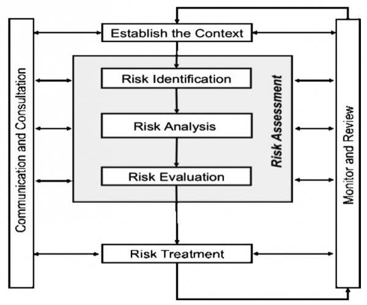
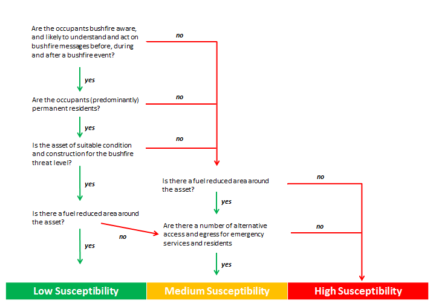
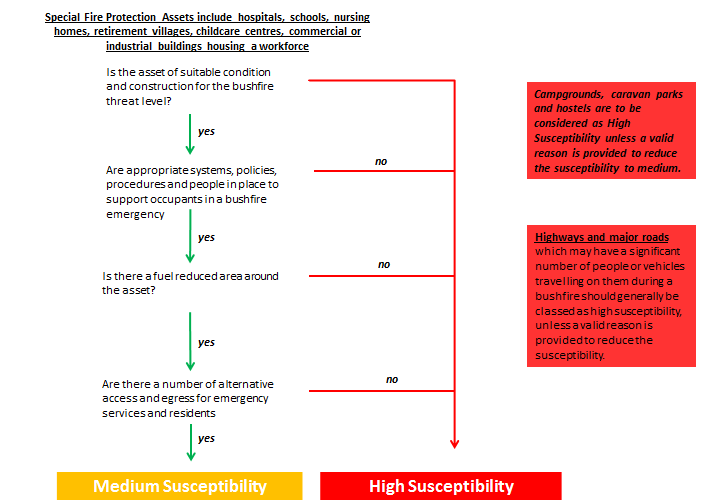
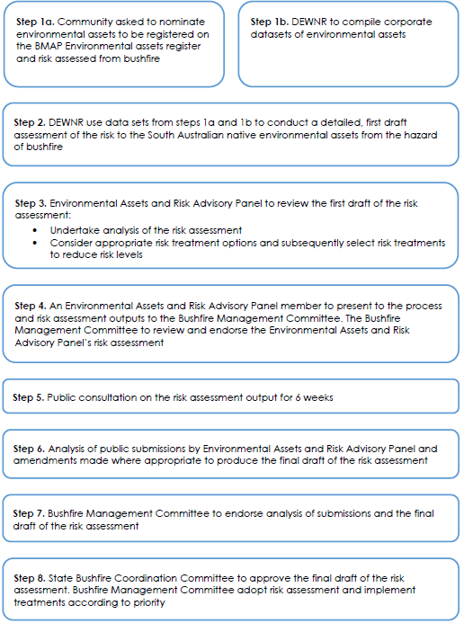
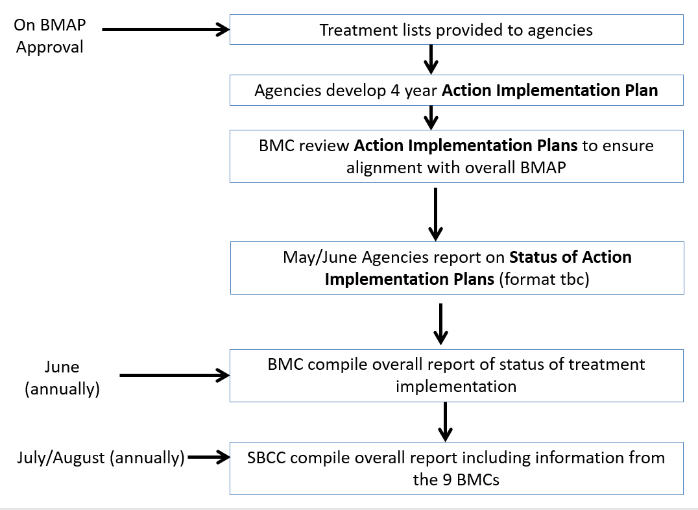
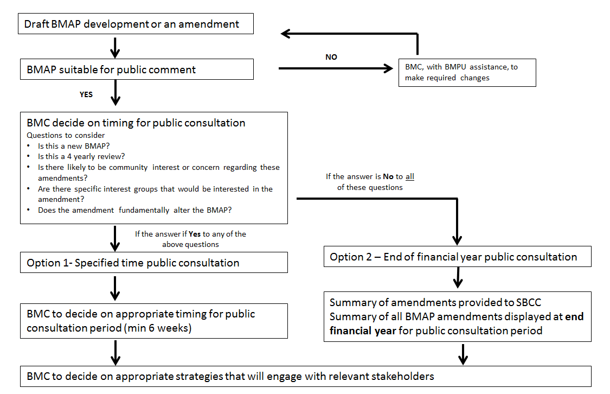
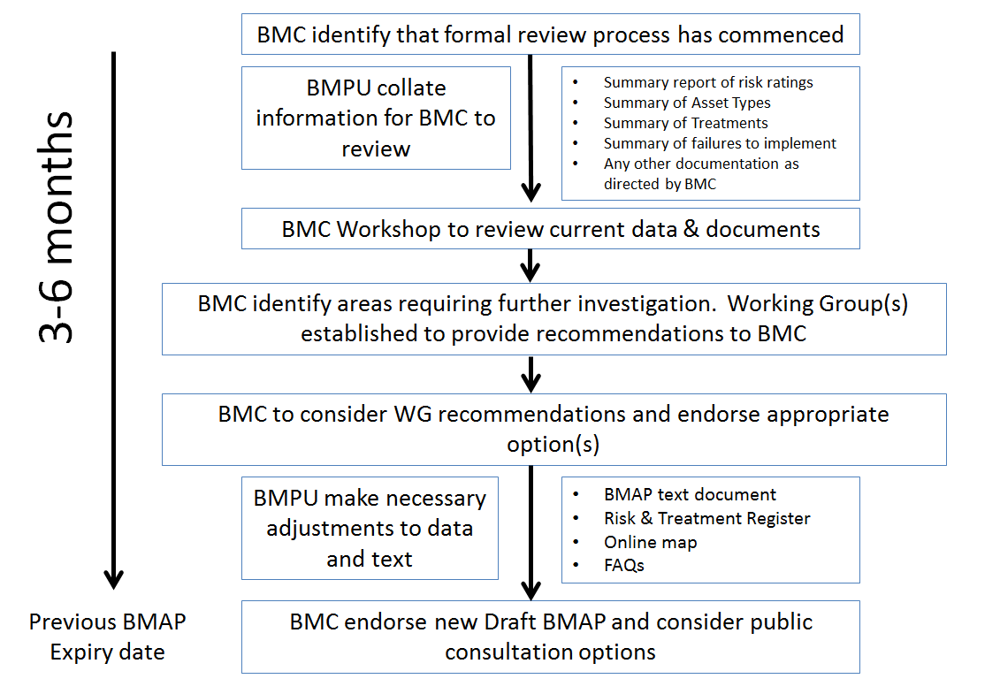

# Handbook for Bushfire Management Area Plans (BMAPs) (Version 2 (Feb 2018, May 2021 hyperlink update))

> **Source**: SA SAFECOM
> **URL**: https://resources-production.safecom.sa.gov.au/current/docs/Handbook%2520for%2520BMAPs%2520-%2520Final%2520version%25202%2520Feb%25202018%2520%2528updated%2520hyperlinks%2520May%25202021%2529.pdf
> **Licence**: © Government of South Australia; emergency-management practitioner reference
> **Retrieved**: 2026-05-07T23:44:53Z
> **SHA-256**: `e71ebdf04524d0620c96d52753f141aab6360aa19849b2d590dcc6385e15c076`
> *Converted from PDF to Markdown format.*

---
## Page 1

BUSHFIRE MANAGEMENT AREA PLAN HANDBOOK                Page   i
STATE BUSHFIRE COORDINATION COMMITTEE 
Bushfire Management Area Plan Handbook 
Version 2 
February 2018 
UNDER REVIEW

---
## Page 2

BUSHFIRE MANAGEMENT AREA PLAN HANDBOOK                Page   ii
TITLE:     Bushfire Management Area Plan Handbook v2 
DATE:     February 2018 
REVIEW DATE:     February 2019 
CUSTODIAN:     CFS Bushfire Management Planning Unit 
UNDER REVIEW

---
## Page 3

 
BUSHFIRE MANAGEMENT AREA PLAN HANDBOOK                Page   1
Contents 
 
Purpose 
5 
 
Aim 
5 
 
Prevention, Preparedness, Response and Recovery Framework 
6 
 
Consideration of Risk Priority 
6 
 
Assets of Aboriginal Significance 
6 
 
Minister for Emergency Services 
7 
 
State Bushfire Coordination Committee (SBCC) 
7 
 
Bushfire Management Committees (BMCs) 
8 
 
Local Government 
8 
 
South Australian Country Fire Service (SACFS) 
9 
 
Department for Environment and Water (DEW) 
10 
 
SA Water Corporation 
10 
 
Forestry 
11 
 
Additional Key Stakeholders 
11 
 
Bushfire Risk Information Management System (BRIMS) 
12 
 
BMAP Initialisation 
14 
 
Stakeholder Engagement 
14 
 
Risk and Treatment Workshops 
14 
 
Risk Identification and Treatment Allocation Workshops 
14 
 
Risk Analysis, Evaluation and Treatment Validation 
15 
 
Area-wide Bushfire Risk Assessment Workshops 
15 
 
Review, Evaluation and Recommendations 
15 
 
Bushfire Safer Places (BSPs) and Last Resort Refuges (LRR) 
16 
 
Inclusion of Assets into BRIMS 
16 
 
Human Settlement Assets 
17 
 
Economic Assets 
18 
 
Cultural Heritage Assets 
19 
 
Environmental Assets 
19 
UNDER REVIEW

---
## Page 4

 
BUSHFIRE MANAGEMENT AREA PLAN HANDBOOK                Page   2
 
Bushfire Risk Criteria 
21 
 
Likelihood 
21 
 
Consequence 
22 
 
Bushfire Attack Level (BAL) – Radiant Heat Threat 
23 
 
Susceptibility of Human Settlement Assets 
24 
 
Susceptibility of Economic and Cultural Heritage Assets (Built Structures) 
27 
 
Consequence matrix – Human Settlement Assets 
28 
 
Consequence Matrix – Economic and Cultural Heritage Assets 
29 
 
Overall Risk Matrices 
29 
 
Methodology for Identifying Bushfire Risks in the BMA 
34 
 
Risk Analysis Outcomes 
36 
 
Tolerable Bushfire Risk Level 
37 
 
Prioritising Bushfire Risk Treatments 
38 
 
Asset Specific Risk Treatment Strategies and Actions 
40 
 
Land and Property Management 
41 
 Property Preparedness 
41 
 Asset Protection Zones (A-Zones) 
41 
 Bushfire Buffer Zones (B-Zones) 
42 
 Firebreaks and Fire Access Tracks 
42 
 Prescribed Burning 
42 
 
Legislative, Development Control and Administrative 
43 
 Council Planning and Development Policy and Standards 
43 
 Policy, Standards and Codes of Practice 
43 
 Bushfire Prevention Activities Conducted by a Council FPO 
44 
 
Community Engagement, Education and Information 
44 
 
Landscape Treatment Investigation Areas (LTIAs) 
45 
 
BMA-Wide Treatment Strategies 
46 
 
Asset Specific Risk Treatment Allocation 
46 
 
Stakeholder and Public Comment Strategy 
48 
 
Draft BMAP Submissions 
48 
UNDER REVIEW

---
## Page 5

 
BUSHFIRE MANAGEMENT AREA PLAN HANDBOOK                Page   3
 
BMC Endorsement for Approval 
50 
 
SBCC Approval Process 
50 
 
Implementation Processes 
52 
 SBCC 
53 
 BMC 
53 
 
BMAP Implementation Reporting 
54 
 
 
UNDER REVIEW

---
## Page 6

 
BUSHFIRE MANAGEMENT AREA PLAN HANDBOOK                Page   4
 INTRODUCTION 
Under the Fire and Emergency Services (FES) Act 2005, South Australia has a two-tiered structure for bushfire 
management – a State Bushfire Coordination Committee (SBCC) and a Bushfire Management Committee (BMC) 
in each of the nine Bushfire Management Areas (BMAs). 
The FES Act specifies the planning framework that the committees are to uphold.  The SBCC must prepare and 
keep under review the State Bushfire Management Plan (SBMP) and the BMCs must prepare and keep under 
review a Bushfire Management Area Plan (BMAP) for each BMA. 
The SBMP sets out the framework for bushfire management in the State.  This handbook details the procedure 
involved for the preparation and implementation of BMAPs, including: 
 
Steps to identify assets at risk of bushfire 
 
Assessment of bushfire risk to those assets 
 
Options to treat the identified risks 
 
A framework to implement risk mitigation programs 
 
Expectations for monitoring and reporting risk treatments 
 
A process for assessment and review 
By documenting the BMAP procedures and guidelines in this Handbook, BMC members and stakeholders can 
understand the process used to assess and treat bushfire risk across the South Australian landscape. 
 
 
UNDER REVIEW

---
## Page 7

 
BUSHFIRE MANAGEMENT AREA PLAN HANDBOOK                Page   5
 SCOPE 
 Purpose 
The purpose of this BMAP Handbook is to articulate the steps required to produce a BMAP.  It provides the 
strategic direction to ensure consistency in the bushfire risk management approach across the State. 
 Aim 
The aim of this Handbook is to provide guidelines and procedures to ensure BMCs and other stakeholders 
understand the risk assessment process and what is expected of them in the development and maintenance 
of a BMAP.  The SBMP provides the strategic framework for BMAPs and outlines the alignment with AS/NZS 
ISO 31000:2009 and National Emergency Risk Assessment Guidelines (NERAG).  The BMAP process follows 
the framework of the AS/NZS ISO 31000:2009 risk management process (Figure 1).   Related BMAP 
administrative guidelines and procedures, which provide additional information on more specific BMAP 
processes, are listed in the ‘Related documents’ section of this document. 
 
 
Figure 1    ISO 31000:2009 Process (pg. vi ISO 31000:2009) 
 
 
UNDER REVIEW

---
## Page 8

 
BUSHFIRE MANAGEMENT AREA PLAN HANDBOOK                Page   6
 Prevention, Preparedness, Response and Recovery Framework 
The Australian Federal Government agency, Emergency Management Australia (EMA), recognises four types 
of activities that contribute to the reduction of hazards and to reducing the susceptibility of a community or 
environment subject to a hazard.  The framework for activities is designed around the PPRR program – 
Prevention, Preparedness, Response and Recovery.  The BMAPs are developed specifically to address 
bushfire prevention and preparedness.  The risk assessment process for assets does not currently refer to the 
wider level of ongoing social, community, political, financial or business continuity consequences of losing 
the asset. BMAPs outline prevention/mitigation activities that aim to eliminate or reduce the impact of 
bushfire and reduce the susceptibility (while increasing the disaster resilience) of the community.  Activities 
relating to bushfire response or recovery are not addressed in BMAPs, but are covered in the various 
regulations, programs, policies and procedures of government and non-government emergency and 
community service agencies.   
 Consideration of Risk Priority 
The BMAPs identify and assess a variety of assets at risk of bushfire within the BMAs.  The assets are 
separated into categories and sub-categories to aid prioritisation of risk reduction/elimination controls.  The 
following considerations have been applied in the development of the BMAP: 
 
Protection and preservation of life 
 
Protection of critical infrastructure and community assets that support disaster resilience  
 
Protection of residential property  
 
Protection of assets supporting livelihoods, economic production and community financial 
sustainability 
 
Protection of cultural assets 
 
Protection of environmental assets at risk from bushfire 
 
Compliance with relevant Acts, Codes of Practice and Regulations 
 Assets of Aboriginal Significance 
The BMAP process recognises the rights, interests and obligations of the traditional owners to speak and care 
for their traditional lands in accordance with their cultural beliefs and traditions. On the advice of the 
Department of the Premier and Cabinet – Aboriginal Affairs and Reconciliation Division (DPC - AARD):  to 
prevent damage, disturbance or interference with any Aboriginal site or object, assets of Aboriginal cultural 
and spiritual significance will not be specifically identified in this iteration of BMAPs. Further consultation 
with relevant stakeholders will be undertaken on the methodology for including assets of Aboriginal 
significance in future iterations of BMAPs.  
 
 
UNDER REVIEW

---
## Page 9

 
BUSHFIRE MANAGEMENT AREA PLAN HANDBOOK                Page   7
  ROLES AND RESPONSIBILITIES 
It is the responsibility of each BMC to develop and maintain a BMAP and to ensure treatment strategies are 
undertaken to reduce bushfire risk to life, property and the environment. The initial development of nine of the 
BMAPs was part of a project funded by the Natural Disaster Resilience Program (NDRP) in partnership with the 
Commonwealth and State Governments of South Australia. The CFS Bushfire Management Planning Unit (BMPU) 
facilitated the development of these BMAPs on behalf of the BMCs.  
The continued development of the BMAP supporting processes, the provision of data to BMCs, and the collation 
of BMC reports to the State Bushfire Coordination committee (SBCC) will continue to be the responsibility of the 
BMPU.  In addition, the 4-yearly review of BMAPs by each of the BMCs will be supported by the BMPU. 
The Department for Environment and Water (DEW) will support BMCs by developing and facilitating the 
environmental risk assessment methodology, convening the Environmental Assets and Risk Assessment Panels 
to advise the BMCs (see Chapter 9) and providing data and expertise in the assessment of environmental assets. 
BMAPs are prepared under specifications as determined by the SBCC and documented in the State Bushfire 
Management Plan (SBMP). 
The SBMP is a strategic level document (required under Section 73 of the FES Act 2005) designed to provide 
policy and direction for the mitigation of bushfire risk in South Australia. It identifies major bushfire risks to life, 
property and the environment in the State and guides actions to mitigate those risks. The SBMP sets out the 
standards for preparation and implementation bushfire management planning at a regional level through the 
development of Bushfire Management Area Plans (BMAPs). 
 Minister for Emergency Services 
The Minister for Emergency Services is responsible for approving the State Bushfire Management Plan 
(SBMP).  
 State Bushfire Coordination Committee (SBCC) 
The SBCC provides strategic direction and coordinates decision making in bushfire management planning 
across the State. In addition to advising the Minister on bushfire prevention and preparedness issues, the 
SBCC is responsible for: 
 
The State-wide coordination, endorsement and promotion of policies, practices and strategies in 
relation to bushfire management planning 
 
Preparing and maintaining the State Bushfire Management Plan (SBMP) 
 
Ensuring strategic bushfire policies and practices are consistent with the SBMP 
 
Reviewing and approving Bushfire Management Area Plans (BMAPs) 
 
Reviewing the SBMP at least once in every 4 years and ensuring any relevant changes are reflected 
in the BMAPs 
UNDER REVIEW

---
## Page 10

 
BUSHFIRE MANAGEMENT AREA PLAN HANDBOOK                Page   8
 Bushfire Management Committees (BMCs) 
Section 72B of the FES Act, directs the functions of BMCs and includes: 
 
Advising the SBCC on bushfire prevention in its area. 
 
Promoting the coordination of policies, practices and strategies relating to bushfire management 
activities within its area. 
 
Preparing and keeping a BMAP under review and ensuring it is consistent with the SBMP. 
 
Overseeing the implementation of its BMAP and reporting to the SBCC on any failure or delay in 
relation to the implementation of the plan. 
 
Preparing or initiating the development of other plans, policies, practices or strategies to promote 
effective bushfire management within its area. 
 
Convening local or regional forums to discuss issues associated with bushfire management within 
its area and to work with local communities to promote and improve effective bushfire 
management. 
 
Providing reports to the SBCC or Minister on any matter relevant to bushfire management within 
its area. 
In the preparation and management of their BMAP, the BMC are responsible for: 
 
Determining and prioritising BMA wide bushfire risks and treatments. 
 
Reviewing and endorsing BMAP information and drafts. 
 
Determining methodologies and supporting activities for community and public consultation. 
 
Reporting to the SBCC on bushfire prevention and preparedness issues within their BMA. 
 
Reviewing their BMAP at least once in every 4 years or at the direction of the SBCC. 
 Local Government  
Councils have a significant role in the BMAP process. They own and manage significant assets and lands, have 
responsibilities for planning and development approvals, and community engagement.  Section 105B of the 
FES Act states ‘any council that is in a rural area or contains within its area part or all of the designated urban 
bushfire risk area must appoint at least one person as a Fire Prevention Officer (FPO)’.  Section 105C outlines 
the functions of a trained FPO, which includes: 
 
Assessing the extent of bushfire hazards within the relevant council area. 
 
Assisting the council in providing advice and information to the relevant BMC in preparation or 
review of the BMAP. 
 
Providing advice to owners of property in respect of bushfire prevention and management. 
 
Carrying out any other functions assigned to the FPO by the regulations. 
In the BMAP process, councils are also responsible for: 
 
Providing key information on assets within their area 
 
Identifying and communicating bushfire risk treatments undertaken within their area 
 
Actively participating in BMAP public consultation activities 
 
Prioritising, applying and reporting on BMAP risk treatments  
UNDER REVIEW

---
## Page 11

 
BUSHFIRE MANAGEMENT AREA PLAN HANDBOOK                Page   9
 South Australian Country Fire Service (SACFS) 
SACFS is the Hazard leader for rural fire and has responsibilities for the protection of life, property and the 
environment.  This is undertaken through the following mechanisms: 
 
Legislation for the management of fuel loads and fire cause 
 
Operational response 
 
Public information and education 
 
Bushfire prevention activities 
 
Bushfire management planning 
The role of Chair of the SBCC is filled by the SACFS Chief Officer and the Director of Preparedness Operations 
performs the role of Executive Officer for the SBCC.  The agency also holds a membership position on the 
committee. 
Similarly the BMCs are chaired by SACFS Regional Commanders with the Executive Officer roles being filled 
by the SACFS Regional Prevention Officer.  The Executive Officer of the BMC also acts as a member of the 
Committee, with their role as Executive Officer being in addition to and separate from that of their 
responsibilities as a member.  It is incumbent on Chairs and Executives of these committees to liaise with the 
relevant business units within SACFS. 
SACFS Bushfire Management Planning Unit (BMPU) 
The SACFS has established a Bushfire Management Planning Unit (BMPU) to develop, facilitate and assist 
each BMC with the preparation and management of its BMAP. The BMPU ensures the consistency of the risk 
assessment process and resultant BMAPs across the State and establishes assurance processes for the valid, 
reliable and repeatable collection of data. This includes the use of generic risk treatment strategies and 
reporting processes. 
The BMPU’s main functions are to: 
 
Develop and manage the bushfire risk framework used to create BMAPs 
 
Develop and manage risk assessment software, tools and website 
 
Facilitate the creation of standardised BMAPs across SA 
 
Undertake and manage stakeholder engagement 
 
Manage BMAP updates and processes  
 
Manage data exchanges and reporting 
 
Coordinate public consultation 
 
Support BMCs with BMAP implementation, monitoring and reviewing 
UNDER REVIEW

---
## Page 12

 
BUSHFIRE MANAGEMENT AREA PLAN HANDBOOK                Page   10
 Department for Environment and Water (DEW) 
DEW is responsible for establishing and managing parks and reserves in South Australia. This protected area 
system includes all reserves proclaimed under the National Parks and Wildlife Act 1972, the Wilderness 
Protection Act 1992, and un-alienated Crown land and conservation reserves dedicated to the Minister for 
Sustainability, Environment and Conservation under the Crown Land Management Act 2009. DEW also 
administers the Heritage Agreement programme whereby conservation areas are established on private 
lands under the Native Vegetation Act 1991. 
Under the FES Act, DEW has an obligation to manage the bushfire risk on the public lands it manages. DEW 
manages those risks in line with department policy and procedures through the development of Fire 
Management Plans, which identify fire management activities over a ten-year period for collections of parks 
and reserves around the state. A key strategy identified in these fire management plans is the identification 
of bushfire management zones for strategic fuel management.  
DEW has a rolling programme of prescribed burning for fuel management, conducted in spring and autumn 
each year to reduce the likelihood of large bushfires developing on public lands and impacting on life, 
property and environmental assets.  Commencing in 2016/17, DEW has increased the scope of its prescribed 
burning activities to include strategic locations on privately owned lands in order to further reduce the impact 
of bushfires on communities. Where appropriate, DEW also conducts ecological prescribed burns to enhance 
biodiversity (for example, regeneration of senescing vegetation) and for land management objectives such 
as weed management. 
DEW is a SACFS Brigade under the FES Act and assist SACFS in bushfire response across the state (regardless 
of tenure), and also contribute significant resources to emergency response in the roles of incident 
management, aerial operations, fire behaviour analysis and mapping support across all hazards.  
A cooperative approach to managing fire on public land has been developed by the Heads of Agency 
Agreement between DEW, the SACFS, ForestrySA and SA Water.  
 SA Water Corporation 
SA Water is owned by the South Australian Government and manages water services in South Australia.  A 
large proportion of land comprises water catchment areas surrounded by natural vegetation resulting in their 
ownership of areas of bushfire hazard.  SA Water, in conjunction with DEW and ForestrySA through the Heads 
of Agency Agreement, annually conduct strategic fuel reduction prescribed burns to reduce the 
establishment and spread of bushfire from their property to neighbouring communities.  Water storage and 
supply infrastructure exists across the South Australian landscape along with wastewater infrastructure 
closer to townships and settlements.  SA Water is a key stakeholder in the prevention and preparedness 
activities identified within all BMAPs and in their ownership and management of infrastructure state-wide. 
UNDER REVIEW

---
## Page 13

 
BUSHFIRE MANAGEMENT AREA PLAN HANDBOOK                Page   11
 Forestry 
There is a mix of government (ForestrySA) and private enterprise involved in managing forest plantations in 
South Australia. These agencies work in cooperation with SACFS, other land managers and neighbouring 
landholders to manage the threat and response to bushfire.  Maintenance of annual prescribed burning 
programmes across the forest reserves form part of their management practices. 
 Additional Key Stakeholders 
In addition to the committees and organisations listed above, additional key stakeholders in the BMAP 
process may include infrastructure agencies, industry, business organisations, conservation groups, service 
agencies and community. These stakeholders may be members or non-members of one or more BMCs and 
may have assets in one, multiple or all BMAs. The BMPU and relevant BMC engage with these stakeholders 
to obtain information on their assets and validate relevant information for inclusion into the BMAP. 
 
 
UNDER REVIEW

---
## Page 14

 
BUSHFIRE MANAGEMENT AREA PLAN HANDBOOK                Page   12
 BMAP BUSHFIRE RISK MANAGEMENT FRAMEWORK 
The overarching Bushfire Risk Management Framework used to produce each of the BMAPs complies with the 
framework outlined in ISO 31000:2009 and is illustrated earlier in Figure 1.  This ensures that information about 
the risk of bushfire impacting an area or identified asset follows the international standard for risk management.  
The BMAP framework, processes and strategies are also monitored and reviewed to identify areas of continuous 
improvement and for the continued updates of the BMAPs. 
 Bushfire Risk Information Management System (BRIMS) 
The Bushfire Risk Information Management System (BRIMS) is an Information Management System (IMS) 
developed by the SACFS to capture the information required for a BMAP.  BRIMS is an ArcGIS driven database 
system embedded with especially designed functions to geospatially record risk identification, risk analysis 
and risk treatment information for identified assets at risk from bushfire. The ArcGIS based mapping system 
that is used to capture the information recorded in BRIMS is known as BRIMap. 
The BRIMS database enables local councils, government agencies, non-government organisations, land 
managers and other stakeholders to record bushfire risk treatments and develop works programmes to 
reduce the overall risk from bushfire to life, property and the environment. BRIMS considers the needs of all 
stakeholders while delivering a practical and flexible database of bushfire risk, assessment and treatment. 
The BRIMS database is managed by the SACFS BMPU and the online information is hosted on the SACFS 
website.  The SACFS BMPU update information in BRIMS and on the website as information is provided by 
BMCs. 
UNDER REVIEW

---
## Page 15

 
BUSHFIRE MANAGEMENT AREA PLAN HANDBOOK v2               Page   13
 BMAP DEVELOPMENT PROCESS 
The major stages in the development of a BMAP fit into the Risk Management Framework set out by ISO 31000, 
and include the following steps, which are addressed in the sub-sections or chapters to follow: 
Risk and Treatment 
Workshops
Review, evaluation and 
recommendations
Draft plan
Public Consultation
BMPU meets with/discusses BMAP process and data capture with Councils and major 
stakeholders, including sourcing preliminary information on assets from Councils, infrastructure 
agencies, SA Govt Departments and other stakeholders.
BMPU conducts asset identification and risk treatment workshops with each Council, utilising 
BRIMap to capture and validate bushfire risk information on all assets at risk from bushfire.  
Workshops may include CFS Community Engagement Officer, representatives from the local 
CFS Brigade and any other significant land managers.
Review existing treatment strategies and allocate proposed new ones against risks identified.  
Identify responsibility for treatment strategies and time frame for implementation.
BMPU creates a drat BMAP from all stakeholders’ inputs and feedback and presents it to the 
BMC for assessment, comment and subsequent endorsement for release of the draft BMAP for 
public consultation.
BMPU facilitates the six week public consultation process including assisting BMC stakeholder 
agencies with the selection of consultation strategies and summarising submissions for 
consideration by the BMC.
BMC reviews and evaluates all feedback and any proposed changes to the draft BMAP and then 
submits the endorsed BMAP to the SBCC for approval and loading onto the CFS website.
BMPU assists the BMC with the development and monitoring of treatment implementation 
plans.
Final review and approval
Implementation and 
monitoring
BMPU updates BRIMS and BRIMap information for the BMAP area to be assessed, including 
GIS layers and aerial imagery, and preloads AIRS ignition data, land use, fire history, weather, 
vegetation type and any available/accessible asset information.
Risk treatment 
implementation and 
reporting
BMC member organisations (Councils) utilise treatment implementation plans to undertake 
and report on their identified treatments.
Monitoring
BMC monitors treatment implementation plans for their effectiveness to reduce bushfire risk 
assets identified. Monitoring is to be as per legislation as well as regular and ongoing reviews 
on a periodic and annual basis.
BMAP initialisation
Stakeholder engagement
 
  
 
Development Stage 
Draft review Stage 
Implementation & Monitoring Stage 
Figure 2  BMAP Development Process 
UNDER REVIEW

---
## Page 16

 
BUSHFIRE MANAGEMENT AREA PLAN HANDBOOK v2               Page   14
 BMAP Initialisation 
The first step in the development of a BMAP is the capture and review of existing information.  Existing 
interim plans and other datasets are interrogated and information that may still be current and relevant is 
imported into BRIMS.  This preliminary data is reviewed and added to during the development of the draft 
BMAP.  This first step is primarily undertaken by BMPU; however DEW provide the relevant information for 
environmental assets. 
 Stakeholder Engagement 
Throughout the development of a BMAP, the BMC members provide information regarding their assets at 
risk from bushfire for inclusion into the BMAP.  The BMPU also engages with major stakeholders in a Bushfire 
Management Area (BMA) who are not represented on the BMC (e.g. commercial businesses and 
infrastructure owners and managers) to determine their key assets for inclusion in the BMAP for risk 
assessment.  Information is exchanged with stakeholders either through workshops and/or data and is 
provided from existing GIS datasets, spreadsheets or databases.  
Throughout the development of a BMAP the BMPU will consult with BMC members and other stakeholders 
to gather information and data.  This data is refined and maps created to enable BMCs to review risk ratings 
and risk treatment strategies.  In some instances Working Groups may need to be established to undertake 
this work and to provide recommendations to rest of the BMC for consideration. 
Training and/or guidance in all stages of the process will be provided by the BMPU to support the continuous 
improvement of bushfire risk assessments and treatment strategies. 
 Risk and Treatment Workshops 
The major workshops held during the development of a BMAP include: 
 Risk Identification and Treatment Allocation Workshops 
Risk identification and treatment allocation workshops are a key activity in the capture and assessment 
of bushfire risk information in relation to assets.  These workshops are generally hosted by local councils 
and attended by council staff, BMC members, stakeholders and community members. The workshop 
attendees assist in identifying assets, conducting risk assessments, allocating risk treatments and 
providing local knowledge of communities and assets.  
These workshops enable the capture and review of a considerable amount of the necessary data for a 
BMAP; however, these workshops should not be the sole option for the collection of information required 
for a BMAP.  Additional workshops or meetings may also be conducted with stakeholders who have 
information relevant to a BMAP as well as selective ground-truthing to determine the validity and 
reliability of assessments.  
UNDER REVIEW

---
## Page 17

 
BUSHFIRE MANAGEMENT AREA PLAN HANDBOOK v2               Page   15
 Risk Analysis, Evaluation and Treatment Validation 
The BMPU consolidates the information captured during earlier workshops and provides the subsequent 
information to BMC members in formats that allow the information to be reviewed (e.g. hard copy and 
online maps, risk registers, treatment lists).  Draft BMAP information may be distributed electronically for 
review but is also provided at a BMC meeting so that members can discuss any amendments as a 
committee. Decisions may be made as a committee (or working group of the BMC) around allocating 
consistent treatments to specific asset types or dependant on risk rating.  These workshops may also 
identify areas of potential hazards and risks requiring further investigation and may recommend 
landscape risk reduction strategies for consideration by the BMC.  
 Area-wide Bushfire Risk Assessment Workshops 
Area-wide Bushfire Risk Assessment workshops are conducted with the whole BMC, co-facilitated by 
BMPU, Exec Officer and Chair and use the National Emergency Risk Assessment Guidelines (NERAG) 
process to look at the 5 consequence categories and the risk within the BMA against those categories.  
See Chapter 10 for more information. 
 Review, Evaluation and Recommendations 
Throughout the preparation of a BMAP, government agencies involved in bushfire prevention and land 
management are consulted and Draft BMAP information shared for comment and validation at various stages 
in development.  These consultation processes and the workshops outlined in Section 5.3 may identify issues 
and result in recommendations that require the consideration of the BMC.  These issues and 
recommendations are collated and provided to the BMC for determination.  
See Chapter 11 for more information regarding Risk Evaluation. 
 
UNDER REVIEW

---
## Page 18

 
BUSHFIRE MANAGEMENT AREA PLAN HANDBOOK v2               Page   16
 BUSHFIRE RISK IDENTIFICATION 
Assets to be included in a BMAP are those that are valued by the community and are at risk from bushfire. 
People with appropriate local knowledge are involved in identifying the assets. Relevant and current 
background data can also be recorded to assist with BMC decision making.  The objective is to generate a 
comprehensive list of assets at risk that can also be viewed spatially.  Risk analysis will assist in setting 
treatment options and priorities. 
For information regarding the risk assessment methodology for environmental assets refer to Chapter 9. 
 Bushfire Safer Places (BSPs) and Last Resort Refuges (LRR) 
Bushfire Safer Places (BSPs) have been established throughout the State and generally incorporate the central 
areas of townships and settlements.  Assets that exist within these areas are generally not at risk from the 
direct bushfire impact and need not be included in assessments.  However, any assets that are on or just in 
the outer boundary of a BSP are considered to be at risk of bushfire impact and should be considered for 
inclusion and be risk assessed.  The BMAP process may identify potential changes to the boundaries of BSPs.   
BMCs can also request a reassessment of a BSP boundary should there be a new residential development or 
other change in land use. 
Last Resort Refuges (LRRs) are generally spaces (i.e. ovals) or buildings that are intended to provide a place 
of relative safety during a bushfire. There is a minimum level of protection to those sheltering at these sites 
from the immediate life threatening effects of radiant heat and direct flame contact in a bushfire.  Signage 
management and the process for assessing new LRRs or reassessment of potentially unsuitable LRRs is 
undertaken by CFS Preparedness Operations.  LRRs are identified in BMAPs as Human Settlement assets in 
the Asset Category of Special Fire Protection.  Treatments are allocated to these sites to ensure they are 
maintained during the FDS and any compliance issues are reported to the BMC.  
 Inclusion of Assets into BRIMS  
Assets identified to be at risk from bushfire, together with all relevant information relating to the risks and 
existing and proposed treatment strategies, can be captured within BRIMS.  This allows for a single repository 
for all current and future assessments to be managed and maintained centrally.  BRIMS allows for assets at 
risk from bushfire to be spatially identified by a point, line or polygon within a BMA. 
Where possible, assets of the same type, category and ownership can be grouped rather than identified on 
an individual basis, though this can only be done where assets have the same risk characteristics and 
treatments.  For example, a street of dwellings abutting a forested area all face the same risk of impact from 
fire and the treatment will most likely be the same for all houses and the street.  Wherever the risk inputs 
differ then a new asset assessment is undertaken.  
 
 
 
 
UNDER REVIEW

---
## Page 19

 
BUSHFIRE MANAGEMENT AREA PLAN HANDBOOK v2               Page   17
Asset Types, Categories and Sub-Categories 
Assets are divided into four asset types:  Human Settlement, Economic, Cultural Heritage and Environmental.  
Each of these asset types is further divided into Categories as shown in Table 1.  Where an asset can be 
described by more than one asset type, it can be assessed separately under each asset type as the assessment 
criteria are different.  
Asset Type 
Asset Category 
Human Settlement 
• 
Residential 
• 
Special Fire Protection 
Economic 
• 
Infrastructure 
• 
Commercial  or Industrial 
Cultural Heritage  
• 
Indigenous  
• 
Non-indigenous 
Environmental  
Refer Chapter 9 for more info 
regarding  sub-categories and risk 
assessment methodology 
Table 1    Asset Categories and Sub-Categories used in the BMAP 
 Human Settlement Assets 
Human Settlement assets are those assets which are likely to be occupied or used by people; therefore, 
there is the potential for loss of human life.  Table 2 outlines the two Human Settlement asset categories 
with sub-category examples. 
Human Settlement 
Category 
Sub-Category Examples 
Residential 
• 
Urban areas, a street or group of streets along a bushland 
interface 
Special Fire Protection 
• 
Schools, Kindergartens or Childcare centres 
• 
Hospitals, Aged care facilities and retirement villages 
• 
Hotels, motels and other tourist accommodation, including 
campgrounds and caravan parks 
• 
Tourism and recreational facilities 
• 
Commercial and/or industrial 
• 
Highways or Major Roads 
Table 2    Human Settlement Sub-Categories and Examples 
UNDER REVIEW

---
## Page 20

 
BUSHFIRE MANAGEMENT AREA PLAN HANDBOOK v2               Page   18
Residential assets are represented spatially as polygons and Special Fire Protection assets as points.  Roads 
can be considered a Human Settlement asset because of their potential to be used for public relocation 
or evacuation during bushfire.  Roads are drawn spatially as a line. 
Residential assets may be mapped at a range of spatial scales, depending on the number of properties 
and the vegetation type near the asset.  Where an area is bound by different vegetation types then the 
area should be split into a number of polygons.  Where a dispersed cluster of assets with common 
characteristics, risk factors and treatments are located in a known and identifiable locality (such as a 
cluster of semi-rural residences), it may not be possible or practical to display these spatially with multiple 
individual points or as a polygon (i.e. these asset clusters are too dispersed to use the distinct boundary 
of a polygon). These areas can be identified in BRIMap by selecting the ‘represents wider area’ field. This 
allows for these dispersed asset clusters to be displayed spatially using alternative symbology such as a 
large symbol (usually a diamond shape) located in the central area of the locality. The title of asset cluster 
will always contain the word “Locality’, as in “Longwood Locality’.  
As it is unfeasible to risk assess every household or parcel of land, BMC members and other workshop 
attendees guide the decision making regarding which assets are to be risk assessed. 
 Economic Assets 
Economic assets are those assets of significance to the local community, region, State or Nation. Table 3 
outlines the three Economic asset categories and sub-category examples. 
 
 
 
 
 
 
 
 
 
Table 3    Economic Sub-Categories and Examples 
Economic 
Category 
Sub-Category Examples 
Commercial or Industrial 
• 
Major industries 
• 
Sawmills 
• 
Plantations 
• 
Commercial Native Forests 
Infrastructure 
• 
Large Power Lines 
• 
Gas and Oil Pipelines 
• 
Railways Lines 
• 
Electrical Sub-stations 
• 
Communication Facilities 
• 
Waste Treatment Plants 
• 
Water Supply and Storage 
UNDER REVIEW

---
## Page 21

 
BUSHFIRE MANAGEMENT AREA PLAN HANDBOOK v2               Page   19
Economic assets are represented spatially as a point unless the BMC deem a polygon necessary for display 
purposes, such as in the case of representing forestry plantations and industrial areas on the outskirts of 
townships. 
  Cultural Heritage Assets 
Cultural Heritage assets currently include non-indigenous historical and heritage areas, places and 
buildings which are of community value.  Table 4 below outlines the Cultural Heritage asset categories 
and some sub-category examples. 
Cultural Heritage  
Category 
Sub-Category Examples  
Non-indigenous 
Assets of local community value.  
• 
Community Halls  
• 
Churches  
• 
Sports Clubs 
• 
Recreational Facilities  
• 
Historic Sites, Ruins and Heritage Buildings 
Indigenous 
To be included in future iterations of BMAPs following further 
consultation and guidance from indigenous communities 
Table 4    Cultural Heritage Asset Categories and Examples 
Cultural Heritage assets are represented spatially as a point.  Information from heritage registers is 
presented to workshop participants and each item discussed for inclusion taking into consideration the 
importance of that asset to the community or if it has historical significance.  This information is also 
provided to local council for verification by staff, elected members or people with local historical 
knowledge, and additional information is gathered through public consultation processes. 
 Environmental Assets 
Below is summary table (Table 5) of the categories under which environmental assets at risk from bushfire 
are identified.  Further detail regarding the risk identification and risk assessment methodology for 
environmental assets is covered Chapter 9.   
 
 
 
 
Table 5    Environmental Asset Categories 
Environmental Asset Categories 
• Threatened ecological community 
• Significant Habitat 
• 
Reserve System 
• 
Flora 
• 
Fauna 
UNDER REVIEW

---
## Page 22

 
BUSHFIRE MANAGEMENT AREA PLAN HANDBOOK v2               Page   20
 
 THE NATURE AND TYPES OF CAUSES OF BUSHFIRE 
In South Australia, even though the threat of a bushfire is present throughout every Fire Danger Season, the 
severity and intensity of the bushfire threat may fluctuate in each bushfire event.  The severity and intensity 
of a bushfire is dependent on three main factors:  
 
Vegetation 
 
Topography 
 
Weather 
The vegetation and topography for an area is measurable and forms part of the risk assessment. However, 
weather is always variable both locally and across the State.  Therefore, when a bushfire risk assessment is 
undertaken, the weather conditions are defined as those the local area would experience on a day with a Fire 
Danger Rating (FDR) of Extreme. 
A FDR of Extreme means that a bushfire, once it takes hold, would be unpredictable, fast moving and difficult 
to bring under control.  Spot fires will start and move quickly and embers may come from many directions.   
It is under these fire weather conditions that risk assessment workshop attendees and other stakeholders 
determine which of the assets would be at risk from bushfire.  The local knowledge of fire weather and fire 
behaviour experienced in the past is an invaluable input into the BMAP process as it aids in the determination 
of likelihood and impact of bushfire. 
 
 
UNDER REVIEW

---
## Page 23

 
BUSHFIRE MANAGEMENT AREA PLAN HANDBOOK v2               Page   21
 BUSHFIRE RISK ASSESSMENT 
The risk assessments process analyses the likelihood and consequence of an event occurring to determine the 
susceptibility (or level of preparedness) that an asset has to fire.  These factors combine to give an overall 
appreciation of the level of risk. 
A number of risk criteria are used to determine the likelihood and consequence of a bushfire risk in this process.  
These criteria are assessed and form the basis to determine bushfire risk levels for each asset identified within a 
BMAP. 
The process for determining consequence, likelihood and overall risk for Human Settlement, Cultural Heritage 
and Economic assets are outlined in Chapter 8.  Chapter 11 outlines the risk evaluation process.  The 
methodology for determining risk to Environmental Assets is outlined in Chapter 9. 
 Bushfire Risk Criteria 
Bushfire risk criteria concerns the elements of likelihood and consequence, relevant to bushfire, which are 
assessed during the risk assessment process.  When defining bushfire risk criteria, the principal factors (as 
outlined in AS/NZS ISO 31000:2009) to be considered include: 
 
The nature and types of causes of the risk 
 
How likelihood will be defined 
 
What consequences can occur and how they will be measured 
 
How the overall level of risk will be determined 
 
How the acceptable or tolerable level of risk will be determined 
 Likelihood 
Likelihood in the BMAP risk assessment framework is based on the level of influence of the following factors: 
 
Fire History 
 
Ignition potential – type (land use driven) and frequency 
 
Vegetation -  type and composition 
 
Fire Breaks and Access Tracks – interruption of spread of fire 
When all elements are considered as a whole, they provide the risk criteria for assessing the potential for a 
bushfire to ignite, establish, spread across the landscape, intensify and impact on an asset.  Local knowledge 
of these elements can improve the accuracy of the likelihood rating.  
UNDER REVIEW

---
## Page 24

 
BUSHFIRE MANAGEMENT AREA PLAN HANDBOOK v2               Page   22
There are four categories of likelihood outcomes that can occur as a result of the risk assessment process, as 
outlined in Table 6. 
 
Unlikely 
 
Very few potential ignition sources 
 
Low probability of ignitions establishing 
 
Very sparse or low combustion vegetation to enable fire to spread 
 
Significant bushfire risk treatments in place 
Possible 
 
Some history of ignitions and fire 
 
Low fuel loads 
 
Bushfire may establish and spread in the right conditions 
 
Some treatments may be in place to inhibit fire spread 
Likely 
 
History of ignitions and fire 
 
Continuous or corridors or areas of moderate to heavy vegetation 
 
Bushfire will establish and spread in the right conditions 
 
Treatments to inhibit the spread of fire may be limited or not possible 
Almost 
Certain 
 
Significant history of ignitions and fires 
 
Land use contributes to frequent ignitions 
 
Fires are likely to establish and spread  
 
Very high to extreme fuel loads with contiguous vegetation 
 
Treatments are not possible, have not been implemented comprehensively or 
only partially effective 
Table 6   Likelihood Rating Scale 
 Consequence 
Consequence, as applied to BMAPs, refers to the consequence to the asset itself from being impacted by 
bushfire.  For example, whether or not it will burn down, cease to function, or if people will be injured.  It does 
not refer to the wider level of ongoing social, community, political, financial or business continuity consequences 
of losing the asset.  These broader consequences are to be considered using the National Emergency Risk 
Assessment Guidelines (NERAG).  Refer Chapter 10 
The criteria used to calculate the consequence of a bushfire impacting on an asset are the Bushfire Attack Level 
(BAL) and Susceptibility.  Note that the susceptibility of Human Settlement assets is assessed differently to that 
of Economic and Cultural Heritage Assets.  
UNDER REVIEW

---
## Page 25

 
BUSHFIRE MANAGEMENT AREA PLAN HANDBOOK v2               Page   23
Consequence ratings explained: 
Very Minor 
 
No fatalities 
 
Minor injuries possible  
 
Inconsequential to no damage to asset with minor to no disruption to use, function or 
operation 
Minor 
 
No fatalities 
 
Minor injuries to people generally treatable by on-site first aid that may require only short 
term additional treatment 
 
Localised damage to assets requiring minor repairs and limited or short disruption to use, 
function or operation 
Moderate 
 
Injuries requiring medical intervention by ambulance or hospitalisation 
 
Damage to assets requiring major repairs 
 
Short to medium disruption to its use, function or operation 
Major 
 
Significant level of injuries with possible fatalities 
 
Significant damage to assets and infrastructure that may be beyond repair or require 
significant  time and resources to repair  
 
Medium to long term disruption to asset/infrastructure use, function or operation 
Catastrophic 
 
Multiple fatalities, large numbers requiring hospitalisation possible 
 
Significant damage/destruction to multiple assets and infrastructure 
Table 7   Consequence Rating Scale 
 Bushfire Attack Level (BAL) – Radiant Heat Threat  
Determining the bushfire attack level (BAL) involves estimating the radiant heat that is likely to be generated 
from a bushfire impacting an asset.  The estimation is based on the Australian Standard 3959-2009 – 
Construction of buildings in bushfire-prone areas.  A BAL assessment takes into consideration the type of 
vegetation, the separation distance of the asset from the vegetation and the effective slope of the vegetation 
in relation to the asset.  The BAL is determined through consultation with specific tables in AS 3959-2009 
using a Fire Danger Index (FDI) of 100. 
UNDER REVIEW

---
## Page 26

 
BUSHFIRE MANAGEMENT AREA PLAN HANDBOOK v2               Page   24
 Susceptibility of Human Settlement Assets 
This refers to the susceptibility of the people associated with an asset or group or assets. 
This assessment is based on the combination of three elements of inherent community factors.  They include 
the attributes of the people who live in the area, the preparedness level/construction standard of the assets 
and environmental factors (Table 8). 
 
Community Factors 
Attribute 
People 
The social and physical capacity of 
people to prepare and respond to 
bushfire 
• Physical ability and decision making capacity 
• Residential status 
• Bushfire awareness 
• Experience with past bushfires 
Asset Preparedness 
The level of preparedness of an 
asset and the presence of 
defendable space around the 
asset. 
• Construction material of the asset 
• General condition of the asset 
• Availability of water and equipment to 
defend property 
• Residents able and willing to defend their 
own property 
• Defendable space around the asset  
• Access and egress for residents and 
firefighters 
Environmental Preparedness 
• Topography 
Table 8    Susceptibility of Human Settlement Assets 
 
UNDER REVIEW

---
## Page 27

 
BUSHFIRE MANAGEMENT AREA PLAN HANDBOOK v2               Page   25
The following decision trees, Figure 3 and Figure 4, are used to determine susceptibility for Human 
Settlement asset categories.  
 
Figure 3   Human Susceptibility – Residential Assets 
 
 
UNDER REVIEW

---
## Page 28

 
BUSHFIRE MANAGEMENT AREA PLAN HANDBOOK v2               Page   26
 
Figure 4   Human Susceptibility – Special Fire Protection Assets 
UNDER REVIEW

---
## Page 29

 
BUSHFIRE MANAGEMENT AREA PLAN HANDBOOK v2               Page   27
 Susceptibility of Economic and Cultural Heritage Assets (Built 
Structures) 
The susceptibility of a built structure being adversely impacted by bushfire is dependent on how the asset 
was constructed and to what standard (Australian Standard 3959 or not), the material used to construct it, 
as well as its age and general condition.  This is represented as Structural Types (1 to 5) in Table 9. 
Economic and Cultural Heritage Structural Types 
Type 1 
Extreme susceptibility to direct flame, radiant heat, sparks and embers  
•    Timber building or structure 
•    Open hay shed, store or work area 
•    Indigenous structure or modified tree 
•    Tarpaulin grain bunkers 
•    Caravans & transportable buildings 
•    Vegetation or organic materials 
Type 2 
High susceptibility to direct flame, radiant heat, sparks and embers 
 
Stone, brick, concrete or steel building or structure (not built to AS3959:2009) with exposed 
timber components or additions; vents, grills and openings around or into the interior of 
the building 
• 
Mud brick or daub building 
• 
Historic homestead 
• 
Stone, brick, concrete or steel building traditionally constructed 
(not built to AS3959:2009) 
Type 3 
High susceptibility to direct flame, moderate susceptibility to radiant heat, low susceptibility 
to sparks and embers 
 
Buildings built to AS3959:2009 or other steel or stone structures built with minimal 
exposure of interior combustible materials (timber, insulation etc.) to heat, sparks and 
embers 
 
•    Post 2009, offices, commercial buildings    
Type 4 
Moderate susceptibility to direct flame, low susceptibility to radiant heat, sparks and embers 
 
Concrete or steel building or structure generally containing interior or exterior components 
of low combustibility and susceptible only to direct flame or extreme radiant heat 
• 
Telecommunication exchanges & towers 
• 
Electrical sub-stations 
• 
Pumping or treatment plants 
• 
Silos & wind farm towers 
• 
Rubbish transfer station infrastructure 
• 
Railway lines with timber sleepers 
Type 5 
Low susceptibility to direct flame, radiant heat, sparks and embers 
 
Concrete or steel building or structure generally containing interior or exterior components 
of low combustibility and susceptible only to direct flame or extreme radiant heat 
 
•    Cemeteries 
 
•    Stone ruins 
 
•    Concrete or steel pipelines, bridges or water tanks 
Table 9    Economic and Cultural Heritage Asset Susceptibility Rating 
UNDER REVIEW

---
## Page 30

 
BUSHFIRE MANAGEMENT AREA PLAN HANDBOOK v2               Page   28
 Consequence matrix – Human Settlement Assets 
When the BAL and susceptibility assessment are complete, the matrix (Figure 5) is used to determine the 
consequence rating to a Human Settlement asset.  
 
 
BUSHFIRE ATTACK LEVEL (BAL) 
 
 
No Radiant 
Heat Threat 
(>100m) 
Low 
(BAL <12.5) 
Medium 
(BAL 19) 
High 
(BAL 29) 
Very High 
(BAL 40) 
SUSCEPTIBILITY 
(Human Settlement) 
High 
 
 
 
 
 
Medium 
 
 
 
 
 
Low 
 
 
 
 
 
 
 
Very Minor 
    Minor 
 Moderate 
Major           Catastrophic 
Figure 5    Consequence Matrix – Human Settlement Assets  
UNDER REVIEW

---
## Page 31

 
BUSHFIRE MANAGEMENT AREA PLAN HANDBOOK v2               Page   29
 Consequence Matrix – Economic and Cultural Heritage Assets 
The matrix below is used to assess the consequence rating for Economic and Cultural Heritage assets 
(Figure 6). 
 
 
BUSHFIRE ATTACK LEVEL (BAL) 
 
 
No Radiant 
Heat Threat 
(>100m) 
Low 
(BAL <12.5) 
Medium 
(BAL 19) 
High 
(BAL 29) 
Very High 
(BAL 40) 
SUSCEPTIBILITY 
(Economic & Cultural Heritage) 
Type 1 
 
 
 
 
 
Type 2 
 
 
 
 
 
Type 3 
 
 
 
 
 
Type 4 
 
 
 
 
 
Type 5 
 
 
 
 
 
            Negligible 
 
Minor   
Moderate 
            Major 
 
Catastrophic 
Figure 6    Consequence Matrix – Economic and Cultural Heritage Assets 
 Overall Risk Matrices 
The methodology for determining likelihood and consequence is dependent on the asset type (Human 
Settlement, Cultural Heritage, Economic or Environmental).   The figures below show the risk matrices used 
by BRIMS to determine the overall risk rating for Human Settlement assets (Figure 7) and for Economic and 
Cultural Heritage assets (Figure 8). 
 
 
CONSEQUENCE (Human Settlement) 
 
 
Very Minor 
Minor 
Moderate 
Major 
Catastrophic 
LIKELIHOOD 
Almost 
Certain 
 
 
 
 
 
Likely 
 
 
 
 
 
Possible 
 
 
 
 
 
Unlikely 
 
 
 
 
 
                         Low                     Medium                   High                   Very High                    Extreme 
Figure 7    Overall Risk Rating Matrix – Human Settlement Assets 
UNDER REVIEW

---
## Page 32

 
BUSHFIRE MANAGEMENT AREA PLAN HANDBOOK v2               Page   30
Negligible              Low             Medium           High 
     Very High             Extreme  
Figure 8    Overall Risk Rating Matrix – Economic and Cultural Heritage Assets 
 
 
 
 
CONSEQUENCE (Cultural Heritage & Economic) 
 
 
Negligible 
Minor 
Moderate 
Major 
Catastrophic 
LIKELIHOOD 
Almost 
Certain 
 
 
 
 
 
Likely 
 
 
 
 
 
Possible 
 
 
 
 
 
Unlikely 
 
 
 
 
 
UNDER REVIEW

---
## Page 33

 
BUSHFIRE MANAGEMENT AREA PLAN HANDBOOK v2               Page   31
 RISK ASSESSMENT METHODOLOGY FOR ENVIRONMENTAL 
ASSETS 
A standard for the identification and risk assessment of South Australian environmental assets from bushfire 
has been developed by the Ecological Technical Reference Group and supported by the State Bushfire 
Coordination Committee. Figure 9 outlines the steps involved in the methodology.  
 
Figure 9  An overview of the steps taken to assess risk to environmental assets 
from bushfire in South Australia 
UNDER REVIEW

---
## Page 34

 
BUSHFIRE MANAGEMENT AREA PLAN HANDBOOK v2               Page   32
 
The Standard allows BMCs to conduct detailed assessment of the risk to environmental assets in their BMA 
which may be negatively impacted by bushfire, whilst using a methodology which is consistently applied in 
all BMAs across the state.  Figure 10 below lists the categories of assets to be identified and assessed. 
Environmental Asset 
Category 
Environmental asset category description  
Community nominated 
environmental assets 
Threatened ecological community 
Flora 
Fauna 
Significant habitat 
Reserve System 
Threatened ecological 
community 
EPBC threatened ecological community listed as threatened under the 
Commonwealth Environment Protection and Biodiversity Conservation 
Act 1999 
State threatened ecological community listed under the South 
Australian Provisional List of Threatened Ecosystems of South Australia 
(DEH, in progress) 
Flora  
Fauna 
Migratory species protected under international agreements and the 
listed as threatened under the Commonwealth Environment Protection 
and Biodiversity Conservation Act 1999 
EPBC native flora or fauna species listed as threatened under the 
Commonwealth Environment Protection and Biodiversity Conservation 
Act 1999 
State native flora or fauna species listed as threatened under the South 
Australian National Parks and Wildlife Act 1972 
Significant habitat 
Key species habitat 
High quality habitat 
Reserve system 
(native vegetation 
contained in South 
Australian terrestrial 
reserve systems) 
Wetlands of international importance listed under the Ramsar 
Convention and the Commonwealth Environment Protection and 
Biodiversity Conservation Act 1999 
Wetlands of national importance listed under the Commonwealth 
Environment Protection and Biodiversity Conservation Act 1999 
Natural world heritage properties listed under the Commonwealth 
Environment Protection and Biodiversity Conservation Act 1999 
Natural national heritage places listed under the Commonwealth 
Environment Protection and Biodiversity Conservation Act 1999 
Wilderness protection areas declared under the South Australian 
Wilderness Protection Act 1992 
Heritage agreements declared under the South Australian Native 
Vegetation Act 1991 
Reserves declared under the South Australian National Parks and 
Wildlife Act 1972 
Native forest reserves declared under the South Australian Forestry Act 
1950 
UNDER REVIEW

---
## Page 35

 
BUSHFIRE MANAGEMENT AREA PLAN HANDBOOK v2               Page   33
Forest conservation areas declared under the South Australian Forestry 
Act 1950 
Reservoir reserves under the care and control of SA Water 
Groundwater basins under the care and control of SA Water 
Roadside reserves identified under the Roadside Marker Scheme in 
accordance with the Native Vegetation Council’s Guidelines for 
Management of Roadside Vegetation 
Environmental Assets 
and Risk Advisory Panel 
Threatened ecological community 
Flora 
Fauna 
Significant habitat 
Reserve system 
Figure 10 Environmental asset categories and sub categories types 
The outputs of the risk assessment are included into BMAPs and allow for priority to be assigned to the 
identified risks.  Risk treatment options for highest priority assets are identified and prioritised to reduce 
risk. 
As with the other categories of assets (Human Settlement, Cultural Heritage and Economic) the above set of 
steps are repeated every four years, or earlier, if required by the BMC or SBCC. 
For further detail regarding this process refer to the Standard for the identification and risk assessment of 
South Australian environmental assets from bushfire 2017.   
 
UNDER REVIEW

---
## Page 36

 
BUSHFIRE MANAGEMENT AREA PLAN HANDBOOK v2               Page   34
 PROPOSED METHODOLOGY FOR THE ASSESSMENT OF 
BMA-WIDE BUSHFIRE RISKS 
The asset based risk assessment process utilised in BRIMS enables land managers, councils, and agencies 
responsible for vulnerable or vital community infrastructure to identify and plan bushfire risk reduction works 
pertinent to specific assets.   
However, in order to define priority works to reduce the risk of bushfire across broad sections or a whole Bushfire 
Management Area (BMA), an area wide risk assessment is required.  The following methodology is proposed for 
such an assessment to be undertaken by the Bushfire Management Committee.  
The BMA-wide risk assessment process is based on the National Emergency Risk Assessment Guidelines 
(NERAG2).  This ensures the process is consistent with current emergency service sector risk assessment 
methodologies in South Australia. NERAG2 provides an all hazards state emergency-related risk assessment 
methodology consistent with the Australian Standard International standard AS/NZS ISO 31000:2009 risk 
management – principles and guidelines framework.  NERAG2 defines a scalable process to reflect local 
particulars for five defined consequence categories: 
 
People 
 
Economy 
 
Environment 
 
Social setting 
 
Public administration 
Each of the BMAs is analysed using the scales within each of the consequence categories to determine the level 
of bushfire risk across the Bushfire Management Area.  Changes or re-assessment of risk levels within the 
Bushfire Management Area in each of the consequence categories should be considered as part of the 4-yearly 
review of the plan or as directed by the SBCC.   
     Methodology for Identifying Bushfire Risks in the BMA 
An assessment is to be undertaken for each of the Consequence Categories for a number of bushfire scenarios 
to determine which are of the highest risk to the BMA. This assessment will be undertaken considering the 
following bushfire scenarios. 
 
Ngarkat/Bangor/Pastoral – A campaign fire in a remote location.  Burning for many days, exceeding 
local firefighting resources and disrupting local services and transport.  Few built assets threatened.  
May be in inaccessible or difficult terrain.  Tends to have relatively slow moving fire front. 
 
Sampson Flat – An intense fire close to populated areas.  Community members may be unaware and 
unprepared.  Many road closures.  Smoke impact and ember attack in the outer suburbs.  Poorly 
prepared properties. 
 
Ash Wednesday/Black Saturday – Multiple significant fires across the state, burning under 
catastrophic conditions.  Local brigades and IMT quickly overwhelmed requiring supplementation 
UNDER REVIEW

---
## Page 37

 
BUSHFIRE MANAGEMENT AREA PLAN HANDBOOK v2               Page   35
from interstate/overseas.  At this scale, human life and economic loss is inevitable.  Conditions will 
lead to a cascade of events and failures of systems. 
 
Dry lightning causing multiple fire starts across a broad landscape – A large number of small fires 
that quickly overwhelm capacity. 
 
Pinery/Wangary – A large, fast moving fire, principally burning in grassland or cropland.  May be 
difficult to suppress.  May be burning under catastrophic conditions. 
 
The BMA-wide risk assessment methodology will identify potential consequences should the above scenarios 
occur and the likelihood of these occurring.  This will provide an overall risk rating for potential outcomes 
across a BMA.  BMCs will then need to assign treatment options to address these risks.    The outcomes of 
this process will assist in guiding the priorities for prevention programmes that target larger areas and 
populations.  
 
UNDER REVIEW

---
## Page 38

 
BUSHFIRE MANAGEMENT AREA PLAN HANDBOOK v2               Page   36
 BUSHFIRE RISK EVALUATION 
Risk evaluation is undertaken to assist in decision making around what needs treatment and the treatment 
priority.  Decision making should take into account the wider context of the risk and risk tolerance. Decisions 
need to take into account any legal and regulatory requirements.   Decisions are made around the following 
questions: 
a) Is the level of risk acceptable?  
b) Is additional analysis of the risk required to further understand the true risk?  
c) Do the risks need additional treatments? 
d) Are the existing treatments appropriate or do they need to be modified or removed? and 
e) Are there any priorities for treatment? 
Workshops are conducted by BMPU with the BMC and other stakeholder groups to review and validate risk 
ratings to all identified assets in the BMAP prior to a public consultation period. 
     Risk Analysis Outcomes 
The overall risk ratings are derived through assessing the specific risk criteria to determine the likelihood of 
a bushfire threatening an asset and the level of impact on an asset.  The results for each risk criteria are 
divided into the risk rating scales listed below.  
The bushfire risk rating results provide a scale by which risk between assets in each separate asset type and 
category can be compared to one another.  The susceptibility of Human Settlement assets is assessed under 
different criteria to Economic and Cultural Heritage assets and therefore direct comparisons in risk ratings 
across asset categories is not appropriate or legitimate. 
The risk ratings assist in determining the risk treatment strategies that need to be implemented to ensure 
that targeted treatments are applied to reduce the overall bushfire risk.  These scales also provide the basis 
for determining the priority for which assets are to be treated. 
Risk Ratings explained: 
 
Negligible (N/A) 
Properties and assets are constructed of materials that are unlikely to be impacted by bushfire and/or 
vegetation is at a significant distance away or virtually absent from the surrounding landscape.  
 
Low  
Properties and assets are well prepared or defendable from the potential impacts from a bushfire. 
Surrounding vegetation is either likely to be a significant distance away or of low levels.  
 
Medium  
Properties and assets are likely to be defendable with little preparation, although surrounding vegetation or 
topography still poses some risk.  
UNDER REVIEW

---
## Page 39

 
BUSHFIRE MANAGEMENT AREA PLAN HANDBOOK v2               Page   37
 
High  
Properties and assets that are not prepared for a bushfire or don’t have adequate separation distance or 
firefighting amenities. Assets are susceptible to the impacts of bushfire as fire intensity and behaviour is 
driven by surrounding vegetation and topography. 
 
Very High  
Properties and assets require special consideration to the impacts of bushfire. Bushfires are likely to be able 
to reach assets with high intensity with only low expectations of being able to defend assets. 
 
Extreme  
Assets and properties are highly susceptible with heavy ember attack and likely flame contact from nearby 
flammable materials.  There are limited options for safe egress or areas that offer sufficient access to defend 
a property from the effects of a bushfire due to continuous or dense vegetation or challenging topography. 
     Tolerable Bushfire Risk Level 
When evaluating bushfire risk the BMC needs to determine whether the risk level for the identified assets is 
tolerable.  This may be determined for each asset or for an entire asset type or category.  This can be 
expressed in terms of accepting the overall risk level so as to secure certain benefits i.e. living, working or 
recreating in a bush or rural environment.  A tolerable level of risk may be defined by the fact that in some 
circumstances it may not be possible to reduce the overall risk rating due to the nature of the asset.  This 
may be due to the physical location or construction materials of the asset or the attitude of residents to risk.  
Further to this, it may not be possible to reduce the risk further under current treatment strategies without 
expenditure of costs that are disproportionate to the benefit gained or where the solution is impractical to 
implement.  
Therefore to determine the acceptable level of risk there may be a trade-off between risk treatments and 
risk exposures with consideration of what can be reasonably practical to achieve.  To determine a tolerable 
level of bushfire risk for each asset the evaluation process needs to take into account: 
a) The likelihood risk criteria – potential for ignition, establish and spread 
b) The consequence risk criteria – radiant heat threat, susceptibility 
c) The availability and suitability of ways to mitigate or eliminate the risk 
d) The cost associated with eliminating or minimising the risk  
e) The communities willingness to accept the risk level to maintain an assets benefits 
On an ongoing basis accepted risk levels should be reviewed. A level of bushfire risk that may have been 
tolerable in the past may become unacceptable due to changes in circumstances, risk criteria, or in social, 
political, legislative or regulatory environments. 
UNDER REVIEW

---
## Page 40

 
BUSHFIRE MANAGEMENT AREA PLAN HANDBOOK v2               Page   38
     Prioritising Bushfire Risk Treatments 
The Overall Risk Rating matrix does not adequately prioritise risks as it does not consider the asset type 
(Human Settlement, Economic, Cultural Heritage or Environmental) and it is limited by the representation of 
only two dimensions of bushfire risk - likelihood and consequence.  Therefore, the overall risk ratings cannot 
be the only element used to determine the level of urgency for allocating and implementing treatment 
strategies.   
When prioritising treatments for assets contained within the BMAP, consideration must be given to: 
 
The type of asset at risk from bushfire 
 
The level for a specific risk that is acceptable (tolerable)  
 
Whether the desired risk level is achievable through current or proposed treatment strategies 
Not all assets with an extreme risk rating will require treatments to reduce the risk as the level of risk may 
have been deemed tolerable.  Guidance on treatment priorities may also be derived from outcomes from 
BMA wide workshops (Chapter 10). 
The variation in structures, services, budgets and resources of the numerous agencies involved in and 
responsible for bushfire risk mitigation make a standard prioritisation process too restrictive given the many 
factors that can and should be considered in the selection and implementation of risk treatments. 
BMC members and stakeholders are provided with Risk Registers to review assets that fall under their 
responsibility.  They will need to prioritise risk treatments based on the above criteria and their knowledge 
around factors such as: business continuity, replacement costs, and community resilience factors. Risk 
Registers can be sorted based on the risk criteria that a treatment may be attempting to address.    An agency 
may choose to prioritise based on risk rating and then further prioritise based on a risk driver such as radiant 
heat or susceptibility.   
 
 
UNDER REVIEW

---
## Page 41

 
BUSHFIRE MANAGEMENT AREA PLAN HANDBOOK v2               Page   39
 RISK TREATMENT STRATEGIES 
Bushfires cannot be eliminated from the landscape; however, a combination of risk treatment strategies can be 
applied to help protect people, assets and the environment from the impacts of bushfire. Treatment options 
include reducing either the likelihood and/or impact of bushfire, improving the capacity of people to prepare 
and respond to bushfire, enhancing the ability of firefighting agencies to access and suppress bushfires and 
limiting the spread of bushfire.  
Risk treatments are activities used to modify the characteristics of a hazard to reduce either the likelihood and/or 
consequence of bushfire to an asset.  
Risk treatment is a cyclical process of: 
 
Assessing a risk treatment 
 
Deciding whether resultant risk levels are tolerable 
 
If not tolerable, finding an alternative treatment 
 
Assessing the effectiveness of the treatment 
Selecting the most appropriate risk treatment option involves balancing the effectiveness, effort, impact and 
cost of the treatment against the benefits derived from undertaking the treatment. Many aspects need to be 
considered in the selection and implementation of a treatment such as: 
 
Does it comply with legislation? 
 
Is it socially responsible? 
 
What is the impact on the natural environment? 
 
Does the amount of reduction in the risk justify the cost and resources required? 
Consideration also needs to be given to how the implementation of any treatments will be perceived by 
stakeholders and the community and if there is a potential for unintended consequences.  
Treatment information is captured during risk identification and treatment allocation workshops and further 
reviewed by individual stakeholders responsible for risk treatment implementation.  The BMC then reviews 
allocated risk treatments to assess consistency, omissions and other factors. 
Risk treatment strategies address the risk to assets and may also address risks that impact across large sections 
or an entire BMA. 
Risk Treatment Strategies are classified into a number of overarching categories:  
 
Land and Property Management 
 
Legislative, Development Control and Administrative 
 
Community Engagement, Education and Information 
These strategies are then further divided into potential actions (see Table 10) which may be need to be adjusted 
by the treatment agency dependent on practicalities, resourcing, equipment requirements, environmental 
considerations etc. 
UNDER REVIEW

---
## Page 42

 
BUSHFIRE MANAGEMENT AREA PLAN HANDBOOK v2               Page   40
Treatment Strategy 
Example Treatment Actions 
Land and Property Management 
 
• Property Preparedness 
• Fuel reduction 
• Asset Protection Zone 
• Bushfire Buffer Zone 
• Fire breaks and fire access tracks 
Legislative and Administrative 
• Policy and procedures 
• Bushfire Prevention Activities by council FPO 
• Council Planning and Development Policy and 
Standards 
Community Engagement, Education 
and Information 
• State-wide awareness campaign 
• Information provision 
• Education programmes 
• Community development programmes 
Table 10    Risk Treatment Strategies and example Risk Treatment Actions 
     Asset Specific Risk Treatment Strategies and Actions 
Risk treatment strategies and actions are allocated to individual assets within the Asset Risk and Treatment 
Register and are designed to mitigate specific elements of the risk i.e. the radiant heat, susceptibility of the 
asset to spark, ember, fire brand, the intensity of the bushfire and/or the potential of a bushfire starting and 
establishing.  The agency (or agencies) that may be responsible for implementing a treatment is documented 
in BRIMS.  
Asset risk treatment strategies are further developed by the asset owners and/or land managers in their 
specific implementation or works plans, which will detail actions and timeframes.  Actions may be determined 
at the implementation planning stage by the treatment agency. Where the treatment aims to mitigate a 
social risk rather than a physical risk, it is important to note that risk treatments will need to be implemented 
for a population (e.g. demographic or wider geographic community area) rather than against an individual 
asset.  
BRIMS allows for the collection of the following fields and these form the final Risk and Treatment Register: 
 
Treatment Strategy 
 
Treatment Action 
 
Risk driver 
 
Financial year (year 1, 2, 3, 4) 
 
Treatment agencies (these fields are for any party that may be involved in decision making around 
actions, and are likely to, though may not necessarily, be responsible for implementing on ground 
works.  Where multiple agencies are identified they are not listed in order of priority. 
UNDER REVIEW

---
## Page 43

 
BUSHFIRE MANAGEMENT AREA PLAN HANDBOOK v2               Page   41
 
Status (existing or proposed) 
 
Notes 
Some of these fields are not displayed as part of the publically available Risk and Treatment Register as they 
may contain confidential information. 
     Land and Property Management 
Treatment actions that fall under this risk treatment strategy include, but may not be limited to: 
     Property Preparedness 
Property preparedness relates to action taken by landholders or occupiers to reduce the risk of bushfire 
impacting on a house or other buildings. The primary focus of property preparedness should be the 
reduction of fuel hazards adjacent to assets to reduce the risk of structures being damaged or ignited by 
direct flame contact or radiant heat. It will also reduce the risk from wind-blown sparks and embers that 
are generated by bushfires.  Property preparedness activities should include: 
 
Managing vegetation and removing fine vegetation fuels (long grass, dried leaves, shrubs etc.) 
 
Undertaking structural modifications and maintenance activities 
 
Establishing water supply and reticulation  
If the occupants plan to stay and defend their home during a bushfire, having a well prepared property is 
essential. 
     Asset Protection Zones (A-Zones) 
An Asset Protection Zone (A-Zone) surrounds or is adjacent to an asset.  Asset Protection Zones are 
designed to reduce fire spread, intensity, radiant heat and direct flame contact to an asset.  The location 
of an APZ should include areas such as existing cleared areas, roads and driveways which already have 
low fuels. . 
An Asset Protection Zone may be used to reduce the risk of impacts to assets identified in the BMAP Risk 
Register, for example residential buildings, industrial, commercial or heritage buildings, essential 
infrastructure and cultural or environmental assets. 
For current information on A-Zones please refer to the Bushfire Management Zone Standard and 
Guidance for Use
UNDER REVIEW

---
## Page 44

 
BUSHFIRE MANAGEMENT AREA PLAN HANDBOOK v2               Page   42
      Bushfire Buffer Zones (B-Zones) 
A Bushfire Buffer Zone (B-Zone) is an area, beyond an A-Zone, where additional fuel management can 
reduce the risk of bushfire impact on assets.  B-Zones often complement an A-Zone around a significant 
asset. 
B-Zones may also be used to provide strategic fuel reduced areas, which may include fuel breaks through 
or around a large block of vegetation, with the aim of reducing: 
 
the impact of bushfire burning a whole large block of native vegetation or several adjacent 
smaller areas of native vegetation 
 
the potential for a bushfire to burn out of vegetated land into surrounding land 
 
the potential for a bushfire to burn into vegetated land from surrounding land 
For current information on B-Zones please refer to the Bushfire Management Zone Standard and 
Guidance for Use. 
     Firebreaks and Fire Access Tracks 
Firebreaks and fire access tracks are strategic fire management measures which are implemented to assist 
with bushfire mitigation or suppression. The standard for firebreaks and tracks has been defined in the 
South Australian Firebreaks, Fire Access Tracks and Sign Standards Guidelines (2015 Government Agencies 
Fire Management Working Group GAFMWG) and endorsed by the SBCC. 
A firebreak is an area or strip of land where vegetation has been removed or modified to reduce the 
intensity and rate of spread of fire that may occur.  It is important to understand that firebreaks cannot 
be expected to prevent the forward movement of moderate to high intensity fires, particularly where 
spotting is likely to occur.  
A fire access track is designed, constructed and maintained for the safe passage of firefighting vehicles 
undertaking fire suppression activities. There are three classifications of fire access tracks, each with their 
own predetermined standards. See the GAFMWG Standard document for further information on 
firebreaks, fire access tracks and sign standards. 
     Prescribed Burning 
Prescribed burning is the controlled application of fire under specified environmental conditions to a 
predetermined area and at the time, intensity, and rate of spread required to attain planned resource 
management objectives. Prescribed burning is a tool used to achieve fuel hazard reduction management 
for bushfire risk mitigation and to achieve environmental, land management and research objectives. 
The State Government agencies of DEW, SA Water and ForestrySA collaborate to undertake prescribed 
burning at a landscape scale across the public lands they manage. This is guided by the Code of Practice 
for Fire Management on Public Land in South Australia, which specifies a consistent, cooperative year-
round prevention and suppression effort in order to reduce the size, frequency and impact of bushfires 
from public land on communities, infrastructure and the environment. 
UNDER REVIEW

---
## Page 45

 
BUSHFIRE MANAGEMENT AREA PLAN HANDBOOK v2               Page   43
While this fuel reduction work has significantly reduced the risks posed by bushfires within and 
surrounding the public land estate, it is recognised that for the greatest risk reduction to be realised, 
prescribed burn programmes must be applied at a landscape scale across both publically and privately 
owned land. The State Government has recently directed SACFS and DEW to increase the scope of its 
prescribed burning activities to include strategic locations on privately owned lands. This work is 
underway, with a pilot programme of prescribed burning on private lands being conducted initially in the 
AMLR BMA, with other areas of the state to follow.  
Private landholders interested in prescribed burning should be mindful of the approval processes for such 
works (e.g. from the SACFS) and the sometimes complex operational requirements to reduce fuels 
through prescribed burning in a safe way.  
Information on prescribed burns can be found on the following link: DEW Prescribed Burns 
     Legislative, Development Control and Administrative 
Treatment actions that fall under this risk treatment strategy include, but may not be limited to: 
     Council Planning and Development Policy and Standards 
Key objectives outlined within planning strategy documents and Development Plans across Government 
and in local area Development Plans (as required under Section 22 of the Development Act 1993), should 
give consideration to the protection of life, property and assets including infrastructure, the region’s 
cultural heritage (indigenous and non-indigenous) and environmental assets from hazards such as 
bushfire. 
Ministers and or Local Government may amend such policies and strategies in order to accurately address 
key objectives relative to the risk identified in their local area. 
Current planning policies relating to bushfire risk, contained in relevant Development Plans, may be 
reviewed in this context as part of future Development Plan amendments. Notably, the State Government 
has embarked on the implementation of key planning reforms over the next 1-5 years, as part of a new 
planning system and the Planning, Development and Infrastructure Act, 2016. Pending the timing and 
sequencing of the introduction of new planning rules and governance systems, there is potential to also 
review future policy approaches relating to bushfire risk and asset protection through this process. 
     Policy, Standards and Codes of Practice 
The policies, standards and codes of practice refer to current overarching bushfire management practices, 
performance measures and desired outcomes of activities undertaken on private and public lands 
generally during the Fire Danger Season (FDS). They provide a framework for the safe and effective 
management of potential ignition sources and fire on private and public land in South Australia both 
during and outside of FDS. Examples include Codes of Practice on Pile Burning, Harvesting and Use of 
Wood Ovens, and policies requiring permits for fire activities. 
UNDER REVIEW

---
## Page 46

 
BUSHFIRE MANAGEMENT AREA PLAN HANDBOOK v2               Page   44
This strategy may also include emergency management policies that individual organisations such as 
schools, health and community services and utilities require to mitigate bushfire risk to their assets and 
people. Examples may include facility closure or restricted staff travel through high risk areas on 
catastrophic fire danger forecasts.  
     Bushfire Prevention Activities Conducted by a Council FPO 
Councils and Fire Prevention Officers undertake fire prevention activities as outlined in the South 
Australian Fire and Emergency Services Act 2005 (Part 4A Division 2) and Regulations 2005. Bushfire 
prevention activities undertaken by Fire Prevention Officer include: 
 
Assessing the extent of bushfire hazards within the relevant council area; 
 
Assisting the council in providing advice and information to any bushfire management 
committee whose area incorporates any part of the relevant council area in connection with the 
preparation or review of the committee's Bushfire Management Area Plan; 
 
Providing advice to owners of property in respect of bushfire prevention and management; 
 
Carrying out any other functions assigned to the Fire Prevention Officer by the regulations. 
Further information can be found in the document SACFS & LGA SA Sec 105 Fire Prevention Officer Policy 
     Community Engagement, Education and Information 
Community engagement and education include a variety of risk treatments ranging from passive information 
dissemination to active community development programs. These activities can be, and are, undertaken by 
many stakeholders (SACFS, MFS, local government, SAPOL, Primary Producers SA, other government 
agencies, private sector, Red Cross, community groups etc.).  
Activities and programs can be designed to meet a variety of objectives ranging from awareness-raising to 
genuine behavioural change and need to be appropriate to the audience and their level of risk.  Engagement 
programs may be resource intensive with outcomes dependent on the quality and the success of 
implementation and uptake.  These activities are a social rather than physical risk treatment strategy and, as 
such, need to be developed and implemented for a target population, rather than for a physical asset. 
Therefore, these activities will not be quantifiable against an individual asset like other risk treatment 
strategies, but may be able to be evaluated for a nominated population.  
BMA-wide engagement and information-based strategies (see Section 12.6) may be used to target the state-
wide community, communities of interest and specific target populations (e.g. online community, industry 
sectors, tourists etc.). To ensure the best outcome and effective use of resources, any local treatments should 
coordinate with community, region and state-wide approaches of organisations and community. With 
regards to prioritising strategies, it is critical to note that research has proven that community safety 
engagement treatments are more successful when a collaborative whole-of-community approach is 
supported and maintained and coordinated with other works. 
UNDER REVIEW

---
## Page 47

 
BUSHFIRE MANAGEMENT AREA PLAN HANDBOOK v2               Page   45
Research has also shown that information provision on its own, whilst important, does not lead to a sufficient 
level of planning and preparation for bushfires. Although community engagement is an integral strategy in 
risk mitigation (with the potential to increase individual awareness, lead to behavioural change and enhance 
disaster resilience), it can be difficult to evaluate success due to the transience and diversity of communities. 
Nonetheless, community engagement activities have the potential to achieve positive outcomes at both the 
individual (resident, household, etc.) and community level, provided they are co-ordinated, planned, well 
implemented and resourced appropriately.   
In the BMAP process, specific risk treatment actions are determined by the identified treatment agencies 
during the implementation planning phase. 
     Landscape Treatment Investigation Areas (LTIAs) 
In order to comply with National and State requirements for the management of vegetation to reduce 
bushfire risk and reduce specific landscape risks within a BMA, the Bushfire Management Planning process 
includes a step to identify any Landscape Treatment Investigation Areas as examples of a fire management 
approach for bushfire mitigation at a broader landscape scale.   
Landscape Treatment Investigation Areas are identified as areas of strategic importance for bushfire 
suppression or for the protection of a cluster of assets.  These areas require further assessment and 
consultation with stakeholders during the life of the BMAP to determine the most effective, acceptable and 
achievable fuel management strategies to provide strategic opportunities across the landscape.  They may 
involve the mechanical removal of vegetation, use of prescribed burning, or weed management depending 
on operational practicality, environmental factors and ecological impacts. 
The investigation areas that may be selected by a BMC aim to complement current risk treatment activities, 
linking areas of existing lower fuel to enhance the effectiveness of these treatments.  The areas to be treated 
may aim to enhance suppression capability and therefore reduce the risk of fire moving between large or 
distinct areas of high fuel. Landscape risk treatments also aim to reduce the risk of a bushfire impacting asset 
clusters such as townships or human settlement areas rather than individual residences.  
Any identified investigation areas do not represent a complete priority-based list of all potential landscape 
treatment investigation areas.  Areas may be added, removed or amended following more detailed risk 
assessments and community consultation.  Once an LTIA has been identified the site will be assessed by 
relevant experts (i.e. land managers, ecologists, fire planners) and recommendations provided to the BMC 
on proposed actions.  The BMC will need to endorse these activities and a public consultation period 
undertaken with relevant stakeholders and the community. 
Additional treatments may also be considered within and adjacent to these investigation areas such as 
community engagement or Operation Nomad activities. 
All landscape risk treatment works are undertaken with consideration to all environmental and ecological 
issues and in accordance with required approvals such as the Environment Protection and Biodiversity 
Conservation Act 1999, and the Native Vegetation Act 1991.  
 
UNDER REVIEW

---
## Page 48

 
BUSHFIRE MANAGEMENT AREA PLAN HANDBOOK v2               Page   46
     BMA-Wide Treatment Strategies 
There are some risk treatment strategies that are applied across a BMA and the State.  They are the 
overarching bushfire prevention and preparedness activities that occur annually within agencies, 
organisations and communities.  They broadly address the bushfire risk to assets thereby reducing the overall 
level of bushfire risk to the BMA and State.  Each of the treatment strategies will reduce either the likelihood 
element of the risk assessment process and/or the consequence element depending on the targeted 
outcome of the programme.  
BMA-wide treatments are included in the BMAP text document and not entered into the risk register as they 
apply to large areas or an entire BMA rather than specific assets.    They are strategies that address risk drivers 
such as causes of ignition, bushfire awareness and land use.  Examples include Codes of Practice, Fire Danger 
Season restrictions and the annual bushfire awareness communications campaign. 
     Asset Specific Risk Treatment Allocation  
Every asset recorded in the BRIMS database has a risk outcome that requires the allocation of treatment(s) 
to reduce the bushfire risk to the asset or justification for the acceptance of the risk.  The overall bushfire risk 
level comprises four risk drivers, some or all of which can be treated to reduce the risk.   
The four drivers include: 
 
Ignition Potential 
 
Fuel type and size to enable fire to establish and spread 
 
Separation distances and the impact of Radiant Heat 
 
Susceptibility due to asset type, inhabitants and fire resistant construction standards 
The risk assessment process produces outcomes for each of these elements, which can indicate where and 
what should be treated to reduce the overall risk.    
Many assets have existing treatments which are recorded in the Risk and Treatment Register.  Additional 
proposed treatments can be allocated to assets with the aim of further reducing the bushfire risk.  When 
adding proposed treatments for the reduction of bushfire risk, consideration is given to practicality, 
feasibility, environmental impact, and expense.  The overall effectiveness of the treatment in reducing the 
risk is imperative in light of the overall outcome. 
The BMPU collects treatment information at the workshops outlined in Section 5.3.  Some Government 
Agencies and Organisations have consistent treatment strategies for their assets that exist across the State.  
These treatment(s) are allocated to the specific assets at the time of drafting the BMAPs.  The treatments are 
reviewed by the local managers of the infrastructure to ensure the allocated treatment strategies are 
sufficient to address the risk.  The gathering of this information may occur in localised meeting format with 
CFS BMPU and agency land managers rather than in workshops. 
UNDER REVIEW

---
## Page 49

 
BUSHFIRE MANAGEMENT AREA PLAN HANDBOOK v2               Page   47
Assets with existing risk treatments in place, when assessed, can come out as a lower risk.  If the risk 
treatments were abandoned due to the low risk outcome, the risk to the asset would increase over time, 
especially in the case of treatments that manage surrounding vegetation.  To maintain the risk level outcome 
for such assets then these existing risk treatments should be maintained. 
Workshops are held with the BMC or a Working Group of the BMC (Section 5.3.2) to review the risk levels 
and the treatments allocated to reduce the risk.  At this point in the process, the BMC reviews the consistency 
of the treatment strategies and discusses whether or not the allocation of additional treatment(s) is required 
to appropriately reduce the risk. 
Risk Treatment Strategies are selected based on the ability of the risk treatment to address one or more of 
the risk drivers. 
 
 
UNDER REVIEW

---
## Page 50

 
BUSHFIRE MANAGEMENT AREA PLAN HANDBOOK v2               Page   48
 DRAFT BMAP REVIEW AND PUBLIC CONSULTATION 
A final draft BMAP consisting of a text document, an online map and a Risk & Treatment Register is provided to 
the BMC, who review the content of all three components with the aim of endorsing the draft BMAP for public 
consultation. 
In most instances, the endorsement of a draft BMAP for public consultation requires a majority vote from a 
quorum of present and valid BMC members. The timing and methodologies utilised during the public 
consultation of the endorsed draft BMAP are discussed and negotiated prior to the voting and release for public 
comment. 
     Stakeholder and Public Comment Strategy 
It is a statutory requirement for the purposes of the Fire & Emergency Services Act 2005 that, by public notice, 
the Draft Plan be made available for inspection for a stipulated six week period.  
The BMC is to approve the external distribution of the draft and to ensure that significant stakeholders and 
parties that register their interest during the development of the BMAP are notified of the Draft Plan release. 
The release of the Draft Plan for public comment will be advertised through relevant print and electronic 
media and will include information on how and where to obtain a copy, the closing date for submissions and 
contact details for further information. 
A range of consultation strategy options are tabled with a BMC for their consideration.   
These include but are not limited to:  
 
Media (print & radio) 
 
Social Media 
 
Posters 
 
Static displays 
 
Public meetings 
 
Guest speaker at existing meetings 
The BMPU provides guidance for BMC decision making for this process and use of appropriate community 
engagement strategies. 
Submissions and feedback are invited from interested parties to provide information to the BMC on any 
particular issues in relation to the Draft BMAP for further consideration by the committee. 
     Draft BMAP Submissions 
Submissions on a draft BMAP can be made verbally or in writing.  A template form is made available for 
community members wishing to make a submission.  This is made available in hard or downloadable copy 
and as an electronic web form.   
UNDER REVIEW

---
## Page 51

 
BUSHFIRE MANAGEMENT AREA PLAN HANDBOOK v2               Page   49
The Executive Officer of a BMC ensures that all submissions are provided to the BMC for consideration. Where 
a comment or submission is received and the public consultation period has concluded then it is at the 
committee’s discretion if the comment is considered.   Submissions become part of the public record and 
available to anyone who requests a copy unless the submitter specifically requests otherwise. 
A BMC should consider making amendments to the Plan when a comment: 
 
Provides additional information of direct relevance and/or strategies to promote the bushfire 
management activities across the State. 
 
Indicates or clarifies a change in government legislation, management commitment or management 
policy. 
 
Improves the ability to promote effective bushfire management planning across the State. 
 
Indicates omissions, inaccuracies or a lack of clarity in the plan. 
A BMC should not consider making amendments to the plan when a comment: 
 
Addresses issues beyond the scope of either the SBMP or BMAP. 
 
Proposes amendments already in place in either the SBMP or BMAP. 
 
The proposed amendment does not promote the coordination of policies, practices and strategies 
relating to bushfire management activities within the relevant area.  
 
Is based on incorrect information. 
 
The proposed amendment is in direct conflict to the Fire and Emergency Services Act 2005 and any 
other relevant plans and policies and Acts.  
 
A repetition of previous comment that was considered and dismissed. 
The BMC will ensure appropriate feedback and responses are provided or publicly available to individuals and 
entities who have made a submission during the consultation process. This will include information regarding 
acceptance or rejection of a proposed amendment and reasoning for the decision.  
BMPU assists with making any amendments to a BMAP that are agreed upon by a BMC and also assist by 
drafting submission response letters for BMC consideration. Draft response letters to submissions are 
reviewed by the relevant BMC prior to approval, signed by the BMC Chair and issued by the BMC Executive 
Officer. 
 
 
UNDER REVIEW

---
## Page 52

 
BUSHFIRE MANAGEMENT AREA PLAN HANDBOOK v2               Page   50
 BMAP APPROVAL PROCESS 
Following the public consultation period and review of submissions a formal governance process is undertaken 
that enables a BMAP to advance from ‘Draft’ to ‘Approved’.  This process involves both the BMC and the SBCC.   
Should a BMC endorse a draft BMAP, it then advances to the SBCC for approval consideration.  The steps which 
need to be undertaken are outlined in the sections below. 
     BMC Endorsement for Approval 
The process for a BMC to endorse a BMAP for approval requires the following steps to be completed; 
 
BMC members are required to review all elements of the BMAP for accuracy 
 
BMC members are to review all submissions  
 
Any suggested changes or corrections will be made as per the information in Section 14.2  
 
BMC to provide written responses to submitters 
 
BMC to complete Template: Seeking Approval of a Bushfire Management Area Plan (Related 
document) 
     SBCC Approval Process 
The SBCC undertake a governance role in approving a BMAP.  The template for approval covers a quality 
assurance methodology that insures all aspects of legislation are met and that the SBCC are provided with all 
relevant information from which to make an informed decision. 
The SBCC need to be satisfied that the following points have been undertaken and to an appropriate 
standard: 
 
The Plan has been drafted to the required standard  
 
All required consultation has been undertaken 
 
All submissions in relation to the plan have been considered  
 
The Chief Officer of the SACFS and the Chief Officer of the SAMFS have been consulted prior to 
seeking approval of the Plan. 
A BMAP, and any amendments to a BMAP, have no force or effect until approved by the State Bushfire 
Coordination Committee. In considering the approval of a BMAP the Fire and Emergency Services Act 2005 
provides the following options for the SBCC: 
 
Approve the BMAP or amendment as presented to them; or 
 
Consult the relevant BMC about any amendment to a proposed BMAP or amendment that the SBCC 
considers necessary, and then approve the BMAP or suggest appropriate changes to the 
amendment.  
 
Refer the BMAP amendment back to the relevant BMC for further consideration 
Approved BMAPs are publicly available and accessible through the SACFS website.  
 
 
UNDER REVIEW

---
## Page 53

 
BUSHFIRE MANAGEMENT AREA PLAN HANDBOOK v2               Page   51
 TREATMENT IMPLEMENTATION AND REPORTING 
Once the BMAP has been approved by the SBCC, risk managers/owners work through how, and if, treatment 
strategies and their associated actions can, or will, be implemented over the 4 years of the BMAP.   
The major stages in the implementation and reporting for an approved BMAP are displayed in Figure 11:  
 
Figure 11    Treatment Implementation Processes 
Agencies that have been identified as having a level of responsibility for undertaking risk treatments are provided 
with lists and/or maps displaying their identified risk treatments.  These resources are used to develop Action 
Implementation Plans (AIPs).  
Each of the BMC member agencies is expected to prepare an initial 4 year AIP to address the strategies defined 
in the BMAP for their area of responsibility.  
Risk Treatment plans are presented to BMCs to consider the overall consistency of application of risk treatment 
strategies.  Data collected from agencies during the annual treatment reporting process will provide information 
so that BMCs can assess the effectiveness of prevention activities and where amendments or additional input 
may be required.  Annual review processes aim to identify any deficiencies in the BMAP. 
UNDER REVIEW

---
## Page 54

 
BUSHFIRE MANAGEMENT AREA PLAN HANDBOOK v2               Page   52
Non-BMC member organisations with responsibility for significant bushfire management works may also be 
asked to prepare similar AIPs at the discretion of a BMC/SBCC. This process may also be triggered by outcomes 
from a BMA-wide risk assessment workshop. 
     Implementation Processes 
Action Implementation Plans (AIPs) may be developed by the risk managers/owners to work through how, and 
if, treatment strategies and their associated actions can or will be implemented over the 4 years of the BMAP.  
AIPs should be integrated within budget cycles, works and maintenance schedules and management processes 
of the agency or organisation.  AIPs should also consider any relevant approvals, assessments and permits to 
allow the agency to undertake the work.  AIPs may be developed collaboratively by multiple agencies where 
treatment strategies cross different land tenures or require various agencies to collaborate on delivery. AIPs may 
also involve community consultation where appropriate in line with good practice. 
AIPs, or relevant elements of AIPs such as treatments that are not able to implemented, should be presented to 
the BMC for review of alignment with the BMAP.  Where responsible agencies identify that they are unable to 
implement risk treatment strategies at the Implementation Planning stage, then the BMC should review these 
items from the perspective of the whole BMA and discuss alternative options for addressing the risk. 
The majority of risk treatment strategies and actions identified within a BMAP are undertaken on an annual basis 
and this information is held in BRIMs.  Therefore where treatment actions are undertaken annually, AIPs for the 
purposes of a BMC require no further information than that already contained within the Risk and Treatment 
Register unless any of these treatments cannot be carried out or need to be amended.  When this is the case 
these items should be brought to the attention of the BMC to consider alternative strategies, funding sources 
etc.  Any data entry errors identified during this time should be brought to the attention of the BMC Executive 
Officer who will provide these required corrections to BMPU.  A summary of these corrections will also be 
provided to the BMC. Additional details such as the exact timing of an action, equipment required, etc. would 
be captured within an agency’s works plans and is not required by the BMC.  An online map that displays 
treatment strategy information can be made available to agencies so that this information can be easily reviewed 
and can also be provided to the BMC in a format that allows for BMC decision making. 
Where risk treatment strategies are not undertaken annually, agencies may require additional time to develop 
AIPs, particularly those where multiple agencies have been identified as having a level of responsibility for either 
undertaking the risk treatment or having input on its delivery.  Considerable collaboration between these 
agencies will be needed over the long term for a successful outcome. 
Resources that display the relevant treatment information in a suitable format are provided to these agencies 
to enable decision making.  A four year AIP of these treatments should be tabled with the relevant BMC that 
indicates which agency will be reporting on the implementation of the treatment, in most instances this will be 
the agency undertaking the majority of the on-ground works.     
AIPs are reported on annually at the end of financial year as part of SBCC reporting requirements for BMCs.  
Specific to implementation plans are the following responsibilities.  
UNDER REVIEW

---
## Page 55

 
BUSHFIRE MANAGEMENT AREA PLAN HANDBOOK v2               Page   53
      SBCC 
The State Bushfire Coordination Committee is responsible for:  
 
Requesting reports from Bushfire Management Committees on the progress of the 
implementation of its plan 
 
Addressing reports from Bushfire Management Committees that indicate any failures or delays 
in relation to the implementation of a Bushfire Management Plan 
      BMC 
The Bushfire Management Committee is responsible for: 
 
Overseeing the implementation of its Bushfire Management Area Plan  
 
Reporting to the State Bushfire Coordination Committee or the Minister any failure or delay in 
relation to the implementation of its plan 
 
Establishing an Implementation Sub-Committee where ongoing and specific attention to 
implementation issues cannot otherwise be effectively managed by the Bushfire Management 
Committee 
 
Developing a plan for implementation in conjunction with those responsible for undertaken the 
works, 
 
Advising land owners, land managers, organisations and agencies in regards to bushfire 
management plan implementation 
 
Collaborating with identified stakeholders to identify a lead agency where required to develop 
a plan for implementation. 
A treatment agency retains their obligations for the implementation of Treatment Strategies when they 
engage or utilise a third party (by agreement, contract or other means).  Action Implementation Plans are 
not required to be sanctioned by the Bushfire Management Committee to make them valid. 
 
 
 
UNDER REVIEW

---
## Page 56

 
BUSHFIRE MANAGEMENT AREA PLAN HANDBOOK v2               Page   54
  BMAP MONITORING AND REPORTING  
Monitoring and review are integral parts of the risk assessment process.  Reporting ensures transparency and 
accountability and allows the BMC to have oversight over activities within a BMA.  Monitoring the 
implementation of risk treatments identified by a BMC in a BMAP will identify any amendments that need to be 
addressed  as well as potentially identifying any emerging risks or changes to the risk environment.  
Matters affecting bushfire management planning should be monitored to ensure changes are noted and the 
matters are reviewed to understand any potential effects.  The results must be reported to ensure that 
appropriate actions are undertaken. 
Reporting matters that should be monitored by BMC members include any changes in: 
 
Legislation, Standards, Policies, Codes of Practice, Standards, Enquiries and Reports  
 
Responsibilities and Functions of Committee 
 
Boundaries – BMA boundaries, Local Government boundaries, SA Government Boundaries, protection 
areas, development zones 
 
Bushfire Management Plans - Implementation success and failures, residual risk, review Intervals 
 
Land management practices 
 
Attributes of communities and assets that influence bushfire risk 
 
Local climatic or environmental conditions that influence bushfire risk. 
     BMAP Implementation Reporting 
Under the FES Act, BMCs are required to report on any failures to implement an identified BMAP treatment.  
Circumstances that delay, prevent or inhibit the implementation of a treatment strategy should be reported to 
the BMC.   
The reasons for failures to implement an identified BMAP treatment may include, but are not limited to: 
 
Lack of financial and human resources 
 
Inclement weather and/or climate 
 
Changes to risk criteria 
 
Changes to work specifications 
When reporting a failure to complete treatment(s) the reasons for the failure and alternative strategies should 
be considered.  Alternatives that should be considered may include: 
 
Support or assistance from another land owner, land manager, organisation or agency 
 
An alternative treatment strategy or action 
 
Additional funding (internal, external such as a grant) 
 
Reconsideration of the risk acceptance level 
Where all alternatives to implement a treatment strategy have been exhausted then it shall be reported to the 
BMC and subsequently the SBCC.  
UNDER REVIEW

---
## Page 57

 
BUSHFIRE MANAGEMENT AREA PLAN HANDBOOK v2               Page   55
Reporting on BMAP implementation will be a two-tiered process with the first report being the adoption of 
agency Action Implementation Plans by the BMC as soon as practicable after the approval of the BMAP.   The 
subsequent reports will be compiled annually and focus on the status of the treatment actions. 
BMC members should report by the end of June each year on the status of their works to the BMC.  The BMC 
Executive Officer collates this information and provides a report about BMAP implementation to the SBCC by 
the end of July. An online reporting tool and checklist audit template to enable this to easily and efficiently occur 
is under development. 
The SBCC should consider the strategic state wide ramifications of treatments that have not been implemented 
and assess if other state-based activities need to be undertaken.  
The SBCC Annual report consists of a combination of SBCC and BMC activities and the BMAP implementation 
reports. This report is presented to both the SACFS Chief Officer and the Minister of Emergency Services.   
 
 
UNDER REVIEW

---
## Page 58

 
BUSHFIRE MANAGEMENT AREA PLAN HANDBOOK v2               Page   56
 BMAP UPDATES AND AMENDMENTS 
Over a period of time there may be changes in matters that have an influence on Bushfire Management Planning.  
Where these matters are brought to the attention of a BMC, through monitoring or by a submission, then a 
review of the matters should be conducted.  
A submission to amend a BMAP may be submitted by any person, agency or organisation at any time.  The 
Executive Officer shall acknowledge in writing the receipt of a submission to amend the plan.  The submission 
and a draft of the proposed changes should be tabled at the next BMC meeting and considered by the 
committee.   
A BMAP may be amended under the following circumstances: 
 
At the Direction of the Minister or the SBCC 
 
The BMAP is no longer consistent with any plan, policy or strategy prepared or adopted under a State 
or Federal Act including the Fire and Emergency Services Act 2005 
 
Information within the BMAP has been superseded by more reliable or up to date information 
 
A significant change in the landscape or bushfire risk has occurred or is likely to occur 
 
Significant changes, inclusions or exclusion of assets considered in the BMAP have occurred or are likely 
to occur 
 
A variation in the boundary of the BMA has occurred 
 
A proposition to amend a BMAP has been received. 
 
The BMAP has been reviewed 
Where an amendment is made to a BMAP the BMC may need to make reasonable steps to consult with:  
 
the SBCC,  
 
any SACFS organisation specified by the Chief Officer of SACFS,  
 
a public sector agency (within the meaning of the Public Sector Act 2009) designated by the Minister 
(i.e. members of the BMC), 
 
any council whose area is wholly or partly within the relevant BMA  
 
any regional NRM board whose region is wholly or partly within the relevant BMA, and 
 
any other person or body. 
The BMC is to consent to the release for public comment the draft proposal to amend their BMAP.  The 
consultation period should run for a period not less than 6 weeks as specified in the Fire and Emergency Services 
Regulations 2005. 
Although the length of time for public consultation is prescriptive, the timing and style of public engagement 
strategies used is a decision for the BMC. It is imperative that sufficient media avenues and other consultation 
forums are used to capture interest from the BMA’s broad public community and to ensure individuals and 
organisations have the opportunity to view the draft BMAP, ask questions and easily provide feedback. 
 
 
UNDER REVIEW

---
## Page 59

 
BUSHFIRE MANAGEMENT AREA PLAN HANDBOOK v2               Page   57
BMCs are presented with two options for the timing of public consultation and the flow chart below (Figure 12) 
displays the decision making process for a BMC: 
 
 
Figure 12   Major and Minor Amendment Flowchart 
Option 1; Major Amendment - The six week public consultation period commences at a time deemed 
appropriate by the BMC with localised consultation options. This option is best suited to amendments that could 
generate community concern and/or interest. 
Option 2: Minor Amendment - A summary of amendments for each approved BMAP must be displayed for six 
weeks at the end of financial year on the SACFS website and/or other appropriate avenues.  The public will 
become familiar with a regular update process to avoid consultation fatigue. This option is best suited for simple 
amendments which are unlikely to generate community concern and/or interest. 
A template form (BMAP Amendment Details and Approvals Form) is to be utilised by the EO and BMPU to 
document suggested amendments and the decision making concerning a Minor or Major amendment. 
The BMC will advise the SBCC via an executive summary of the outcome of any amendments and any public 
consultation arrangements. 
 
 
 
 
 
UNDER REVIEW

---
## Page 60

 
BUSHFIRE MANAGEMENT AREA PLAN HANDBOOK v2               Page   58
 AUDITING OF PLANNING PROCESS 
Bushfire Management Planning aims to minimise the potential of bushfires occurring, and when they do 
occur, to reduce, control or mitigate its impacts.   Bushfire Management committees have legislated duties, 
objectives and goals to achieve.  This process is governed by the South Australian Fire and Emergency Services 
Act, 2005.   
71A—Functions of State Bushfire Coordination Committee 
 (1) 
The State Bushfire Coordination Committee has the following functions: 
 
(a) 
to advise the Minister on bushfire prevention in the country and in designated urban 
bushfire risk areas; 
 
(b) 
to advise the Minister on matters related to bushfire management; 
 
(c) 
as far as is reasonably practicable—to promote the State-wide coordination and 
integration of policies, practices and strategies relating to bushfire management 
activities; 
 
(d) 
to provide guidance, direction and advice to bushfire management committees and to 
resolve any issues that may arise between 2 or more bushfire management committees; 
 
(e) 
to prepare, and to keep under review, the State Bushfire Management Plan and to keep 
under review the extent to which— 
 
(i)Bushfire Management Area Plans; and 
 
(ii)policies, practices and strategies adopted or applied by bushfire management 
committees, 
are consistent with the State Bushfire Management Plan; 
 
(f) 
to oversee the implementation of the State Bushfire Management Plan and to report to 
the Minister on any failure or delay in relation to the implementation of the plan; 
 
(g) 
to prepare, or initiate the development of, other plans, policies, practices, codes of 
practice or strategies to promote effective bushfire management within the State; 
 
(h) 
to convene forums to discuss bushfire management issues, and to promote public 
awareness of the need to ensure proper bushfire management within the State; 
 
(i) 
at the request of the Minister, or on its own initiative, to provide a report on any matter 
relevant to bushfire management; 
 
(j) 
to carry out any other function assigned to the State Bushfire Coordination Committee 
under this or any other Act or by the Minister. 
71E—Annual reports 
The State Bushfire Coordination Committee must, on or before 31 August in each year, 
provide to SACFS a report on the activities of the State Bushfire Coordination Committee 
and each bushfire management committee during the preceding financial year (and 
need not provide a report under the Public Sector Act 2009). 
 
UNDER REVIEW

---
## Page 61

 
BUSHFIRE MANAGEMENT AREA PLAN HANDBOOK v2               Page   59
Legislation establishes a relationship through this process where State and Regional committees manage risk 
and increase the likelihood that established objectives and goals to protect life, property and environment 
will be achieved.  Like the State, the Regional committees have legislative responsibilities.  
72B—Functions of bushfire management committees 
 
(1) 
A bushfire management committee has the following functions: 
 
(a) 
to advise the State Bushfire Coordination Committee on bushfire prevention in 
its area; 
 
(b) 
to promote the coordination of policies, practices and strategies relating to 
bushfire management activities within its area; 
 
(c) 
to prepare, and to keep under review, a Bushfire Management Area Plan for its 
area, and to ensure that this plan is consistent with the State Bushfire Management 
Plan; 
 
(d) 
to oversee the implementation of its Bushfire Management Area Plan and to 
report to the State Bushfire Coordination Committee or, if it thinks fit, to the Minister, 
on any failure or delay in relation to the implementation of the plan; 
 
(e) 
to prepare, or initiate the development of, other plans, policies, practices or 
strategies to promote effective bushfire management within its area; 
 
(f) 
to convene local or regional forums to discuss issues associated with bushfire 
management within its area, and to work with local communities to promote and 
improve effective bushfire management; 
 
(g) 
at the request of the Minister or the State Bushfire Coordination Committee, or 
on its own initiative, to provide a report on any matter relevant to bushfire 
management within its area; 
 
(h) 
to carry out any other function assigned to the bushfire management 
committee under this or any other Act, by the Minister or by the State Bushfire 
Coordination Committee. 
 
A Bushfire Management Area Plan (BMAP), organises, and directs the performance of sufficient actions to 
provide reasonable assurance that objectives and goals will be achieved.  The legislation provides direction 
under Division 71A-Bushfire Management Plans (FES Act 2005). 
UNDER REVIEW

---
## Page 62

 
BUSHFIRE MANAGEMENT AREA PLAN HANDBOOK v2               Page   60
73—State Bushfire Management Plan 
 
(1) 
The State Bushfire Coordination Committee must prepare and maintain a plan 
to be called the State Bushfire Management Plan. 
 
The primary purpose of the plan is to identify major bushfire risks in the State and 
recommend appropriate action that will provide protection to life, property and the 
environment from the effects of bushfires. 
 
The State Bushfire Coordination Committee must review the plan at least once in every 
4 years. 
 
The plan, and any amendments to the plan, have no force or effect until approved by 
the Minister after consultation with the Chief Officer of SACFS and the Chief Officer of 
SAMFS. 
73A—Bushfire Management Area Plans 
 
(1) 
Each bushfire management committee must prepare and maintain a Bushfire 
Management Area Plan for its area. The plan must set out a scheme for bushfire 
management within its area. 
 
 
A bushfire management committee must review its plan— 
 
(a) 
at least once in every 4 years; or 
 
(b) 
at the direction of the State Bushfire Coordination Committee. 
 
There is a requirement to assure a level of confidence that the obligations indicated above are achieved while 
conforming to the planning process.  The following should be provided by the BMC to the SBCC as a minimum 
to guarantee conformity to the legislative requirements; 
 
Confirmation of the membership of Bushfire Management Committees as specified in the FESA 
 
Confirmation of the frequency of meetings of the Bushfire Management committees 
 
Confirmation of the establishment of a Bushfire Management Area Plan for its area. 
 
The Plan has been reviewed annually, incorporating any new risks identified and existing actions 
that have been identified have been completed.  
 
A checklist audit tool is being developed to report on the obligations of the legislation providing a level of 
confidence that objectives have been achieved within an acceptable level of risk or reasons to the contrary.  
 
 
UNDER REVIEW

---
## Page 63

 
BUSHFIRE MANAGEMENT AREA PLAN HANDBOOK v2               Page   61
 FORMAL FOUR YEARLY BMAP REVIEW PROCESS 
 
Each BMAP is required by legislation to be formally reviewed every four years.  As BMC’s are required to 
monitor and report on the implementation of its BMAP on an ongoing basis the body of work to review a 
BMAP should not be as onerous as the development of the initial BMAP.  The formal review process does 
however give the BMC the opportunity to scrutinise the information contained in their BMAP and identify 
opportunities for improvements. 
The review process should begin prior to the end of the 4 year period allowing sufficient time to draft a new 
BMAP prior to the expiry of the current BMAP.   The steps outlined in Figure 13 below guide the BMC on 
the review process. 
 
Figure 13   Formal BMAP Review Process  
 
 
 
UNDER REVIEW

---
## Page 64

 
BUSHFIRE MANAGEMENT AREA PLAN HANDBOOK v2              Page   62 
Related documents 
 
Overview: 2018 SBCC BMC Guidelines, Terms of Reference and Templates  
Policy: Bushfire Safer Places 
Procedure: Public Consultation for Draft Bushfire Management Area Plans and amendments  
Template: Public Consultation strategies options template 
Template: Seeking Approval of a Bushfire Management Area Plan  
Procedure: Amendment to an approved Bushfire Management Area Plan (2 documents) 
Template: BMAP Amendment Details and Approvals Form 
Template: BMAP Checklist Audit template 
Guideline: Standard for the identification and risk assessment of South Australian environmental assets from 
bushfire 
 
 
UNDER REVIEW

---
## Page 65

 
BUSHFIRE MANAGEMENT AREA PLAN HANDBOOK v2              Page   63 
Glossary and Acronyms 
Name 
Description 
Agencies 
Refers to any State or Federal government entity or privately owned organisation that is the 
manager or owner of the land or asset. 
AIRS 
Australian Incident Reporting System 
APZ 
Asset Protection Zone 
AS/NZS ISO 
31000:2009 
AS/NZS ISO 31000:2009 Risk Management - Principles and Guidelines.  The agreed international 
standard that dictates the fundamental principles behind risk management. 
Asset 
A term used to describe anything of value within communities that may be impacted by bushfire.  
This may include residential areas, infrastructure, commercial, environmental, heritage and 
community valued sites. 
Asset Owner 
and/or Land 
Manager 
The owner occupier or custodian responsible for the care or management of an asset.  The 
responsibility may be defined by ownership, lease or contract.  Also refer to the Fire and 
Emergency Service Act 2005 for more information. 
Asset Risk 
Treatment 
Strategies 
Strategies allocated to modify the bushfire risk to specific assets that have been assessed. Asset 
risk treatment strategies are allocated to mitigate individual risks within the BMAP Treatment 
Register and are designed to mitigate specific elements of the risk i.e. the radiant heat, 
susceptibility of the asset to spark and embers, the intensity of the bushfire and/or the potential 
of a bushfire starting and establishing.  Asset risk treatment strategies are to be undertaken by 
asset owners and/or land managers and will be documented in an implementation plan which 
documents how the work will be undertaken. 
BAL 
Bushfire Attack Level 
BBZ 
Bushfire Buffer Zone 
BMA 
Bushfire Management Area as proclaimed by the Governor under Section 72 of the Fire and 
Emergency Services Act 2005.Bushfire Management Areas are typically defined by Council 
boundaries. 
BMAP 
Bushfire Management Area Plan as defined under S73A of the Fire and Emergency Services Act 
2005. 
BMC 
Bushfire Management Committee as defined under the Fire and Emergency Services Act 2005 
S72A. 
BOM 
Bureau of Meteorology 
BRIMS 
Bushfire Risk Information Management System - A systematic process that identifies assets at risk 
from bushfire, assesses the level of risk, captures current and proposed treatments, treatment 
owners and time frames for implementation, and provides a framework for continuous review 
and monitoring of the risks and their treatments. 
Bushfire Hazard 
The vegetation that poses a level of threat to human life, economic and cultural assets or 
ecological assets.  The potential severity of a bushfire threat is determined by fuel load, fuel 
arrangement and topography under a given climatic condition. 
UNDER REVIEW

---
## Page 66

 
BUSHFIRE MANAGEMENT AREA PLAN HANDBOOK v2              Page   64 
Name 
Description 
Bushfire Risk 
The concept of risk has three elements: a) the likelihood of a bushfire igniting and spreading to 
the hazard adjacent to and threatening an asset; b) the observable event of the hazardous 
vegetation igniting and c) the consequences to the asset from a bushfire event. 
Consequence 
The term “Consequence” for the purpose of this plan, means “what will happen to the asset if it is 
impacted by a bushfire?”  For example will it burn down, will it cease to function, will people be 
injured etc.?  The elements that contribute to the consequence of a bushfire are the Bushfire 
Attack Level (BAL) (measuring the radiant heat) and either the susceptibility of occupants in 
human settlement assets or susceptibility of built structures. The outcome or impact of damage 
to the asset from a bushfire event occurring. 
DEW 
Department for Environment and Water 
FBD 
Fire Ban District 
FDI 
Fire Danger Index 
FDS 
Fire Danger Season 
FES Act 
Fire and Emergency Services Act 2005 
FMP 
Fire Management Plan – The plans that are produced by the Department of Environment, Water 
and Natural Resources for the management of their reserves and Crown lands for bushfire risk 
reduction works and ecological management. 
FPO 
Fire Prevention Officer as defined in the FES Act. 
Land Manager 
The person, organisation or agency responsible for the care or management of an asset or land.  
The responsibility may be defined by ownership, lease or contract.  Also refer to the Fire and 
Emergency Services Act 2005 Section 3 for additional clarification. The person, organisation or 
Agency responsible for the care or management of an asset or land.  The responsibility may be 
defined by ownership, lease or contract.  Also refer to the Fire and Emergency Service Act 2005. 
For BMAPs the term Asset Owner and/or Land Manager is used  - this is to convey that it is the 
owner or the person managing the asset or land is responsible for certain actions. 
Landscape 
Treatment 
Strategies 
The overarching bushfire prevention and preparedness activities that are generally undertaken by 
agencies, organisations and communities.  They broadly address the bushfire risk to assets and, 
thereby, reduce the overall level of bushfire risk to the Region and State.  Each of the treatment 
strategies will reduce either the likelihood and/or the consequence of the bushfire depending on 
the targeted outcomes of the programme. 
Likelihood 
The chance or cause of a bushfire igniting and spreading to the hazard adjacent to and 
threatening an asset. 
Prescribed Burning 
Prescribed burning is the planned application of fire under prescribed environmental conditions 
and within defined boundaries to achieve fuel hazard reduction management for bushfire risk 
mitigation and to achieve ecological, land management and research objectives. 
Risk Elements 
The parts of the risk.   
The Risk comprises of the likelihood and the consequence of a bushfire impacting for each of the 
identified assets. 
ELEMENTS - Risk elements may be comprised of more than one element such as for likelihood 
there are two elements: (1) potential ignition sources and (2) ability to establish, spread and 
intensity.  These may be referred to as elements. 
Risk Register 
The Risk Register is an element of the total BRIMS data base that is managed by the Bushfire 
Management Unit within SACFS.  The risk register identifies the assets and their risk rating within 
a bushfire context. 
UNDER REVIEW

---
## Page 67

 
BUSHFIRE MANAGEMENT AREA PLAN HANDBOOK v2              Page   65 
Name 
Description 
Risk Treatment 
Strategies 
A Risk Treatment Strategy – Provides direction in developing an appropriate plan to mitigate the 
likelihood and impact of bushfires on assets and the wider community. 
SACFS 
South Australian Country Fire Service 
SAPOL 
South Australian Police 
SBCC 
State Bushfire Coordination Committee as defined under the Fire and Emergency Services Act 
2005, s71. 
Treatment 
Implementation 
Plan 
A plan that is developed by those responsible for undertaking the Treatment Strategies. 
 
UNDER REVIEW

