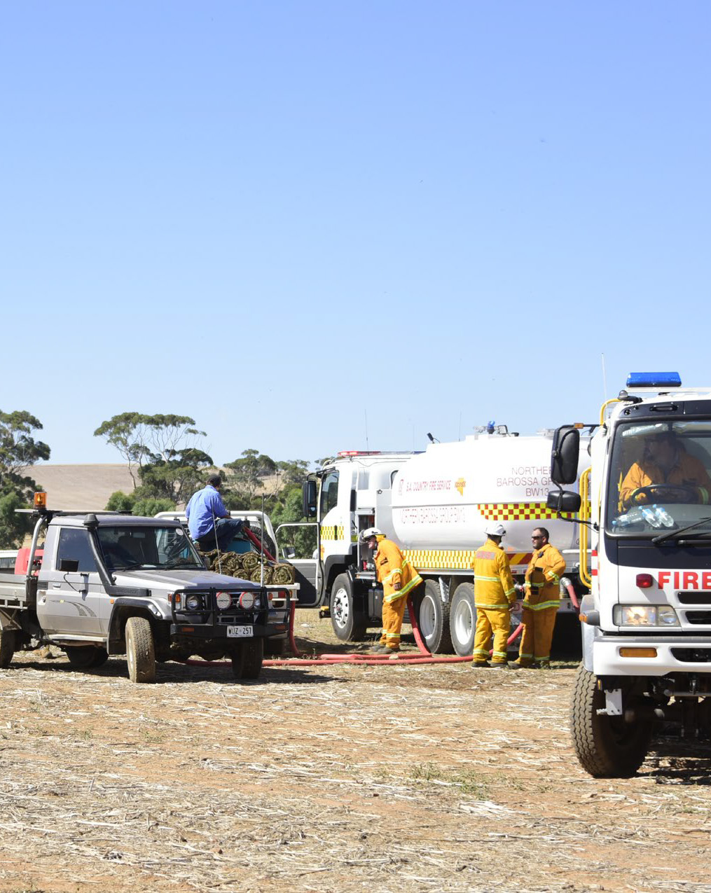
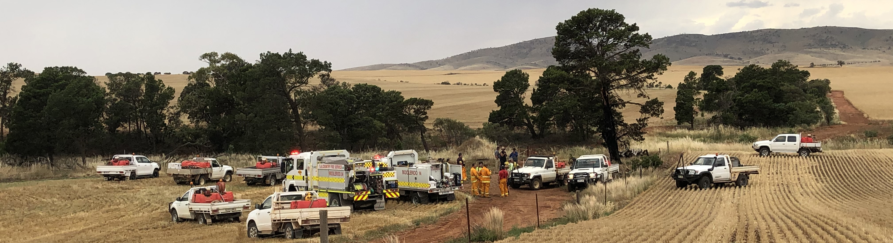
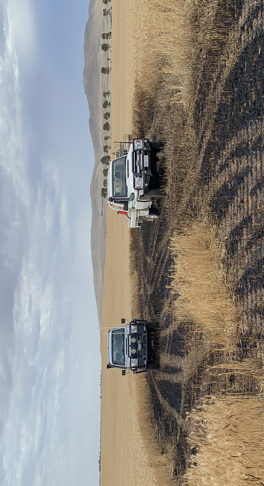
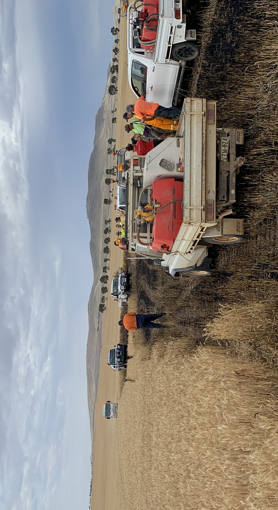
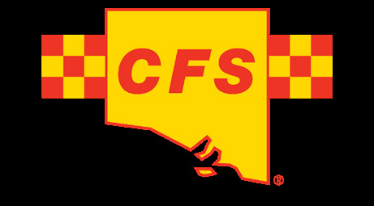
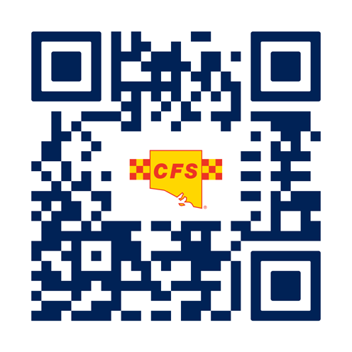

# Handbook for Farm Fire Units (SA)

> **Source**: SA SAFECOM
> **URL**: https://resources-production.safecom.sa.gov.au/current/docs/handbook_for_farm_fire_units.pdf
> **Licence**: © Government of South Australia; emergency-management practitioner reference
> **Retrieved**: 2026-05-07T23:44:50Z
> **SHA-256**: `7563e8a4842e2d1c8170c9d9a18d0750ed189c51d98f606775881a69446890c2`
> *Converted from PDF to Markdown format.*

---
## Page 1

Farm Fire Units
Handbook
Use this guide to prepare your 
Farm Fire Unit for bushfires

---
## Page 2

Contents
3
table-layout
1
Introduction
4
2
Minimum requirements for registration
5
3
How to register
6
3.1
Registration
6
3.2
FFU Sticker
6
4
Entering and leaving a fireground
6
5
Personal Protective Clothing and safety equipment
7
5.1
Minimum PPC and PPE requirements
7
5.2
Recommended PPC and PPE
7
6
FFU vehicle and equipment
8
6.1
Minimum FFU vehicle requirements
8
6.2
Recommended FFU vehicle standards and equipment
8
6.3
Trailer Firefighting Units
8
6.4
Ancillary equipment - Heavy plan, farm machinery and implements
8
6.5
What is not considered a CFS registered FFU
8
7
Communications on the fireground
9
8
Working cooperatively with emergency services
10
8.1
Before the fire danger season
10
8.2
The role of FFUs during a fire
10
8.3
Safety at fires
10
8.4
Know your risks
11
8.5
Accept responsibility
11
8.6
Personal limits and capabilities
11
9
Injury protection and reporting
12
9.1
Personal injury protection
12
9.2
Reporting an injury
12
10
FFU vehicle or equipment loss or damage
13
10.1
Insured vehicles
13
10.2
Uninsured vehicles
13
10.3
No CFS liability
13
10.4
Making a claim for reimbursement
13
Further information
14
Resources and references
14
Contact us
14
Glossary
15
Checklists
16
Personal Protective Equipment requirements
16
Vehicles and firefighting equipment requirements
16
Acknowledgement
The CFS acknowledges the Traditional Custodians and Owners of the lands on which we work and live 
across Australia and pay our respects to Elders past, present and emerging.

---
## Page 3

Thank you for your interest in Farm Fire 
Units (FFUs) and how you may be able 
to help the South Australian Country Fire 
Service (CFS) protect your community.
The CFS is responsible under South Australian 
legislation for the protection of life, property and 
the environment, and has overall control during 
bushfires.
FFUs can often be the first vehicles on a 
fireground, particularly in remote areas, so this 
Handbook is designed to help you understand 
the dangers on a fireground, how to minimise 
them, and how to communicate with the CFS to 
ensure you are supported while attending a fire.
This Handbook supports local arrangements 
across the state and establishes a uniformed 
approach to how these arrangements are 
managed.
The Handbook also provides information on 
how to communicate with the CFS, equipment 
required to attend a fire, and protection offered 
by the CFS for yourself and your equipment.
By becoming a registered CFS FFU, you join a 
large team fighting a fire and will be included in 
the planning, response and support of crews on 
the ground. 
You may also be covered if you are injured 
or your equipment is damaged while you are 
fighting a fire in support of CFS.
FFU operators should familiarise themselves 
with the contents of this Handbook prior to 
attending a fire to ensure the best outcomes 
are achieved for all parties involved.
Introduction
To become a CFS registered FFU you 
must meet the minimum requirements 
to attend a fire managed by CFS. This 
is also a requirement for personal injury 
and equipment insurance coverage.
To register as an FFU with the CFS you must live 
and/or work as/for a farmer/primary producer. If 
you live and work within a township you cannot 
register an FFU with the CFS. Understanding the 
minimum requirements in the FFU Guidelines 
is important. CFS, on receipt of a claim, will 
investigate whether the minimum requirements 
were met. If you do not meet the identified 
standards your claim may be rejected.
As a CFS registered FFU you are required to:
•	
notify the CFS when you arrive at a fire 
(Log on) and when you leave the fireground 
(Log off)
•	
carry and use properly fitted personal 
protective clothing and equipment 
(described in Checklist on p.16)
•	
ensure your vehicle complies with relevant 
South Australian regulations 
•	
ensure your vehicle is equipped to the 
minimum requirements (see Checklist, p.16)
•	
carry and use appropriate communication 
equipment for fireground communication 
and logging on and off 
•	
work cooperatively with emergency 
services and follow directions.
The following activities are not considered FFU 
activities approved by the CFS:
•	
responding to fires more than 150km from 
your property or outside of your local 
brigade area (whichever is greater)
•	
the use of any vehicle which is not 
registered with CFS*
•	
the use of a vehicle classed greater than 
Medium Rigid (MR)*
•	
firefighting on your own property prior to 
calling Triple Zero to report the fire.
* If you have a HR classified vehicle that you 
wish to register as an FFU you will need to have 
endorsement by your local Group Officer and 
CFS Region. Once you have the endorsement 
your contact and vehicle details will then be 
forwarded for processing.
Minimum requirements for registration
circle-1
circle-2
4
5

---
## Page 4

Becoming a registered FFU is beneficial 
to the owner/operator and the CFS.
The CFS can provide coverage for injuries and 
vehicle damage, as well as information to assist 
you to work with your local CFS brigades before, 
during, and after fires.
When FFU operators register with the CFS, it is 
much easier for all operators in the area to be 
identified.
3.1 Registration
An online registration system is available at
cfs.sa.gov.au/farms.
The registration process will provide you 
with a basic understanding of your role and 
responsibilities on a fireground.
Online registration may also be available at 
regional and local events hosted by CFS Groups 
and Brigades.
Once your online registration has been completed 
you will be sent a FFU sticker to be displayed on 
your vehicle.
If you are unable to access the CFS FFU online 
registration, approach your local CFS Brigade, 
Group or CFS Regional Office for assistance.
3.2 FFU Sticker
A FFU sticker will be provided once the owner/
operator has completed the CFS FFU registration 
process and has agreed to comply with the 
expectations and requirements of the CFS when 
operating on CFS controlled firegrounds.
The FFU sticker is intended to provide a 
distinctive mark of recognition for emergency 
personnel to assist in identifying a FFU vehicle 
that is involved with assisting neighbours and the 
CFS in fighting a bushfire.
Such stickers may assist in providing access 
for FFUs through road closures or Traffic 
Management Points (TMPs), but this is not 
guaranteed. On occasions, emergency personnel 
or SA Police managing these points may prevent 
FFUs from proceeding as it may not be safe to do 
so.
FFU operators are required to comply with lawful 
instructions from emergency services personnel 
or SAPOL and cooperate with their directions.
For more information
cfs.sa.gov.au/warnings-and-incidents/managing-
road-closures-during-emergencies/
How to register
The CFS is accountable for the safety 
and wellbeing of all personnel who are 
on a CFS-controlled fireground.
Under the Fire and Emergency Services Act 2005 
(Section 59) the CFS must “provide efficient 
and responsive services in the country for the 
purpose of fighting fires”.
Section 97.2 of the Act details how the CFS is 
legally able to assume control over any land 
where there is a need to protect life, property or 
the environment from a fire.
With Section 59 and 97 in mind, it is essential for 
FFU operators to make their presence known as 
soon as possible to CFS when they arrive at or 
depart from a fireground.
FFUs operators should also record the details of 
who/how you logged on/off with, and the time it 
occurred, as you may need this information at a 
later date if making an injury or damage claim.
The first option is to use pre-determined local 
arrangements to ensure that a record of FFU 
logging on has occurred.
Contact your local CFS brigade or Regional 
Headquarters and familiarise yourself with 
current local arrangements for your area.
Logging on to an incident will allow for:
•	
operations to be managed in a coordinated 
and safe manner
•	
inclusion in welfare and catering 
arrangements
•	
access to water re-supply for firefighting
•	
notification of arrangements for any first 
aid/medica reporting and treatments
•	
coverage for personal injury protection 
under Return-to-Work legislation
•	
vehicle and ancillary equipment damage 
and repair expenses reimbursement.
Entering and leaving a fireground
Wearing the correct types of personal 
protective clothing (PPC) and safety 
equipment (PPE) when firefighting is 
essential.
The correct PPC and PPE:
•	
provides protection from radiant heat
•	
provides protection when working in a 
hazardous fire ground environment
•	
enables the wearer to remain as 
comfortable and safe as possible during 
firefighting activity.
5.1 Minimum PPC and PPE Requirements
All clothing must be worn correctly and properly 
secured (buttoned/zipped) with sleeves rolled 
down.
The following is the minimum PPC required on 
the fireground:
•	
long sleeve heavy duty cotton or natural 
fibre shirt
•	
long pants, heavy duty cotton or natural 
fibre
•	
sturdy, closed leather footwear (workboots 
or similar).
Working from the rear of a moving vehicle during 
a bushfire presents additional hazards that must 
be considered by the operator. For example, 
if working from the rear of a vehicle, an FFU 
operator is more exposed to radiant heat and 
dust. In this instance, additional PPE is required. 
This should include:
•	
leather work gloves
•	
head protection
•	
eye protection
•	
breathing protection. 
5.2 Recommended PPC and PPE
Clothing
Long sleeve and long leg, cotton or natural 
fibre clothing, high visibility, or fire rated. Rural 
Firefighting ensemble is recommended.
Footwear
Leather boot, hardened toe with ankle protection. 
Pull on or lace up.
Gloves
Leather, with cuff that provides wrist protection 
(gauntlet style).
Head protection
Hard shell helmet that provides some radiant heat 
protection with a chin strap to secure helmet. A 
visor to provide facial shielding from radiant heat.
Eye protection
Industrial googles with strap that fits securely 
and seals to the face.
Breathing protection
A P2 or above rated dust mask.
A PPE checklist is provided on page 16.
PPC and safety equipment
circle-5
circle-3
circle-4
6
7

---
## Page 5

FFU vehicle and equipment may comprise of:
•	
FFU vehicles and equipment used for 
firefighting
•	
ancillary equipment including heavy plant, 
farm machinery and implements
6.1 Minimum FFU vehicle requirements
The minimum requirement for a CFS registered 
FFU vehicle are:
•	
registered, roadworthy and compliant with 
relevant vehicle regulations
•	
equipped with a UHF CB Radio
•	
under its gross vehicle mass (GVM)
•	
a secure load including the tank, pump and 
fittings
•	
pump and tank must be in good working 
order
•	
personal drinking water is carried to 
maintain hydration.
6.2 Recommended FFU vehicle 
standards and equipment
•	
a fitted UHF CB Radio
•	
appropriately insured, including private 
firefighting use
•	
heat shields, handrails and safety equipment 
fitted to tray if being used by personnel for 
firefighting.
•	
First Aid Kit – with a specific burns kit 
included
•	
woollen blanket for fire protection
•	
rotating amber light fitted for use on 
fireground
•	
a means of personal communication with the 
driver and people working on the rear of the 
vehicle
•	
personal drinking water and snacks.
6.3 Trailer Firefighting Units
Trailer units are discouraged from being used for 
firefighting as they present significant challenges 
in terms of manoeuvrability, mobility and stability, 
as well as to the safety of personnel on the 
fireground.
Do not ride on trailer units while firefighting as 
this is considered an unreasonable safety risk.
6.4 Ancillary Equipment – Heavy plant, 
farm machinery and implements
Farm machinery and implements refers to a 
category of equipment for use in tasks such 
as slashing, ripping, harrowing or grading, and 
are usually drawn by another vehicle such as a 
tractor.
The use of heavy plant, farm machinery and 
implements on a fireground should be supported 
by a vehicle with wet firefighting capability and 
communications, and only used to perform tasks 
acknowledged and approved by the CFS.
Heavy plant refers to equipment such as 
bulldozers, graders, scrapers and front-
end loaders that are not directly involved 
in firefighting and/or are being operated 
independently and not commercially contracted 
by the CFS.
The operator of ancillary equipment must ensure:
•	
the safety of the operator and that of other 
personnel is maintained
•	
the apparatus is suitable and capable of 
performing the task
•	
the apparatus is reliable to operate in the 
hazardous environment of a fire ground.
•	
the apparatus are only used by suitably 
trained, experienced and licenced 
operators.
A vehicle and equipment checklist is provided 
on page 16.
6.5 What is not considered a CFS 
registered FFU
The following vehicles are not considered as CFS 
registered FFUs for firefighting purposes:
•	
vehicles and ancillary equipment used for 
the defence of domestic dwellings on their 
own property in a bushfire
•	
vehicles and ancillary equipment 
commercially contracted by emergency 
services
•	
vehicles or equipment on a fireground that 
are not registered with CFS
•	
vehicles or equipment that are classed 
greater than Medium Rigid (MR) unless an 
exemption has been endorsed by the local 
CFS Group Officer and Region.
•	
Industry Brigade Firefighting Units.
FFU vehicle and equipment
The CFS considers the use of UHF CB as 
the primary method of communication 
on the fireground with Farm Fire Units.
Prior to the fire season the local FFU 
Coordination officer (usually attached to a CFS 
brigade) should be consulted to determine the 
communications arrangements and protocols 
applying to various areas around the state.
It is likely that there will be a combination of 
various technologies used including UHF CB 
radios, mobile phones and other services.
The primary UHF channel for many areas is 
9, with secondary options of 19, 29 & 39 (also 
known as ‘the 9s’), but this should be checked 
with the local CFS.
Use of UHF CB channels 9, 19, 29 & 39 are 
compatible and consistent with both 40 and 80 
channel UHF CB sets.
When allocated a UHF Channel to use on the 
fireground ensure that you remain on that 
channel for the duration of your attendance. The 
channel will be used to convey tasks, instructions, 
and important safety information.
Communications with FFU operators is essential 
in providing information such as:
•	
operational instructions and tasking
•	
location of water points
•	
safety messages
•	
warning messages – fire changes/weather 
and wind changes
•	
welfare, catering and first aid arrangements.
Depending on the size of the incident a 
communications plan, including UHF CB channels 
for FFU, may be implemented by the CFS. Large 
incidents may allocate different channels for 
different areas of a fireground.
Communications may not be confined to use 
of technology, and verbal face-to-face contact 
between FFU operators and CFS crews may also 
be necessary, depending upon the circumstances 
of the incident. It should be remembered that 
smoke from a bushfire may interfere with radio 
and mobile phone communications.
Communication on the fireground
circle-7
circle-6
8
9

---
## Page 6

It is essential during an active fire that 
FFU operators work with emergency 
services to achieve the overall goal of 
protecting the community.
8.1 Before the Fire Danger Season
Prior to the start of the Fire Danger Season, FFU 
operators should contact their local CFS Brigade, 
Group HQ or Regional HQ to make themselves 
aware of any changes to procedures. Many CFS 
Groups and Brigades will arrange pre-season 
activities to engage with FFU owner/operators. 
These events are a valuable relationship building 
opportunity. You are encouraged to attend these 
and share your knowledge.
8.2 The role of FFUs during a fire
FFU roles and tasks when carrying out 
firefighting may include:
•	
initial attack of the fire, only if safe to do so
•	
coordinated support and pairing with CFS 
fire trucks
•	
blackout operations (wetting down hot 
areas that exist after the main front of the 
fire has passed)
•	
patrolling and observing the fire for 
reignitions
•	
providing local knowledge.
Remember that each task will vary in terms of:
•	
the current and perceived hazards and risks 
involved
•	
the degree of physical and mental exertion 
required
•	
the extreme conditions that equipment may 
need to operate in.
The use of ancillary equipment, which does not 
involve direct firefighting, may include:
•	
graders, bulldozers, scrapers and front-end 
loaders to create mineral earth breaks
•	
tractors for slashing, ploughing or grading 
to remove fuel from the fire line.
As the fireground is a hostile environment, there 
will be a number of hazards encountered when 
operating a FFU. It is your responsibility while on 
the fireground to monitor your health and safety. 
Some of the hazards you may be exposed to 
include:
•	
smoke, radiant heat, dehydration, heat 
stress and heat stroke
•	
high levels of noise for prolonged periods
•	
poor visibility
•	
exposure to mental stress and/or trauma
•	
falling objects (trees and tree limbs)
•	
rough terrain or dense vegetation
•	
close proximity to firefighting vehicles, 
heavy machinery or other emergency 
vehicle traffic
•	
downed, live powerlines.
Where a FFU operator encounters a safety risk 
they should withdraw to a safer location and 
notify others on the fireground of the hazard 
immediately.
8.3 Safety at fires
The highest priority for the CFS when attending 
fires is the protection of life. This includes you as 
a FFU operator. When preparing for firefighting 
and on the fireground, FFU operators must take 
responsibility for their own safety. It is essential 
that well before the fire danger season begins 
you are adequately prepared. This includes 
checking you are prepared:
•	
mentally and physically
•	
with the minimum Personal Protective 
Clothing and Equipment (see section 5)
•	
with a vehicle that meets the minimum 
requirements (see section 6)
•	
and capable of fighting a fire.
Do not work alone – team up with others to 
enhance the safety of yourself and others on the 
fire ground. Working as a team will contribute to:
•	
being able to look out for each other
•	
being aware of the situation around you 
and changing fire behaviour or, weather 
conditions
•	
communicating with others on the 
fireground
•	
identifying escape routes
•	
identifying safety zones.
Working cooperatively with emergency services
Alcohol and drugs
FFU operators are expected to ensure that while 
operating on the fireground they:
•	
are not affected by drugs or alcohol to the 
extent where it may impair their judgement 
or capacity to act safely
•	
do not consume alcohol or drugs
8.4 Know your risks
FFU operators must be aware of what is 
happening around them on a fireground. You 
must be constantly alert to the changing 
conditions that may impact the personal safety of 
yourself and others. The CFS encourages the use 
of risk assessments prior to entering and whilst 
on a fireground. Risks can range from, but are 
not limited to, topography, changing vegetation 
and fuel loads, variable weather conditions, aerial 
fire bombers, falling trees and unpredictable fire 
behaviour.
The CFS utilises the LACES dynamic risk 
assessment process. LACES is an acronym for 
Lookout, Awareness, Communication, Escape 
Routes, and Safety Zones.
As conditions change, on-ground responders rely 
on the use of safety zones and the timely use 
of escape routes for safety. In these situations, 
LACES provides a system to maintain safety. 
During bushfires, LACES is particularly useful 
where there is a risk of burnover, entrapment, or a 
weather change. LACES should be considered as 
part of the dynamic risk assessment process.
•	
Lookout: A fixed, aerial or mobile lookout 
shall be deployed to maintain a clear 
overview of risks and to provide timely 
advice of the need to use escape routes 
and safety zones.
•	
Awareness: Firefighters and FFU operators 
shall be aware of the impact of changes 
in fire behaviour, including those resulting 
from variations to fuel, weather and 
topography and of other fireground 
hazards.
•	
Communications: All fire crews (FFU 
operators included) shall follow the 
Communications Plan, communicate with 
surrounding crews to discuss and address 
safety issues.
•	
Escape routes: At least two escape routes 
should be agreed and made known to 
all relevant personnel. The suitability of 
an escape route should be continually 
reviewed to ensure it remains effective.
•	
Safety zones: Safety zones should be 
identified and made known to all relevant 
firefighters and FFU operators. Firefighters 
need to consider escape time and safety 
zone size requirements that will change as 
fire behaviour changes.
The CFS recognises that some aspects of the 
LACES process may not be fully utilised by FFU 
operators, but it is crucial that FFU operators are 
aware of the risks when entering a fireground 
and, where possible, undertake a risk assessment 
to assist in mitigating injuries, damage to 
vehicles and equipment and potentially loss 
of life. At a minimum FFU operators must be 
constantly aware, utilise effective and approved 
communications, and know your escape routes 
and safety zones.
Remember – everyone at a fire has a 
responsibility for safety. Make safety your 
priority.
8.5 Accept responsibility
When a FFU operator elects to engage in 
firefighting as a private individual they accept 
responsibility for their own decisions and actions. 
The FFU operator:
•	
will be expected to take responsibility for 
their decisions
•	
will not be exempt or above the law when 
firefighting
•	
will be expected to comply with all legal 
obligations.
8.6 Personal limits and capabilities
FFU operators should know their physical and 
mental boundaries and work within those limits. 
This is because working on a fireground is an 
environment that:
•	
requires arduous physical exertion
•	
has continuous mental pressures to make 
decisions
•	
is variable and can be hazardous.
circle-8
10
11

---
## Page 7

9.1 Personal injury protection
Claims for compensation for personal 
injury by an operator of a FFU are to be 
interpreted under the following South 
Australian legislation - Return to Work 
Regulations 2015 (under the Return-to-
Work Act 2014).
To be covered by the provisions of this legislation, 
and therefore covered from a personal injury 
protection perspective, there must be:
•	
local arrangements for an operator of a FFU 
to make contact with the CFS present at 
the emergency operation
•	
information that captures the logged on/off 
to an incident.
Through this, the CFS will be aware of the 
presence of FFU operators and will effectively 
cover the requirements of the above 
legislation.
9.2 Reporting an injury
All FFU operators who sustain an injury while 
logged on to the fireground, no matter how 
minor at the time, must:
•	
while on the fireground report it to a CFS 
crew leader, FFU liaison officer, or Incident 
Management Team member so that the 
occurrence can be logged.
•	
the FFU operator must also record the 
name of the person who the injury was 
reported to and the time that the report 
was made.
•	
report the occurrence to the CFS Regional 
Office within 24 hours of the injury 
occurring, providing the details of who and 
when you logged on, and who and when 
you reported the injury to.
If the injury has caused medical expenses to be 
incurred and/or time has been lost from a main 
source of employment, the injured party is to 
consult promptly with a doctor of their choice 
and obtain a Workcover Capacity Certificate 
which will provide a detailed diagnosis and 
advice on current capacity for main employment 
duties.
To provide coverage for return-to-work personal 
insurance claims, the injured party is required 
to complete a Volunteer Accident Notification 
Investigation to Region Form with the assistance 
of the CFS Regional Office.
Injury protection and reporting
circle-9
12
It is the intention of CFS to reimburse 
expenses due to damage to FFU vehicles 
and ancillary equipment assisting in 
operational duties.
Expenses are covered by CFS provided the 
following criteria has been met:
•	
the vehicle or equipment must have been 
approved (logged on) for use by the CFS 
officer in charge at the incident
•	
the operator holds the appropriate licences 
to operate the vehicle or equipment
•	
the vehicle and operator was specifically 
tasked and operating under the direction of 
a CFS officer or representative
•	
the vehicle or equipment were not 
commercially hired for the incident.
When damage has occurred to FFU vehicles or 
ancillary equipment, the operator is to:
•	
record the incident scenario and resulting 
damage and take photographs of the 
damage if possible
•	
obtain witness statements if possible
•	
notify a member of the CFS at the 
incident attended (i.e. Crew Leader, Sector 
Commander or Incident Management Team 
member) as soon as reasonably possible so 
that the circumstances can be logged.
10.1 Insured vehicles
For insured FFU vehicles and ancillary equipment, 
the CFS liability for reimbursement of damage 
or repair expenses is limited to the cost of the 
owner’s insurance policy excess.
10.2 Uninsured vehicles
For uninsured FFU vehicles and ancillary 
equipment (vehicles with no current insurance 
coverage), the CFS will meet the lesser of the 
repair costs or the market value of the vehicle.
Where the market value of the vehicle is paid, the 
vehicle becomes the property of the agency for 
salvage purposes.
10.3 No CFS Liability
No liability will be accepted by the CFS for 
damage to vehicles and ancillary equipment 
where the damage is caused by a negligent or 
reckless act or omission on the part of the owner 
or operator, or where they are operating on their 
own behalf and without the appropriate CFS 
approval.
10.4 Making a Claim for Reimbursement
In the event of damage to insured FFU vehicles or 
ancillary equipment, the owner is to:
•	
contact their own insurance provider to 
arrange for repair
•	
pay for the excess of insurance and retain a 
copy of the payment details
•	
complete a Private Farm Fire Unit and 
Ancillary Equipment Damage Claim 
Form, available through the CFS Regional 
Office, and submit the form to the CFS 
Regional Office together with supporting 
documentation (evidence of excess 
payment, photos etc.).
In the event of damage to uninsured FFU vehicles 
or ancillary equipment, the owner is to:
•	
have the repairs undertaken
•	
pay for the repairs undertaken and retain 
the tax invoice
•	
complete a Private Farm Fire Unit and 
Ancillary Equipment Damage Claim 
Form available through the CFS Regional 
Office and submit the form to the CFS 
Regional Office together with supporting 
documentation (evidence of excess 
payment, photos etc.).
13
FFU vehicle or equipment loss or damage

---
## Page 8

CFS Brigade
A group of CFS volunteers 
from a specific area with 
rolesincluding Brigade 
Captain, Lieutenant(s), Senior 
Firefighter(s) and Brigade 
Members.
CFS Group
A collection of Brigades with 
roles of Group Officer, Deputy 
Group Officer(s) and other 
administrative roles.
CFS Regional Office
The Headquarters of each 
Region (an area designated by 
the CFS in relation to risk and 
capabilities of the volunteers 
within).
Deadman zone
An area above the fire (usually 
atop a hill or rise) where a fire 
will travel quickly to.
Divisional Commander
A position on the fireground 
used to coordinate firefighter 
response through Sector 
Commanders, Strike Team 
Leaders and Crew Leaders.
Escape routes
Identified pathways that 
firefighters can safely use to 
retreat from a fire.
FFU
Farm Fire Units.
FFU Coordinator
A person assigned, at a CFS 
regional or Group level, to co-
ordinate and administer the 
FFU program by developing 
and improving relationships 
between CFS and local FFU 
owner/operators.
FFU Liaison
A person assigned during a fire 
to provide operational support 
and a connection between FFU 
owner/operators and the CFS 
Incident Controller.
Flanks
The sides of a fire where fire 
activity is less aggressive than 
its direction of travel.
Flank attack
A directive for firefighters to 
extinguish flames along the 
side of a fire.
Head of fire
The large flames at the front 
of a fire where the extremity 
of the flames and heat are 
greatest and where the most 
dangerous part of a fire is.
Heel of fire
The rear of the fire where 
ground has been burned and 
where flame activity is lesser 
than the area where it is 
travelling.
Heavy plant
Large machinery such as 
bulldozers, graders or front-
end loaders.
Incident Controller (IC)
A person who is legally in 
control of the response to, and 
outcome of, an emergency and 
responsible for all personnel on 
the fireground.
Incident Management Team 
(IMT)
A team formed to support the 
IC on large incidents.
Glossary
Red Flag Warning
A phrase used to describe 
information about hazards, 
perceived risks or actual risks 
on a fireground.
CFS Crew Leader
A CFS volunteer in-charge of a 
crew within a fire truck.
Safety Zones
Areas where firefighters can 
retreat to if required.
Sector Commander
A CFS volunteer who 
coordinates the response 
activity of a large area of a 
fireground via Strike Team 
Leaders and Crew Leaders.
Strike Team
A collection of firefighting 
crews (usually four fire trucks, 
a bulk water carrier and a 
command vehicle) used to 
attack specific areas of a 
fireground.
Strike Team Leader
A CFS volunteer who directs 
a Strike Team’s activities or 
tasks.
Water points
Designated points where CFS 
is authorised to access water 
replenishments – can be dams, 
water tanks, stand pipes or 
Bulk Water Carriers.
book
15
Resources and information included in this 
Handbook are available from the CFS website.
cfs.sa.gov.au/farms
References
SA Motor Vehicles Act 1959
www.legislation.sa.gov.au/lz/c/a/motor%20
vehicles%20act%201959.aspx
SA Return to Work Regulations 2014
www.legislation.sa.gov.au/lz/c/a/return%20to%20
work%20act%202014.aspx
Fire and Emergency Services Act 2005
www.legislation.sa.gov.au/lz/c/a/fire%20and%20
emergency%20services%20act%202005/
current/2005.40.auth.pdf
Region 1
Mount Lofty Ranges and Kangaroo Island
75 Gawler St, Mount Barker SA 5251
T: 08 8391 1866
E: cfsregion1@sa.gov.au
Region 2
Mount Lofty Ranges, Yorke Peninsula and
Lower Mid North
Spurling Circuit off Mudla Wirra Road, Wasleys
P: PO Box 1506 Willaston SA 5118
T: 08 8522 6088
F: 08 8522 6404
E: cfsregion2@sa.gov.au
Region 3
Murraylands and Riverland
11-17 Kennett Road, Murray Bridge
P: PO Box 1371, Murray Bridge SA 5253
T: 08 8532 6800
F: 08 8532 6220
E: cfsregion3@sa.gov.au
Region 4
Flinders Ranges, Mid North and Pastoral Areas
40 Flinders Terrace, Port Augusta
P: PO Box 2080, Port Augusta SA 5700
T: 08 8642 2399
F: 08 8641 0176
E: cfsregion4@sa.gov.au
Region 5
South East
46 Smith St, Naracoorte
P: PO Box 8, Naracoorte SA 5271
T: 08 8762 7100
F: 08 8762 1863
E: cfsregion5@sa.gov.au
Region 6
Eyre Peninsula and West Coast
32 Matthew Place, Port Lincoln
P: PO Box 555, Port Lincoln SA 5606
T: 08 8682 4266
F: 08 8682 6569
E: cfsregion6@sa.gov.au
Further information
Contact us
address-book
circle-info
14

---
## Page 9

Personal Protective Equipment requirements
Vehicles and firefighting equipment requirements
Do you have the correct Personal Protective Clothing and Equipment
Yes
No
1
Cotton or natural fibre overalls with long sleeves?
or
Natural fibre work shirt and trouser ensemble?
2
Sturdy leather boots?
3
Leather work gloves?
4
Industrial type helmet with chin-strap?
5
Industrial type goggles?
6
Respirator or dust mask?
7
Hearing protection (if required)?
8
High visibility vest (if required)?
9
Drinking water and food/snacks?
Is your vehicle ready?
Yes
No
1
When loaded is your vehicle less than the Gross Vehicle Mass?
2
Is the load including tank, pump and fittings properly secured?
3
Is your vehicle roadworthy?
4
Are the vehicle and pump mechanically sound?
5
Have the vehicle and pumpm been serviced regularly?
6
Is your vehicle fitted with a UFH radio transceiver?
7
Is there a first aid kit with burns pack in the vehicle?
8
Is there a woollen blanket for fire protection in the vehicle?
9
Is your vehicle fitted with an amber rotating beacon?
10
Is your vehicle fitted with heatshields (if required)?
square-check
cfs.sa.gov.au/farms
Checklists

