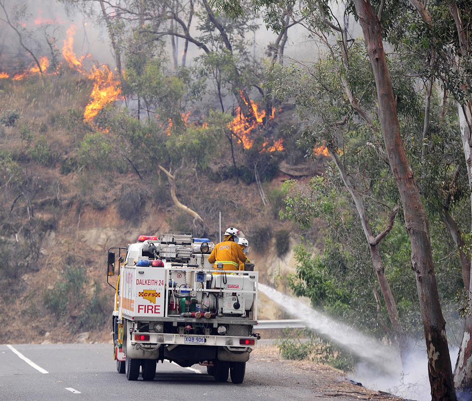

# Preparedness Operations Charter (SA Emergency Services)

> **Source**: SA SAFECOM
> **URL**: https://resources-production.safecom.sa.gov.au/current/docs/Preparedness-Operations-Charter.pdf
> **Licence**: © Government of South Australia; emergency-management practitioner reference
> **Retrieved**: 2026-05-07T23:44:58Z
> **SHA-256**: `d09a3ee802394a33123fb8885217207c1ae773de11f9a2633b5691ba52bf0412`
> *Converted from PDF to Markdown format.*

---
## Page 1

SOUTH AUSTRALIAN COUNTRY FIRE SERVICE
PREPAREDNESS OPERATIONS
CUSTOMER SERVICE CHARTER
Our Customer Service Commitments
The Directorate of Preparedness Operations is committed to 
ensuring that you receive quality service, quickly and courteously. 
We know that you – our customer – can monitor our performance, 
provide feedback on how we measure up and make sure we deliver 
on our undertaking.
We also ask that you understand that our people are members 
of a frontline emergency service and that our undertaking and 
commitments may vary during operational periods. We ask that you 
understand that operational agency matters take precedence and 
may affect some of the time frame commitments below, however 
we will endeavour to keep you informed of any potential delays.
Fees and Charges
Fees and charges apply under legislation to a number of Preparedness 
Operations services. Customers are encouraged to contact us to ascertain 
what, if any, fees and charges may apply and the payment arrangements 
available.
Redress
Where you believe that Preparedness Operations has not met one of the 
undertakings set out in this Charter, you are encouraged to:
a)
Contact the responsible Officer in the first instance;
and if not satisfied with the outcome
b)
Contact the appropriate Manager, or the Director Preparedness
Operations.
Whilst a complaint may be initially lodged at any level, it can be dealt with 
more quickly if it is lodged with the person nearest the source of the complaint 
in the first instance.
1)
General Complaints
•
If a customer has a complaint about the service we have provided
we will ensure an appropriate investigation is undertaken and a
considered response provided.
•
We will acknowledge a complaint within five working days and try
to resolve complaints within 20 working days.
•
If we have made a mistake, the customer will receive a written
apology and advice concerning actions taken.
•
Preparedness Operations will keep a record of complaints received
and actions taken, with due regard to protecting the privacy of
customers and staff.
•
Complaints must be in writing - anonymous complaints are not
supported.
2)
Complaints concerning Preparedness Operations personnel
•
The rights of both the customer and staff member will be observed.
•
Complaints concerning a particular individual’s attitude or actions
will be referred to firstly to the individual’s line Manager for
attention. Secondly, the individual will be advised of the details of
the complaint and will be requested to respond to the complaint.
•
The Manager / Director, will take into account the response received
and advise the complainant and employee of the outcome.
•
Serious complaints will be directed to the Director, Preparedness
Operations for appropriate action.
3)
Compliments Received
•
Compliments received will be referred to the appropriate Manager
and / or Department and any staff member involved.
•
A copy of the letter of compliment may be kept in the employee’s
personal files.
SACFS PREPAREDNESS
OUR UNDERTAKINGS
Answering incoming phone calls
We will answer 75% of calls within one minute* and all calls will be answered by a CFS staff member 
or pager messaging service operator
Operator Assisted Answering Service Pager 
messages
We will respond to Operator Assisted Pager messages within two working days
Answering correspondence
We will respond to emails and letters within 10 working days of receipt
Complaints
We will acknowledge complaints within five working days of receipt and will address complaints within 
20 working days
Regulation 28/45 Assessments
We will complete 100% of Reg 28/45 Assessments within 15 working days of receipt.
Regulation 83/103 Assessments
We will acknowledge all applications and contact the applicant to arrange scheduling of Reg. 83/103 
Assessments within 10 working days of receipt.
Residential Referrals & Bushfire Attack Level 
Assessments (BAL)
We will acknowledge and request additional information on all assessments within 10 working days. 
We will aim to complete 100% of referrals and BAL assessments within 30 working days.
Requests for Meetings
We will acknowledge meeting requests within five working days of receipt.
Variation Requests
We will complete 75% of variation requests within 10 working days of receipt.
Permit Issuing
We will acknowledge permit requests within two working days.
It is important to note that scheduled site visits cannot occur if access is restricted (e.g. locked gates, unsuitable tracks for our vehicles), sites are not 
marked, or other undisclosed hazards are present. In cases where Preparedness Operations personnel attend a property for a scheduled visit and are 
unable to complete the task due to access or other property issues, the timeframes listed above will not apply. 
*In the event you cannot talk to a CFS Officer, all calls are answered by an Operator Assisted Answering Service. Please leave your name and contact details,
and we will return your call.

