# State Bushfire Coordination Committee and Bushfire Management Committees — Guidelines (January 2018)

> **Source**: SA SAFECOM
> **URL**: https://resources-production.safecom.sa.gov.au/current/docs/sbcc_and_bmc_guidelines_january_2018.pdf
> **Licence**: © Government of South Australia; emergency-management practitioner reference
> **Retrieved**: 2026-05-07T23:45:31Z
> **SHA-256**: `1fbcf60eb9eded8a2dbe7400c84c0a93ebbb9628760009612d498269751a9be3`
> *Converted from PDF to Markdown format.*

---
## Page 1

1 
State Bushfire Coordination Committee 
GUIDELINES FOR 
STATE BUSHFIRE COORDINATION COMMITTEE & 
BUSHFIRE MANAGEMENT COMMITTEES  
January 2018 
UNDER REVIEW

---
## Page 2

2 
TITLE:     Guidelines for the State Bushfire Coordination Committee and Bushfire Management 
Committees 
AUTHORISED BY:    Presiding Member, State Bushfire Coordination Committee 
DATE AUTHORISED:     XXXXX 2018 
REVIEW DATE:     February 2019 
CUSTODIAN:     State Bushfire Coordination Committee 
All references to BMC quorum requirements rescinded and replaced as a result of an SBCC resolution 
on 15 November 2024. 
NOTE: the Terms of Reference for the SBCC and BMCs have been extracted from Part Six of this 
document and published as stand-alone documents, as a result of an SBCC resolution on 21 
November 2025.
UNDER REVIEW

---
## Page 3

3 
ABBREVIATIONS 
AFAC 
Australasian Fire and Emergency Services Authorities Council 
BMAP 
Bushfire Management Area Plan  
BMC 
Bushfire Management Committee 
BoM 
Bureau of Meteorology 
BSP 
Bushfire Safer Place 
CFSVA 
Country Fire Service Volunteers Association 
CCSA 
Conservation Council of South Australia 
DEWNR 
Department of Environment, Water and Natural Resources 
DF 
Drought Factor 
DPTI 
Department of Planning, Transport and Infrastructure 
DPC 
Department of Premier and Cabinet 
EO 
Executive Officer 
FBDs 
Fire Ban Districts 
FDS 
Fire Danger Season 
FESA 
Fire and Emergency Services Act 2005 (SA) 
FPO 
Fire Prevention Officer 
GAFLC 
Government Agencies Fire Liaison Committee 
LGA 
Local Government Association 
LRR 
Last Resort Refuge 
NRMC 
Natural Resources Management Council  
NPWA 
National Parks & Wildlife Act 1972 (SA)  
NVC 
Native Vegetation Council 
OACDT 
Outback Areas Community Development Trust 
PPSA 
Primary Producers SA 
RPO 
Regional Prevention Officer 
SACFS 
South Australian Country Fire Service  
SAFC 
South Australian Forestry Corporation 
SAFECOM 
South Australian Fire and Emergency Services Commission 
SAMFS 
South Australian Metropolitan Fire Service  
SAPOL 
South Australian Police 
SAW 
South Australian Water Corporation 
SBCC 
State Bushfire Coordination Committee 
SDI 
Soil Dryness Index 
UNDER REVIEW

---
## Page 4

4 
TABLE OF CONTENTS 
ABBREVIATIONS 
3 
INTRODUCTION 
5 
PART ONE: BUSHFIRE MANAGEMENT OVERVIEW 
5 
Background 
5
Legislative Framework 
5
Bushfire Management Areas 
7
PART TWO: STATE BUSHFIRE COORDINATION COMMITTEE 
9 
SBCC Composition 
9
SBCC membership information 
10
SBCC Functions 
11
SBCC Administration 
11
PART THREE:  BUSHFIRE MANAGEMENT COMMITTEES 
14 
BMC Composition 
14
BMC Membership changes 
15
BMC Functions 
16
BMC Responsibility to the SBCC and BMAPs 
17
BMC MEMBER Roles and Responsibilities 
19
BMC Administration 
21
Meeting protocols 
23
New BMC Members 
24
BMC Sub-Committees and Working Groups 
24
PART FOUR: BMC CHAIRPERSONS AND EXECUTIVE OFFICERS 
26 
BMC Chairperson 
26
BMC Executive Officer 
26
BMC Meeting Process 
30
PART FIVE: BMC BUSINESS MATTERS 
35 
35
36
37
37
37
37
Fire Danger Season Date Recommendations 
Bushfire Safer Place and Last Resort Refuges Amendments  
Reporting of Bushfire Management Activity Annual 
Reporting of BMAP Activities 
Annual Executive Summary 
Authorised Officer Permit Issuing Guidelines 
BMAP Amendment AGreement and Approval 
38
39 
40 
41 
42 
PART SIX: TERMS OF REFERENCE FOR COMMITTEES & OUT OF SESSION PROTOCOL 
PART SEVEN: MEETING TEMPLATES & FORMS 
APPENDIX 1 – Bushfire Management Area Boundaries 
APPENDIX 2 – Checklists for BMC meetings 
APPENDIX 3 – Summary Fact Sheet for BMC Members 
APPENDIX 4 – BMC Mid-Term Membership Management Procedure
45 
 Provided Separately
NOTE: the Terms of Reference for the SBCC and BMCs have been extracted from Part Six of this 
document and published as stand-alone documents, as a result of an SBCC resolution on 21 
November 2025.
SEE NOTE BELOW
UNDER REVIEW

---
## Page 5

5 
INTRODUCTION 
This document contains guidelines for members of the State Bushfire Coordination Committee 
(SBCC) and the Bushfire Management Committees [BMCs] on their roles and responsibilities with 
regard to bushfire management planning in South Australia.  
This guideline should be regarded as a dynamic document, which will be amended and updated 
on an ongoing basis following SBCC decisions.  
PART ONE: BUSHFIRE MANAGEMENT OVERVIEW 
BACKGROUND
Under the Fire and Emergency Services Act 2005 (FESA) there is a two-tiered bushfire 
management framework, consisting of a State Bushfire Coordination Committee [SBCC] and nine 
Bushfire Management Committees [BMCs].  The SBCC is required to prepare and maintain a 
State Bushfire Management Plan [SBMP] to establish a strategic risk-based framework for 
bushfire management in South Australia.  Each BMC is required by the FESA to develop, 
implement and review a Bushfire Management Area Plan [BMAP] based on assessment of 
bushfire risk to assets, incorporating a broader perspective on bushfire management values and 
local knowledge.  Each of the BMAPs are required to be monitored for amendments annually and 
formally reviewed every four years. 
There are other roles and responsibilities that the SBCC and BMCs are required to undertake in 
order to develop, maintain and review the BMAPs.  The SBCC and BMC have specific functions 
including governance over bushfire management in South Australia, meetings, reporting on 
bushfire management activities, consideration of amendments to BMAPs, public consultation, 
election of sub-committees and working groups to achieve BMAP outcomes.  This document 
serves to outline the policies and procedures for carrying out these specific roles and 
responsibilities to ensure consistency in the bushfire management process across the State. 
LEGISLATIVE FRAMEWORK 
The Fire and Emergency Services Act 2005 (FESA) is the primary legislative document for Bushfire 
Management Area Planning [BMAP] in South Australia.  The FESA establishes a State Bushfire 
Coordination Committee [SBCC], and details its composition and functions. The SBCC divided 
the state into nine Bushfire Management Areas [BMAs], with a Bushfire Management 
Committee [BMC] required for each BMA. The composition and term of appointment of BMC 
members is determined by the SBCC after consultation with the Minister. Figure 1 below shows 
the reporting relationships for the legislated BMAP process in South Australia. 
UNDER REVIEW

---
## Page 6

6 
Figure 1    The reporting relationships for the legislated BMAP process in South Australia 
UNDER REVIEW

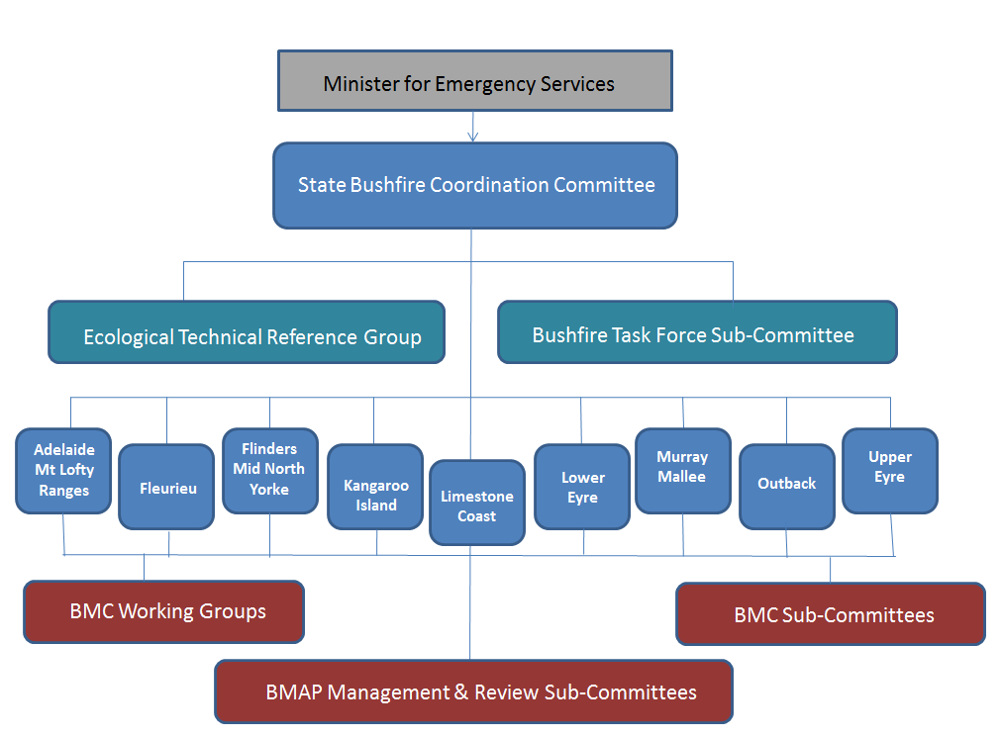

---
## Page 7

7 
BUSHFIRE MANAGEMENT AREAS 
Pursuant to s.72 of FESA 2005, the Governor, on the basis of recommendation from the SBCC, has 
proclaimed nine Bushfire Management Areas [BMAs] for South Australia. The Governor also has the 
power to vary the boundaries of a BMA or abolish a BMA on the basis that a new division is to occur.  
For a map of the BMA boundaries see Appendix 1.   BMAs have been defined on the basis of the 
following criteria: 
•
No local Council is represented in more than one BMA
•
Alignment with SA Government Regions has been sought wherever possible
•
BMAs have a similarity of bushfire management issues, including: bushfire risk, land
form, climate, fuel type and land use.
The nine BMAs identified for South Australia are as follows: 
BMA 
Included Local Government Areas 
Limestone Coast 
Grant, Mount Gambier, Naracoorte Lucindale, Wattle Range, Robe, Kingston, 
Tatiara. (7) 
Murray Mallee 
Coorong, Southern Mallee, Karoonda East Murray, Murray Bridge, Mid Murray, 
Renmark Paringa, Loxton Waikerie, Berri Barmera. (8) 
(A separate management group for Ngarkat CP has been established) 
Fleurieu 
Yankalilla, Victor Harbor, Alexandrina. (3) 
Kangaroo Island 
Kangaroo Island (1) 
Adelaide Mount 
Lofty Ranges 
Onkaparinga, Mount Barker, Marion, Mitcham, Burnside, Adelaide Hills, 
Campbelltown, Tea Tree Gully, Salisbury, Playford, Gawler, Barossa. (12) 
Flinders, Yorke, 
and Mid North 
Yorke Peninsula, Copper Coast, Barunga West, Wakefield, Mallala, Light, 
Clare and Gilbert Valleys, Goyder, Port Pirie, Northern Areas, Peterborough, 
Mount Remarkable, Flinders Ranges, Port Augusta, Carrieton Orroroo. (15) 
Lower Eyre 
Peninsula 
Lower Eyre Peninsula, Port Lincoln, Tumby Bay. (3) 
Upper Eyre 
Peninsula 
Whyalla, Franklin Harbour, Cleve, Kimba, Elliston, Wuddina, Streaky Bay, 
Ceduna. (8) 
Outback 
Roxby Downs, Coober Pedy, Outback Areas Authority. (3) 
* Note that the membership of the BMCs as presented in the above table are subject to the
resolutions regarding the Designated Urban Bushfire Risk Areas [DUBRAs] - refer below.
UNDER REVIEW

---
## Page 8

8 
DESIGNATED URBAN BUSHFIRE RISK AREAS 
The FESA 2005 provides for 'designated urban bushfire risk areas' [DUBRAs], which are 
designated by SAFECOM under Section 4A of the Act, and gazetted following consultation with 
the Chief Officers of the SAMFS, the SACFS, the relevant Minister and relevant local Councils. 
In practice, DUBRAs fall within the response area for the SAMFS, and represent sections of the peri-
urban interface around metropolitan Adelaide and some regional centres where bushfire risk has been 
identified. DUBRAs form part of the relevant BMA in which they are located.  A list of DUBRAs will be 
included in these Guidelines in summary form once the DUBRAs are finalised. 
UNDER REVIEW

---
## Page 9

9 
PART TWO: STATE BUSHFIRE COORDINATION COMMITTEE 
The State Bushfire Coordination Committee (SBCC) is a statutory body established under the FESA  to 
formulate and oversee a framework for coordination of bushfire management in each Bushfire 
Management Area [BMA] in South Australia.  The FESA establishes the composition of the SBCC and details 
its functions.  
SBCC COMPOSITION 
Pursuant to s.71 (2) of the FES Act 2005, the SBCC consists of: 
(a) the Chief Officer of South Australian Country Fire Service [SACFS] (ex officio) (who will be the
presiding member of the committee); and 
(b) the following members, appointed by the Governor:
(i)
1 officer of South Australian Metropolitan Fire Service [SAMFS], nominated by SAMFS;
(ii)
1 officer of SACFS (not being an officer who holds office as a volunteer member of
SACFS), nominated by SACFS;
(iii)
1 volunteer member of SACFS, nominated by the CFS Volunteers Association [CFSVA];
(iv)
1 police officer, nominated by South Australia Police [SAPOL];
(v)
1 officer of the administrative unit of the Public Service primarily responsible for
assisting the relevant Minister in the administration of the National Parks and Wildlife
Act 1972, nominated by the Chief Executive of that administrative unit;
(vi)
1 officer of the South Australian Forestry Corporation [SAFC], nominated by the SAFC;
(vii)
1 officer of the administrative unit of the Public Service primarily responsible for
assisting the relevant Minister in the administration of the Highways Act 1926,
nominated by the Chief Executive of that administrative unit;
(viii)
1 officer of the administrative unit of the Public Service primarily responsible for
assisting the relevant Minister in the administration of the Electricity Act 1996,
nominated by the Chief Executive of that administrative unit;
(ix)
1 officer of the administrative unit of the Public Service primarily responsible for
assisting the relevant Minister in the administration of the Development Act 1993 with
experience in development in bushfire prone areas, nominated by the Chief Executive of
that administrative unit;
(x)
1 officer of the administrative unit of the Public Service primarily responsible for
assisting the relevant Minister in the administration of the Natural Resources
Management Act 2004, nominated by the Chief Executive of that administrative unit;
(xi)
1 officer of the administrative unit of the Public Service primarily responsible for
assisting the relevant Minister in the administration of Primary Industry in the State,
nominated by the Chief Executive of that administrative unit;
(xii)
1 officer of the South Australian Water Corporation [SAW], nominated by the South
Australian Water Corporation;
(xiii)
1 person nominated by the Bureau of Meteorology [BoM];
UNDER REVIEW

---
## Page 10

10 
(xiv)
1 person nominated by the Local Government Association [LGA];
(xv)
1 person nominated by the Native Vegetation Council [NVC];
(xvi)
1 person nominated by the Outback Areas Community Development Trust [OACDT];
(xvii)
1 person nominated by Primary Producers SA Incorporated [PPSA];
(xviii)
1 person nominated by the Conservation Council of South Australia Incorporated
[CCSA].
SBCC MEMBERSHIP INFORMATION 
SBCC CHANGE OF MEMBERSHIP 
The membership of the SBCC is reviewed and changed every three years according to the FESA 
legislation.  The agencies and organisations represented on the SBCC must submit a nominee and deputy, 
who are able to provide advice to the SBCC and make decisions with regard to bushfire management.  
The change of membership must be accepted by the Minister of Emergency Services and gazetted prior 
to the new members sitting at the first meeting. 
INDUCTION OF NEW MEMBERS 
New SBCC members will be guided through an induction process in order to provide them with the 
information required to understand the process of bushfire management planning over which they will 
preside.  They will be informed of their roles and responsibilities while sitting on the SBCC, informed of 
the bushfire management planning process and updated with regard to pertinent business matters and 
the status of the BMAPs that have been adopted by the SBCC.  By doing so, the new members will be able 
to provide relevant and appropriate advice or comment to the SBCC. 
MEMBERSHIP VACANCY 
Section 71 of FESA states: 
(5) The Governor may remove an appointed member from office—
(a) for a breach of, or non-compliance with, a condition of appointment; or
(b) for mental or physical incapacity to carry out official duties satisfactorily; or
(c) for neglect of duty; or
(d) for misconduct.
(6) The office of an appointed member becomes vacant if the member—
(a) dies; or
(b) completes a term of office and is not reappointed; or
(c) resigns by written notice to the Minister; or
(d) is removed from office under subsection (5).
(7) On the office of a member becoming vacant, a person must be appointed in accordance with this
Act to the vacant office.
(8) The Governor may appoint a suitable person to be a deputy of a member of the State Bushfire
Coordination Committee.
At the conclusion or a term of appointment of the SBCC the Minister will in writing request Chief 
Executives and Head of Agencies to provide nominees to fill positions on the SBCC. Where a person 
vacates a position mid-term and a casual vacancy exists the EO will issue an invitation in writing to the 
relevant organisation. 
UNDER REVIEW

---
## Page 11

11 
SBCC FUNCTIONS 
The State Bushfire Coordination Committee (SBCC) has the following functions designated 
under section 71A of the Fire and Emergency Services Act 2005 (SA). 
(a) to advise the Minister on bushfire prevention in the country and in designated urban bushfire
risk areas;
(b) to advise the Minister on matters related to bushfire management;
(c) as far as  reasonably practicable – to promote the state-wide coordination and integration of
policies, practices and strategies relating to bushfire management activities;
(d) to provide guidance, direction and advice to bushfire management committees and to resolve
any issues that may arise between 2 or more bushfire management committees;
(e) to prepare, and to keep under review, the State Bushfire Management Plan and to keep under
review the extent to which-
(i)
Bushfire Management Area Plans; and
(ii) policies, practices and strategies adopted or applied by bushfire management
committees,
are consistent with the State Bushfire Management Plan;
(f) to oversee the implementation of the State Bushfire Management Plan and to report to the
Minister on any failure or delay in relation to the implementation of the plan;
(g) to prepare, or initiate the development of, other plans, policies, practices, codes or practice or
strategies to promote effective bushfire management within the State;
(h) to convene forums to discuss bushfire management issues, and to promote public awareness of
the need to ensure proper bushfire management within the State;
(i)
at the request of the Minister, or on its own initiative, to provide a report on any matter relevant
to bushfire management;
to carry out any other function assigned to the State Bushfire Coordination Committee under this
or any other Act of by the Minister.
SBCC ADMINISTRATION 
The SBCC is legislated to be chaired by the Chief Officer of the SACFS.  If the Chair is not available for a 
scheduled meeting it is the responsibility of the Committee to elect an acting Chair prior to the meeting.  
The Executive Officer [EO] of the SBCC supports the Chair, tables the agenda and provides all members a 
copy of the previous meeting minutes and relevant correspondence for deliberation prior to the 
meeting. 
Members are required to attend a majority of meetings and may attend via teleconference.  The quorum 
required for an SBCC meeting is half of its members, plus one.  The EO determines if there is a quorum 
prior to the commencement of the meeting and should there not be a quorum the meeting will be 
rescheduled.  If a member cannot attend a meeting, the appointed deputy must be engaged to attend 
with apologies submitted to the EO as soon as practical prior to the scheduled meeting. 
Notice of meeting time and date will be provided to SBCC members at least 14 days prior to the meeting. 
An agenda, business papers and copies of minutes from the last meeting should be circulated to 
UNDER REVIEW

---
## Page 12

12 
members at least 7 days before the meeting. 
Observers and guests may attend at the request or invitation of the SBCC.  They may not participate in 
the meeting unless permitted by the Chair. 
SITTING FEES AND TRAVEL EXPENSES 
SBCC members are entitled to sitting fees and travel expenses in accordance with the 
Commissioners' Standard 3.2.1  The sitting fees are determined by the Department of Premier 
and Cabinet [DPC] in accordance with standard Government of South Australia process.  Should 
a SBCC member wish to claim sitting fees or travel reimbursement, they will need to request a 
disbursement form, tax file declaration form and a Sitting Fee form from the SBCC Executive 
Officer [EO] prior to their first meeting.  These forms are required to be submitted to the SBCC 
EO at the first meeting. 
DISCLOSURE OF CONFLICTS OF INTEREST 
The term ‘conflict of interest’ refers to situations where a conflict arises between the duty of the 
SBCC member and a private interest which could influence the performance of their duties and 
responsibilities. Conflict of interests can be classified as pecuniary interests or personal interests 
(i.e. non-pecuniary). 
A pecuniary interest involves a private financial holding, such as owning a company or shares in a 
company, owning land or being employed by an organisation that has an interest in the issues 
raised at a SBCC meeting.  A non-pecuniary, or personal, interest includes situations where they 
themselves or family members are employed or involved in the issues raised. 
Members of the SBCC need to be aware of the potential conflicts between their role on the SBCC 
and their other interests. 
The Public Corporations Act 1993 (SA) requires the disclosure of interests by members of 
Government appointed boards and committees. Committee members who have direct or indirect 
pecuniary or personal interest in a matter decided or under consideration by the committee must: 
•
As soon as reasonably practicable, disclose to the committee full and accurate details
of the interest.
•
Not take part in any discussion by the committee relating to the matter or vote on it.
•
Be absent from the meeting room when any such discussion or voting is taking place.
Details of any disclosure of the nature of the interest in any matter made, or absence due to 
conflict of interest, must be recorded in the meeting minutes.  In addition, the Declaration of 
Pecuniary or Personal Interest form must be completed and submitted to the SBCC EO as soon as 
practical. 
1 Commissioner for Public Employment (22 December 2016), Commissioner's Standard 3.2 - Response and Safe Employment 
Conditions: Remuneration - Allowances and Reimbursements, 
UNDER REVIEW

---
## Page 13

13 
PROTECTION FROM LIABILITY 
Section 127 of the Act provides protection from liability for SBCC members: 
(1) No civil or criminal liability will attach to a member of an emergency services
organisation, a person appointed or authorised to act under this Act by the
Commission, or other person for an honest act or omission—
(a) in the exercise or discharge, or purported exercise or discharge, of a power
or function under this Act; or
(b) in the carrying out of any direction or requirement given or imposed at the
scene of a fire or other emergency.
(2) A liability that would, but for subsection (1), lie against a person lies instead against
the Crown.
(3) A person (the "injured person") who suffers injury, loss or damage as a result of the
act or omission of a member of an emergency services organisation who is a
volunteer may not sue the member personally unless—
(a) it is clear from the circumstances of the case that the immunity conferred by
subsection (1) does not extend to the case; or
(b) the injured person brings an action in the first instance against the Crown but
the Crown then disputes, in a defence filed to the action, that it is liable for the
act or omission of the member.
(4) Without limiting subsection (1), no liability attaches to SACFS, the State Bushfire
Coordination Committee, a bushfire management committee or a council (or the
members of any of them) by virtue of the fact that a bushfire prevention plan—
(a) has not been prepared under this Act in relation to a particular part of this
State; or
(b) has been so prepared but has not been implemented, or fully implemented.
UNDER REVIEW

---
## Page 14

14 
PART THREE:  BUSHFIRE MANAGEMENT COMMITTEES 
Section 72A of the FESA requires that the SBCC establish a Bushfire Management Committee 
[BMC] for each BMA.  BMCs are responsible for preparing and maintaining a strategic, risk-based 
Bushfire Management Area Plan [BMAP] in their designated Bushfire Management Area [BMA], as 
determined but the SBCC and based on the State Bushfire Management Plan [SBMP].   
Bushfire Management Committees [BMC] have a critical role in landscape scale, strategic 
bushfire management. Their key function is to bring together all relevant agencies and 
organisations with a direct interest in bushfire management, and facilitate a coordinated and 
collaborative approach to bushfire management planning and implementation of mitigation 
strategies. 
Each BMC is responsible for ensuring that the bushfire management issues in their BMA are 
addressed to the best of the ability and capacity of all of their member agencies and 
organisations, with the ultimate aim of improving bushfire safety for the community within their 
BMA. 
BMC COMPOSITION 
The Minister for Emergency Services has approved a three-year term for BMC members. 
Pursuant to s.72A(2), the SBCC has determined that the composition of each BMC shall be as 
follows: 
i.
A Regional Officer of the SACFS
ii.
An Executive Officer from the SACFS
iii.
A senior CFS Officer(s), who is a volunteer, nominated by the CFS VA, with a maximum of two
iv.
Any Local Government Authority will be required to have a nominee. The nominee is to be a
Chief Executive Officer or a Senior Manager within a Council.
v.
A Manager of the SAMFS, where applicable
vi.
An Officer from ForestrySA, where applicable
vii.
An Officer from the DEWNR
viii.
A landholder recommended by the South Australian Farmers Federation (Primary Producers
South Australia)
ix.
An Officer of the SAPOL
x.
An Officer from the Department for Transport, Energy and Infrastructure, where applicable
xi.
A person nominated by the Natural Resource Management Board(s);
xii.
An Officer of SA Water, where applicable
xiii.
A person nominated by the Conservation Council of South Australia, where applicable
xiv.
On the approval of the State Bushfire Coordination Committee, a member(s) sought by
nomination from the community to fill skills required for the effective operation of the
Committee
xv.
Any other person with relevant bushfire management or responsibility and experience, as
approved by the SBCC, including but not limited to:
o
for the Limestone Coast, a person who will be a non ForestrySA representative of the
Forest Owners Conference
o
persons representing Traditional Owners, where appropriate
o
a person representing the Australian Government, where applicable
o
a person representing the Defence forces, where applicable
o
a person representing the mining industry, where applicable
The composition of each BMC will vary to some degree based upon the relevance of the membership 
categories to the BMA in question. 
UNDER REVIEW

---
## Page 15

15 
DEPUTY BMC MEMBERS 
In accordance with s72A(7), deputies should be nominated and appointed for each member of the BMC.   The 
EO will send a letter to relevant organisations/agencies inviting nomination of a BMC member and deputy.  It 
is at this time that appropriate authorised persons’ names are submitted to the BMC for consideration. 
The BMC member must inform their deputy of what they may or may not discuss, report or commit to on 
their behalf.  The deputy has the same voting rights and responsibilities as the member.  The member needs 
to ensure that their deputy understands the role of the BMC in bushfire management planning and the 
implications of its deliberations and decisions. 
Sending a deputy must not become a standard practice. 
BMC MEMBERSHIP CHANGES 
ADDING ADDITIONAL MEMBERS 
If a BMC wishes to add members other than those specifically provided for by the SBCC, then it must 
seek the approval of the SBCC. The request must be made in writing to the SBCC, explaining the 
reasons for requesting the additional member(s).  In determining whether to allow any additional 
member, the SBCC will consider the desirability of the addition and will particularly consider whether 
the need could be satisfied in some other manner (such as the person to attending meetings as an 
observer). 
REMOVING MEMBERS 
The SBCC may remove members from a BMC for any reasonable cause (section 72A(4)).  If a member is 
failing to adequately participate in BMC business, the Committee should attempt to resolve the situation 
with the individual concerned, through their organisation/agency, or within the BMC, and as a last resort 
by requesting the assistance of the SBCC.  The SBCC may give a direction to an organisation/agency to 
provide a substitute representative if problems cannot be satisfactorily resolved. 
MEMBERSHIP VACANCY 
This section, 'Membership Vacancy', has been wholly rescinded and replaced by the November 
2021 Amendment to SBCC and BMC Guidelines - BMC Mid-Term Membership Management 
Procedure, which now forms Appendix 4. Hover over text for weblink.
UNDER REVIEW

---
## Page 16

16 
CHANGING THE NAME OF A BMC 
A BMC has no authority to change the name of a BMC. However, a BMC may request a name change in 
writing to the SBCC, explaining the reasons for the requested change.  The decision to change the name 
of a BMC will be made at the sole discretion of the SBCC. 
CHANGES TO BMC STRUCTURES 
BMCs are based upon Bushfire Management Areas (BMAs) are determined by the SBCC and proclaimed 
by the Governor.  In the event that a BMC believes that a variation should be made to a BMA, written 
submission should be made to the SBCC outlining in detail the reasons for the requested variation. 
BMC FUNCTIONS 
BMC FUNCTIONS 
Bushfire Management Committees have the following functions under s.72B of the FESA 2005: 
(a) to advise the State Bushfire Coordination Committee on bushfire prevention in its
area;
(b) to promote the coordination of policies, practices and strategies relating to
bushfire management activities within its area;
(c) to prepare, and to keep under review, a Bushfire Management Area Plan for its
area, and to ensure that this plan is consistent with the State Bushfire
Management Plan;
(d) to oversee the implementation of its Bushfire Management Area Plan and to report
to the State Bushfire Coordination Committee or, if it thinks fit, to the Minister, on
any failure or delay in relation to the implementation of the plan;
(e) to prepare, or initiate the development of, other plans, policies, practices or
strategies to promote effective bushfire management within its area;
(f) to convene local or regional forums to discuss issues associated with bushfire
management within its area, and to work with local communities to promote and
improve effective bushfire management;
(g) at the request of the Minister or the State Bushfire Coordination Committee, or on
its own initiative, to provide a report on any matter relevant to bushfire
management within its area;
(h) to carry out any other function assigned to the bushfire management committee
under this or any other Act, by the Minister or by the State Bushfire Coordination
Committee. 
UNDER REVIEW

---
## Page 17

17 
BMC RESPONSIBILITY TO THE SBCC AND BMAPS 
BMC AND SBCC RESPONSIBILITIES 
Under s 72B of the FESA 2005, the BMCs have the following responsibilities to the SBCC: 
a)
Operate in accordance with all guidelines and instructions by the SBCC.
b)
Submit draft BMAPs to the SBCC for endorsement in accordance with guidelines approved by the
SBCC and the FESA 2005.
c)
Submit reports as required by the SBCC.
d)
Refer issues and recommendations with wider policy implications to the SBCC where necessary.
e)
Refer any relevant matters to the SBCC for consideration and their information.
f)
Provide copies of minutes of the BMC meetings to the SBCC.
g)
Provide regular activity reports to the SBCC
The BMCs are required under Section 72B of the FESA 2005 to report on their bushfire 
prevention activities and other matters relevant to bushfire management in their area. The SBCC 
specifies the reporting requirements for each BMC. 
BMC AND BMAPS 
Section 72B of the FESA 2005 requires a BMAP to be prepared and regularly reviewed for each BMA.  
Section 73A (extracted below) stipulates the BMCs responsibilities for BMAPs. 
73A—Bushfire Management Area Plans 
(1) Each bushfire management committee must prepare and maintain a Bushfire Management
Area Plan for its area.
(2) The plan must set out a scheme for bushfire management within its area.
(3) Without limiting subsection (2), the plan must—
(a) identify existing or potential risks to people and communities within its area from bushfire;
and
(b) outline strategies to achieve appropriate hazard reduction associated with bushfire
management within its area, especially through a coordinated and cooperative approach
to bushfire prevention and mitigation; and
(c) identify action that should be taken by persons, agencies and authorities to achieve
appropriate standards of bushfire management within its area; and
(d) without limiting paragraphs(b) and(c), establish or adopt principles and standards to guide
or measure the successful implementation of bushfire management strategies and
initiatives; and
(e) include or address other matters prescribed by the regulations or specified by the State
Bushfire Coordination Committee.
(4) The plan must be consistent with—
(a) the State Bushfire Management Plan; and
(b) such other plans, policies or strategies as may be prescribed by the regulations for the
purposes of this paragraph.
UNDER REVIEW

---
## Page 18

18 
(5) A bushfire management committee must review its plan—
(a) at least once in every 4 years; or
(b) at the direction of the State Bushfire Coordination Committee.
(6) Subject to subsection (7), a bushfire management committee may amend its plan at any time.
(7) A bushfire management committee must, in relation to a proposal to create or amend its
plan—
(a) prepare a draft of its proposal; and
(b) take reasonable steps to consult with—
(i) the State Bushfire Coordination Committee; and
(ii) any SACFS organisation specified by the Chief Officer of SACFS; and
(iii) a public sector agency (within the meaning of the Public Sector Act 2009)
designated by the Minister from time to time for the purposes of this subsection;
and 
(iv) any council whose area is wholly or partly within the relevant bushfire
management area; and
(v) any regional NRM board whose region is wholly or partly within the relevant
bushfire management area; and
(vi) any other person or body, or person or body of a class, prescribed by the
regulations for the purposes of this subsection,
in relation to the proposal; and 
(c) by public notice, give notice of the place or places at which copies of the draft are available
for inspection (without charge) and purchase and invite interested persons to make written
representations on the proposal within a period prescribed by the regulations.
(8) Subsection (7) does not apply in relation to an amendment that is being made—
(a) in order to ensure that the plan is consistent with a change to the State Bushfire
Management Plan; or
(b) in order to remove or replace information in the plan that has been superseded by
information that is more reliable or up-to-date; or
(c) in order to make a change in form; or
(d) in any other prescribed circumstance.
(9) A plan, and any amendments to a plan, have no force or effect until approved by the State
Bushfire Coordination Committee.
(10) The State Bushfire Coordination Committee may, in connection with subsection (9)—
(a) approve a plan or amendment when it is furnished to the State Bushfire Coordination
Committee;
(b) consult the relevant bushfire management committee about any amendment to a proposed
plan or amendment that the State Bushfire Coordination Committee considers necessary or
appropriate and then approve the plan or amendment with amendment;
(c) refer a plan or amendment back to the relevant bushfire management committee for further
consideration.
(11) A plan is an expression of policy and does not in itself affect rights or liabilities (whether of a
substantive, procedural or other nature).
UNDER REVIEW

---
## Page 19

19 
(12) A failure by a bushfire management committee to comply with a requirement under this
section cannot be taken to affect the validity of a plan, or any other plan or instrument under
this Act.
The SBCC determines the process for development of BMAPs and issues guidelines to assist the planning 
process. Further detail regarding this process can be found in the Bushfire Management Area Plan 
Handbook. 
BMAPs require approval by the SBCC and constant reference must be made by the BMCs to this plan to 
ensure that all functions of the Committee are being met by all parties. BMCs should be aware of any 
delay in completion of treatment strategies identified in their BMAP and recommend amendments to 
timelines contained in the plan to compensate for these delays. Committee members should be prepared 
to accept comments and suggestions from the BMC as to recommended variations to their annual works 
programmes, in order to best serve the interests of the community as a whole. 
The BMAPs should assist in driving land managers’ programmes in terms of bushfire risk management on 
an ongoing basis, and regular reports should be made regarding the progress of the plan at each BMC 
meeting.  
BMC MEMBER ROLES AND RESPONSIBILITIES 
BMC members are required to collaboratively provide insight into bushfire risk management with 
regard to their expertise in the area.  Individual BMC members’ input in to the BMAP process is 
integral to bushfire management planning. See also Appendix 3 – Summary Fact Sheet for BMC 
Members. 
AN ORGANISATION/AGENCY’S RESPONSIBILITY TO THEIR BMC REPRESENTATIVE 
It is the responsibility of each individual BMC member to negotiate with their organisation/agency the 
extent and manner of the support to be provided to the BMC.  All bushfire management issues that 
would require substantial commitment of funds or resources, or a significant change to a policy position, 
will be identified in the agenda prior to a BMC meeting.  A BMC member is then able to consult with 
more senior staff from their organisation/agency, if necessary, to determine their position so that the 
member is able to speak with authority at the meeting. 
To ensure that members are able to make a meaningful input into the BMC, the organisation/agency 
should: 
a)
Ensure that their representatives are adequately trained and provided with information on
organisation/agency policies and relevant legislation.
b)
Ensure that the position and views of their organisation/agency are available to the BMC to
assist with deliberations.
c)
Negotiate with their organisation/agency the extent and manner of the reporting required.
d)
Provide resources (including manuals and guidelines), technical advice and support in resolving
issues.
e)
After consultation with senior staff members, give the BMC member authority to discuss,
commit support and participate in decision making relating to specific bushfire management
agenda items.
UNDER REVIEW

---
## Page 20

20 
RESPONSIBILITY OF BMC MEMBERS TO THEIR ORGANISATION/AGENCY 
From a BMC perspective, BMC members have the following responsibilities to their organisation/agency: 
a)
Inform of local issues that may be pertinent to organisation/agency bushfire policy and program
objectives, including media reporting.
b)
Report BMC activities and decisions to their organisation/agency on a regular basis.
c)
Keep up to date on current bushfire management policy, conservation objectives, fire ecology and
bushfire management research.
REPRESENTATION OF ORGANISATIONS/AGENCIES 
It is the individual committee members’ responsibility to ensure that the BMC understands the 
roles and responsibilities of the individual organisation/agency in terms of bushfire management 
activities. At initial BMC meetings with new membership, all members should be invited to provide 
an overview of their professional background and their organisation/agency's responsibilities in 
terms of bushfire management. This could be done verbally, or through circulation of a brief 
written statement prior to the meeting. 
Each member should express the full range of opinions and needs of their organisation/agency, 
including the risk of adopting or not adopting particular courses of action. 
BMC MEMBER CONTRIBUTION TO THE BMC 
Although the SACFS is responsible for providing an officer of SACFS to undertake the role of 
Chairperson and EO under s 72A of the FESA, all members of the BMC have equal 
responsibilities. All members of the BMC are responsible for getting the Committees’ business 
done. The work of the BMC must be carried out in a timely fashion, meaning that managing 
timeframes and delivering deliverables are a shared responsibility.  Each individual member of a 
BMC is responsible for the carriage and discharge of the Committees' obligations on behalf of 
their organisation/agency. 
PARTICIPATION IN DECISION MAKING 
The BMC is required to conduct its business on the basis of consensus decision making and 
members should: 
•
Participate and communicate constructively to achieve consensus on all issues.
•
Help develop and use mechanisms that encourage resolution of issues.
•
Work together inclusively and cooperatively.
•
Negotiate with other members to resolve issues of conflict and make balanced
decisions.
Members have a dual role to provide expertise on behalf of an individual organisation/agency and 
commitment from individual organisations/agencies’ in terms of bushfire management and 
works. 
Any deliberations and decisions of the BMC should be made on the basis of the best outcome for 
the community. Individual members are required to keep this clearly in mind to ensure that the 
best bushfire management outcome is achieved. 
UNDER REVIEW

---
## Page 21

21 
CONFIDENTIAL INFORMATION 
BMC members must respect the confidentiality of deliberations and privileged information that may be 
provided during the course of Committee business.  Members must make available to the BMC all data [e.g. 
digital data layers containing asset or fire track location and detail] and information of which they are aware 
that is relevant to the BMC’s work, excepting privileged ‘commercial in confidence’ information. 
REPORTING 
BMC members are required to report back to their organisation/agency, informing them of the decisions of 
the BMC, and to provide regular feedback to the BMC from their organisation/agency.  Pertinent to this is 
seeking opinion on BMC activities from senior members of the organisation/agency.  Members must also 
provide regular reports to the BMC regarding relevant activities of their organisation/agency with regards to 
the BMAP and bushfire management. 
FIRE TRACK REGISTER 
All BMCs should have a current and regularly maintained fire track register, developed in accordance with 
SBCC guidelines, including the Government Agencies Fire Management Working Group Fire Breaks and Fire 
Access Tracks standard. An adequate access network of fire tracks for firefighting vehicles is essential for the 
protection of the community and its assets. The fire track register must regularly be reviewed by the BMCs, 
at least annually prior to the Fire Danger Season, with particular attention to any changes to land 
management regimes that may warrant amendments to the register. 
BMC ADMINISTRATION 
The BMC is chaired by the relevant Regional Commander of the SACFS.  If the Chair is not available for a 
scheduled meeting it is the responsibility of the BMC to elect an acting Chair prior to the meeting.   
The BMC members are required to attend a majority of meetings.  Members may attend via 
teleconference.  The quorum required for a BMC meeting is half of the currently filled seats on the 
committee, plus one.  Should there not be a quorum the meeting may still proceed, but no business will 
be able to be formalised, and any resolution must be formally considered by the committee when 
quorum is able to be achieved.
Notice of meeting time and date will be provided to BMC members at least 14 days prior to the meeting. 
An agenda, business papers and copies of minutes from the last meeting should be circulated to 
members at least 7 days before the meeting. 
Observers and guests may attend at the request or invitation of the SBCC.  They may not participate in 
the meeting unless permitted by the Chair. 
SITTING FEES AND TRAVEL EXPENSES 
BMC members are entitled to sitting fees and travel expenses in accordance with the 
Commissioners' Standard 3.2.2  The sitting fees are determined by the Department of Premier 
and Cabinet [DPC] in accordance with standard Government of South Australia process.  Should a 
BMC member wish to claim sitting fees or travel reimbursement, they will need to request a  
2 Commissioner for Public Employment (22 December 2016), Commissioner's Standard 3.2 - Response and Safe Employment 
Conditions: Remuneration - Allowances and Reimbursements, 
BMC quorum requirements rescinded and updated (15 November 2024). 
UNDER REVIEW

---
## Page 22

22 
disbursement form, tax file declaration form and a Sitting Fee form from the BMC Executive 
Officer [EO] prior to their first meeting.  These forms are required to be submitted to the BMC EO 
at the first meeting. 
DISCLOSURE OF CONFLICTS OF INTEREST 
The term ‘conflict of interest’ refers to situations where a conflict arises between the duty of the 
BMC member and a private interest which could influence the performance of their duties and 
responsibilities. Conflict of interests can be classified as pecuniary interests or personal interests 
(i.e. non-pecuniary). 
A pecuniary interest involves a private financial holding, such as owning a company or shares in a 
company, owning land or being employed by an organisation that has an interest in the issues 
raised at a BMC meeting.  A non-pecuniary, or personal, interest includes situations where they 
themselves or family members are employed or involved in the issues raised. 
Members of the BMC need to be aware of the potential conflicts between their role on the BMC 
and their other interests. 
The Public Corporations Act 1993 (SA) requires the disclosure of interests by members of 
Government appointed boards and committees. Committee members who have direct or indirect 
pecuniary or personal interest in a matter decided or under consideration by the committee must: 
(a) As soon as reasonably practicable, disclose to the committee full and accurate details
of the interest.
(b) Not take part in any discussion by the committee relating to the matter or vote on it.
(c) Be absent from the meeting room when any such discussion or voting is taking place.
Details of any disclosure of the nature of the interest in any matter made, or absence due to 
conflict of interest, must be recorded in the meeting minutes.  In addition, the Declaration of 
Pecuniary or Personal Interest form must be completed and submitted to the BMC EO as soon as 
practical. 
PROTECTION FROM LIABILITY 
Section 127 of the FESA provides protection from liability for BMC members: 
(1) No civil or criminal liability will attach to a member of an emergency services
organisation, a person appointed or authorised to act under this Act by the
Commission, or other person for an honest act or omission—
(a) in the exercise or discharge, or purported exercise or discharge, of a power or
function under this Act; or
(b) in the carrying out of any direction or requirement given or imposed at the
scene of a fire or other emergency.
(2) A liability that would, but for subsection (1), lie against a person lies instead against
the Crown.
(3) A person (the "injured person") who suffers injury, loss or damage as a result of the
act or omission of a member of an emergency services organisation who is a
volunteer may not sue the member personally unless—
(a) it is clear from the circumstances of the case that the immunity conferred by
subsection (1) does not extend to the case; or
(b) the injured person brings an action in the first instance against the Crown but the
Crown then disputes, in a defence filed to the action, that it is liable for   the act or
omission of the member.
(4) Without limiting subsection (1), no liability attaches to SACFS, the State Bushfire
Coordination Committee, a bushfire management committee or a council (or the
UNDER REVIEW

---
## Page 23

23 
members of any of them) by virtue of the fact that a bushfire prevention plan— 
(a) has not been prepared under this Act in relation to a particular part of this
State; or
(b) has been so prepared but has not been implemented, or fully implemented.
MEETING PROTOCOLS 
MEETING ATTENDANCE 
It is the responsibility of the individual committee member to be punctual and to attend meetings 
regularly. It is also the responsibility of the individual committee member to make an ‘apology’ if they 
cannot attend and to send their deputy. Only unavoidable circumstances should be an appropriate 
reason for non-attendance to meetings and sending a deputy should not be a common practice.  Non-
attendance of BMC members puts the Committee at risk of being without a quorum where valid 
business cannot be conducted and valuable time is wasted for other BMC members. 
If members cannot attend regularly or find they have other commitments, it is their responsibility to 
find an appropriate person from their organisation/agency that can replace them. Or, if their 
organisation/agency’s interest is only on isolated issues, the agency may advise the BMC that it does not 
wish to provide a member, but ask to have an observer to attend meetings when relevant issues arise. If 
the organisation/agency making this request is prescribed in the composition of the BMC, the BMC will 
need to consider the request and determine whether a request for exemption from membership should 
be made to the SBCC. 
MEETING PREPARATION 
It is the individual members’ responsibility to read the minutes of the previous meeting, together with 
the agenda and any associated papers circulated prior to the meeting. 
Any queries or business arising should be notified to the EO to ensure they are included as an agenda 
item if necessary. It is also the individual committee member's responsibility to check the previous 
minutes for any actions they were required to follow up and to report on the progress of these actions at 
the meetings. 
CONTRIBUTION OF RESOURCES 
BMC members are expected to contribute their organisation/agency’s resources to assist the BMC carry 
out its responsibilities. This may involve sharing costs and facilities for BMAP administration and 
implementation purposes and also the provision of technical skills if required.  
MEETING NOTICES, AGENDAS AND REPORTS 
BMC members should be provided with background information sufficient to be prepared for meetings 
and for the business at hand by the EO.  All meeting notices, agendas, reports and any business papers 
relevant to any issues to be discussed at meetings will be disseminated prior to the next meeting.  Any 
information provided to the BMC via the EO will be distributed to members out of session as soon as it is 
received.   
UNDER REVIEW

---
## Page 24

24 
BMC members will receive copies of draft and adopted minutes.  Minutes of previous meetings are 
circulated as ‘draft’ minutes as soon as possible after meetings and adopted as being true and correct at 
the next meeting.  
NEW BMC MEMBERS 
PROVISION OF INFORMATION 
All new BMC members will be provided with the following information: 
(a) a copy of these Guidelines
(b) Bushfire Management Area Plan Handbook
(c) a copy of any relevant BMAP currently in preparation or under review
(d) a copy of current State Bushfire Management Plan [SBMP], and any draft plan
currently in preparation
(e) a copy of any relevant SBCC policies
(f) a copy of the last set of meeting minutes (and then each subsequent)
(g) a list of all current BMC members and their contact details
(h) a copy of relevant legislation, including the FESA
INDUCTION OF BMC MEMBERS 
BMC members will be provided with an introduction to the BMC by the EO, including an 
explanation of: 
(a) The purpose and functions of the BMC
(b) The BMC’s area of responsibility
(c) The structure of the BMC (i.e. the members and the organisations/agencies they
represent; any sub-committees and working groups and their composition and
functions)
(d) Protocols relating to the management and administration of the BMC
(e) Any current planning, plans and activities of the BMC
(f) The legislative framework within which the BMC operates
(g) BMC member roles and responsibilities to the Committee and their organisation/agency
BMC SUB-COMMITTEES AND WORKING GROUPS 
Formation of BMC Sub-Committee may be considered for the ongoing management of specific 
matters by a BMC.  Working Groups should be formed to undertake tasks over an identified time 
frame, rather than being maintained as ongoing structures. 
For working groups and sub-committees the decision as to whether formal minutes are taken or 
just a summary of discussions depends on the individual group, the convener and the purpose of 
the group.  Either way, some form of records for working groups and sub-committees must be 
kept. 
Full Terms of Reference for Sub-Committees and Workings can be found in PART SIX: Terms of 
Reference for Committees. 
UNDER REVIEW

---
## Page 25

25 
SUB-COMMITTEES 
A BMC may make a written request to the SBCC to form a sub-committee for a specific purpose 
related to any matter within its BMA where that purpose requires ongoing specific attention that 
cannot otherwise be effectively managed by the BMC. Any such request to the SBCC must clearly 
state the reasons for the sub-committee and identify why the matter cannot be addressed by the 
BMC in its normal course of business. 
At least three of members of a sub-committee must be members of the BMC; other members of a 
sub-committee may be drawn from outside the BMC. The BMC EO shall also be the EO for each 
sub-committee providing a consistent link between the BMC and the sub-committee. In the case of 
a sub- committee existing between two BMCs, the executive officers may determine whether the 
committee is jointly managed, or managed solely by one of the two executive officers. 
The instrument of delegation to a sub-committee must specify the extent of decision-making 
powers held by that committee.  Terms of Reference included in this guide are to be engaged when 
a sub-committee is formed.  The procedures for calling BMC sub-committee meetings and conduct 
of meetings are to be determined by the sub-committee itself (subject to the direction from the 
BMC). Sub-committees must provide copies of their minutes to the BMC.  
Due to the ongoing resourcing requirements associated with the formation and management of 
sub-committees, the use of task based working groups will generally be preferred. 
WORKING GROUPS 
The BMC may form task-based working groups to assist it in the exercise of its functions without 
the specific approval of the SBCC. Working groups are established to carry out a particular task or 
tasks, and once complete, are then wound up and cease to exist. A timeframe must be set for the 
conclusion of a working group at the time of its formation. They may operate for a very short 
time, or longer periods in excess of 12 months. 
The BMC must endorse a written statement including: 
(a) tasks to be undertaken by a working group;
(b) reporting requirements of the working group to the BMC;
(c) timeframe for conclusion of the working group's activities.
A template for this documentation is supplied in PART SEVEN: Meeting Templates & Forms of 
this these Guidelines. 
At least one of the members of a working group must be a member of the BMC the other 
members are to be made up of stakeholders with relevant interest or knowledge of the specific 
task(s) to be deliberated. Each working group must have a convener who is responsible for 
coordination the work of the group, and this person may be identified by the BMC. 
Working Groups may only make recommendations to a BMC - they may not make decisions or 
undertake any actions on behalf of the BMC without the endorsement of the BMC. 
UNDER REVIEW

---
## Page 26

26 
PART FOUR: BMC CHAIRPERSONS AND EXECUTIVE OFFICERS 
The following sections outline the roles, responsibilities and administrative procedures for BMC 
Chairs and Executive Officers. 
BMC CHAIRPERSON 
The SBCC has resolved that the BMC Chairperson will be the CFS Regional Commander at the time 
of a BMC meeting, and that the Deputy BMC Chairperson may be appointed by the BMC.  
ROLES AND RESPONSIBILITIES OF THE CHAIRPERSON 
The Chairperson is an appointed member of the BMC and the role is in addition to and separate 
from their responsibilities as a member. 
The Chairperson presides at BMC meetings and signs all BMC correspondence as the BMC 
Chairperson. 
The Chairperson must ensure the BMC carries out its responsibilities. While the BMC is collectively 
responsible for meeting its objectives and tasks, the Chairperson must guide and, where necessary, 
direct the committee to ensure that it remains focused on its tasks and maintains momentum in 
performing its bushfire management duties. 
The key roles of the Chairperson include: 
a) Provide leadership to the committee in its deliberations
b) Facilitate the Committees effort towards consensus outcomes
c) Establish and foster within the committee a cooperative working culture
d) Ensure balanced consideration in decision-making so that all views are heard
e) Ensure that the committee observes statutory and other directions (e.g. from the
SBCC) applicable
f) Bring the necessary paperwork to meetings (agenda, minutes, business paper etc.)
The Chairperson is required to ensure that all BMC meetings commence in a timely manner and 
that all correspondence, including agendas, is circulated through the BMC's EO prior to the 
meetings. It is also the responsibility of the Chairperson to discuss with the EO the draft agenda set 
prior to each meeting. 
ABSENCE OF THE CHAIRPERSON 
If the Chairperson is absent at a meeting, a BMC member appointed as a deputy will assume the 
role of Chairperson. 
BMC EXECUTIVE OFFICER 
The Executive Officer [EO] of the BMC is a member of the SA CFS as specified by s 72(b) of the 
FESA. Ordinarily the BMC EO will be the Regional Prevention Officer [RPO], but other SACFS staff 
members may be appointed to the role as required.  
ROLES AND RESPONSIBILITIES OF THE EXECUTIVE OFFICER 
The role of the EO includes: 
UNDER REVIEW

---
## Page 27

27 
a)
Assisting the Chairperson to prepare for and conduct BMC meetings.
b)
Preparing agendas and scheduling of Committee business.
c)
Provision of advice and support to the Chairperson in terms of what the BMC can and cannot
do, and advice on meeting procedure.
d)
Utilising available resources for administrative assistance, including taking minutes, posting
letters, and preparing meeting rooms.
e)
Fulfilling the role of the CFS representative on the BMC.
f)
Being aware of issues, actions, and reports for which the BMC is responsible.
g)
Suggesting a timeframe for completion of any relevant actions.
The EO should meet with the Chairperson prior to each meeting to discuss: 
a)
The matters listed on the agenda.
b)
Other matters which the EO is aware that is likely to arise during the meeting.
c)
Who should be called on to inform/brief the BMC on matters during the meeting.
The EO should assist the progress of the Committee at each meeting by ensuring that the BMC 
understands: 
a)
The actions and goals they need to achieve.
b)
Their roles and responsibilities.
A BMC may have an EO and an Assistant EO. These roles cannot be delegated or transferred to any 
other person. However, EO can enlist persons to assist them in their role. For example, an 
administrative assistant can be utilised to send out meeting minutes to members, or to take notes 
at the meeting from which minutes are prepared. The EO must check and endorse the minutes 
prior to circulation. 
The EO also acts as a member of the BMC, with their role as EO being in addition to and separate 
from that of their responsibilities as a member. Assistant EOs may act as deputies for the EO. 
However, it will ordinarily be expected that the EO will perform this role. Assistant EO may attend 
Committee meetings as an ex officio member. 
The EO is the key contact for Committee members for provision of information regarding 
Committee business.  On receipt of correspondence for the BMC, the EO is to arrange for all 
material to be distributed promptly, rather than waiting until the next meeting (unless the next 
meeting is scheduled within one week of receipt of the material). 
The EO does not have the right to speak on behalf of the BMC, it is the Chairperson’s role to speak, 
when required.   
All correspondence should be signed by the Chairperson and not the EO, unless authorised 
otherwise by the BMC.  The EO can prepare a report or submission based on the information 
provided by the Committee, which is signed off by the Chairperson. 
EXECUTIVE OFFICER ABSCENSE 
In the absence of the EO at a BMC meeting, the Assistant EO may attend in their place, where an 
Assistant has been appointed. Where no Assistant EO has been appointed, it is the responsibility of 
the EO to send an administrative assistant along to the meeting to take the minutes if convenient.  
Alternatively, if no one is sent in the EO’s absence, it is the responsibility of the Committee to 
ensure that the minutes are taken and passed onto the EO for completion/distribution. 
UNDER REVIEW

---
## Page 28

28 
It is still appropriate to hold the meetings without the EO, however, the Chairperson must ensure 
that all paperwork is brought to the meeting that would normally be distributed by the EO.  
Although the EO may send an assistant to take minutes, the assistant does not assume the role of 
the EO and is present for minute taking only.  The roles of the EO and Assistant EO cannot be 
delegated. 
GENERAL RESPONSIBILITIES OF THE EXECUTIVE OFFICER 
The general responsibilities of the EO include the items set out below. A checklist is provided at 
Appendix 2 to assist Executive Officers in supporting the BMC. Where they have been appointed, 
Assistant EOs may perform any of these functions at the direction of the EO. 
PREPARATION OF AGENDAS & MINUTES 
The EO is required to draft agendas and minutes as per the templates contained in PART SEVEN: 
Meeting Templates & Forms of these Guidelines. The draft agenda is to be approved by the 
Chairperson prior to distribution, and should include all business that is carried over from the 
previous meeting. 
The EO should draft minutes as soon as possible after each meeting and submit them to the 
Chairperson for approval/distribution. Once approved in draft form, the minutes are to be 
distributed to all BMC members for comment prior to adoption. Any comments or changes should 
be presented at the next meeting and the minutes adopted at that meeting. The adopted minutes 
should be distributed to all BMC members after the meeting and placed on file. 
COMPILATION OF REPORTS AND BUSINESS PAPERS 
At times briefing papers will be required for meetings.  It is the EO’s role to compile briefings into a 
business paper for distribution prior to the meeting. (Refer business paper template PART SEVEN: 
Meeting Templates & Forms) 
Business papers may include reports provided by BMC members, either provided on their own 
initiative or requested by the EO. Business papers may not be required for all meetings, but should 
be compiled when it is determined additional background material is required. 
Reports provided by BMC members may suggest a particular course of attention be undertaken, 
which should be produced as a recommendation to ensure it is raised at a BMC meeting. 
DISTRIBUTION OF DOCUMENTATION 
The EO is to ensure that copies of agendas, meeting notices, minutes (draft and final), business 
papers, correspondence, reports and the like are distributed to all BMC members in a timely 
fashion. Distribution may be electronic or hard copy according to the preference of Committee 
members and the nature of the material being distributed.  
PREPARATION OF CORRESPONDENCE 
It is the EO’s responsibility to draft and prepare any correspondence at the direction of the BMC or 
the Chairperson. Any outgoing correspondence needs to be on standard BMC letterhead and is to 
be signed by the Chairperson (refer PART SEVEN: Meeting Templates & Forms for correspondence 
template). 
UNDER REVIEW

---
## Page 29

29 
PREPARATION FOR MEETINGS 
The EO is to ensure that, if a BMC meeting will take more than half a day, then arrangements for 
lunch will be made. SA CFS will cover the cost of refreshments and lunches. 
The BMC is to determine as a whole the preferred location of meetings and it is then the 
responsibility of the EO to make the venue bookings.  Alternative locations and venues should be 
discussed in the event that preferred locations and/or venues are not available. 
It is also the EO’s role to ensure the meeting room is adequately arranged and suitable facilities are 
available as required. The EO should ensure that persons invited to address the BMC meetings 
and/or provide a presentation have adequate time to set up prior to the meeting. 
COLLATION OF APOLOGIES 
It is the EO’s role to record and collate apologies prior to and at the BMC meetings. If the number 
of apologies received prior to the meeting leaves the BMC unable to form a quorum, the EO must 
immediately advise the Chairperson and arrangements should be made to reschedule the meeting. 
FILE MAINTENANCE 
The BMC files belong to the Committee and as such should be kept separate from existing SACFS 
files, to assist with ease of access and reference. Therefore original BMC documents should not be 
filed on standard Regional business files. It is the responsibility of the EO to organise the filing 
system and have all files filed in an appropriate manner at their office. These files should be 
available for viewing by any member of the BMC during normal office hours. 
BMC CALENDAR AND MEETING SCHEDULES 
The EO needs to be aware of what the BMC is to accomplish and by when and should prepare a 
calendar for the BMC to ensure timelines are met. This calendar should be presented at each 
meeting by the EO to assess committee progress and remind the committee of tasks and due 
dates. The EO will need to monitor BMC business and correspondence to add new tasks and 
update amended tasks and dates to the calendar as they arise. 
MEMBERSHIP RECORDS AND CONTACT DETAILS 
A current membership list must be established and maintained by the EO. These details will 
normally be available to the SBCC, and to staff of the SA CFS involved in the management and 
administration of the SBCC and BMCs. 
The EO should regularly check the contact list with BMC members at meetings and have members 
confirm their contact details/advise of changes where necessary. (Refer PART SEVEN: Meeting 
Templates & Forms for a personal details form). 
NEW MEMBER INDUCTION 
When a new member joins the BMC, it is the EO’s role to provide them with the induction 
information together with a welcome letter. The EO will also need to meet with any new members 
prior to their first meeting to explain the role of the BMC, its plans, current projects and issues. The 
Executive Officer should introduce and welcome new members at their first meeting. 
UNDER REVIEW

---
## Page 30

30 
BMC MEETING PROCESS 
Most BMC business is conducted within meetings. This section of these Guidelines provides an 
overview of the meeting process. 
CONDUCTING BUSINESS OUTSIDE OF MEETINGS 
On rare occasions, a BMC may conduct business without a formal meeting. For example, to attain 
approval of amendments to documents, the EO may send an email with the attached document to 
all BMC members for consideration and a reply email provided by the members ensures approval 
or disapproval. 
A BMC may conduct a meeting where one or a number of committee members are participating by 
teleconference. All committee members who are not participating in a meeting in person must be 
able to hear members who will be speaking at the meeting and must be heard by the other 
members. 
Committee business papers may be circulated between committee members by email, post or any 
other agreed methods. 
See also PART SIX: Terms of Reference for Committees & Out of Session Protocol 
FREQUENCY OF MEETINGS 
This section, 'Frequency of Meetings', has been wholly rescinded and deleted as a result of a 
SBCC resolution in November 2021. In support of this resolution, the reference to quarterly 
meetings for BMCs contained in the ‘Guidelines for the State Bushfire Coordination Committee 
and Bushfire Management Committees’ (January 2018) on p.21, and the section headed 
‘Frequency of meetings’ on p.30 are hereby rescinded and deleted. It is further noted that the 
2022 meeting schedule is subject to revision following the conduct of the SBCC and BMC review 
of governance. 
UNDER REVIEW

---
## Page 31

31 
MEETING QUORUM 
A quorum is the minimum number of people required to be present to make the proceedings of 
the meeting valid and formal. The quorum for a meeting of the BMC is half of currently filled seats 
on the committee (rounded down to the nearest whole number), plus one. It is acceptable for 
members to participate via teleconference, and their presence is to be counted into the quorum. 
Where the BMC is unable to form a quorum, the meeting may still proceed, but no business will 
be able to be formalised and and resolution must be formally considered by the committee when 
quorum is able to be achieved (either through out-of-session protocols or at a future meeting). 
It is expected that any BMC member who cannot attend a meeting arranges to have a deputy 
present and advises the EO prior to the meeting. A courtesy call to the EO is required if a BMC 
member is running late for a meeting.
Where matters require urgent consideration and no quorum is present at a meeting, the members 
present may proceed to discuss these matters, with the record of the discussion circulated to 
members for comment and resolution (where required) out-of-session. The quorum rule is also 
applied to out-of-session business. If objections arise that cannot be resolved out-of-session, the 
matter should be deferred until the next BMC meeting and if required an urgent meeting can be 
called.
AGENDA AND CORRESPONDENCE 
Agendas are prepared by the EO and approved by the Chairperson. Any member can request items 
be included as an agenda item. The standard BMC agenda template can be found at PART SEVEN: 
Meeting Templates & Forms of this these Guidelines. 
Members should be provided with as much information as possible about issues to be discussed, 
prior to the meeting.  This will enable the committee to understand the issues and to establish 
their organisation’s/agency’s position prior to the meeting, minimizing the need for issues to be 
deferred to subsequent meetings. 
In addition to the agenda and copies of correspondence, the EO may compile a business paper 
containing items requiring decision.  Business papers are compiled using information provided by 
BMC members, and approved by the Chairperson. (A template business paper form can be found 
in PART EIGHT: Meeting Templates & Forms). 
BMC MEMBER REPORTS 
When a member is required to provide a report to the BMC, they should do so in writing.  It is 
preferable that reports requested are circulated with papers at least 7 days prior to the meeting, 
rather than being tabled.  The report consists of a summary or dot points in which the member 
elaborates on during the meeting. 
MEETING AGENDA AND CONSENSUS DECISIONS 
Each item on the agenda is introduced by the Chairperson and addressed in turn. Members discuss 
the item and any proposals.  The Chairperson must ensure that everyone who wants to express a 
view, idea or concern is heard.  From time to time the Chairperson will remind the BMC what the 
proposal is, what has been agreed to so far, and what has still to be discussed or decided.  
Committee members should endeavour to reach a consensus decision. 
BMC quorum requirements rescinded and updated (15 November 2024). 
UNDER REVIEW

---
## Page 32

32 
If one or more committee members strongly disagree with the proposal, the committee may be 
able to reach consensus by: 
a)
Changing the proposal or considering new options.
b)
Exploring other ideas of the BMC members.
c)
Leaving the issue for the time being to deal with later – some time and distance from the issue
may allow a clearer view.
d)
Reviewing or setting a closing date for a decision.
e)
Making a decision that is conditional or adaptive.
f)
Having a stepped or phased-in decision.
During a BMC meeting issues may arise that were not foreseen.  If the EO is aware that a person 
present (including an observer) has knowledge of the matter under discussion, the EO should bring 
this to the attention of the Chairperson, so that the person can be asked to assist the Committee to 
allow it to deal with the matter as expeditiously as possible. 
The EO should sit next to the Chairperson. This allows the Chairperson to seek the advice of, or 
give direction to the EO (or the EO to prompt the Chairperson) without disrupting the meeting. 
OBSERVERS 
An observer to a BMC meeting is a person who attends meetings but is not a member of the BMC. 
An observer should: 
a) Attend only the meetings to which the BMC invite them to attend. BMC members may
request the observer be present while the matter relevant to them is being discussed.
b) Make presentations or comment only at the request of the BMC member and/or at
the request of the Chairperson.
c) Must not intrude on BMC deliberations or decision making processes.
d) Observe all confidentialities and operating protocols of the BMC, as well as any other
conditions as outlined by the BMC.
The record of attendance in the minutes should clearly distinguish between members and 
observers. (See PART SEVEN: Meeting Templates & Forms for an attendance record sheet). 
Regular observers endorsed by the BMC should be sent meeting notices, agendas and minutes. 
BMC meetings are not open to the public or to organisations or agencies generally who have 
provided BMC members. However, it can be counter-productive to prevent the attendance of a 
person who persistently requests it. 
MEETING MINUTES 
The minutes of a BMC meeting are the official record of decisions made and progress on activities. 
They are a tool which assists the BMC in working towards its objectives and a record of the actions 
to be taken.  Formal minutes must be taken at all BMC meetings. Decisions at BMC meetings 
should be confirmed and recorded in sufficient detail to stand alone. Anyone should be able to tell 
from the minutes what decisions were made at a meeting. 
A template for minutes can be found in PART SEVEN: Meeting Templates & Forms. 
The person taking notes for the minutes should sit next to the Chairperson so that they can ask for 
details to be clarified or ask the Chairperson to slow the meeting down if they need extra time to 
correctly record the details of a decision. 
UNDER REVIEW

---
## Page 33

33 
In addition to having written notes taken, it can be helpful to tape record the meeting. A recording 
device may only be used with the knowledge and consent of all members of the committee 
present. 
Draft minutes should be prepared and distributed as soon as possible after the meeting. 
SENSITIVE INFORMATION 
All proceedings in the BMC are confidential until the committee has agreed otherwise, or where 
the provider of the information advises that it is publicly available and no restrictions apply to its 
release. 
At times, BMCs will discuss issues which may be sensitive or controversial. In such cases, 
information provided and subsequent discussions must be treated with the utmost confidentiality 
and must be kept within the confines of the BMC.  BMC members must respect the confidentiality 
of their deliberations and any privileged information with which they may be provided. 
BUDGET, FINANCES AND RESOURCES 
BMCs are not legal identities and cannot expend or receive monies.  BMCs cannot apply for or 
receive grant funding.  The SACFS will cover the cost of venue hire for meetings, hire of equipment, 
provision of refreshments or meals, printing of documents, photocopying and the like. 
PUBLIC IMAGE 
BMCs generally have a limited public profile. Member organisations/agencies usually have their 
own media/public relations unit. However, there may be times when it is appropriate for a BMC to 
issue media releases or comment on specific matters. These must be approved and signed by the 
Chairperson (not the EO). Such statements need to ensure that the message is clearly delivered 
from the BMC, not the SA CFS. Media releases or comments issued by a BMC must be consistent 
with SBCC policy. Assistance and advice can be sought from the EO of the SBCC. 
CONFLICT RESOLUTION 
There may be occasions when one BMC member’s opinion will differ significantly from other 
members of the BMC. There may be times when discussions become heated and actions are not 
agreed upon. 
Conflicts should be resolved where possible, at the time of the disagreement. 
Should a BMC member find themselves in a situation which cannot be resolved, they should 
contact their organisation/agency for advice and support. If a fair resolution cannot be reached, 
then the dispute can be referred to the SBCC and will be addressed in accordance with the SBCC 
Conflict Resolution Policy (to be prepared). 
FREEDOM OF INFORMATION (FOI) 
The Freedom of Information (FOI) Act 1991 allows information held by the South Australian 
government to be made available to the public when requested.  
For the purpose of the FOI Act 1991 (SA), the SBCC and the BMCs are taken to be included in the 
CFS. This means that any application under the FOI Act for access to information relating to the 
BMC or its records must be made through the CFS. If a BMC receives a request for information 
UNDER REVIEW

---
## Page 34

34 
under the FOI Act, the Executive Officer must contact the CFS FOI Officer as soon as possible to 
determine what is required. It is very important to act quickly, as there is normally only a 21-day 
period for response. 
PRIVACY AND PERSONAL INFORMATION 
The South Australian Government requires the observance of the ‘Information Privacy Principles 
(IPPS) Instruction)4, which refers to the collection, management and release of personal 
information. The IPPI requires that: 
•
Personal information should be not collected by unlawful or unfair means, nor
should it be collected unnecessarily.
•
An agency that collects personal information should take reasonable steps to ensure
that, before it collects it or, if that is not practicable, as soon as practicable after it
collects it, the subject of the record is told:
a) the purpose for which the information is being collected (the "purpose of
collection"), unless that purpose is obvious;
b) if the collection of the information is authorised or required by or under law
- that the collection of the information is so authorised or required; and
c)
in general terms, of its usual practices with respect to disclosure of
personal information of the kind collected.
•
An agency should not collect personal information that is inaccurate or, having regard
to the purpose of collection, is irrelevant, out of date, incomplete or excessively
personal.
There are specific requirements for the handling and access to any personal information that has 
been collected. 
Under the IPPS, personal information is any information or opinion that relates to an 
identifiable person. It not only covers information in the traditional form, such as paper files, 
but also electronic records, genetic material, video recordings and photographs. The person 
does not have to be clearly identified by the information. That is, the person’s name does not 
have to be mentioned - it is only necessary that the identity of the person can be reasonably 
proven from the information. 
Although there will be limited occasions when a BMC will have cause to collect personal 
information, BMCs need to be aware of the existence of these privacy requirements. A full 
account of the IPPS is outside the scope of this these Guidelines. If a BMC finds itself in a 
position where it needs to collect personal information, or where a person has made an enquiry 
about information that the BMC may hold, the EO should contact the CFS headquarters for 
advice relevant to the BMC’s particular circumstances. 
4 Refer http://www.dpc.sa.gov.au/documents/rendition/DPC-Circular-Information-Privacy-Principles-IPPS-
Instruction.pdf 
UNDER REVIEW

---
## Page 35

35 
PART FIVE: BMC BUSINESS MATTERS 
During the course of a financial year, the BMC will need to preside over a number of regular 
business matters, adhoc or depending on the time of year, with regard to bushfire management.  
Following are some of the business matters that will need to be considered and deliberated during 
the course of the BMC sittings.  Further detail regarding the below matters is contained in the 
Bushfire Management Area Plan Handbook 
FIRE DANGER SEASON DATE RECOMMENDATIONS 
South Australia has been divided into 15 Fire Ban Districts (FBDs) with each having their own Fire 
Danger Season (FDS) dates.  BMC’s may have two or more Fire Ban Districts within their boundary. 
Figure 2    South Australian Fire Ban Districts and Fire Danger Season Dates 
The Fire Danger Season (FDS) is a period of time in which the risk of bushfire is elevated, normally 
from November to April.  During this time all fire activity is regulated and the SACFS makes 
arrangements for increased bushfire risk response throughout the Regions. 
As an advisor of bushfire management for BMAs, it is the BMC’s responsibility to assess and make 
recommendations to the Chief Officer of the SACFS regarding the start and finish of the FDS each 
year.  The climate and vegetation changes annually and needs to be considered prior to the 
traditional start of the FDS as the prevailing conditions may mean that FDS start dates need to be 
brought forward or in exceptional cases, delayed. 
At the beginning of September and again in late February, the EO will collate and copy the 
following information to be distributed to BMC members for deliberation either out-of-session, if 
no meeting is scheduled, or at an appropriately scheduled meeting: 
a)
Average grassland fuel load for each Fire Ban District.
b)
Current state and trend of grassland curing or re-greening across the FBDs.
c)
Bushfire and Natural Hazard CRC 3-Monthly Outlook
d)
Any relevant SACFS and Australasian Fire and Emergency Services Authorities Council (AFAC)
publications regarding fire weather predictions.
e)
Soil Dryness/Drought Indexes for relevant locations within the BMA – to-date and for previous
years for comparison – as there are only 19 sites across the state this may not be relevant.
f)
Any recent and relevant fire behaviour observations made by the SACFS or other agencies.
UNDER REVIEW

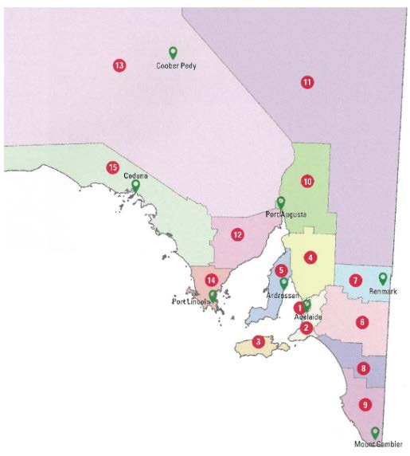

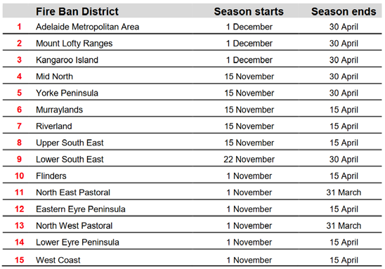

---
## Page 36

36 
It is the responsibility of BMC members to take the information to their organisation/agency 
colleagues, either directly or indirectly involved in bushfire management, for discussion and 
generation of recommendations.  Matters to consider when the documentation and data are 
received include: 
a)
Whether or not the grassland fuel loading is higher or lower than the average – higher means
that there is more fuel available to burn and lower means there is less fuel available.
b)
What the average grassland curing rate is and whether the grasses are curing faster or slower on
average across the BMA – faster curing means that dry fuel is present earlier and slower curing
means that it will take longer for dry fuel to increase the bushfire risk.
c)
Whether or not the BoM climate outlook suggests a drier or wetter than usual spring – dry
springs mean that grasslands will be curing faster and that there could be less available fuel with
wet springs meaning more vegetation growth and slower curing.  The FBDs could be
experiencing drought in which there is little or no fuel available.
d)
Comparing soil dryness indices (SDI) and drought factors (DF) to consider available soil moisture
for vegetation growth – the higher numbers mean that it would take that much rainfall to
moisten the soil (the soil profile to 200mm is deficient in moisture), lower numbers mean less
rainfall is required to fill the soil profile with moisture.
e)
Fire ignition and behaviour observations from the organisation/agency – there could be a
forecast high thunderstorm activity period where dry lightning ignitions could present a problem,
fire incidents have shown that fires are running fast or slow due to the conditions.
f)
Any scheduled local activities that could contribute to fire ignition outside of the FDS and any
known community safety matters that could influence the size and type of bushfire – an example
being more farmers than average burning off outside of the FDS, or excessive numbers of people
camping in the school holidays.
The EO will provide a template either by mail or email for the BMC members to record their 
observations and recommendations.  The members are required to send the recommendations for 
the FDS to the EO at least 7 days before the scheduled meeting.  The content of each 
recommendation will be discussed by the BMC members with the outcome being an agreed 
recommendation for the start and finish dates of the FDS for their FBDs. 
The EO will generate a letter to the Chief Officer of the SACFS with the BMC start and finish date 
recommendations prior to the traditional start date in order that the dates can be gazetted and 
published on the SACFS website.  It is common that the FDS start and finish dates remain the same 
as the traditional dates. 
BUSHFIRE SAFER PLACE AND LAST RESORT REFUGES AMENDMENTS 
Bushfire Safer Places (BSPs) and Last Resort Refuges (LRRs) need to be monitored and reviewed 
annually or when significant changes occur to townships and settlements.  Councils are generally 
tasked with the maintenance of these areas to ensure they satisfy the conditions that make them a 
BSP or LRR.  Townships and settlements change over time with some growing into surrounding 
areas, reducing the distance of hazardous vegetation from houses and others experiencing 
declining population for a variety of reasons. 
The BMC member is responsible to review the BSPs and LRRs within their BMA.  If an amendment 
is required they are to contact the EO to discuss the proposed change(s) and reasoning.  The EO 
will investigate and take the measurements required for reassessment and table the findings at the 
next BMC meeting to progress the request in a timely manner.  The BMC will discuss the 
amendment and achieve consensus on progressing the changes as a recommendation to the SBCC.  
UNDER REVIEW

---
## Page 37

37 
If the SBCC approves the amendment, the BMPU will update the map(s) and upload to the SACFS 
website. 
REPORTING OF BUSHFIRE MANAGEMENT ACTIVITY 
The BMC composition has a number of agencies/organisations that conduct bushfire management 
activities throughout the year.  A requirement of BMC members is to provide a report on their 
action or inaction with regard to bushfire management at each BMC meeting.  It is important that 
the BMC members produce a report that they can speak to at the meeting with reasoning provided 
as to why an activity was undertaken or not.  Good practice involves the BMC member consulting 
with the relevant persons prior to the scheduled meeting.  If this is not possible, the BMC member 
should invite the appropriate person to the meeting to provide the appropriate information. 
The report needs to be typed on agency/organisation letterhead and provided to the EO either 
before or after the BMC meeting.  This can be done by hand or digitally.  The reports will aid the 
EO when they are required to generate an annual report on BMC bushfire management activities 
for the SBCC. 
ANNUAL REPORTING OF BMAP ACTIVITIES 
The BMAPs’ Treatment Registers require ratification with regard to implementation, which is 
presented to the SBCC.  The SBCC EO requires the BMC to report on BMAP activity or inactivity in 
July of each year.  The BMC EO will produce the report according to BMC member input at the mid-
year meeting. 
BMC members responsible for treatments in the BMAP are required to present either their works 
plans that identify treatments that are implemented and, if treatment(s) were not implemented, 
reasons why the treatments could not be completed, or a written document stating what has been 
completed according to the BMAP treatment register.  Any knowledge of treatments in the register 
that were or were not completed by relevant stakeholders also needs to be recorded. 
The EO will collate reports and produce a document for the SBCC EO prior to the August meeting.  
The report will be tabled on the SBCC Agenda and presented to the SBCC.  This report will then be 
passed on to the Minister of Emergency Services. 
ANNUAL EXECUTIVE SUMMARY 
The EO is responsible for providing this report on BMC membership and functionality in addition to 
the BMAP Report which is presented at the August SBCC meeting.  This report is to state BMC 
member attendance or non-attendance at meetings, the organisations/agencies that have failed to 
nominate members to the committee.  In addition, it needs to report on any issues with regard to 
BMC functionality over the course of the year.  The Chair is to review and sign off on the report in 
preparation for sending to the SBCC EO for presentation at the SBCC meeting. 
AUTHORISED OFFICER PERMIT ISSUING GUIDELINES 
The SACFS Regional Prevention Officers (RPOs) conduct training for Authorised Officers throughout 
the year.  Authorised Officers are able to, under the FESA, issue Schedule 9 and 10 permits for 
activities that utilise fire during the FDS.  The Permit Issuing Guidelines endorsed by BMC’s provide 
a consistent approach across the BMA for issuing permits and providing guidance to Authorised 
Officers on what conditions they may include on a permit that permit holders must adhere to 
when conducting their activities. 
UNDER REVIEW

---
## Page 38

38 
The BMC is responsible for annually reviewing the guidelines.  However, in circumstances where 
issues and/or incidents arise the guidelines may need to be reviewed at that time to prevent the 
issue or incident from eventuating again.  Legislation or related policies and procedures may be 
changed during the course of a year, in which case the guidelines will need to be reviewed with 
regard to this. 
BMAP AMENDMENT AGREEMENT AND APPROVAL 
This section, 'BMAP Amendment Agreement and Approval', has been wholly rescinded and 
replaced by the November 2021 Amendment to SBCC and BMC Guidelines - Bushfire 
Management Area Plan (BMAP) Amendments. Hover over text for weblink.
UNDER REVIEW

---
## Page 39

39 
PART SIX: TERMS OF REFERENCE FOR COMMITTEES & OUT OF SESSION PROTOCOL 
The following section contains the terms of reference for the committees, sub-committees and working groups outlined and numbered as per the structure below.  
Additional to the seven Terms of References is the document outlining the Out of Session Protocol for committees. 
TOR 7 
BMAP Review Sub Committees
TOR 1 SBCC 
TOR 3 
Bushfire Task 
Force 
TOR 2 ETRG 
TOR 4 BMCs
TOR 6 
BMC Working 
Groups
TOR 5 Sub-Committees 
Additional documentation – Out of Session Protocol 
Document 8 
Out of Session Protocol
NOTE: the Terms of Reference for the SBCC and 
BMCs have been extracted from this document 
and published as stand-alone documents, as a 
result of an SBCC resolution on 21 November 2025.
UNDER REVIEW
Rescinded 
20/2/26
Rescinded 
20/2/26

---
## Page 40

Terms of Reference 
BUSHFIRE MANAGEMENT COMMITTEE 
SUB-COMMITTEE
VERSION 
V2.0 
DATE 
NOVEMBER 2017 
REVIEW 
NOVEMBER 2020 
STATUS 
APPROVED 
CONFIDENTIALITY 
C3-RESTRICTED 
DIVISION 
PREPAREDNESS OPERATIONS 
UNDER REVIEW

---
## Page 41

Terms of Reference 
TOR BMC Sub-Committees    Page 2 
CONTENTS 
1.
Purpose
3 
2.
Structure
3 
3.
Authority
4 
4.
Membership
4 
5.
Responsibilities
4 
6.
Meetings of Members
4 
6.1 
Procedures for Calling Meetings 
4 
6.2 
Conflict of Interest 
4 
6.3 
Confidentiality of Deliberations and Decisions 
4 
6.4 
Executive Officer 
5 
6.5 
Agenda and Papers 
5 
6.6 
Minutes 
5 
5.7 
Retention of Records 
5 
6.
Review
5 
The Terms of Reference has been prepared in accordance with the guidelines issued by the Government of South Australia for 
“Improving the Effectiveness of Government Boards and Committees” (Department of the Premier and Cabinet Circular PC022, 
19 September 2012). 
UNDER REVIEW

---
## Page 42

Terms of Reference 
TOR BMC Sub-Committees    Page 3 
1.
Purpose
The purpose of a BMC Sub-Committee is to deal with any matter within a Bushfire Management Area
(BMA) associated with the performance and/or function of a BMC, where ongoing, specific attention
cannot otherwise be effectively managed by the BMC.
2.
Structure
UNDER REVIEW

---
## Page 43

Terms of Reference 
TOR BMC Sub-Committees    Page 4 
3.
Authority
The formation of a BMC Sub-committee must be approved by the SBCC.  The SBCC must be advised in
writing of the formation of a BMC Sub-Committee, its purpose and members.
4.
Membership
The composition and terms of appointment of a BMC Sub-Committee is determined by the BMC, and
will include:

BMC Executive Officer

Representatives of stakeholders as determined by the BMC as appropriate to the ongoing
specific task or function to be undertaken.
The BMC Executive Officer shall also be the Executive Officer for each BMC Sub-Committee. 
At least one of the members of a BMC Sub-Committee must be a member of the BMC; other members 
of a Sub-Committee may be drawn from outside the BMC. 
In the case of a BMC Sub-Committee existing between two BMCs, the Executive Officers of each Sub-
Committee may determine whether the Sub-Committee is jointly managed or managed solely by one of 
the two Executive Officers. 
5.
Responsibilities
The responsibilities of the Sub-Committee are formulated by the BMC.  A BMC Sub-Committee may only
make recommendations to the BMC; it may not make decisions or undertake any actions on behalf of
the BMC.
6.
Meetings of Members
6.1 Procedures for Calling Meetings
The procedures for calling/conducting meetings of a BMC Sub-Committee are determined by the 
BMC. 
6.2 Conflict of Interest 
If a member believes that a conflict of interest exists or would be perceived to exist in respect of 
any matter placed before the Sub-Committee, that member should declare the interest and not 
take any part in the discussions or decisions in respect of that matter. 
6.3 Confidentiality of Deliberations and Decisions 
Where agreed by the Sub-Committee, members will keep confidential the deliberations of the 
Sub-Committee including the positions adopted by individual members of the Sub-Committee. 
UNDER REVIEW

---
## Page 44

Terms of Reference 
TOR BMC Sub-Committees    Page 5 
6.4 Executive Officer 
The Executive Officer is responsible for coordinating the business of the Sub-Committee. 
6.5 Agenda and Papers 
A notice of meeting time and date should be provided to the Sub-Committee well before the 
meeting date, together with minutes from the last meeting and any other relevant papers. 
6.6 Minutes 
Minutes are to be recorded for each meeting, detailing outcomes and action items.  Minutes are 
in draft form until approved at the next meeting subject to such modifications as are deemed 
necessary. A copy of draft minutes, together with action items are distributed to the BMC and the 
Sub-Committee within 10 days of each Sub-Committee meeting. 
5.7   Retention of Records 
Minutes and records shall be retained in accordance with the provision of the State Records Act 
1997. 
6. Review
These terms of reference are to be reviewed and endorsed bi-annually by the SBCC.
References 
State Records Act 1997 
State Emergency Management Plan Annex K 
State Bushfire Coordination Committee and Bushfire Management Committees Guideline 
CFS Style Guide 
RECORD OF AMENDMENTS 
DATE  
VERSION 
AUTHOR 
DESCRIPTION 
UNDER REVIEW

---
## Page 45

Terms of Reference 
BUSHFIRE MANAGEMENT COMMITTEE 
WORKING GROUP
VERSION 
V2.0 
DATE 
NOVEMBER 2017 
REVIEW 
OCTOBER 2019 
STATUS 
APPROVED 
CONFIDENTIALITY 
C3-RESTRICTED 
DIVISION 
PREPAREDNESS OPERATIONS 
UNDER REVIEW

---
## Page 46

Terms of Reference 
 TOR BMC Working Group      Page 2 
CONTENTS 
1.
Purpose
3 
2.
Structure
3 
3.
Membership
4 
4.
Responsibilities
4 
5.
Meetings of Members
4 
5.1 Procedures for Calling Meetings 
4 
5.2 Conflict of Interest 
4 
5.3 Confidentiality of Deliberations and Decisions 
4 
5.4 Convenor 
4 
5.5 Agenda and Papers 
5 
5.6 Minutes 
5 
5.7  Retention of Records 
5 
6.
Review
5 
The Terms of Reference has been prepared in accordance with the guidelines issued by the Government of South 
Australia for “Improving the Effectiveness of Government Boards and Committees” (Department of the Premier and 
Cabinet Circular PC022, 19 September 2012). 
UNDER REVIEW

---
## Page 47

Terms of Reference 
 TOR BMC Working Group      Page 3 
1.
Purpose
The purpose of a BMC Working Group (BMC WG) is to support the BMC in developing policy and
procedures pertaining to mitigation strategies within the Bushfire Management Area (BMA).  BMC
Working Groups should be formed to undertake specific tasks over an identified period of time and
should not be maintained as an ongoing structure.
2.
Structure
UNDER REVIEW

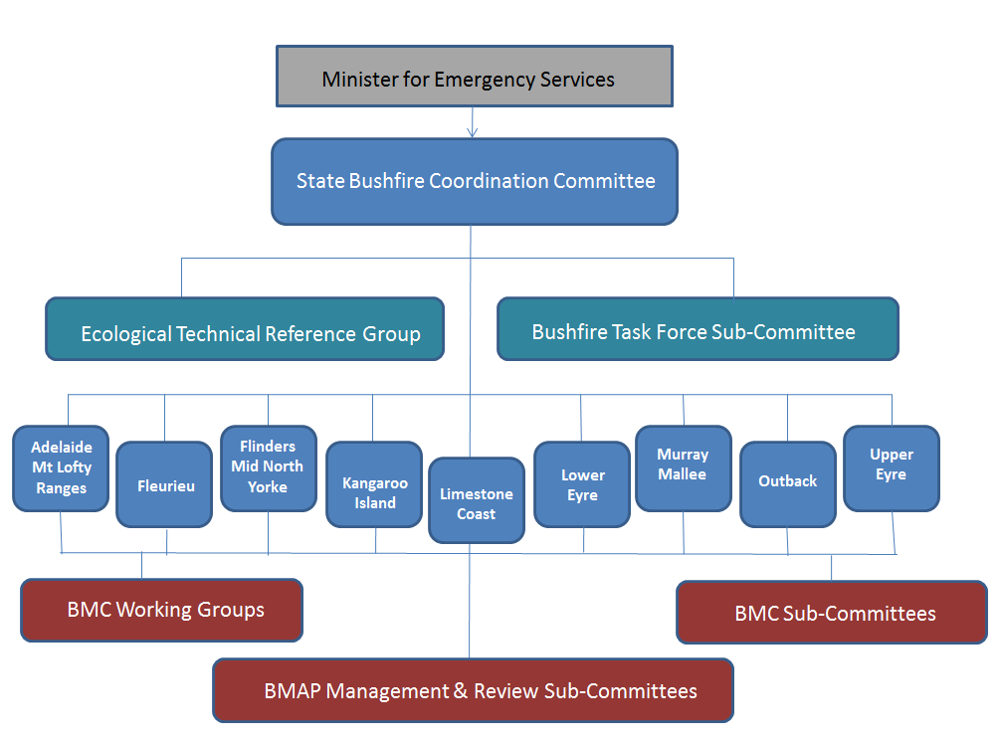

---
## Page 48

Terms of Reference 
 TOR BMC Working Group      Page 4 
3.
Membership
The composition and terms of appointment of BMC WG is determined by the BMC, and will include:

BMC Executive Officer

Representatives of stakeholders as determined by the BMC as appropriate to the task to be
undertaken
Working Groups may include CFS Volunteer representatives from the CFS Group(s) as appropriate/where 
there is capacity to the task to be undertaken. 
At least one of the members of a BMC WG must be a member of the BMC; other members of a WG may 
be drawn from outside the BMC. 
Each BMC WG must have a convenor who is responsible for the coordination of the WG and this person 
will be identified by the BMC. 
The SBCC must be advised in writing of the formation of a BMC WG, its purpose, members and duration. 
4.
Responsibilities
The responsibilities of the WG are formulated by the BMC.  A BMC WG may only make
recommendations to the BMC; they may not make decisions or undertake any actions on behalf of the
BMC.
5.
Meetings of Members
5.1 Procedures for Calling Meetings
The procedures for calling/conducting meetings of a BMC WG are determined by the BMC. 
5.2 Conflict of Interest 
If a member believes that a conflict of interest exists or would be perceived to exist in respect of 
any matter placed before the WG, that member should declare the interest and not take any part 
in the discussions or decisions in respect of that matter. 
5.3 Confidentiality of Deliberations and Decisions 
Where agreed by the WG, members will keep confidential the deliberations of the WG including 
the positions adopted by individual members of the WG. 
5.4 Convenor 
The convenor is responsible for coordinating the WG. 
UNDER REVIEW

---
## Page 49

Terms of Reference 
 TOR BMC Working Group      Page 5 
5.5 Agenda and Papers 
A notice of meeting time and date should be provided to the WG well before the meeting date, 
together with minutes from the last meeting and any other relevant papers. 
5.6 Minutes 
Minutes are to be recorded for each meeting, detailing outcomes and action items.  Minutes are 
in draft form until approved at the next meeting subject to such modifications as are deemed 
necessary. A copy of draft minutes, together with action items are distributed to the BMC and the 
WG within 10 days of each WG meeting. 
5.7   Retention of Records 
Minutes and records shall be retained in accordance with the provision of the State Records Act 
1997. 
6. Review
These terms of reference are to be reviewed and endorsed bi-annually by the SBCC.
References 
State Records Act 1997 
State Emergency Management Plan Annex K 
State Bushfire Coordination Committee and Bushfire Management Committees Guideline 
CFS Style Guide 
RECORD OF AMENDMENTS 
DATE  
VERSION 
AUTHOR 
DESCRIPTION 
UNDER REVIEW

---
## Page 50

Terms of Reference 
BUSHFIRE MANAGEMENT COMMITTEE 
BMAP MANAGEMENT 
AND 
REVIEW SUB-COMMITTEE
VERSION 
V2.0 
DATE 
NOVEMBER 2017 
REVIEW 
OCTOBER 2019 
STATUS 
APPROVED 
CONFIDENTIALITY 
C3-RESTRICTED 
DIVISION 
PREPAREDNESS OPERATIONS 
UNDER REVIEW

---
## Page 51

Terms of Reference 
TOR BMAP Management & Review Sub-Committees      Page 2 
CONTENTS 
1.
Purpose
3 
2.
Structure
3 
3.
Membership
4 
4.
Responsibilities
4 
5.
Meetings of Members
4 
5.1 Procedures for Calling Meetings 
4 
5.2 Conflict of Interest 
4 
5.3 Confidentiality of Deliberations and Decisions 
4 
5.4 Convenor 
5 
5.5 Agenda and Papers 
5 
5.6 Minutes 
5 
5.7  Retention of Records 
5 
6.
Review
5 
The Terms of Reference has been prepared in accordance with the guidelines issued by the Government of South 
Australia for “Improving the Effectiveness of Government Boards and Committees” (Department of the Premier and 
Cabinet Circular PC022, 19 September 2012). 
UNDER REVIEW

---
## Page 52

Terms of Reference 
TOR BMAP Management & Review Sub-Committees      Page 3 
1.
Purpose
The purpose of a Bushfire Management Area Plan (BMAP) Management and Review Sub-Committee is
to support the BMC in the oversight and ongoing monitoring of the BMAP.
2.
Structure
UNDER REVIEW

---
## Page 53

Terms of Reference 
TOR BMAP Management & Review Sub-Committees      Page 4 
3.
Membership
The composition and terms of appointment of BMAP Management and Review Sub-Committee is determined
by the BMC, and will include:

Chair (to be appointed by the BMC from current BMC membership only)

BMC Executive Officer

Up to three (3) nominees (to be appointed by the BMC from current BMC membership only).
The Executive Officer shall also be the Executive Officer for the BMAP Management and Review Sub-
Committee. 
The SBCC must be advised in writing of the formation of a BMAP Management and Review Sub-
Committee and its members. 
4.
Responsibilities
The responsibilities of the Bus-Committee are to annually review:
a)
The BMAP to monitor progress towards the completion of treatment works listed in the BMAP
and the timeliness of the works.  Annual Reports must be provided to the BMC.
b) The BMAP to ensure that new and emerging risks and appropriate treatment adjustments to
address those risks (as required) are recommended to the BMC for endorsement as variations
to the BMAP;
c)
The status of Bushfire Safer Places within the BMA.
The BMAP Management and Review Sub-Committee may only make recommendations to the BMC; 
it may not make decisions or undertake any actions on behalf of the BMC. 
5.
Meetings of Members
5.1 Procedures for Calling Meetings
The procedures for calling/conducting meetings of a BMAP Management and Review Sub-
Committee are determined by the BMC. 
5.2 Conflict of Interest 
If a member believes that a conflict of interest exists or would be perceived to exist in respect of 
any matter placed before the BMAP Sub-Committee, that member should declare the interest 
and not take any part in the discussions or decisions in respect of that matter. 
5.3 Confidentiality of Deliberations and Decisions 
Where agreed by the BMAP Sub-Committee, members will keep confidential the deliberations of 
the BMAP Sub-Committee including the positions adopted by individual members of the BMAP 
Sub-Committee. 
UNDER REVIEW

---
## Page 54

Terms of Reference 
TOR BMAP Management & Review Sub-Committees      Page 5 
5.4 Convenor 
The convenor is responsible for coordinating the BMAP Sub-Committee. 
5.5 Agenda and Papers 
A notice of meeting time and date should be provided to the BMAP Sub-Committee well before 
the meeting date, together with minutes from the last meeting and any other relevant papers. 
5.6 Minutes 
Minutes are to be recorded for each meeting, detailing outcomes and action items.  Minutes are 
in draft form until approved at the next meeting subject to such modifications as are deemed 
necessary. A copy of draft minutes, together with action items are distributed to the BMC and the 
BMAP Sub-Committee within 10 days of each Sub-Committee meeting. 
5.7   Retention of Records 
Minutes and records shall be retained in accordance with the provision of the State Records Act 
1997. 
6. Review
These terms of reference are to be reviewed and endorsed bi-annually by the SBCC.
References 
State Records Act 1997 
State Emergency Management Plan Annex K 
State Bushfire Coordination Committee and Bushfire Management Committees Guideline 
CFS Style Guide 
RECORD OF AMENDMENTS 
DATE  
VERSION 
AUTHOR 
DESCRIPTION 
UNDER REVIEW

---
## Page 55

Out-of-Session Protocol 
STATE BUSHFIRE COORDINATION COMMITTEE 
OUT OF SESSION PROTOCOL 
FOR
SBCC, BMCs, ASSOCIATED SUB-COMMITTEES 
AND WORKING GROUPS 
VERSION 
V2.0 
DATE 
NOVEMBER 2017 
REVIEW 
OCTOBER 2019 
STATUS 
DRAFT 
CONFIDENTIALITY 
C3-RESTRICTED 
DIVISION 
PREPAREDNESS OPERATIONS 
UNDER REVIEW

---
## Page 56

Out-of-Session Protocol 
 Out of Session Protocol      Page 2 
1.
Purpose
The purpose of this document is to detail the agreed protocol to enable discussions and decisions
outside of the scheduled meetings of the State Bushfire Coordination Committee (SBCC), the Bushfire
Management Committees (BMCs) or associated sub-committees and working groups, in order to deal
with emerging issues in a timely manner.
This document should be read in conjunction with SBCC’s/BMCs’ Terms of Reference, or those of the
relevant sub-committee or working group.
2.
Out-of-Session Decisions
2.1 Via Email
Out-of-session decisions are able to be sought from members via email where the issue is not 
complex and able to be easily communicated via email. 
The explicit approval of the Chair is required prior to requesting a decision from members via 
email. 
Where approval is provided, the Executive Officer will issue the email correspondence on behalf of 
the Chair making it explicit that a formal decision of the members is being requested. 
2.1.1 
Consensus 
A decision supported by a majority of members via email is the decision of the 
Committee.   
A decision taken via email must be ratified by the Chair of the Committee. 
2.1.2 
Notification of Decisions 
Decisions made via email will be circulated to each member once ratified by the Chair.  
Where possible, this will be within 3 working days of the original request for decision. 
All decisions made via email will be placed on the Agenda of the next scheduled 
meeting. 
2.2 Extraordinary Meeting 
The Chair can approve the calling of an extraordinary meeting where an issue has emerged which 
cannot wait for the next scheduled meeting to be considered and is too complex to be handled 
via email.   
2.2.1 
Chair 
If the Chair is not available to attend an extraordinary meeting, the Chair must 
nominate another member and notify all members of the alternative Chair prior to 
that meeting. 
UNDER REVIEW

---
## Page 57

Out-of-Session Protocol 
 Out of Session Protocol      Page 3 
2.2.2 
Quorum 
While it is preferred that all members attend an extraordinary meeting, it is 
recognised that this will not always be possible given that meetings are likely to be 
called at short notice. 
A quorum for an extraordinary meeting shall consist of at least half normal members, 
including at least one non-emergency services representative. 
2.2.3 
Consensus 
A decision supported by a majority of the votes cast at an extraordinary meeting at 
which a quorum is present is the final decision. 
A decision taken at an extraordinary meeting must be ratified by the Chair. 
2.2.4 
Secretary and Resourcing 
The Executive Officer will provide secretariat support for extraordinary meetings. 
2.2.5 
Minutes 
Minutes will be kept of each extraordinary meeting.  They will be circulated to each 
member once the Chair has ratified the decision(s) taken.  Where possible, this will be 
within 3 working days of the meeting. 
The Minutes of extraordinary meetings will also be placed on the Agenda of the next 
scheduled meeting. 
2.3. 
Retention of Records 
Decisions made via email or extraordinary meeting shall be retained in accordance with the provision of 
the State Records Act 1997. 
RECORD OF AMENDMENTS 
DATE  
VERSION 
AUTHOR 
DESCRIPTION 
08.02.13 
DRAFT 1 
A WILSON
INTERNAL DRAFT 
30.11.17 
DRAFT 2 
CFS BMPU 
MINOR FORMATTING CHANGES 
UNDER REVIEW

---
## Page 58

40 
PART SEVEN: MEETING TEMPLATES & FORMS 
The following sections contains the below templates that should be used by all BMCs 
1.
MEETING AGENDA TEMPLATE
2.
MEETING MINUTES TEMPLATE
3.
ACTION & AGREEMENT RECORD TEMPLATE
4.
ATTENDANCE TEMPLATE
5.
PERSONAL DETAILS FORM
6.
CORRESPONDENCE TEMPLATE
7.
BUSINESS PAPER TEMPLATE
8.
SUB COMMITTEE SITTING FEE FORM
9.
DECLARATION OF PECUNIARY INTEREST FROM
10.
ESTABLISHMENT OF A SUB-COMMITTEE OR WORKING GROUP
TEMPLATE
11.
REIMBURSEMENT FORM
12.
DISBURSEMENT FORM
UNDER REVIEW
Rescinded 20/2/26 
Rescinded 20/2/26
Rescinded 20/2/26 
Rescinded 20/2/26
Non-SBCC doc - ceased use 20/2/26
Non-SBCC doc - ceased use 20/2/26

---
## Page 59

Author:
Page 1 of 2
Date:      
Status:  
 D 
 
R 
A 
  
F 
T 
Action and Agreement Record 
Date 
Time:   
Duration:   
Location:   
Meeting 
Name of Committee 
Attendees 
Apologies 
No 
Actions and Agreements 
Who
When 
Completed
1. 
Welcome/Apologies 
Chair 
2. 
Safety Briefing / OHSW Issues 
Executive Officer 
3. 
Declarations of conflict of Interest / Probity 
Executive Officer 
4. 
Confirm Minutes of Previous Meeting  
Moved:  
Seconded:    
CARRIED 
Chair 
5. 
Business arising from minutes 
 
 
6. 
Correspondence 
IN 
OUT 
 
Chair 
UNDER REVIEW

---
## Page 60

Author:
Page 2 of 2
Date:      
Status:  
 D 
  
R 
A 
F 
T 
 
Correspondence accepted 
 
Moved: 
 
Seconded: 
CARRIED 
7. 
Business Items 
8. 
Other Business  
9. 
Late Agenda Items: 
10. 
Next Meeting:  
11. Future Meeting Schedule: 
UNDER REVIEW

---
## Page 61

<insert name of committee> 
BUSHFIRE MANAGEMENT COMMITTEE 
BMC Attendance Record 
Meeting Date:  ___/____/ 20___    Meeting Location:  ______________ 
Chairperson:  ________________________________ 
Executive Officer:  ____________________________ 
Please note - only one person representing each organisation may vote at meetings.  If the 
MEMBER is attending then the DEPUTY has nil voting rights.  ANY person attending the 
meeting who has NIL voting rights please register on the OBSERVERS attendance register. 
Name 
Organisation 
Member / Deputy / 
Observer 
(please indicate) 
UNDER REVIEW

---
## Page 62

COMMITTEE MEMBER - PERSONAL DETAILS 
Name 
Organisation 
Postal Address 
Email Address 
Phone 
Mobile 
Facsimile 
Preferred method of contact 
OFFICE USE ONLY 
Date 
Membership Commenced 
Please note: This information will not be supplied to third parties unless 
written consent is provided by the Committee member. 
<insert name of committee> 
BUSHFIRE MANAGEMENT COMMITTEE 
UNDER REVIEW

---
## Page 63

(FORMAT FOR) 
 SBCC PROPOSAL/BUSINESS PAPER 
TITLE 
INTRODUCTION TO ISSUE 
Proposals/Business Papers put to the SBCC need to be researched, analysed and well presented.   It 
is preferred that Proposals/Business Papers are in the following format: 
BACKGROUND 
The reason the proposal is being put forward.   What prompted the proposal? 
DISCUSSION – including 

Relationship to Policy
OPTIONS AND RECOMMENDATION 
Comment on all identified options and justify argument as to why the preferred option has been 
chosen. 
WORDING OF RECOMMENDATION 
Include a clear, unambiguous and concise recommendation. 
UNDER REVIEW

---
## Page 64

Appendix 3 - Declaration of Pecuniary Interests Form 
(extracted from "Government Boards and Committees", Government of South Australia, 2000) 
Confidential 
DECLARATION OF PECUNIARY INTERESTS 
SURNAME: ……………………………………………………………………………………………………………. 
OTHER NAMES ………………………………………………………………………………………………………. 
DATE OF BIRTH: ………/………./ 20……. 
ADDRESS: …………………………………………………………………………………………………………….. 
  Registrable Interests 
Details 
1.
The income Source1 of any financial benefit2
which you received or were entitled to receive
during any part of the previous twelve months.
2.
The name of any company or other body in which
you held office as director or otherwise during the
previous twelve months.
3.
The name or description of any company or other
body in which you hold a beneficial interest.
4.
The name of any association or trade or professional
organisations of which you are or have been a
member during the past twelve months.
5.
A concise description of any trust in which you hold a
beneficial interest or a potential beneficial interest.
6.
A concise description of any trust or other body in
which a member of your family3 holds a beneficial
interest or a potential beneficial interest.
7.
The address or description of any property4 in which
you hold a beneficial interest (other than by way of
security for a debt).
8.
The source of any significant contribution in cash or
in kind for travel beyond South Australia undertaken
by you during the previous twelve months (but not
including contributions from public funds).
9.
Any gift exceeding $500 received by you from a
person other than a relative by blood or marriage.
10.
Any other substantial interest (whether of a pecuniary
nature or not) held by you or a member of your family
of which you are aware and which you consider
might appear to raise a material potential conflict with
your public duty.
11.
Any criminal conviction, financial or taxation dealing
and any other matter that might render or be seen to
render you unfit for this office.
I will undertake to declare any change in circumstances that might be seen to cause a potential conflict of 
interests. 
Signature: ………………………………………............. 
Signature of Witness: …………………………………. Date: ......../……../20……. 
1 "Income source" means: a) any person or body of persons with whom you entered into a contract of service or held any paid office; or b) any trade, vocation or 
profession engaged in by you.
2 "Financial benefit" means: a) the remuneration fee, salary or other pecuniary sum received by you in respect of any contract of service entered into or paid office held 
by you; and b) the total of all remuneration fees or other pecuniary sums received by you in respect of any trade, profession or vocation engaged in by you
3 "Family" to include de facto spouse, dependent children and other members of the household or family with closely connected interests.
4 "Property" to include private residence, land and other real estate.
UNDER REVIEW

---
## Page 65

<insert name of committee> 
BUSHFIRE MANAGEMENT COMMITTEE 
Establishment of a Sub-Committee or Working Group Documentation 
[insert name] Working Group/Sub-committee 
Reports to: [name] BMC 
Decision No.___________ Date:______________________ 
[Quote resolution that establishes the sub-committee/working group] 
______________________________________________________________________ 
______________________________________________________________________ 
______________________________________________________________________ 
______________________________________________________________________ 
Convenor:_____________________________________________________________ 
Members: 
Name 
Organisation/Agency 
Phone 
Email 
Terms of Reference: 
(e.g. review organisation/agency performance against nominated BMAP activities) 
______________________________________________________________________ 
______________________________________________________________________ 
______________________________________________________________________ 
______________________________________________________________________ 
Project/s assigned to WG: 
(e.g. prepare report detailing progress made towards treatment plans nominated in 
BMAP) 
______________________________________________________________________ 
______________________________________________________________________ 
______________________________________________________________________ 
______________________________________________________________________ 
(include Decision Nos. etc as relevant – also include any additions, changes or 
directions from Committee as the project progresses) 
UNDER REVIEW

---
## Page 66

<insert name of committee> 
BUSHFIRE MANAGEMENT COMMITTEE 
WG Project (prepare one of these pages per project assigned) 
Project title:_________________________________________________________ 
Expected completion date:___/_____/ 20____ 
Scope of project: 
_______________________________________________________________ 
___________________________________________________________________ 
___________________________________________________________________ 
___________________________________________________________________ 
___________________________________________________________________ 
(include things that will/will not be addressed, if this is necessary) 
Tasks: 
___________________________________________________________________ 
___________________________________________________________________ 
___________________________________________________________________ 
___________________________________________________________________ 
___________________________________________________________________ 
___________________________________________________________________ 
___________________________________________________________________ 
___________________________________________________________________ 
___________________________________________________________________ 
___________________________________________________________________ 
___________________________________________________________________ 
___________________________________________________________________ 
___________________________________________________________________ 
___________________________________________________________________ 
___________________________________________________________________ 
___________________________________________________________________ 
___________________________________________________________________ 
___________________________________________________________________ 
___________________________________________________________________ 
___________________________________________________________________ 
UNDER REVIEW

---
## Page 67





















	















































‰



‰



‰













 
!
"
#
!
$
%
&
"
'
!
!
(
)
)
)
)
)
)
)
)
)
)
)
)
)
)
)
)
)
)
)
)
)
)
)
)
)
)
)
)
*


!
(
)
)
)
)
)
)
)
)
)
)
)
)
)
)
)
)
)
)
)
)
)
)
)
)
+



!
,
, -
.
.
.
.
.
.
.
.
.
.
.
.
.
.
.
.
.
.
.
.
.
.
.
.
.
.
.
.
.
.
.
.
.
.
.
.
.
.
.


$
!
-
.
.
.
.
.
.
.
.
.
.
.
.
.
.
.
.
.
.
.
.
.
.
.
.
.
.
.
.
.
.
.
.
.
.
.
.
.
.
.
.
.
UNDER REVIEW

---
## Page 68

41 
APPENDIX 1 – BUSHFIRE MANAGEMENT AREA BOUNDARIES 
UNDER REVIEW

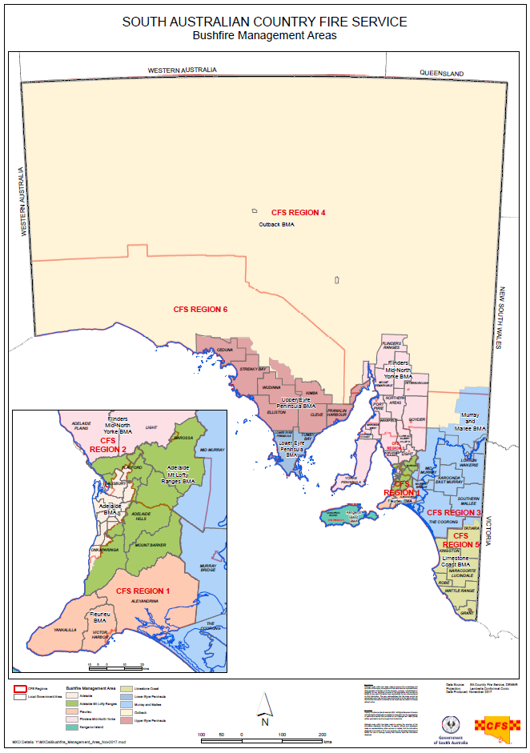

---
## Page 69

42 
APPENDIX 2 – CHECKLISTS FOR BMC MEETINGS 
WHAT SHOULD BE COMPLETED BEFORE A BMC MEETING? 
What? 
When? 
Who? 
Draft yearly meeting schedule 
End of each calendar year, send 
meeting requests 
Executive Officer after discussion 
and consensus from BMC 
Meeting schedule distributed 
End of each calendar year send 
meeting requests 
Executive Officer 
Draft agenda 
At least 21 days before scheduled 
meeting 
Executive Officer 
Submit draft agenda to 
Chairperson to review 
21 days before scheduled meeting 
Executive Officer 
Approve agenda 
14 days before scheduled meeting 
Chairperson 
Check apologies & if no quorum 
reschedule meeting 
7 days before scheduled meeting 
Executive Officer in coordination 
with Chairperson 
Agenda & any business paper &/or 
reports distributed 
At least 7 days before meeting 
Executive Officer 
Minutes drafted and submitted to 
the Chairperson for review 
As soon as possible after meeting  
(keep in mind that draft minutes 
need to be sent to BMC within 
15working days) 
Executive Officer & Chairperson 
Draft minutes circulated to BMC 
once approved by Chairperson 
As soon as possible after meeting 
but within 15 working days of each 
BMC meeting 
Executive Officer 
Compile list of changes to draft 
minutes from last meeting 
Upon receipt & before next 
meeting 
Executive Officer 
Prepare correspondence register 
since last meeting 
At least 1 day before meeting 
Executive Officer 
WHAT SHOULD BE SENT TO BMC MEMBERS PRIOR TO A MEETING? 
What? 
When? 
Who? 
Meeting reminder notice & call for 
agenda items 
At least 14 days prior to meeting 
Executive Officer 
Agenda 
At least 7 days prior 
Executive Officer 
Draft Minutes of previous meeting 
As soon as possible after meetings 
(within 15 days), should be sent 
out again as a reminder at least 7 
days before next meeting 
Executive Officer 
Business paper(s) and/or reports 
(if any) 
At least 7 days prior 
Executive Officer 
UNDER REVIEW

---
## Page 70

43 
 
WHAT SHOULD BMC MEMBERS DO PRIOR TO A MEETING? 
 
What? 
When? 
Who? 
Read agenda, draft minutes, 
business paper(s), correspondence 
etc. 
Prior to meeting 
All members  
Seek clarification or advice if 
necessary from Executive Officer 
or organisation/agency 
At least 1 day prior 
All members 
Written review of 
organisation/agency’s progress 
with the BMAP & any related 
targets  & actions 
At least 1 day before meeting – 
written report to Executive Officer 
at least 14 days prior to meeting 
All members 
Contact Executive Officer to list 
items on the agenda if desired 
At least 14 days prior to meeting 
All members 
Provide written reports, position 
papers if necessary to Executive 
Office 
At least 14 days prior to meeting 
All members 
WHAT IS EXPECTED DURING A MEETING? 
 
What? 
When? 
Who? 
Notes taken from which minutes 
can be prepared 
During meeting 
Executive Officer or Administrative 
Assistant on his/her behalf 
Apologies recorded 
At start of meeting 
Executive Officer/all members 
Circulate list of BMC contacts and 
update where necessary 
During meeting 
Executive Officer/all members 
Adopt previous minutes 
After apologies are taken 
All members 
Discuss any correspondence that 
has been received or circulated 
prior to the meeting 
After adoption of minutes 
All members 
Report on bushfire activities since 
last meeting 
During meeting 
All members 
Go through task list and update if 
necessary 
During meeting 
Executive Officer 
WHAT SHOULD BE COMPLETED AFTER A MEETING? 
 
What? 
When? 
Who? 
Draft minutes and submit draft 
minutes to the Chairperson for 
approval 
As soon as possible after meeting 
but no longer than 10 working 
days after meeting 
Executive Officer  
Circulate draft minutes to all 
members once approved 
As soon as possible after meeting 
but no longer than 15 working 
days after meeting 
Executive Officer  
Check draft minutes for accuracy 
and advise EO is any changes 
required 
Upon receipt of draft minutes & 
before due date set by EO 
All members 
Update BMC members list if there 
are any changes 
As need basis on resignation or 
retirement of BMC member 
Executive Officer 
Update task/project register 
Not more than 2 weeks after 
Executive Officer 
UNDER REVIEW

---
## Page 71

44 
 
meeting 
Carry out tasks and projects 
agreed at meeting 
Within timeframes set at meeting 
All members 
WHAT SHOULD BE COMPLETED ONCE A YEAR? 
 
What? 
When? 
Who? 
Contact organisations/agencies 
eligible for BMC membership but 
who are not currently represented 
& issue an invitation to provide a 
member to the BMC.  Contact 
should be made in writing. 
On an as needs basis upon a BMC 
member retiring, leaving or when 
a major change occurs within a 
BMA (new industry or land use 
etc.). 
Executive Officer/Chairperson 
Prepare and submit annual report 
to SBCC 
One per year as directed by the 
SBCC 
BMC 
Report on implementation of 
BMAP 
Once per year as directed by the 
SBCC 
BMC 
Prior to commencement of the fire 
season, discuss whether there is 
likely to be a need to recommend 
a variation to the bushfire danger 
period in any of the  Fire Ban 
Districts within the  BMA to the 
CFS Chief Officer 
Twice yearly - prior to the 
commencement of the FDS and 
the prior to the end of the FDS.  
BMC to consider environmental 
conditions.  
BMC 
Review fire track register 
Once per year 
BMC 
WHAT SHOULD BE COMPLETED ONCE EVERY 4 YEARS? 
 
What? 
When? 
Who? 
Prepare and submit a Bushfire 
Management Area Plan 
Every 4 years or as directed by the 
SBCC 
BMC 
 
 
 
UNDER REVIEW

---
## Page 72

45 
APPENDIX 3 – SUMMARY FACT SHEET FOR BMC MEMBERS 
WHAT MAY A BMC DO? 
•
Make recommendations regarding bushfire danger periods
•
Endorse guidelines for permits to burn within their BMA, consistent with the Act and
any SBCC policy regarding permits to burn
•
DRAW MATTERS TO THE ATTENTION OF THE BMC & SBCC
BMC members may bring matters to the attention of the Committee that they think
will benefit the Committees discussion and input. For example, DEWNR has decided
not to burn a particular nature reserve for a number of years in order to protect a
particular plant species. This approach may be useful for the BMC to endorse if the
action is consistent with the BMAP. This allows for DEWNR to have general support
from the BMC, which is the body most knowledgeable of bushfire management in the
area.
On occasion, issues will arise that cannot be resolved locally by the BMC, or where it
appears that the problem may be wider spread, or where the BMC has devised a
solution or developed an idea that might be of wider benefit or application. These
matters may be referred to the SBCC for the information or advice of that committee,
through the Executive Officer.
•
PROVIDE SUGGESTIONS AND FEEDBACK TO THE SBCC
The SBCC actively encourages BMC feedback on its policies, these Guidelines etc.
Suggestions and comments should be made in writing to the SBCC Executive Officer.
WHAT DOESN’T A BMC DO? 
The BMC is not a legal entity and as such there are a range of matters it cannot undertake. 
These include: 
•
A BMC CANNOT UNDERTAKE HAZARD REDUCTION WORKS
The proponent for hazard reduction or other physical works should be the owner or
lawful manager of the land, or organisation/agency intending to carry out the work. For
example, DEWNR is responsible for carrying out works on protected areas.
•
A BMC CANNOT ASSESS OR GIVE APPROVAL FOR HAZARD REDUCTION WORKS
A BMC is not an approval authority and as such cannot assess or give approval for
hazard reduction works. Any hazard reduction works approvals or any other necessary
environmental assessments must be sought from the relevant approval authorities.
However, there are certain hazard reduction works that can be undertaken without
specific approval, and these are set out in the Native Vegetation Regulations 2017.
•
A BMC CANNOT PROHIBIT BUSHFIRE MANAGEMENT WORKS
A BMC has no authority to prevent a land owner/manager or other person carrying out
bushfire management works on land. While a BMC may advise that: works are
inappropriate for a bushfire hazard reasons; are not required for bushfire management
purposes; and/or require legal approval by other authorities, the BMCs have no
authority to prevent such works.
•
A BMC CANNOT DIRECT BUSHFIRE MANAGEMENT WORKS
A BMC cannot direct or force any land owner/manager or any other person to
UNDER REVIEW

---
## Page 73

46 
undertake or cease bushfire management works. A BMC can however, use its authority 
to advise and attempt to persuade the person to concur to the views of Committee. 
•
A BMC CANNOT ENTER INTO ANY CONTRACT
A BMC cannot enter into any contract, for example, engaging an earthmoving contractor
for the construction or maintenance of fire tracks, or a funding agreement for a grant.
Such agreements need to be entered into by the relevant land owner/manager.
•
A BMC CANNOT UNDERTAKE BUSHFIRE MANAGEMENT WORKS
The BMC has no staff and does not undertake bushfire management works. Works can
only be undertaken within a committee members' own organisation/agency and not as a
BMC entity.
CAN A BMC CONDUCT COMPLIANCE WORK? 
The BMC has no legal role in forcing organisations/agencies’ to conduct bushfire management 
works or to enforce compliance with such works. The BMC can however set in place 
requirements for bushfire management works that can be enforced by authorised persons 
within local government (e.g. a Fire Prevention Officer) or the relevant fire service Chief Officer 
under the FESA 2005. 
Under FESA 2005, it is the responsibility of individual land owners/managers to take reasonable 
steps to 
•
to prevent or inhibit the outbreak of fire on the land; and
•
to prevent or inhibit the spread of fire through the land; and
•
to protect property on the land from fire; and
•
to minimise the threat to human life from a fire on the land
A BMC, with the approval of the SBCC, can identify mitigation activities to address these requirements 
within its BMAP. 
If a BMC is aware that non-compliance with required bushfire mitigation activities is occurring, 
the Committee should bring this matter to the attention of the relevant compliance authority. 
Where the land in question is within a Designated Urban Bushfire Risk Area (DUBRA), the 
relevant fire agency is the SA MFS. If the land is outside of gazette Fire Districts, the relevant 
fire agency is the SA CFS. For all private land, the relevant compliance authority is an authorised 
officer within local government. The table below outlines the relevant compliance authorities 
under FESA 2005 on the basis of land tenure. 
Land tenure 
Compliance Authority 
Private 
Authorised Officer within local government 
Local Government 
Relevant Chief Officer to Minister for Local 
Government 
Crown land management agency 
Relevant Chief Officer to relevant Minister 
Commonwealth of Australia 
Relevant Chief Officer to relevant Commonwealth 
land management authority 
CAN A BMC DIRECT FIREFIGHTING AGENCIES OR BRIGADES? 
The BMCs have no authority to direct firefighting agencies or brigades in any manner. However, 
during the develop of BMAPs individual CFS brigades may propose areas for risk treatment and 
indicate whether they are prepared to support such works being undertaken in a volunteer 
capacity. These proposed risk treatments may be incorporated within BMAPs if the BMC 
considers it appropriate to do so. 
The BMCs as an entity have no power to conduct or take part in firefighting or fire prevention 
operations. 
UNDER REVIEW

---
## Page 74

 
 
 
BMC Mid-Term Membership Management Procedure November 2021  
Status: Approved v.1 
Updated: 24/11/2021  
Page 1 of 17 
 
 
 
 
Amendment to BMC Mid-Term Membership 
Management Procedure 
 
This amendment wholly replaces the content of ‘Membership Vacancy’ on page 15 of the ‘Guidelines 
for State Bushfire Coordination Committee and Bushfire Management Committees’ (2018), and will be 
considered an attachment to the Guidelines. 
 
 
 
Date Updated:  
30/11/2021 
Author: 
Paula Slutzkin, Anthea Howard 
Parent Document 
Name: 
Guidelines for State Bushfire Coordination Committee and 
Bushfire Management Committees (2018) 
Section(s) being 
rescinded: 
BMC Membership Information (part); and 
BMC Membership Changes (part) 
 
Authorised by: Chairman, State Bushfire Coordination Committee 
Name 
Mr Mark Jones QFSM 
Signature 
 
Date 
30  / 11  / 2021 
 
 
UNDER REVIEW

---
## Page 75

 
 
 
BMC Mid-Term Membership Management Procedure November 2021  
Status: Approved v.1 
Updated: 24/11/2021  
Page 2 of 17 
Contents 
INTRODUCTION ................................................................................................................................................. 3 
Membership Flowchart ................................................................................................................................. 5 
Mid-term Membership Change flowchart ...................................................................................................... 6 
1 
BMC Executive Officer (XOs) Responsibilities ............................................................................................. 7 
1.1 
Nominations and Resignations: ...................................................................................................... 7 
1.2 
Maintain an Overview of Membership Changes: ............................................................................ 7 
1.3 
Recognition of Service: ................................................................................................................... 7 
1.4 
Records Management / Objective: ................................................................................................. 7 
2 
SBCC Secretariat Responsibilities ............................................................................................................... 8 
2.1 
Nominations and Resignations: ...................................................................................................... 8 
2.2 
Maintain an Overview of Membership Changes: ............................................................................ 8 
2.3 
Communications: ........................................................................................................................... 8 
2.4 
Recognition of Service: ................................................................................................................... 8 
2.5 
Records Management / Objective .................................................................................................. 8 
3 
Mid-term Nomination Process ................................................................................................................... 8 
3.1 
Check nomination form: ................................................................................................................. 8 
3.2 
Save nomination form: ................................................................................................................... 9 
3.3 
Update spreadsheet (membership details): .................................................................................. 10 
3.4 
Update spreadsheet (CEO details): ............................................................................................... 10 
3.5 
Prepare nomination details to send to SBCC for endorsement: .................................................... 10 
3.6 
Send ‘BMC Mid-term Membership Changes’ form:....................................................................... 11 
3.7 
(Information Only) SBCC Secretariat will coordinate endorsement by SBCC: ................................. 11 
4 
Mid-term Resignation Process ................................................................................................................. 12 
4.1 
Save the resignation letter and/or email: ..................................................................................... 12 
4.3 
Prepare and send Acknowledgement of Service letter: ................................................................. 12 
4.4 
Record the resignation on the membership spreadsheet:............................................................. 13 
4.5 
Update spreadsheet (membership/vacancy details): .................................................................... 14 
4.6 
Prepare to send the resignation to SBCC Secretariat: ................................................................... 14 
4.7 
Send ‘BMC Mid-term Membership Changes’ form:....................................................................... 15 
Appendix 1 – Folder Locations and Naming Conventions tables ................................................................... 16 
Appendix 2 – Checklists ............................................................................................................................... 17 
 
 
 
UNDER REVIEW

---
## Page 76

 
 
 
BMC Mid-Term Membership Management Procedure November 2021  
Status: Approved v.1 
Updated: 24/11/2021  
Page 3 of 17 
 
Introduction 
Why do we have this procedure? 
The State Bushfire Coordination Committee (SBCC) is established under s.71 of the Fire and Emergency Services 
Act 2005 (SA) (the ‘FES Act’), and has established bushfire management committees (BMCs) under s.72A for 
each gazetted bushfire management area (BMA). These BMAs are established by the Governor on the 
recommendation of the SBCC – see Fire and Emergency Services (Bushfire Management Areas) Proclamation 
2012 – and may be varied by the Governor by subsequent proclamation, again on the recommendation of the 
SBCC. 
Currently, under s.72A of the FES Act, members of BMCs are appointed for a term determined by the SBCC on 
conditions approved by the Minister, and the office of a member becomes vacant only if the member dies; 
completes a term of office and is not reappointed; resigns by written notice to the SBCC; or is removed from office 
for reasonable cause by the SBCC. 
Section 71E of the FES Act stipulates that the SBCC must provide an annual report to the Minister on the activities 
of the SBCC and each BMC. This report includes information about membership and attendance. Additionally, 
we are required to provide annual details of SBCC and BMC membership and remuneration to Parliament through 
the Boards and Committees Information System (BCIS) maintained by the Department of the Premier and 
Cabinet, as well as to the Department of Treasury and Finance. 
These procedures have been developed to facilitate to support meeting these statutory and reporting 
requirements. 
How is this procedure used? 
This document provides a detailed step-by-step guide, using screenshots and detailed explanations to support 
understanding of the procedure and steps involved. 
Once the process becomes more familiar, a reference with less detail may be preferred. A summary version of 
this procedure has also been provided (Objective ID A1595343), and flowcharts (Objective ID A1595346) and 
checklists are included to assist you complete all required steps. 
Further support to understand and implement these procedures is available from the SBCC Secretariat if required 
(CFS.SBCC@sa.gov.au). 
Prompts to undertake actions are included throughout this procedure, as outlined below: 
 
UNDER REVIEW

---
## Page 77

 
 
 
BMC Mid-Term Membership Management Procedure November 2021  
Status: Approved v.1 
Updated: 24/11/2021  
Page 4 of 17 
 
Submission Alerts: 
 
Given the shared administrative responsibility of BMCs and the need for the SBCC to report to the Minister on 
the activities of the BMCs, clear and consistent communication between BMC Executive Officers and the SBCC 
Secretariat is imperative. For this reason, clear processes and responsibilities have been established for mid-
term membership changes. 
Forms and templates have been developed to ensure consistency of this communication across the 9 BMCs. 
The above alert will be seen where this procedure requires the preparation and/or submission of forms. 
 
Records Management Alerts: 
 
The emergency services sector (ESS) has a legislative obligation under the State Records Act 1997 to create, 
capture, retain and manage documents and records, and compliance with the SAFECOM Records Management 
Policy 2017 (Objective document A804391; or can be found on the ESS intranet) will enable the ESS to meet its 
records management obligations. 
All documents and records created, received, retained or managed by the ESS in the conduct of its business 
activities must be captured and kept appropriately. 
Throughout the procedure the above alert is found, which highlights points at which an item needs to be saved 
to Objective. 
 
 
SUBMISSION ALERT: FILL AND SUBMIT FORM TO SBCC SECRETARIAT 
 
RECORDS MANAGEMENT ALERT: SAVE TO OBJECTIVE 
UNDER REVIEW

---
## Page 78

 
 
 
BMC Mid-Term Membership Management Procedure November 2021  
Status: Approved v.1 
Updated: 24/11/2021  
Page 5 of 17 
 
Membership Flowchart 
 
 
 
UNDER REVIEW

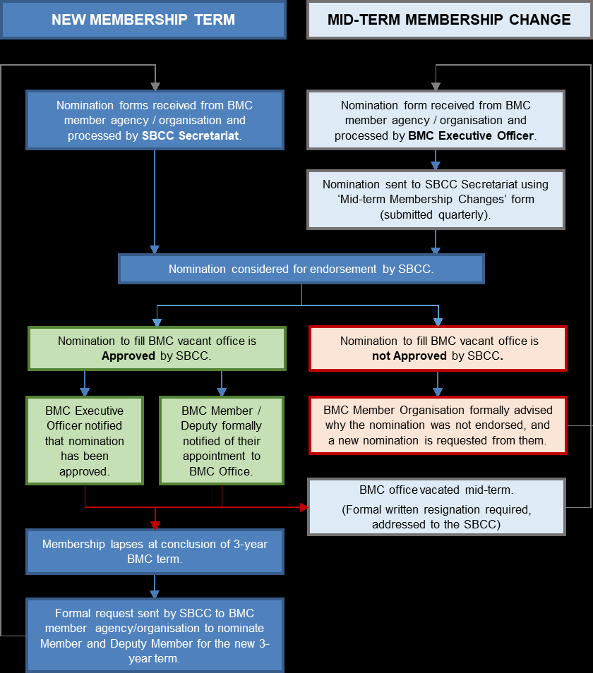

---
## Page 79

 
 
 
BMC Mid-Term Membership Management Procedure November 2021  
Status: Approved v.1 
Updated: 24/11/2021 
Page 6 of 17 
 
Mid-term Membership Change flowchart 
UNDER REVIEW

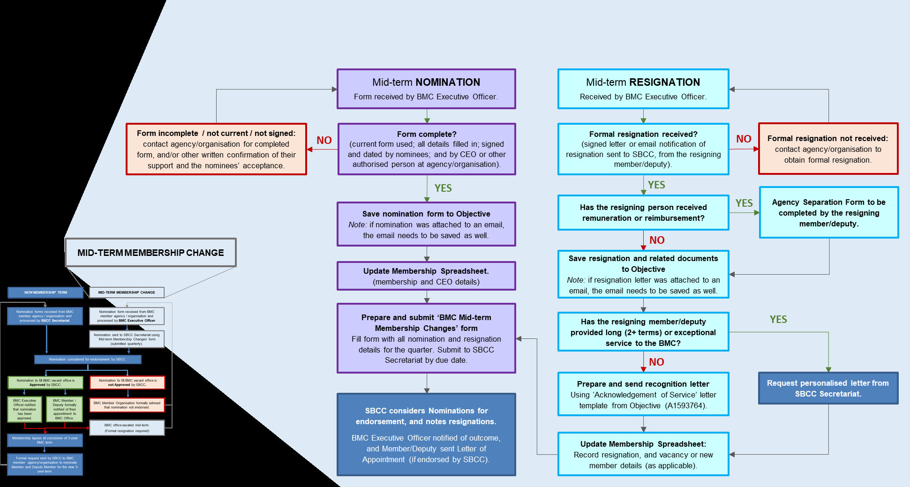

---
## Page 80

 
 
 
BMC Mid-Term Membership Management Procedure November 2021  
Status: Approved v.1 
Updated: 24/11/2021 
Page 7 of 17 
BMC Membership Management Responsibilities 
IMPORTANT NOTES: 
∗ All nominations, including mid-term nominations, must be endorsed by the SBCC before members and 
deputies can vote at BMC meetings. They may attend as guest observers when they are not endorsed.  
∗ Formal written resignations directed to the Chair of the SBCC (as the SBCC is the appointing authority) are 
required to process any mid-term resignations, in order to comply with reporting obligations. Resignation letters 
or emails need to be saved to Objective. 
∗ Throughout this document, when referring to locations on Objective, ‘xx BMC’ refers to each individual BMC – 
e.g., AMLR BMC, Outback BMC, etc. 
1 
BMC Executive Officer (XOs) Responsibilities 
The following lists set out the responsibilities of BMC Executive Officers in the membership management 
process. 
1.1 
Nominations and Resignations: 
• Receive and process mid-term nominations and resignations.  
• Collate mid-term nominations and resignations, and submit a summary to the SBCC for endorsement: 
o To be submitted approximately quarterly, with dates set by the SBCC; 
 Meeting requests will be sent by the SBCC Secretariat to BMC XOs with the due dates for 
these, in order to provide a reminder.  
o To be submitted using the ‘BMC Mid-term Membership Changes’ form provided by SBCC 
Secretariat (Objective location: xx BMC - Administration / xx BMC - Forms and Templates). 
1.2 
Maintain an Overview of Membership Changes: 
• Maintain an up-to-date record of mid-term BMC membership changes, including resignations, 
nominations, and any other changes. The membership management spreadsheet provided by SBCC 
Secretariat (‘xx BMC - 2021-24 term - Membership and Attendance’) can be used for this; or your own 
processes.  
1.3 
Recognition of Service: 
• Prepare (from template) and send routine thank-you letters when members/deputy members resign. 
o In cases where personalised thank-you letters are required – long (2+ terms) or exceptional service 
– forward requests on to the SBCC Secretariat. 
1.4 
Records Management / Objective: 
• File nomination forms, resignations, thank-you letters, and related letters or emails, in the relevant 
folders in Objective using appropriate and consistent naming conventions. See Appendix 1 for guides. 
• Ensure that templates and forms used are obtained from Objective, so that they are current. 
• Seek assistance and advice from the SBCC Secretariat if support with records management is required. 
 
 
UNDER REVIEW

---
## Page 81

 
 
 
BMC Mid-Term Membership Management Procedure November 2021  
Status: Approved v.1 
Updated: 24/11/2021 
Page 8 of 17 
2 
SBCC Secretariat Responsibilities 
The following lists set out the responsibilities of BMC Executive Officers in the membership management 
process. 
2.1 
Nominations and Resignations: 
• Manage the new term BMC Membership process (every 3 years). 
• Forward any mid-term BMC nominations received (for example, any sent to the central mailbox – 
CFS.BMCMembership@eso.sa.gov.au) to the appropriate XO. 
• Set dates for ‘BMC Mid-term Membership Changes’ forms to be submitted; and provide meeting 
requests / reminders to BMC XOs for these dates. 
• Receive ‘BMC Mid-term Membership Changes’ forms (nominations and resignations) from BMC XOs. 
• Coordinate the SBCC endorsement process. 
2.2 
Maintain an Overview of Membership Changes: 
• Maintain a central database of BMC membership and changes, using information provided on ‘BMC 
Mid-term Membership Changes’ forms submitted by BMC XOs.  
2.3 
Communications: 
• Communicate critical information to BMC XOs, for example: 
o Details of when and which new members and deputy members the SBCC has endorsed; 
o Updates from SBCC Meetings. 
2.4 
Recognition of Service: 
• Prepare and send Letters of Appointment (issued by the SBCC Chair) to newly endorsed 
members/deputy members.  
• Prepare and send personalised thank-you letters for resigning members / deputy members when 
requested by BMC XOs. 
2.5 
Records Management / Objective 
• Maintain the general BMC Administration folder on Objective, ensure that all general BMC records are 
uploaded to relevant locations using appropriate file naming conventions, and ensure that templates 
and forms are current. 
• Provide assistance and training to XOs and regional administration officers to support good records 
management practices. 
3 
Mid-term Nomination Process 
When a mid-term nomination is received (either directly to the XO from the organisation or Member/Deputy; or 
forwarded on to you from the SBCC Secretariat), follow the instructions below to ensure that you complete all 
steps.  
3.1 
Check nomination form: 
• Ensure that form is complete: 
o all details filled in;  
o signed and dated by Member and/or Deputy;  
o signed and dated by CEO or another authorised person at the agency/organisation. 
UNDER REVIEW

---
## Page 82

 
 
 
BMC Mid-Term Membership Management Procedure November 2021  
Status: Approved v.1 
Updated: 24/11/2021 
Page 9 of 17 
• If all required sections of form are not completed, you will need to contact the agency/organisation to 
obtain a completed form, or other written confirmation (see examples in the ‘Note’ above) of their support 
and the nominees’ acceptance.  
NOTE: SBCC Secretariat needs written confirmation that the nomination has been accepted by the 
nominee; and that it is authorised and supported by the nominating agency/organisation. The 
easiest way to meet this requirement is by ensuring all necessary sections on the 
nomination form are filled out. 
However, alternate forms of written confirmation are also accepted, such as copies of minutes or 
election records which include endorsements (specifying the term of the endorsement), or emails 
stating support for the nomination from an authorised person within the agency/organisation. 
3.2 
Save nomination form: 
 
• Save the nomination form to the relevant folder in Objective, using appropriate and consistent naming 
conventions (see Appendix 1 for folder locations and naming conventions tables): 
o Objective location:  
o Naming convention:  
 (unconfirmed) [BMC name] BMC - [agency/organisation] - [date of nomination in yyyy-mm-
dd format] - Nomination - [surname, first initial] (M for Member, or D for Deputy) – see sample 
below: 
(unconfirmed) UEP BMC - Ceduna DC - 2021-06-21 - Nomination - Mouse, M (M) 
 
NOTE: if a nomination form was sent attached to an email, save the email to Objective as well. 
These can be saved to the same location, but instead of the notation ‘Nomination’ you can annotate 
it ‘Nomination email’. For example, if you had received a resignation letter for M Mouse attached to 
an email, you would save both files in the ‘Nominations – awaiting endorsement’ folder as follows: 
 
 
RECORDS MANAGEMENT ALERT: SAVE TO OBJECTIVE 
UNDER REVIEW

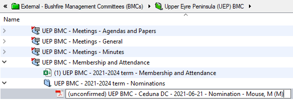

---
## Page 83

 
 
 
BMC Mid-Term Membership Management Procedure November 2021  
Status: Approved v.1 
Updated: 24/11/2021 
Page 10 of 17 
3.3 
Update spreadsheet (membership details): 
• In the ‘Membership’ tab of the ‘2021-24 term – Membership and Attendance’ spreadsheet (shown below) 
provided by SBCC Secretariat, you need to enter the following information: 
o enter the date of the nomination into Column B, and the Objective ID of the nomination form in 
Column C:  
o enter the details from the form in Columns G-Q: 
 
NOTE:  
 As some cells are locked, you cannot ‘Tab’ between cells. However, if you highlight all the 
cells you want to update, you can then press ‘Enter’ to move to the next cell. 
3.4 
Update spreadsheet (CEO details): 
• Using the worksheet tabs at the bottom of the Excel spreadsheet, change to the ‘CEOs etc’ worksheet. 
• Check the CEO details from the nomination form against the CEO details in the ‘CEOs etc’ tab in the 
BMC Membership spreadsheet. Update details if required. 
3.5 
Prepare nomination details to send to SBCC for endorsement: 
 
• Add details to the ‘BMC Mid-term Membership Changes’ form, in preparation to send collated 
nominations to the SBCC for endorsement by the due date: 
NOTE: If you already have a form in progress for other resignations or nominations, continue with 
that form. 
 
SUBMISSION ALERT: PREPARE FORM FOR LATER SUBMISSION 
UNDER REVIEW

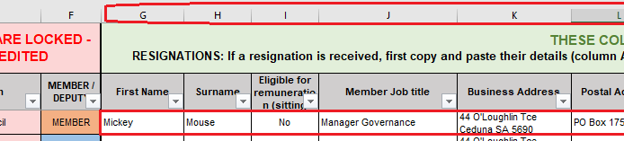

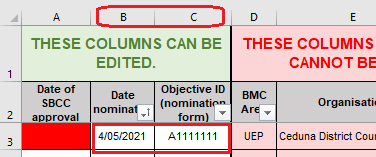

---
## Page 84

 
 
 
BMC Mid-Term Membership Management Procedure November 2021  
Status: Approved v.1 
Updated: 24/11/2021 
Page 11 of 17 
o For any mid-term nominations received, fill in ALL the fields. 
o The easiest way to do this is to copy and paste from the ‘2021-24 term – Membership and 
Attendance’ spreadsheet: 
 Open the ‘Membership’ worksheet of the spreadsheet; 
 For the nominated member/deputy, select the cells in Columns B to J, and copy (Ctrl + C). 
 
 In the ‘Membership Changes’ form, highlight all the cells that you want to paste into (click 
under ‘Nomination Date’ and drag across to ‘Member Job Title?’ to select), and then paste the 
details (Ctrl + V). 
 
o Repeat these steps as necessary for any further nominations. 
• Send to SBCC Secretariat before each SBCC meeting (due dates will be advised). 
NOTE:  If there are issues with achieving quorum in a BMC due to nominations awaiting endorsement, 
liaise with SBCC Secretariat. 
3.7 
(Information Only) SBCC Secretariat will coordinate endorsement by SBCC: 
• The SBCC Secretariat will coordinate the endorsement process.  
• Once endorsed, the SBCC Secretariat will notify XOs and update the ‘Date of SBCC Endorsement’ for 
the relevant Members/Deputies in the column in the ‘Membership’ tab of the ‘2021-24 term – 
Membership and Attendance’ spreadsheet. 
NOTE:  If using your own membership management processes (e.g., on a separate spreadsheet), 
please liaise with the SBCC Secretariat regarding how this step will be managed. 
 
UNDER REVIEW

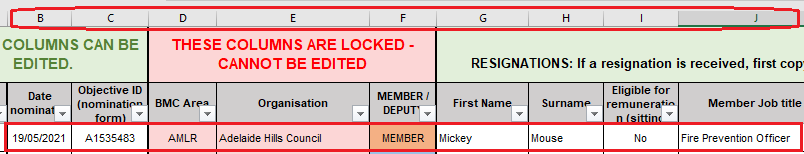

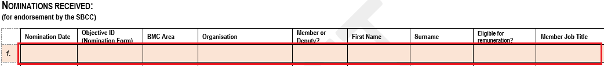

---
## Page 85

 
 
 
BMC Mid-Term Membership Management Procedure November 2021  
Status: Approved v.1 
Updated: 24/11/2021 
Page 12 of 17 
4 
Mid-term Resignation Process 
It is a requirement of the FES Act that resignations are addressed to the SBCC. Consequently, resignations need 
to be sent to the SBCC Secretariat, and will be forwarded on to BMC XOs for processing.  
If this has not happened, contact the resigning member/deputy to obtain this. The member agency/organisation 
can send through notification of this if the Member/Deputy cannot be contacted. 
4.1 
Save the resignation letter and/or email: 
 
• Save to the relevant folder in Objective, using appropriate file naming conventions (see Appendix 1 for 
folder locations and naming conventions tables): 
 [relevant BMC folder] > xx BMC - Membership and Attendance > xx BMC - 2021-24 term - 
Resignations 
o Naming Convention: 
 [BMC name] BMC - [agency/organisation] - [date of resignation in yyyy-mm-dd format] - 
Resignation - [surname, first initial] (M for Member, or D for Deputy) 
 UEP BMC - Ceduna District Council - 2021-06-21 - Resignation - Mouse, M (M) 
o Note the Objective ID of the letter to enter into the ‘BMC Mid-term Membership Changes’ form. 
NOTE: if a resignation letter was sent attached to an email, you need to save the email to Objective as 
well. These can be saved to the same location, but instead of the notation ‘Resignation’ you can notate it 
‘Resignation email’. For example, if you had received a resignation letter for M Mouse attached to an 
email, you would save both files in the ‘Resignations received’ folder as follows: 
 
4.2 
Agency Separation Form (members/deputies who have claimed sitting fees): 
 
• If the member or deputy member resigning was eligible for sitting fees, and has been claiming them, 
they also need to complete an ‘Agency Separation Form’ so that they are removed from the South 
Australian Government payroll. Form located at http://cms.esau.sa.gov.au/public/download/?id=91199. 
NOTE: if a personalised acknowledgement letter from the Chair of the SBCC is required for the resigning 
Member/Deputy, due to long (2+ terms) or exceptional service to the BMC, this needs to be requested 
from the SBCC Secretariat, either using the ‘BMC Mid-term Membership Changes’ form, or by emailing 
CFS.SBCC@sa.gov.au. 
• Open the ‘2021-2024 – Mid-term Acknowledgement of Service Letter’ template (Objective location: xx 
BMC - Administration / xx BMC - Forms and Templates). 
• Ensure name, address, date, and greeting sections are updated with the resigning member/deputy 
member’s details.  
• Print and send letter. 
 
RECORDS MANAGEMENT ALERT: SAVE TO OBJECTIVE 
 
SUBMISSION ALERT: FILL AND SUBMIT FORM TO SBCC SECRETARIAT 
UNDER REVIEW

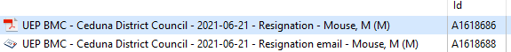

---
## Page 86

 
 
 
BMC Mid-Term Membership Management Procedure November 2021  
Status: Approved v.1 
Updated: 24/11/2021 
Page 13 of 17 
 
• Save letter into Objective. See Appendix 1 for folder locations and naming conventions tables. 
o Recommended location:  
o Naming convention: xx BMC - Resignation - Thank-you letter - letter date yyyy-mm-dd - 
Agency/Organisation - Surname, First initial (M or D) 
o Note the Objective ID of the letter to enter into the ‘BMC Mid-term Membership Changes’ form. 
4.4 
Record the resignation on the membership spreadsheet: 
• Enter the resigning member/deputy member’s details into the ‘2021-24 term – Membership and 
Attendance’ spreadsheet provided. 
• The easiest way to do this is to copy and paste from the ‘Membership’ worksheet to the ‘Resignations’ 
worksheet, following the steps below (this will save re-typing their details): 
o In the ‘Membership’ worksheet, find the member or deputy who is resigning, and copy their details. 
 In the example below, if the Member for Ceduna District Council (Mickey Mouse) has resigned, 
select cells A3 to Q3, and copy them (Ctrl + C). 
 
 Click into the next blank cell in Column D, and paste the member/deputy’s details using ‘paste 
values and number formatting’ (click the arrow under ‘Paste’, and click the 
 icon): 
  
  
 
 Enter the mid-term resignation date in Column A; the Objective ID of the Resignation 
Letter/Email in Column B, and note whether an Agency Separation Form has been submitted 
in Column C. 
 
 
RECORDS MANAGEMENT ALERT: SAVE TO OBJECTIVE 
UNDER REVIEW

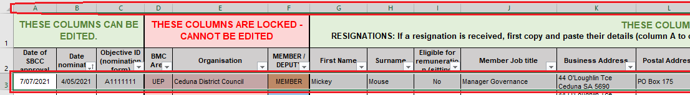

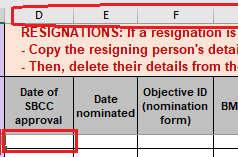

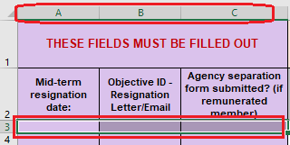

---
## Page 87

 
 
 
BMC Mid-Term Membership Management Procedure November 2021  
Status: Approved v.1 
Updated: 24/11/2021 
Page 14 of 17 
4.5 
Update spreadsheet (membership/vacancy details): 
• Record the new member/deputy details (or vacancy) into the worksheet, by following the steps below: 
o Using the tabs down the bottom of Excel, return to the ‘Membership’ tab. 
o Delete the data from the relevant row (in this example, we will delete the data from the Member for 
Ceduna District Council. Since some columns are locked, you will need to delete the data in 
Columns A to C, and then Columns G to Q, separately. 
 
 Enter ‘VACANT’ under the Columns G (First Name) and H (Surname). As conditional 
formatting has been used, these cells will highlight yellow automatically when this text is 
entered.  
o If a new nomination has been received: 
 Follow the instructions above to enter the details of the new nomination. 
4.6 
Prepare to send the resignation to SBCC Secretariat: 
 
• Add details of resignation to ‘BMC Mid-term Membership Changes’ form, in preparation to send to the 
SBCC Secretariat by the due date: 
NOTE: If you already have a form in progress for other resignations or nominations, continue with 
that form instead. 
o For any mid-term resignations received, fill in ALL the fields. 
o The easiest way to do this is to copy and paste from the ‘Resignations’ worksheet of the ‘2021-24 
term – Membership and Attendance’ spreadsheet: 
Part 1: 
 Select the cells in Columns G to K, for the resigning member, and copy (Ctrl + C). 
 
 
SUBMISSION ALERT: PREPARE FORM FOR LATER SUBMISSION 
UNDER REVIEW

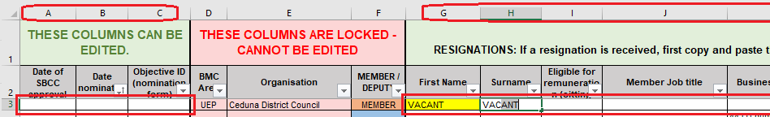

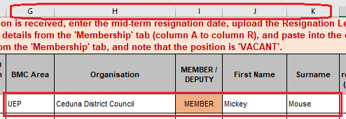

---
## Page 88

 
 
 
BMC Mid-Term Membership Management Procedure November 2021  
Status: Approved v.1 
Updated: 24/11/2021 
Page 15 of 17 
 In the ‘Membership Changes’ form, highlight all the cells that you want to paste into (click 
under ‘BMC Area’ and drag across to ‘Surname’ to select), then paste the details (Ctrl + V). 
 
Part 2: 
 
 In the ‘Membership Changes’ form, highlight all the cells that you want to paste into (click 
under ‘Resignation Date’ and drag across to ‘Agency Separation form’ to select), then paste 
the details (Ctrl + V). 
• 
If requesting a personalised acknowledgement letter be sent from the Chair of the 
SBCC, due to long (2+ terms) or exceptional service to the BMC, note this and the 
reasons here. Ensure that enough detail is included so that the letter can be 
appropriately personalised. 
 
o Repeat these steps as necessary for any further resignations. 
• Send to SBCC Secretariat before each SBCC meeting (due dates will be advised). 
 
 
UNDER REVIEW

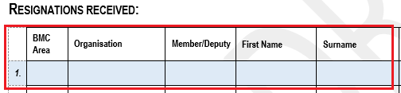

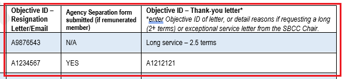

---
## Page 89

 
 
 
BMC Mid-Term Membership Management Procedure November 2021  
Status: Approved v.1 
Updated: 24/11/2021 
Page 16 of 17 
Appendix 1 – Folder Locations and Naming Conventions tables 
Objective Global Folder > 01. Corporate Direction > Boards, Committees and Meetings >  
External – Bushfire Management Committees (BMCs) 
NOTE: In the tables below, ‘xx BMC’ refers to each individual BMC – e.g., AMLR BMC, Outback BMC, etc. 
Table 1. Nominations & Resignations folders, and Membership and Attendance spreadsheets 
(Found in Objective folder xx BMC - Membership and Attendance) 
BMC 
Nominations folder 
Objective ID: 
Resignations folder 
Objective ID: 
Membership and Attendance 
Spreadsheets 
Objective ID: 
AMLR 
fA219284 
fA220036 
A1561230 
FL 
fA220054 
fA220053 
A1561299 
FMNY 
fA219283 
fA219285 
A1561334 
KI 
fA220071 
fA220072 
A1563490 
LC 
fA220075 
fA220074 
A1561376 
LEP 
fA220077 
fA220078 
A1561385 
MM 
fA220080 
fA220081 
A1561394 
Outback 
fA220083 
fA220084 
A1561408 
UEP 
fA218500 
fA218532 
A1561411 
 
Table 2. Forms and Templates 
BMC Mid-term Membership 
Changes Form 
BMC Acknowledgement of 
Service Letter Template 
Agency Separation Form 
(Found in Objective folder – xx BMC – Forms and Templates) 
A1566669 
A1593764 
http://cms.esau.sa.gov.au/public/download/?id=91199 
 
Table 3. Naming conventions 
Nomination forms 
Resignations 
Acknowledgement of Service 
letters 
(unconfirmed) xx BMC - Agency/org - 
Nomination date yyyy-mm-dd - 
Nominations - Surname, First initial (M) & 
Surname, First initial (D) 
(unconfirmed) xx BMC – Agency/org 
- Resignation date yyyy-mm-dd - 
Resignation - Surname, First initial 
(M or D) 
xx BMC - Resignation – 
Acknowledgement of Service letter - 
letter date yyyy-mm-dd - 
Agency/Org - Surname, First initial 
(M or D) 
e.g., (unconfirmed) UEP BMC - Ceduna 
District Council - 2021-06-21 - Nominations 
- Duck, D (M) & Mouse, M (D) 
e.g., (unconfirmed) UEP BMC - 
Ceduna District Council - 2021-06-
21 - Resignation - Mouse, M (M) 
e.g., UEP BMC - Resignation - 
Acknowledgement of Service letter 
– 2021-07-01 - Ceduna District 
Council - Mouse, M 
 
 
 
UNDER REVIEW

---
## Page 90

 
 
 
BMC Mid-Term Membership Management Procedure November 2021  
Status: Approved v.1 
Updated: 24/11/2021 
Page 17 of 17 
Appendix 2 – Checklists 
CHECKLISTS 
NOMINATIONS 
 
Nomination form checked for completeness 
☐ 
Nomination form saved to Objective 
☐ 
Updated Membership and Attendance Spreadsheet with 
nomination details 
☐ 
Checked (and updated if necessary) CEO details on Membership 
and Attendance Spreadsheet 
☐ 
‘BMC Mid-term Membership Changes’ form prepared with 
nomination details 
☐ 
 
 
RESIGNATIONS 
 
Formal resignation received 
☐ 
(if remunerated member) Resigning member submitted Agency 
Separation Form 
☐ 
Resignation & related documents saved to Objective 
☐ 
Acknowledgement of Service letter sent (or personalised letter 
requested) 
☐ 
Resignation recorded on ‘Resignations’ tab 
☐ 
Updated Membership and Attendance Spreadsheet with vacancy 
or new member details 
☐ 
‘BMC Mid-term Membership Changes’ form prepared with 
resignation details 
☐ 
 
UNDER REVIEW

---
## Page 91

 
 
State Bushfire Coordination Committee and Bushfire Management Committee Guidelines – Amendment (Nov 2021) 
Status: Approved v.1 
Date Updated: 3/11/2021 
 
Page 1 of 4 
 
 
 
 
Amendment to ‘Guidelines for State Bushfire 
Coordination Committee & Bushfire Management 
Committees’ (January 2018) - Bushfire 
Management Area Plan (BMAP) Amendments 
 
This amendment wholly replaces the content of ‘BMAP Amendment Agreement and Approval’ contained on page 
38 of the ‘Guidelines for State Bushfire Coordination Committee and Bushfire Management Committees’ (2018). 
 
 
 
Date Updated:  
3/11/2021 
Author: 
Danielle Drever, Anthea Howard 
Parent Document Name: 
Guidelines for State Bushfire Coordination Committee and Bushfire 
Management Committees (2018) 
Section being rescinded: 
BMAP Amendment Agreement and Approval 
 
Authorised by: Chairman, State Bushfire Coordination Committee 
Name 
Mr Mark Jones QFSM 
Signature 
 
Date 
 
30 / 11  / 2021  
 
 
UNDER REVIEW

---
## Page 92

 
 
State Bushfire Coordination Committee and Bushfire Management Committee Guidelines – Amendment (Nov 2021) 
Status: Approved v.1 
Date Updated: 3/11/2021 
 
Page 2 of 4 
1. Bushfire Management Area Plan (BMAP) Amendments 
BMAP amendments, as a standing BMC and SBCC meeting agenda item, should be prioritised to keep BMAPs up to 
date and maintain the accuracy of BMAP information between formal four yearly reviews1. 
An amendment may be undertaken as either a minor or major amendment (as defined within these Guidelines). All 
amendments must be approved by both the BMC and SBCC, and, where the amendment is major, public consultation 
must be undertaken allowing for a period of 6 weeks2 for public comment. This process is illustrated in Figure 1 
below. 
 
Figure 1 BMAP Amendment Process 
 
 
 
1 Four yearly review of the BMAP required under section 73A(5)(a) of the Fire and Emergency Services Act 2005 (SA) 
2 Section 28 of the Fire and Emergency Services Regulations 2021  
UNDER REVIEW

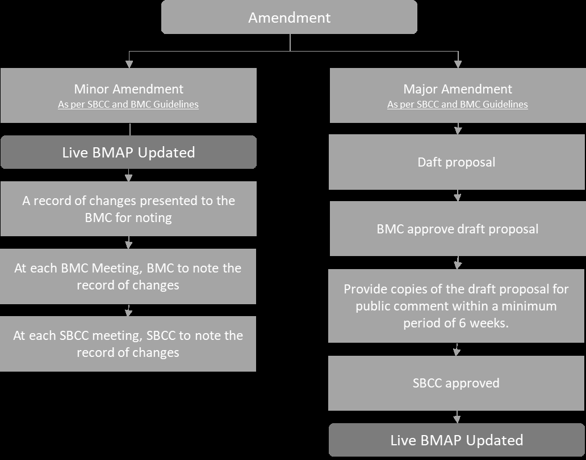

---
## Page 93

 
 
State Bushfire Coordination Committee and Bushfire Management Committee Guidelines – Amendment (Nov 2021) 
Status: Approved v.1 
Date Updated: 3/11/2021 
 
Page 3 of 4 
1.1. Minor Amendments 
The BMC and the SBCC will note minor amendments at formally constituted committee meetings.  
A minor amendment, as per section 73A(8) of the FES Act, is defined as an amendment made; 
• 
To ensure a BMAP is consistent with the State Bushfire Management Plan; or 
• 
To remove or replace information in the plan that has been superseded by information that is more reliable 
or up-to-date; or 
• 
In order to make a change in form. 
Examples of minor amendments include (but are not limited to): 
• 
Corrections (inaccuracies, changes of ownership, inclusion of information previously missed, reflecting 
impacts of bushfire incidents in the sense of asset removal). 
• 
Changes in material circumstances resulting in changes to risk ratings and treatments (eg. clearance being 
undertaken resulting in increased separation distance). 
• 
Changes in external standards (eg. changes to AS3959 or the Building Code of Australia that impact risk 
ratings). 
• 
Changes in available information (eg. new and improved data or modelling that updates a risk rating and 
may then result in a change in risk reduction treatments applied to the asset the subject of the risk 
assessment, or to the treatment itself). 
• 
Any amendment undertaken as part of the implementation of an action approved by the BMC and SBCC. 
• 
Updates to supporting data and mapping layers. 
1.2. Major Amendments 
All major amendments must, as per section 73A(7) of the FES Act, be prepared as a draft and; 
• 
Be reviewed and approved by the BMC; and 
• 
Publicised for 6 weeks3 through public notice with interested persons invited to provide written comment; 
and 
• 
Be approved by the SBCC. 
Major amendments include: 
• 
New groups of assets across multiple land tenures with multiple owners/managers, or new developments 
• 
Changes of land use 
• 
Any other amendment that does not constitute a minor amendment. 
 
3 Section 28 of the Fire and Emergency Services Regulations 2021 
UNDER REVIEW

---
## Page 94

 
 
State Bushfire Coordination Committee and Bushfire Management Committee Guidelines – Amendment (Nov 2021) 
Status: Approved v.1 
Date Updated: 3/11/2021 
 
Page 4 of 4 
1.2.1. Major Amendments - Consultation 
Where a major amendment is proposed it must be released for public consultation allowing for a minimum period 
of 6 weeks.4 Under section 73A(7)(b) of the FES Act, the BMC must also take reasonable steps to consult on the major 
amendment with: 
• 
the State Bushfire Coordination Committee; and 
• 
any SACFS organisation specified by the Chief Officer of SACFS (for example, brigades and Groups in an area 
covered by a proposed major amendment); and 
• 
a public sector agency (within the meaning of the Public Sector Act 2009) designated by the Minister; and 
• 
any Council whose area is wholly or partly within the relevant bushfire management area; and 
• 
any regional Landscape Board whose region is wholly or partly within the relevant bushfire management 
area; and 
• 
any other person or body, or person or body of a class, prescribed by the regulations for the purposes of this 
subsection (note that currently none are specified). 
In most cases – other than SACFS brigades and Groups as noted above – the organisations listed are members of the 
SBCC and/or BMCs and additional consultation will not be required. However, the intent of the consultation process 
is to ensure that those entities directly impacted by the proposed major amendment would be provided with the 
opportunity to comment. If, for example, a school or business was included within the area, the relevant authority 
would be invited to comment. 
 
4 Section 28 of the Fire and Emergency Services Regulations 2021 
UNDER REVIEW

