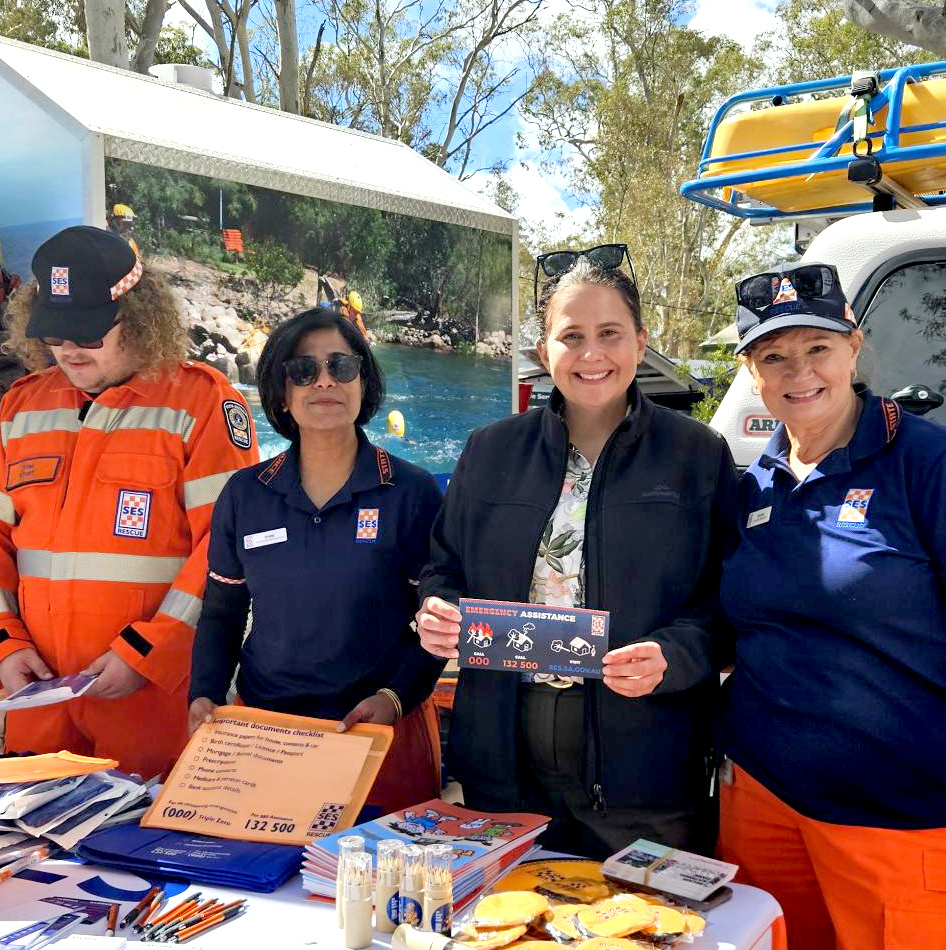
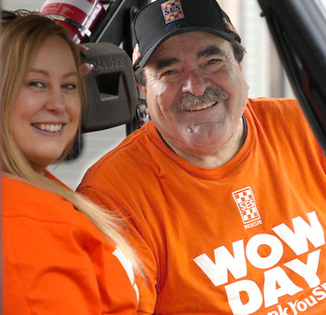
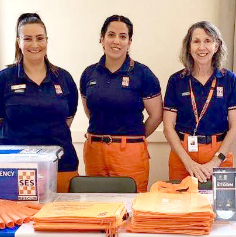
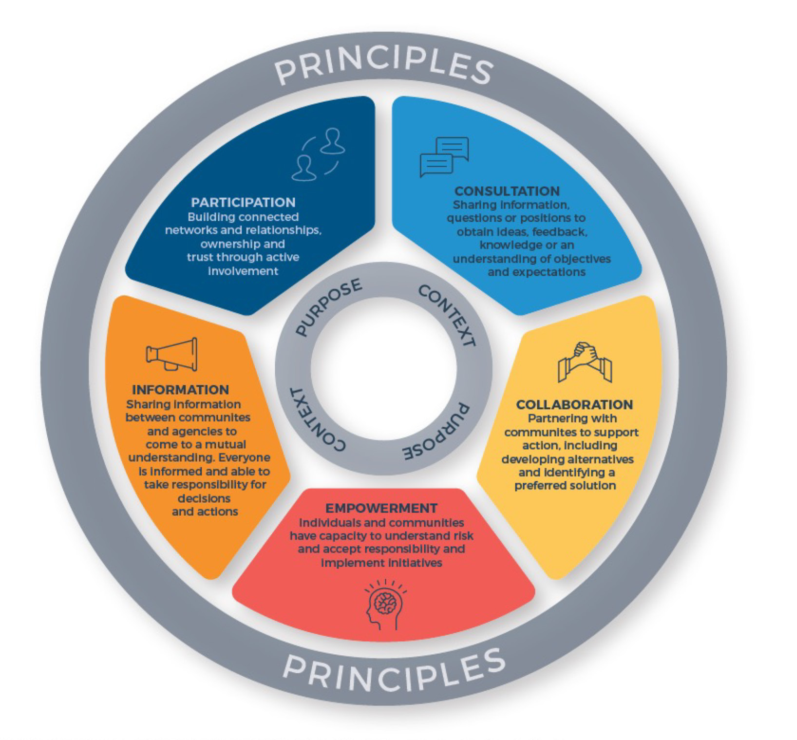

# SA SES Community Engagement Strategy (2018)

> **Source**: SA SES
> **URL**: https://resources-production.safecom.sa.gov.au/current/docs/sa_ses_community_engagement_strategy_2018.pdf
> **Licence**: © Government of South Australia; emergency-management practitioner reference
> **Retrieved**: 2026-05-07T23:44:57Z
> **SHA-256**: `44c777eb576c3394cbfbbaad1b2b3daa8dff808bc766703253fcb7c451bec1d7`
> *Converted from PDF to Markdown format.*

---
## Page 1

SA State
Emergency
Service
2024-2029
Community 
Engagement 
Strategic Directives

---
## Page 2

SASES  acknowledge and pay our respect to Aboriginal 
people as the state’s first peoples and nations, and 
recognise them as traditional owners and occupants of 
land and waters in South Australia.

---
## Page 3

Community Engagement Strategic Directives 2025
3
Our Vision
A reliable and trusted volunteer-based organisation building safe and resilient communities.
Our Purpose
To create safer communities by partnering with them to prepare for and respond to extreme 
weather conditions including heat, storm, and flood.
Values
The values represented within this body of work reflect those of the South Australian State 
Emergency Service (SASES) and align with the South Australian Government’s Public Sector Values 
and Behaviour Framework. The values inform our day-to-day activities and underpin collective 
approaches to sustaining a positive value-based culture – our people, our way of working, our 
behaviours and our community value1
Purpose of the Community Engagement Strategic Directives
Our purpose in updating these strategic directives is to build on the existing work that has been 
undertaken during 2018-2023 and incorporate lessons learnt within the community engagement 
area. This is also a time for celebrating our significant achievements. Looking forward to how we 
will continue to grow this capability, making an impact by encouraging and supporting South 
Australians to develop and strengthen their disaster resilience.
Community engagement principles
These strategic directives reflect the following community engagement principles outlined in 
the AIDR National Strategy for Disaster Resilience Handbook 2020. The principles are reflected 
in the Community Engagement Model for Emergency Management (Page x, Fig1). The following 
principles: Understand the community, its capacities, strengths and priorities, Recognise Complexity 
and Partner with community to support existing networks and resources, all serve as statements of 
good practice when planning for effective community engagement.
Understand the community, its capacities, strengths, and priorities
In the SASES, we use a strengths-based approach, where everyone in the community, with the 
right tools and supports can make some decisions about their emergency planning. Using local 
approaches we will continue to listen to, learn from and create meaningful engagement activities. 
We aim to leverage the wealth of knowledge that communities and our volunteers hold about their, 
levels of awareness and preparedness, capabilities, challenges, and external impacts. 
Understanding community involves:
•	 Respecting and using local knowledge and experience
•	 Tapping into existing networks
•	 Using genuinely respectful and flexible approaches
•	 Identifying and addressing barriers to engagement and making participation accessible to all
•	 Recognising that communities change and evolve over time 6

---
## Page 4

Community Engagement Strategic Directives 2024-2029
4
Recognise Complexity
As part of enhancing disaster resilience, we recognise challenges that are a part of the process of 
working in partnership with community. To better understand the needs of the South Australian 
community, we need to be mindful of a range of influencing factors including an ageing 
population, elevated levels of low literacy and numeracy, cultural diversity, geographic isolation, 
poor infrastructure, and poverty. We also recognise the inherent challenges of differences in life 
experience, opinion, knowledge, resources, and capacity. 
Recognising complexity involves:
•	 Embracing and respecting difference and diversity, including different perceptions of risk 
•	 Using genuinely respectful and flexible approaches 
•	 Identifying and addressing barriers to engagement and making participation accessible to all
•	 Recognising that communities evolve and change over time 7
Partner with community to support existing networks and resources
Community are the experts of their own lives, and we will continue to partner with them in 
meaningful, genuine ways to support local actions that reduce their risks. We understand that the 
disaster resilience space is one that is rich in variety, experience, and knowledge. To ensure that 
community knowledge and experience has a voice at the table we will seek to coordinate with other 
disaster resilience focused agencies and organisations to provide the best possible experience for 
all members of the community to be engaged and empowered in their preparedness journey.
Partnering with the community to support existing networks and resources involves:
•	 building and maintaining partnerships
•	 fostering relationships with community leaders
•	 respecting community choices
•	 aligning emergency management activities to build on existing social capital
•	 identifying and employing strategies that empower local action.8
6, 7 & 8 AIDR National Strategy for Disaster Resilience Handbook 2020

---
## Page 5

Community Engagement Strategic Directives 2025
5
Community Engagement Model for Emergency Management
 
The Community Engagement Model for Emergency Management is circular to show that one 
engagement approach is not necessarily better than any other, and that different approaches are 
legitimate depending on the purpose and context of a particular situation.9  
In developing this strategy, we have a focus on community engagement activities that are 
coordinated, inclusive of diverse community needs and empower community to plan for and take 
protective actions for extreme weather events.
Community Engagement Model for Emergency Management - National Stratergy for Disaster Resilience

---
## Page 6

Community Engagement Strategic Directives 2024-2029
6
Why we do community engagement and where we have come from
‘Building upon our existing emergency planning arrangements, we need to focus more on action-
based resilience planning to strengthen local capacity and capability, with greater emphasis 
on community engagement and a better understanding of the diversity, needs, strengths and 
vulnerabilities within communities. Disasters do not impact everyone in the same way, and it is often 
our vulnerable community members who are the hardest hit. ‘
 National Strategy for Disaster Resilience (COAG, 2011)
Community Engagement has been recognised nationally as a key component of frontline 
emergency services and is a foundation for creating disaster resilient communities. With the 
increase of severe and more frequent extreme weather events, SASES has a role in ensuring that 
communities are engaged, educated, and empowered to plan and prepare for emergencies.
The first Community Engagement Strategic Directives 2018-2023 focused on developing and 
growing the community engagement capability with a disaster resilience focus. In line with national 
best practice there was a requirement for the community engagement capability to evolve from a 
centralised model into one that embraces local, targeted, and tailored approaches. This has enabled 
leveraging of local knowledge, creating behaviour change and shared responsibility in building 
disaster resilient communities. All of this required significant changes in policy, procedures and 
processes as can be seen reflected in the Community Engagement Evolution 2018-2029 diagram 2. 
The focus has been to develop and uplift the community engagement capability embedding it as an 
important part of frontline services. 
Diagram 2
Community Engagement Evolution 2018 - 2028
2018
2019
2021
2022
2023
2024 - 2029
•	 CE Strategic Directives 
2018-2023
•	 Focus on Disaster resilience
•	 CE Volunteer Roles – 
re-scoped as specialist 
highly skilled and trained 
volunteers
•	 Move to a localised model
•	 CE Volunteer cohort identified
•	 Strategic partnerships with EM 
Sector
•	 Development of CE collateral
•	 Strategic partnerships with 
Emergency management 
sector, Local government, non-
profits, and community services
•	 Paddy guidelines updated 
and online training
•	 CE Community of Practice
•	 CE volunteers engage 
700+ community 
members
•	 Corporate Partnership with 
NRMA formalised
•	 River Murray Community 
Engagement Response
•	 River Murray CE response, 
engaged 4,000+ members of 
the community in 25 + tailored 
community meetings
Key strategic partner projects:
•	 DEW Gawler River Research
•	 People at Risk in Emergencies
•	 Redi Communities
•	 Youth in emergencies Program
CE Strategic Directives key 
focus areas:
•	 CE Capability strengthened
•	 Growth in regional areas
•	 Working with First Nations 
and CALD groups
•	 Completion of CE training 
toolkit with 3 modules, 
recruitment for CE roles 
in metropolitan and 
regional areas
2020
•	 Online Introduction to 
community engagement 
training
•	 25 trained CE Volunteers 
mainly in metro areas

---
## Page 7

Community Engagement Strategic Directives 2025
7
Tailoring Community Engagement – the way forward
We acknowledge that there is no one size fits all model and that our communities are rich in 
diversity and going forward there is a requirement to adapt our engagement activities to better 
suit community needs. 
 
In South Australia we live in a diverse community with over 24% of people who speak a language 
other than English and about half of all adults have poor or very poor literacy and numeracy skills2. 
There are currently over 118,000 people who have some form of disability2 People with a disability 
are disproportionately impacted by disaster events. They are two to four times more likely to die in 
a disaster, experience higher risk of injury and loss of property, have greater difficulty evacuating, 
sheltering, and require more intensive health and social services during and after disasters 3. 
Our first nations people are often disproportionately affected by disasters and historically first 
nations people’s knowledge regarding preparing for, coping with, and recovering from disasters has 
been overlooked4. We also have the highest proportion of older people on mainland Australia with 
more than 630,000 people aged over 505.
These are all examples of some of the members of our community who may require tailored 
engagement approaches that can assist them to identify their risk and take appropriate protective 
actions. Included in these communities are those who will need additional support to help 
them prepare for emergencies and emergency services must find ways to work in partnership 
with organisations that support them. Once communities have identified their risks, and make 
the necessary preparations, they will be better equipped to adapt plans to suit their personal 
circumstances and the dynamic nature of emergencies during the response phase. 
2 Australian Bureau of Statistics Census 2021
3 Michelle Villeneuve, Disability-Inclusive Emergency Planning: Person-Centred Emergency Preparedness. 
4 PAHO & WHO 2014, UNDRR 2015
5 South Australia’s Plan for Ageing Well 2020-2025

---
## Page 8

Community Engagement Strategic Directives 2024-2029
8
Key Deliverables

---
## Page 9

Community Engagement Strategic Directives 2025
9
Key Deliverables 2024-2029
Starting with a small cohort of enthusiastic volunteers, we have seen a significant growth in 
community engagement volunteers in the metropolitan and regional areas. This has included 
uplifting of the community engagement roles, Community Engagement Coordinator and 
Community Engagement Crew, online skills development training, and development of 
presentations and resources. We aim to build on this success by using flexible approaches 
across the state, developing and adapting resources, leveraging key stakeholder relationships, 
amplifying our key messages in the community, and developing our operational community 
engagement roles.
There are five key deliverables for the Community Engagement Strategic Directives 2024-2029, 
these include:
•	 Grow Community Engagement Capability
•	 Strategic Partnerships
•	 Expand the Toolkit and Adapt Collateral
•	 Campaign and Key Messages  
•	 Community Liaison Officer Role
Grow the Community Engagement (CE) Capability
Objective
Recruit and train Community Engagement (CE) volunteers across the state with a focus on 
building disaster resilience knowledge, and engagement skills, along with local knowledge that 
can be utilised to educate the community, using standardised key messaging. 
Overarching Strategy 
Going forward our focus is on supporting existing CE volunteers and strengthening the CE 
capability further with coordinated recruitment for both existing and new volunteers within 
metropolitan and regional areas. Working with leadership and the recruitment team we will 
create flexible options for regional units when there is limited volunteer capacity, we will seek 
to be innovative and apply other approaches including a district model. Building on the work 
that began in Introduction to Engagement three new modules were created. Module one – 
Introduction to Community Engagement and Module two – Planning are both online self-paced 
modules. Module three – Presentation Techniques format is a face-to-face workshop.
 
Actions
Recruiting new volunteers in both metropolitan and regional areas that self-identify for CE with 
the support of Unit Leadership
Working with regional leadership to develop flexible approaches including district models that 
better suit regional units 
6-8 Community Engagement Virtual Communities of practice including 1-2 face to face meetings 
annually
CE Modules 1 and 2 are online and will have ongoing intakes during the year
CE Module 3 will be presented face-to-face quarterly by the CE team 
Develop, adapt and facilitate training for CE Volunteers, including; How to run street corner 
meetings and Conflict Resolution

---
## Page 10

Community Engagement Strategic Directives 2024-2029
10
Expand the Toolkit and Adapt Collateral 
Objective
The Community Engagement (CE) toolkit will continue to reflect our diverse communities and 
have multiple tools that CE volunteers can access to contribute to their event planning and 
presentations. Collateral will be updated to be relevant and consistent with our key messages as 
well as adapted for specific community needs.
Overarching Strategy
To further support our trained CE volunteers, we will ensure that key preparedness messages 
are delivered consistently across the state, as we continue to develop and refine the community 
engagement toolkit. This will include tailored presentations; session plans and identifying new 
community engagement activities. Our suite of brochures and animations will continue to be 
updated and adapted for different communities including remote APY Lands, first nations, taking 
advice from first nations communities and multicultural peak bodies and developing materials 
in a range of formats. We will also explore the feasibility of developing a program and activities 
targeted at Youth.
Actions
Develop tailored presentations for: Culturally and Linguistically Diverse Communities, those with 
a Disability, First Nations communities and other specialist groups
Include panel style events as part of the CE range of activities with a focus on one hazard such 
as Storm, Heat or Floods
Explore developing a youth education program, including reviewing other emergency services 
education programs and products 
Develop new Heatwave and Flood collateral for APY lands based on feedback from focus groups
Update our collateral suite with translations in new and emerging language groups as identified 
through Australian Bureau of Statistics and other government departments
Review, consumer test and where necessary update the Storm, Flood, and heatwave collateral on 
a 3 yearly cycle
Utilise monitoring and evaluation frameworks to report on and measure the success of our 
engagement activities

---
## Page 11

Community Engagement Strategic Directives 2025
11
Strategic Partnerships
Objective
Work collaboratively with internal and external stakeholders including emergency services, local 
councils, national and state peak bodies, non-government organisations and community groups. 
We will continue to leverage existing partnerships, as well as forging new partnerships that are 
focused on building disaster resilient communities. 
Overarching Strategy
Continue to build on our relationships that are focused on working with diverse members of our 
community. These include relationships with other emergency services, state, federal and local 
government, non-for-profit organisations and community groups. We will work in partnership 
with stakeholders on mutually beneficial projects. Seeking new opportunities to work with these 
organisations that have clients with an elevated disaster risk. This includes industries such as 
aged care and disability services. We also seek to develop a sustainable respectful relationship 
with our first nations communities and culturally and linguistically diverse groups. We will 
continue to collaborate, share knowledge, and shape Community Engagement practice through 
our involvement within the AFAC network.
Actions
Engage with organisations such as those in the disability or aged care field with at risk clients, 
delivering disaster risk education with staff who will then engage with clients around their home 
emergency plans
Build strategic relationships with key APY, Indigenous and multicultural stakeholders that are 
based on mutual respect and flexibility
Identify projects with other emergency services, state and local government and non-profit 
organisations focused on building community disaster resilience 
Continue to work with District Officers and regional leadership to determine targeted areas of 
focus
Continue to represent SASES through quarterly meetings on the AFAC Community Engagement 
Technical Group and the Community Safety Group
Identify key projects to collaborate with our corporate sponsor NRMA that meet SA SES disaster 
resilience goals
Utilise NRMA research resources, to assist with identifying at-risk communities, and developing 
targeted community engagement activities

---
## Page 12

Community Engagement Strategic Directives 2024-2029
12
Community Liaison Officer
Objective
To provide timely, appropriate, and engaging operational community engagement activities, 
within the Public Information function when required. During significant events, we have seen 
firsthand the importance of identifying and running targeted, local, community activities. 
These activities are critical to increasing community awareness and encouraging preparedness 
activities that have a direct influence on the communities understanding of the risk and ways to 
mitigate this risk. 
Overarching Strategy 
We are committed to growing this capability within our existing workforce through, promoting 
the role of Community Liaison Officer, providing training and opportunities for mentoring 
before stepping into the role. Where possible we will also explore the use of trained community 
engagement volunteers as community meeting facilitators. This may also include running street 
corner meetings, attending stakeholder meetings and briefings as well as any additional training 
and mentoring involved to equip people with the skills needed to do the roles.
Actions
Involvement in the development and use of the operational community engagement pathway 
with staff and volunteers to introduce the role and identify a cohort of interested staff 
Provide training and mentoring opportunities during activations
Explore a potential annual exercise to ensure skills are up to date
Support a cohort of trained community engagement volunteers with further training and 
mentoring to run operational community meetings

---
## Page 13

Community Engagement Strategic Directives 2025
13
Campaign and Key Messages
Objective
We will continue to build on the work, started with our corporate partner NRMA Insurance in 
the inaugural 2024 Storm preparedness campaign. Our focus is to continue with this work to 
strengthen SASES brand awareness and embed our key preparedness messaging for storm and 
extreme weather within South Australia.
 
Overarching Strategy
Working within the funding scope we will seek to utilise a range of media methods, including 
print, digital media and where possible television, to give us the best possible reach and message 
cut through across the state. We will expand the work completed in the previous campaign, 
where we will adapt our key messages for different community members targeting regional 
communities and Culturally and Linguistically Diverse groups based on local knowledge and 
NRMA research and data from the Australian Bureau of Statistics.  
Actions
Collaborate with NRMA Insurance and SASES leadership to plan and develop the extreme 
weather awareness campaign
Liaise with all relevant SASES business areas in development and execution of the plan
For new campaigns build in pre and post research to determine knowledge of risk and 
preparedness actions as well as communities to target
Develop targeted campaign messaging for specific community cohorts such as CALD and First 
Nations groups
Review end of campaign reports and implement changes for future campaigns

---
## Page 14

Community Engagement Strategic Directives 2024-2029
14
Essential success Factors
Internal Partnerships
Internal partnerships remain critical to the further growth of the Community Engagement 
capability.  This area works closely with recruitment, training, operations, and the 
communications team. We will continue to strengthen relationships, share, and seek support, and 
actively look for opportunities to collaborate on mutually beneficial projects, communicating our 
outcomes across business units. As this area continues to grow it is important to recognise that 
building a more disaster resilient South Australia is an important part of the core function of the 
SASES.
Targeted, Trusted Local Engagement
The Community Engagement volunteers will complete online training modules, participate in 
Communities of Practice, and ongoing skills development. Tapping into local knowledge at 
their unit and in the leadership team and the latest statistics through the ABS they will deliver 
community engagement activities that are tailored and adapted for their unique community 
needs.  Understanding that to influence positive behaviour change, building trust is a key 
component they will continue to display a consistently high level of professional behaviour when 
engaging with the community.    
Conclusion
This body of work represents the Community Engagement Strategic Directions over the next 
five-year period. These directives aim to strengthen the capacity building that has happened 
in the previous five years and build disaster resilience through a strength’s-based engagement 
model.
Effective engagement is recognised nationally as a central pillar in building disaster resilient 
communities. These recommendations are focused on building capacity within the community 
engagement space.

---
## Page 15

Community Engagement Strategic Directives 2025
15
Related Documents
This strategy has linkages with the the following documents:
South Australian State Emergency Service
Annual Business Plan 2024-2025
South Australian State Emergency Service
Community Engagement Strategic Directions 2028-2023
South Australian State Emergency Service
Public Information Manual, Community Liaison
AIDR Community Engagement for Disaster
Resilience Handbook 2020
Sendai Framework for Disaster Risk
Reduction 2015-2030
Further Reading
Natural hazards Research Australia - Resilient Communities research 
Resilient communities | Natural Hazards Research Australia
AFAC Climate Change and Disasters 2020
afac-climate-change-and-disasters_key-messages-and-resources_nov-2020.pdf
Disability-Inclusive Emergency Planning: Person-Centred Emergency Preparedness
Person-Centred Emergency Preparedness (PCEP) User Guide
South Australian’s Plan for Ageing Well 2020-2025
South+Australia’s+Plan+for+Ageing+Well+2020-2025_WEB.pdf

---
## Page 16

