# TFS Building for Bushfire — A Property Owner's Guide

> **Source**: Tasmania Fire Service
> **URL**: https://www.fire.tas.gov.au/userfiles/madisons/file/20200903%20-%20Building%20for%20Bushfire%20Booklet%209/200233%20TFS%20Building%20for%20Bushfire%20booklet_9%20June.pdf
> **Licence**: Crown copyright Tasmania; practitioner and public-information use
> **Retrieved**: 2026-05-07T13:40:43Z
> **SHA-256**: `859978024b8104b660e20e450670a41b2d8b2502b97c57f41b371eb67a435854`
> *Converted from PDF to Markdown format.*

---
## Page 1

Planning and Building in 
Bushfire-Prone Areas for 
Owners and Builders
June 2020
fire.tas.gov.au
Building for
Bushfire

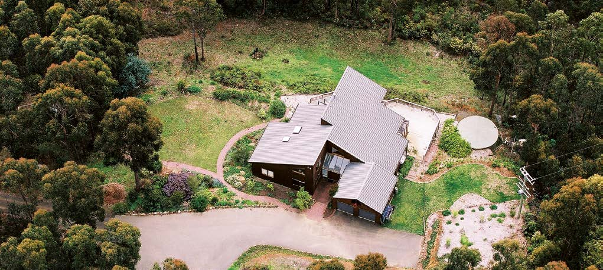

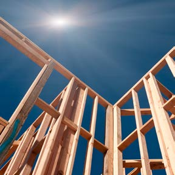

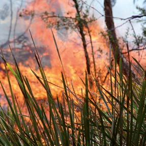

---
## Page 2

Building for
Bushfire
Planning and Building in Bushfire-Prone Areas for Owners and Builders
2
Planning and Building in Bushfire-Prone Areas
for Owners and Builders
Bushfire is Tasmania’s most prevalent natural 
hazard and a persistent threat to the safety of our 
communities, our built assets and other economic 
resources. Keeping our community safe from 
bushfires requires a range of measures in addition 
to firefighter intervention. Prevention measures, 
which include planning and building standards, 
provide the most cost-effective means of reducing 
risk to life and property. 
The Tasmanian Government introduced significant 
reforms for planning and building in bushfire-prone 
areas in 2012. The reforms sought to establish 
consistent minimum standards for bushfire 
protection and to balance development in bushfire-
prone areas with the physical, social and emotional 
risk of bushfire in our communities. 
‘Building for Bushfire’ provides an introduction to 
planning and building requirements for bushfire 
protection in Tasmania. It is designed for those 
who are looking to buy or build in a bushfire-prone 
area and outlines the key issues that need to be 
considered.  
The planning and building approvals process can be 
difficult and you should remember that your local 
council, accredited bushfire hazard practitioners 
and the Tasmania Fire Service are there to help.  
Of course, planning and building for bushfire is just 
the first step in minimising the bushfire threat.
It is also important to prepare your own Bushfire 
Survival Plan and to know your Community 
Protection Plan. The Tasmania Fire Service has good 
resources to help you prepare for an emergency.

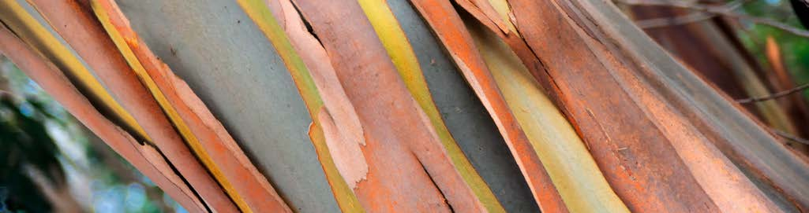

---
## Page 3

Planning and Building in Bushfire-Prone Areas for Owners and Builders
3
Contents
1 	Bushfires in Tasmania	
4
1.1	 Building in a bushfire-prone area	
5
1.2	 Buying in a bushfire-prone area	
6
1.3	 Rental property in a bushfire-prone area	 6
1.4	 What’s in this Guide	
6
2 	Planning your development	
7
2.1	 Am I in a bushfire-prone area?	
7
What is bushfire-prone vegetation?	
7
		The role of accredited bushfire hazard 
practitioners
7
2.2	 What is a bushfire hazard 
management plan	
8
2.3	 When do I need a bushfire hazard
management plan?	
8
2.4	 Balancing site location, construction
requirements and maintenance	
8
What is the Bushfire Attack Level?	
9
2.5	 Planning for access to buildings and 
water supply	
9
DISCLAIMER
Whilst the Tasmanian Government has made every effort to ensure the accuracy 
and reliability of these guidelines, the Government accepts no responsibility for the 
accuracy, completeness or relevance to the viewer’s purpose, of the information in these 
guidelines and those viewing it for whatever purpose are advised to verify its accuracy 
and to obtain appropriate professional advice. 
The Tasmanian Government, its officers, employees and agents do not accept any 
liability, however arising, including liability for negligence, for any loss or damage 
resulting from the use of, or reliance upon, the information contained in these guidelines.
3	 Building your new home	
10
3.1	 Construction requirements	
10
3.2	 Building Costs	
11
4	 Maintain your land	
12
5	 Prepare, act and survive	
13
6	 Checklist for building in bushfire-prone areas	14
7	 Further Information	
14
8	 An example of a bushfire hazard 
management plan	
15

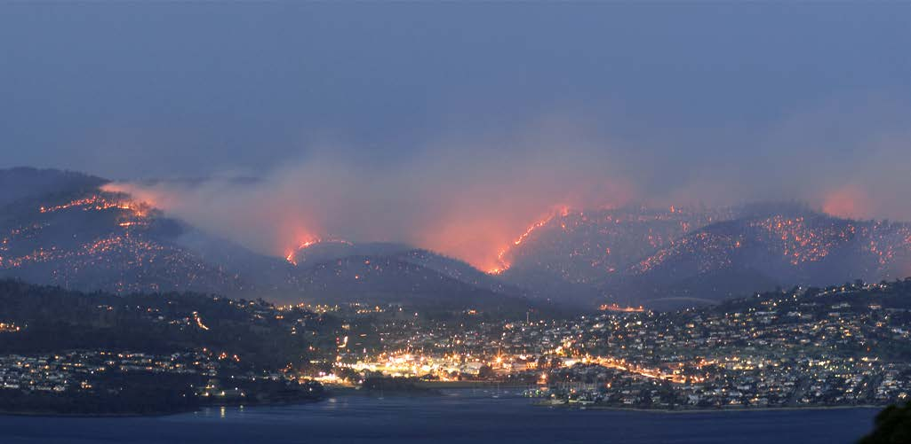

---
## Page 4

Planning and Building in Bushfire-Prone Areas for Owners and Builders
4
Bushfire is part of the history and natural 
landscape of Tasmania. Over the years, 
there have been many significant bushfires 
in Tasmania, including more recently the 
devastating fires in and around the Dunalley 
area early in 2013 that destroyed over
200 homes.
Where we settle, build our houses and construct 
our roads can greatly influence where a bushfire 
will eventually run. These factors play an important 
role in the inherent safety of an area. Good land-
use planning and development can minimise the 
bushfire threat and reduce the physical, social and 
emotional costs of bushfire. 
In October 2012, new requirements for developing 
in bushfire-prone areas were introduced in 
Tasmania to help reduce vulnerability to bushfire. 
These requirements incorporate lessons learned 
from bushfires within Tasmania and more broadly 
Australia, including the Victorian ‘Black Saturday’ 
fires of 2009.
1	 Bushfires in Tasmania
The requirements mean that new development in 
bushfire-prone areas, is required to have a bushfire 
hazard management plan (unless an exemption 
can be obtained). If you are thinking of developing, 
building, or buying land in a bushfire-prone area, 
this Guide will help explain how these plans are 
created, the steps along the way, and where you 
can access help to work through the planning and 
building approvals process.

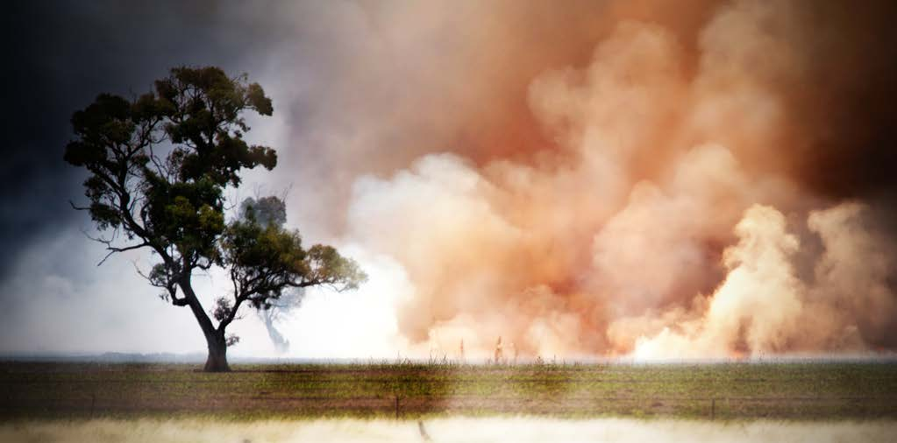

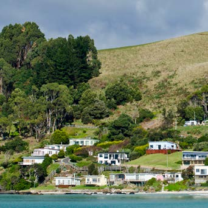

---
## Page 5

Planning and Building in Bushfire-Prone Areas for Owners and Builders
5
1.1	Building in a bushfire-prone area
It is important to remember, however, that 
even if your home conforms to the minimum 
requirements, bushfires can and will occur on days 
where the Fire Danger Rating exceeds 50, at which 
point homes may not be defendable. The Tasmania 
Fire Service will provide public warnings and advice 
on conditions during a bushfire, and whether you 
could defend your home or you should leave early.
The bushfire requirements include restrictions 
on the development of vulnerable (e.g. nursing 
homes) and hazardous uses in bushfire-prone 
areas. In some circumstances, a proposed use 
and development may not meet the minimum 
required standards, or the risks associated with the 
development may be too great. 
The Fire Danger Rating warns of the potential impact of a bushfire on any given day, 
based on forecast weather conditions. The Fire Danger Rating ranges from 
Low-Moderate (0) to Catastrophic (100+).
0-11
LOW-MODERATE
HIGH
VERY HIGH
SEVERE
EXTREME
12-24
25-49
50-74
75-99
100+
CATASTROPHIC
Figure 1: Fire Danger Rating
Total Fire 
Ban Days
38
FDR 50-74
Can stay and defend 
only if well prepared
FDR 50
Minimum standard for 
planning and building design
If you are planning to develop in a bushfire-
prone area, you need to plan to reduce your 
vulnerability to bushfire. 
Tasmanian planning and building requirements 
aim to balance the benefits of development with 
the protection of life, property and environment 
during a bushfire. They also support the work of 
Community Protection Planning and any emergency 
response by the Tasmania Fire Service.
In Tasmania new development in a bushfire-prone 
area must be planned, designed and constructed 
to survive a fire with a Fire Danger Rating of 50 
(see Figure 1). Your bushfire hazard management 
plan will detail how your development meets these 
minimum requirements.

---
## Page 6

Planning and Building in Bushfire-Prone Areas for Owners and Builders
6
1.2	Buying in a 
bushfire-prone area
If you are considering buying land or buildings in 
a bushfire-prone area, you should check with the 
local council to confirm whether the property is 
within a bushfire-prone area and if it has an existing 
bushfire hazard management plan.
A bushfire hazard management plan, if available, will 
provide useful information for you including how the 
land surrounding the building must be maintained 
and where you can build, renovate, and extend 
without needing to prepare a new plan. If a bushfire 
hazard management plan has been prepared for 
the property the owner must ensure the property 
remains compliant with all requirements of the plan. 
The property vendor or your local council should be 
able to advise if a bushfire hazard management plan 
exists for the property.
Many older properties may not have a bushfire 
hazard management plan. In these cases, a plan will 
only be required if you undertake new building 
work on the property. You should consider bushfire 
requirements if purchasing a property to develop.   
It should be noted that under Tasmanian legislation 
a caravan or ‘tiny home’ that is permanently 
attached to the ground is considered to be a 
building and is therefore required to comply with 
building (including bushfire) requirements.
1.3	Rental property in a 
bushfire-prone area
If you intend to let a property you own, you 
must be aware of your legal obligations in regard 
to bushfire safety. Where a bushfire hazard 
management plan is in place, the property owner 
is responsible for ensuring compliance with the 
requirements of the plan, unless an alternate 
arrangement is explicitly detailed within a residential 
tenancy agreement. Maintaining compliance with a 
bushfire hazard management plan requires a range 
of routine maintenance tasks.  
If you are renting property in a bushfire-prone 
area, you too need to know whether there are 
specific bushfire protection measures that you or 
the property owner are required to maintain. If you 
are new to the area, it is particularly important that 
you prepare a Bushfire Survival Plan so you are well 
prepared in the event of bushfire. 
1.4	What’s in this Guide
This Guide provides details on:
•	 What to consider in planning your development;
•	 Designing and building your development;
•	 Maintaining your property and responding in 
an emergency; and
•	 A checklist for planning and building in a 
bushfire-prone area.

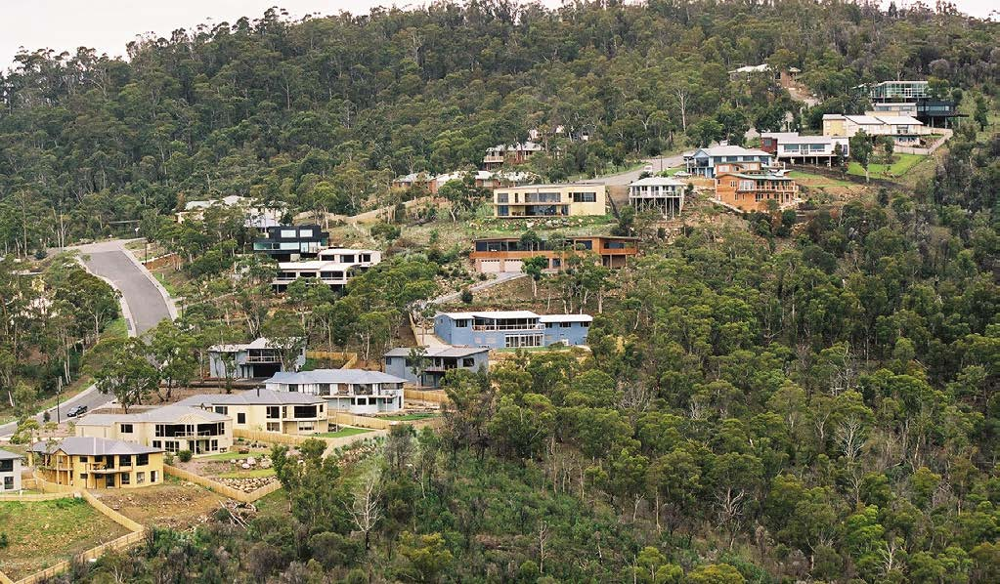

---
## Page 7

Planning and Building in Bushfire-Prone Areas for Owners and Builders
7
2	 Planning your 
development
2.1	Am I in a bushfire-
prone area?
A ‘bushfire-prone area’ is an area where 
a bushfire is likely to occur that may cause 
significant damage to buildings and danger to life. 
Some local councils have a planning scheme overlay that 
identifies bushfire-prone areas within their municipality. 
Planning scheme overlays can be viewed online through 
the LIST website (www.thelist.tas.gov.au).
In the absence of a published overlay, all land within 
100m of ‘bushfire-prone vegetation’ is considered to be 
in a bushfire-prone area. 
Your local council or an accredited bushfire hazard 
practitioners can advise you whether your land is 
bushfire-prone. Remember, it is better to check 
whether your land is bushfire-prone early in the 
planning process to save time and costs later 
(for more details, see Section 7 - Further Information). 
If your land is bushfire-prone then your proposed 
development will likely require a bushfire hazard 
management plan.
What is bushfire-prone vegetation?
Bushfire-prone vegetation includes areas of 
vegetation larger than one hectare (ha). 
The one hectare area may be made up of clumps 
of vegetation separated by less than 20 metres, 
but will not include clumps of vegetation separated 
by more than 20 metres.
Bushfire-prone vegetation includes forests, 
shrubs and grasslands, but does not include 
maintained lawns, parks, orchards or 
horticultural land. 
The role of accredited bushfire hazard 
practitioners
Bushfire hazard practitioners are accredited by 
the Tasmanian Fire Service to provide advice 
on matters relating to planning and building 
in bushfire-prone areas. In order to become 
accredited, bushfire hazard practitioners are 
trained in understanding how planning and 
construction relates in vulnerability to bushfires. 
A list of accredited bushfire hazard practitioners 
can be found on the TFS website under ‘Building 
for Bushfire’ (www.fire.tas.gov.au).

---
## Page 8

Planning and Building in Bushfire-Prone Areas for Owners and Builders
8
2.2	What is a bushfire hazard 
management plan?
A bushfire hazard management plan is a plan 
that details the specific measures that will be 
implemented to achieve an acceptable level of 
protection for a proposed use or development.  
Accredited bushfire hazard practitioners can prepare 
bushfire hazard management plans. They provide a 
report and a plan to demonstrate compliance with 
the applicable statutory requirements. An example 
of a plan is provided on the last page of this Guide.
Remember that not all development in Tasmania 
requires a bushfire hazard management plan, only 
development in bushfire-prone areas. Repairs, 
maintenance and minor extensions away from 
bushfire-prone vegetation may not require a plan.
2.3	When do I need a bushfire
	 	 hazard management plan?
Depending on the zoning of your site, your new home 
may require a planning permit as well as a building permit.
For most types of building work (including residential 
dwellings), a bushfire hazard management plan is
not required until the building approvals stage. This 
means you may not be required to provide this as 
part of your development application. 
However, it is important to understand that bushfire 
requirements may have planning implications. 
For example, they may affect building siting and 
required vegetation removal. In some cases, bushfire 
requirements may even influence the choice of 
materials and design of the building. Therefore, 
bushfire requirements should be considered early 
in the design process and before submitting your 
development application. Engaging a bushfire hazard 
practitioner early in the design process is advisable. 
TFS recommends, wherever planning approval is 
required, a BHMP is provided with the application. 
2.4	Balancing site location, 
construction requirements 
and maintenance
Deciding where to build on your land is an important 
step in planning for bushfire. The decision needs to 
balance how close your building will be to bushfire-
prone vegetation, the slope of your land, how you 
will manage your land, and how access to the building 
and emergency water supplies will be provided.
A bushfire hazard management plan balances 
these considerations through an assessment of 
Bushfire Attack Level (BAL) for your development. 
Developments that are planned close to bushfire-
prone vegetation are likely to have increased 
exposure to bushfire and will be assessed as having 
a high BAL. As a result, more stringent building 
construction standards will be required to improve 
resistance and reduce risk to occupants during a 
bushfire. In general, the higher the BAL the higher 
the cost of compliance. 
The land between your development and bushfire-
prone vegetation is part of your hazard management 
area and acts to reduce the impact of bushfires on 
your building; as such it needs to be maintained in 
accordance with the plan. Make sure you understand 
the costs associated with maintaining this area. 
Your bushfire hazard management plan 
will specify: 
•	 The applicable Bushfire Attack Level (BAL)
for construction;
•	 A building area with minimum setbacks; 
•	 Standards for site access and firefighting
	
water supplies;
•	 Hazard management areas and required 	 	
	
vegetation removal;
•	 Ongoing maintenance requirements; and
•	 Other additional recommendations for risk 	
	
mitigation as appropriate for the site.

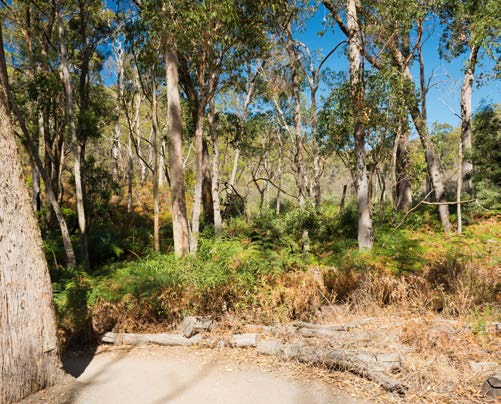

---
## Page 9

Planning and Building in Bushfire-Prone Areas for Owners and Builders
9
Figure 2 illustrates 
the relationship 
between Bushfire 
Attack Level and 
the distance to 
bushfire-prone 
vegetation.
Bushfire-prone Vegetation
Higher construction 
requirements
Lower construction 
requirements
Hazard 
Management Area
BAL-Low
BAL-12
BAL-19
BAL-29
BAL-40
BAL-Flame Zone
Distance to bushfire-prone vegetation
Figure 2: Bushfire Attack Level (BAL)
2.5	Planning for access to 
buildings and water supply
In case of a bushfire, there must be safe access to 
and from buildings to the road network to support 
occupant evacuation and firefighter intervention.  
Access must be designed and constructed so that: 
•	 Occupants, fire fighters, and emergency services 
can get to and from the road network;
•	 Fire fighting vehicles and equipment can be 
manoeuvred and reach all parts of a habitable 
building; and
•	 Water supplies can be reached by fire fighting 
equipment.
In general, where a private access is constructed 
to buildings, it must have a minimum carriageway 
width of 4 metres and meet other engineering 
specifications.
Water supplies must be adequate, accessible and 
reliable for fire-fighting purposes. This can be 
achieved by siting the building within an acceptable 
distance of a fire hydrant (if available) or by 
installing a static water supply reserved for fire 
fighting purposes.
What is the Bushfire Attack Level?
The Bushfire Attack Level (BAL) is a measure 
of the potential impact of bushfire from ember 
attack, radiant heat and direct flame contact on 
your development. It takes into account the types 
of bushfire-prone vegetation surrounding your 
development, its proximity to your building site and 
the slope of the land. 
The closer your development is to bushfire-
prone vegetation, the greater the potential for 
bushfire to impact your building. As such, a high 
BAL may apply. The further your development 
is from bushfire-prone vegetation, the lower 
the potential for bushfire to impact your 
development and a lower BAL may apply. 
There are six BAL levels for design: BAL-Low, BAL-
12.5, BAL-19, BAL-29, BAL-40, and BAL-Flame Zone. 
Each level informs your building designer or builder 
of construction requirements to reduce the impact 
of a bushfire. The requirements for each BAL level 
are set out in Australian Standard 3959, Construction 
of buildings in bushfire-prone areas.
The applicable BAL for your development will be 
determined by your bushfire hazard practitioner.
Accredited bushfire hazard practitioners will 
be able to help you balance where you choose 
to site your building, additional construction 
requirements and the maintenance required over 
time. Remember that the location of your chosen 
building site will be shown on the bushfire hazard 
management plan. If you decide later on that you 
want to build in a different location, then a new or 
revised plan may be needed.

---
## Page 10

Planning and Building in Bushfire-Prone Areas for Owners and Builders
10
Once your bushfire hazard management plan 
has been prepared and planning approval 
obtained, the detailed design of your 
development can commence. Australian 
Standard 3959 Construction of buildings in 
bushfire-prone areas sets out construction 
requirements for new building work.
3.1 Construction
	 	 requirements
The Standard contains six Bushfire Attack Levels that 
range from BAL-LOW (no additional construction 
requirements), through to BAL-Flame Zone (with 
the highest level of construction requirements). 
The Standard prescribes minimum construction 
standards designed to improve building resistance, 
as appropriate to the Bushfire Attack Level. This 
includes requirements for building features such as 
external walls, windows, doors, roofs, decks and 
water and gas supply pipes. 
Requirements for ember protection include limiting 
gap widths in external facades and roof systems, 
screening openable portions of windows and 
hardening areas where embers and debris are likely 
to accumulate. This is particularly important as the 
majority of house losses from bushfire are the result 
of ember attack.
3	 Building your new home
Resistance to radiant heat is achieved by reducing 
the combustibility of external elements and 
strengthening glazed elements appropriate to 
the Bushfire Attack Level. This has little effect on 
materials that can be used at BAL-12.5 and BAL-19 
but becomes more restrictive at BAL-29 and above.
Building to the Standard has other benefits in 
addition to improving bushfire resistance:
•	The use of durable products will increase the
life of the building and reduce long-term 
maintenance costs;
•	Minimising gaps in buildings means better 
weather-proofing and insulation properties;

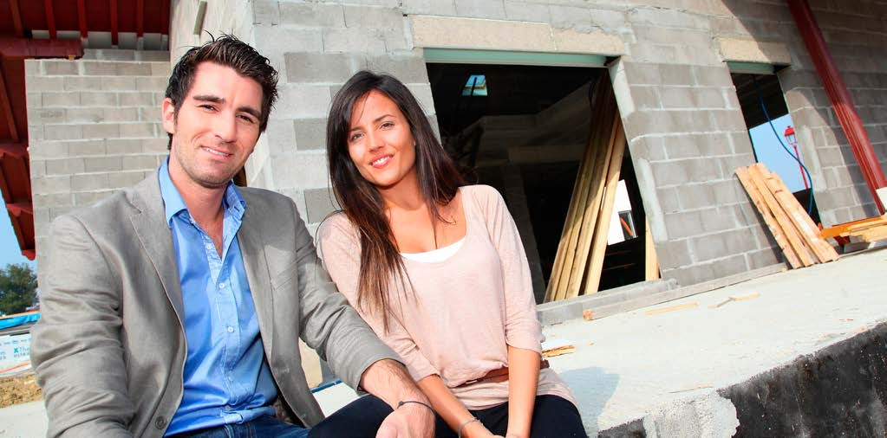

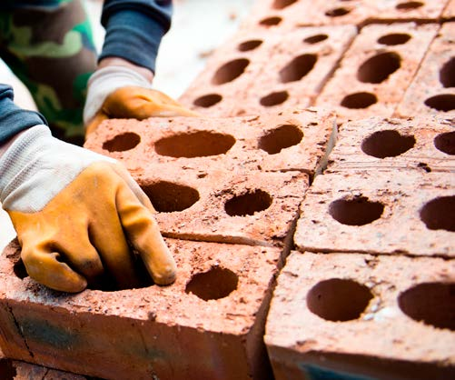

---
## Page 11

Planning and Building in Bushfire-Prone Areas for Owners and Builders
11
Case Study – 
Peter and Leah, a block 
on a new subdivision
Peter and Leah have just bought a
block of land in a new subdivision.
The developer provided the bushfire 
hazard management plan, which was 
created when the subdivision was 
planned. The plan shows the building 
area, the property’s hazard management 
area and the Bushfire Attack Level,
BAL-19, for their land. 
Peter and Leah were happy with the plan, and 
talked to their designer about the construction 
features required to meet BAL-19. Some of the 
items discussed included:
•	External cladding: Peter was free to choose 
weatherboard cladding and the designer 
incorporated bushfire-resisting boards near 
to the ground. 
•	Deck: Both Peter and Leah really wanted 
a timber deck. The designer ensured that 
non-combustible materials were incorporated 
within 300mm of the external walls.
•	Windows and doors: Leah chose to install 
special bushfire screens across the windows 
and doors instead of bushfire shutters, which 
she didn’t like the look of. The screens she 
chose were also cheaper.
There were no additional requirements for 
the foundations and roof. Gaps around the 
house were covered with mesh to prevent 
burning embers becoming caught in them. 
Their designer suggested a simple rectangular 
design as good practice to minimise the 
buildings’ exposure to flames and heat.
Peter and Leah’s bushfire hazard management 
plan also showed their hazard management area 
that had to be maintained to reduce the impact 
of bushfire on their home.
•	Higher specification glazing improves energy 
efficiency; and
•	Sarking improves thermal performance of roofs 
and helps control condensation.
Your designer should clearly show how their design 
complies with the Standard.  
3.2 Building Costs
The additional costs for a building project associated 
with building to Australian Standard 3959 depends 
on a number of factors including the type of 
construction proposed, the assessed Bushfire Attack 
Level and the other building requirements that apply.
Compliance costs will likely be more expensive for an 
elevated lightweight construction house when compared 
to a single storey, slab on ground house. The most costly 
aspects of compliance will likely be associated with gap 
and join sealing, upgraded glazing and screens.
Compliance costs need to be considered in the 
context of other aspects of the National Construction 
Code. For example, to comply with energy efficiency 
requirements many buildings will already require 
thermally efficient glazing and thermal mass.
A recent Western Australian study (Project BAL 
Build) indicates that compliance with Australian 
Standard AS 3959 increases overall building costs at 
BAL-12.5 by 3.8%, BAL-19 by 4.3% and BAL-29 by 
7.7%.  By comparison, building to BAL-40 and BAL-FZ 
was found to be much more costly, with up to 20.1% 
additional cost (noting that these higher BALs are 
rarely used in Tasmania) and are subject to additional 
regulatory requirements.

---
## Page 12

Planning and Building in Bushfire-Prone Areas for Owners and Builders
12
Your bushfire hazard management plan will 
specify an area around your building that 
is required to be kept in a low fuel state to 
prevent the spread of fire. Failure to maintain 
this area as specified can place buildings and 
lives at risk. 
A hazard management area has two important 
roles. Firstly, it is much easier and safer to defend 
your home when most flammable material close 
to your building has been removed. Secondly, 
it reduces your building’s exposure to radiant 
heat and flame contact. An example of a hazard 
management area is shown in Figure 3.
Your hazard management area must be maintained 
all year round. Some common maintenance includes: 
•	Remove selected small trees to maintain clumps 
separated by open areas, rather than continuous 
strips of vegetation;
•	Prune lower branches and shrubs; and,
•	Minimise fine fuels at ground level: mow, slash, 
and rake.
4	 Maintain your land
Hazard Management Area
• Remove selected trees
• Prune lower branches up to 2m high
• Minimise fine fuels on the ground
Unmanaged Bush/Forest
Figure 3: Hazard Management Area
Note: While you should remove all trees next 
to your buildings, retention of some trees within 
your hazard management area helps to trap 
embers and reduce wind speeds around
your building.

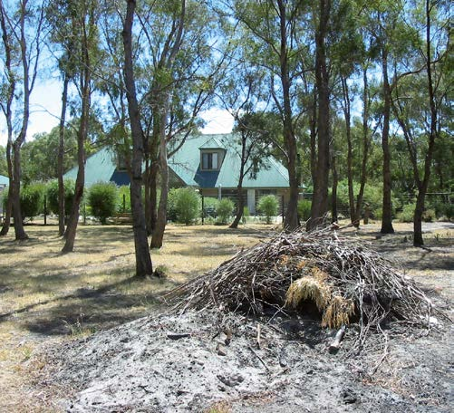

---
## Page 13

Planning and Building in Bushfire-Prone Areas for Owners and Builders
13
If you live in bushfire-prone areas then your 
home is at risk from bushfire. Most bushfires 
in Tasmania occur during relatively mild 
summer weather and are easily controlled 
by fire fighters. However, bushfires that 
break out on very hot, dry and windy days 
can spread rapidly and may be difficult or 
impossible for fire fighters to control. 
These fires can burn large areas of forest 
and farmland, destroy homes and livestock, 
and sometimes kill or injure people.
A properly prepared home is more likely to survive 
a bushfire than one that hasn’t been prepared, and 
the chances increase significantly if able-bodied 
people are there to protect your home.
While properly prepared and defended homes can 
provide a safe haven during almost all bushfires, the 
Tasmania Fire Service recommends that in most 
cases, you should not plan to defend your home 
when the Fire Danger Rating exceeds 50 (severe) in 
your area. 
The safest option always is to leave before a fire 
threatens your home. If you are not staying to 
defend your property, you need to plan to
leave early. 
5	 Prepare, act and survive
Many people have died in bushfires because they 
have tried to relocate too late, and have been 
trapped and burnt in their cars or on foot. Fewer 
lives will be lost if people who choose to leave do 
so well before a bushfire threatens their home.
It is important to prepare your Bushfire Survival 
Plan, read your Community Protection Plan 
and know your Nearby Safer Place. For more 
information, visit fire.tas.gov.au

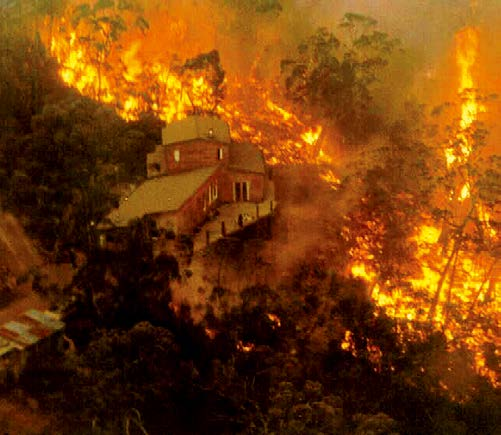

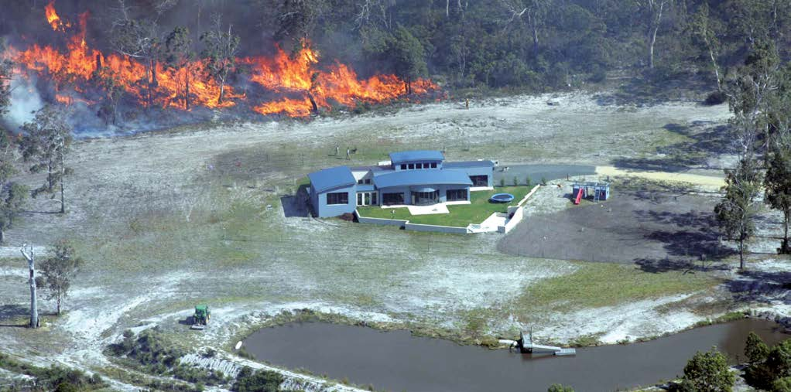

---
## Page 14

Planning and Building in Bushfire-Prone Areas for Owners and Builders
14
6	 Checklist for building in bushfire-prone areas
There is a lot to think about when planning to build anywhere, let alone in a bushfire-prone 
area. The following checklist summarises the key issues for those looking to build in 
bushfire-prone areas.
Step 1: Is your land in a bushfire-prone area? (Section 2.1) 
If you are developing land or building in a bushfire-prone area, you may need to consider 
bushfire as part of your development. 
Talk to an accredited bushfire hazard practitioner or your Council to confirm if your property is 
in a bushfire-prone area.  
Step 2: Plan and design (Sections 2.2 - 2.5) 
Decisions made about where and how you develop your property will be informed by a variety 
of factors, not least of which is managing bushfire risk. Your bushfire hazard practitioner can help 
you to balance siting, construction requirements, vegetation removal and ongoing maintenance 
considerations. 
Council will require a bushfire hazard management plan as part of the statutory
approvals process. 
Step 3: Build your new home (Section 3)
Once you have obtained the required permits you can develop your land or build your new 
home. Your building will be constructed to the Bushfire Attack Level specified on your bushfire 
hazard management plan. Any required hazard management areas will also need to be created 
prior to occupancy.  
Step 4: Move in and Maintain (Section 4) 
Congratulations! Now that you are living in your new home, your bushfire hazard management 
plan will show you how to maintain your hazard management area to protect against bushfire.  
Step 5: Prepare for Emergency (Section 5) 
Prepare your Bushfire Survival Plan. Know your Community Protection Plan and your Nearby 
Safer Place.
7	 Further Information
TFS Online (www.fire.tas.gov.au)
Further information on bushfire requirements and a list of accredited practitioners can be found in the 
‘Building for Bushfire’ section of the TFS website.

---
## Page 15

Planning and Building in Bushfire-Prone Areas for Owners and Builders
15
8	 An example of a 
bushfire hazard 
management plan
BUSHFIRE HAZARD MANAGEMENT PLAN

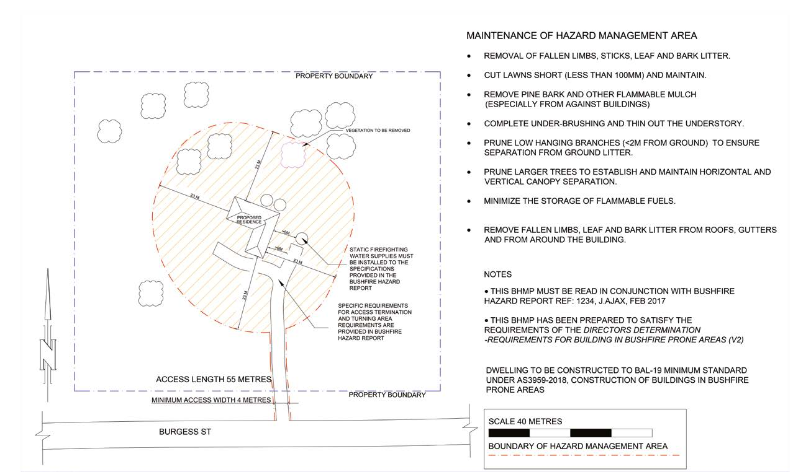

---
## Page 16

Published June 2020
Copyright State of Tasmania
ISBN 978 0 7246 5671 5
Tasmania Fire Service
fire.tas.gov.au
200233

