# TFS — Reducing Harvester Fire Risk

> **Source**: Tasmania Fire Service
> **URL**: https://www.fire.tas.gov.au/userfiles/stuartp/file/Publications/ReducingHarvesterFire%20Risk.pdf
> **Licence**: Crown copyright Tasmania; practitioner and public-information use
> **Retrieved**: 2026-05-07T13:40:50Z
> **SHA-256**: `95170c9147c0840bbedf2ba086478a5b9f79135015c65ee7ab3f47dea6253217`
> *Converted from PDF to Markdown format.*

---
## Page 1

REDUCING
HARVESTER 
FIRE RISK
THE 
BACK
POCKET
GUIDE

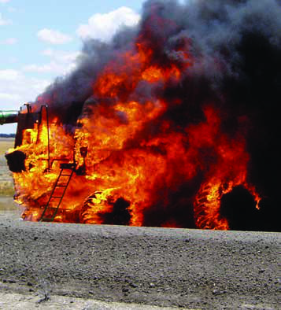

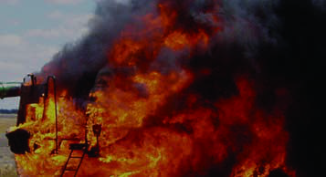

---
## Page 2

  All harvesters are prone to fi re but crop and 
machine losses can be minimised with hygiene, 
inspection and maintenance.
   Bearings, hydraulic lines and belts need to be 
closely monitored and the harvester should be 
kept free of dust and chaff accumulation.
   According to Kondinin Group research, on 
average annually, around 7% of harvesters 
will start a fi re. Of these, one in ten will 
cause signifi cant damage to the machine or 
surrounding crop.
   If you detect a fi re, face the harvester into the 
wind and evacuate promptly. 
Harvester fi res can not only damage or destroy machinery but can 
also cause considerable damage to surrounding crops and properties 
and endanger life.
GRDC – HARVESTER FIRES
2
INTRODUCTION

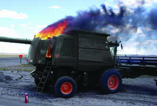

---
## Page 3

  The benefi ts extend further than reducing the fi re 
risk. A more pro-active maintenance and inspection 
programme will help reduce machinery downtime 
and prevent an expensive repair bill.
  Identifying problem areas with individual 
harvester makes and models is essential for 
controlling the fi re risk. While some machines 
are more prone than others it pays to talk 
to dealers and other farmers using similar 
machines for advice.
  Areas of increased risk include dust trap 
areas, rubbing or slipping belts or failure-prone 
bearings and should be checked more regularly.
  From the operator’s seat in the cabin it can be 
diffi cult to detect the early stages of a fi re and 
smell smoke.
   Keep all communication lines open, as other 
operators such as chaser bin drivers can alert 
the harvester driver if a problem occurs.
GRDC – HARVESTER FIRES
3
HOT TIP
If bearings start running hotter, replace them at 
the end of the day before they collapse, potentially 
posing a fi re risk and further machine damage.
If you fi nd particular bearings fail regularly, keep a 
supply of new bearings on hand, so they can be 
quickly changed over before reaching dangerous 
temperatures.

---
## Page 4

4
GRDC – HARVESTER FIRES
Harvester fire reduction checklist 3
	 1.	 Recognise the big four factors that contribute to fires: relative humidity, ambient 	
	
temperature, wind and crop type and conditions. Stop harvest when the danger is 	
extreme.
	 2.	 Focus on service, maintenance and machine hygiene at harvest on the days 	
	
more hazardous for fire. Follow systematic preparation and prevention procedures. 
	 3.	 Use every means possible to avoid the accumulation of flammable material on the 	
manifold, turbocharger or the exhaust system. Be aware of side and tailwinds that can 	
disrupt the radiator fan airblast that normally keeps the exhaust area clean. 
	 4.	 Be on the lookout for places where chafing can occur ie fuel lines, battery cables,  
hot wires, tyres, drive belts etc.

---
## Page 5

5
GRDC – HARVESTER FIRES
	 5.	 Avoid overloading electrical circuits. Don’t replace a blown fuse with a higher amperage 
one. It is your only protection against wiring damage from shorts and overloading.
	 6.	 Periodically check bearings around the front and the machine body. Use a hand-held 		
digital heat-measuring gun for temperature diagnostics on bearings, brakes etc. 
	 7.	 Drag chains, or better still drag cables or grounding conductors, may help dissipate 	
	
electrical charge but are not universally successful in all conditions. There are some 	 	
invaluable fire-suppressing options on the market. 
	 8.	 Use the battery isolation switch when the harvester is parked. Use vermin deterrents 	
in the cab and elsewhere, as vermin chew some types of electrical insulation.
	 9.	 Observe the Grassland Fire Danger Index (GFDI) protocol on high fire risk days.
	10.	 Maintain two-way or mobile phone contact with base and others. Keep an eye 	
	
out for hazards on machinery during the season.

---
## Page 6

6
GRDC – HARVESTER FIRES
This table indicates the 
maximum average wind 
speed for a given temperature 
and relative humidity level at 
GDFI 35. If wind speeds over 
those indicated occur, harvest 
operations must cease. South 
and Western Australian** 
grain harvesters must cease 
operations in these conditions 
but the guidelines are equally 
useful for other states.
** Western Australian harvest and vehicle 
movement bans are issued by local authorities.
*RH% (Relative Humidity rounded down)
†Wind speed averaged over 10 minutes
TEMP °C 
5
10
15
20
25
30
40
50
60
65
RH%*
15
31
35
38
40
43
45
49
53
56
58
20
29
33
36
38
40
43
46
50
53
55
25
27
30
33
36
38
40
44
47
50
52
30
25
28
31
33
35
37
41
44
47
49
35
23
26
28
31
33
35
38
41
44
46
40
21
24
26
28
30
32
35
39
41
43
45
19
22
24
26
28
30
33
36
39
40
TEMP °C  
5
10
15
20
25
30
40
50
60
65
RH%*
AVERAGE WIND SPEED (KPH)
2
1
3
GDFI(35) average wind speed limits
Grassland Fire Danger Index (GFDI)

---
## Page 7

7
GRDC – HARVESTER FIRES
Worked example: In accordance with the above table
1
2
3
Temp = 35º
RELATIVE HUMIDITY (RH) = 14% (Round down to 10%)
For this combination of temperature and humidity, grain harvesting 
operations must cease when the average wind speed† is greater than 26kph.
   Note: Wind-speed must be averaged over ten minutes.
Acknowledgement: CFS South Australia
Did you know
The GFDI can exceed 35 even at low temperatures 
accompanied by low humidity and high wind speeds.

---
## Page 8

8
GRDC – HARVESTER FIRES
Minimise flammable 
material
  	A rigorous clean-down regime is the 
best way to reduce fire risk. 
  	Clean-down intervals should be 
guided by visual build-up of flammable 
material which vary between crop type 
and ambient conditions. For example, 
pea crops may require a clean-down 
as often as after every grain-tank full 
to reduce fire risk.
  	While faulty bearings could still run 
hot, it is often the accumulation of 
flammable material that enables a fire 
to take hold of a machine. 
Check list
1

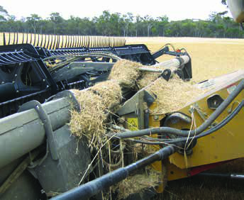

---
## Page 9

9
GRDC – HARVESTER FIRES
Start at the front
  	Always check the harvester front 
by inspecting under guarded areas, 
where dust and chaff build-up can  
go unnoticed. 
  	Pay attention to knife drive gearboxes 
which can overheat.
  	Check the bearings in the front as 
they are a common source of fire.
2

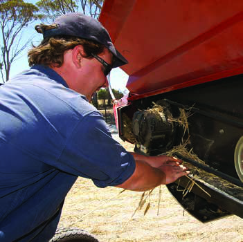

---
## Page 10

10
GRDC – HARVESTER FIRES
3
Front hydraulics
  	Dust and chaff accumulation around 
hydraulic motors are a fire risk as 
some of these components run at 
elevated temperatures. 
  	Oil, which is usually present, can 
attract dust and create a flammable 
mixture that is difficult to remove.
  	Hydraulic motors in the front will 
require degreasing periodically.

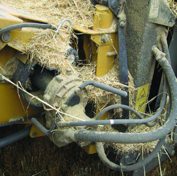

---
## Page 11

11
GRDC – HARVESTER FIRES
4
Side-panel spot-
checks
  	Frequent inspection under all panels, 
guards and covers is critical. If the 
machine is stopping for any reason 
then take a quick look for signs of 
trouble. 
  	Inspect all fuel and hydraulic lines 
thoroughly for leaks and repair these 
immediately.

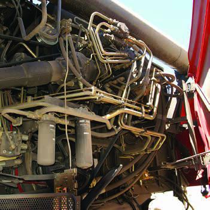

---
## Page 12

12
GRDC – HARVESTER FIRES
5
Fire lighters: Bearing 
checks
  	If a bearing was to fail and drop hot 
metal parts from above, it would 
ignite the chaff below.
  	Keep these areas free of dust and 
chaff and check bearings regularly for 
damage and/or heat increases.
  	Use an infrared thermometer to check 
the temperature of bearings and other 
moving parts (the unit pictured costs 
around $50 but could help identify a 
bearing approaching failure).

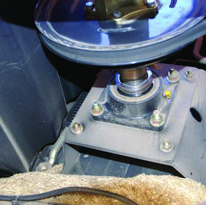

---
## Page 13

13
GRDC – HARVESTER FIRES
6
Fire lighters: Bearing 
checks
  	Point the infrared thermometer at a 
bearing or hub as pictured, with the 
red laser dot trained on the bearing. 
  	Monitor the temperature of problem 
bearings by keeping a daily 
temperature log. 
  	Some bearings run hotter  
than others. If the temperature  
of a bearing increases by more than 
50 per cent, investigate further.

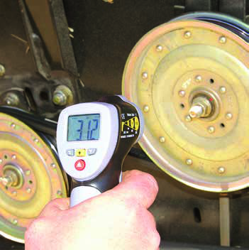

---
## Page 14

14
GRDC – HARVESTER FIRES
7
Fire lighters: Bearing 
checks 
  	The thermometer allows readings 
to be taken from a distance or while 
standing on the ground.
  	Ensure the machine is not running 
prior to opening panels and checking 
bearings.

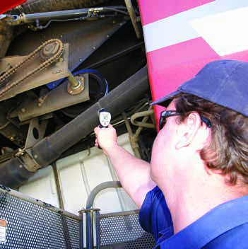

---
## Page 15

15
GRDC – HARVESTER FIRES
8
Fire lighters: Brakes 
  	Sticking or malfunctioning brakes are 
a common source of fire. 
  	Some operators inadvertently leave 
hand brakes applied. 
  	Ensure all brakes are inspected for 
overheating and are well maintained.

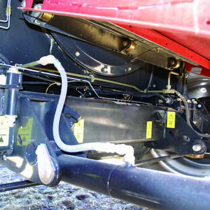

---
## Page 16

16
GRDC – HARVESTER FIRES
9
Fire lighters: Exhaust 
system
  	Keep exhaust pipes and mufflers 
clean and free of dust and chaff. 
  	When modifying exhaust pipes and 
mufflers avoid creating additional 
entrapment points. 
  	If the engine fan is directed over the 
exhaust, ensure air flow is sufficient  
to keep it clean.

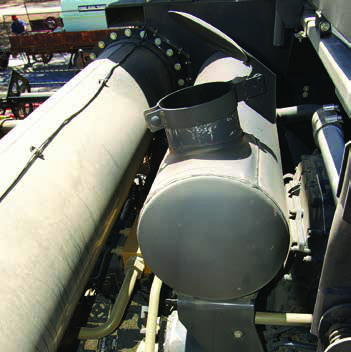

---
## Page 17

17
GRDC – HARVESTER FIRES
10
Fire lighters: Turbo-
chargers
  	Dust and chaff on exhaust manifolds 
and turbochargers is a common 
source of engine fires. 
  	Engine fans should keep manifolds 
thoroughly clean but check all 
recesses for dust accumulation. 
Some manifolds are shielded but 
dust will still settle on hot parts, with 
the shield preventing the fan from 
cleaning it away. 
  	Some heat-resistant paints will create 
a more slippery surface, which will 
assist cleaning from the fan.

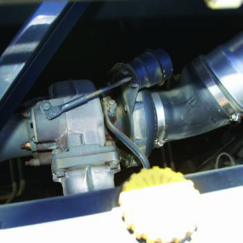

---
## Page 18

18
GRDC – HARVESTER FIRES
11
Clean-down: Get the gear
  Use a large air compressor for blowing 
down a machine but ensure the 
appropriate safety equipment (dust 
mask and eye-protection) is worn. 
  	A high-capacity air compressor with a 
long hose can clean down a machine  
in minutes.

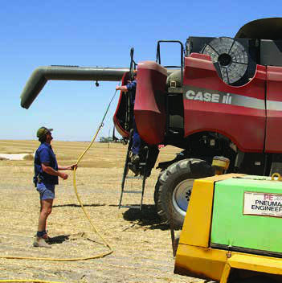

---
## Page 19

19
GRDC – HARVESTER FIRES
12
Clean-down: Top down 
approach
  	When cleaning the harvester, open 
the appropriate panels but leave the 
engine cover closed. 
  	Start at the top of the machine and 
blow out all dust and chaff. 
  	When clean, repeat the process 
with the engine cover open to 
avoid blowing excess dust into the 
enclosure.

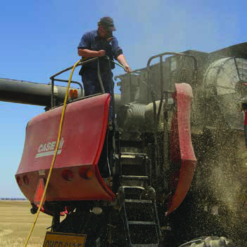

---
## Page 20

20
GRDC – HARVESTER FIRES
13
Clean-down: Working 
around
  	With the top of the harvester blown 
down, work around the machine, 
opening all panels and blowing out  
as pictured.

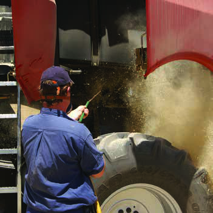

---
## Page 21

21
GRDC – HARVESTER FIRES
14
Fire control: Be prepared
  	Check all fire extinguishers are in place 
and fully charged. 
  	Familiarise all operators with correct 
procedures for extinguisher use. 
  	Always have a trailed or mobile fire-
fighting unit on-hand ready in accordance 
with shire or state regulations.
  	Integrated fire suppression systems for 
harvesters are worth considering.
  	Powder extinguishers must be 
recharged whenever partly used as 
powder will settle on the seal and partly 
used extinguishers will lose pressure.

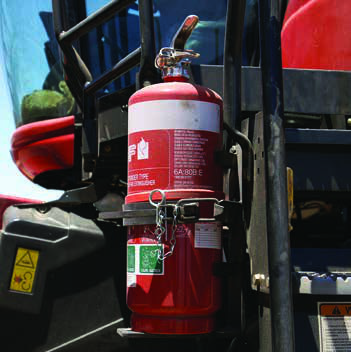

---
## Page 22

22
GRDC – HARVESTER FIRES
Fire control: Extinguishers
Class
Type of fire
Extinguisher type 
Water
Foam
Powder 
ABE*
Powder 
BE*
Carbon 
Dioxide
Vaporising 
liquid
Wet 
Chemical
A
Wood, paper, plastics
3
3
3
7
Limited
3
3
B
Flammable and combustible liquids
7
3
3
3
Limited
Limited
7
C
Flammable gases
7
7
3
3
Limited
Limited
7
E
Electrical fires
7
7
3
3
3
3
7
F
Cooking oils and fats
7
Limited
7
Limited
Limited
Limited
3
*Tip powder extinguishers upside down every six months to prevent powder settling. If there is a thumping sound, powder has clumped and will not pass through the nozzle.

---
## Page 23

23
GRDC – HARVESTER FIRES
  	Note your local Fire, SES and Hospital numbers or UHF channels here 
for quick access.
Emergency contacts
Name of Emergency Dept
Contact Number or UHF channel
FIRE
LOCAL HOSPITAL
SES

---
## Page 24

DISCLAIMER: Any recommendations, suggestions or opinions contained in this publication do not necessarily 
represent the policy or views of the Grains Research and Development Corporation (GRDC). No person should 
act on the basis of the contents of this publication without first obtaining specific, independent professional 
advice. The Corporation and contributors to this Back Pocket Guide may identify products by proprietary or trade 
names to help readers identify particular types of products. We do not endorse or recommend the products of 
any manufacturer referred to. Other products may perform as well as or better than those specifically referred 
to. The GRDC will not be liable for any loss, damage, cost or expense incurred or arising by reason of any person 
using or relying on the information in this publication. will not be liable for any loss, damage, cost or expense 
incurred or arising by reason of any person using or relying on the information in this publication.
Copyright:  © All material published in The Back Pocket Guide is copyright protected and may not be  
reproduced in any form without written permission from the GRDC and Kondinin Group. 	                 June 2013
Maureen Cribb, 
GRDC Publishing Manager
T:  02 6166 4500 
E:  maureen.cribb@grdc.com.au
ACKNOWLEDGEMENTS:  Josh Giumelli, Norm Jenzen
USEFUL RESOURCES:
National
www.grdc.com.au
Southern Region
www.cfs.sa.gov.au/public/download.jsp?id=1173
FOR FURTHER INFORMATION: 
Ben White
T:  0407 941 923 
E:  ben.white@kondinin.com.au
Dr Graeme Quick
T:  (07) 5494 9920 
E:  g.quick@bigpond.com
GROUND COVER DIRECT  How to order
Free phone: 1800 11 00 44   Free fax: 1800 00 99 88
Email:  ground-cover-direct@canprint.com.au
Post:  Ground Cover Direct is PO Box 7456, Canberra MC, ACT 2610
For a complete listing of all GRDC publications, go to www.grdc.com.au/bookshop
Reducing Harvester Fire Risk Back Pocket Guide is part of a 
series of Back Pocket Guides published by the GRDC.
Photos courtesy Kondinin Group unless otherwise specified.

