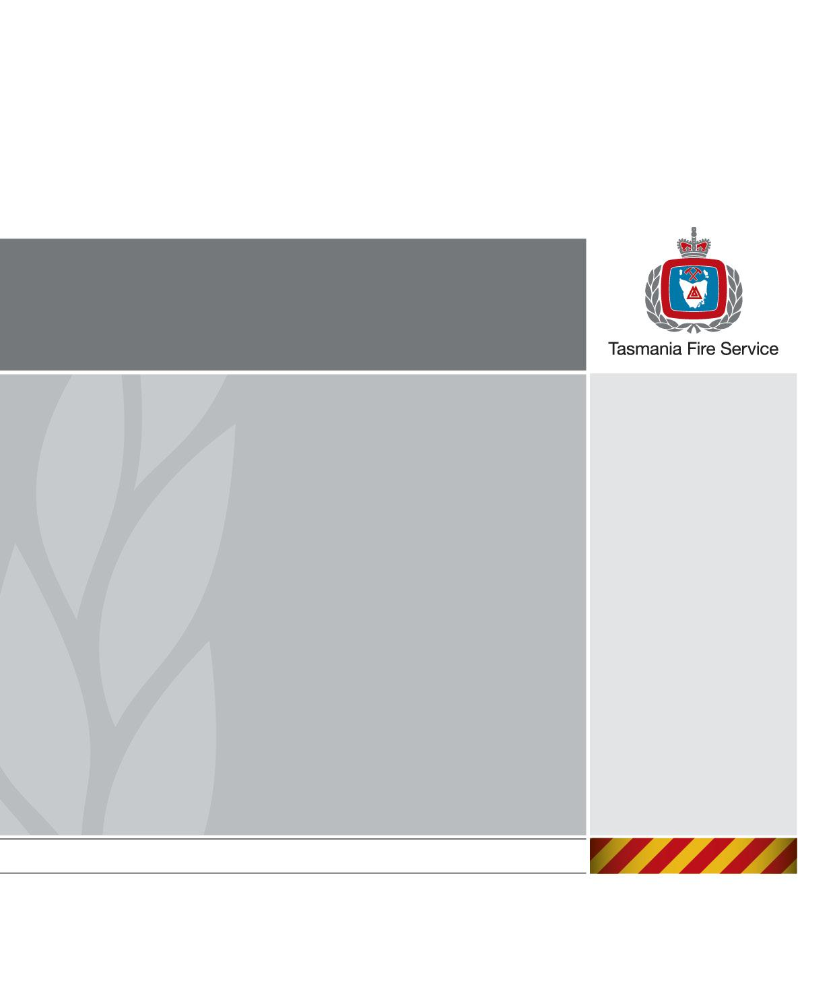

# TFS State Bushfire Safety Policy (SFC 04/14) (2014)

> **Source**: Tasmania Fire Service / State Fire Commission
> **URL**: https://www.fire.tas.gov.au/userfiles/stuartp/file/Miscellaneous/SFC_04_14_StateBushfireSafetyPolicy.pdf
> **Licence**: Crown copyright Tasmania; practitioner and public-information use
> **Retrieved**: 2026-05-07T13:40:45Z
> **SHA-256**: `d4524aaa0f71eaef915e90055938647d846d6ec74704821a3c28669b00b40419`
> *Converted from PDF to Markdown format.*

---
## Page 1

State State Fire Commission 
Fire Comssion 
Version: 1.0 
Copy: Uncontrolled 
 
 
 
 
State Bushfire Safety Policy
State Fire Commission

---
## Page 2

State Fire Commission 
Applicability: 
Wide 
State Bushfire Safety Policy 
SFC 04/14 
Issue Date: 
27 June 2014 
Status:  
Approved 
Revision Date: 
01 April 2015 
Page:  
2 of 21 
Version: 
1.0 
 
Acknowledgements 
The contribution of information used in this policy from the following individuals and organisations 
is gratefully acknowledged: 
Parks and Wildlife Service – Tasmania, Forestry Tasmania, Tasmania Police, State Emergency 
Service (Tas), Department of Premier and Cabinet (Tas), The Australasian Fire and Emergency 
Service Authorities Council, the Fire Services Commissioner Victoria, the Local Government 
Association of Tasmania, and the Forest Fire Management Group. 
 
Document Acceptance and Release Notice 
This document is Version 1.0 27-06-2014 of the State Bushfire Safety Policy. 
The State Bushfire Safety Policy is a managed document. For identification of amendments, each 
page contains a release number and a page number. Changes will only be issued as complete 
replacement. Recipients should remove superseded versions from circulation. This document is 
authorised for release once all signatures have been obtained. 
 
 
PREPARED: 
 
Date: 
27 
- 06 
- 14 
(for 
acceptance) 
N. Wilson, Manager - Policy and Doctrine 
Tasmania Fire Service 
 
 
 
 
 
 
 
 
 
ACCEPTED: 
 
Date: 
27  - 06 
- 14 
(for approval) 
M.W. Brown AFSM, Chief Officer 
Tasmania Fire Service 
On behalf of the  
State Fire Commission

---
## Page 3

State Fire Commission 
Applicability: 
Wide 
State Bushfire Safety Policy 
SFC 04/14 
Issue Date: 
27 June 2014 
Status:  
Approved 
Revision Date: 
01 April 2015 
Page:  
3 of 21 
Version: 
1.0 
 
 
 
 
 
Table of Contents 
1 Introduction .................................................................................. 5 
 
1.1 Purpose ........................................................................................................................... 5 
1.2 Aim .................................................................................................................................. 5 
1.3 Authority .......................................................................................................................... 5 
1.4 Scope .............................................................................................................................. 6 
1.5 Linkages .......................................................................................................................... 6 
 
2 Background and Context ............................................................ 7 
 
2.1 Background ...................................................................................................................... 7 
2.2 Context ............................................................................................................................ 8 
 
3 Community Awareness and Understanding ............................. 9 
 
3.1 Introduction ...................................................................................................................... 9 
3.2 Education and Awareness ............................................................................................... 9 
3.3 Recognising Community Diversity .................................................................................... 9 
3.4 Policy Objectives ............................................................................................................ 10 
 
4 Community Resilience .............................................................. 11 
 
4.1 Introduction .................................................................................................................... 11 
4.2 Community Bushfire Planning ........................................................................................ 11 
4.3 Land Use and Development Strategies .......................................................................... 12 
4.4 Landscape and Vegetation Management Strategies ...................................................... 12 
4.5 Policy Objectives ............................................................................................................ 13 
 
5 Bushfire Warnings ..................................................................... 14 
 
5.1 Introduction .................................................................................................................... 14 
5.2 Advice about Fire Danger .............................................................................................. 14 
5.3 Bushfire Alerts ............................................................................................................... 15 
5.4 Policy Objectives ............................................................................................................ 16

---
## Page 4

State Fire Commission 
Applicability: 
Wide 
State Bushfire Safety Policy 
SFC 04/14 
Issue Date: 
27 June 2014 
Status:  
Approved 
Revision Date: 
01 April 2015 
Page:  
4 of 21 
Version: 
1.0 
 
 
 
6 Bushfire Safety Options ............................................................ 17 
 
6.1 Introduction .................................................................................................................... 17 
6.2 Leave Early .................................................................................................................... 17 
6.3 Stay and Defend ............................................................................................................ 18 
6.4 Bushfire Shelter Options ................................................................................................ 19 
6.5 Evacuation ..................................................................................................................... 20 
6.6 Policy Objectives ............................................................................................................ 20 
 
7 Policy Administration ................................................................ 21

---
## Page 5

 
Introduction 
Applicability: 
Wide 
State Bushfire Safety Policy 
SFC 04/14 
Issue Date: 
27 June 2014 
Status:  
Approved 
Revision Date: 
01 April 2015 
Page:  
5 of 21 
Version: 
1.0 
 
1  Introduction 
1.1  Purpose 
The State Bushfire Safety Policy is a high-level management policy that provides guidance to 
government, agencies and other stakeholders in the development of strategic initiatives to enhance the 
safety and resilience of the community from bushfires. 
1.2  Aim 
The State Bushfire Safety Policy aims to guide government, agencies and other stakeholders in the 
development of policies and plans that: 
 
recognise the shared responsibility for bushfire safety between the State Government, local 
governments, emergency and land management agencies, communities and individuals; 
 
increase community knowledge of and preparedness for bushfire risk, thereby informing the 
development of action plans to address such risk; 
 
support and improve local bushfire safety planning that tailors management of risk to the needs of 
the individual community; and 
 
ensure a safe response to bushfires by households and individuals in identifying bushfire safety 
options to maximise the likelihood of survival.  
1.3  Authority 
The Chief Officer of the Tasmania Fire Service (TFS) is responsible for the development, implementation 
and review of the State Bushfire Safety Policy on behalf of the State Fire Commission (SFC). 
The Chief Officer will review and evaluate the policy after each bushfire season. The review will take into 
account the experiences and lessons from previous seasons together with stakeholder views, 
performance indicators and research relevant to bushfire safety. Feedback from the community for the 
development and implementation of bushfire risk mitigation strategies is vital in ensuring a responsive 
and adaptive policy. 
The policy acknowledges the numerous and diverse range of agencies and stakeholders that collectively 
seek to address bushfire risk. It is imperative that parties with responsibilities in mitigating bushfire risk 
work with each other and the Tasmanian community to identify methods and strategies pertinent to this 
policy.

---
## Page 6

 
Introduction 
Applicability: 
Wide 
State Bushfire Safety Policy 
SFC 04/14 
Issue Date: 
27 June 2014 
Status:  
Approved 
Revision Date: 
01 April 2015 
Page:  
6 of 21 
Version: 
1.0 
 
1.4  Scope  
The State Bushfire Safety Policy provides guidance and a framework that government, agencies and 
other stakeholders must work towards to increase community safety and resilience from bushfires in 
Tasmania. By taking a principles-based approach, this policy aims to guide organisational policies, 
programs and plans for action. Specifically, the policy identifies four strategic pillars that government, 
agencies and stakeholders should use to focus singular and multi-agency efforts in addressing bushfire 
safety. These are: 
 
Community Awareness and Understanding 
 
Community Resilience 
 
Bushfire Warnings 
 
Bushfire Safety Options 
The State Bushfire Safety Policy promotes a framework of community engagement and risk-awareness, 
education and capacity-building to deliver a range of safety options. It does not seek to address agency 
responsibilities in relation to land management, infrastructure development and design, vegetation 
management, response or recovery – which are also important considerations in managing bushfire in 
Tasmania. 
The underpinning principle is the protection of life.  
1.5  Linkages 
The State Bushfire Safety Policy is a position statement under the State Fire Protection Plan (SFPP) as 
defined in Section 8 (d) of the Fire Service Act 1979. It is consistent with the Australasian Fire and 
Emergency Service Authorities Council’s (AFAC) position Bushfire and Community Safety (2012) and the 
Commonwealth Government’s National Strategy for Disaster Resilience (2012). Additionally, this policy is 
aligned with the National Framework for Advice and Warnings to the Community (2009) and the Forest 
Fire Management Group’s (FFMG) National Bushfire Management Policy Statement for Forests and 
Rangelands (2012). The Victorian Fire Services Commissioner publication Bushfire Safety Policy 
Framework (2013) is acknowledged as a reference.  
This policy reflects and draws upon the findings of the 2009 Victorian Bushfires Royal Commission 
(VBRC), AFAC’s Audit-Review: The Tasmanian Fires of January 2013 and the Tasmanian Bushfires 
Inquiry (2013). The Auditor-General Special Report No. 99 Bushfire Management (2011) is 
acknowledged in providing previous recommendations that guided policy development. 
This policy should be read in conjunction with the SFPP where agency responsibilities specific to fire 
management are further described. Additionally inter-agency protocols between emergency management 
agencies and land management agencies, emergency management plans and business continuity plans 
all provide further detail on bushfire arrangements. The Fire Service Act 1979 and the Tasmanian 
Emergency Management Plan (TEMP) provide legislative authority and associated responsibilities 
respectively.

---
## Page 7

 
Background and Context 
Applicability: 
Wide 
State Bushfire Safety Policy 
SFC 04/14 
Issue Date: 
27 June 2014 
Status:  
Approved 
Revision Date: 
01 April 2015 
Page:  
7 of 21 
Version: 
1.0 
 
2   Background and Context 
2.1  Background 
Bushfire has been a constant and natural phenomenon in Australia for many thousands of years. South-
eastern Australia, including Tasmania, is particularly prone to fire and is regarded as one of the most 
bushfire-affected regions in the world. Fire is an important and natural component in the management 
and renewal of biodiversity and habitat. If uncontrolled, however, its effects can be catastrophic. 
Since European settlement, Tasmania has experienced periodic bushfire events that have caused 
devastating loss to life and property. To manage this risk, agencies have been created to prepare for and 
respond to bushfires in order to ensure the safety and well-being of the community. While the protection 
of life has always been the underpinning principle in addressing bushfire safety, agencies have 
traditionally focussed on prevention and suppression activities. More recently, however, bushfire events 
in south-eastern Australia have seen this approach adapted to recognise the significant role of the 
community in building a safe and resilient framework.  
On 7 February 2009, Victoria experienced the worst bushfires in Australia’s recorded history. One 
hundred and seventy-three people lost their lives and many others were seriously injured. Approximately 
78 communities were directly impacted, and many were left in a state of devastation. The VBRC was 
established to investigate the fires, releasing its final report in July 2010. Recognising the inherent 
similarities between Victoria and Tasmania in dealing with bushfire risk, the Tasmanian Government 
accepted or accepted in principle 65 recommendations from the VBRC report, including five specific to 
bushfire safety policy, as follows: 
 
The State revises its bushfire safety policy, adopting the national ‘Prepare. Act. Survive’ 
methodology. 
 
The State revises its approach to community bushfire safety education. 
 
The State establishes mechanisms for helping municipal councils to undertake local planning that 
tailors safety options to individual communities. 
 
The State introduces comprehensive shelter options. 
 
The State introduces a comprehensive approach to evacuation. 
In January 2013, Tasmania experienced its worst bushfire event since the 1967 Black Tuesday fires. 
Thousands of hectares were burned, community infrastructure was lost and over 200 buildings destroyed. 
AFAC conducted an audit-review into the management of these fires, and the Tasmanian Government 
commissioned the Tasmanian Bushfires Inquiry. The findings of both supported the development of a 
Tasmanian bushfire safety policy that clearly articulates objectives and policy statements to guide inter-
agency and stakeholder engagement, inclusive of the community, for shared responsibility of bushfire 
risk. 
This policy has been developed from the common principles agreed to by AFAC and member agencies. It 
reflects the complexities of bushfires, the diverse and differing needs of the Tasmanian community and 
the need for governments, agencies and stakeholders to work collaboratively in addressing bushfire risk.

---
## Page 8

 
Background and Context 
Applicability: 
Wide 
State Bushfire Safety Policy 
SFC 04/14 
Issue Date: 
27 June 2014 
Status:  
Approved 
Revision Date: 
01 April 2015 
Page:  
8 of 21 
Version: 
1.0 
 
2.2  Context 
The principles that underpin the State Bushfire Safety Policy reflect the accepted recommendations from 
the 2009 Victorian Bushfires Royal Commission (VBRC) and the Tasmanian Bushfires Inquiry 2013; and 
are aligned with AFAC Position, Bushfires and Community Safety (2012). The principles that are 
important in guiding the application of the policy are: 
 
Bushfires are a common and normal occurrence. 
 
The protection of human life is paramount. 
 
The management of risk is fundamental to bushfire safety; however, bushfire risk can never be 
completely removed. 
 
Bushfire safety is a shared responsibility between the government, agencies and other 
stakeholders. 
 
Householders and individuals are ultimately responsible for determining their course of action in a 
bushfire. 
 
The State Government has a responsibility to prepare for, prevent, mitigate and respond to 
bushfires and subsequent recovery operations. However, in some circumstances TFS and other 
emergency management agencies will not be able to protect all persons or property from 
bushfire. 
 
Every bushfire is different and responses are shaped by dynamic and complex events. Not all 
homes or other structures are defendable, and no single universal action exists to guarantee 
safety. 
 
The State Government has a responsibility to help individuals and communities to better 
understand and assess bushfire risk, including the provision of planning assistance at the local 
municipal level when required.  
 
A comprehensive approach to bushfire safety is underpinned by people having access to multiple 
safety and shelter options, but all involve varying degrees of danger. 
 
The safest option is leaving the bushfire risk area well ahead of the fire igniting. 
 
All Tasmanians should seek to understand their personal bushfire risk and undertake measures 
to mitigate their exposure to it.  
 
Bushfire safety information and alerts must acknowledge community diversity and allow for non-
residents and transient populations to make informed decisions.

---
## Page 9

 
Community Awareness and Understanding 
Applicability: 
Wide 
State Bushfire Safety Policy 
SFC 04/14 
Issue Date: 
27 June 2014 
Status:  
Approved 
Revision Date: 
01 April 2015 
Page:  
9 of 21 
Version: 
1.0 
 
3  Community Awareness and Understanding 
3.1  Introduction 
The government, agencies and other stakeholders have important roles in engaging with the community 
to increase knowledge, awareness and understanding of bushfire risks and how to manage those risks. 
Community engagement must be a shared responsibility between agencies driven by the objective to 
ensure communities and individuals can make informed choices in the face of bushfire. The intent of 
engagement is to change behaviour, increase preparedness and grow resilience through awareness and 
understanding. 
3.2  Education and Awareness 
Advice provided to individuals and communities about bushfire risk must be clear and relevant to situation 
and context. Efforts to inform and educate the community should focus on the different types of 
conditions that may be experienced and the possible consequences of staying in a high-risk area. 
Tailored community education initiatives should focus on local considerations pertinent to the region such 
as topography, vegetation and weather patterns. This will increase local understanding of how such 
conditions influence bushfire behaviour, and it will assist with community planning and informed decision-
making by individuals and households. Communities should also be informed about the careful use of fire 
and common causes of accidental fires; these include planned burns, machinery and campfires. 
Education and awareness initiatives should occur primarily before and during the bushfire season. This 
promotes relevant and timely safety messages and provides up-to-date information about the bushfire 
risk, bushfire behaviour and local planning considerations. Communities – with assistance from TFS and 
other agencies – should then refine local response options and bushfire planning schemes. Individuals 
and households, schools, hospitals, aged care homes and other facilities assessed as vulnerable should 
be actively encouraged to assess their personal safety and prepare a bushfire plan.  
3.3  Recognising Community Diversity 
3.3.1 Multi-faceted approach 
Approaches to community education should be designed to meet the needs of diverse audiences 
including households, local community groups, tourists, school children, cultural and linguistically-diverse 
communities, and people with special needs. Age, infirmity, social isolation and mental or physical 
disability are also factors that must be considered. An integrated approach using an appropriate mix of 
broad-based media, official websites, social media and locally-delivered engagement and education 
programs is essential to engage as much of the community as possible. 
3.3.2 Transient populations 
During the summer months Tasmania enjoys a healthy tourism industry from visitors and holiday-makers. 
Small towns and communities across the state may experience significant population expansion during 
the time that historically coincides with the major bushfire season. Advice and information campaigns

---
## Page 10

 
Community Awareness and Understanding 
Applicability: 
Wide 
State Bushfire Safety Policy 
SFC 04/14 
Issue Date: 
27 June 2014 
Status:  
Approved 
Revision Date: 
01 April 2015 
Page:  
10 of 21 
Version: 
1.0 
 
must allow for this demographic as visitors are likely to be unaware of local bushfire risks and appropriate 
responses to take during a bushfire threat. Tailored information packages should be given to service 
providers such as local tourism information centres, real estate agents, hotels and caravan park 
operators to ensure holiday-makers and tourists are aware of bushfire risks and the actions that should 
be taken to preserve life in the event of bushfire. 
3.3.3 Vulnerable people 
Increased vulnerability is not just reserved for visitors. There are many reasons why people in the 
community can be at greater risk during a bushfire event. Age, frailty, physical or mental impairment, 
social isolation, illness, injury, cultural or linguistic diversity, or lack of preparedness for bushfire can 
expose individuals to greater risk from the impacts of bushfire. Agencies and organisations that provide 
services to such groups should work with TFS and emergency management planners to identify people in 
the community at risk and then prompt their clients to develop personal or household bushfire survival 
plans. Where possible, a tailored education and bushfire planning package should be developed specific 
to this target audience.  
3.3.4 Pets and livestock 
Pets and livestock remain the responsibility of the owner in times of bushfire; however it is important to 
note the significant influence they may have on people’s decisions. Information needs to take account of 
owner attachment to pets and livestock, ensuring that communities and householders are provided with 
practical advice about how animals can be dealt with in the event of bushfire. Owners should be 
encouraged to plan for the early relocation of pets and livestock based on fire danger ratings to places 
where bushfire risk is lower. If leaving early is not practical or possible, relative ‘safe zones’ on properties 
should be identified within individual household bushfire survival plans. The reality, however, is that 
owners may need to face the very real prospect of leaving animals behind or setting them free.  
3.4  Policy Objectives 
Diverse and multi-agency bushfire education initiatives contribute to an informed and responsible 
community that is aware of bushfire risk and can prepare for and respond to a bushfire event. 
Governments, agencies and stakeholders work with the community care sector and tourism providers to 
ensure bushfire safety information and education initiatives meet the needs of diverse communities, 
groups and individuals.  
Governments, agencies, community groups, community service providers and the aged care sector work 
together in identifying and assisting vulnerable and ‘at risk’ individuals and groups in the development of 
bushfire safety plans and business continuity plans. 
A broad range of information sources and media deliver timely and relevant bushfire information to a 
diverse population.

---
## Page 11

 
Community Resilience 
Applicability: 
Wide 
State Bushfire Safety Policy 
SFC 04/14 
Issue Date: 
27 June 2014 
Status:  
Approved 
Revision Date: 
01 April 2015 
Page:  
11 of 21 
Version: 
1.0 
 
4  Community Resilience 
4.1  Introduction 
A strong, resilient and bushfire-ready community provides the foundation for a successful bushfire safety 
approach. Whilst bushfire safety remains a collective responsibility between all stakeholders, the benefits 
of strong community leadership and knowledge, networking and local support arrangements cannot be 
overstated. Communities and households that are enabled to undertake their own bushfire safety 
planning – with assistance from agencies – are far more likely to succeed in the face of a bushfire event. 
There is no substitute for local knowledge or community-based leadership; as such, community-lead 
bushfire safety planning is a primary objective of this policy framework. 
4.2  Community Bushfire Planning  
Enabling community bushfire planning is essential to building a resilient population. There is no substitute 
for local knowledge in helping to evaluate bushfire risk, and agencies should engage stakeholders and 
communities in the development of strategies that reduce the likelihood and impact of a bushfire event. 
With knowledge and assistance, decisions relating to bushfire treatment and the management of bushfire 
risk can be made in advance. However, it should be recognised that the implementation of such decisions 
may take longer than anticipated or that being in or near a bushfire may affect decision-making 
processes. Facilitated planning and practicing of community and household bushfire plans is therefore 
essential.  
Specifically, community protection planning facilitates interaction between emergency management 
agencies, local governments, key stakeholders and communities to develop options for managing 
bushfire risk. Community protection planning focusses on the local environment within which a 
community exists; it includes an assessment of physical risk, environmental constraints, geography, 
possible safety and shelter options and response strategies. Community protection planning can be 
broadly configured into three categories, as follows: 
 
Community Bushfire Protection Plans. These are plans for community members and visitors to 
assist with bushfire preparation and survival. They should contextualise bushfire risk to the local 
setting, thereby facilitating informed bushfire survival planning. 
 
Community Bushfire Response Plans. These are response plans for emergency managers to 
better protect communities during bushfire emergencies. They identify operational priorities 
including the location of likely vulnerable people or groups, valuable community assets that will 
assist in post-fire recovery, safe access and egress routes, primary hazards and water supplies.  
 
Community Bushfire Mitigation Plans. These plans focus on addressing local bushfire hazards 
and improving the survivability of communities and assets. These plans are developed through a 
system of coordinated agreement between agencies, local governments, Fire Management Area 
Committees (FMACs) and landowners to identify and reduce bushfire hazards.

---
## Page 12

 
Community Resilience 
Applicability: 
Wide 
State Bushfire Safety Policy 
SFC 04/14 
Issue Date: 
27 June 2014 
Status:  
Approved 
Revision Date: 
01 April 2015 
Page:  
12 of 21 
Version: 
1.0 
 
4.3  Land Use and Development Strategies 
 
Whilst community protection planning focusses on local mitigation and response actions, a strategic focus 
to bushfire risk planning is also essential. Land use planning provides a range of effective mitigation 
strategies through the inclusion of bushfire risk into strategic plans, appropriate land zoning, development 
planning and application building standards. State and local planning authorities apply these controls to 
shape settlement patterns and reduce the likelihood of bushfire hazard to developments. The intent of 
this approach is to deliver long-term community safety outcomes by reducing community exposure to 
bushfire risk. 
 
An adaptive approach to land use planning by state and local authorities to pre-empt the changing nature 
of land use and fuel build-up is highly encouraged. Agencies and local government with planning 
approval delegations should apply bushfire-safe principles to mitigate the risk of bushfire to a new 
development or changing demographic, rather than taking a localised or single structure view. Similarly, 
internal bushfire risk mitigation strategies must be applied by appropriate agencies to ensure future 
resilience in both governance and service provision to the community should a bushfire occur. A multi-
agency, whole-of-government outlook on what constitutes ‘best practice’ initiatives for sustainable 
development proposals in areas where bushfire risk cannot be adequately mitigated must be 
encouraged. 
4.4  Landscape and Vegetation Management Strategies 
In a similar vein to land use planning, hazard reduction and vegetation management are key tools in 
mitigating bushfire-related risk in Tasmania. Whilst it is acknowledged that many agencies and 
stakeholders actively undertake seasonal burning to reduce bushfire risk, a statewide coordinated 
approach to vegetation and landscape management is necessary to ensure best-practice methods are 
applied appropriately to local circumstances. The importance of applying a consistent and tested bushfire 
risk model cannot be overstated. 
As defined within the Fire Service Act 1979, the State Fire Management Council (SFMC) is the primary 
advisory body that provides government, agencies and stakeholders the strategic direction for planned 
landscape-scale vegetation management and burning. The SFMC oversees the development of a state 
vegetation fire management policy through the facilitation of a statewide forum. This initiative is designed 
to guide the function of regional Fire Management Area Committees (FMACs) in developing strategies for 
tenure-blind fire protection through fuel management planning and implementation. This serves to 
promote community understanding of bushfire risk and associated land management mitigation 
strategies. The regional approach also encourages coordination between stakeholders to invest in 
research and improvement in the management of bushfire-related risk. 
Importantly, the SFMC reinforces the principle of shared responsibility across governments, agencies and 
stakeholders. By providing the strategic objectives in addressing bushfire risk and vegetation 
management, the SFMC acts as a facilitator in preparing regional fire protection plans that assist in 
determining the priorities for community protection planning and the development of bushfire-ready 
neighbourhoods. Active involvement by all stakeholders in SFMC (and FMAC) activities is essential for a 
consolidated approach to strategic landscape fuel management.

---
## Page 13

 
Community Resilience 
Applicability: 
Wide 
State Bushfire Safety Policy 
SFC 04/14 
Issue Date: 
27 June 2014 
Status:  
Approved 
Revision Date: 
01 April 2015 
Page:  
13 of 21 
Version: 
1.0 
 
4.5  Policy Objectives 
Individuals and households are engaged and encouraged to develop personal bushfire survival plans that 
include (and are integrated with) a range of community-based contingency options. 
Governments and agencies assist and empower communities and stakeholders to develop and maintain 
community fire protection plans appropriate to local circumstances. 
Community resilience is enhanced by applying bushfire risk assessment techniques to land use and 
development applications. 
Strategic landscape fire management planning and hazard reduction planning is cooperatively 
undertaken between governments, agencies, communities and stakeholders to enhance community 
resilience through the application of best-practice vegetation management.

---
## Page 14

 
Bushfire Warnings 
Applicability: 
Wide 
State Bushfire Safety Policy 
SFC 04/14 
Issue Date: 
27 June 2014 
Status:  
Approved 
Revision Date: 
01 April 2015 
Page:  
14 of 21 
Version: 
1.0 
 
5  Bushfire Warnings 
5.1  Introduction 
The provision of advice and alerts about bushfires is essential where community action is necessary to 
protect lives and property. Timely advice and alerts help individuals and communities to understand the 
level of bushfire danger, promote informed decision-making and enhance personal safety through 
decisive action in the face of fire. Advice and alerts about bushfires – when heeded and acted upon in a 
timely manner – can significantly reduce community exposure to bushfire risk. 
5.2  Advice about Fire Danger 
Tasmania utilises the national fire danger rating system, which provides advice to the community on the 
levels of forecast fire danger; including how a fire is likely to behave once it starts and how difficult it may 
be to extinguish. Each day during the bushfire danger period, the Bureau of Meteorology (BoM) forecasts 
the fire danger index on which fire danger ratings are based. This may be up to four days in advance so 
as to elicit an informed and appropriate response by the community. It is essential that advice is widely 
disseminated, clearly visible and accessible across a broad range of media. 
The nationally-agreed fire danger ratings are as follows: 
 
Catastrophic. This is the worst conditions for a bushfire possible. Homes and other structures are 
not designed to withstand these conditions; the safest place is away from the bushfire area. 
 
Extreme. Extreme conditions are likely. If a bushfire starts, it will be uncontrollable. Consider 
staying with the property only if preparation and construction is at the highest level as unprepared 
properties are likely to be destroyed. 
 
Severe. Hot, dry and possibly windy conditions are likely. Bushfires may be uncontrollable if they 
start, so awareness of local conditions is essential. 
 
Very High. Conditions are favourable for fire, and fires may be difficult to control. Well-prepared 
and actively defended homes may provide safety. If plans do not include defending the property, 
leave early. 
 
High. Fire may be controllable if accessible and in some fuels. People should be encouraged to 
check bushfire survival plans and be prepared for loss of some essential services if a fire 
eventuates. If plans do not include defending the property, prepare to leave for a safe place in the 
event of fire. 
 
Low–moderate. Fires that break out can be easily controlled. Whilst there is little risk to property 
or life, people should be encouraged to monitor for any changes that may occur. 
Total Fire Bans (TFB) should not be viewed in the same context as fire danger ratings. Supported by 
legislation, a TFB is not advice, but mandatory direction that restricts what activities can or cannot occur 
in a particular district for a prescribed period of time. TFB seek to reduce activities that may start a fire, 
and they mandate extinguishment of any fires that are alight.

---
## Page 15

 
Bushfire Warnings 
Applicability: 
Wide 
State Bushfire Safety Policy 
SFC 04/14 
Issue Date: 
27 June 2014 
Status:  
Approved 
Revision Date: 
01 April 2015 
Page:  
15 of 21 
Version: 
1.0 
 
5.3  Bushfire Alerts 
In contrast to advice, bushfire alerts inform the community of an impending or current threat from a fire 
that has already started. With the aim to produce an appropriate response from the community, bushfire 
alerts should be specific, as brief as possible and unambiguous. They should cover information such as 
the location, level and timeframe of threat, and a recommendation for action. Whilst alerts are most 
effective when delivered to an informed and prepared community, they must cater for the under-prepared 
with survival information that aims to preserve life. Ideally, alerts must be capable of reaching every 
member of the community. 
Consistent with nationally-agreed arrangements, there are three levels of bushfire alerts, each increasing 
in importance and urgency for action:  
 
Advice. A bushfire has started and general information is provided to keep individuals, 
households and communities up-to-date with developments. 
 
Watch and Act. A bushfire is approaching and conditions are changing. Individuals, households 
and communities need to monitor their development and start taking action to ensure safety 
should the threat escalate.  
 
Emergency Warning. Individuals, households and communities will be impacted by bushfire and 
are in imminent danger. Action must be taken immediately.  
Fire safety education programs must ensure people are aware of initiatives to promote and deliver alerts. 
For example, the Standard Emergency Warning Signal (SEWS), which may be used to draw attention to 
warnings issued via radio and television, should be promoted to the general public. In addition to SEWS, 
a telephone-based warning capability (Emergency Alert) which greatly enhances the ability of agencies to 
deliver targeted emergency warnings to threatened areas should also be the focus of education 
campaigns. 
Individuals and communities should note that bushfire alerts cannot always recommend a single ‘safest’ 
action. People within the community will be in different stages of readiness in response to bushfire risk, 
and different circumstances will likely always exist between locations. There may even be times when a 
warning may not be given or received. If a threat develops within the local area, people must understand 
that they should not wait for an official warning to be issued prior to taking action to preserve life. 
Dissemination of timely and accurate bushfire information is essential. Governments, agencies and other 
stakeholders must make bushfire warnings a priority whenever a bushfire is perceived to threaten life or 
property. On the occasion where a warning is issued and does not eventuate in a genuine bushfire threat, 
agencies should inform the community on why the warning was issued to reinforce trust and maintain the 
validity of future warnings. Similarly, communities should also be advised once the threat has passed.

---
## Page 16

 
Bushfire Warnings 
Applicability: 
Wide 
State Bushfire Safety Policy 
SFC 04/14 
Issue Date: 
27 June 2014 
Status:  
Approved 
Revision Date: 
01 April 2015 
Page:  
16 of 21 
Version: 
1.0 
 
5.4  Policy Objectives 
Appropriate and timely bushfire alerts, consistent with the nationally adopted framework, are issued to 
Tasmanian communities in bushfire-prone areas. 
A broad range of media and public announcement mechanisms are utilised to ensure advice and alerts 
are distributed and understood as widely as possible within the community. These may include, but are 
not limited to: 
 
national, state and community radio (particularly ABC) 
 
TV screen crawls with supporting announcements. 
web-based information 
call centre services that ideally interface with the National Relay Service 
community meetings 
community-based information centres 
messages provided in multiple languages as and when required 
messages that cater for people with sensory impairment (such as signing for interview) 
telephone-based warning system (i.e. ‘Emergency Alert’) 
social media (i.e. Facebook, Twitter) 
satellite or other communication systems where free-to-air television is not available. 
The Tasmanian community can easily understand and access fire danger advice and alerts during the 
bushfire season.

---
## Page 17

 
Bushfire Safety Options 
Applicability: 
Wide 
State Bushfire Safety Policy 
SFC 04/14 
Issue Date: 
27 June 2014 
Status:  
Approved 
Revision Date: 
01 April 2015 
Page:  
17 of 21 
Version: 
1.0 
 
6  Bushfire Safety Options 
6.1  Introduction 
There are many ways in which communities and individuals may respond to the threat of bushfire. It is 
likely, however, that some options will not be available due to the circumstances surrounding the fire 
event, the community or the individual. It is important to note that communication strategies should 
highlight that not all options listed below offer the same degree of protection from bushfire risk; depending 
upon the local conditions at the time, some should only ever be used as a last resort. 
Strategies for community education should focus on three broad courses of action: 1. leave early; 2. stay 
and defend the home and use it for shelter if required; and 3. seek shelter in an appropriate place nearby. 
Options of last resort should be developed regardless of action taken. 
6.2  Leave Early 
In promoting tailored bushfire safety options, agencies should reinforce that leaving before a bushfire has 
started is the safest option for those who live in bushfire-prone areas or are unprepared. Communication 
strategies by governments and agencies should reinforce triggers to monitor the situation; these include 
weather forecasts, the declaration of a catastrophic fire danger rating, or perhaps a total fire ban in 
relevant areas. Strategies must imply a sense of deliberate urgency if a decision is made to leave the 
area before the fire impacts on the ability to travel safely; this is preferably very early in the warning cycle. 
The risks of leaving a bushfire prone area too late or moving through bushfire-affected terrain should be 
highlighted.  
To ensure the communication strategy for early departure is targeted to those community segments at 
greatest risk, key messages should be aimed at: 
 
individuals who do not have the physical capacity and psychological readiness to actively defend 
their homes; 
 
houses that are likely to be subjected to excessive amounts of radiant heat or direct flame contact 
due to fuel loads touching, or near to, the structure;  
 
houses that are not adequately prepared to deal with ember attack, or are considered not 
defendable for the potential bushfire danger predicted for that day;  
 
individuals and households that have not developed a Bushfire Survival Plan;  
 
individuals who do not have the knowledge, personal protective equipment and fire equipment to 
protect themselves; and 
 
areas where the fire danger rating is likely to be ‘severe’, ‘extreme’ or ‘catastrophic’.

---
## Page 18

 
Bushfire Safety Options 
Applicability: 
Wide 
State Bushfire Safety Policy 
SFC 04/14 
Issue Date: 
27 June 2014 
Status:  
Approved 
Revision Date: 
01 April 2015 
Page:  
18 of 21 
Version: 
1.0 
 
An important aspect of the ‘Leave Early’ communication strategy is reinforcing suitable destinations 
available outside the bushfire area. People have a range of options upon leaving their homes, and they 
should be encouraged to seek out family and friends where possible. Other locations outside the area of 
risk may include public centres such as swimming pools and shopping centres, the beach and towns. 
Regardless of destination, communities should be encouraged to be alert to the signs of fire, and where 
an immediate threat emerges the decision to leave or stay and seek shelter should be made immediately 
rather than waiting for an official warning. Communities and individuals should be strongly encouraged to 
remain vigilant of possible road conditions once departure has commenced and have contingency options 
should roads be compromised.  
For those households and individuals who do not have alternative arrangements, an Evacuation Centre 
(formerly Community Fire Refuge) may be identified by TFS in conjunction with local governments. 
Evacuation Centres will normally be located outside the immediate bushfire-threatened area, and offer 
basic shelter and amenities. Although they are not designed to provide primary protection from the direct 
impact of bushfire, Evacuation Centres remain subject to assessment and validation by TFS and must be 
maintained in a state of readiness by local governments in accordance with Municipal Emergency 
Management Plans and TFS Community Fire Refuge Arrangements.  
6.3  Stay and Defend 
Actively defending a well-prepared home surrounded by adequate defendable space may be a valid 
strategy for people who are physically and mentally capable and who acknowledge the residual risk 
associated with remaining; however, this strategy will not be effective for all people, all homes or under all 
bushfire conditions. Information and education to the community should clearly articulate that: 
 
There is a risk of psychological trauma, injury and death in defending a home.  
 
Not all homes can be defended. A range of factors including house design, construction and 
maintenance, vegetation management, fire defence equipment, fitness and training, bushfire 
intensity and wind strength will influence whether defending a home is a viable option. These 
factors may vary significantly throughout the bushfire season and on any given day. 
 
Planning to defend a home or property on days when ‘catastrophic’ fire danger ratings are 
forecast is strongly discouraged. Homes are not designed or constructed to withstand bushfire in 
such conditions, regardless of preparation and resources. 
 
When bushfires are burning out of control, firefighters cannot provide assistance to every 
household, or at every home. 
 
Contingency plans should include having a list of nearby places to shelter as a last resort, and 
there should be readiness to relocate quickly and safely to one of these places. Last resort 
options are all high risk and survival is not guaranteed. 
 
A well-prepared home can provide shelter from all but the most intense bushfires. If a house does 
ignite, it may still provide necessary protection from radiant heat until the worst of the bushfire 
passes. 
 
Residents cannot rely on passively sheltering within the house, and they must always have an exit 
strategy to avoid becoming trapped.

---
## Page 19

 
Bushfire Safety Options 
Applicability: 
Wide 
State Bushfire Safety Policy 
SFC 04/14 
Issue Date: 
27 June 2014 
Status:  
Approved 
Revision Date: 
01 April 2015 
Page:  
19 of 21 
Version: 
1.0 
 
Additionally, while expert agencies can deliver advice on preparing and defending a home or property 
from bushfire, residents must make their own decisions on how to respond. Definitive assessments on 
whether a home will survive a particular bushfire event are not possible. Advice to the community should 
reinforce the effort required to successfully prepare for bushfire and defend a home. 
6.4  Bushfire Shelter Options 
6.4.1  Nearby Safer Places 
Not all people living in high bushfire-risk areas will have a well-developed bushfire survival plan. And not 
all people caught in or threatened by a bushfire will be able to remain with a well-prepared, appropriately-
equipped and defendable home. In some circumstances, residents or visitors may need to seek 
alternative places of shelter as a last resort. Such a place may be in the nearest building or structure able 
to provide a shield from radiant heat during the passage of the fire front, or in a large fuel-free open area.  
Nearby safer places (NSPs) may be of three types: 
 
places identified in consultation with local communities and listed in Community Protection Plans 
(CPPs). These are assessed as reasonably safe by TFS and are subject to strict assessment 
criteria and annual review; 
 
places identified by TFS while bushfires are burning and subsequently broadcast as potential 
places of shelter for those with limited shelter options; 
 
informal and relatively fuel-free open spaces identified by householders at nearby locations that 
they can relocate safely to and at short notice. 
Advice to communities regarding NSPs should reinforce the message that these are places of last resort 
only. NSPs may not guarantee safety in a bushfire, and there are inherent risks in travelling to such 
places in the face of fire. NSPs are not appropriate destinations for those leaving early. 
6.4.2  Private Bushfire Shelters 
The concept of having a personal fire bunker is widespread in the Tasmanian community. Whilst this 
policy acknowledges that people have constructed such bunkers, the likely performance of these is 
unknown. It is possible that many privately-built shelters may not work as intended, and if used may 
actually increase the bushfire risk to the occupants. 
In the context of this policy, Private Bushfire Shelters (PBS) are specifically engineered and purpose built 
structures which meet the Australian Building Codes Board’s Performance Standard for Private Bushfire 
Shelters (2010). TFS only supports the use of PSBs when the shelter is built to the Standard and when all 
other recommended bushfire safety measures have been implemented. The role of the shelter is to 
provide an occupant with the confidence to stay and defend their property during bushfire when the 
conditions are at FDR Severe or less. Shelters should not be used to replace the other recommended 
bushfire safety measures.

---
## Page 20

 
Bushfire Safety Options 
Applicability: 
Wide 
State Bushfire Safety Policy 
SFC 04/14 
Issue Date: 
27 June 2014 
Status:  
Approved 
Revision Date: 
01 April 2015 
Page:  
20 of 21 
Version: 
1.0 
 
6.4.3  Other Options of Last Resort 
When all other options for shelter are not viable, people may need to seek the nearest place that 
provides a degree of shelter from radiant heat. This may include areas of low vegetation, a water 
body (not above-ground water tanks), a nearby structure, or in extreme cases a motor vehicle. 
Advice to the community should reinforce that in any fire, and depending on the proximity of bushfire 
fuel, these last resort contingencies may not provide the necessary degree of shelter for survival. 
These options should only be taken when all others are exhausted. 
6.5  Evacuation 
Noting the many examples of successful home defensive actions, there may still be circumstances where 
it is appropriate for emergency agencies to recommend and manage evacuation. When this occurs, 
actions are to be in accordance with the TASPOL and TFS inter-agency agreement: Bushfire Evacuation 
Arrangements (2013).  
6.6  Policy Objectives 
Communities have a range of bushfire safety options available that are appropriate to local circumstances 
and are identified in local plans. 
People are educated and aware of community protection plans for bushfire and local arrangements 
pertaining to those plans. 
Assessed and validated NSPs are identified within community protection plans in accordance with the 
CPP framework and included in Municipal Emergency Management Plans. 
Appropriate facilities within communities are identified as Evacuation Centres and maintained at a 
suitable level of readiness should activation be required.

---
## Page 21

 
Policy Administration 
Applicability: 
Wide 
State Bushfire Safety Policy 
SFC 04/14 
Issue Date: 
27 June 2014 
Status:  
Approved 
Revision Date: 
01 April 2015 
Page:  
21 of 21 
Version: 
1.0 
 
7  Policy Administration 
7.1  Policy Contact 
This policy is maintained by the Manager – Policy and Doctrine, Tasmania Fire Service for the Chief 
Officer on behalf of SEMC. Feedback regarding this policy should be made in writing to: 
Email: fire@fire.tas.gov.au 
Mail:  Attention Manager – Policy and Doctrine 
State Headquarters, TFS 
GPO Box 1526 
Hobart TAS 7001 
 
Phone: (03) 6225 8501 
7.2  Document Development History 
Build Status: 
Version 
Date 
Author 
Reason 
Sections 
0.A 
 
01-04-2014 
N. Wilson 
Initial Release 
All 
0.B 
29-04-2014 
N. Wilson 
Consultation  
All 
0.C 
19-05-2014 
N. Wilson 
Consultation 
All 
0.D 
23-06-2014 
N. Wilson 
Consultation 
All 
1.0 
27-06-2014 
N. Wilson 
Approval 
All 
Amendments in this Release: 
Section Title 
Section Number 
Amendment Summary 
 
 
Nil

