# TFS — Using Fires Outdoors

> **Source**: Tasmania Fire Service
> **URL**: https://www.fire.tas.gov.au/userfiles/alarm/180562_TFS_Using_Fires_Outdoors.pdf
> **Licence**: Crown copyright Tasmania; practitioner and public-information use
> **Retrieved**: 2026-05-07T13:40:59Z
> **SHA-256**: `72722a828a68622e545f76b4c2e4a7c5d483ae08fcc658e3e06adef06ea2392d`
> *Converted from PDF to Markdown format.*

---
## Page 1

Using fire outdoors
Your fire is your responsibility
A guide to using fire safely outdoors, at home, in the bush, or on holiday

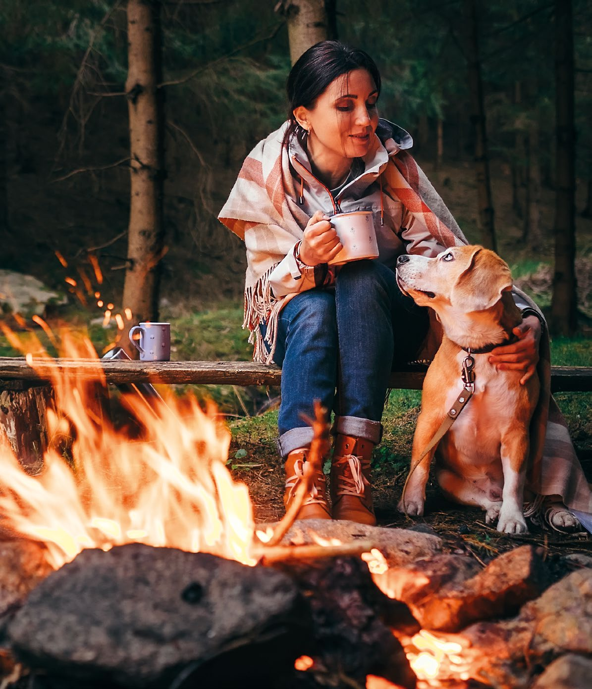

---
## Page 2

Sometimes unnecessary burns and small fires that 
were lit with good intentions can escape and become 
large bushfires.
As the weather gets warmer many people like to 
get outdoors and enjoy activities such as camping, 
working outside, cooking for and entertaining guests – 
all of which have potential to cause a bushfire.
Knowing what kind of fire you can light and when, 
and deciding whether a fire is necessary, is key to 
protecting the community from potentially devastating 
consequences.
If people are more careful with fire, the loss and 
damage to possessions, property and the environment 
can be greatly reduced.
Every year a number of fires 
costs Tasmanians and the 
community dearly. 
Some bushfires can 
be deliberately or 
irresponsibly lit.
If you see any suspicious 
activity involving fire, 
contact Crime Stoppers 
on 1800 333 000
2	
Using Fire Outdoors
www.fire.tas.gov.au
To find out more, go to 
www.fire.tas.gov.au

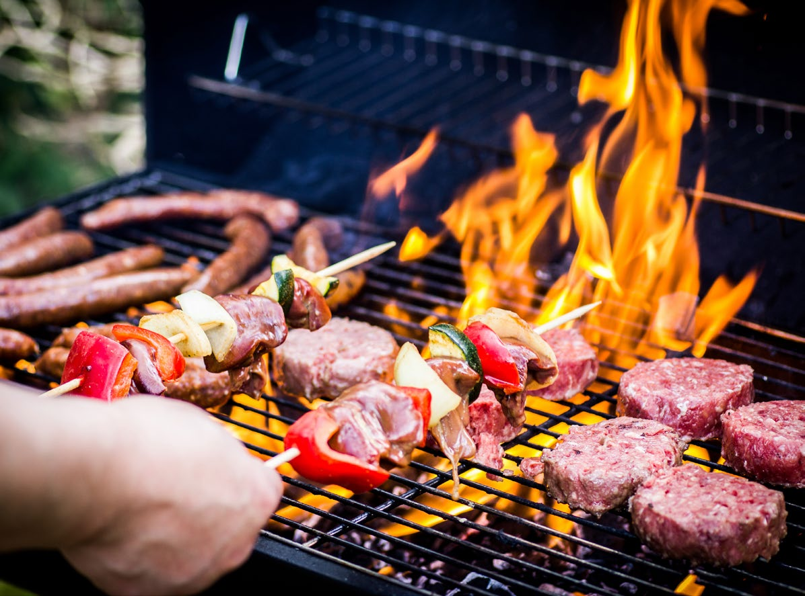

---
## Page 3

Subject to Environmental Regulations, 
Local Government By-Laws and any 
restrictions in parks and reserves.
Total
 fire bans
Fire permit 
periods
All other 
times
Electric 
BBQ
If cleared around 
for 1 metre
Gas 
BBQ
If cleared around 
for 1 metre
Incinerator
Banned
If cleared around 
for 3 metres
Fire pits
Banned
If cleared around 
for 3 metres
Campfires
Banned
If cleared around 
for 3 metres
Burning 
heaps
Banned
Permit 
required
If exceeding 
1 cubic metre
Burning 
land
Banned
Permit 
required
	
Using Fire Outdoors 	
3
www.fire.tas.gov.au
Fire use
checklist:

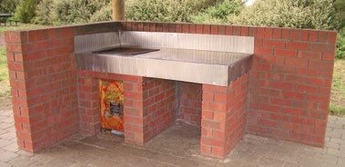

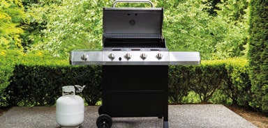

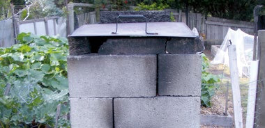

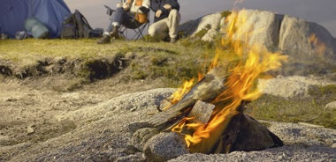

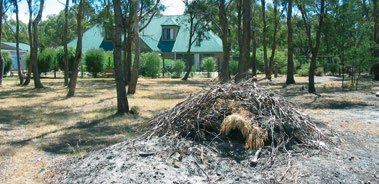

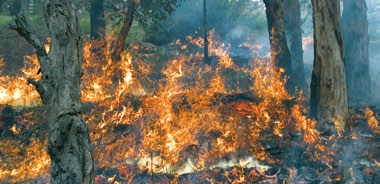

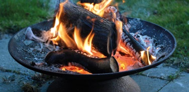

---
## Page 4

The Tasmania Fire Service can declare a 
Total Fire Ban on days when there is a danger 
of fire and when fires would be expected to 
develop rapidly and be extremely difficult to control. 
Usually a Total Fire Ban lasts for at least 
24 hours or longer as advertised.
Days of Total Fire Ban are advertised in daily newspapers, 
on social media, television, ABC radio, and on the TFS website.
On Days of Total Fire Ban, all outdoor fires are banned* 
except electric stoves and gas barbecues.
Other barbecues, pizza ovens and portable stoves including those that use 
wood, charcoal or other solid or liquid fuel are banned. 
Work practices such as grinding, welding and cutting metal in the open are not permitted. 
The use of machinery for harvesting etc, may be subject to restrictions or prohibited on 
the declaration of a total fire ban. All fire permits are automatically suspended.
*Prohibited unless it is specified within the declaration that a fire/activity is excluded from the ban.
Fires in permitted times may still be subject to 
Environmental Regulations, Local Government By-Laws 
and any restrictions in parks and reserves.
For more information:
•	 Environmental Regulations - environment.tas.gov.au or 03 6233 4028.
•	 Local Government By-Laws - lgat.tas.gov.au or 03 6233 5966.
On Total Fire Ban days, you may not:
You may:
•	 Use electric-powered 
or LPG (Butane or 
Propane) outdoor 
cookers or stoves 
so long as you have 
cleared all flammable 	
material away for at 
least one metre.
•	 Light a fire in the 
open, including 
campfires, vegetation 
fires, and bonfires.*
•	 Use any outdoor 
cooker, stove, 
barbecue or pizza 
oven etc. that uses 
wood, charcoal, heat 
beads or other solid 
or liquid fuels.*
•	 Do work in the open 
that creates sparks, 
such as grinding, 
welding or cutting 
metal.*
4	
Using Fire Outdoors
www.fire.tas.gov.au
Total Fire Bans

---
## Page 5

Fire permit periods are usually in force during 
the dry summer period from September to 
April, although this will vary from year to year 
depending on the dryness of the vegetation 
and the fire danger.
During a Fire Permit Period, fires are not 
banned but are allowed where there are 
good opportunities to safely use fire for land 
management purposes. However, conditions are 
placed on the use of certain fires in the open.  
When do I need a fire permit?
You need a fire permit for the burning of 
vegetation at all times during a declared 
Fire Permit Period regardless of the weather 
conditions. You do not need a permit for 
barbecues, campfires or incinerators provided 
you comply with the conditions associated with 
their use. 
What’s in a fire permit?
Your permit will contain conditions that must 
be followed to reduce the risk of fire escaping. 
You will only be allowed to burn during specified 
weather conditions and with certain equipment 
available. You will need to notify the Tasmania 
Fire Service when you intend to light your 
fire and may also be required to notify your 
neighbours. 
Permits are free. To get a permit simply 
contact your local Fire Permit Officer on 
freecall 1800 000 699.
A fire must not be allowed to escape from 
your land or endanger land other than yours, 
including public land.
Campfires, barbecues and 
incinerators must:
•	 Be at least three metres away from 
overhanging branches, stumps, logs and 
trees and other flammable material.
•	 Not be lit on peat soils or grassed sand dunes.
•	 Have someone stay with the fire until it is 
completely extinguished.
You should also ensure that you:
•	 Do not burn human-made materials such as 
tyres, plastics and paints.
•	 Comply with any Environmental Regulations 
or Council By-laws which may have additional 
restrictions for incinerators and heap fires.
•	 Obey all signs in National Parks and other 
reserves that may restrict where camp fires 
may be lit.
•	 Only burn domestic garden refuse in 
incinerators or heaps. Incinerators should be 
constructed to prevent the escape of burning 
material and sparks.
•	 Have enough water close to the fire to be able 
to put it out or prevent it from spreading.
TFS encourages you to register any fuel reduction 
burn even outside of permit period to reduce 
the risk of unnecessary brigade call outs. 
Freecall 1800 000 699 to register.
What happens if my fire gets out of control?
Contact the Tasmania Fire Service by dialling triple zero (000) 
or if a TTY user call 106.
This is the quickest way to get local assistance to bring your fire under control.
Ensure you follow all the conditions on your permit and take all reasonable steps 
to keep the fire on your property.
	
Using Fire Outdoors 	
5
www.fire.tas.gov.au
Fire permit 
periods
All other times

---
## Page 6

Campfire safety
SOAK IT. STIR IT. SOAK IT AGAIN.
MAKE SURE YOUR FIRE IS OUT.
Remember that campfires must not be lit during a Total Fire Ban. 
While fire permits are not required for campfires, ensure 
campfires are permitted in the area you intend to set up camp. 
Don’t leave campfires unattended. When leaving your campsite, 
make sure your fire is completely out.
Use water to make sure your fire is completely extinguished. 
Do not use soil or sand. Fires can still smoulder under soil and 
sand and can stay hot for more than eight hours.
Remember:
Never leave a fire 
unattended at any 
time of the year.
Register your fire by 
freecalling 1800 000 699. 
Notifying the Tasmania 
Fire Service about your 
fire helps prevent false 
alarms and call outs.
To report a fire dial 
Triple Zero (000).
If someone suffers a 
burn around a fire, 
hold the burn under 
gently running cool water 
for at least 20 minutes.
If the burn is larger than a 
20 cent coin seek medical 
advice. For serious burns, 
dial Triple Zero (000) and 
ask for an ambulance.
6	
Using Fire Outdoors
www.fire.tas.gov.au
Fire pit safety
There are simple actions you can take to reduce the risk of fire 
when using a firepit.
•	 The fire pit should be kept CLEAR of structures or foliage. 
Do not place the fire pit on a flammable surface.
•	 Always have a continuous supply of water or a fire 
extinguisher ready to completely PUT OUT the fire when 
you are finished.
•	 Always have a responsible adult WATCH and control the 
fire. Only burn clean, dry, well-seasoned wood.
•	 Keep a WATCH on the weather. Do not use a fire pit if it is 
too windy or there is a Total Fire Ban.
•	 Always WATCH children and pets around a fire pit.
•	 Remove debris from the last fire before starting a new fire.

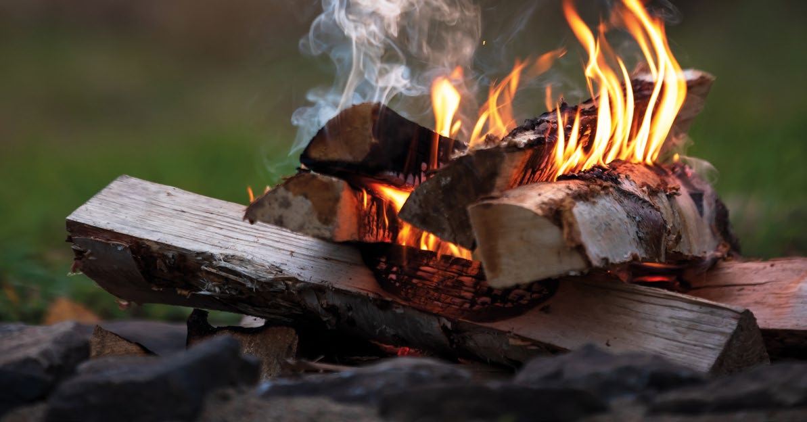

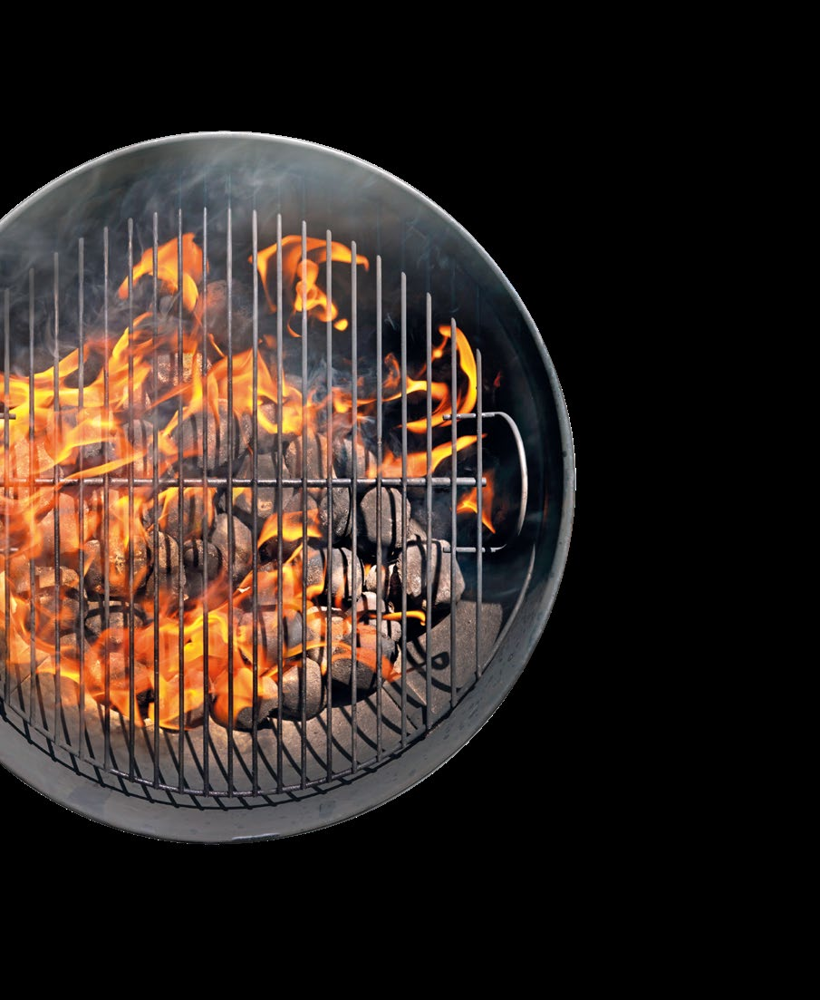

---
## Page 7

Fire Danger Ratings are used on days 
when there’s a risk of fires and you need 
to take action. The higher the fire danger, 
the more dangerous the conditions and the 
greater the consequences if a fire starts.
Fires can start suddenly, and weather 
conditions can change quickly. 
Find information about Fire Danger Ratings, 
current warnings and alerts at:
•	 fire.tas.gov.au
•	 TasALERT.com
•	 on Tasmania Fire Service’s social media 
•	 listen to your local ABC radio station.
Bushfire warning and alert levels:
When bushfires have started, these warnings will keep you informed.
Remember, leaving early is recommended as the safest option to protect you and your family. 
Anyone not staying to actively defend the property should leave early.
Plan and prepare.
Take action now to
protect life and property.
Be ready to act.
For your survival, leave 
bushfire risk areas.
MODERATE:
EXTREME:
HIGH:
CATASTROPHIC:
	
Using Fire Outdoors 	
7
www.fire.tas.gov.au
ADVICE:
A fire is burning. 
There is no 
immediate danger. 
Stay up to date in 
case the situation 
changes. 
(May also be 
used to advise 
that a threat has 
reduced.)
WATCH 
AND ACT: 
A fire is burning 
and conditions are 
changing. Start 
taking action now 
to protect yourself 
and others.
EMERGENCY 
WARNING:
An Emergency 
Warning is the 
highest level 
of warning. 
You may be in 
danger and need 
to take action 
immediately. 
Any delay may put 
your life at risk.
SMOKE ALERT: 
Provides 
information about 
smoke from a fire, 
bushfire or fuel 
reduction burn 
that may impact 
a community or 
areas of Tasmania.
Fire Danger Ratings and warnings
Know the Fire Danger Rating 
for your area and be prepared.

---
## Page 8

While the State Fire Commission has made every effort to 
ensure the accuracy and reliability of the information contained 
in this booklet, the State Fire Commission does not accept any 
responsibility for the accuracy, completeness, or relevance to 
the viewer’s purpose of the information contained in this booklet, 
and those viewing it for whatever purpose are advised to verify 
its accuracy and to obtain appropriate professional advice.   
The State Fire Commission, its officers, employees and agents 
do not accept any liability, however arising, including liability for 
negligence, for any loss or damage resulting from the use of, 
or reliance upon, the information contained in this booklet. 
© Copyright Tasmania Fire Service 2022
2022 v1 | 220228 
www.fire.tas.gov.au
If you are deaf, hard of 
hearing or have a speech 
impairment, there are a 
number of ways to contact 
emergency services through 
the National Relay Service.
If you find yourself in an emergency which is 
either life threatening or where time is critical, 
you can contact the fire service, police or 
ambulance by phone on triple zero (000). 
•	 Ask for Fire, Police or Ambulance.
•	 Stay calm, don’t shout, speak slowly 
and clearly.
•	 When asked, give as much detail 
about your location as you can.
In an emergency…
YOUR FIRE IS YOUR RESPONSIBILITY
At all times register your fire by freecalling 1800 000 699
Chat: nrschat.nrscall.gov.au 
Captions: nrscaptions.nrscall.gov.au
SMS relay: 0423 677 767 ask for 000
Video relay: skype NRS ask for 000
TTY: 106
Learn more: 
For further information:
www.fire.tas.gov.au
www.tfseducation.com.au
Free-call 1800 000 699
Your Bushfire Plan outlines what actions each member of your family/household will  
take on fire risk days and if bushfire threatens. Having phone numbers  and details of  
key contacts is an essential first step of any bushfire planning.
STEP 1 – My details
Making a choice to leave or stay when a bushfire threatens is too late. 
You and your loved ones’ safety and survival during a bushfire  will depend on how prepared you are and 
the decisions you make. TFS recommends having a Bushfire Plan and sharing it with  household members, 
neighbours and friends.  Don’t wait, create your 5 MINUTE Bushfire Plan now. 
For more information on bushfire planning, visit fire.tas.gov.au
Your Bushfire Plan should include each member of your family/household who may be impacted on fire risk days and 
if bushfire threatens.
Name
Phone Number
Pets (name and type)
Included in the plan
Call triple zero - 000 - in an emergency. 
Ask for Fire, Police  or Ambulance. Stay calm, 
 don’t shout, speak slowly  and clearly.
Name
Suburb
Email address
Postcode
Phone number
Date
/
/
Includes  
pull-out  
Bushfire Plan
2022
Home Fire Safety
Protect what you value
Escape 
Plan
Child 
Safety
Smoke 
Alarms
more
Bushfire 
Safety Guide
Home Fire 
Safety Guide
www.TasALERT.com
@TasALERT
facebook.com/TasALERT

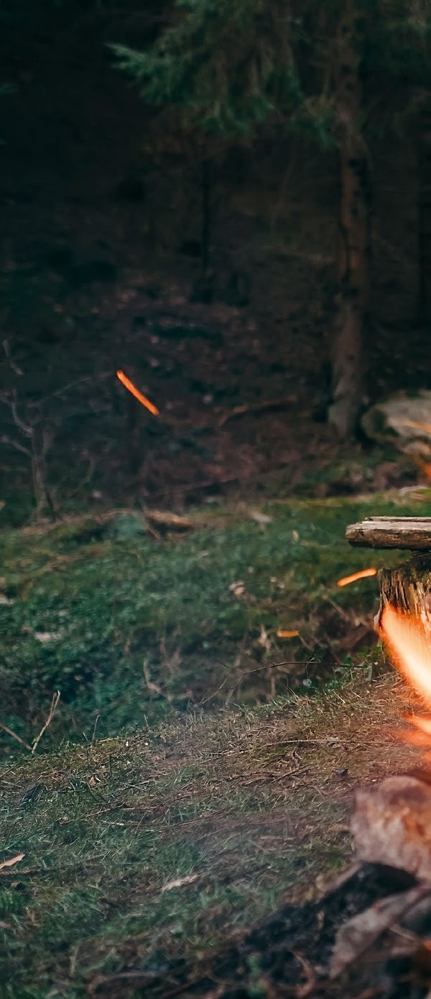

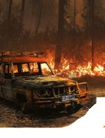

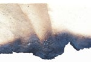

