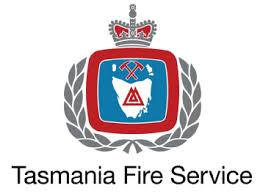
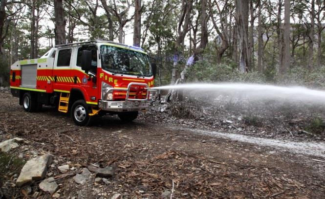
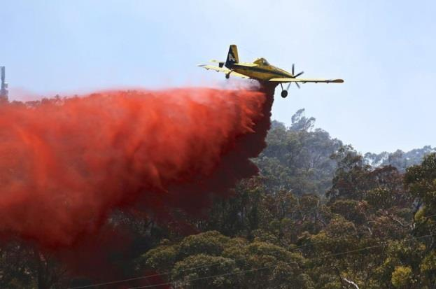
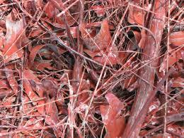
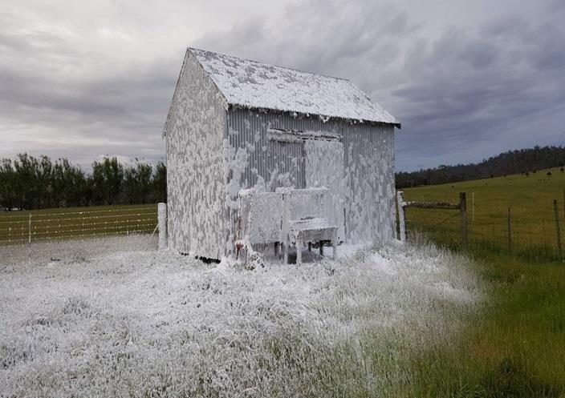

# Use of Water Additives in Controlling Bushfires — Information Guide

> **Source**: Tasmania Fire Service
> **URL**: https://www.fire.tas.gov.au/userfiles/publications/Use_of_Water_Additives_in_Controlling_Bushfires_Information_Guide_FINAL.pdf
> **Licence**: Crown copyright Tasmania; practitioner and public-information use
> **Retrieved**: 2026-05-07T13:40:47Z
> **SHA-256**: `4ed295dde46818ed19eefdee325cc3e56fe7bc826f95f0accb659a826436afda`
> *Converted from PDF to Markdown format.*

---
## Page 1

  
           
        
      
 
Use of Water Additives in Controlling 
Bushfires 
INFORMATION GUIDE 
 
 
‘Water Additives’ is the description given to different supplements that can be 
combined with water when fighting fires.  This additive and water solution is then 
either applied to a bushfire to slow the spread and intensity of the fire, or applied 
to vegetation or property to try and prevent it from catching fire.   
 
 
1.      What types of Water Additives are used in Tasmania to help control 
bushfires? 
Water additives are used worldwide to help combat fires and have been used in Tasmania for several years. 
 
There are three main categories of water additives used in Tasmania: 
 
Bushfire Foam, 
 
Water Enhancers  
 
Bushfire Retardants. 
 
 
2. What are the products made of? 
Bushfire foam is basically a mix of water, synthetic detergents (not unlike washing up liquid or shampoo) and 
corrosion inhibitors.  Tasmanian fire agencies currently use several different brands of bushfire foam however 
their ingredients are very similar. 
 
Water enhancers are made up of thickeners, stabilizers as well as super absorbent polymers similar to those 
found in some absorbent pads and disposable nappies.    Currently, Tasmania’s three fire agencies use water 
enhancer product called Blaze Tamer 380 and Thermo-Gel®.  
 
Fire agencies in Tasmania have access to several types of retardants.  The basic ingredients are a mix of water, 
Ammonium Polyphosphate (also readily used as fertiliser), thickeners (gum and/or clay) and corrosion inhibitors 
to protect the machinery which applies the product. A red pigment made from Iron Oxide is also added so as 
the retardant can be seen on the ground.  
 
Due to interstate firefighting arrangements between Tasmania and other States and Territories in Australia, 
brands and types of water additives may vary 
 
For full Safety Data Sheets for particular additives that can and are used in Tasmania see Section 12 of this fact 
sheet.

---
## Page 2

 
GPO Box 1526, HOBART, TASMANIA, 7001. 
Phone: 1800 000 699 Fax: (03) 6234 6647 
Email: fire@fire.tas.gov.au   Visit: www.fire.tas.gov.au 
 
 
 
3.      Why do firefighters use additives and not just water? 
Water additives reduce fire intensity and spread more effectively than water alone, giving firefighters a greater 
chance of successfully protecting life and property.  By using these additives, firefighters are able to use the 
available water more efficiently and effectively, which is important when water is in short supply during our hot 
dry summer. 
 
The use of water additives gives firefighters the option to fight fires ‘indirectly’ as they are able to create 
chemical fire-breaks ahead of the threatening fire without having to remove vegetation by land clearing or back-
burning, however chemical fire breaks are not always the most effective option, and vegetation removal may still 
be the most effective method to contain particular fires. 
 
4.      How are the products applied? 
Water additives (bushfire foam, water enhancers and fire retardants) can be applied either by ground based 
firefighting crews using a firefighting vehicle or by aircraft. 
 
Tasmania’s three fire agencies carry and are capable of applying bushfire foam to fires.  This is done through 
normal water application methods using the vehicle mounted firefighting pump and hoses.  
Tasmania Fire Service also has purpose built, state of the art vehicles equipped with Compressed Air Foam 
System (CAFS) which use water, bushfire foam concentrate and compressed air to create thick blankets of 
firefighting foam using small amounts of water and foam concentrate making our water usage more effective and 
efficient.  A ‘CAFS’ blanket is generally used to cover vegetation and structures to try and protect them from 
the threatening fire. 
 
In Tasmania, water enhancers and bushfire retardants are almost always applied by aircraft but can also be 
sprayed from a vehicle mounted tank.  The chosen additives is mixed with water while the aircraft is on the 
ground and transported in the ‘belly tank’ of the aircraft or in a ‘bucket’ slung from underneath to the pre-
determined location it is to be used.  Whilst flying low to the ground, the pilot will release the water enhancer 
or fire retardant mixture onto the surface of the vegetation and/or asset to be protected. 
There are several different types of aircraft used for this task ranging from small helicopters, small aero planes 
(Single Engine Air Tankers –‘SEATs’) to what are appropriately named ‘Very-Large Air Tankers’ (VLATs).  Very 
Large Air Tankers are specially converted passenger jets modified to carry and dump large amounts of water or 
a water and additive mixture. 
         
 
         A Tasmania Fire Service tanker applying bushfire 
 
            An 802 ‘Air Tractor’ (SEAT) releasing a load of Phos-Chek 
         foam to a roadside. 
 
 
 
 
            fire retardant on vegetation

---
## Page 3

 
GPO Box 1526, HOBART, TASMANIA, 7001. 
Phone: 1800 000 699 Fax: (03) 6234 6647 
Email: fire@fire.tas.gov.au   Visit: www.fire.tas.gov.au 
 
 
 
5.      How do the additives work? 
Bushfire foams were developed in the mid-1980s for fighting bushfires. Bushfire foam lowers the surface tension 
of the water, which assists in the wetting and saturation of carbonaceous fuels with water. This aids fire 
suppression and can prevent re-ignition.  Depending on the ratio of foam concentrate to water, a blanket of air-
filled foam bubbles can be layered over a surface of an object to try and stop the object from catching fire.  
Because bushfire foam is still predominantly water, it generally evaporates quickly which makes it unsuitable for 
some conditions. 
 
Water enhancers are created by mixing polymers normally in the form of dry powder, with water.  The powder 
is able to absorb large volumes of water which creates a clear gel-like substance, similar to jelly.  Like bushfire 
foams, water enhancers can either be applied directly to the fire or used to coat vegetation and other surfaces 
to minimize the chance of them catching fire. 
Unlike bushfire foams, water enhancers don’t evaporate readily –enabling them to be used further in front of a 
threatening fire as they stay in place for longer. 
 
Bushfire retardants can work in several different ways, depending on the type of retardant and the environment 
in which they are used.  Generally, bushfire retardants when exposed to heat create a solid shield around a 
surface which acts as thermal protection from the fire.   
Some retardants, when heated also release non-flammable carbon dioxide which displaces the oxygen around 
the retardant and stops the fuels from igniting. 
 
Fire retardants are almost always spread on vegetation or surfaces ahead of the approaching fire which will assist 
firefighters in reducing the fire threat to life and property. 
 
 
6. What do the products look like?  
The different types of water additives have distinctly different appearances and can be easily identified.  The 
appearance of bushfire foam, when applied to a surface will range from a thin milky white coloured solution to a 
thick white snow like soap suds.   The appearance depends on how it is applied and the ratio of bushfire foam 
concentrate to water that is used.  
 
Water enhancers are often referred to as ‘firefighting gel’ due to its clear, jelly like appearance on surfaces. 
 
Fire retardants are usually red or orange in colour which is due to the coloured pigment (iron oxide) added to 
the retardant to easily allow firefighters to identify where the retardant has been applied. 
          
 
Phos-Chek fire retardant on ground fuels. 
 
      A Class firefighting foam applied to grass and an out-building.

---
## Page 4

 
GPO Box 1526, HOBART, TASMANIA, 7001. 
Phone: 1800 000 699 Fax: (03) 6234 6647 
Email: fire@fire.tas.gov.au   Visit: www.fire.tas.gov.au 
 
 
 
7. Can the water additives used in controlling bushfires harm me, my pets or 
my livestock? 
Although studies show that the risk of adverse health effects from contact with these additives is low, the 
additives can produce minor irritant effects and contaminated water is unsafe for drinking (both by humans and 
animals).  The nature of the products can also create slippery surfaces creating a slip and fall hazard.  By taking 
these simple precautions, you can greatly reduce the chance of harm: 
 
Do not enter areas where bushfire foam, water enhancers or retardants are still present 
 
Avoid touching any objects coated in bushfire foam, water enhancer or retardant. 
The ammonium polyphosphate salts used in firefighting retardant should not be confused with nitrogenous 
fertilizers which may be harmful to cattle and other livestock. 
 
If you believe that you have been exposed to a water additive and you feel unwell, contact the Poisons 
Information Centre on 13 11 26.  
 
 
8. Can the chemicals harm the environment? 
In Australia, long term fire retardants have been observed to cause some damage to native species (generally 
low-lying new growth) and on occasions, the sheer weight of the product being dropped from a height can cause 
branches or trees and vegetation to be damaged.  Although this does not generally harm the plants in the long-
term, care must be taken when entering the area as dislodged branches may fall and cause injury. 
Water plants and animals are generally more sensitive to chemicals and foams in particular can be moderately 
toxic to aquatic life.  It is for these reasons that there are strict rules in place governing the use of water 
additives in and around waterways and vulnerable vegetation. 
 
Where required, the environmental effects of using these products are considered with consultation with the 
Environment Protection Authority Tasmania (EPA). When consulted, the EPA considers what impact the 
application may cause compared with the likely impact on people, infrastructure and the environment if the 
application is not used. This process is call net environmental benefit analysis (NEBA) 
 
All of the water additives which are used in Australia have undergone stringent testing by the United States 
Forest Service.  This data has been analysed and accepted by the Australasian Fire Authorities Council (AFAC) 
which is the peak body for public sector fire, land management and emergency service organisations in Australia 
and New Zealand.   
 
It is important to note that the final mixture which is applied is still predominantly water with some slight 
variations in ratios dependent on the application.  See table below. 
 
Application Ratios 
 
Product 
Additive Content 
Water Content 
Bushfire Foam 
0.5 - 1% 
99 - 99.5% 
Water Enhancer (BlazeTamer 380) 
0.1 - 0.65% 
99.35 – 99.9% 
Bushfire Retardant  
15 – 20% 
80 – 85%

---
## Page 5

 
GPO Box 1526, HOBART, TASMANIA, 7001. 
Phone: 1800 000 699 Fax: (03) 6234 6647 
Email: fire@fire.tas.gov.au   Visit: www.fire.tas.gov.au 
 
 
9. What do I do if I get one of the products on me or my pets? 
If you or your pets inadvertently come into contact with a firefighting water additive, wash the skin with mild 
soap and cold water as soon as practicable and remove any contaminated clothing and using rubber gloves,  
hand wash in cold water. 
 
If you believe that you have been exposed to a water additive and you begin to feel unwell, contact the Poisons 
Information Centre on 13 11 26.  
 
 
 
10. 
How do I clean it up? 
After the threat of fire has passed and whilst wearing gloves, clean water additive residue off surfaces simply by 
using a mild soap and rinse with water. A scrubbing brush or stiff bristled broom can also be used.  Ensure run-
off does not enter water-ways, including storm water system 
 
 
 
11. 
What if my water supply gets contaminated? 
If you have a domestic water tank supply, you can take a few precautions in order to not compromise your 
water supply.  If there is a fire in your area, you can disconnect your water tank from the roof catchment (i.e. 
Disconnect your down pipe from entering the tank) this will also reduce the likelihood of smoke and ash 
entering your water supply.  Make sure you do not disconnect the supply side of your tank, especially if you are 
relying on it for firefighting pumps or sprinklers. 
 
The normal concentrations of water additive used should not present a risk to your health however may affect 
the taste and potability of the water. Foam products also contain detergents so the water in the tank may froth 
up. 
 
As a precaution, if you believe that firefighting water additives have entered your water supply, the tank and 
supply pipes should be drained and cleaned along with the collection surfaces.  The first flush of water should be 
discarded.  It can then be allowed to refill using rainwater or filled with water using a licensed water-carrier.

---
## Page 6

 
GPO Box 1526, HOBART, TASMANIA, 7001. 
Phone: 1800 000 699 Fax: (03) 6234 6647 
Email: fire@fire.tas.gov.au   Visit: www.fire.tas.gov.au 
 
 
 
12. 
Where do I get more information? 
 
For more information on the water additive chemicals that Tasmania’s bushfire agencies may utilize for 
firefighting as well as more detailed Safety Data Sheets, visit the following websites. 
 
Bushfire CRC - http://www.bushfirecrc.com/resources/firenote/using-chemicals-firefighting-operations 
Forexepan S - http://www.angusfire.co.uk/ 
Blaze Tamer 380 – www. biocentral-labs.com  
ThermoGel – www.thermogel.com.au 
Phos-Chek Products -  www.phos-chek.com.au 
 
For more information including information on which product may have been used in your area, contact 
Tasmania Fire Service on 1800 000 699 or visit the Tasmania Fire Service website at www.fire.tas.gov.au

