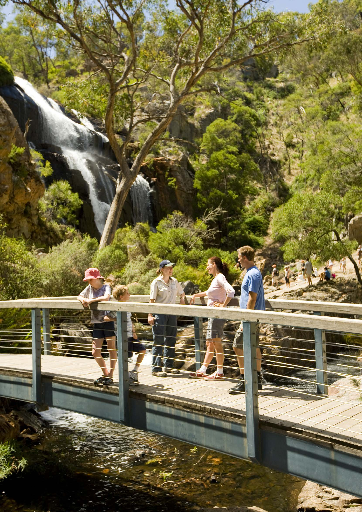
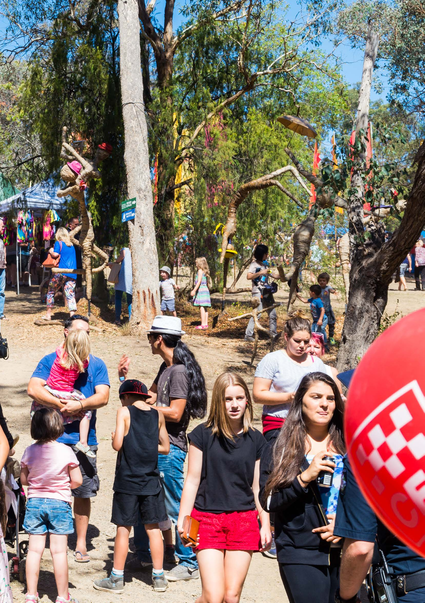
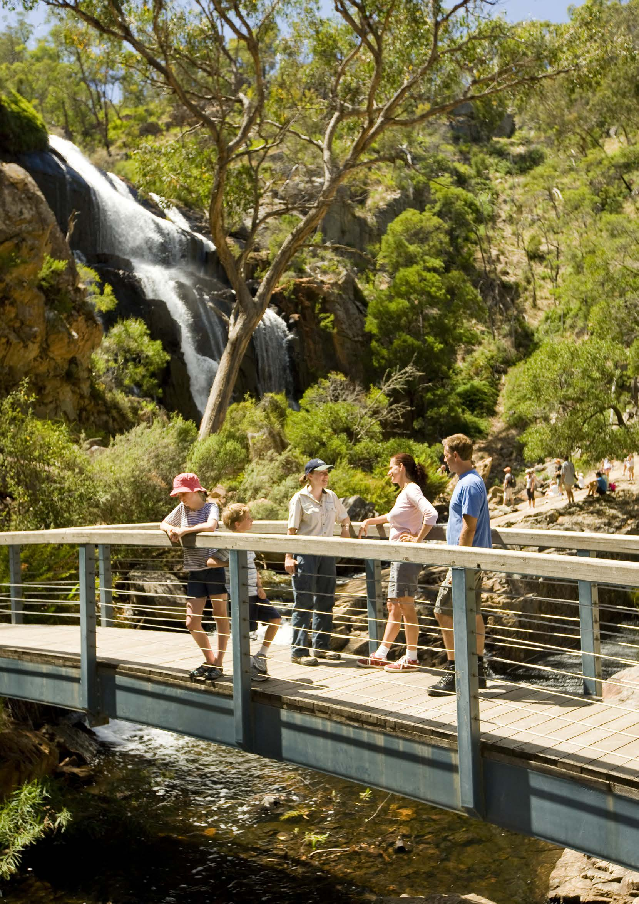
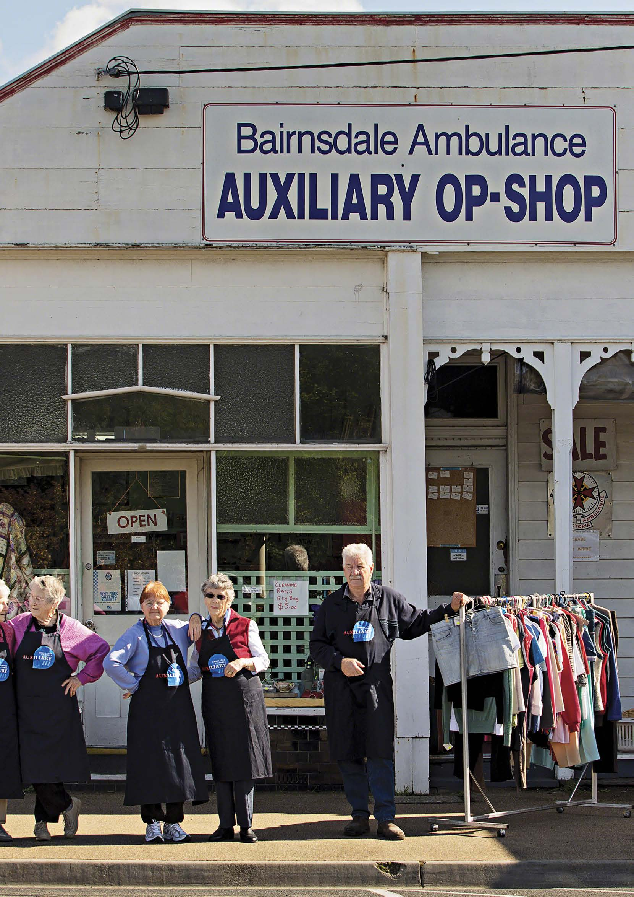
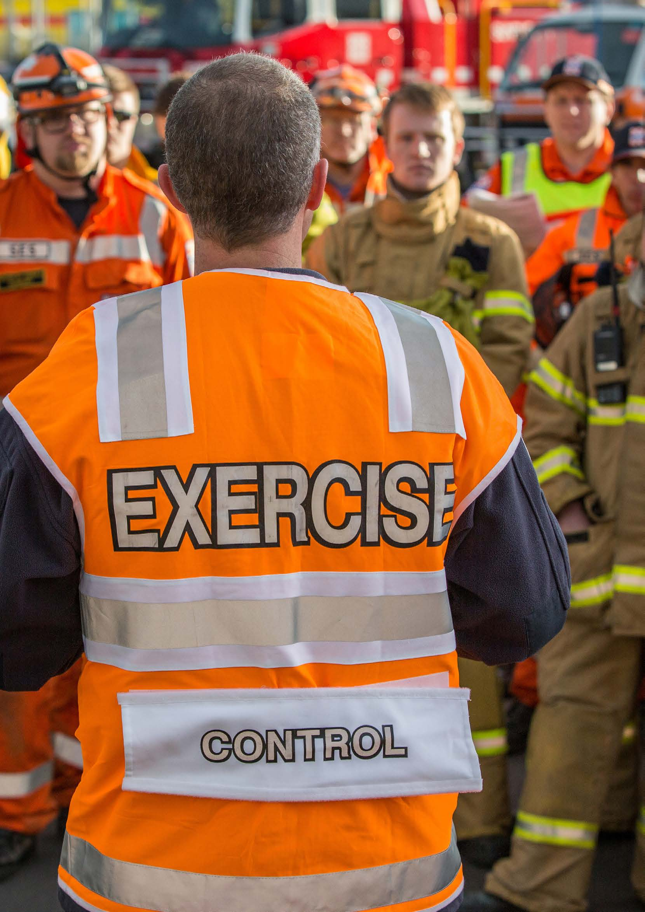
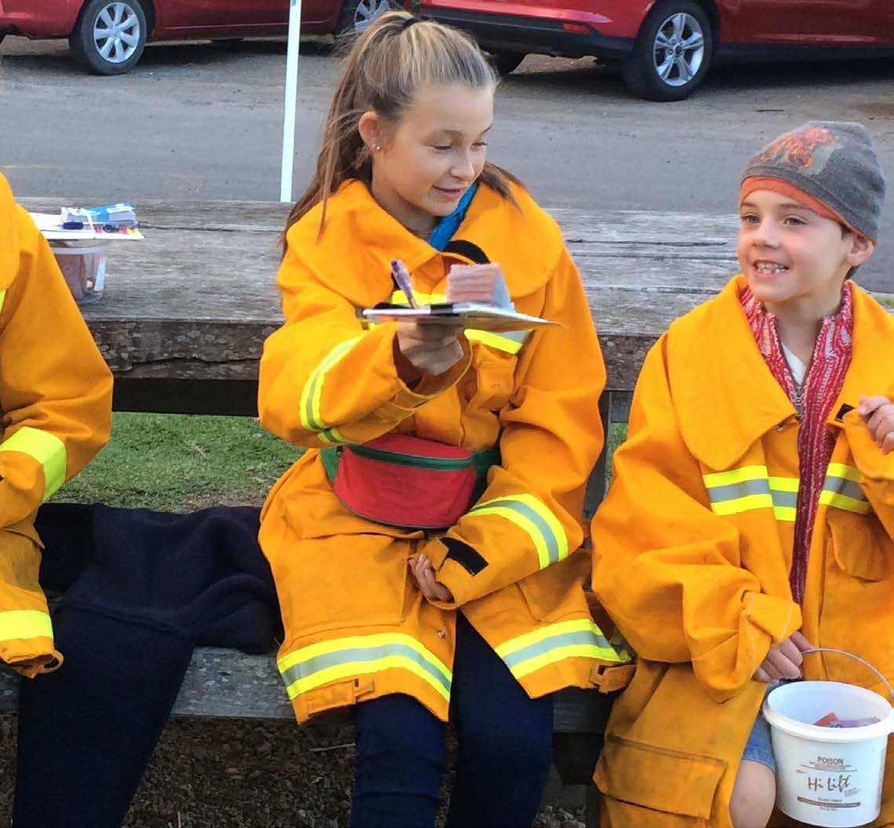
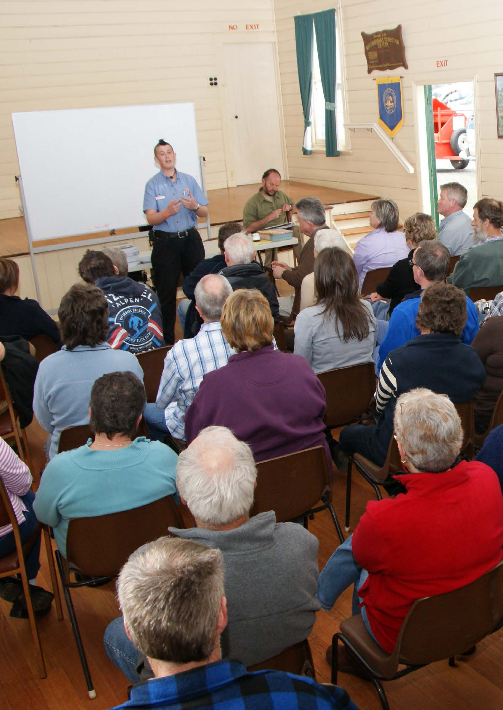
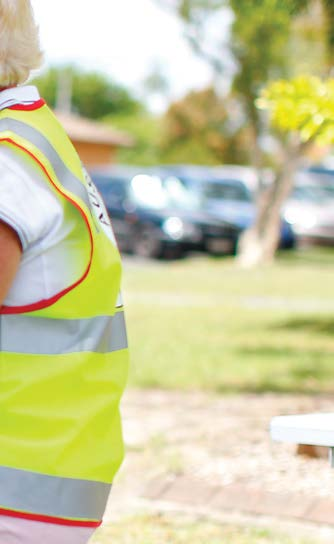
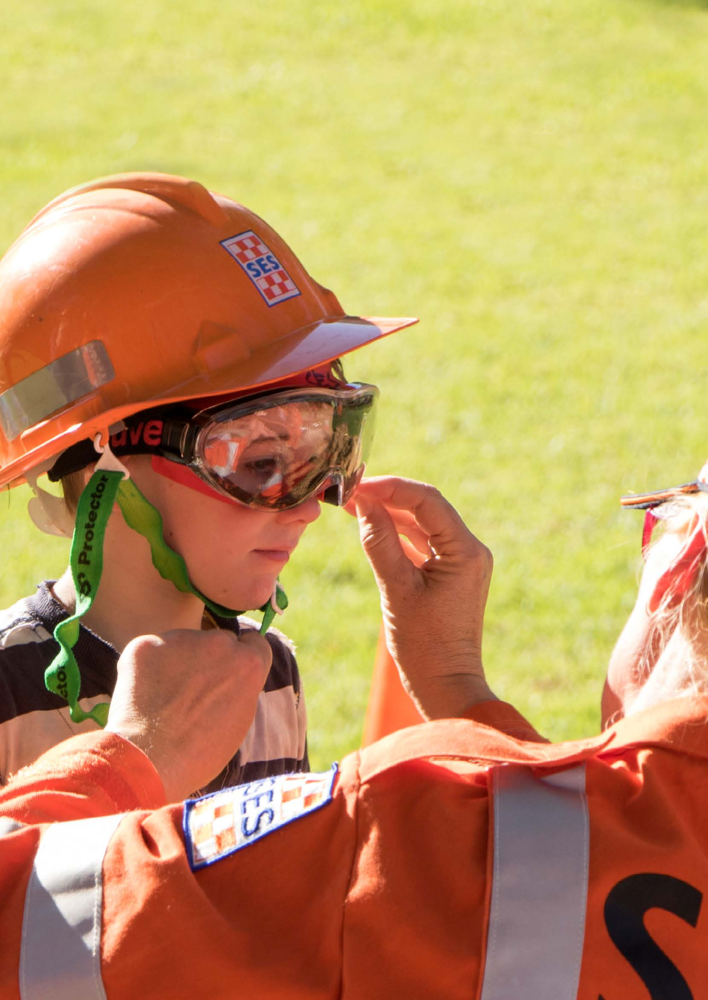

# Community Resilience Framework for Emergency Management (2021)

> **Source**: Emergency Management Victoria
> **URL**: https://files.emv.vic.gov.au/2021-08/Community%20Reslience%20Framework%20for%20Emergency%20Management.pdf
> **Licence**: © State of Victoria; emergency-management practitioner reference
> **Retrieved**: 2026-05-07T23:44:41Z
> **SHA-256**: `dece9503c489f201abb32a41778dce2e6991ad9623535ac4fd1f110a4dac162d`
> *Converted from PDF to Markdown format.*

---
## Page 1

Community 
Resilience 
Framework
For Emergency 
Management

---
## Page 2

Acknowledgment of Country
Emergency Management Victoria (EMV) acknowledges Aboriginal and Torres Strait Islander people as the 
Traditional Custodians of the land. EMV also acknowledges and pays respect to the Elders, past and present and 
is committed to working with Aboriginal and Torres Strait Islander communities to achieve a shared vision of 
safer and more resilient communities.
Photo credit front page: Vision Victoria. Photo by Rob Blackthorn
Community Resilience Framework for Emergency Management
2
Authorised and published by Emergency Management Victoria 
121 Exhibition Street, Melbourne, 3000 
© State of Victoria 2017 
You are free to re-use this work under a Creative Commons Attribution 4.0 licence, provided you credit the State of Victoria (Emergency Management 
Victoria) as author, indicate if changes were made and comply with the other licence terms. The licence does not apply to any images, photographs or 
branding, including Government logos. 
ISBN 978-1-925549-33-1 
Published month: April 2017 
If you would like to receive this publication in an accessible format please email media@emv.vic.gov.au 
This document is also available in Word format at emv.vic.gov.au

---
## Page 3

Table of 
Contents
Foreword
Executive Summary
Safer and More Resilient 
Communities
Community Resilience 
in the Emergency 
Management Context
Community Resilience 
Characteristics
Using the Community 
Resilience Framework
Assessing Community 
Resilience User Guide
Conclusion 
Further Reading
Glossary 
04
05
36
43
46
47
08
15
21
32
Community Resilience Framework for Emergency Management
3

---
## Page 4

Commissioner Craig Lapsley
The Victorian community 
is already resilient in many 
ways. Victoria’s social civil 
and democratic structures, 
the rule of law, developed 
economic base, rich and 
varied physical environment 
and inherent community 
diversity are the foundations 
upon which a resilient 
community is built.
Many of the emergency 
management organisations across the State are 
expressions of that solid foundation - fire brigades 
(both urban and rural, paid and volunteer), the 
ambulance service, Victoria Police, the State 
Emergency Service, Red Cross, the health and 
human service functions of government. More 
than 60 organisations play critical roles in the 
State’s emergency management arrangements. 
Many other public and private organisations, 
industries and businesses also step up to assist in 
emergencies.
A community with that level of active participation 
in emergency management is already structured 
to withstand the acute shocks and chronic 
stresses that confront modern society.
However, community resilience is a long end 
game. Victoria, Australia and the world have been 
focussed on defining what it is and how we do it. 
The Community Resilience Framework for 
Emergency Management has been built based 
on research, evaluation and knowledge and 
expertise from the ground up with a broad range 
of emergency management and community 
stakeholders keen to embed the notion of safer 
and more resilient communities in the way we 
operate.  
To do this, and to build resilience across Victorian 
communities, partnerships are essential, both 
across agencies and with the community. A 
range of strategies and programs are already 
contributing to this approach. 
Despite our best efforts, we will be challenged and 
faced with loss. Both the incidence and severity of 
emergencies in Victoria will continue to grow, just 
as the community itself continues to grow. Some 
of the factors influencing this are beyond our 
immediate control. 
In the end, the cause of an emergency is less 
important than the capacity of a community to 
respond to it, to recover from it, to rebuild and to 
revitalise. 
It is that ability to regroup after an acute shock 
or face up to a chronic stressor that marks a 
community as resilient.  It’s this that Victoria is 
focussed on.
Craig Lapsley PSM 
Emergency Management Commissioner 
Emergency Management Victoria
Community Resilience Framework for Emergency Management
4
Foreword

---
## Page 5

Community Resilience Framework for Emergency Management
5
Executive Summary
The Community Resilience Framework for 
Emergency Management has two focuses. The 
first is community, which is at the centre of all 
emergency management activity in Victoria. The 
second is the emergency management sector in 
its broadest definition. 
In essence, this Framework is about ensuring 
that everything those involved in emergency 
management in Victoria do helps in turn to build a 
safer and more resilient Victoria. 
Like so much in this area, the responsibility is 
a shared one. But there is greater onus upon 
emergency managers to ensure that Victorians 
individually and collectively are empowered to 
become more resilient. 
This is not about transferring risk or responsibility.  
It is about sharing these more effectively and 
realistically and understanding how this will be 
achieved.
At the heart of the Framework are seven resilience 
characteristics that emergency managers should 
aim to strengthen and encourage in communities.  
These characteristics are: 
››
Safe and well 
››
Connected, inclusive and empowered
››
Dynamic and diverse local economy
››
Sustainable built and natural environment 
››
Culturally rich and vibrant
››
Democratic and engaged
››
Reflective and aware
These characteristics are not immediately 
“emergency” related but reflect instead the 
qualities that enable all sorts of communities to 
avoid or manage emergencies and to enable them 
to rebuild and re-establish when necessary. 
Our dependence on vulnerable systems is 
highlighted when disruption occurs through 
stresses and shocks that affect our society and 
economy and require the sector and its partners to 
work together to limit the consequences of events. 
Increasing resilience involves a focus on the 
strength and sustainability of a community’s 
lifelines, as well as building and strengthening the 
links between people and the services, systems and 
structures that support the community to function.
All of this complements the aim of strengthening 
the wellbeing, liveability, sustainability and viability 
of communities across the State.
Bringing this together, the Framework provides 
a holistic and integrated approach to resilience. It 
provides the foundation upon which the sector’s 
strategies, programs and actions can be planned, 
integrated and implemented, building safer and 
more resilient communities.
Representatives from more than 50 organisations, 
departments, local government, universities 
and community groups have contributed to the 
development of this Framework. 
Some organisations are already well down the path 
of testing the application of the Framework. 
The VICSES Community Resilience Strategy 2016-
2019 provided an opportunity to both align and 
test the principles embodied in the Framework.     
Both CFA and MFB have also adopted the 
resilience principles embodied in the Framework.
There is no “one-size fits all” answer to what it is 
to be a resilient community or how organisations 
can collaborate and take actions to reduce the 
consequences of emergencies. One resilient 
organisation and community will look different 
to another. Each will have different social and 
settlement qualities, risks, services, leadership 
networks and characteristics – but communities will 
often have common elements that work together 
to build resilience.
In this way, the Framework highlights the need for, 
and encourages us to embrace, the importance of 
planning for resilience, not just planning for disaster.

---
## Page 6

This Framework is aimed at people and organisations operating within the emergency management 
sector in Victoria. However, it has wider applicability and establishes the basis for common 
understanding of language and future direction. It provides guiding principles and seven community 
resilience characteristics that invite individuals, communities and practitioners who play a role in 
emergency management to engage with community resilience.  
A key aim of this Framework is to support the 
Victorian emergency management sector to 
align and advance investment toward achieving a 
shared vision for resilience.
The objective of this Framework is to bring the 
community to the centre of the emergency 
management sector’s strategies, programs and 
approaches by establishing a foundation upon 
which all emergency management activities can 
be developed and implemented.
Alignment with this Framework will support all 
emergency management organisations in Victoria 
to:
- Participate in achieving the vision of safer and 
more resilient communities;
- Realign policies, programs and activities to 
help build and strengthen community resilience 
characteristics;
- Empower staff, volunteers and key partners to 
better understand and participate in achieving the 
shared vision;
- Work together to adopt and use Community 
Based Emergency Management;
- Improve connection and collaboration within 
organisations involved in emergency management 
and between these organisations and the 
community;
- Improve the capacity of emergency managers 
and their organisations to connect with 
communities and support them to better 
understand shocks and stresses and take action 
before, during and after emergencies;
- Plan for and support resilient recovery through 
connecting community systems and networks to 
support wellbeing, liveability, sustainability and 
viability outcomes after an emergency;
- Utilise land use planning systems to reduce, 
as far as is practicable, community exposure to 
unreasonable risks from known hazards;
- Integrate planning and implementation to reduce 
risks in a measured and meaningful way.
If successful we should see:
- The emergency management sector align with 
the broader Victorian Whole of Government 
approach to resilience;
- Opportunities for agencies to ’work as one’ with 
communities, government, business, industry and 
non-government organisations;
- Increased opportunities for a range of 
organisations to connect and work together as 
part of the community, particularly at the local 
level;
- Strengthened connections and lifelines identified 
through collaborative and inclusive approaches;
- The opportunity to identify and measure 
changes in community characteristics to support 
continual improvement processes.
Aim and Objective 
of the Framework
Community Resilience Framework for Emergency Management
6

---
## Page 7

Guiding principles
The Framework is underpinned by the following 
guiding principles that closely align with the 
Community Based Emergency Management 
Approach, to develop safer, more resilient 
communities: 
››
Each community is unique with existing and 
evolving levels of safety and resilience; 
››
Volunteers are critical and perform a 
fundamental role in building and strengthening  
communities
››
Listening is vital and support should be 
relevant to, and respectful of, communities’ 
needs and pace; 
››
Locally tailored planning and engagement 
processes should support community 
and organisational leadership, through the 
development of mutual goals and solutions;  
››
These processes draw upon combined 
community and organisational strengths and 
are accessible to, and inclusive of, all in the 
community; 
››
Partnerships between agencies, community 
service organisations, business and industry 
and with the community will be essential to 
supporting the community to achieve their 
goals; 
››
Collaborative processes aim to support people 
to manage long term challenges (chronic 
stresses) while better preparing to cope and 
recover from emergencies (acute shocks).
Communities are 
at the centre of 
everything we do.
Craig Lapsley - Emergency Management Commissioner
 Community Resilience Framework for Emergency Management
7

---
## Page 8

Community Resilience Framework  |  2017 p. 8
Safer And 
More Resilient  
Communities

---
## Page 9

Victoria’s greatest asset is its diverse society. The 
state has a rich Aboriginal heritage and is home 
to people from more than 200 countries and 
260 cultural and linguistic backgrounds. People 
identify in different ways with respect to their age, 
gender, ethnicity, cultural background, ability, sexual 
orientation, faith and socio-economic status, and 
the communities with which they connect can be 
many and varied. 
The more that emergency managers can support 
these different communities to be resilient, the 
stronger and more prepared Victoria will be to 
navigate the chronic stresses and acute shocks that 
may come in the future.
Understanding the needs, capabilities and 
expectations of these different communities is 
essential in ensuring their safety and strengthening 
their resilience.
Every physical and interest-based community in 
Victoria is different. Many of these communities are 
changing rapidly. Some are experiencing significant 
growth, which presents both challenges and 
opportunities. Others, particularly in rural areas, are 
potentially in decline.
Overall, the Victorian community is ageing. It 
remains deeply rooted in urban environments, 
some of which intersect significantly with the 
surrounding rural landscape.
One of the defining issues for many rural 
communities is that many services are less 
accessible. The General Social Survey 2006 found 
that over 40 percent of people in rural areas 
encountered difficulties accessing basic services 
such as medical care, employment services, 
telecommunications, Centrelink, banks, disability 
services and family assistance. Rural communities 
and communities on the rural-urban fringe may 
also be exposed to greater risks from shocks such 
as bushfires and floods.
While the population in some rural areas is in 
decline, Victoria continues to grow. From 2015 
to 2031, the population of Victoria is projected 
to grow by 1.8 million to 7.7 million, reaching a 
population of 10.1 million by 2051. During the same 
period, Victoria will be challenged and confronted 
in ways that will test the resolve of communities 
and the emergency management sector.
The pressure to develop land and to rebuild after 
shocks will be high. How we interact with the land, 
adapt to Victoria’s environment and work together 
will be critical to managing risks from natural 
hazards and responding to the consequences of 
emergencies through good policy, design and 
human connection.
Communities share many common characteristics. 
Resilient communities are, however, often 
connected and able to work together to manage 
stresses and cope with emergencies. They are self-
reliant and able to manage local issues, together 
with the ability to draw upon other communities 
and organisations during times of significant need.
Working together to build and strengthen lifelines 
such as roads, utilities and facilities means that the 
community and their support systems can continue 
to function in the face of extremes such as high 
temperatures, rising water levels, storms, bushfires 
and potential terrorist attacks. Appropriate land 
use planning arrangements and advice guides 
expansion or redevelopment away from known 
high hazard areas, with existing vulnerabilities 
managed through modifications and potential 
relocation to safe areas.
Buildings and critical assets are constructed, 
hardened or retrofitted to meet code standards, 
based on agreed risk tolerance levels and 
modelled consequences of emergencies. The 
natural environment is recognised, protected and 
enhanced to support ecosystems, natural resources 
and provide local amenity.
Understanding Victorian 
Communities 
Communities are rich, complex and exist in many shapes and forms, generally sharing common 
characteristics or interests. They can be communities of place (defined by a geographical area such 
as a city,  township, suburb or locality) or communities that share a similar interest, attribute, bond or 
passion (including faith based groups, sporting clubs or other social networks). 
Community Resilience Framework for Emergency Management
9

---
## Page 10

However, volunteering is undergoing significant 
changes which will require organisations to adapt 
and provide broader opportunities for example 
in episodic, corporate and digital volunteering. 
This presents new opportunities to engage with a 
potentially larger, more diverse, more empowered 
and more innovative volunteer base which may 
not be easily captured by existing institutions and 
structures.
Experiences in Victoria and further abroad 
demonstrates that engaging with volunteers and 
volunteer organisations in the community provides 
a range of benefits. Volunteers are genuine 
stakeholders in a community, they offer an active 
connection and show a commitment to shared 
responsibility for emergency management.
Resilient communities access and use up-to-
date information to support decision making 
processes and take action before, during and after 
emergencies.
The shift from the “emergency services” to 
“emergency management” articulates an end- 
to-end system that helps build a collective 
capacity to plan for, withstand and recover from 
emergencies. The organisations involved in 
emergency management share a common interest 
in supporting communities before, during and after 
emergencies.
Victoria is fortunate to have developed a highly 
skilled and professional emergency management 
capacity. It comprises both paid and volunteer 
personnel who work together to deliver exceptional 
services to all Victorians regardless of where they 
live.
Volunteers and volunteering are integral to 
Victorian community life. This is especially evident 
in emergency management, where trained and 
committed volunteers deliver services across the 
State on a daily basis. “Ordinary” people have long 
been willing to come together during tough times 
to pitch in and help affected communities.
Individual volunteers are more likely to be 
motivated by a strong sense of community 
and driven by the desire to ‘make a difference.’ 
A challenge will be to encourage this drive 
in communities and foster leadership as 
demonstrated by volunteers both in times of crisis 
and in daily life.
Community Resilience Framework for Emergency Management
10

---
## Page 11

Community Resilience Framework for Emergency Management
11

---
## Page 12

Understanding 
Community Resilience 
Emergency management in Victoria uses a 
common definition of resilience, being “the 
capacity of individuals, communities, institutions, 
businesses and systems to survive, adapt and 
thrive no matter what kind of chronic stresses and 
acute shocks they experience.” 
Building resilience requires communities, 
government, agencies, community service 
organisations, business and industry to work in 
partnership and share responsibility. It requires an 
integrated approach that puts people at the centre 
of decision-making and supports the emergency 
management sector to better connect with 
communities to understand their values, priorities 
and strengths. For examples of shocks and stresses 
see Figure 1. 
Applying the Framework is empowering and 
enabling. It moves organisations beyond needing to 
do everything themselves. It embraces the dynamic 
nature of communities and seeks to harness the 
vast potential within them. The resilience approach 
must be flexible to help the emergency sector 
understand how to support communities to 
identify their strengths and to work together to 
become safer and more resilient in the future.
Resilience can be affected by the types of shocks 
and stresses a community experiences, changing 
in intensity through the different phases of a 
shock event. The temporal nature of community 
response to an event will ebb and flow, often with 
cascading and complex consequences which may 
create, enhance or alleviate stress according to the 
response.
Traditional emergency management approaches 
will be tested by local and overseas impacts 
associated with climate change, population growth, 
technology, globalisation and acts of terrorism. 
Acute shocks such as bushfires, extreme heat, 
storms and floods have long been experienced or 
witnessed by many Victorians. A changing climate 
means the frequency and intensity of such events 
will likely increase.
By using this Framework, organisations will be 
better placed to connect and work together with 
communities to build the collective capacity and 
capability to better manage long chronic stresses, 
while better preparing to anticipate, cope with and 
recover from acute shocks.
The concept of resilience has increasingly been adopted by policy makers, practitioners and 
academics in various disciplines over recent years. Resilience has many definitions and applications. 
However, at their core, most definitions of resilience are closely connected to the idea of embracing 
and adapting to a changing future and coping with both slow onset issues (chronic stresses) and 
emergencies, disasters or crises (acute shocks).
Community Resilience Framework for Emergency Management
12

---
## Page 13

Shocks and Stresses
Unemployment
Natural disasters
Mental health
Extreme heat
Poverty
Disease
Stresses
Shocks
Climate change 
Extremist acts
Figure 1.  Shocks and stresses. Adapted from 100 Resilient Cities
Community Resilience Framework for Emergency Management
13
Shocks are sudden, sharp 
events that threaten a city, 
community or system, while 
stresses weaken the fabric 
of such systems on a daily or 
cyclical basis.

---
## Page 14

A shared vision: safer and more 
resilient communities
The concept of safer and more resilient 
communities includes communities building upon 
their current safety and resilience levels, together 
with appropriate support. This will require a sector-
wide approach involving communities, agencies, all 
levels of government, business, industry and non- 
government organisations.
It is only through this coordinated approach that a 
sustainable emergency management system that 
builds resilience to emergencies will be realised.
Achieving this vision will require organisations 
to better connect and work together before, 
during and after emergencies, to participate with 
their communities and contribute toward the 
ongoing development of a modern emergency 
management system in Victoria.
The development of modern emergency 
management requires ongoing resilience building 
tailored to our communities’ unique networks, 
connections and structures. Increasing resilience 
involves a focus on the strength and sustainability 
of community lifelines, as well as building and 
strengthening the links between people and the 
services, systems and structures that support the 
community to function.
A key focus of emergency management in Victoria 
must be to understand the values and aspirations 
of our communities. Strengthening networks and 
connections is critical. The traditional emphasis on 
responding to emergencies will in time become an 
enabler to the ongoing task of building resilience at 
all levels. 
Those charged with dealing with hazards and 
emergencies will become:
•	
Connected, within their community and with 
others.
•	
Knowledgeable, with the ability to assess, 
monitor and manage risks, while learning new 
skills and building on past experiences.
•	
Able to identify problems, establish 
priorities and act, with the support of good 
infrastructure and services.
•	
Flexible and resourceful, with the capacity to 
accept uncertainty and proactively respond to 
change.
The future of emergency management requires 
a broader approach, focused on connecting 
community systems and networks to plan for and 
support wellbeing, liveability, sustainability and 
viability outcomes for community, agencies and 
business.
“Building safer and more resilient 
communities” is the shared vision 
for the emergency management 
sector in Victoria. 
Community Resilience Framework for Emergency Management
14
Influence 
positive 
behavior 
change
Safer 
people
1 - 2 + years
1 - 5 + years
1 - 20 + years
Adaptable  
Community
Safer & more 
resilient 
community
Build on 
combined
strength
The Journey
Figure 2.  Safer and more resilient community

---
## Page 15

Community Resilience Framework  |  2017 p. 15
Community 
Resilience In 
The Emergency 
Management 
Context

---
## Page 16

Achieving safer and more resilient communities 
is a shared responsibility, but not always shared 
equally. There are some activities where the State 
and the organisations that support emergency 
management must assume greater responsibility 
than the general community. Often this 
responsibility is laid down by law. Similarly, there 
are areas where communities will take a lead and a 
greater share of the responsibility.
Emergency organisations already support 
community resilience in many ways. While not 
always called “resilience”, support to communities 
has always been central to emergency 
management in Victoria. The concepts outlined in 
this Framework are not entirely new, but provide an 
invitation to organisations to build on, enhance and 
adapt activities through a common approach with 
community at the centre of everything that we do.
Continuing to support Victoria’s diverse 
communities through old and new challenges will 
require collaboration across communities, within 
government, not-for-profit service providers 
and the private sector. It will require sector-wide 
awareness of the global changes that will drive 
local changes in Victorian communities. Our 
dependence on vulnerable systems is highlighted 
when disruption occurs through stresses and 
shocks that affect our economy and society and 
require the sector and its partners to work together 
to limit the consequences of events.
Regardless of the sector’s efforts, natural disasters 
and emergencies are inevitable. Part of the 
resilience-based approach is simply accepting that 
despite our best efforts we will be challenged and 
confronted with loss. However, it is possible for the 
sector to integrate, better prepare for, respond to 
and recover from emergencies to reduce individual 
and collective consequences.
This is not just about the emergency services 
responding. It is an end-to-end system that starts 
well before an emergency even occurs. It is about 
building the community’s capability to connect 
and work together at a local level. Improving 
the preparedness, capability and resilience of 
all communities in preparing for, responding to 
and recovering from emergencies is a shared 
responsibility and will require the sector to continue 
to work as one.
Strengthened capability is a collective responsibility 
which draws on abilities and skills from across the 
community: from local government, emergency 
services, individual community members, business 
or volunteer organisations.
To cope with the inevitability, increasing complexity 
and uncertainty of emergencies, emergency 
managers need to adopt a new approach. This 
must be centred on supporting and enabling 
communities to adapt to challenges and the 
associated stresses, to survive when shocks occur, 
and to thrive afterwards. This approach will link 
new resilience-building actions with existing efforts 
across the sector and communities to ensure 
Victoria is a better place for future generations to 
live in, and whose services and amenity can be 
enjoyed by everyone.
Ultimately, building community resilience in 
Victoria will include the integration of community 
based emergency planning across preparedness, 
response and recovery as a contribution toward 
developing a modern emergency management 
system in Victoria.
Building resilience is an ongoing process 
that includes developing opportunities for 
communities, emergency management 
organisations, government, business, industry 
and non-government organisations to better 
identify strengths and opportunities to overcome 
challenges through co-design and collaborative 
approaches. Every person, every family, every 
organisation and every community will have their 
own journey toward resilience.
Emergency Management 
and Resilience
The emergency management sector has a unique place in the community. It enjoys the trust of the 
community. Its staff and volunteers are usually active members of their communities. How the sector 
connects with community has a direct impact upon community safety and resilience.  
Community Resilience Framework for Emergency Management
16

---
## Page 17

Shared resilience challenges
Just as communities are complex and dynamic, so 
too are the challenges they face. To better support 
communities to develop the characteristics that 
enable resilience, it is important to consider 
some of the shared challenges that Victorian 
communities currently face and will continue to 
face into the future.
Each will experience demographic, economic, 
environmental, social and governance challenges 
that affect them differently. The key theme 
running through these challenges is change – 
while this change presents risks for communities, 
in many cases it presents an opportunity to 
find new ways of doing things that better suit 
communities’ evolving needs through the use of 
innovative tools, systems and programs for paid 
and volunteer emergency management personnel.
The following is a brief summary of some of the 
resilience challenges facing Victoria. For more, see 
the Further Reading section. 
Demographic challenges
››
The population is growing rapidly – Victoria’s 
population is predicted to grow from 5.5 
million in 2011 to 10.1 million in 2051.  Much of 
the State’s population growth is expected to 
occur in outer Melbourne suburbs;
››
Some rural areas are in decline – these areas 
may experience difficulty keeping services 
and facilities viable. This is likely to affect 
levels of engagement and participation within 
communities;
››
The population is ageing – by 2050 there will 
be only 2.7 people of working age to support 
each Australian aged over 65, compared to 5 
in 2010 and 7.5 in 1970;
››
Households are getting smaller, but there 
are more of them – the average Australian 
household size is expected to decline to 
approximately 2.4 people per household 
by 2026 and the number of one-person 
households is also increasing;
››
Victorians are diverse – across the state, 
communities speak more than 260 languages 
and dialects, follow 135 faiths and identify 
themselves by reference to a broad range of 
attributes.
This Framework is designed to support 
emergency management organisations in 
Victoria to consider and use approaches 
that will support the community to 
become safer and more resilient.  More 
than 60 such organisations are identified 
in the Emergency Management Manual 
for Victoria. Other organisations identify 
with other sectors (for example,  local 
government, water, or energy). All have 
an important role to play to reduce the 
consequences of stresses and shocks on 
our community.
Community Resilience Framework for Emergency Management
17

---
## Page 18

Social and governance challenges
››
Communities are changing and less engaged 
in traditional structures. Social cohesion is 
sometimes fragile; 
››
Chronic disease – cardiovascular disease, 
cancers and mental disorders are the largest 
causes of poor health and disability, and 
over the past two decades adult obesity in 
Victoria has increased by about 40 per cent, 
with more than 2.3 million Victorians now 
overweight or obese; 
››
The growth profiles of inner, middle and outer 
Melbourne, as well as our rural communities, 
tell different stories of wealth and liveability. 
The average weekly earnings of women in 
Victoria are, on average, 14 per cent less 
than their male counterparts. Workforce 
participation is also lower for women at 58.8 
per cent, compared to 71.4 per cent for men; 
››
Competition for human resources, especially 
volunteers, is changing. Emergency 
management organisations must compete 
against a range of other volunteer-based 
organisations which offer different, sometimes 
tailored volunteer experiences as many people 
become increasingly time poor. 
››
The scale and pace of emerging challenges is 
straining current governance systems.
Economic and infrastructure challenges
››
The Victorian economy is in transition – 
financial and insurance services have replaced 
manufacturing as the largest contributor to 
employment and Gross State Product. Rural 
communities are often more vulnerable to 
shocks and crises due to their economic 
dependence on agriculture or other natural 
resource-based industries; 
››
Lifelines are under stress – public transport 
services and road infrastructure is challenged 
by growing residential development, 
particularly in peri-urban areas. As Melbourne 
becomes more transport intensive and less 
transport efficient, both congestion and travel 
times can be expected to increase;
Environmental challenges
››
Climate change will exacerbate existing 
stresses and compound pre-existing 
challenges – this is expected to include lower 
rainfall, meaning more severe and frequent 
droughts and bushfires in rural and peri-urban 
areas. Higher temperatures will result in an 
increased urban heat island effect in the CBD. 
Among coastal communities, between 31,000 
and 48,000 homes are at risk from sea level 
rise, along with 3,500 kilometres of roads, 125 
kilometres of railways and 2,000 commercial 
buildings;  
››
Development is becoming denser while also 
pushing out further – peri-urban development, 
subdivision, or urban infill, puts increasing 
pressures on biodiversity, food production, 
services and infrastructure provision, and 
social amenity levels. Increasing housing prices 
push low income earners into outer suburbs 
while the inner city is experiencing denser 
development in the form of residential high 
rise buildings.
Community Resilience Framework for Emergency Management
18

---
## Page 19

The Community Resilience Framework for 
Emergency Management supports “the capacity 
of local communities to be ready to withstand, 
and recover from an emergency, using community, 
social and business networks to raise awareness, 
share responsibility and build self-reliance to 
strengthen resilience.” 
This Framework alone will not achieve safer 
more resilient communities. It forms part of a 
sustained, whole-of-government approach to 
supporting community resilience. Partnerships 
and collaboration that puts community at the 
centre will be an essential pathway to achieve this 
shared vision.
The Framework acknowledges, draws upon and 
aligns with the significant contribution of previous 
work in the field of resilience and community 
development in Victoria.  It also draws inspiration 
for national and international work such as the 
National Disaster Resilience Strategy and the 
UNISDR Sendai Framework for Disaster Risk 
Reduction 2015-2030. 
The range of Victorian strategies and programs 
already contributing to this approach include: 
››
Resilient Melbourne, a collaborative initiative 
with input, guidance and support from 
organisations and community groups across 
Melbourne, including its 32 Metropolitan 
councils, to address chronic stresses and 
acute shocks the city is likely to experience, 
and to achieve a vision of a city that is viable, 
sustainable, liveable and prosperous, today 
and into the future.
››
A Modern Emergency Management System 
for Victoria, working in conjunction with 
communities, government, agencies and 
business. 
››
Community Based Emergency Management 
Overview, which provides a practical 
approach towards development of a modern 
emergency management system to integrate 
community-based planning, response and 
recovery arrangements. 
››
Victoria’s Strategic Framework for Social 
Cohesion outlines why strengthening social 
cohesion and building community resilience is 
important, key principles for working together 
and high level objectives, priority themes, 
activities and indicators. 
››
Emergency Management Diversity and 
Inclusion Framework: Respect and Inclusion 
for All which lays the foundation for creating a 
diverse and inclusive sector that draws on the 
full potential of all its members and connects 
with all the communities it serves. 
››
Victoria’s Critical Infrastructure Resilience 
Strategy outlines how industry and 
government are working together to enhance 
the resilience of Victoria’s critical infrastructure 
and limit service disruption to the community 
and other industry sectors as a result of 
emergencies. 
››
Safer Together which sets out a new 
approach to reducing the risks of bushfire 
across private and public land, moving from 
a hectare target for planned burns to a risk 
reduction target. It recasts fuel management 
as just one of a range of different actions 
to protect lives, homes, jobs and the 
environment. 
››
Victoria’s Emergency Management 
Climate Change Program is working with 
communities, businesses, agencies and 
government to integrate climate risks, impacts 
and projections into all phases of emergency 
management. 
››
Resilient Recovery Model which provides 
a new model for relief and recovery that 
focusses on community wellbeing, liveability, 
sustainability and viability aligned with the 
objectives of community resilience.
Building safer and more resilient communities 
will not happen overnight. It will be an ongoing 
process that is reflective of current and future 
challenges and adaptive to measures that can be 
taken to reduce the consequence of emergencies. 
The resilience journey will take time and effort. 
Organisations will not always get it right but 
what is certain is that the sector is committed to 
building resilience. 
To help the sector, some shifts in thinking and new 
tools will become increasingly important.
A shared approach 
Community Resilience Framework for Emergency Management
19

---
## Page 20

A change management strategy will require 
significant attention and ongoing commitment to 
achieve sector wide reform that is long term and 
sustainable. 
The change management approach will need 
to build upon the Community Resilience 
Characteristics of: 
- Safe and well 
- Connected, inclusive and empowered
- Dynamic and diverse local economy
- Sustainable built and natural environment 
- Culturally rich and vibrant
- Democratic and engaged
- Reflective and aware  
Community development principles are essential 
underpinnings to a community resilience 
approach. These include:
››
community participation and empowerment 
- everyone has a valuable contribution and 
volunteers and community members are 
integral to the decision-making
››
community ownership and inclusion - 
governance models must work for the 
community in co-operation and collaboration 
with staff, volunteers and the wider 
community
››
community networking and self-help - 
building on trusted networks, through 
both formal and informal means; sharing 
information, knowledge, skills and life 
experiences.
A modern emergency management planning 
framework is being developed that includes 
a new level of community based emergency 
management planning. It is time to supplement 
the traditional risk and hazard approach with a 
community-centric approach that incorporates 
community development principles and 
focuses on consequence management, building 
community resilience and  where necessary the 
revitalisation of affected communities.
This will require: 
- a policy shift from risk and hazard to a more 
community focussed approach; 
- a refresh of the emergency management 
planning processes at Municipal, Regional and 
State levels and the inclusion of community based 
emergency management planning;
- an emergency management systems refresh that 
incorporates the emergency planning framework 
and the capability (training) approaches;
Community Resilience Framework for Emergency Management
20

---
## Page 21

Community Resilience Framework  |  2017 p. 21
Community 
Resilience 
Characteristics

---
## Page 22

This Framework encourages organisations to 
consider how their actions contribute to the seven 
broad community resilience characteristics. 
Each of the seven characteristics is made up of 
three to five components – these highlight the 
wide range of factors that contribute to each. For 
each component, potential indicators have been 
proposed in the Assessing Community Resilience 
User Guide, adapted from the relevant Victorian 
Community Indicators Project (VCIP). This list is 
not exhaustive. The VCIP provides further detail on 
specific data sources that could potentially be used 
for each indicator.
The following pages outline each of the 
characteristics, identified components of each, a 
descriptor and a case study to illustrate practically 
how they come together.  
Community Resilience Framework for Emergency Management
22
Community Resilience 
Characteristics

---
## Page 23

Community Resilience Framework for Emergency Management
23
Figure 3.  Community resilience characteristics
Safe & well
Culturally rich 
& vibrant
Democratic & engaged
Dynamic & diverse 
local economy
Sustainable built & 
natural environment
Reflective & aware
Connected 
inclusive & 
empowered
Diversity is celebrated and 
the community has a range 
of cultural, arts and leisure 
activities accessible by all.
A community is physically and 
mentally healthy and it is a 
safe place to be. Community 
wellbeing is high.
There are diversified and 
accessible employment 
opportunities and a 
sustainable work life 
balance.
High levels of amenity are 
accessible to all. Ecosystem 
services are valued and 
sustainable.
There are networks and structures 
in a community that support 
collaboration, communication, 
sharing, reaching out to others 
and learning together.
A community is able to 
participate in decision-making 
and community activities.
A community can access the resources it 
needs to be aware, to act where required 
and reflect upon their experiences in order to 
inform future preparedness and response.

---
## Page 24

Safe and well 
Descriptor 
Health and wellbeing outcomes are strong across 
all age groups and demographics. The community 
is a safe place to be with low workplace accidents, 
crime and family violence. Community members 
are healthy and knowledgeable, with the ability to 
assess, monitor and manage risks, while learning 
new skills and building on past experiences.
Case study: Keep Cool in Yarra – heatwave safety 
campaign
Yarra City Council developed and led a campaign 
to build resilience and reduce the vulnerability 
to the undesirable consequences of heatwave 
among the city’s culturally and linguistically 
diverse (CALD) communities living in social and 
public housing.
The Council partnered with 25 different agencies 
and community groups to deliver the campaign 
over 2015-16. 
This initiative involved engaging directly with 
vulnerable community members through activities 
which already involved  vulnerable groups (e.g. 
English language classes, Migrant Centres, Cultural 
Community festivals, etc). The initiative used 
service providers trusted by CALD groups to 
deliver heatwave risk information and resilience-
building products (e.g. Pharmacists, Red Cross, 
Yarra Community Housing, VicDeaf, Victorian 
Aboriginal Health Service etc.)
The program involved distributing CALD-tailored 
heat safety information in creative, accessible 
formats and modifying Council’s Home and 
Community Care client assessments to also 
consider client heatwave vulnerability. Traditional 
and social media channels used by CALD 
community members (e.g. ethnic radio, branding 
heat safety information on community buses in 
languages other than English) were also used. 
Campaign products had an estimated reach of 
40,000 people. Media advertisements had an 
estimated reach of 450,000 people. Feedback 
surveys from the target audience showed that the 
Campaign: 
››
Increased heatwave risk awareness among 
Yarra’s CALD residents of Public and Social 
Housing;
››
Encouraged and facilitated heatwave safety 
behaviour; 
››
Provided useful resources for vulnerability 
reduction to occur; 
››
Forged new connections between Council 
and vulnerable groups; 
››
Strengthened relationships between 
government agencies and local social service 
providers.
Components 
Personal health and wellbeing 
Personal and community safety
Community Resilience Framework for Emergency Management
24

---
## Page 25

Connected, inclusive and empowered
Descriptor 
The community has high levels of networks 
and structures facilitating collaboration, 
communication, sharing, learning and the 
provision of support to individuals and families. All 
members of the community feel encouraged and 
welcome to participate. They are actively engaged 
and share local knowledge, allowing emergency 
management processes to be more effective. 
Relationships are in place to allow access to a 
wide support environment and a supply of goods 
and services when required. The community can 
work in partnership with emergency services, their 
local authorities and relevant organisations before, 
during and after emergencies.
Case study: Be Ready Warrandyte – Living with 
Bushfire Risk (2012-2015) 
 ‘Be Ready Warrandyte’ began with the aim of 
getting most households in ‘Greater Warrandyte’ 
to have an effective bushfire plan. The tagline 
‘Living with Bushfire Risk’ was adopted to 
emphasise that this was not a scare campaign but 
an essential component of living in bushfire prone 
areas. 
A program was developed to encourage residents 
to prepare an effective fire plan. A baseline survey 
was completed then a ‘toolkit’ of products, events 
and activities was developed that included: a 
website; ‘fire-watch app’; sample fire plans; several 
community forums; fire bunker tours; local and 
state media campaign and ‘Heatwave’ effects 
survey and pilot study. 
Overall, Be Ready Warrandyte was assessed as 
an effective vehicle for sharing responsibility in 
bushfire preparedness that had community safety 
benefits reaching beyond its specific goal and 
beyond its local community. 
Participants felt it had struck a good balance 
between focusing on meeting community goals 
and needs while also respecting the established 
emergency management system, and between 
seeking to complement community safety 
approaches while also challenging and influencing 
them.
A general increase in the level of bushfire planning 
amongst local residents over the term of the Be 
Ready Warrandyte project was evident. 
Components 
Community connectedness 
Service availability/accessibility 
Community Resilience Framework for Emergency Management
25

---
## Page 26

Dynamic and diverse 
local economy
Descriptor 
Victoria has vibrant local economies, which 
sustain vibrant local communities. Communities 
are resilient to economic shocks due to diversified 
employment and a sustainable work life balance. 
Local employment is strong and businesses are 
experiencing growth, have flexibility and resources 
to embrace new technologies and opportunities 
and have the capacity to resume function after 
a disaster. Businesses are engaged in continuity 
planning that links with community and 
emergency management arrangements.  All work 
is valued, whether inside or outside the home, for 
the valuable contribution it makes to the economy 
and wellbeing. 
Case study: The Dig In Community Cafe
The Emerald Community House (ECH) team of 
volunteers creates meals from food donated by 
local businesses and community through a food 
collection/donation partnership on a regular 
monthly basis. The Dig In Community Cafe 
brings together experiences and people with an 
opportunity to practice feeding the community in 
a spontaneous environment through participating 
in a shared responsibility exercise.
The Dig In Community Cafe was developed to 
provide volunteers an opportunity to participate 
and train in spontaneous community dining. It also 
increased the working relationships with other 
organisations and businesses such as Woolworths, 
local bakeries, local community groups 
and greengrocers to participate in a shared 
responsibility model. The venue used is managed 
by ECH and owned by the local council. 
By partnering with diverse groups, collecting 
ingredients, donating services, cooking and 
serving food for the monthly meals, this project 
is a great example of the National Strategy for 
Disaster Resilience statement which identifies 
local government, business, organisations, families 
and individuals as key shared responsibility 
stakeholders.
Components 
Employment
Income and wealth
Skills
Business continuity planning 
Community Resilience Framework for Emergency Management
26

---
## Page 27

p. 27
Sustainable built and 
natural environment 
Descriptor 
The natural and built environment is managed in a 
way to ensure sustained high levels of community 
amenity, accessibility and planning. Lifelines, 
including energy, water and waste are used and 
managed sustainably and reliably. Critical assets are 
known and hardened against future shocks. 
Negative environmental impacts are minimised, 
resources are recycled and biodiversity is protected. 
The benefits of open space, high air quality, and 
biodiversity are valued, acknowledged and accessible 
to all. Transport options are diverse and accessible 
to all. Future proofing by good planning and design 
ensures that industry and housing stock is suited to 
shocks and stresses, is accessible and affordable.  
Case study: AusNet Services Dandenong Ranges 
powerline replacement program
In the Dandenong Ranges, east of Melbourne, 
AusNet Services completed a multi-faceted 
powerline replacement program, as part of the 
Victorian Government’s Powerline Replacement 
Fund (PRF). The Program’s aim was to increase 
electricity reliability, especially during severe weather 
events and reduce the risk of bushfires caused by 
electrical assets.
Renowned for its Mountain Ash trees, the unique 
landscape of the region provided many challenges 
which were largely overcome through design 
innovation, industry-leading construction and 
environmental and safety management.
Underpinning the program’s model was a mature and 
responsive engagement strategy that incorporated a 
tailored stakeholder plan for local council, businesses, 
the broader community and environmental groups.
An example of this was the ‘redesign’ of sections 
of the high voltage network where the terrain was 
unsuitable for undergrounding the power supply. 
While planning the work, consideration was given 
to amenity design, traffic management, business 
operations and tourism, while avoiding avoid fire 
danger periods. 
In areas where undergrounding was absolutely 
necessary, the cables were installed deep below 
roadways to minimise impacts to trees and 
vegetation.
Before work was undertaken near waterways, 
AusNet Services collaborated with the Arthur 
Rylah Institute, the biodiversity research centre 
of the Department of Environment, Land, Water 
and Planning. Together, they developed what is 
understood to be Victoria’s first ‘Threatened Fauna 
Management Plan’, specifically for burrowing crayfish 
and amphipod species.
This collaborative end-to-end engagement approach 
has set a new standard in undergrounding electricity 
infrastructure in Victoria.
Components 
Transport accessibility 
Housing
Open greenspace 
Infrastructure 
Communications infrastructure
Community Resilience Framework for Emergency Management
27

---
## Page 28

Culturally rich and vibrant
Descriptor 
Victoria’s communities are diverse. Understanding 
the diverse needs, capabilities and expectations of 
different communities is imperative for ensuring their 
safety and strengthening their resilience. Diversity 
and inclusion is accepted and celebrated, bringing 
shared understanding. The community has a range 
of diverse cultural, arts, leisure and other resources 
which are reflective of and draw on the full potential 
of all its members. 
Case study: Arts House Refuge project
For many, unseasonal variations in the weather are 
enough to support the notion that climate change 
is happening. But what happens if these variations 
become even more extreme? Where will you go 
and who will you turn to if disaster strikes? These 
thorny questions are just some of the issues a group 
of artists set out to explore as part of an ambitious 
event/project staged over 24 hours in July 2016.
The project, led by Arts House and funded by 
the City of Melbourne, used art to help examine 
what might happen in the event of a disaster that 
triggers emergency management procedures in 
Melbourne. Based at the North Melbourne Town 
Hall, a designated local relief centre for the area 
and the home of Arts House, a group of six artists 
from across Australia and overseas have worked 
with disaster management professionals and local 
community groups to devise an arts-based response 
to a fictitious, yet possible, climatic disaster.
The artists grappled with the question of what 
they could bring to the process and to understand 
the bigger question of the artist in such a project 
and whether their role was to, ‘affect people, or to 
be effective?’ The group were conscious of their 
responsibility to be practical and to make real 
connections to the community through their work. 
The finished product, Refuge, functioned as an actual 
rehearsal in preparedness that fully incorporated 
artists and artistic thinking into the planning, delivery 
and rollout of such a scenario.
It also forms part of a five-year initiative to 
investigate the contribution a cultural response can 
make to a disaster management plan. Some of the 
outcomes Arts House and the City of Melbourne 
would like to see are stronger connections with and 
between the local communities of North and West 
Melbourne, an increased capacity for Arts House 
staff and artists to contribute in an emergency and a 
general increase in the community’s awareness of the 
potential impacts of climate change.
Components 
Arts and cultural activities
Leisure and recreation 
Culturally diverse 
Community Resilience Framework for Emergency Management
28

---
## Page 29

Democratic and engaged
Descriptor 
Citizen engagement is high with community 
members actively involved in decision making 
processes. Political candidates are representative of 
community interests and there is a high level of trust. 
Organisations that manage emergencies in Victoria 
maintain high levels of trust and confidence. There 
is equal opportunity for people of different genders 
in roles of power and high levels of membership of 
community organisations and high volunteerism.  
People work together with their leaders using local 
knowledge and resources before, during and after 
disasters. 
Case study: Bird boxes in Wye River/Separation 
Creek  
Following the Christmas 2015 bushfires in Wye River/
Separation Creek, two volunteers from Volunteering 
Victoria’s HelpOUT emergency volunteering service, 
Neil Fisher and Brendon Brackin, partnered with 
Southern Otway Landcare Network to help distribute 
habitat kits to the impacted area.
The habitat kits, also known as ‘bird boxes’, 
provide essential relief to the birdlife that lost food 
and shelter in the fires. A total of 50 boxes were 
couriered from Monbulk in Melbourne’s East to Wye 
River by the HelpOUT volunteers. 
Upon receiving Landcare’s request for a volunteer 
driver, Volunteering Victoria searched its HelpOUT 
database for a volunteer who had offered to assist in 
both eastern Melbourne and the Colac Otway Shire 
area. Neil was the perfect fit – he lives in Melbourne’s 
eastern suburbs and has a holiday home in Wye 
River that survived the recent fires. Neil registered as 
a HelpOUT volunteer because he wanted to support 
the Wye community’s recovery, saying HelpOUT 
is “such a great idea”. He recruited his Wye River 
neighbour Brendon and the pair delivered the boxes 
to Wye River CFA in time for the local Easter fete.
The boxes are part of an initiative launched by 
Monbulk Landcare after the Black Saturday fires in 
February 2009. The kits are designed to remedy the 
loss of large habitat trees and vegetation in areas 
affected by fire and aim to act as substitute nests. 
Almost 500 boxes have been built to date, through 
fundraising and donations. A number of local 
colleges, secondary schools and organisations have 
helped compile tailored kits for a range of species, 
including yellow-tailed black cockatoos, parrots, 
possums and owls. The boxes donated to Wye 
River were built by students at Monbulk College and 
Ranges Trade Educational College.
Components 
Citizen engagement
Volunteerism 
Youth engagement 
Community Resilience Framework for Emergency Management
29

---
## Page 30

Reflective and aware
Descriptor 
We work together to better understand stresses 
and shocks while implementing community-based 
solutions. Governance and institutional frameworks 
concerning the community are joined up and 
focussed on building connections and resilience 
over time. When services, products and polices are 
developed, adaptation and community resilience is 
paramount. Information is shared openly to assist a 
community to make informed decisions and to act 
purposefully.
Case study: Charlton Flood Triggers Template 
The township of Charlton has a history of flooding 
from the adjoining Avoca River.  There are detailed 
and comprehensive planning and readiness 
guidelines for local flooding available to the 
emergency agencies.
Charlton residents have also been provided with 
a local flood guide compiled by the VICSES. This 
provides information about local flooding, flood 
warnings and preparing for floods.  
A regular history of flooding means that there are a 
number of inherent ‘triggers’ locals use to prepare 
for, or avoid, the impacts and consequences of 
flooding within the town.  VICSES has been working 
with the community to identify which local ‘triggers’ 
are important to them and what actions they have 
taken.  
These triggers and actions have been recorded 
on a map of the town and in a “flooding triggers 
table” that aligns to other upstream and catchment 
flood ‘triggers’ that emergency agencies use.  The 
Charlton Flood Triggers Template, expressed on a 
double-sided A3 sheet, provides the community 
with information about predicted flood heights, 
impacts on community assets, times available for 
emergency agencies and the community to respond 
to floods and information about where they will be 
able to meet and source public flood information and 
materials such as sand and sandbags.  
Using this information, the community has taken 
ownership of what they consider to be the local 
flood risk and the response priorities - and the 
actions that they will need to undertake in order to 
deal with the impacts of flooding on their township.
The template and schematic map includes the 
community priorities, actions and timings. Use of the 
template has been enthusiastically endorsed and 
adopted by the community.
In the event of a possible flood in Charlton, the 
emergency agencies will activate the appropriate 
resources and control to the incident and escalate 
the response as required.  Whether emergency 
agencies are involved or not, communities will take 
actions to protect themselves and the things that 
are important to them.  The template also assists 
VICSES, Victoria Police, North Central Catchment 
Management Authority and Buloke Shire to 
understand community priorities and to provide 
support and assistance based upon these
Components 
Emergency management and mitigation plans 
Responsibility and self-organisation
Lifelong learning
Community Resilience Framework for Emergency Management
30

---
## Page 31

We work together to better understand stresses 
and shocks while implementing community-
based solutions. Governance and institutional 
frameworks concerning the community are 
joined up and focussed on building connections 
and resilience over time. When services, 
products and policies are developed, adaptation 
and community resilience is paramount. 
Information is shared openly to assist a 
community to make informed decisions and to 
act purposefully.
Community Resilience Framework for Emergency Management
31

---
## Page 32

Community Resilience Framework  |  2017 p. 32
Using the 
Community 
Resilience 
Framework

---
## Page 33

There is no one-size fits all answer to what it is 
to be a resilient community or how organisations 
can collaborate and take actions to reduce the 
consequences of emergencies. One resilient 
organisation and community will look different 
to another. Each will have different social and 
settlement qualities, risks, services, leadership, 
networks and characteristics – but communities will 
often have common elements that work together 
to build resilience.
The Framework recognises that just as every 
community is different, the organisations involved 
in emergency management in Victoria are each 
unique. This is not just a Framework for emergency 
services and organisations involved in emergency 
management such as State Government, councils 
and non-government organisations (NGOs). 
Victorians rely upon the continuity of important 
services provided by critical infrastructure that 
supports our most basic needs: safe drinking water, 
food, reliable transport, accessible public health 
services, energy for homes and industry, access 
to banking, finance and government services 
and global communications networks to connect 
us socially and in business. This Framework is 
also intended to speak to private sector and 
industry with a stake in emergency management, 
and advance the view of communities as active 
members of the sector.
Increasing resilience involves a focus on the 
strength and sustainability of a community’s 
infrastructure and institutions, as well as building 
and strengthening the links between people and 
the services, systems and structures that support 
the community to function. As such, it is expected 
that organisations within the sector will work to 
incorporate and reflect this Framework in their 
strategies, programs and activities.
The Framework should be a lens through which 
activities before, during and after emergencies 
can be viewed – an alignment tool to ensure all 
activities seek to achieve common community 
resilience outcomes at their core. It will help 
organisations to ensure that empowering 
communities and leaders to develop awareness, 
shared responsibility and self-reliance is part 
of all emergency management activities, plans, 
programs and systems.
The sector will fully realise a sustainable and 
efficient emergency management system that 
reduces the consequences of emergencies when 
agencies, departments, industry, business, all levels 
of government and community work together.
The Assessing Community Resilience User Guide 
provides examples of how organisations involved 
in emergency management can contribute to 
community resilience.  The User Guide is not an 
exhaustive or prescriptive list but is intended to be 
a guide for organisations to review their approach 
to community resilience and to ensure that 
communities are at the core of their activities. 
To apply the Framework in your organisation, see 
the suggested steps outlined on the next page.
For further information, guidance or help 
in applying the Framework please email: 
communityresilience@emv.vic.gov.au
Community Resilience Framework for Emergency Management
33
The emergency management sector 
is currently engaged in an ambitious 
and necessary reform agenda that is 
focussed on the community and based 
on government, agencies, business, 
industry and the community “working as 
one”. 
Sector leaders have already 
committed to promoting and building 
resilience within their organisations. 
Organisational initiatives are underway 
to translate commitment to action.

---
## Page 34

Step one
Step four
Step two
Step five
Step three
Step six
How To Use 
The Framework
Consider the seven 
community resilience 
characteristics.
Review your current 
policies, programs and 
activities with these 
community resilience 
outcomes in mind and 
reflect these outcomes 
in current activities 
where possible, and in 
any future plans and 
activities.
Consider the specific 
organisational and 
community context 
in which your 
organisation’s policies, 
programs and activities 
are being developed.
Discuss with your 
peers.
Review the Assessing 
Community Resilience 
User Guide
Explore where you 
may be able to partner 
with the community 
or other organisations 
in the delivery of your 
activities.
Figure 4.  How to use this Framework
A


Community Resilience Framework for Emergency Management
34

---
## Page 35

Community Resilience Framework for Emergency Management
35
Every Resilience
Journey is Unique.
Focus Group participant

---
## Page 36

Community Resilience Framework  |  2017 p. 36
Assessing 
Community 
Resilience 
User Guide   
Contribution of emergency management to 
strengthening community resilience

---
## Page 37

Resilience 
characteristic
Components
Potential self-
assessment questions 
for agencies 
Examples of EM 
contribution*
Example measures**
Safe and well
Personal health and 
wellbeing 
- How do your 
programs support 
better health 
(including mental 
health) and wellbeing 
outcomes in the 
community? 
- Ambulance in Schools 
programs aligned to health 
and physical education 
curriculum 
- Mental health programs 
- Personal Helpers and 
Mentors and Save a Mate 
programs (Red Cross)
- Self-reported health 
- Life expectancy 
- Adequate exercise 
- Food accessibility 
- Fruit and vegetable 
consumption 
- Obesity 
- Psychological distress 
- Drug and alcohol use 
Personal and 
community safety
- How do your 
programs reduce 
violence and crime in 
the community? 
- Chain of Survival and 4 
Steps for Life Plus capacity 
building community 
education programs 
(Ambulance Victoria) 
- Neighbourhood Watch 
and Crime Prevention 
Officers (VicPol) 
- Council community safety 
programs
- Perception of Safety 
- Crime 
- Family violence 
- Road safety 
- Workplace safety
Connected, 
inclusive and 
empowered
Community 
connectedness
- How do your 
organisation’s 
programs support 
people to feel a part of 
the community?
- City of Greater Bendigo 
Cultural Diversity and 
Inclusion Plan 
- Emergency management 
volunteers (Red Cross, 
Salvation Army, VICSES, 
CFA, Ambulance Victoria, 
etc.)
- Feeling part of the 
community 
- Social support 
- Volunteering 
- Parental participation 
in schools
Service availability and 
accessibility
- How do you support 
the community to 
access services?
- Seniors Fire Safety 
Program (MFB)
- Access to services 
- Services for older 
people 
- Perceptions of access 
to services 
- Internet access
Assessing Community Resilience 
User Guide
Community Resilience Framework for Emergency Management
37

---
## Page 38

Community Resilience Framework for Emergency Management
38
Resilience 
characteristic
Components
Potential self-
assessment questions 
for agencies 
Examples of EM 
contribution*
Example measures**
Dynamic and 
diverse local 
economy
Employment
- Does your 
organisation provide 
local employment 
opportunities to your 
community?
- In many rural areas, 
organisations involved in 
emergency management, 
including councils, are 
important employers
- Participation Rate 
- Unemployment 
- Local employment 
Income and wealth
- Does your 
organisation provide 
grants or have 
programs that are 
accessible to low 
income households?
- Grants and personal 
hardship assistance
- Income 
- Income distribution 
- Per capita wealth 
- Distribution of wealth 
- Financial stress 
Skills
- What training or 
capacity building 
programs do 
you provide to 
communities? 
- Do they receive any 
formal qualifications?
- Who are these 
programs aimed at? 
Can you make them 
more inclusive?
- Emergency management 
training
- Provide ‘transferable skills’ 
volunteers can also use in 
the paid workforce 
- Capacity building of the 
community to run relief 
centres and undertake 
other emergency 
management activities, 
before, during and after an 
emergency
- Community/safety 
qualifications 
- Educational 
qualifications
Business continuity 
planning
- How does your 
organisation support 
businesses to 
undertake planning 
before, during and 
after a disaster?
- Business continuity 
planning information and 
advice 
– Tourism Branch, 
Department of Economic 
Development, Jobs, 
Transport and Resources 
- Business continuity 
plans

---
## Page 39

Community Resilience Framework for Emergency Management
39
Resilience 
characteristic
Components
Potential self-
assessment questions 
for agencies 
Examples of EM 
contribution*
Example measures**
Sustainable 
built and 
natural 
environment
Transport accessibility
- How does your 
organisation 
contribute to the 
community’s mobility, 
including public 
transport accessibility?
- Yarra Trams operations 
centre, manages incidents 
and  ensures services are 
maintained 
- Driver Reviver (VICSES 
and Rotary)
- Public transport access 
and availability and 
patronage 
- Dedicated walking and 
cycling trails 
- Schools walkability 
- Practical non-car 
options 
- Roads and footpaths
Housing
- How does your 
organisation support 
housing and shelter in 
communities?
- Home safety training and 
hoarding materials (MFB)
- Temporary housing 
following emergencies 
(Councils and DHHS)
- Housing affordability 
- Housing diversity 
- Housing adequacy 
- Stability of Tenure 
Open green space
- How does your 
organisation support 
access to, and 
sustainable use of 
open green space?
- Fire management on 
public land and managing 
fire risk in recreational 
areas such as National 
Parks (DELWP)
- Access to areas of 
public open space 
- Appearance of public 
space 
- Quantity of green 
space 
- Air quality 
- Migration corridors
Infrastructure 
- What does your 
organisation do to 
provide, support 
and/or protect 
infrastructure in your 
communities?
- Community Shelters 
and Evacuation Centres 
(Councils, DHHS) 
- Emergency response 
programs for CityLInk, 
Penninsula Link, EastLink) 
- Critical infrastructure 
strategy
- Household safe 
electricity generation 
- Public building stock 
- Established Evacuation 
Centres 
- Continuity of 
infrastructure
Communications 
infrastructure
- If communications 
infrastructure was to 
be shut down (e.g. 
phone, internet, radio) 
what impact would 
this have on your 
organisation and on 
your community? 
- How does your 
organisation work with 
critical infrastructure 
providers to protect 
communications 
infrastructure?
- Critical infrastructure  
strategy
- Communications 
infrastructure

---
## Page 40

Community Resilience Framework for Emergency Management
40
Resilience 
characteristic
Components
Potential self-
assessment questions 
for agencies 
Examples of EM 
contribution*
Example measures**
Culturally 
rich and 
vibrant
Arts and cultural 
activities 
- Does your 
organisation support 
arts and cultural 
activities in the 
community? 
- If so, how can you 
make these activities 
more inclusive?
- Many EM organisations 
are involved in local 
festivals
- Opportunities to 
participate in arts 
and cultural activities, 
participation in these 
activities are high
Leisure and recreation
- Does your 
organisation support 
leisure and recreation 
activities? 
- If so, how can you 
make these activities 
more inclusive?
- Many EM organisations 
are involved in community 
sporting teams 
- With a growing 
population, an increasing 
number of Victorians are 
frequently visiting national 
parks and areas outside the 
city. These expose people 
to different risks.
- Opportunities to 
participate in sporting 
and recreational 
activities, participation 
rates in these activities 
are high
Culturally diverse
- Are your programs 
inclusive, do they 
provide opportunities 
for men and women, 
young people and 
old and people from 
diverse backgrounds? 
- Building preparedness 
through relationships 
in Koori and culturally 
and linguistically diverse 
communities (VICSES) 
- Multicultural Water Safety 
and Settlement Program 
(Life Saving Victoria ) 
- Multicultural Liaison 
Officers (MFB)
- Flames for teenagers and 
Flames for adult migrants, 
delivers fire safety 
education to secondary 
school students and adults 
newly arrived in Australia 
(MFB).
- Community 
acceptance of diverse 
cultures

---
## Page 41

Community Resilience Framework for Emergency Management
41
Resilience 
characteristic
Components
Potential self-
assessment questions 
for agencies 
Examples of EM 
contribution*
Example measures**
Democratic 
and engaged 
Citizen engagement
- How do you engage 
with the community? 
Is this appropriate 
for everyone in the 
community? 
- How is your 
engagement with the 
community relevant 
to, and respectful 
of the communities’ 
needs, values and 
pace? 
- Are you giving 
the community an 
opportunity to have 
a say in emergency 
management issues?
- Community messaging 
and emergency warnings. 
- Community briefings, 
forums and committees.  
- Community based 
emergency management 
programs
- Opportunity to have a 
say in important issues 
- Participation In Citizen 
engagement 
- Gender diversity 
among local councillors 
and /or leaders in the 
community 
- Opportunity to vote 
Volunteerism
- Do your 
current volunteer 
opportunities take 
into consideration 
the changing nature 
of volunteering (less 
hours, more flexible 
working conditions)? 
What are you doing to 
address this? 
- How can you 
encourage more 
diversity in your 
volunteer workforce? 
- How are volunteers 
valued in your 
organisations?
- Emergency management 
volunteers (Red Cross, 
Salvation Army, VICSES, 
CFA, Ambulance Victoria, 
etc.) 
- Volunteer Consultative 
Forum
- Membership 
of community 
organisations 
- Hours spent 
volunteering per month 
- Volunteerism (EM 
Volunteers) 
- Group and 
Organisational 
Membership
Youth engagement
- Do you work 
with youth in your 
organisation? If so, 
are your programs 
inclusive and do they 
cater for increasingly 
culturally and 
linguistically diverse 
communities?
- Junior volunteers (CFA) 
- Fire Safe Youth/Juvenile 
Fire Awareness and 
Intervention Program (CFA, 
MFB) 
- School visits (SES, CFA, 
Ambulance Victoria, etc.)
- Ambulance in Schools 
programs aligned to Health 
and Physical education
- Youth access to 
decision makers 
- Youth Volunteering

---
## Page 42

*Examples only, not an exhaustive list. 
**Indicators provided are examples only to help 
guide organisations towards measures of their 
contribution. Indicators may be considered more 
formally as part of this Framework at a later stage, 
following a review of the initial application of the 
Framework by agencies. Indicators used have 
been derived from Community Indicators Victoria 
(CIV), for access to Local Government Area-
based reports by indicator, see the CIV website          
www.communityindicators.net.au  
Community Resilience Framework for Emergency Management
42
Resilience 
characteristic
Components
Potential self-
assessment questions 
for agencies 
Examples of EM 
contribution*
Example measures**
Reflective 
and aware
Emergency 
management and 
mitigation plans
- How does your 
organisation work with 
the community?
- What kind of role 
do you play (are you 
leading, supporting or 
enabling)?
- How can you make 
this process more 
community driven
- Are there 
opportunities for you 
to partner with other 
organisations in your 
engagement with 
communities?
- Community based 
emergency management 
planning (with Councils 
and Emergency Service 
Organisations).
- Community Flood Plan – 
Charlton (with VICSES)
- Community Fireguard 
(CFA)
- Fire Ready Victoria (CFA)
- Emergency 
management/ 
mitigation plans that 
are developed with 
community consultation, 
have been developed 
collaboratively with a 
range of organisations, 
are adaptive and flexible
Responsibility and 
self- organisation
- How does your 
organisation 
support community 
organisations or 
activities?
- Do you know any 
other organisations 
involved in emergency 
management that 
support community 
organisations and their 
activities?
- Do you know the 
community-based 
organisations in 
your area that 
might be concerned 
about emergency 
management or 
related issues?
- Support for community 
organisations that respond 
to the community’s 
emergency management 
needs e.g. Jewish 
Emergency Management 
Plan (JEMP)
- Driver Reviver (VICSES 
and Rotary)
- Community/citizen 
groups
Lifelong learning
- What programs 
or activities does 
your organisation 
offer that helps 
communities build 
skills in emergency 
management or other 
related areas?
- Emergency management 
training programs for 
health and human 
organisations (DHHS)
- Volunteer opportunities 
(Red Cross, Salvation Army, 
SES, CFA, etc.)
- Apprenticeship/ 
vocational training 
opportunities
- Library membership
- School retention

---
## Page 43

Community Resilience Framework  |  2017 p. 43
Community Resilience Framework  |  2017 p. 43
Conclusion

---
## Page 44

Part of the resilience-based approach is accepting 
that despite the sector’s best efforts, we will be 
challenged and faced with loss. 
This Framework recognises and embraces the 
importance of planning for resilience, not just 
planning for disaster. 
The Framework accepts the possibility that a 
wide range of disruptive events – both stresses 
and shocks – may occur which are not necessarily 
predictable. Therefore, the focus is on identifying 
community resilience characteristics that will 
strengthen the performance of emergency 
management through an integrated sector 
wide approach to build safer and more resilient 
communities. 
Community participation in emergency 
management before, during and after emergencies 
is fundamental to saving lives and reducing 
the consequences of emergencies. Engaging 
communities, listening and being part of their 
resilience building efforts will open new possibilities 
for collaboration and action.
The sharing of experiences and lessons learned 
on this journey will help maintain the Framework’s 
currency and relevance. Additional resources and 
guidance will be developed over time to support 
the emergency management sector to implement 
the Framework. 
For the sector to operate effectively and continue 
to support Victoria’s diverse communities through 
old and new challenges, sustained, collaborative 
efforts across communities, within government, 
not-for-profit service provides and the private 
sector will be required.  
This Framework provides a holistic and integrated 
approach to resilience. It provides the foundation 
on which the sector’s strategies, programs 
and actions can be planned, integrated and 
implemented, building safer and more resilient 
communities.  
Thank you for applying the Framework and its 
principles within your organisation.  
Please email any feedback to:    
communityresilience@emv.vic.gov.au
Regardless of the sector’s best efforts, natural disasters and emergencies are inevitable. Major events, 
disruptions, emergencies and disasters will happen and when they do Victoria will have no choice but 
to confront them. 
Conclusion
Community Resilience Framework for Emergency Management
44

---
## Page 45

With thanks to the following 
organisations for their participation 
in the Framework development
focus group sessions:
AECOM
AGL
Alpine Shire Council
Ambulance Victoria
Ararat Rural City Council
Barwon Water
Buloke Shire Council
Cardinia Shire Council
Carisbrook Project
City of Greater Bendigo
City of Melbourne
City of Kingston
City of Whitehorse
Country Fire Authority
Department of Education and Training
Department of Environment, Land, Water and 
Planning
Department of Health and Human Services
Department of Economic Development, Jobs, 
Transport and Resources
Department of Premier and Cabinet
East Gippsland Shire Council
Golden Plains Shire Council
Horsham Rural City Council
Latrobe City Council
Macedon Ranges Shire Council
Manningham City Council
Maroondah City Council
Melbourne Water
Metropolitan Fire and Emergency Services Board
Mitchell Shire Council
Monash University
Mornington Peninsula Shire Council
Morwell Neighbourhood House
Neighbourhood Houses Victoria
Parks Victoria
Powercor
Public Transport Victoria
Pyrenees Shire Council
Red Cross
Regional Development Victoria
RMIT
South Gippsland Shire
Surf Coast Shire Council
Tourism Victoria
Victorian Council of Social Services
Victoria Police
Victoria State Emergency Service
VicRoads
VLine
Voices of the Valley
Wellington City Council
Yarra Ranges Shire Council
Community Resilience Framework for Emergency Management
45

---
## Page 46

Further Reading 
A range of strategy and research publications 
have influenced the formulation of this 
framework. The following is a selection of key 
resources:  
››
100 Resilient Cities, 	
www.100resilientcities.org
››
City of Melbourne (2016), Resilient 
Melbourne Strategy http://
resilientmelbourne.com.au/strategy/
››
Department of Premier and Cabinet (2016), 
The Strategic Framework to Strengthen 
Victoria’s Social Cohesion and the Resilience 
of its Communities http://www.dpc.vic.gov.
au/index.php/about/community-resilience-
unit
››
Emergency Management Victoria (2015), 
Emergency Management Strategic Action 
Plan 2015-2018, www.emv.vic.gov.au
››
Emergency Management Victoria (2016), 
Emergency Management Strategic Action 
Plan Update 2016-19, www.emv.vic.gov.au
››
Emergency Management Victoria (2017), 
Resilient Recovery – Discussion Paper   
www.emv.vic.gov.au
››
Fire Services Commissioner Victoria 
(2013), 2021 Research Program Literature 
Reviews Report 1: Agriculture, public land, 
private land uses, http://fire-com-live-wp. 
s3.amazonaws.com/wp-content/ uploads/
Publication-External-Report-1-Agriculture-
public-land.pdf
››
Fire Services Commissioner Victoria (2013), 
2021 Research Program Literature Reviews 
Report 2: Peri-urban residential, commercial 
and industrial, http://fire-com-live-wp.
s3.amazonaws.com/wp-content/ uploads/
Publication-External-Report-2-Peri-urban-
residential-commercial-and-industrial.pdf
››
Fire Services Commissioner Victoria (2013), 
2021 Research Program Literature Reviews 
Report 3: Urban residential, CBD, industrial, 
deep harbour and ports, http://fire-com-
live-wp.s3.amazonaws.com/wp-content/
uploads/Publication-External-Report-2-Peri-
urban-residential-commercial-and-industrial.
pdf
››
State of Victoria Department of 
Environment, Land, Water and Planning 
(2016), Victoria in Future 2016: Population 
and household projections to 2051 https://
www.planning.vic.gov.au/__data/assets/
pdf_file/0014/14036/Victoria-in-Future-
2016-FINAL-web.pdf
››
Wiseman, J. et al (2006), Developing a 
Community Indicators Framework for 
Victoria: The final report of the Victorian 
Community Indicators Project (VCIP), http://
www.communityindicators.net.au/files/
docs/20060817_VCIP_Final_Report.pdf
Community Resilience Framework for Emergency Management
46

---
## Page 47

Term
Definition
Acute shocks
Sudden, sharp events that can threaten individuals, households and the community. These 
include bushfire, floods, earthquakes, disease outbreaks and terrorist attacks.
Chronic stresses
Long-term issues weaken the fabric of a community on a daily or cyclical basis. Examples 
include: high unemployment, inefficient public transport system, poor health, endemic 
violence, food or water shortages and the impact of climate change.
Community
A group sharing common characteristics, attributes or interests including communities of 
place (township, locality etc.); and communities of interest (faith, club, business, virtual, etc.).
Diversity
The differences between people in how they identify in relation to their age, cultural 
background, disability, gender, indigenous background, sexual orientation and socio economic 
background.
Emergency
A situation where people need immediate assistance to cope with an acute shock.
Inclusion
Inclusion occurs when a diversity of people (e.g. different ages, genders) feel valued and 
respected, have access to opportunities and resources, and can contribute their perspectives 
and talents to improve their community or organisation.
Lifelines
The people, connections and support systems that support individuals, households and 
communities to function normally. These can also be strengthened and/ or weakened by 
chronic stresses and the impacts from acute shocks.
Resilience
The capacity of individuals, communities, institutions, businesses and systems to survive, 
adapt and thrive no matter what kinds of chronic stresses or acute shocks they experience 
(100 Resilient Cities 2016).
Self-reliance
The social and economic ability of an individual, a household, business or a community to 
meet essential needs. These include protection, food, water, shelter, personal safety, health and 
education. 
Shared responsibility
A common understanding that communities and organisations have significant roles to play 
in building resilience before, during and after emergencies. This includes increasing capacity 
and capability for individuals, households and communities to take greater responsibility for 
their own safety and resilience levels; together with the appropriate support from emergency 
services, government, business, industry and non-government organisations.
Community Resilience Framework for Emergency Management
47
Glossary

---
## Page 48

www.emv.vic.gov.au
This publication was produced and distributed  
by Emergency Management Victoria (EMV). 
Level 23, 121 Exhibition Street, Melbourne 3000
Working in conjunction with Communities,  
Government, Agencies and Business

