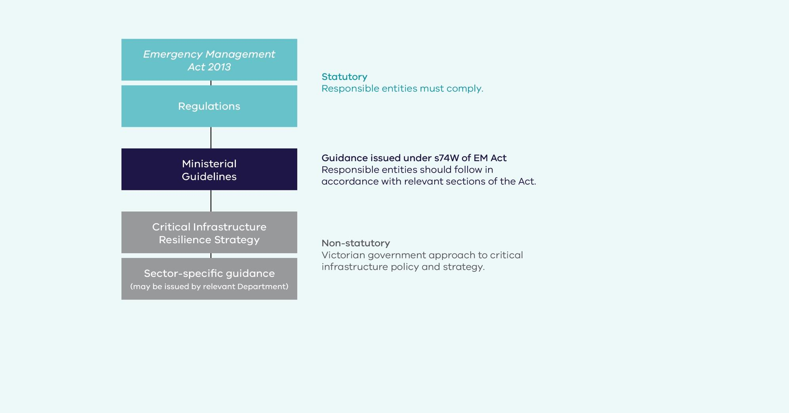
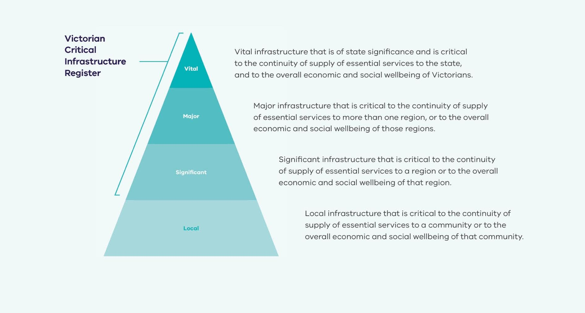
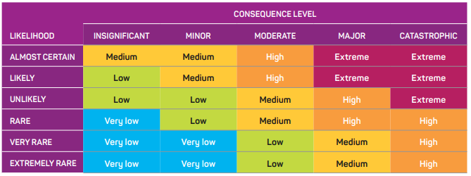
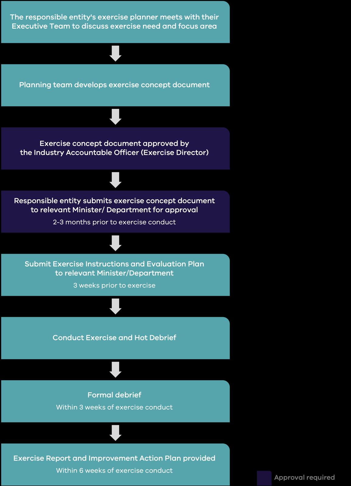

# Ministerial Guidelines for Critical Infrastructure Resilience (February 2024)

> **Source**: Emergency Management Victoria
> **URL**: https://files.emv.vic.gov.au/2024-02/Ministerial%20Guidelines%20for%20Critical%20Infrastructure%20Resilience%20-%20February%202024.pdf
> **Licence**: © State of Victoria; emergency-management practitioner reference
> **Retrieved**: 2026-05-07T23:44:43Z
> **SHA-256**: `e3ff4e64775c5e416a6df6564e80eb365297c6d2d6639d3014abd02a7a2327ae`
> *Converted from PDF to Markdown format.*

---
## Page 1

 
Ministerial 
Guidelines for 
Critical 
Infrastructure 
Resilience

---
## Page 2

Ministerial Guidelines for Critical Infrastructure Resilience 
Page 2 of 48 
Authority 
These Guidelines are issued by the Minister for Emergency Services in accordance with 
section 74W of the Emergency Management Act 2013 (the Act). 
Commencement 
These Guidelines commence operation on the day they are approved. 
It is intended that these Guidelines and templates contained within will be reviewed 
periodically. Emergency Management Victoria (EMV) will lead the review process.  
Any revisions of the Ministerial Guidelines will be endorsed by the State Crisis and 
Resilience Council and the Minister responsible for the Act. 
Document information 
Date of Approval: 5 February 2024 
Version: Version 4 issued by the Hon. Jaclyn Symes MP, Minister for Emergency Services 
Change log: 
Date 
Change 
28 May 2015 
Original Guidelines issued by Minister for Emergency Services. 
23 August 2016 
Inclusion of definition for ‘region.’ 
27 March 2017 
Updated Table 1: SRP Reporting Cycle. 
5 February 2024 
Content reviewed and updated across all Guidelines.

---
## Page 3

Ministerial Guidelines for Critical Infrastructure Resilience 
Page 3 of 48 
Contents 
 
Introduction............................................................................................................................................... 5 
Objectives of the Ministerial Guidelines for Critical Infrastructure Resilience ..................... 6 
Key Definitions ................................................................................................................................................................... 6 
Information Security Classification .....................................................................................................................8 
Ministerial Guideline: Criticality Assessment Methodology ...................................................... 11 
Objectives of the Ministerial Guideline for the Criticality Assessment Methodology ...... 11 
Key Principles of the Criticality Assessment Methodology ................................................................. 11 
Critical Infrastructure Resilience Information System ......................................................................... 12 
Ministerial Guideline: Emergency Risk Management Planning ............................................... 13 
Objectives of the Ministerial Guideline for Emergency Risk Management Planning ...... 13 
Key Principles for Emergency Risk Management Planning .............................................................. 14 
Reporting ............................................................................................................................................................................. 15 
Schedule 1: Statement of Assurance template .......................................................................................... 16 
Schedule 2: Attestation template ....................................................................................................................... 23 
Ministerial Guideline: Additional Assurance Information ......................................................... 25 
Objectives of the Ministerial Guideline for Additional Assurance Information .................. 25 
Key Principles for Requesting Additional Assurance Information ............................................... 25 
Ministerial Guideline: Exercises ........................................................................................................ 28 
Objectives of the Ministerial Guideline for Exercises ........................................................................... 28 
Key Principles for Exercises ................................................................................................................................... 28 
Key Timeframes in the Exercise Cycle ............................................................................................................. 31 
Key Documentation ..................................................................................................................................................... 32 
Exercise Feedback – Minister’s Delegate ..................................................................................................... 32 
Exercise Exemption ..................................................................................................................................................... 32 
Ministerial Guideline: Audits .............................................................................................................. 33 
Objectives of the Ministerial Guideline for Audits................................................................................... 33 
Key Principles of Audits ............................................................................................................................................. 33 
Audit Scope ...................................................................................................................................................................... 34 
Appointment of an Auditor .................................................................................................................................... 34 
Audit Methodology ....................................................................................................................................................... 35 
Audit Report ......................................................................................................................................................................36 
Audit Certificate .............................................................................................................................................................36

---
## Page 4

Ministerial Guidelines for Critical Infrastructure Resilience 
Page 4 of 48 
Second Audit ....................................................................................................................................................................36 
Schedule 3: Audit Certificate template .......................................................................................................... 37 
Ministerial Guideline: Sector Resilience Plans .............................................................................. 38 
Objectives of the Ministerial Guideline for Sector Resilience Plans ...........................................39 
Key Principles for Developing the Sector Resilience Plan .................................................................39 
Reporting ........................................................................................................................................................................... 40 
Schedule 4: Sector Resilience Plan template .............................................................................................. 41

---
## Page 5

Ministerial Guidelines for Critical Infrastructure Resilience 
Page 5 of 48 
Introduction 
The Victorian arrangements for critical infrastructure resilience aim to provide clear 
guidance and a strategic framework for the Victorian Government and key public and 
private sector stakeholders to work together to enhance organisational and sector 
resilience. 
These Ministerial Guidelines for Critical Infrastructure Resilience (Guidelines), issued in 
accordance with section 74W of the Emergency Management Act 2013 (the Act), are 
designed to assist stakeholders to implement requirements under the arrangements.  
Responsible entities should follow the Guidelines to support compliance with their 
obligations under the Act. Failure to comply with requirements of the Act may result in 
penalty. 
Government departments under the Critical Infrastructure Resilience Strategy (the 
Strategy) should follow the Ministerial Guideline for Sector Resilience Plans. 
Sector-specific guidance may also be issued by relevant Departments to further 
support responsible entities. 
Figure 1 illustrates the hierarchy of documents involved in the critical infrastructure 
resilience arrangements.   
It is acknowledged that some responsible entities for vital critical infrastructure in 
Victoria under Part 7A of the Act may also have obligations under the Security of 
Critical Infrastructure Act 2018 (Cth) (SOCI Act). Wherever possible, Part 7A activities 
may complement or contribute to obligations under the SOCI Act, so long as specific 
requirements of the Emergency Management Act 2013 are also met. 
Figure 1: Documents supporting Victorian critical infrastructure arrangements

---
## Page 6

Ministerial Guidelines for Critical Infrastructure Resilience 
Page 6 of 48 
Objectives of the Ministerial Guidelines for Critical 
Infrastructure Resilience  
These Guidelines support relevant Departments and key public and private sector 
stakeholders to meet requirements under the Act, the Emergency Management 
(Critical Infrastructure Resilience) Regulations 2015 (the Regulations), and the Strategy. 
While the Regulations set out minimum standards for the legislated requirements of 
emergency risk management plans, exercises and audits, the Guidelines provide more 
explicit guidance to assist in undertaking these and other activities specified in the Act 
or Strategy. 
Relevant Departments and owners and/or operators of critical infrastructure are 
expected to work together using the approach set out by these Guidelines to achieve 
the best results under the Act for the Victorian community. 
Key Definitions  
Act 
Refers to the Emergency Management Act 2013. 
Audit 
Has the same meaning as provided in section 74S of the Act. 
Critical dependency 
Refers to the relationship with assets, systems, 
infrastructure, or supply chains which, if disrupted, would 
significantly inhibit the ability of a sector to deliver its critical 
services to the community. 
Critical 
infrastructure1 
Has the same meaning as provided in section 74B of the Act.  
Criticality 
assessment 
methodology 
Refers to the Criticality Assessment Tool (CAT) within the 
Critical Infrastructure Resilience Information System (CIRIS). 
Exercise 
Has the same meaning as provided in section 74Q of the Act. 
Emergency 
Has the same meaning as provided in section 3 of the Act. 
Emergency risk 
management plan 
Has the same meaning as provided in section 74P of the Act. 
Guidelines 
Refers to guidelines issued under section 74W of the Act. 
 
1  An additional definition of critical infrastructure is used in Victoria, which applies more broadly than this definition from 
the Act: Critical infrastructure includes those physical facilities, supply chains, systems, assets, information 
technologies and communication networks which, if destroyed, degraded, compromised, or rendered unavailable for 
an extended period, would significantly impact on the social or economic wellbeing of the Victorian community. Under 
the Strategy, Victoria recognises eight critical infrastructure sectors: banking and finance, communications, energy, 
food and grocery, government, health, transport, and water. The Security of Critical Infrastructure Act 2018 (Cth) 
identifies a broader range of sectors as critical infrastructure, which are of national importance.

---
## Page 7

Ministerial Guidelines for Critical Infrastructure Resilience 
Page 7 of 48 
Industry Accountable 
Officer 
Has the same meaning as provided in section 74I of the Act. 
 
Key emergency risk 
Is a risk which, if realised, could disrupt the supply of critical 
services to the community. 
OFFICIAL: Sensitive 
Security classification under the Australian Government 
Protective Security Policy Framework (PSPF) is used for 
information that if compromised, unauthorised release could 
cause limited damage to an individual, organisation or 
government generally. 
Owner and/or 
operator 
Refers to any entity which owns and/or operates critical 
infrastructure. This may include the responsible entity for 
vital critical infrastructure, or the owner/operator of major or 
significant critical infrastructure. 
PROTECTED 
Security classification under the Australian Government 
PSPF is used for information that could result in damage to 
the national interest, organisations or individuals if 
compromised. Note: the phrase “protected information” 
under the SOCI Act has a different meaning than used in the 
PSPF or these Guidelines. 
Region 
Has the same meaning as defined in the Victorian State 
Emergency Management Plan. 
Regulations 
Refers to the Emergency Management (Critical 
Infrastructure Resilience) Regulations 2015. 
Relevant Department Has the same meaning as provided in section 74B of the Act. 
Relevant Minister 
Has the same meaning as provided in section 74B of the Act. 
Resilience 
Improvement Cycle 
Has the same meaning as provided in sections 74B and 74M 
of the Act. 
Responsible entity 
Has the same meaning as provided in section 74H of the Act. 
SOCI Act 
Refers to the Security of Critical Infrastructure Act 2018 (Cth). 
Statement of 
Assurance 
Has the same meaning as provided in section 74B of the Act. 
Strategy 
Refers to the Critical Infrastructure Resilience Strategy 
(Victorian Government). 
Victorian Critical 
Infrastructure 
Register 
Has the same meaning as provided in section 74B of the Act. 
Vital critical 
infrastructure 
Has the same meaning as provided in section 74B of the Act.

---
## Page 8

Ministerial Guidelines for Critical Infrastructure Resilience 
Page 8 of 48 
Information Security Classification 
Material provided by owners and/or operators of vital critical infrastructure to 
Government will be treated as OFFICIAL: Sensitive or PROTECTED information. 
Information security classifications 
The more valuable, important, or sensitive the information, the greater the impact on 
the business that would result from its compromise. 
OFFICIAL: Sensitive: If compromised, unauthorised release of this information could 
cause limited damage to an individual, organisation or government generally. 
PROTECTED: If compromised, unauthorised release of this information could result in 
damage to the national interest, organisations, or individuals. 
A baseline security clearance or above is required for Department representatives with 
ongoing access to PROTECTED information.

---
## Page 9

Ministerial Guidelines for Critical Infrastructure Resilience 
Page 9 of 48 
Type of material under each classification 
OFFICIAL: Sensitive material includes: 
• 
Part 7A documents*, if identifying information is removed, including:  
o Statement of Assurance 
o Attestation by the Industry Accountable Officer 
o Part 7A exercise documents 
o Part 7A audit certificate and findings 
o Details relating to an emergency risk management plan or other documents 
relating to emergency risk management.  
*Note: If the above documents are being shared with other responsible entities for 
the purposes of continuous improvement, these must be redacted to remove 
identifying information such as the name and address of the vital critical 
infrastructure, criticality rating, responsible entity, Industry Accountable Officer, 
as well as specific information on risk that may identify the asset’s vulnerabilities. 
This information should not be shared outside of the relevant Department without 
informing the responsible entity as the owner of these documents. 
• 
General information within the Critical Infrastructure Resilience Information 
System (CIRIS) – noting owner/operator information is only visible to the 
organisation, relevant Department, and EMV. 
PROTECTED material includes: 
• 
Governor in Council Orders made under section 74E(1) of the Act, designating vital 
critical infrastructure or revoking such designations. 
• 
Infrastructure criticality ratings (assessment as significant or major critical 
infrastructure, or designation as vital critical infrastructure – this includes an 
owner and/or operator’s status as a responsible entity). 
Note: There may be some instances where certain information can be shared 
within government, such as with specific positions requiring access (for example, 
the relevant State Duty Officer during an emergency). Information may be 
disclosed for appropriate government purposes and if there is an operational 
requirement to do so, in line with the need-to-know principle. For advice, contact 
EMV at cir@emv.vic.gov.au.

---
## Page 10

Ministerial Guidelines for Critical Infrastructure Resilience 
Page 10 of 48 
• 
Information on the Victorian Critical Infrastructure Register. Access is as per 
section 74K of the Act. 
Applying protective markings 
• 
The appropriate protective markings should be used by responsible entities and 
relevant Departments to identify sensitive or security classified information. 
• 
It is the responsibility of the entity generating the information to apply the 
appropriate protective marking. 
• 
Protective markings cannot be removed from information that is copied or re-
used to a new document.  
• 
Documents are to be classified to the highest level of information they contain. 
Further information 
Further information on the measures for handling security classified can be found in 
the Protecting and securing Victorian Government information and assets guide at 
https://www.vic.gov.au/protecting-and-securing-victorian-government-information-
and-assets/information-security. 
For further information about applying for a security clearance, contact 
security.clearances@dpc.vic.gov.au.

---
## Page 11

Ministerial Guidelines for Critical Infrastructure Resilience 
Page 11 of 48 
Ministerial Guideline: Criticality 
Assessment Methodology 
The relevant Minister, or their delegate, must assess or reassess major, significant 
and/or vital critical infrastructure having regard to the criticality assessment 
methodology. The relevant Minister must then advise the Minister for Emergency 
Services of the outcome of this assessment or reassessment. 
Objectives of the Ministerial Guideline for the Criticality 
Assessment Methodology 
The Ministerial Guideline for the Criticality Assessment Methodology provides advice on 
the appropriate methodology for relevant Ministers to use to assess critical 
infrastructure under sections 74D and 74E of the Act. 
Key Principles of the Criticality Assessment Methodology 
Victoria’s critical infrastructure is assessed at four levels of importance (vital, major, 
significant, and local), with the first three forming the Victorian Critical Infrastructure 
Register (Figure 2). The Register provides high level information about Victoria’s most 
important infrastructure to EMV and others requiring access to perform their functions 
in critical infrastructure, counterterrorism, or emergency management. 
Figure 2: Victorian Critical Infrastructure Model

---
## Page 12

Ministerial Guidelines for Critical Infrastructure Resilience 
Page 12 of 48 
Critical Infrastructure Resilience Information System 
The Critical Infrastructure Resilience Information System (CIRIS) is a secure online 
platform managed by EMV to host information on the criticality of Victorian critical 
infrastructure.  
CIRIS contains the following modules: Criticality Assessment Tool (CAT), Pre-Register, 
Register, and CIRIS map. The CAT provides a consistent and transparent method of 
assessing the value and criticality of infrastructure. The methodology is risk and 
consequence focused and uses predetermined questions to help inform the 
assessment of criticality.  
Owners and/or operators should review CIRIS annually to ensure their asset 
information remains accurate and current.   
The criticality assessment methodology broadly identifies and considers the:  
• 
services provided by the operator/provider to the community  
• 
assets required to supply those services  
• 
hazards and risks impacting both the services and assets  
• 
level of vulnerability of the infrastructure to a hazard  
• 
consequences to the community if the service is not delivered 
• 
an understanding of redundancy including available alternative service providers 
or infrastructure to continue to deliver the service. 
While relevant Ministers have primary responsibility for assessing the criticality of the 
infrastructure within their portfolio, as per section 74D of the Act, the final 
recommendation considers the information provided in CIRIS by owners and operators 
of critical infrastructure, and an assessment from the relevant Department.  
Owners and/or operators may elect not to conduct a self-assessment using the CAT, in 
which case, the recommendation to the Minister will be based upon the assessment of 
the department alone. This does not impact the entity’s obligations under the Act if 
they are a responsible entity for vital critical infrastructure.

---
## Page 13

Ministerial Guidelines for Critical Infrastructure Resilience 
Page 13 of 48 
Ministerial Guideline: Emergency Risk 
Management Planning 
Emergency risk management plans (RMPs) are to be prepared and maintained by 
responsible entities for vital critical infrastructure, in accordance with requirements 
under section 74P of the Act, the Regulations and these Guidelines. To support the 
Statement of Assurance under section 74N, RMPs should include: 
• 
the identification and assessment of key emergency risks 
• 
the existing and planned actions or activities to manage each of the emergency 
risks 
• 
the arrangements, processes, and procedures to implement these actions or 
activities. 
It is recognised that RMPs may be integrated within enterprise risk management plans 
or form a part of other risk management plans prepared to satisfy other legislative 
requirements. For example, a Part 7A RMP may form part of the Critical Infrastructure 
Risk Management Program (CIRMP) prepared in compliance with the SOCI Act, so long 
as the requirements of the Emergency Management Act 2013 and these Guidelines are 
also met. 
To provide assurance that the RMPs meet the requirements of the Act, the annual 
Statement of Assurance, which is to be approved by the Industry Accountable Officer in 
accordance with section 74N of the Act, is to contain a signed attestation. 
Objectives of the Ministerial Guideline for Emergency Risk 
Management Planning 
The Ministerial Guideline for Emergency Risk Management Planning provides 
appropriate guidance to assist responsible entities to effectively manage emergency 
risk, and to prepare the annual Statement of Assurance including signed attestation.

---
## Page 14

Ministerial Guidelines for Critical Infrastructure Resilience 
Page 14 of 48 
Key Principles for Emergency Risk Management Planning 
The Regulations prescribe AS/NZS ISO 31000 Risk management—Principles and 
guidelines, as published from time to time, as the basis for emergency risk 
management planning by responsible entities. 
They also prescribe SA/SNZ HB 436 Risk management guidelines—Companion to 
AS/NZS ISO 31000, as published from time to time. 
The following principles are provided to guide responsible entities in the development 
of their RMPs: 
1. The development and implementation of the RMP should give due consideration 
to the National Emergency Risk Assessment Guidelines, and associated 
guidance publications relating to risk management/supporting ISO 31000. For 
example: 
• 
AS/NZS ISO 31010 Risk management—Risk assessment techniques 
• 
SA/SNZ HB 89 Risk management—Guidelines on risk assessment techniques 
• 
SA/SNZ HB 158 Delivering assurance based on ISO 31000 
• 
SA/SNZ HB 167 Security risk management. 
There may be additional standards that a responsible entity chooses to 
reference in the development of its RMP, on topics such as organisational 
resilience, business continuity, information security, climate change adaptation, 
and so on. 
2. RMPs should consider the impact of an emergency event on the responsible 
entity and any services on which the responsible entity is dependent, so far as is 
reasonably practicable. In the development and implementation of the RMP, the 
responsible entity should consider the dependencies on other services which 
may be deemed critical to the asset's ability to provide services – and 
opportunities for collaboration. 
3. Responsible entities are required to identify the emergency risks to relevant vital 
critical infrastructure, pursuant to section 74N(2) of the Act. 
4. In the identification of risk, responsible entities should consider a range of 
sources to identify key emergency risks and critical dependencies. This may 
include, but is not limited to, the most recent state level risk assessment, annual 
cyber threat reports, climate change reports, or the previous Sector Resilience 
Plan.

---
## Page 15

Ministerial Guidelines for Critical Infrastructure Resilience 
Page 15 of 48 
5. RMPs should reference the emergency response procedures to be implemented 
in readiness and/or response to the occurrence of an emergency event. 
Emergency response procedures should be aligned to and be consistent with the 
State Emergency Management Plan and its sub-plans. Emergency response 
procedures are also to be broadly consistent with the international standard ISO 
22320 Security and resilience—Emergency management—Guidelines for 
incident management, to the extent that the standard is applicable. 
6. RMPs should reference the procedures for recovery of the vital critical 
infrastructure from an emergency event, and for its continued safe operation. 
Recovery and continuity procedures should be broadly consistent with AS/NZS 
5050 Business continuity—Managing disruption-related risk, to the extent that 
the standard is applicable. 
7. RMPs should provide details of the approach to assurance and continuous 
improvement – assurance and risk management being complementary 
processes. 
8. The annual Statement of Assurance prepared in accordance with section 74N of 
the Act should be broadly consistent with the template provided at Schedule 1 of 
this Guideline. 
9. The annual Attestation by the Industry Accountable Officer should be broadly 
consistent with the template provided at Schedule 2 of this Guideline. 
Reporting 
Responsible entities are required by section 74N of the Act to submit a Statement of 
Assurance within the period of 6 months after receiving a copy of an Order under 
section 74E of the Act, and at the end of each subsequent period of 12 months. In 
practice, this means a Statement of Assurance should be submitted annually to the 
relevant Department, no later than 30 days after the completion of the previous cycle. 
The relevant Department will support responsible entities to submit their Statement of 
Assurance and ensure expectations have been met.

---
## Page 16

Ministerial Guidelines for Critical Infrastructure Resilience 
Page 16 of 48 
Schedule 1: Statement of Assurance template 
 
 
 
 
 
 
[SECTOR] 
 
 
Statement of Assurance 
and 
Attestation by the Industry Accountable Officer 
For the previous Resilience Improvement Cycle ending [DD MMM YYYY]  
and new cycle commencing [DD MMM YYYY] 
 
A Statement of Assurance in accordance with section 74N 
of the Emergency Management Act 2013.

---
## Page 17

Ministerial Guidelines for Critical Infrastructure Resilience 
Page 17 of 48 
STATEMENT OF ASSURANCE 
Vital Critical Infrastructure: 
Responsible Entity: 
Address: 
 
Industry Accountable Officer: 
Contact Details: 
Name: 
Phone: 
Mobile: 
Email: 
New Resilience Improvement Cycle Commencing:  [DD MMM YYYY] 
 
EMERGENCY RISK CONTEXT 
Asset Details 
Provide a brief description of the vital critical infrastructure, including its importance to Victoria. 
Risk Analysis Criteria 
Provide details of the likelihood / impact matrix that your organisation is using, including supporting 
scale descriptors. An example is provided below. 
Consequence criteria and levels (EXAMPLE ONLY) – See NERAG section 6.4 
 
Consequence 
Category 
Catastrophic 
Major 
Moderate 
Minor 
Insignificant 
People 
 
 
 
 
 
Economic  
 
 
 
 
 
Environmental 
 
 
 
 
 
Administration 
 
 
 
 
 
Social setting 
(community)

---
## Page 18

Ministerial Guidelines for Critical Infrastructure Resilience 
Page 18 of 48 
Qualitative risk matrix (EXAMPLE ONLY) 
 
Source: National Emergency Risk Assessment Guidelines (NERAG) 
Summary of Risk Assessment 
Provide summary details of: 
• 
the emergency risks identified 
• 
the assessed likelihood, consequence, and level of risk for each identified emergency risk 
• 
current and proposed risk management actions or activities to manage the identified 
emergency risks 
• 
the status and assessed effectiveness of the risk management actions or activities 
• 
material upstream/downstream dependencies or interdependencies relevant to the 
continued provision of an essential service. 
The following table may be used to summarise the organisation’s emergency risk assessment. 
Risk 
 
Category 
e.g. cyber, supply chain etc 
Likelihood (Pre-Control) 
 
Consequence (Pre-Control) 
 
Rating (Pre-Control or Inherent) 
 
Current and proposed actions to 
address risk 
Current actions; 
Proposed actions; 
Likelihood (Post-Control) 
 
Consequence (Post-Control) 
 
Rating (Post-Control)

---
## Page 19

Ministerial Guidelines for Critical Infrastructure Resilience 
Page 19 of 48 
Dependencies and Interdependencies 
The following table may be used to provide additional information summarising the organisation’s 
key dependencies and interdependencies. 
Dependency Type # 
Description 
Controls  
 
U/D/I/ID  
 
 
U/D/I/ID  
 
 
U = Upstream (products or services provided to your infrastructure, necessary to support 
operations) 
 
D = Downstream (products or services provided to your customers) 
 
I = Internal (internal links among major assets constituting your infrastructure) 
 
ID = Interdependency (a bidirectional relationship between two separate pieces of infrastructure, 
each reliant upon the other). 
 
 
EMERGENCY RISK MANAGEMENT PLAN 
The Risk Management Plan for the management of the identified emergency risks is comprised 
of the following manuals and documents: 
The table below includes the minimum reporting requirements under this section. Additional 
information can be added if desired. 
Title 
Version no. 
Version date 
Approval authority 
Date of next scheduled review 
 
 
 
 
 
 
 
 
 
 
 
 
 
 
COMPLETION OF [PREVIOUS CYCLE] ACTION PLAN 
Provide a statement of completion of the action plan contained in the previous cycle’s 
Statement of Assurance. Where actions are incomplete or circumstances have changed, please 
provide an explanation and intended resolution as appropriate. 
The table below can be used as a guide for information to include and provide a traffic light 
overview of status (optional). Additional information can be added if desired, such as: 
• 
Background (how was the action identified?) 
• 
Outcomes (what did the action achieve?)  
• 
Responsible officer (which role was the main contact for this action?)

---
## Page 20

Ministerial Guidelines for Critical Infrastructure Resilience 
Page 20 of 48 
Action 
Status & implementation schedule 
 
Planned improvements to risk treatments 
Arising from: 
- emergency risk assessment 
- exercise outcomes 
- audit findings 
- operational experience / other  
 
For example: Completed, Delayed, 
Scheduled, Ongoing  
+ comment  
 
Training approach and activities 
 
 
 
 
Exercises (schedule and style) 
 
 
 
 
Engagement, collaboration or participation 
- interdependent infrastructure owners / operators 
- the Sector Resilience Network 
- emergency service organisations 
- Government 
 
 
 
 
Assurance activities 
- audit program 
- monitoring, review, improvement 
- reporting 
 
 
 
 
Other

---
## Page 21

Ministerial Guidelines for Critical Infrastructure Resilience 
Page 21 of 48 
ACTION PLAN [UPCOMING CYCLE]:   
Provide details of the specific planned actions or activities to be undertaken in the coming cycle. 
The action plan should include a responsible person (role) and an indicated schedule for 
completion. The action plan should be drawn from: 
• 
Actions arising from: 
o emergency risk assessment 
o last resilience cycle’s Part 7A exercise outcomes 
o last resilience cycle’s Part 7A audit findings 
o operational experience / other (for example, completed training) 
• 
planned engagement, collaboration, and participation with: 
o interdependent infrastructure owners / operators 
o the Sector Resilience Network 
o emergency service organisations 
o Government 
• 
planned assurance activities: 
o Part 7A exercise and any other relevant exercises (high level / indicative information) 
o Part 7A audit program (including proposed audit scope, if known) 
o monitoring, review, improvement 
o reporting 
• 
planned training activities. 
The table below can be used as a guide for information to include and provide a traffic light 
overview (optional). Additional information can be added if desired, such as: 
• 
Background (how was the action identified?) 
• 
Outcomes (what will the action achieve?)  
• 
Responsible officer (which role is the main contact for this action?) 
Action 
Status & implementation schedule 
 
Planned improvements to risk treatments 
 
 
  
 
Training approach and activities 
 
 
 
 
Exercises (schedule and style)

---
## Page 22

Ministerial Guidelines for Critical Infrastructure Resilience 
Page 22 of 48 
Action 
Status & implementation schedule 
 
Engagement, collaboration or participation 
 
 
 
 
Assurance activities 
 
 
 
 
Other

---
## Page 23

Ministerial Guidelines for Critical Infrastructure Resilience 
Page 23 of 48 
Schedule 2: Attestation template 
 
Attestation by the Industry Accountable Officer 
 
I, [Name of Industry Accountable Officer], being the Industry Accountable Officer for the 
responsible entity of [Name of responsible entity], the owner/operator of vital critical 
infrastructure known as [Name of vital critical infrastructure/s], do hereby attest that:  
 
For the period from [Previous cycle submission date] to [Current submission date], 
 
1. The information provided in the accompanying Statement of Assurance accurately 
reflects the status of the management of emergency risk, planned actions and activities, 
and the assurance program for emergency risk management. 
2. [Name of responsible entity] has complied with the requirements of Part 7A of the 
Emergency Management Act 2013, other than any exceptions noted in the attached 
Schedule. 
3. [Name of responsible entity] will undertake the emergency risk management actions and 
activities proposed in the accompanying Statement of Assurance in the Resilience 
Improvement Cycle from [Current date/new cycle commencement] to [Next submission 
date/end of cycle]. 
4. The emergency risk management actions and activities proposed for the previous 
resilience improvement cycle within the Statement of Assurance dated [Previous 
submission date] have been undertaken, other than any exceptions noted in the attached 
Schedule. 
5. (Optional) [Name of responsible entity] has reviewed the accuracy and currency of 
information on its critical infrastructure within the Critical Infrastructure Resilience 
Information System (CIRIS).  
 
………………………………………………. 
Date: 
[Name] 
Industry Accountable Officer 
[Name of responsible entity] 
[Address of responsible entity]

---
## Page 24

Ministerial Guidelines for Critical Infrastructure Resilience 
Page 24 of 48 
Schedule 
Use this Schedule to note any exceptions in compliance with Part 7A of the Emergency 
Management Act 2013 (as agreed in writing by the relevant Minister or Department), or any 
exceptions to the emergency risk management actions and activities that were to be undertaken 
in the previous Resilience Improvement Cycle.    
The responsible entity is advised to liaise with the relevant Department regarding any significant 
compliance exceptions prior to submitting the Statement of Assurance. 
Delete this Schedule if not required.

---
## Page 25

Ministerial Guidelines for Critical Infrastructure Resilience 
Page 25 of 48 
Ministerial Guideline: Additional 
Assurance Information 
The relevant Minister or delegate may, subject to the requirements of section 74O or 
74P of the Act, use powers under these provisions to obtain additional assurance 
information from a responsible entity.  
Objectives of the Ministerial Guideline for Additional 
Assurance Information 
The objective of this Ministerial Guideline is to describe the powers available to the 
relevant Minister or delegate under the Act to seek additional information from a 
responsible entity to validate that an emergency risk relevant to vital critical 
infrastructure has been identified and appropriately managed. 
The intent is to provide assurance to the relevant Minister that the responsible entity 
can effectively manage and mitigate key emergency risks that may threaten the 
delivery of an essential service. 
Key Principles for Requesting Additional Assurance 
Information 
1. A Statement of Assurance prepared under section 74N of the Act must:  
o be prepared in accordance with the Regulations and Guidelines 
o identify the emergency risks to relevant vital critical infrastructure 
o specify the emergency risk management actions or activities that the 
responsible entity proposes to take to address the identified emergency risks 
o contain an attestation signed by the Industry Accountable Officer.  
2. The attestation must state, among other things, whether or not the emergency 
risk management actions and activities proposed in the previous statement of 
assurance have been undertaken, and how audit findings under section 74T will 
be dealt with. 
3. Risk management actions or activities within the Statement of Assurance should 
be written in an adequate level of detail to provide validity and assurance of 
appropriate management.

---
## Page 26

Ministerial Guidelines for Critical Infrastructure Resilience 
Page 26 of 48 
4. An example of risk management actions or activities to be included in the 
Statement of Assurance may include training, exercising, reviews and reporting 
(for example, business continuity plans), assessments and audits, alignment with 
relevant standards or frameworks, consultations and engagement (for example, 
with community, other organisations, cross-sector, with Executive board), 
documentation (for example, policies, Standard Operating Procedures), and 
operational activities (for example, vegetation management, construction of a 
flood wall).  
5. The responsible entity should note which activities, if any, are compliance 
activities associated with other legislation/regulation. 
6. Under section 74O, a relevant Minister or delegate may request a responsible 
entity to revise a Statement of Assurance submitted by the responsible entity if 
the relevant Minister or delegate is of the opinion that the statement of 
assurance is not adequate having regard to the requirements under section 74N. 
7. The relevant Minister or delegate may inform the responsible entity in writing 
which sections of the Statement of Assurance are not adequate and provide 
recommendations for what should be addressed to meet the requirements 
under section 74N.  
8. As an example, a responsible entity may have completed a maturity assessment 
during the previous resilience improvement cycle, however the Statement of 
Assurance did not include sufficient level of detail, such as the score obtained, or 
areas of improvement identified. 
9. If a revised Statement of Assurance is in the opinion of the relevant Minister or 
delegate still not adequate having regard to section 74N, the relevant Minister or 
delegate may direct the responsible entity to submit a further Statement of 
Assurance amended in accordance with the direction of the relevant Minister or 
delegate within a time as specified by the relevant Minister or delegate. The 
relevant Minister or delegate may request a responsible entity to provide any 
information specified by the Minister or delegate in the request which is 
considered necessary to establish the accuracy of the statements made in the 
Statement of Assurance. A responsible entity must comply with the request 
within the specified timeframe. 
10. Under section 74P, the responsible entity must prepare an emergency risk 
management plan for vital critical infrastructure to prepare for an emergency, in 
accordance with the Regulations and Guidelines. The relevant Minister or 
delegate may request a responsible entity to provide a copy of an emergency 
risk management plan, any details relating to an emergency risk management 
plan or any other documents relating to emergency risk management as 
specified in the request. Responsible entities are required to comply with this

---
## Page 27

Ministerial Guidelines for Critical Infrastructure Resilience 
Page 27 of 48 
request within the time specified by the relevant Minister or delegate in the 
request under section 74P.

---
## Page 28

Ministerial Guidelines for Critical Infrastructure Resilience 
Page 28 of 48 
Ministerial Guideline: Exercises 
Responsible entities must develop, conduct, and evaluate an exercise to test their 
planning, preparedness, mitigation, response, or recovery capability in respect of an 
emergency. 
Objectives of the Ministerial Guideline for Exercises 
The Ministerial Guideline for Exercises summarises the approach to the preparation, 
conduct and evaluation of Part 7A exercises in accordance with requirements under 
sections 74Q and 74R of the Act and regulation 6 of the Regulations.  
Key Principles for Exercises 
The Regulations currently prescribe the Australian Emergency Management Handbook 
Series—Managing Exercises Handbook 3, as published from time to time, as the basis 
for the development, conduct and evaluation of exercises by responsible entities. This 
Handbook is now published by the Australian Institute for Disaster Resilience (AIDR) as 
the Australian Disaster Resilience Handbook 3: Managing Exercises. 
The Handbook is available for download at 
https://knowledge.aidr.org.au/collections/handbook-collection/. 
Responsible entities should also give due consideration to the Lessons Management 
Handbook (AIDR), as published from time to time. 
The following principles are provided to guide responsible entities in the development, 
conduct and evaluation of their exercises: 
1. An exercise is a controlled, objective-driven activity used for testing, practising 
or evaluating processes or capabilities. 
2. The focus of the Part 7A exercise should be a key emergency risk within an ‘all 
hazards, all emergencies’ context. 
3. ‘All hazards’ may include cyber and information security hazards, personnel 
hazards, physical security hazards, natural hazards or supply chain hazards.

---
## Page 29

Ministerial Guidelines for Critical Infrastructure Resilience 
Page 29 of 48 
4. Exercise designers should: 
a. 
consider the processes or capabilities that need to be tested or 
practised 
b. 
develop measurable objectives that will allow exercise evaluators to 
observe activities and assess performance 
c. 
design a scenario focussed on those capabilities.   
5. Exercise scenarios should be identified that will support measurable, achievable 
objectives. 
6. Exercises should consider organisational requirements and the risk context in 
which the organisation is operating, including state significant risks and risks 
identified by the sector in the Sector Resilience Plan. Exercises should also be 
commensurate to the asset being vital critical infrastructure – meaning they 
should appropriately test emergency planning, preparedness, prevention, 
response or recovery capability in relation to a key emergency risk, given the 
adverse impact that disruption could have on the supply of an essential service 
to Victoria, or the economic or social wellbeing of the State. 
7. Under section 74Q(2) of the Act, the exercise must be developed in consultation 
with the relevant Minister. To support this requirement, the Exercise Concept 
Document including details of the proposed exercise (the nature of the 
simulated emergency event, timing and location) should be submitted to the 
relevant Minister or Department for review and approval 2-3 months before the 
exercise date.  
8. Failure to manage aspects of an incident within the context of an exercise does 
not equate to non-compliance. In fact, identifying gaps and areas for 
improvement is a crucial part of successful exercising for continuous 
improvement. 
9. Exercise scope should be linked to the needs of the organisation in relation to 
their identified emergency risks. It is recommended that exercise scope is 
different year to year – unless the purpose is to specifically improve on an 
aspect identified in a previous year or there is a suitable justification for 
considering a similar risk in consecutive years. 
10. An exercising program should be incorporated into the organisation’s 
continuous improvement cycle. 
11. Responsible entities may utilise existing internal exercises for the purposes of a 
Part 7A exercise, so long as they meet the requirements of the Act and these

---
## Page 30

Ministerial Guidelines for Critical Infrastructure Resilience 
Page 30 of 48 
Guidelines, which include obtaining agreement in writing from the responsible 
Minister. 
12. Exercises should consider the relationships with state and regional emergency 
management arrangements, as considered appropriate. 
13. Responsible entities may consider involving relevant stakeholders or agencies, 
such as interdependent infrastructure, to take part in the exercise. 
14. Described in sections 74Q and 74R of the Act, the relevant Minister (or relevant 
Department, as the Minister’s delegate) must be consulted in the development of 
the exercise, observe, and review the exercise conduct, including the exercise 
debrief, and provide comments in writing to the responsible entity on the 
outcomes of the exercise. An exercise conducted without the relevant Minister, 
or their delegate, in attendance is not compliant with the Act. 
15. Responsible entities may choose to inform relevant stakeholders of exercise 
outcomes, for example, following a cyber security exercise it may be useful to 
share a copy of the Exercise Report with the Department of Government 
Services Cyber Security Division.

---
## Page 31

Ministerial Guidelines for Critical Infrastructure Resilience 
Page 31 of 48 
Key Timeframes in the Exercise Cycle 
The relevant Department, as the Minister’s delegate, will monitor all aspects of the 
exercise cycle. 
 
 
 
The above timeframes are indicative only to maintain the intent of the legislation. 
Responsible entities may seek amendment to these timeframes in consultation with the 
Minister’s delegate.

---
## Page 32

Ministerial Guidelines for Critical Infrastructure Resilience 
Page 32 of 48 
Key Documentation 
In accordance with the Managing Exercises handbook, responsible entities will produce 
and submit the following documents at minimum: 
• 
Exercise Concept Document 
• 
Exercise Plan 
• 
Exercise Instructions 
• 
Evaluation Plan 
• 
Exercise Report and Improvement 
Action Plan (treatment 
options/recommendations). 
Exercise Feedback – Minister’s Delegate 
The relevant Department will provide the responsible entity with feedback focussed on 
both the performance against objectives as well as the process of designing and 
managing the exercise as a requirement under section 74R(b) of the Act. These 
observations will be incorporated in the Department’s written feedback. 
If the observer of the exercise considers that there are significant issues with the 
exercise conduct or outcome then the responsible entity may be required to conduct 
another exercise, conduct training or other remedial activities as required under 
section 74R(c) of the Act. 
Exercise Exemption 
As per section 74Q(8) of the Act, the relevant Minister (or relevant Department) may 
agree in writing with the responsible entity that the responsible entity is not required to 
complete an exercise in the current Resilience Improvement Cycle, if the relevant 
Minister is satisfied that the occurrence of an event, including an exercise conducted in 
compliance with any other requirement, tested the responsible entity’s planning, 
preparedness, mitigation, response or recovery capability in respect of an emergency; 
and the occurrence of the event demonstrated substantial compliance with the 
requirements under Part 7A. An exercise conducted in compliance with any other 
requirement is still expected to have met obligations of a Part 7A exercise. 
Where a responsible entity also operates outside of Victoria, the relevant Minister will 
determine whether an interstate emergency event or exercise is acceptable to 
demonstrate substantial compliance with the requirements under section 74Q of the 
Act. 
Responsible entities should follow any processes for requesting an exemption issued by 
the relevant Department.

---
## Page 33

Ministerial Guidelines for Critical Infrastructure Resilience 
Page 33 of 48 
Ministerial Guideline: Audits 
Responsible entities must conduct an audit of their emergency risk management 
processes after the completion of a Part 7A exercise. 
Objectives of the Ministerial Guideline for Audits 
The Ministerial Guideline for Audits provides advice on conducting an audit in 
accordance with section 74S of the Act and preparing an audit certificate and findings 
as per section 74T of the Act. 
The audit should be conducted after the completion of a Part 7A exercise; and 
submitted before the end of the Resilience Improvement Cycle. An audit must still be 
undertaken by a responsible entity even when an exercise exemption has been 
granted. 
Key Principles of Audits 
The Regulations prescribe the international standard handbook HB 158 Delivering 
assurance based on ISO 31000 Risk management—Principles and guidelines, as 
published from time to time, as the basis for the planning and conduct of audits by 
responsible entities. 
The following principles guide responsible entities in the planning and conduct of their 
audits: 
1. The main focus of the audit should be to evaluate the efficiency, effectiveness 
and appropriateness of the emergency risk management processes. 
2. Audits should form a key part of the responsible entity’s assurance program. 
3. Audits should be aligned with the responsible entity’s existing processes to avoid 
duplication. 
4. Audits should be conducted as an independent activity. In accordance with 
section 74S(3)(a) of the Act, audits must be undertaken by a person who was not 
involved in the emergency risk management planning process or the 
development and conduct of an exercise.

---
## Page 34

Ministerial Guidelines for Critical Infrastructure Resilience 
Page 34 of 48 
The following training is recommended for those conducting or reviewing Part 7A 
audits: 
• 
BSBAUD411 Participate in quality audits 
• 
BSBAUD511 Initiate quality audits 
• 
BSBAUD512 Lead quality audits 
• 
BSBAUD513 Report on quality audits. 
Audit Scope 
The audit should evaluate the efficiency, effectiveness and appropriateness of the 
responsible entity’s management of risks to its capability in relation to planning, 
preparedness, prevention, response and recovery in accordance with section 74S of the 
Act.  
The responsible entity is encouraged to work with the relevant Department to confirm 
the audit scope will meet requirements of the Act and determine timing for audit 
completion. Note the audit is not required to be on the Part 7A exercise. The audit focus 
should change from year to year, as appropriate to the needs of the organisation, to 
examine various aspects of the responsible entity’s risk management.  
In determining the audit scope, the responsible entity should consider: 
• 
clearly defining the extent, timing and nature of the audit 
• 
the risk assessment process 
• 
the risk to the capability of the responsible entity to plan, prepare, prevent, 
respond and recover from emergency events. 
Appointment of an Auditor 
The audit is to be undertaken by an audit team with adequate knowledge of the 
subject matter and audit techniques, who were not involved in the emergency risk 
management planning process or the development or conduct of an exercise (refer to 
section 74S(3) of the Act). This may be conducted internally or by an external 
contractor. 
It is good practice for an audit to be conducted periodically by a suitably qualified 
external auditor.

---
## Page 35

Ministerial Guidelines for Critical Infrastructure Resilience 
Page 35 of 48 
Audit Methodology 
The planning stage of the audit should consider: 
• 
understanding the responsible entity and its key stakeholders 
• 
the responsible entity’s operating environment and its internal control systems 
• 
assessing the risk of misstatement 
• 
the design of audit procedures commensurate with the assessed level of risk 
• 
sources of evidence. 
Typically, the audit should include: 
• 
an analysis of documented procedures 
• 
interviews/consultation with relevant staff and key stakeholders 
• 
involving appropriate staff to assess the effectiveness of training 
• 
an analysis of information systems to assess effectiveness 
• 
an analysis of quality controls 
• 
an identification of changes in systems and documented procedure 
• 
an evaluation and documentation of deficiencies.

---
## Page 36

Ministerial Guidelines for Critical Infrastructure Resilience 
Page 36 of 48 
Audit Report 
The audit findings should be documented in a report which includes: 
• 
a description of the audit objective, audit scope and methodology 
• 
audit questions, sources of data and limitations of data 
• 
the systems, processes and procedures examined 
• 
recommendations for improvements based on findings where relevant. 
Auditors are encouraged to report audit outcomes using a grading system. 
The responsible entity has the right of reply to any of the audit findings and should 
prepare a response to the audit report as appropriate. 
Audit Certificate 
Following the audit, the Industry Accountable Officer should submit to the relevant 
Minister an audit certificate confirming that the audit has been completed, as soon as 
practicable. The certificate should include the outcome of the audit, whether any 
required actions have been identified and any responsible entity management 
response.  
The audit certificate should be completed using the template at Schedule 3 of this 
Guideline. 
The identified actions and the expected timing for implementation should be included 
in the annual Statement of Assurance submitted to the relevant Department. 
Second Audit 
Section 74U of the Act provides that the relevant Minister can request a second audit if 
the relevant Minister is not satisfied that the audit has met the intent of the Act.

---
## Page 37

Ministerial Guidelines for Critical Infrastructure Resilience 
Page 37 of 48 
Schedule 3: Audit Certificate template 
 
 
Dear Minister, 
 
[Name of responsible entity] Audit Certificate 
 
As you are aware, [Name of vital critical infrastructure] is designated as vital critical infrastructure 
for purposes of the (Vic) Emergency Management Act 2013 (the Act). [Name of responsible 
entity], being the responsible entity, is required to conduct an audit of its emergency risk 
management processes under the Act. As the Industry Accountable Officer for [Name of 
responsible entity], and pursuant to Section 74T of the Act, I hereby attest that: 
 
1. An audit of [Name of responsible entity]’s emergency risk management processes has 
been completed for the previous Resilience Improvement Cycle of XXXX to XXXX. 
 
2. The audit evaluated the efficiency, effectiveness and appropriateness of the 
management of risks to [Name of responsible entity]’s capability in relation to planning, 
preparedness, mitigation, response and recovery in accordance with section 74S of the 
Act, section 7 of the Emergency Management (Critical Infrastructure Resilience) 
Regulations 2015 and HB—158:2010: Delivering assurance based on ISO 31000:2009 
Risk management—Principles and guidelines. 
 
3. The enclosed Appendix outlines the audit scope, methodology, findings and associated 
actions aimed at improving the overall effectiveness of [Name of responsible entity] 
emergency risk management processes. 
 
Should you have any questions in relation to this matter, please contact XXXX. 
Regards 
 
XXXX 
Industry Accountable Officer 
 
APPENDIX –

---
## Page 38

Ministerial Guidelines for Critical Infrastructure Resilience 
Page 38 of 48 
Ministerial Guideline: Sector Resilience 
Plans 
Sector Resilience Plans (SRPs) are produced annually by government departments in 
collaboration with industry through Sector Resilience Networks (SRNs) or other existing 
stakeholder groups. SRPs are based on information supplied by the sector and provide 
Government with:  
• 
a picture of each sector’s overall resilience 
• 
key emergency risks faced by the sector 
• 
the sector’s key dependencies and interdependencies 
• 
major emergencies experienced over the past 12 months 
• 
resilience improvement initiatives completed by the sector in the previous 12 
months 
• 
resilience improvement initiatives to be undertaken by the sector in the following 
12 months.  
SRPs also perform an assurance function. Government departments are accountable 
for their responsibilities under the Strategy and their role in promoting the resilience of 
their sector through the SRP’s Departmental Attestation.

---
## Page 39

Ministerial Guidelines for Critical Infrastructure Resilience 
Page 39 of 48 
Objectives of the Ministerial Guideline for Sector Resilience 
Plans 
The Ministerial Guideline for Sector Resilience Plans provides guidance to assist 
government departments to complete SRPs. A sample Sector Resilience Plan template 
to guide government departments in the development of their SRPs is at Schedule 4. 
Key Principles for Developing the Sector Resilience Plan 
The following principles are provided to guide government departments in the 
development of their SRPs: 
1. SRPs should represent a collaboration between the government departments 
and industry stakeholders through the SRN, or other key stakeholder groups.  
2. Government departments should work with industry to develop the content of 
the SRPs. However, departments will remain the final arbitrator of the content of 
the SRPs in the interest of improvement of sector-wide resilience. Some matters, 
such as specific terrorism risks and mitigations, may be considered by 
departments or sectors to be too sensitive to include within the SRPs. The 
Secretary of the department for the sector may determine that the sensitivity of 
any matters warrant that they should be referenced only at a high level or, 
where there is exceptional justification, not be included in the SRP. Where 
possible the issues should be summarised prudently with guidance provided on 
related resilience improvement initiatives or other actions that are planned. 
3. To promote consistency and support the preparation of the All Sectors 
Resilience Report, the SRPs developed by government departments should be 
broadly consistent with the template provided at Schedule 4.

---
## Page 40

Ministerial Guidelines for Critical Infrastructure Resilience 
Page 40 of 48 
Reporting 
SRPs are completed annually by government departments. EMV will determine 
appropriate timelines in consultation with government departments, however an 
indicative reporting cycle is at Table 1 below to assist in planning. 
Table 1: SRP Reporting Cycle 
Date 
1 July 
previous year 
1 July 
August – 
September 
October – 
December* 
SECTOR 
RESILIENCE 
PLANS 
Commencement 
Government 
departments 
begin drafting 
SRPs. 
Submission 
Finalised SRPs 
provided to 
EMV 
(Emergency 
Management 
Commissioner). 
Approval Process 
Finalised SRPs 
provided to SCRC 
for endorsement. 
 
ALL 
SECTORS 
RESILIENCE 
REPORT 
 
 
Drafting 
EMV drafts 
Victoria’s Critical 
Infrastructure All 
Sectors Resilience 
Report. 
Approval and 
Release 
All Sectors 
Resilience Report 
publicly released 
following SCRC 
endorsement 
and approval 
from the Minister 
for Emergency 
Services. 
* Indicative dates dependent on annual meeting schedules of SCRC and other priorities.

---
## Page 41

Ministerial Guidelines for Critical Infrastructure Resilience 
Page 41 of 48 
Schedule 4: Sector Resilience Plan template 
 
 
 
 
 
 
 
 
 
 
 
 
 
[SECTOR] 
 
Sector Resilience Plan 
[YEAR] - [YEAR] 
 
 
 
A Sector Resilience Plan in accordance with 
the Victorian Government’s Critical Infrastructure Resilience Strategy.

---
## Page 42

Ministerial Guidelines for Critical Infrastructure Resilience 
Page 42 of 48 
TABLE OF CONTENTS 
1. 
Executive Summary 
2. 
[Name of sector] Sector Overview 
a. 
Defining the Sector 
b. 
Scope of the Sector Resilience Plan 
c. 
Key Industries and Stakeholders 
d. 
Key Assets and Infrastructure 
e. 
Emergency Events that have Challenged the Sector in the Past 12 Months 
f. 
Summary of Actions Arising from the [Previous FY] Sector Resilience Plan 
3. 
Key Emergency Risks and Dependencies 
a. 
The Sector’s Emergency Risk Environment 
b. 
Critical Dependencies of the Sector 
c. 
Resilience Improvement Initiatives 
d. 
Key Roles and Responsibilities 
4. 
Conclusion 
5. 
Departmental Attestation 
6. 
Appendices – only if required. 
Note: As a general rule, approximately 20 pages is a good length for the Sector Resilience Plan. 
However, this will vary depending on the sector and level of detail included.

---
## Page 43

Ministerial Guidelines for Critical Infrastructure Resilience 
Page 43 of 48 
1. 
Executive Summary 
Use this section to summarise the content of the Sector Resilience Plan. 
This is a good place to highlight any themes or focus areas for the next 12-month cycle, 
two or three top initiatives and briefly describe any challenges the sector faced during the 
previous cycle. 
 
2. 
[Name of sector] Sector Overview 
a. 
Defining the Sector 
Provide a brief description of the sector, including any sub-sectors, and the key 
goods or services provided to government, industry, and the Victorian community.  
Approximately 50-100 words, or 2-4 lines, is best for this section. A high-level 
summary will be pulled from here to be used in Victoria’s Critical Infrastructure All 
Sectors Resilience Report, which is published on an annual basis. 
Departments may choose to follow this initial summary with some paragraphs on 
relevant legislation or other context as suitable to their sector. This additional context 
is optional to include. 
 
b. 
Scope of the Sector Resilience Plan 
Include a few lines on the scope of the Sector Resilience Plan.  
For example, “This Plan outlines key activities and outcomes from the [Name of 
sector] Sector Resilience Plan [Previous Cycle] and planning for continuous 
improvement initiatives for the [Name of sector] sector in Victoria over [Upcoming 
Cycle]. 
 
Include comment on engagement with key sector stakeholders to contribute to the 
development of the Sector Resilience Plan. 
Where the focus is on a particular risk and/or resilience theme, this should be noted. 
 
Include comment on intended audience (primarily internal government/in some 
cases also the Sector Resilience Network, however a high-level summary of its 
contents will be included in the All Sectors Resilience Report). 
 
c. 
Key Industries and Stakeholders 
Provide a brief overview of the key industries and stakeholders that underpin the 
sector.

---
## Page 44

Ministerial Guidelines for Critical Infrastructure Resilience 
Page 44 of 48 
d. 
Key Assets and Infrastructure 
Provide a brief overview of key assets or infrastructure within the sector.  
 
e. 
Emergency Events that have Challenged the Sector in the Past 12 Months 
Provide a short summary of any emergency events which had the potential to, or did 
challenge, the resilience of the sector’s infrastructure, operations or deliverables 
(where relevant and appropriate, noting that some owners and/or operators may 
have security or reputational concerns about being identified). 
 
Tip: Keep narrative high level and think about what would be of interest to the 
Victorian community and other critical infrastructure sectors. 
 
f. 
Summary of Actions Arising from the [Previous Cycle] Sector Resilience Plan 
Provide a brief progress summary of Resilience Improvement Initiatives listed in the 
previous Sector Resilience Plan.  
 
The table below may be used to highlight key completed initiatives – this does need 
to be exhaustive.  
 
Departments should focus on initiatives that will have a meaningful and significant 
impact on sector resilience. The progress summary should be kept succinct. 
No. Initiative 
Summary of progress 
 
 
•  
 
 
•  
 
 
•

---
## Page 45

Ministerial Guidelines for Critical Infrastructure Resilience 
Page 45 of 48 
3. 
Key Emergency Risks and Dependencies 
a. 
The Sector’s Emergency Risk Environment 
Provide a high-level narrative of the emergency risk environment, including the 
nature of risks facing, or expected to be faced, by the sector. 
 
The narrative may draw on: 
▪ 
information provided by risk assessments available to the department  
▪ 
threat assessments 
▪ 
long-range weather forecasts 
▪ 
supply and/or demand issues 
▪ 
other relevant material available to the department or provided by owners 
and/or operators. 
 
Any significant changes in the emergency risk environment from previous years 
should also be included. 
 
The Secretary of the relevant Department may determine that the sensitivity of any 
matters warrant that they should be referenced only at a high-level or, where there is 
exceptional justification, not be included in the Sector Resilience Plan. Where 
possible the issues should be summarised prudently with guidance provided on 
related resilience improvement initiatives or other planned actions. 
 
Tip: Generally, around five to eight top risks is a good amount to list in the Sector 
Resilience Plan, though this is not a rule. Departments should use standard naming 
of risks wherever possible – in consultation with EMV and the Critical Infrastructure 
Resilience Sectors Forum (CIRSF). This will support consolidation of risk information 
for the All Sectors Resilience Report. As an example, sector risks may include: 
▪ 
Natural disasters related to climate change 
• 
Bushfire 
• 
Extreme heat  
• 
Flood/storm 
▪ 
Electricity, gas or liquid fuels disruption 
▪ 
Water supply disruption 
▪ 
Cyber security event 
▪ 
Space weather event 
▪ 
Earthquake

---
## Page 46

Ministerial Guidelines for Critical Infrastructure Resilience 
Page 46 of 48 
▪ 
Major health emergency (including pandemic) 
▪ 
Physical security risks 
▪ 
Foreign interference 
▪ 
Workforce issues. 
 
b. 
Critical Dependencies of the Sector 
Identify any critical dependencies relevant to the sector.  
 
Departments are encouraged to consider the following sources: 
▪ 
recurring risks or themes across the sector identified by the Resilience 
Improvement Cycle and Risk Management Planning processes 
▪ 
the relevance of risks identified in the latest Victorian Emergency Risk 
Assessment 
▪ 
any reports, threat assessments, analyses or risk identification products 
undertaken by, or provided to, the department in the preceding 12 months 
(where relevant) 
▪ 
Victoria Police with regards to any criminal threat. 
 
Tip: Around three to five dependencies is a good amount for this section, though 
this is not a rule. 
 
c. 
Resilience Improvement Initiatives 
Summarise the proposed Resilience Improvement Initiatives to be completed by the 
sector and relevant Department for the upcoming cycle. 
 
Initiatives identified should relate to enhancing the sector’s overall resilience to 
respond or adapt to unexpected events, or the sector’s risk exposure from key 
emergency risks or critical dependencies. 
 
The table below may be used to identify the initiatives – this does not need to be 
exhaustive. 
No. Initiative 
Implementation 
Timing 
 
 
 
 
Government departments may opt to identify a theme to underpin the sector’s 
Resilience Improvement Initiatives for this SRP cycle.

---
## Page 47

Ministerial Guidelines for Critical Infrastructure Resilience 
Page 47 of 48 
Tip: Around five to eight initiatives is best here. Remember, these will be provided to 
the State Crisis and Resilience Council to provide assurance of the sector’s ongoing 
resilience efforts. These may also be reported at a high-level to the community, as 
appropriate, via the All Sectors Resilience Report. 
 
d. 
Key Roles and Responsibilities 
Government departments should articulate their role in completing initiatives, as well 
as coordinating information/actions for the sector. 
 
Key stakeholders including other government departments and agencies (including 
regulators); the sector’s owners and/ or operators; and any additional stakeholders – 
where relevant – should be identified. 
 
Government departments should closely collaborate with key stakeholders to 
complete resilience improvement initiatives.  
 
Government departments will not be accountable for any actions taken or failed to be 
taken by other stakeholders. 
 
4. 
Conclusion 
Include closing remarks. 
 
5. 
Appendices – only if required.  
These may be added at the relevant Department’s discretion to provide additional 
information to their Secretary and the State Crisis and Resilience Council.

---
## Page 48

Ministerial Guidelines for Critical Infrastructure Resilience 
Page 48 of 48 
DEPARTMENTAL ATTESTATION 
NAME OF DEPARTMENT 
[SECTOR] 
 
Departments should complete the relevant fields of the attestation, including obtaining the 
Secretary’s signature.  
Secretaries are not expected nor asked to attest to the intentions or actions of the sector’s 
industry. 
Once finalised, the SRP is to be lodged with EMV by the completion of the SRP annual cycle. 
 
Government Department Responsibilities 
1. 
The [INSERT DEPARTMENT] has fulfilled legislative requirements and 
responsibilities under Part 7A of the Emergency Management Act 2013. (if relevant) 
2. 
The [INSERT DEPARTMENT] has conducted the [INSERT SECTOR]’s Sector 
Resilience Network with industry and government representatives in accordance with 
the Critical Infrastructure Resilience Strategy. 
Sector Resilience Plan 
3. 
The [INSERT SECTOR]’s Sector Resilience Plan for [YEAR] – [YEAR]: 
a. has been completed in consultation with the [INSERT SECTOR] Sector 
Resilience Network; 
b. provides a summary of the key emergency risks facing the [INSERT 
SECTOR] sector, as advised by industry;  
c. describes the resilience initiatives completed by the department or sector; and 
d. outlines resilience initiatives that will be undertaken through the Sector 
Resilience Network. 
 
 
NAME OF SECRETARY 
 
 
 
 
 
Date: 
SECRETARY 
DEPARTMENT

