# Victorian DRFA Guideline 1 — Claims and Eligibility for Essential Public Assets (April 2024)

> **Source**: Emergency Management Victoria
> **URL**: https://files.emv.vic.gov.au/2024-04/Victorian%20DRFA%20Guideline%201%20Claims%20and%20eligibility%20for%20essential%20public%20assets%20-%20April%202024.pdf
> **Licence**: © State of Victoria; emergency-management practitioner reference
> **Retrieved**: 2026-05-07T23:44:45Z
> **SHA-256**: `c28be96f3470795f15bf550f3ed36d50bd3f5e68a03a7889b4947b17722f169f`
> *Converted from PDF to Markdown format.*

---
## Page 1

 
 
Updated April 2024 
Guideline 1: Claims and 
eligibility for essential 
public assets (Category B) 
Victorian Disaster Recovery Funding Arrangements 
 
 
 
 
 
Updated April 2024

---
## Page 2

 
Guideline 1: Claims and eligibility for essential public assets (Category B) 
Victorian Disaster Recovery Funding Arrangements 
Page | 1  
 
Contents  
Contents ................................................................................................................ 1 
Glossary of Terms ................................................................................................ 4 
Introduction .......................................................................................................... 9 
Purpose ................................................................................................................................................ 9 
Scope ................................................................................................................................................... 9 
Definition of Essential Public Assets (EPA) ........................................................................................... 9 
Administering and Assessing Authorities ............................................................................................ 11 
Essential Public Asset works or Counter Disaster Operations ....................... 12 
Counter Disaster Operations .............................................................................................................. 12 
Summary of Eligible Category B Measures for Delivery Agency.......................................................... 13 
Eligible events and activation process ............................................................. 14 
The high level process steps are to be followed once a disaster occurs .............................................. 14 
Insurance ........................................................................................................................................... 15 
SECTION A: applicable to all works types (Emergency Works, Immediate 
Works and Essential Public Assets Reconstruction works) ............................ 17 
Eligibility assessments ............................................................................................................... 17 
Technical standards ................................................................................................................... 17 
Eligible works for transport infrastructure ................................................................................... 17 
Road pavements and surfacing .......................................................................................................... 17 
Culverts and drainage structures ........................................................................................................ 18 
Bridges ............................................................................................................................................... 18 
Causeways or floodways .................................................................................................................... 18 
Embankments and batters .................................................................................................................. 19 
Road infrastructure, roadside furniture, delineation, and Intelligent Transport Systems ....................... 19 
Other .................................................................................................................................................. 19 
Eligibility scenarios..................................................................................................................... 20 
Betterment ................................................................................................................................. 25 
Eligible and ineligible expenditure .................................................................... 25 
Eligible expenditure .................................................................................................................... 25 
Direct costs ................................................................................................................................ 25 
Day labour .......................................................................................................................................... 25 
Material costs ..................................................................................................................................... 27 
Waste management ........................................................................................................................... 27 
Indirect costs .............................................................................................................................. 28 
Offsite overhead costs ........................................................................................................................ 28 
Additional temporary employees ......................................................................................................... 28 
Position Descriptions .......................................................................................................................... 28 
Secondments ..................................................................................................................................... 29 
Consultant and contractor fees ........................................................................................................... 29 
Travel costs ........................................................................................................................................ 30 
Asset restoration office ....................................................................................................................... 30 
Evidence required .............................................................................................................................. 31 
Ineligible expenditure ................................................................................................................. 32 
Additional considerations .................................................................................................................... 34 
Damage Assessments for Essential Public Assets .......................................... 35 
Post-disaster damage ................................................................................................................ 35 
Introduction ........................................................................................................................................ 35 
Standard of photographic evidence .................................................................................................... 35

---
## Page 3

 
Guideline 1: Claims and eligibility for essential public assets (Category B) 
Victorian Disaster Recovery Funding Arrangements 
Page | 2  
 
Requirements by standard treatment category .................................................................................... 37 
Supplementary evidence .................................................................................................................... 38 
Pre-disaster condition ................................................................................................................ 38 
Introduction ........................................................................................................................................ 38 
Standard of photographic evidence .................................................................................................... 39 
Requirements by standard treatment category .................................................................................... 40 
Pre-disaster asset condition assessment report ......................................................................... 41 
Example of Appendix D: Essential Public Assets Reconstruction works closeout photo report ........................... 42 
Asset condition surveys ...................................................................................................................... 44 
Maintenance records .......................................................................................................................... 44 
Defect log ........................................................................................................................................... 44 
Satellite and aerial images.................................................................................................................. 44 
File and folder naming conventions ............................................................................................ 44 
SECTION B process to be followed to complete an eligible claim by works 
type ...................................................................................................................... 45 
Emergency works ...................................................................................................................... 45 
Emergency works example .............................................................................................................................. 45 
Allowable time limit ............................................................................................................................. 48 
Extension to the allowable time limit ................................................................................................... 48 
Cost management .............................................................................................................................. 49 
Overtime for standard employees associated with emergency works .................................................. 50 
Claim process and supporting documentation required ....................................................................... 50 
Funding contributions ............................................................................................................ 50 
Supporting documentation required to show post disaster damage ...................................... 51 
Example of forms and expenditure – Emergency Works ................................................................................... 55 
Document retention ............................................................................................................................ 58 
Immediate reconstruction works................................................................................................. 59 
Immediate Reconstruction works examples ...................................................................................................... 59 
Allowable time limits ........................................................................................................................... 59 
Extensions to the allowable time limits ................................................................................................ 60 
Cost management .............................................................................................................................. 61 
Overtime for standard employees on immediate reconstruction works ................................................ 62 
Claims process and supporting documentation required ..................................................................... 62 
Funding contributions ............................................................................................................ 63 
Supporting documentation required to show disaster damage .............................................. 63 
Example of forms and expenditure – Immediate Reconstruction Works ............................................................. 67 
Document retention ............................................................................................................................ 71 
Essential public asset reconstruction works ............................................................................... 72 
Essential Public Asset Reconstruction works examples .................................................................................... 72 
Re-damaged essential public assets where works have not yet commenced ...................................... 72 
Re-damaged assets where works have commenced .......................................................................... 72 
Allowable time limits ........................................................................................................................... 73 
Extensions to the allowable time limits (EOT) for essential public assets reconstruction works ........... 74 
Cost management .............................................................................................................................. 74 
Claims process and supporting documentation required ..................................................................... 75 
Funding contributions ............................................................................................................ 75 
Efficiencies framework ........................................................................................................................ 77 
Essential Public Asset Function Framework for pre-disaster asset function assessments ......... 77 
Primary asset function ........................................................................................................................ 78 
Classification ...................................................................................................................................... 78

---
## Page 4

 
Guideline 1: Claims and eligibility for essential public assets (Category B) 
Victorian Disaster Recovery Funding Arrangements 
Page | 3  
 
Information sources ............................................................................................................................ 79 
Supporting documentation required to show disaster damage ............................................................ 79 
Reconstruction works closeout ........................................................................................................... 80 
Required supporting documents ......................................................................................................... 81 
Examples of forms and expenditure - Essential Public Asset Reconstruction works estimate and progress 
reporting ............................................................................................................................................ 83 
Independent technical review ................................................................................................ 87 
Special circumstances – changes required to an approved claim estimate ......................................... 87 
Reimbursement and payment process ................................................................................................ 88 
Advance payments ............................................................................................................................. 89 
Progress reporting ................................................................................................................ 89 
Claim acquittal and completion requirements ...................................................................................... 90 
Example of forms for claim acquittal ................................................................................................................. 92 
Document retention .................................................................................................................... 96 
Further information ............................................................................................ 96 
Document information ....................................................................................... 97 
Document details ....................................................................................................................... 97 
Version control ........................................................................................................................... 97 
Reference material ................................................................................................................... 100 
Acronyms ................................................................................................................................. 100 
Appendix A: Claims and eligibility standard forms and templates ............... 102 
Appendix B: Emergency works photo report ................................................. 103 
Appendix C: Immediate Reconstruction works photo report ........................ 104 
Appendix D: Essential Public Assets Reconstruction works closeout 
photo report ...................................................................................................... 105 
Appendix E: Pre-disaster asset condition assessment report template ....... 106

---
## Page 5

 
Guideline 1: Claims and eligibility for essential public assets (Category B) 
Victorian Disaster Recovery Funding Arrangements 
Page | 4  
 
Glossary of Terms  
 
Terms 
Description 
Administering Authority  
The Administering Authority for the DRFA in Victoria is the Emergency 
Management (EM) Group, within the Department of Justice and Community Safety 
(DJCS). DJCS serves as the single point of contact with the Commonwealth 
Government and oversees the DRFA across state agencies and local councils. 
Allowable time limits 
Prescribed timeframes under the DRFA including, but not limited to, the following 
activities:  
• 
Notification of the Commonwealth Government of a disaster event  
• 
Completion of emergency works and non-reconstruction works  
• 
Provision of evidence of damage to the State for an eligible disaster event  
• 
Approval of cost estimates related to a disaster event  
• 
Period to incur reconstruction expenses  
ASAE3150 
ASAE3150 Assurance Engagements on Controls, issued by the Auditing and 
Assurance Standards Board.  
ASA 800 
Auditing Standard ASA 800 Special Considerations-Audits of Financial Reports 
Prepared in Accordance with Special Purpose Frameworks, issued by the Auditing 
and Assurance Standards Board. 
Assessing Authority  
The Assessing Authority assesses claims for the reconstruction of essential public 
assets on behalf of the Administering Authority. The Department of Transport is 
the appointed Assessing Authority. 
Borrow pit 
A borrow pit is an area where material (usually soil, gravel or sand) has been 
excavated for use at another location 
Certified estimate works 
package 
The estimated cost of reconstruction of an essential public asset damaged by an 
eligible disaster and calculated in accordance with these arrangements, and which 
has been approved by the ERV.  
Claim pack 
The financial reporting pack provided by the Commonwealth Government to the 
State each year. 
Contingency 
The allowance reflecting the reconstruction project risk profile, complexity, 
investment lifecycle, benchmarks and past performance for similar projects. 
Control agency  
The agency who is responsible to undertaking the control activity to mitigate the 
risk to ensure that the control objective(s) can be met. 
Control objectives  
The control objectives established within these arrangements, as required under 
ASAE3150. 
Cost estimation  
The process of developing the estimated reconstruction cost for the reconstruction 
of essential public assets by building up the component elements including:  
• 
scoping and defining the works required for reconstruction of the essential 
public asset;  
• 
applying relevant assumptions and exclusions, and  
• 
using available historical data of actual costs (that is, benchmark pricing) 
and/or supplier quotes to estimate the cost of reconstruction works. 
Counter disaster operations  
Activities undertaken by the state in response to the occurrence of a disaster event 
to protect a community from the impacts of the disaster event. 
Refer to Victorian DRFA Guideline 3 for advice.

---
## Page 6

 
Guideline 1: Claims and eligibility for essential public assets (Category B) 
Victorian Disaster Recovery Funding Arrangements 
Page | 5  
 
Terms 
Description 
Date of Access 
For the purposes of determining when the three-month time frame for completing 
emergency and immediate works starts and finishes, an essential public asset is 
considered to be ‘accessible’ from the time when: 
• 
the disaster is no longer occurring (e.g. flood waters have receded, or a 
bushfire is out/under control) and the site of the damaged asset can be safely 
accessed by reconstruction workers; or 
• 
the Delivery Agency has capacity to undertake the required restoration works. 
In this situation, the Delivery Agency must be able to demonstrate they have 
made a reasonable attempt to undertake works as soon as the disaster was 
no longer occurring (as per the point above) but was not able to complete the 
works because of: 
o 
competing reconstruction priorities associated with a significant program 
of works caused by a severe disaster or multiple disasters, or 
o 
the unavailability of specialised equipment/resources. 
Day Labour  
The use of a Delivery Agency’s own plant, equipment or resources to undertake 
works. The key components of day labour are plant, labour and materials. 
Disaster event activation  
Under the DRFA, for an event to be activated, the following conditions must be 
satisfied:  
• 
Meets the definition of a natural disaster or terrorist event and eligible disaster; 
and  
• 
Has impacted an eligible undertaking. 
Disaster Recovery Funding 
Arrangements Management 
System 
The processes and controls implemented by state agency and third-party 
organisations (where applicable) in relation to an estimated reconstruction cost, as 
defined under the DRFA. 
Delivery Agency  
A State or Local Government agency responsible for delivering emergency or 
reconstruction works to restore an asset post-disaster. 
Direct costs 
Costs directly associated with the reconstruction of an eligible essential public 
asset, commonly referred to as construction costs. 
Eligible disaster  
A natural disaster or terrorist act for which:  
• 
a coordinated multi-agency response was required, and  
• 
state expenditure exceeds or is expected to exceed the small disaster criterion 
of $240,000 for an individual or cluster of bushfires in adjoining local 
government areas. For all other disasters (including floods and storms), the 
one small disaster criterion applies across the whole State. 
Eligible measure  
A relief or recovery assistance measure specified under the DRFA, or a cost to the 
state under clause 8.1 of these arrangements.  
Eligible undertaking  
A body that:  
• 
is one of the following:  
– 
a department or other agency of a state government, or  
– 
established by or under state legislation for public purposes (for example, a 
local council), and  
• 
in the operation of the asset provides services free of charge or at a rate that is 
50 per cent or less of the cost to provide those services. 
Emergency works  
Urgent activities necessary following an eligible disaster to temporarily restore an 
essential public asset to enable it to operate/be operated at an acceptable level of 
efficiency to support the immediate recovery of a community, and take place:  
• 
prior to the state commencing essential public asset reconstruction works in 
accordance with these arrangements, or  
• 
prior to or at the same time as immediate reconstruction works and where no 
essential public asset reconstruction works are required.

---
## Page 7

 
Guideline 1: Claims and eligibility for essential public assets (Category B) 
Victorian Disaster Recovery Funding Arrangements 
Page | 6  
 
Terms 
Description 
Escalation 
The allowance for expected changes in capital costs throughout the project 
lifecycle. 
Essential public asset  
A transport or public infrastructure asset of an eligible undertaking which, the state 
considers, and the Commonwealth Government agrees, is a necessary part of a 
state’s infrastructure and is integral to the normal functioning of a community. 
Essential public asset function 
framework  
The Essential Public Asset Function Framework as defined under the DRFA (refer 
to clause 6.3).  
Essential public asset 
reconstruction works 
Reconstruction works on an essential public asset directly damaged by an eligible 
disaster for which an estimated reconstruction cost (known as a certified estimate 
works package once approved by the ERV), has been developed.  
Estimated reconstruction costs  The estimated cost of reconstruction of an essential public asset damaged by an 
eligible disaster and calculated in accordance with these arrangements (known as 
a certified estimate works package once approved by the ERV).  
Extensions to allowable time 
limits 
Extensions to prescribed timeframes under special/ extenuating circumstances to 
maintain eligibility of a claim under the DRFA. 
First principles estimation 
The process of assigning plant, labour and material rates to a given work activity 
or standard treatment. 
Immediate reconstruction 
works  
Immediate reconstruction activities following an eligible disaster within three 
months post access to the asset, to fully reconstruct an essential public asset, and 
where no essential public asset reconstruction works are required, .  
Ineligible works 
Works that are not eligible for claiming under the DRFA. 
Indirect costs  
Costs indirectly related to the reconstruction of an eligible essential public asset, 
including overheads, project management, procurement and engineering 
assessment costs.  
Independent Technical Review A review of estimated reconstruction costs in accordance with the DRFA specified 
parameters. 
Investigative techniques 
Investigative techniques (for example, geotechnical testing) are considered eligible 
for funding, where it is evident that an asset has been directly damaged by an 
eligible disaster, and the investigative techniques are used as part of the 
reconstruction works (for example, to determine the extent of that damage and/or 
identify the reconstruction option). 
Investigative techniques (such as destructive testing of a road, falling weight 
deflectometer, pavement roughness testing or road laser survey) used to prove the 
existence of damage or the cause of damage to an asset are considered to be 
ineligible. 
Market response  
The process of developing estimated reconstruction cost for reconstruction of 
essential public assets by tender or competitive bidding.  
Monitoring agency  
The agency who is responsible for monitoring that the control activity has been 
undertaken to successfully meet the control objective(s). 
Natural disasters 
According to the DRFA, a natural disaster is one, or a combination of the following 
rapid onset events: Bushfire, earthquake, flood, storm, cyclone, storm surge, 
landslide, tsunami, meteorite strike or tornado. 
Pre-disaster condition 
Condition of an eligible asset prior to the occurrence of the disaster event.  
Post-disaster condition  
Condition of an eligible asset in the aftermath of a disaster event occurring.  
Pre-disaster asset function  
Under the DRFA, the Commonwealth Government will provide funding equivalent 
to reconstruct an essential public asset to its pre-disaster function. Therefore, the 
pre-disaster function must be determined to establish the proposed treatment and 
subsequent estimated reconstruction cost. It is important to note that the  
pre-disaster condition of the asset is still an important factor, and evidence of the

---
## Page 8

 
Guideline 1: Claims and eligibility for essential public assets (Category B) 
Victorian Disaster Recovery Funding Arrangements 
Page | 7  
 
Terms 
Description 
assets condition prior to the disaster event is required as part of the funding claims 
process. 
Project 
For the purpose of defining a project, a project shall be considered one of the 
following: 
• 
a single asset 
• 
up to 10 individual assets or appropriate project size. The Delivery Agency 
should discuss the appropriate size with their assigned assessor.  
Public infrastructure  
An asset that is an integral part of a state’s infrastructure and is associated with 
health, education, justice or welfare.  
Reconstruction  
The restoration or replacement of an essential public asset.  
Re-damaged essential public 
asset  
An essential public asset is re-damaged if it suffers additional damage from a 
subsequent eligible disaster which occurs after the development of an estimated 
reconstruction cost for the preceding eligible disaster.  
Reasonable assurance 
engagement 
An assurance engagement in which the assurance practitioner reduces 
engagement risk to an acceptably low level in the circumstances of the 
engagement as the basis for the assurance practitioner’s conclusion. The 
assurance practitioner’s conclusion is expressed in a form that conveys the 
assurance practitioner’s opinion on the outcome of the measurement or evaluation 
of the underlying subject matter against criteria 
Relief and Recovery activities 
Refer to the Victorian DRFA Guideline 3 for advice on claiming expenditure. 
Responsible agency  
The agency who is responsible for undertaking the activity as prescribed under the 
DRFA. 
Small disaster criterion 
For the purposes of these arrangements, the amount of $240 000 or an amount as 
published by the National Emergency Management Agency (NEMA) 
Special Circumstances  
Where the estimated reconstruction cost (for the reconstruction of essential public 
assets to be completed after the first three months post access to the asset) is 
lower than the actual cost of a project as a result of special circumstances, and the 
variance does not meet the criteria for an Independent Technical Review, the 
Delivery Agency can adjust the estimated reconstruction cost to reflect the 
variance. The Delivery Agency must provide evidence to the Assessing Authority 
to demonstrate the special circumstances encountered, including why the special 
circumstances could not reasonably have been foreseen. 
Standard treatment(s) 
Common or typical reconstruction/ repair procedures undertaken in response to 
damage sustained from disasters  
Suitably qualified professional 
A suitably qualified professional may be defined as a person with relevant tertiary 
qualification and a minimum of five years’ experience in the appropriate field of 
work for the asset type, or, a person with the appropriate level of expertise and 
experience within the Delivery Agency at the Director level, for example, Director 
Infrastructure or its equivalent. 
A suitably qualified professional may be defined as a person within the Assessing 
Authority as having the appropriate level of expertise and experience to assess 
and verify the supporting documentation provided by the Delivery Agency.   
The System (Disaster 
Recovery Funding 
Arrangements Management 
System) 
The processes and controls implemented by a state agency and third-party 
organisations (i.e. Delivery Agency where applicable) in relation to an estimated 
reconstruction cost, as defined by the DRFA. 
Terrorist act 
An action or a series of actions committed in Australia which the Minister has 
determined is a terrorist act for the purposes of an eligible disaster under these 
arrangements.

---
## Page 9

 
Guideline 1: Claims and eligibility for essential public assets (Category B) 
Victorian Disaster Recovery Funding Arrangements 
Page | 8  
 
 
 
 
 
 
 
 
 
Terms 
Description 
Without limiting the matters to which the Minister may have regard in determining 
whether the action or series of actions is a terrorist act, the Minister may have 
regard to: 
• 
the definition of a terrorist act under section 100.1 of the Criminal Code Act 
1995, and 
• 
if available, the advice of other Australian agencies. 
In the event of one or more acts, the Minister may determine two or more related 
acts to be a single terrorist act. 
Transport infrastructure 
An asset that is an integral part of a state’s infrastructure and includes essential 
public assets associated with roads, road infrastructure (including footpaths, bike 
lanes, and pedestrian bridges), bridges, tunnels and culverts.

---
## Page 10

 
Guideline 1: Claims and eligibility for essential public assets (Category B) 
Victorian Disaster Recovery Funding Arrangements 
Page | 9  
 
Introduction 
Victoria's Natural Disaster Financial Assistance (NDFA) scheme is available to Delivery 
Agencies including local councils and Catchment Management Authorities (CMAs), to relieve some 
of the financial burden that may be experienced following a disaster, in accordance with the 
Commonwealth Government’s Disaster Recovery Funding Arrangements (DRFA). The DRFA 
is a cost sharing arrangement with states and territories. The DRFA does not cover all costs 
following a disaster. 
The Victorian Government provides reimbursements from the scheme as eligible claims are 
submitted. At the end of the financial year, an acquittal is submitted to the Commonwealth 
Government seeking a cost sharing contribution reimbursement. 
Purpose 
The purpose of this guideline is to document the eligibility framework and claims process for 
impacted Delivery Agencies within Victoria, in seeking reimbursement associated with the repair 
and reconstruction of essential public assets. 
This guideline is aligned to the DRFA determination and guidelines issued by the Commonwealth 
Government and have been developed to enable Delivery Agencies to lodge valid claims.  
Scope  
This guideline applies to works undertaken on essential public assets following damage from 
natural disaster and terrorist events activated under Category B of the DRFA. These works 
include: 
– 
counter disaster operations for the protection of the general public; 
– 
emergency works for essential public assets;  
– 
immediate reconstruction works for essential public assets; and 
– 
essential public asset reconstruction works; 
This guideline also references tools, forms and templates to be used by Delivery Agencies to 
ensure provision of appropriate information required by the State and Commonwealth Government 
to assess the claims.  
A high level overview of the process is outlined in the Victorian DRFA claims management process 
maps, on the website at https://www.emv.vic.gov.au/natural-disaster-financial-assistance/events-
post-1-november-2018. The process maps document the process to be followed by The Delivery 
Agency to deliver the works and reimburse eligible costs under the arrangements. 
Definition of Essential Public Assets (EPA)  
An EPA must be a transport or public infrastructure asset of an eligible undertaking which, the State 
considers, and the Commonwealth Government agrees, is a necessary part of a state’s 
infrastructure and is integral to the normal functioning of a community. 
An eligible undertaking (referred to as a ‘Delivery Agency’ in this guideline) is either one of the 
following: 
• 
A department or other agency of the State government.

---
## Page 11

 
Guideline 1: Claims and eligibility for essential public assets (Category B) 
Victorian Disaster Recovery Funding Arrangements 
Page | 10  
 
• 
A body established by or under State legislation for public purposes (for example, a local 
council or CMA. 
In operating the asset, the Delivery Agency provides services free of charge or at a rate that is 
50 per cent or less of the cost to provide those services. 
Essential public assets – Transport in Victoria, transport assets are local government owned 
roads and bridges and their associated components, which may include: 
• 
road pavements and surfacing; 
• 
culverts and drainage structures; 
• 
bridges and floodways; 
• 
embankments and batter protection;  
• 
stormwater drains and culverts; 
• 
footpaths (that are considered to be transport infrastructure); 
• 
bike lanes (that are considered to be transport infrastructure); 
• 
pedestrian bridges (that are considered to be transport infrastructure); 
• 
roadside furniture, delineation and intelligent transport systems; or 
• 
tunnels. 
Essential public assets – Infrastructure Public infrastructure assets in Victoria may include: 
• 
levees (please refer to Guideline 3 for advice on claiming costs associated with levees used for 
counter disaster operations); 
• 
river safety monitoring equipment including tide gauges and flood monitoring stations; 
• 
engineered erosion control structures that directly protect an eligible public asset such as a 
road or bridge, including: 
– 
river and sea walls (including rock beaching and rip rap, groynes and engineered log jams) 
– 
pile fields (timber or sheet); 
– 
grade control structures (including chutes, trickle pipe units and drop structures) 
Note that to be eligible, the Delivery Agency must be able to demonstrate that these structures 
are directly protecting or associated with structural integrity of the essential public asset i.e. 
within up to 200 metres upstream or downstream of a bridge or concrete structure associated 
with a bridge. The Delivery Agency are also required to demonstrate that these structures have 
been appropriately engineered and maintained. Refer to the ‘Pre-disaster condition’ section in 
this Guideline; 
• 
stormwater infrastructure; 
• 
police, fire and emergency services’ stations; 
• 
prisons/correctional facilities; 
• 
public hospitals; 
• 
public housing; 
• 
public schools;  
• 
regional and/or remote airports/aerodromes which serve communities which are highly 
dependent on air transportation method to remain connected;

---
## Page 12

 
Guideline 1: Claims and eligibility for essential public assets (Category B) 
Victorian Disaster Recovery Funding Arrangements 
Page | 11  
 
• 
state or local council offices (including a public library, maternal and child health centres and 
early learning centres) excluding contents such as furnishings in buildings and any costs 
recovered through insurance. The Delivery Agency are required to liaise with the Assessing 
Authority to seek a determination on eligibility of any costs associated with local council offices, 
especially where a particular service such as early learning centres may be funded via a 
revenue stream (such as childcare fees). The determination will also include consideration of 
the operational costs and whether they are less than 50 per cent of the cost for providing those 
services; or 
• 
water tanks owned by an eligible undertaking which does not charge users for the water if used 
to provide emergency services with the appropriate resource to conduct risk reduction burn-offs 
and to support firefighting operations in times of need. The Delivery Agency are required to 
liaise with the Assessing Authority on a case by case basis to determine eligibility of the water 
tank/s. 
Examples of assets that are not eligible are: 
• 
community infrastructure such as Town Halls and recreational facilities i.e. football clubs and 
netball courts; 
• 
privately owned, managed or maintained roads and bridges; 
• 
environmental assets including national and state parks, natural vegetation, waterways, rivers, 
beaches, forests or undeveloped land; 
• 
fencing, except where related to protection of an essential public asset; 
• 
pedestrian and cycle paths that are not considered to be transport infrastructure 
• 
fire trails or fire access tracks managed by local government; 
• 
engineered erosion control structures that only protect open space or private land; and  
• 
those assets (or part of) damaged due to contributing factors such as poor design, poor 
construction, inadequate maintenance or pre-existing damage. 
Administering and Assessing Authorities 
The Administering Authority for the DRFA in Victoria is Emergency Recovery Victoria (ERV) 
within the Department of Justice and Community Safety (DJCS). The Administering Authority 
serves as the single point of contact with the Commonwealth Government for eligibility advice under 
Categories A and B and oversees the operation of the DRFA in Victoria, across The Delivery 
Agency including State agencies, local councils and CMAs. The Administering Authority also 
prepares and submits (on behalf of Victoria), the annual financial year acquittal to the 
Commonwealth Government seeking a cost sharing contribution for all DRFA eligible expenditure 
incurred in the financial year. 
The Assessing Authority assesses claims for the repair and reinstatement of damaged essential 
public assets (EPAs) on behalf of the Administering Authority. The Assessing Authority is the 
Department of Transport and Planning. The claims journey map provided on the EMV website, 
outlines the roles and responsibilities between the Administering and Assessing Authority.

---
## Page 13

 
Guideline 1: Claims and eligibility for essential public assets (Category B) 
Victorian Disaster Recovery Funding Arrangements 
Page | 12  
 
Essential Public Asset works or Counter Disaster 
Operations 
Under Category B, the following works can be undertaken to repair and reconstruct damaged 
essential public assets or undertaken as Counter Disaster Operations, following an eligible disaster: 
• 
counter disaster operations 
• 
emergency works 
• 
immediate reconstruction works  
• 
essential public asset reconstruction works. 
Counter Disaster Operations  
The DRFA allows for Counter Disaster Operations (CDO) to be undertaken under Categories A 
and B. Counter Disaster Operations are undertaken immediately before, during and/or within three 
months, after an eligible disaster occurring: 
• 
Category A CDO – extraordinary CDO for assistance directly provided to an individual - this 
measure is intended to provide assistance to individuals who are under threat from, or who have 
been directly affected by an eligible disaster. Examples of CDO Category A activities include 
sandbagging, tree bracing to protect damage to properties or evacuation of threatened people;  
• 
Category B CDO – extraordinary CDO activities are aimed at protecting the general public and 
ensuring public health and safety in public areas, i.e. the community as a whole will benefit from 
the activity being undertaken. Examples of Category B CDO activities include sandbagging to 
prevent damage to communities e.g. to protect public schools, protect residential areas and fire 
suppression activities to protect the general public. 
Refer to the Victorian DRFA Guideline 3 for further information on both categories of CDO.

---
## Page 14

 
Guideline 1: Claims and eligibility for essential public assets (Category B) 
Victorian Disaster Recovery Funding Arrangements 
Page | 13  
 
Summary of Eligible Category B Measures for Delivery Agency  
Table 1 Summary of eligible measures for Delivery Agency 
 
 
 
Eligible 
measure 
DRFA 
ref 
Timeframe for works to 
be completed  
Summary 
Approval 
Process 
Emergency 
works for 
essential 
public assets 
Refer page 
58 
4.3.2 (b)  
Cat B 
Within 3 months of gaining 
access to the asset.  
Expenses incurred for 
eligible work to an 
essential public asset to 
make it safe or enable 
other essential activity 
relating to the wellbeing of 
the community (i.e. 
clearing roads to allow 
public access). 
Actual expenditure 
No pre- approval 
required  
Immediate 
reconstructio
n works for 
essential 
public assets 
Refer page 
71 
4.3.2 (c)  
Cat B 
Within 3 months of gaining 
access to the asset.  
Eligible work to fully 
restore an essential public 
asset in the required 
timeframe and where no 
essential public asset 
reconstruction works are 
required. 
Actual expenditure 
Delivery Agency 
liaise with 
Assessing 
Authority on 
works proposed 
Essential 
public asset 
reconstructio
n costs 
Refer page 
83 
4.3.2 (d)  
Cat B 
Cost estimates must be 
submitted no later than 
nine months after the end 
of the financial year in 
which the eligible disaster 
event occurred. 
Works are to be completed 
within two years after the 
end of the financial year in 
which the eligible disaster 
event occurred. 
The estimated costs of 
reconstruction of damaged 
eligible essential public 
assets.  
Actual Expenditure up to 
the approved certified cost 
estimate. 
Cost estimate to 
be certified by the 
Delivery Agency, 
checked by the 
Assessing 
Authority and 
approved by the 
Administering 
Authority before 
works can 
commence

---
## Page 15

 
Guideline 1: Claims and eligibility for essential public assets (Category B) 
Victorian Disaster Recovery Funding Arrangements 
Page | 14  
 
Eligible events and activation process 
Under the DRFA, for eligible measures to be activated, the following conditions must be satisfied. 
Specifically, the event must:  
• 
meet the definition of a natural disaster or terrorist event; and 
• 
have impacted an eligible undertaking. 
A natural disaster is one, or a combination of, the following rapid onset events:  
• 
bushfire; 
• 
earthquake; 
• 
flood; 
• 
storm; 
• 
cyclone; 
• 
storm surge; 
• 
landslide; 
• 
tsunami; 
• 
meteorite strike; or 
• 
tornado. 
An eligible disaster is one for which: 
• 
a coordinated multi-agency response was required; and 
• 
State expenditure exceeds or is expected to exceed the small disaster criterion of $240,000 for 
an individual or cluster of bushfires in adjoining local government areas. For all other disasters 
(including floods and storms), the one small disaster criterion applies across the whole State. 
When an eligible event is declared, specific DRFA assistance measures are activated within 
affected local government areas. 
The high level process steps are to be followed once a disaster occurs 
 
Step 1: A disaster occurs 
A Delivery Agency is required to advise the Administering Authority within five working days of 
being impacted by an eligible disaster event by filling out a Notification of Event form via the 
following EMV website link: 
https://vicndfa.lightning.force.com/lightning/r/PublicSector__EmergencyRequest__c/a0a9g000000Lj
vHAAS/view?ws=%2Flightning%2Fr%2FDisaster_Event__c%2Fa0n9g000000HSFKAA4%2Fview 
Step 2: If the small disaster criterion is met, confirmation of the DRFA event will be provided 
The Administering Authority will then issue a notification of event acknowledgement letter. 
The Administering Authority coordinates advice for each disaster, including identifying impacted 
local council areas and eligible measures to be activated. The information is submitted to the 
Commonwealth Government. Where the event is deemed eligible under the DRFA, details of the

---
## Page 16

 
Guideline 1: Claims and eligibility for essential public assets (Category B) 
Victorian Disaster Recovery Funding Arrangements 
Page | 15  
 
event and available relief and recovery measures are listed in the into the Administering Authority’s 
online portal the Claims Management System (CMS) via the following EMV website link: 
https://vicndfa.lightning.force.com/lightning/r/PublicSector__EmergencyRequest__c/a0a9g000000Lj
vHAAS/view?ws=%2Flightning%2Fr%2FDisaster_Event__c%2Fa0n9g000000HSFKAA4%2Fview 
The Disaster Notification process described in the Victorian DRFA claims management process 
map presents the activities to be undertaken, and forms to be used by the different agencies to 
declare an event eligible under the DRFA.  
Upon receiving an Australian Government Reference Number (AGRN) for the eligible event, a 
terms of funding agreement letter will also be issued for emergency works and immediate 
reconstruction.  
For events that do not meet the DRFA small disaster criterion and are therefore not notified to the 
Commonwealth, Delivery Agencies are required to incur the first $100,000 in eligible expenditure 
prior to receiving assistance under Victoria’s NDFA Scheme. The Delivery Agency is required to 
comply fully with the DRFA process and complete all relevant forms and provide supporting 
documentation to seek reimbursement under the NDFA. 
Step 3: Outline of the information required to complete a fully compliant DRFA claim 
including the Guidelines and Fact Sheets 
Following successful activation of the eligible measures, the Delivery Agency enters the event 
information into the Administering Authority’s online portal the Claims Management System (CMS). 
Information entered includes; details on the event, including initial estimates per expenditure 
category, by financial year.  
A certified estimate works package is required for essential public asset reconstruction 
works. The certified estimate works package is reviewed and recommended for approval by the 
Assessing Authority to the Administering Authority. Following approval by the Administering 
Authority, a terms of funding agreement letter, detailing the requirements and timelines, will be 
issued before for the essential public asset reconstruction works can commence. Where 
reconstruction works have commenced or are completed prior to the certified estimate works 
package being approved by the Administering Authority, the Delivery Agency should be aware that 
they are commencing the work at their own financial risk. 
Step 4: How a fully compliant DRFA claim is finalised 
Information regarding the NDFA and full DRFA process can also be found at the website. The 
Delivery Agency are required to read the DRFA guidelines before preparing a claim and devote 
appropriate resources in the preparation of the claim. Please work with the assigned Assessor 
throughout the claim and claims are to be lodged as the expenditure is incurred throughout the 
financial year: 
https://www.emv.vic.gov.au/natural-disaster-financial-assistance/events-post-1-november-2018 
Insurance  
Where a Delivery Agency has an existing insurance policy in place over an essential public asset or 
if there are works being undertaken on the essential public asset at the time of the disaster, funding 
to repair damage resulting from an eligible disaster must be claimed from these insurance policies.

---
## Page 17

 
Guideline 1: Claims and eligibility for essential public assets (Category B) 
Victorian Disaster Recovery Funding Arrangements 
Page | 16  
 
The Victorian Managed Insurance Authority (VMIA) provides insurance cover for state-owned 
and controlled assets including road, rail and health infrastructure assets. The relevant State 
agency is required to submit an insurance claim to VMIA each time its assets are damaged or 
destroyed by an insurable event, where the loss is likely to exceed the agency’s insurance excess. 
The DRFA Administering Authority will consult with the VMIA on an annual basis to determine if 
payments made by the VMIA for eligible essential public infrastructure under the State of Victoria’s 
VMIA excess level (set at $50 million) are able to be captured by the State in its annual DRFA 
acquittal to the Commonwealth Government. In the event the agency requires additional financial 
support (for out-of-pocket expenses incurred which are not covered, or only partially covered, by 
insurance), it may need to seek financial assistance via the State of Victoria budget process. The 
DRFA Administering Authority will also review this data to determine if it can be captured for 
possible cost sharing in the DRFA acquittal.

---
## Page 18

 
Guideline 1: Claims and eligibility for essential public assets (Category B) 
Victorian Disaster Recovery Funding Arrangements 
Page | 17  
 
SECTION A: applicable to all works types 
(Emergency Works, Immediate Works and Essential 
Public Assets Reconstruction works)  
Eligibility assessments 
This section provides guidance to ensure that the treatment being proposed by the Delivery Agency 
is eligible and complies with the DRFA’s Essential Public Asset Function Framework. 
Technical standards 
The relevant Victorian technical standards for construction, testing and material properties must be 
used when carrying out reconstruction works on all essential public assets in the State.  
Assets are to be restored to the pre-disaster function and usage adopting relevant technical 
standards. 
Funding under the DRFA allows for the reconstruction of the affected asset to its pre-disaster 
function. Assets should be designed and constructed in accordance with the current standards, but 
any works that are interpreted as enhancements over and above the asset’s pre-disaster function, 
which is also known as betterment, will not be eligible under the DRFA. 
Eligible works for transport infrastructure 
Road pavements and surfacing 
Pavements must have sustained damage as a direct result of an eligible disaster. This can include 
damage that has been sustained as a result of high velocity flows, subsurface movements, 
inundation, saturation of the road pavement or damage as a result of fallen debris and materials on 
the road pavement. 
Pavements must only be returned to their pre-disaster function type – for example, formed, 
unsealed gravel, sealed gravel, asphalt, concrete. The width of the pavements must be returned to 
the width that existed pre-disaster – for example, 8 metres unsealed, or 6 metres sealed plus 2 
metres unsealed shoulders. 
Where a pavement design is considered necessary to sufficiently reconstruct the road pavement, 
this design can be based on the standard engineering practice for the design of road pavements 
(that is, current and future traffic loading). 
Where gravel from pavements has been partially displaced (for example, 150 mm thick pavement 
suffering 50 mm of displaced gravel), the volume of material displaced should be replaced and 
blended into the remaining material to achieve an appropriate depth of pavement as per the pre-
disaster condition. 
The geometry and alignment of the road can only be altered from what existed pre-disaster where it 
can be demonstrated that there are no additional costs incurred or where improvements are funded 
by the asset owner.

---
## Page 19

 
Guideline 1: Claims and eligibility for essential public assets (Category B) 
Victorian Disaster Recovery Funding Arrangements 
Page | 18  
 
Culverts and drainage structures 
The repair of damage to kerb and gutter, and longitudinal and cross drainage systems that are an 
integral part of the road formation and damaged as a direct result of an event are eligible for 
reconstruction. Culverts and drainage structures that are destroyed, displaced or damaged beyond 
economical repair are eligible for reconstruction. The existing, pre-disaster capacity of the culvert or 
drainage structure is only eligible for reconstruction – for example, a four-cell 1200 mm pipe culvert 
with an effective area/capacity of 3 m² can only be replaced by a culvert with the same 3 m² 
capacity. 
Bridges  
Where a bridge is required to be replaced as a result of damage sustained from an eligible disaster, 
it must be reconstructed: 
• 
to current engineering standards;  
• 
to maintain dimensions as per its pre-disaster condition; 
• 
using design criteria that would enable the asset to be operated or used as per its pre-disaster 
function; and 
• 
using appropriate, cost-efficient materials. 
Where the bridge is proposed to be reconstructed to either an increased load capacity, improved 
flood immunity or increased width, the eligible value should be calculated on the basis in which 
these characteristics existed pre-disaster, adopting the current AUSTROADS standards. 
Where a full reconstruction of a bridge structure is to be undertaken, the Assessing Authority will 
review the plans and specifications and estimate to confirm the eligibility, or part thereof, of the 
structure before the invitation for tender is issued. 
Partial damage to bridge structures, such as scour to bridge abutments, can be reconstructed to 
ensure that the structural integrity and the pre-disaster function of the structure are sustained. 
Scour or damage to the natural watercourse/stream-bed that does not imminently impact on the 
structural integrity of the bridge structure is ineligible. 
Causeways or floodways 
Any causeway or floodway that has sustained damage from an eligible disaster must be returned to 
its same form and dimensions (for example, if it was a gravel causeway this form must be adopted 
for the reconstruction works). 
Where gravel from a causeway has been partially displaced (for example, 150 mm thick pavement 
suffering 50 mm of displaced gravel), the volume of material displaced should be replaced and 
blended into the remaining material to achieve an appropriate depth of pavement as per the  
pre-disaster condition.  
The only circumstance where the positioning of the causeway or floodway may be altered is when 
following the eligible disaster, the watercourse has shifted or re-aligned. The causeway or floodway 
must be designed to suit this altered natural watercourse providing the same flood immunity that 
existed in the previous location.

---
## Page 20

 
Guideline 1: Claims and eligibility for essential public assets (Category B) 
Victorian Disaster Recovery Funding Arrangements 
Page | 19  
 
Embankments and batters 
Road embankments and batter slopes are considered a part of the essential public asset of the 
road network. Following an eligible disaster event, common forms of damage include scours, cut 
failures (shallow or deep) and embankment failures (shallow or deep). Where damage is sustained 
to road embankments and batters, an assessment is to be undertaken in line with existing practises 
in place in Victoria. This process may involve categorising the risk, slope instability and prioritising 
the risk management of the slope. 
Investigative techniques (for example, geotechnical testing) are considered eligible for funding, 
where it is evident that an asset has been directly damaged by an eligible disaster, and the 
investigative techniques are used as part of the reconstruction works (for example, to determine the 
extent of that damage and/or identify the reconstruction option). 
Road infrastructure, roadside furniture, delineation, and Intelligent Transport 
Systems  
Infrastructure not listed above such as footpaths, bike lanes and pedestrian bridges are also 
considered to be essential public assets where they form an integral part of the transport network 
for the normal functioning of a community. To be considered an integral part of the transport 
network, the pedestrian/cyclist assets must be located entirely within the road reserve, within an 
urban area and provide connectivity between residences, businesses and commercial areas (etc), 
or other essential public infrastructure. Assets with a primary function of recreation are not 
considered essential public assets. 
Intelligent Transport Systems (ITS), as defined by Infrastructure Australia, provide innovative 
solutions to allow for more coordinated and efficient use of transport infrastructure. They use 
advanced information and communications technologies (ICT) to collect information on road 
conditions, which can then help traffic system managers and road users to make informed 
decisions. Outcomes include reduced congestion, improved safety and greater environmental 
sustainability.  
Any road furniture, traffic signalling, delineation and line marking or ITS that are damaged as a 
direct result of an eligible disaster must only be reconstructed to the same quantity, form and type 
unless the current relevant design standard stipulates differently. Parking meters associated with 
ITS are not considered as eligible essential public assets as their operational costs are not less 
than 50 per cent of providing those services. The Delivery Agency are required to liaise with the 
Assessing Authority on a case by case basis to determine eligibility of any costs associated with 
parking sensors i.e. if there is a revenue stream associated with any damaged sensors. For 
example, parking sensors located in an underground carpark where the user pays will consider if 
the operational costs are less than 50 per cent of providing those services.   
Other 
Only fencing that is considered ‘controlled access’ or ‘perimeter’ fencing to restrict access to an 
essential public asset and is damaged as a direct result of the eligible disaster is eligible. 
Where an asset may have aspects that are owned by more than one agency (for example, railway 
level crossing) an assessment is required to determine which components may be considered an 
essential public asset. 
An access track or path (in isolation) would not be generally considered an essential public asset. 
However, where this access track or path is integral to access an essential public asset (i.e. school, 
hospital) the damage to this access track or path would be considered eligible.

---
## Page 21

 
Guideline 1: Claims and eligibility for essential public assets (Category B) 
Victorian Disaster Recovery Funding Arrangements 
Page | 20  
 
Eligibility scenarios 
This section outlines some potential scenarios to assist Delivery Agents and the Assessing 
Authorities with application of the eligibility guidelines. These scenarios are categorised as per the 
standard treatment listing (refer to Guideline 2: Cost Estimation) as follows: 
• 
unsealed pavements 
• 
sealed pavements; 
• 
clearing and earthworks; 
• 
road furniture and delineation; 
• 
concrete; 
• 
drainage structures;  
• 
other; and 
• 
emergency works  
 
Table 2 Eligibility scenarios against asset type 
 
Asset 
Type 
Category 
Damage 
Eligibility assessment and justification of 
works 
1 
Unsealed 
pavements 
Unsealed road 
with 8 m 
formation width 
A section of 1200 m has been 
damaged by an eligible disaster 
event. There is no gravel on the 
road. 
Formation grading and gravel re-sheeting is 
proposed on the existing 8m unsealed road. 
There is evidence demonstrating re-sheeting 
of the road within five years before the event.  
As the existing width is being maintained, all 
works are eligible for funding if it can be 
demonstrated that an appropriate thickness of 
gravel was maintained before the eligible 
disaster event.  
If no records of history of gravel works exist, 
these works are ineligible and only the 
formation grading is eligible for funding. 
2 
Unsealed 
pavements 
Gravel loss of 
unsealed road 
Multiple locations have suffered 
gravel loss during an eligible 
disaster event. The gravel loss is 
confined to sections where the 
pavement was completely 
inundated by fast-flowing waters. 
Locations where photographs support 
complete inundation during the event and 
provide evidence of gravel loss are eligible.  
3 
Unsealed 
pavements 
Rutting of 
unsealed road 
Rutting and scouring on the 
shoulder, and wheel tracks in the 
wheel path on an unsealed road 
which have resulted from an 
eligible disaster event.  
Where the damage can be repaired with a 
maintenance grade, this is eligible under 
immediate reconstruction works and no 
further reconstruction works are required. 
4 
Sealed 
pavements 
Two-lane sealed 
road 
The ‘inner’ and ‘outer’ wheel 
paths in both traffic lanes of a 
section of the road have been 
The reconstruction of the full pre-event 
(existing) road width (i.e. using full-width

---
## Page 22

 
Guideline 1: Claims and eligibility for essential public assets (Category B) 
Victorian Disaster Recovery Funding Arrangements 
Page | 21  
 
 
Asset 
Type 
Category 
Damage 
Eligibility assessment and justification of 
works 
damaged by an eligible disaster 
event. 
 
pavement rehabilitation) for that section is 
eligible for funding. 
5 
Sealed 
pavements 
Two-lane sealed 
road 
There are isolated patches/areas 
of a road that have been 
damaged by a recent flood 
event. 
The reconstruction of the part-width and the 
required seal (initial primer seal and follow-up 
overlapping seal) for those areas that have 
been damaged are eligible for funding.  
Where a higher order treatment is proposed 
(e.g. half or full-width reconstruction) it must 
be demonstrated that this higher order 
treatment is more economical than the part-
width pavement rehabilitation solution. 
6 
Sealed 
pavements 
Single-lane 
sealed road with 
formation width 
of 8 m and seal 
width of 4 m 
The road is damaged to full 
formation width by a recent flood 
event. 
The reconstruction of the full 8 m formation is 
eligible for funding.  
The reconstruction of the 4 m seal width is 
also eligible.  
7 
Sealed 
pavements 
Two-lane sealed 
road 
Sections of pavement on a 
sealed road have been 
inundated with water, with rutting 
<80 mm visible three months 
after the eligible disaster event. 
As it would be difficult to ascertain if the 
rutting was directly caused by the eligible 
disaster event, the repair of the rutting is 
ineligible. 
8 
Sealed 
pavements 
Two-lane sealed 
road 
Sections of pavement on a 
sealed road have been 
inundated with water, and the 
seal has broken away from the 
pavement and/or wheel rutting is 
>80 mm.  
The area of reconstruction is limited to the 
direct area, with one or both of these 
conditions eligible, with minimum construction 
widths of plant to apply. 
9 
Sealed or 
Unsealed 
pavements 
Clearing and 
earthworks:  
Table drain 
adjacent to a 
road 
A section of the V-drain has 
been scoured as a result of a 
flood event and is contributing to 
the saturation and damage of the 
adjacent pavement. 
The cost of constructing the trapezoidal drain 
in this location is equivalent to the cost of 
repairing the V-drain.  
The current engineering standard requires a 
trapezoidal drain be provided in this instance.  
The cost of constructing the trapezoidal drain 
is eligible for funding. A cost breakdown of 
each reconstruction option (trapezoidal drain 
vs V-drain) must be submitted to demonstrate 
that the trapezoidal drain is the same cost as 
repairing the V-drain.  
If the cost of constructing the trapezoidal 
drain is more than repairing the V-drain, the 
additional cost is ineligible for funding. The 
eligible funding would be limited to the cost of 
restoring the V-drain. 
10 
Sealed or 
Unsealed 
pavements 
Clearing and 
earthworks: 
A 20m length of the batter 
slumps, washing away part of the 
higher roadway. 
The Delivery Agency proposes constructing a 
retaining wall for the full 50m length as it all 
has potential to fail in the future

---
## Page 23

 
Guideline 1: Claims and eligibility for essential public assets (Category B) 
Victorian Disaster Recovery Funding Arrangements 
Page | 22  
 
 
Asset 
Type 
Category 
Damage 
Eligibility assessment and justification of 
works 
Road 
embankment 
Only the treatment of the damaged section 
(20m) is eligible. 
11 
Sealed or 
Unsealed 
pavements 
Clearing and 
earthworks: 
Trees within 
road reserve 
A tree which was damaged by 
eligible disaster event which 
involved a bushfire, now 
possesses a significant risk to 
fall onto the road pavement. 
Some small branches have 
already done so. 
As the essential public asset is considered the 
area within the road reserve (between the 
property boundaries) the removal of this tree 
that has been damaged by the disaster event 
(bushfire) would be considered eligible as 
long as the tree is impacting on the function of 
the essential public. Refer to Figure 1 in this 
Guideline. 
12 
Road 
furniture 
and 
delineation 
Line marking 
A section of sealed road was 
destroyed by an activated event 
and the full pavement width for 
1 km. Prior to the disaster only a 
centreline existed. 
The current line marking standard for this 
road type and width is for a centreline and 
edge lines. As the edge lines did not exist 
prior to the event this work is ineligible. The 
centreline works are eligible. 
13 
Road 
furniture 
and 
delineation 
Regulatory signs A 2 km section of road was 
damaged by an eligible disaster 
event, which required the whole 
section to be reconstructed, 
including replacing signage. 
Prior to the event there were only three 
regulatory signs along the 2 km section. 
Following the completion of the reconstruction 
works, a road safety audit identified the 
requirement for five regulatory signs. 
As the eligible reconstruction works for the 
road should not have included any change to 
dimensions or geometry of the road, the 
requirement for the two additional regulatory 
signs was not caused by the eligible disaster 
event and is therefore ineligible. 
14 
Road 
furniture 
and 
delineation 
Guardrail 
The 20m guardrail approach to a 
bridge, was destroyed following 
high-velocity flows from an 
eligible disaster event.  
The current design standard for the guardrail 
dictates that the guardrail approach needs to 
be 30m. 
As the existing guardrail approach was sub-
standard prior to the event, the cost to install 
the additional 10 m of guardrail is ineligible. 
15 
Concrete 
Reinforced 
concrete 
floodway 
The concrete floodway remains 
structurally sound after a recent 
flood event, but the 
embankments at the approaches 
have been severely scoured and 
washed out, resulting in a large 
gap between the floodway and 
the eroded embankment/road. 
An assessment finds the floodway could be 
extended by 10 m to cross the gap left by the 
erosion. 
The cost of repairs to the damaged floodway 
is eligible for funding. Generally, an 
engineering report will be required to be 
submitted outlining the recommendations for 
reconstruction of the floodway.  
If a new floodway is proposed by the 
engineer, the cost to reconstruct the floodway 
to the same level of service is eligible for 
funding. 
As the flood event changed the surrounding 
environment by eroding the embankments 
and widening the water course, reinstatement

---
## Page 24

 
Guideline 1: Claims and eligibility for essential public assets (Category B) 
Victorian Disaster Recovery Funding Arrangements 
Page | 23  
 
 
Asset 
Type 
Category 
Damage 
Eligibility assessment and justification of 
works 
of the embankment is not a suitable 
reconstruction option. The only option is to 
extend the floodway to suit the new 
environment. Therefore, the additional length 
of the floodway is eligible for funding. 
16 
Drainage 
structure 
Three cell 
600 mm 
diameter culvert 
The entire length of the culvert 
has been damaged as a result of 
flood waters. 
The culvert was designed to Q20 flood 
immunity. The current engineering standard 
for this location stipulates that Q50 flood 
immunity should be provided. This flood 
immunity increase results in an additional cell 
(i.e. four cells in total) to comply with the 
current engineering standards. 
The replacement of the three cells of the 600 
mm diameter culvert is eligible for funding. As 
the additional culvert cell (i.e. fourth cell) 
provides increased capacity, it is ineligible for 
funding.  
17 
Drainage 
structure 
Two cell 
900 mm 
diameter culvert 
with 200 mm 
cover  
As a result of the high velocity 
flows pipes were separated and 
fractured and a number displace 
downstream. 
The current standard for the replacement of 
this culvert includes 350 mm cover. As the 
deficient cover that existed prior the event, 
this component of the reconstruction works is 
considered ineligible. The cost of the supply, 
placement and compaction of the additional 
150 mm cover would need to be funded by 
the Delivery Agency. The remainder of the 
replacement of the culvert is eligible. 
18 
Drainage 
Structure 
Stormwater 
A stormwater pipe, collecting 
water from the road, travels 
under private property and 
outlets in a local creek. 
During an eligible disaster event, 
the creek floods, and the 
headwall and last pipe length are 
washed away. 
As the pipe collects water only from the 
essential public asset (the road), the work is 
eligible. 
19 
Drainage 
structure  
Single cell 
600mm pipe 
with no end 
structures 
The end section/cell of the 
culvert was displaced.  
The current standard for this type of pipe is 
for either a cast-in situ or precast headwall.  
The reconstruction of the end/cell of the 
culvert is eligible. As the principle of the 
DRFA is to repair the asset from the event, 
the inclusion of the headwalls would need to 
be funded by the Delivery Agency. 
20 
Other 
Fencing 
The property fencing was 
destroyed by a bushfire that was 
declared an eligible disaster 
event. 
As the type of fence is not considered a 
‘controlled access’ to the road asset, the 
replacement of this fencing would be 
ineligible. 
21 
Other 
Guardrail 
A creek runs roughly parallel to a 
local road. During an eligible 
The Delivery Agency wants to reinstate the 
road to its previous width, but also wants to

---
## Page 25

 
Guideline 1: Claims and eligibility for essential public assets (Category B) 
Victorian Disaster Recovery Funding Arrangements 
Page | 24  
 
 
Asset 
Type 
Category 
Damage 
Eligibility assessment and justification of 
works 
disaster event, a creek running 
roughly parallel to a local road 
scours the road embankment 
out, narrowing the road.  
install a guardrail because the current 
standards would require it.  
The reconstruction of the road would be 
eligible, however installation of the guard 
fence to meet the current standards would not 
be eligible. 
22 
Other 
Road 
embankment 
A section of ‘cut’ batter with 
natural vegetation has slipped/ 
eroded as a result of a flood 
event. 
Geotechnical investigations were undertaken, 
and the engineering report recommended soil 
nailing and a shotcrete protection to the 
batter. 
The cost of reinstating the slope is eligible for 
funding. The engineering report should 
investigate a range of treatment options and 
recommend a solution that is effective and 
provides value for money. 
23 
Other 
‘Cut’ batter 
A mountain side washes out, 
depositing large amounts of 
debris and large rocks onto the 
road and beyond. 
A geotechnical assessment recommends the 
removal of loose rocks from the exposed face, 
placement of geotextile matting on the face 
and the installation of a rock catch fence to 
prevent future rockslides ending on the 
roadway. 
Removal of debris, loose rocks and 
placement of matting and rock catch fence is 
eligible for funding. 
24 
Other 
Bridge abutment 
protection 
A recent flood event caused 
serious erosion around the 
abutments and pier footings of a 
bridge. The remainder of the 
bridge is structurally sound. 
An engineering investigation and report 
determined that the required treatment to 
maintain the structural integrity of the bridge 
involved further piling to reinforce the footings 
and rock protection works. The engineering 
report determined that the piling and the rock 
protection works were the most cost-effective 
solution, the cost to perform this work is 
eligible for funding. 
25 
Other  
Bridge 
The one lane 40 m long, 5 m 
high timber bridge has been 
made structurally unsound by the 
recent flood event and needs to 
be replaced. 
Under the DRFA replacement, timber bridges 
with concrete are allowed due to the shortage 
of appropriate structural timber materials and 
the cheaper whole-of-life cost of concrete 
bridges. Replacing a timber bridge with 
concrete or steel is eligible under the DRFA. 
The application of current engineering and 
building standards for the purposes of the 
DRFA allows flexibility to employ 
contemporary construction methods and 
materials.  
The cost of the replacement concrete bridge 
providing the same level of service – 40m 
long and 5m high. (i.e. same height, width and 
length) is eligible for funding.

---
## Page 26

 
Guideline 1: Claims and eligibility for essential public assets (Category B) 
Victorian Disaster Recovery Funding Arrangements 
Page | 25  
 
Betterment 
‘Betterment’ is the restoration or replacement of an essential public asset to a more disaster-
resilient standard than its pre-disaster standard. ‘Betterment’ works are not funded under 
Category B – Restoration of Essential Public Assets of the DRFA. The DRFA does however provide 
provision to fund and carry out betterment type works through Category D Measures (upon 
application by the ERV on behalf of the State of Victoria) and the DRFA Efficiencies Framework 
requirements (refer to Section 7 of the Commonwealth DRFA Determination). The Efficiencies 
Framework is to define how any efficiencies (savings) realised are prioritised and expended in 
accordance with the High-Level Disaster Mitigation Principles, as defined in the DRFA.  
An example of ‘betterment’ is where a damaged asset is restored to a higher standard than that 
which is required to restore it to its pre-disaster function. Where a higher standard is required, this 
may be undertaken however the cost to repair to pre-disaster function and relevant technical 
standard must be the basis of the claim under the DRFA. 
Where there has been an increase in functionality, capacity or aesthetics of an asset beyond that 
which existed prior to the eligible disaster, this will be considered as enhancement rather than 
betterment (for example, an additional lane on a bridge) as it will not result in increasing the asset 
to a more disaster resilient standard. Enhancement is not eligible for reimbursement under the 
DRFA and as such, costs associated with the enhancement component are required to be borne by 
the Delivery Agency which is responsible for the asset. The Assessing Authority is able to assist 
with providing further advice on a project by project basis. 
Eligible and ineligible expenditure  
Eligible expenditure 
All eligible expenditure relating to reconstruction works which require the certified estimate works 
package to be approved, must be included in the V Form C-RW. This includes both direct and 
indirect costs such as project management. Any costs not included in the certified estimate works 
package for these works will not be reimbursed. 
All eligible claims are exclusive of Goods and Services Tax (GST). 
The following expenditure associated with the completion of emergency, immediate reconstruction 
and the reconstruction of essential public assets is considered to be eligible: 
Direct costs  
Direct costs (commonly referred to as construction costs) associated with the reconstruction of an 
essential public asset are eligible, where they are undertaken by a construction contractor who is 
not associated with the Delivery Agency that owns the essential public asset. 
Day labour  
For eligible DRFA events occurring from 6 October 2022, in addition to the previously eligible 
expenditure relating to overtime and external plant hire, a Delivery Agency can now also claim the 
normal hours salary and wages for staff (known as day labour) and Delivery Agency-owned plant 
and equipment costs that are directly engaged in the delivery of eligible Emergency Works,

---
## Page 27

 
Guideline 1: Claims and eligibility for essential public assets (Category B) 
Victorian Disaster Recovery Funding Arrangements 
Page | 26  
 
Immediate Reconstruction Works and the Reconstruction of Essential Public Asset Works. 
For specific day labour eligibility associated with the Reconstruction of Essential Public Assets, the 
following circumstances are required to be met:  
• 
Council is able to demonstrate that external contractors are not available to undertake the 
works in a timely basis, in particular in remote rural/regional areas and where council in-house 
crews have the capacity to undertake; or 
• 
Where the Council undertakes the majority of their maintenance and capital program in-house 
and can demonstrate its normal capital/maintenance program delivery has been significantly 
reduced as a result of the Flood event and therefore has capacity to undertake the works in-
house; or 
• 
Council can demonstrate that the cost of in-house delivery is significantly below the market 
price obtained and has capacity to undertake the works in-house without impacting on its 
scheduled in-house capital/maintenance program delivery. 
 
Where Immediate Reconstruction Works have been undertaken by a Delivery Agency’s in-house 
crew have commenced and not able to be completed within the allowable time period, the Delivery 
Agency can continue to complete these works under the Reconstruction of Essential Public Assets 
Works. 
 
When seeking to claim day labour, council is to consult the assigned Department of Transport and 
Planning claim assessor. 
 
Eligible expenditure for all claim types, for day labour includes:  
Direct salary and wages (including overtime) for physical work activities undertaken and associated 
salary on-costs. Eligible physical works activities includes direct labour, supervision and project 
management of the works, over the period that the eligible works were undertaken.  
Plant and equipment costs pro-rated for the period of that the eligible activities were undertaken:  
• 
Plant and equipment depreciation charges;  
• 
Finance cost on interest (where plant and equipment are purchased through a finance lease);  
• 
Insurance/licences/registration of plant and equipment;  
• 
Scheduled maintenance on plant and equipment;  
• 
Plant and equipment repairs and parts resulting from eligible works undertaken (excluding the 
amount that can be claimed from insurance);   
• 
External plant and equipment hire; and  
• 
Direct plant and equipment consumables (e.g. fuel, oils).  
Ineligible expenditure includes:  
• 
Project margins of Delivery Agency plant and equipment (profit margins);  
• 
Down time (e.g works suspended due to weather, setup for operation and repairs) for the above 
listed eligible costs;  
• 
On-call or standby costs (as only actual work hours are eligible for reimbursement); 
• 
Garaging space for plant and equipment;  
• 
Staff Training; and  
• 
Generic indirect and overhead costs including internal administration costs to the council such 
as finance, human resources and corporate.  
Evidence required to claim day labour eligible expenses:

---
## Page 28

 
Guideline 1: Claims and eligibility for essential public assets (Category B) 
Victorian Disaster Recovery Funding Arrangements 
Page | 27  
 
In addition to the existing Category B requirements for Emergency Works, Immediate 
Reconstruction works and works associated with the Reconstruction of Essential Public Assets, 
listed below is the supporting documentation that will be required. All direct costs must be claimed 
on a per asset basis;  
• 
Detailed general ledger or transactions reports outlining all expenditure;   
• 
Details of resources claimed for the eligible activities including staff names, position 
descriptions of roles, internal costing/payroll reports/timesheets for any payroll costs;  
• 
In relation to plant and equipment used for the event, utilisation details (by asset, hours, dates);  
• 
Plant and equipment purchase date, purchase cost, written down value, residual value, asset 
life, depreciation to-date;  
• 
Detailed calculation of claimable hourly rate for all plant and equipment items including details 
of costs incurred per year that form the basis of the charge out rates;  
• 
The basis of apportionment of the expenses.   
The Delivery Agency is able to claim day labour expenses incurred for Emergency works in the 
V Form B-EW claim form, for Immediate works in the V Form C-IR claim form and for the 
Reconstruction of Essential Public Assets in the V Form C-RW.   
 
Delivery Agencies are to engage with their Assigned Assessor when preparing a day labour 
claim to agree on the methodology and rates before submitting the claim for assessment.   
Material costs 
Any materials that are supplied by an external contractor and relate specifically to an eligible 
treatment and scope is considered eligible. Materials that are supplied by a Delivery Agency and 
incorporated as part of the essential public asset are to be established as follows: 
• 
The establishment or disestablishment of borrow pits are only considered eligible where the 
material sourced from the pit is used exclusively for the reconstruction of essential public 
assets. 
• 
Only materials included in the works are eligible. Any excess materials, even though they may 
be stored on site, are ineligible. 
• 
Where materials (e.g. gravel) are produced by the Delivery Agency (e.g. through the Delivery 
Agency owning a quarry), the cost of the production of the materials is eligible, excluding any 
profit that may be charged when these materials are provided to third parties. 
Waste management 
Costs that arise from the removal, transport, processing and disposal of waste material and other 
debris that is impeding the normal function of an essential public asset, and which has been 
deposited or generated as the direct result of the eligible disaster is considered eligible, exclusive of 
any profit margins paid to council or any other eligible undertaking.  
Eligible costs may also include tipping fees, waste processing and disposal costs.  
If these works are undertaken by a Delivery Agency’s own labour and plant, the provisions as 
outlined in the ‘Day labour’ section above shall apply.

---
## Page 29

 
Guideline 1: Claims and eligibility for essential public assets (Category B) 
Victorian Disaster Recovery Funding Arrangements 
Page | 28  
 
Indirect costs 
Offsite overhead costs 
Offsite overhead costs (that is, Delivery Agency costs) that may be required to support the projects 
associated with essential public asset reconstruction are only eligible for: 
• 
additional temporary employees engaged; 
• 
overtime costs of standard employees; and 
• 
backfilling of employees. 
The Delivery Agency must be able to demonstrate that any employment on-costs that are to be 
claimed, such as superannuation, payroll tax and workers’ compensation insurance premiums, are 
directly attributable to the employment of temporary fixed-term staff and contractors, overtime and 
backfilling. 
Only the additional costs, such as higher duties of backfilling a person undertaking eligible 
activities, are eligible, and this is dependent on type of arrangement, not the salary of the 
incumbent. 
Where Delivery Agencies engage external contractors to undertake Reconstruction of Essential 
Public Assets works, the Delivery Agency are able claim indirect costs for project management and 
contract administration, that directly supports the contracted out works, if the indirect council costs 
have been included in the approved certified works estimate package. 
Additional temporary employees 
Additional temporary employees may be permitted where The Delivery Agency are able to 
demonstrate that resources from within their organisation have been exhausted, and any costs 
associated with additional temporary fixed-term employees or contractors to be claimed are in 
addition to the aggregate level of staffing prior to the eligible disaster. 
Position Descriptions 
For works requiring additional resources, position descriptions (PDs) for additional temporary/fixed 
term employees must be approved by the Administering Authority following the recommendation of 
the Assessing Authority prior to the role commencing.  
PDs must include the following information:  
• 
the eligible disaster for which work will be undertaken,  
• 
the start and end dates of the position,  
• 
the salary range of the position, 
• 
a clear description outlining how the position relates to the event, e.g. ‘To assist in the 
planning, procurement and delivery of the necessary projects to repair Council’s essential 
public assets damaged as a result of disaster AGRN XXX’,  
• 
a clear description of how the activities or works being undertaken link to the disaster e.g. 
‘Develop and deliver assigned storm impact related projects for Council essential public 
assets damaged as a result of storm event AGRN XXX’.  
Ineligible items for PDs include:

---
## Page 30

 
Guideline 1: Claims and eligibility for essential public assets (Category B) 
Victorian Disaster Recovery Funding Arrangements 
Page | 29  
 
• 
positions that are already exist in the organisations structure, including positions for 
temporary employees working under an existing contract that was in place prior to the 
disaster.  
• 
positions that will be recruited from an external agency, these costs should be treated the 
same as any other external contract cost. 
• 
incumbent salaries for any staff who have been seconded to the eligible disaster related 
positions, only additional disaster related positions should be claimed.  
To demonstrate the positions are over and above the current structure, the Assessing Authority 
may request a letter from an executive in the Delivery Agency confirming that current resources are 
fully utilised and not able to meet the demand expected to complete the reconstruction works.  
The Delivery Agency will need to provide a copy of the payroll reports as evidence of the claims 
and ensure forecast salary costs are included in certified estimate works packages (for essential 
public asset reconstruction works).  
The Delivery Agency must keep records to demonstrate that appropriate recruitment processes 
have been followed for temporary fixed-term disaster recovery roles, including clear position 
descriptions and general ledger expenditure reports for each of the additional employees. 
If the Delivery Agency employ additional positions in response to an event and seek to claim salary 
costs through the DRFA, the DRFA funded position request is to be completed in the CMS and a 
copy of the PD uploaded for assessment. 
The  DRFA funded position request via the CMS is not required to be completed for consultants and 
contractors that are engaged by a Delivery Agency.  
Secondments 
Delivery Agency considering seconding staff to or from another Delivery Agency and seeking 
reimbursement under the DRFA, should seek approval from the Assessing Authority in consultation 
with the Administering Authority, to ensure eligibility of these costs and establish PDs accordingly.  
Delivery Agency can include lease costs for office equipment for temporary employees or 
employees on secondment when a Delivery Agency has exhausted their own supply of equipment. 
For example, a Delivery Agency can lease a laptop for an additional/fixed term employee, the 
Delivery Agency must supply supporting documentation for the leased equipment and how this 
equipment supports the DRFA eligible activities.  
Consultant and contractor fees 
Consultants and contractors that have been engaged specifically for activities associated with the 
reconstruction of essential public assets are eligible. These activities may include: 
• 
investigations; 
• 
design; 
• 
procurement; 
• 
contract administration; 
• 
communication and stakeholder management; 
• 
environmental management; and 
• 
project and program management.

---
## Page 31

 
Guideline 1: Claims and eligibility for essential public assets (Category B) 
Victorian Disaster Recovery Funding Arrangements 
Page | 30  
 
For larger scale disaster events it is expected that additional resources would be required to assist 
in the damage assessment and project management of the reconstruction works. It is 
recommended that local consulting organisations are approached prior to disaster events to gain an 
understanding of capability and expertise to assist with this work. The engagement of local 
consulting organisations ensure that any accommodation and travel costs can be minimised, while 
also engaging personnel who have local knowledge.  
Furthermore, where possible, panel arrangements are encouraged to be established to assist in the 
damage assessment and project management of reconstruction works. Panel arrangements ensure 
that suitable organisations and resources are identified, rates for services are established, and a 
prompt process for engagement is established when disaster events occur. 
Travel costs  
Travel costs, allowances and accommodation for Delivery Agency employees, consultants and 
contractors that are directly related to the reconstruction of essential public assets under the DRFA 
are eligible.  
Where a Delivery Agency is seeking reimbursement for costs associated with meals and 
allowances associated with undertaking an eligible activity i.e. damage assessments on impacted 
residential properties, the Delivery Agency is required to demonstrate that the person undertaking 
the activity was not paid a meal/incidental allowance while on that particular deployment.  
Asset restoration office 
When claiming for establishment of a temporary asset restoration office to coordinate the 
restoration of significant number of essential public assets, the Delivery Agency is required to 
demonstrate the following as part of their claims: 
• 
that costs being claimed would not have been incurred if the disaster did not happen i.e. the 
asset restoration office is being established as a direct result of significant damage to assets 
following an eligible disaster under the DRFA; 
• 
where there is no available accommodation within existing resources; 
• 
that the costs being claimed accurately represent the level/proportion of DRFA eligible works 
being undertaken from the additional office space; and 
• 
the costs are incurred within the allowable time period. 
Eligible costs associated with the establishment of a temporary asset restoration office, which are 
essential to the safe operation of the additional office space, include the following: 
• 
Leasing of a building; 
• 
The hire of office furniture and equipment; 
• 
Relocation; and 
• 
Running costs such as water and council rates, utilities (i.e. electricity), internet, cleaning, 
security, insurance, and other costs such as toilet paper and dish liquid provisions. 
Costs associated with non-essential components, such as tea, coffee and catering are not eligible 
to be reimbursed. 
To meet the requirements, a letter from the Chief Executive Officer of the Delivery Agency is 
required to be submitted to the Assessing Authority as part of the first claim following the 
establishment of the asset restoration office. This letter needs to clearly articulate the processes

---
## Page 32

 
Guideline 1: Claims and eligibility for essential public assets (Category B) 
Victorian Disaster Recovery Funding Arrangements 
Page | 31  
 
that the Delivery Agency undertook to accommodate their project management and engineering 
staff within the existing accommodation and the need for additional accommodation.  
Delivery Agency interested in establishing a temporary asset restoration office are requested to 
contact the Assessing Authority prior to the establishment. 
Evidence required 
Refer to section B of this guideline for further information about how indirect costs are recorded 
against works types.

---
## Page 33

 
Guideline 1: Claims and eligibility for essential public assets (Category B) 
Victorian Disaster Recovery Funding Arrangements 
Page | 32  
 
Ineligible expenditure 
Expenditure that is considered ineligible, which is associated with the completion of emergency 
works, immediate reconstruction works, and the reconstruction of essential public assets under the 
DRFA, includes the following: 
• 
capital purchases including for computers, phones and software (including dashcams); 
• 
costs the Delivery Agency could reasonably be expected to incur responding to the eligible 
disaster event (Delivery Agency are expected to have a reasonable level of human, capital and 
financial resources to be able to undertake disaster response activities); 
• 
costs that would have been incurred should the eligible disaster event not have occurred, such 
as maintenance, costs associated with permanent employees or other ongoing administrative 
costs; 
• 
the costs of delay (prolongation costs) to direct control construction or contract works; 
• 
damage to any project in progress, or separable part, unless a Certificate of Practical 
Completion was issued before the damage was sustained; 
• 
arborist reports undertaken to identify trees damaged by the disaster in the close vicinity to an 
essential public asset but not classed as being dangerous i.e. those trees that may pose a risk 
in the future; 
• 
employment costs for temporary employees, agency staff, contractors and/or consultants when 
working under an existing contract that was in place prior to the eligible disaster event; 
• 
development of environmental water management plans; 
• 
farm design services; 
• 
generic indirect and overhead costs including internal administration costs to the Delivery 
Agency such as finance, Human Resources, back-office processing and administration 
including corporate recovery overheads; 
• 
grading or channelling of stream beds, unless necessary to ensure the structural adequacy of 
the essential public asset (for example, bridge, road formation); 
• 
kerbside waste picked up as per normal council arrangements i.e. weekly; 
• 
legal fees associated with a breach of contractual arrangements between Delivery Agency and 
a contractor undertaking eligible works; 
• 
where internal plant is approved for day labour, the following plant-related costs are still 
considered ineligible (refer to the Day Labour section above for advice regarding this ineligible 
cost): 
– 
Project margins of Council plant and equipment (profit margins);  
– 
Down time (e.g works suspended due to weather, setup for operation and repairs) for the 
above listed eligible costs;  
– 
Garaging space for plant and equipment;  
– 
Staff Training; and  
– 
Generic indirect and overhead costs including internal administration costs to the council 
such as finance, human resources and corporate.

---
## Page 34

 
Guideline 1: Claims and eligibility for essential public assets (Category B) 
Victorian Disaster Recovery Funding Arrangements 
Page | 33  
 
• 
costs that are reimbursable under other external funding sources, including existing insurance 
policies in place and any projects for which the project or contract insurance provisions are still 
in effect; 
• 
consequential losses subsequent to the actual eligible disaster event (for example, business 
interruptions, loss of income, damage not directly caused by the event, additional damage after 
the event); 
• 
consequential damage caused as a result of removing debris; 
• 
costs associated with the preparation of DRFA claims, reporting and acquittal; 
• 
costs associated with assessing an asset by the Delivery Agency when no damage has been 
identified;  
• 
cost associated with damage considered to arise from the lack of maintenance or unsatisfactory 
work is not eligible for assistance where there is evidence that damage occurred wholly or 
partly as the result of the lack of proper maintenance, or where previous works were not 
completed satisfactorily; 
• 
damage to pavements and subgrades that is caused by prolonged wet weather. This type of 
deterioration is considered to be a normal maintenance liability; 
• 
investigative techniques (such as destructive testing of a road, falling weight deflectometer, 
pavement roughness testing or road laser survey) used to prove the existence of damage or the 
cause of damage to an asset; 
• 
mitigation works associated with preventing damage; 
• 
off stream watering sites and/or stock watering systems (allowing stock an alternative to 
drinking from the creek); 
• 
pedestrian facilities other than pedestrian grade separation structures, and facilities that are 
shared cycleways and within the road corridor; 
• 
The purchase of a new asset, used for the reconstruction of an essential public asset, that has 
a life that extends beyond the life of the event is generally ineligible (excluding purchase of low-
cost items up to $100). However, where equipment is unable to be hired and must be 
purchased to meet operational requirements or it is less expensive to purchase, the following 
cost recovery options may be eligible (with sufficient supporting documentation to demonstrate): 
– 
equivalent hire cost; 
– 
purchase price less value at the end of the operational use; 
– 
depreciated amount calculated over the life of the asset; or 
– 
lifespan of asset as per the ATO apportionment for life of works. 
• 
removal of debris from ineligible assets including community assets, parks, cemeteries and 
commercial properties; 
• 
removal of debris impacting on an insured asset and the removal is covered by insurance; 
• 
removal of debris from streams, beyond that directly impacting on the essential public asset (for 
example, bridge or culvert structure); 
• 
removal of non-disaster related debris from any assets; 
• 
removal of trees and/or tree stumps not directly damaged by the disaster including those on 
road reserves but not impacting on the functionality of an essential public asset i.e. powerlines; 
• 
replacement of the contents of an essential public asset, such as furnishings in buildings; and 
• 
the restoration of fire trails, recreational paths, access tracks through natural reserves;

---
## Page 35

 
Guideline 1: Claims and eligibility for essential public assets (Category B) 
Victorian Disaster Recovery Funding Arrangements 
Page | 34  
 
• 
The restoration of: 
– 
damage located in caravan parks 
– 
council-owned vehicles 
– 
garden beds, shrubs, trees and grasslands near riverbanks; 
• 
the restoration or rehabilitation of natural ecosystems; 
• 
the delivery of revegetation plans; 
• 
riverbank stabilisation or restoration where the creek bank is not near a bridge or road and 
therefore, is not an integral component of these essential public assets; 
• 
saturation damage where: 
– 
water fills the table drain and is unable to drain away because of poor construction or a lack 
of proper maintenance 
– 
extensive ruts, cracks, potholes and heave were in evidence prior to the disaster; 
• 
staff counselling; 
• 
training; 
• 
tree trimming prior to the disaster occurring and ongoing maintenance of trees; 
• 
watering of plants; and 
• 
weed control. 
Additional considerations  
Some events are exceptional/unique in nature and above the normal approach undertaken as a 
Category B response for an essential public asset.  
Where an event requires a response or type of activity that is outside of these guidelines an 
exceptional consideration request can be reviewed by the Administering Authority. To be 
considered exceptional a Delivery Agency will need to outline:  
• 
How the activity is exceptional and outside of circumstances covered in the DRFA guidelines 
• 
What the proposed approach is, including: 
o 
the most appropriate way to resolve the exceptional/unique circumstances; 
o 
cost effective; 
o 
reduce other potential hazards; and  
o 
provide a benefit to the community.

---
## Page 36

 
Guideline 1: Claims and eligibility for essential public assets (Category B) 
Victorian Disaster Recovery Funding Arrangements 
Page | 35  
 
Damage Assessments for Essential Public Assets 
The following section provide guidance for the collection and assessment of evidence (particularly 
visual imagery) to demonstrate post-disaster and pre-disaster asset condition for compliance under 
the DRFA. 
Post-disaster damage  
Introduction 
To establish a basis that the damage sustained was a direct result of an eligible disaster, the 
Delivery Agency submitting the claim should be able to provide evidence of the exact location, 
nature and extent of damage to an essential public asset through the following means:  
photographic evidence, including details of latitude, longitude and date taken. 
It is recommended that this evidence is collected as soon as possible up to six months following the 
eligible disaster. This evidence may also be supported by other imagery that may include: 
• 
satellite or aerial imagery that depicts the extent of damage sustained. 
The Delivery Agency should engage with the Assessing Authority as soon as possible after the 
occurrence of an eligible disaster event, to establish the link between the damage and the eligible 
event, and to commence discussions on the scope, development and lodgement of claims 
associated with the damage. 
Inspections to verify damage and restoration works by the Assessing Authority are also 
recommended to be undertaken on a progressive basis.   
If the geospatial metadata cannot be embedded in the photo, the Delivery Agency is to raise this 
concern with their Assessor from the Department of Transport who can verify the location of the 
damaged asset during a site visit. Photos will still be required with the location identified. The 
Assigned Assessor will verify this location during claim assessment and recommendation.  
Standard of photographic evidence 
The collection of visual imagery (photographic or videographic), which includes geospatial metadata 
of longitude, latitude and date taken, is considered the strongest form of evidence to demonstrate 
post-disaster damage. This visual imagery should be captured at a scope and resolution that 
facilitates visual assessments of the extent (width, length, depth and height – where relevant) of the 
post-disaster damage. The timely collection of event-related visual imagery is essential to ensure 
that the post-disaster damage can be identified and directly attributed to the eligible event. The 
prompt collection of the evidence also facilitates the development of the cost estimate for 
reconstruction works. 
Examples of visual imagery and reporting format are provided in the following appendices:  
• 
Appendix B: Emergency works photo report 
• 
Appendix C Immediate Reconstruction works photo report 
• 
Appendix D: Reconstruction of an Essential Public Asset closeout photo report 
When taking post-disaster photos, it is important to consider: 
• 
Photos should be clear, in colour and must contain geospatial metadata of longitude, latitude 
and date taken.

---
## Page 37

 
Guideline 1: Claims and eligibility for essential public assets (Category B) 
Victorian Disaster Recovery Funding Arrangements 
Page | 36  
 
• 
Actual post-disaster damage must be visible in the photos, photos of completed emergency 
works or completed reconstruction works are not suitable to establish event related damage. 
• 
Close-up photos are encouraged. Close-up photos can be used to demonstrate the disaster 
damaged components to support the proposed treatment(s). Close-up photos need to be 
supported with photos of the same damage showing the horizon and the complete asset to 
provide context and to establish a reference for location.  
• 
The photos should identify the full extent of the damage. For example, where full-width 
reconstruction works are proposed, the post-disaster damage photos should demonstrate 
damage across the full width of the pavement to justify this treatment. Similarly, photos of the 
side view of culverts, structures and floodways’ can be used to show the extent of the washout, 
blocked or collapsed pipe, or end structure damage. 
• 
Immediate and Asset Restoration works repair photos should be taken at similar location as the 
post disaster photos for easy comparison. 
• 
Take photos of the damage at every location. The photos need to show consistent damage and 
variances in the degree of damage. For example, for pavement that is deformed (i.e. by rutting), 
the degree of rutting is recommended to be identified with a 3 metre straight edge and 
measuring device.  
• 
Where damage is difficult to identify, the asset should be marked to highlight damage and 
extent. 
• 
Additional photos of the environmental surroundings of the asset may be required to provide 
evidence of the event and resulting damage (e.g. build-up of washed away pavement gravel, 
dislodged end wall and culvert components located in creek, scouring and washing away of 
rock protection seen in drain, grass debris on fence lines). 
What to avoid: 
• 
Photos that do not contain geospatial metadata of longitude, latitude and date taken as it is 
then difficult to ascertain the exact location of the damage. 
• 
Photos taken from inside the car or through the windscreen that obscure the image or don’t 
show the full extent of the damage. 
• 
Any objects that obscure the view of the damage (e.g. structures, vehicles, people). 
• 
Photos with glare or dark shadows on the ground. These can obscure the view of the damage.  
• 
The use of star pickets, sticks, pens, posts and guideposts etc. as straight edges. It is 
recommended to use a 2-3 metre straight edge.

---
## Page 38

 
Guideline 1: Claims and eligibility for essential public assets (Category B) 
Victorian Disaster Recovery Funding Arrangements 
Page | 37  
 
Requirements by standard treatment category 
Table 3: Post disaster photo considerations 
Standard treatment 
category 
Post disaster photo considerations  
Unsealed pavements  
• 
Photos of potholes and isolated depressions or scours should be captured at 
every location where treatment is proposed.  
• 
Where a close-up photo is warranted to clearly identify damage, include an 
additional photo of the full width of pavement, with the horizon in view, to 
establish the context of the location. 
• 
Photos must show damage at regular intervals appropriate to the terrain. For 
damage of a continuous nature (e.g. rutting, scouring formation deformation) 
photos at a maximum spacing of 100 metres are recommended. This spacing 
between photos or frequency can vary depending on the geometry of the road 
and nature of the damage being identified. For continuous forms of damage, it is 
important that the photos illustrate this for the complete extent of the damaged 
road section. 
• 
Where full-width reconstruction works are proposed, the post-disaster damage 
photos should demonstrate damage across the full width to justify this treatment. 
• 
If possible, photos should capture visuals of washed out gravel, (e.g. in table 
drains to support proposed pavement restoration) if applicable. 
Sealed pavements 
• 
Photos of pavement damage, potholes and isolated shoving or scours should be 
captured at every location where a treatment is proposed. Where a close-up 
photo is warranted to clearly identify damage, include an additional photo of the 
full width pavement, with horizon in view, to establish context of the location. 
• 
Photos must show damage at regular intervals appropriate to the terrain. For 
damage of a continuous nature (e.g. rutting, cracking or an edge break) photos at 
a maximum spacing of 50 metres are recommended. This frequency can vary 
depending on the geometry of the road and nature of the damage being identified.  
• 
Where full-width reconstruction works are proposed, the post-disaster damage 
photos should demonstrate damage across the full width to justify this treatment. 
Sealed and Unsealed 
roads: Clearing and 
earthworks  
• 
Photos must show damage to each damaged component of the asset. For 
clearing and earthworks-related damage, ensure photos are taken that clearly 
demonstrate the full extent of the damage. For example, if embankments were 
scoured, or debris was deposited by the event on the carriageway, provide a 
photo of each area of debris and scour. 
• 
If possible, use a measuring device (measuring tape, level staff, ranging pole) 
that clearly demonstrates the depth (if appropriate) of the damage and ensure this 
measurement is clearly visible with a second close-up photograph. 
• 
There may be surrounding damage that is not immediately identifiable, look for 
scour and debris under/around the asset and ensure this damage is captured 
clearly with photographic evidence. This may include build-up of washed away 
debris, dislodged concrete structures, scoured table drains and grass debris in 
fence lines. 
Road furniture and 
delineation 
• 
Photos must show damage to each damaged component of the asset. For road 
furniture and delineation ensure that a photo is taken of each individual asset that 
is missing/damaged. For example, if multiple road signposts were damaged in the 
disaster event, provide a photo of each damaged signpost to support the 
proposed treatments. 
• 
If possible, show remaining part of asset (e.g. broken post, bolt holes or deformed 
guardrail, etc.).

---
## Page 39

 
Guideline 1: Claims and eligibility for essential public assets (Category B) 
Victorian Disaster Recovery Funding Arrangements 
Page | 38  
 
Standard treatment 
category 
Post disaster photo considerations  
Concrete 
• 
Photos must show damage to each damaged component of the asset. Consider 
taking photos at various angles and orientations to demonstrate damage and to 
quantify proposed treatments. 
• 
Where the asset is located adjacent to the pavement surface, include a photo of 
the full width pavement, with horizon in view, to establish context of the location. 
• 
There may be surrounding damage that is not immediately identifiable, look for 
scour and debris under or around the asset and ensure this damage is captured 
clearly with photographic evidence. This may include build-up of washed away 
gravel, dislodged end structures, lost rock protection in drains and grass debris in 
fence lines. 
Drainage structures  
• 
Photos must show damage to each damaged component of the asset. Consider 
photos taken at various angles and orientations to demonstrate damage and to 
quantify proposed treatments. 
• 
Where the asset is located adjacent to the sealed surface, include a photo of the 
full width pavement with horizon in view to establish context of the location. 
• 
There may be surrounding damage that is not immediately identifiable, look for 
scour and debris underneath or around the asset and ensure this damage is 
captured clearly in a photo. For example, build-up of washed away gravel, 
dislodged end wall located in creek, lost rock protection seen in drain, grass 
debris in fence lines. 
Other 
• 
Photos must show damage to each damaged component of the asset. Consider 
photos taken at various angles and orientations to demonstrate damage and to 
quantify proposed treatments. 
Supplementary evidence 
To establish a basis that the damage sustained was a direct result of an eligible event, the inclusion 
of post-disaster geospatial data, including satellite images may be used to demonstrate post-
disaster damage where the extent of the damage is clearly visible and of an appropriate scale to be 
identified in the satellite view when compared with pre-disaster imagery.  
Specific damage that can be identified and approximately quantified from a ‘birds eye view’ is likely 
to benefit from the inclusion of a comparison of post-disaster and pre-disaster satellite imagery with 
the claim. This may include large scale scour to bridge abutments, large scale geotechnical slips, 
changes to floodway extents and water courses, and significant structure damage. 
Supplementary evidence such as photos obtained from newspaper articles, news websites and 
other sources where the location and date are able to be confirmed may also be useful to establish 
the pre-disaster condition and post-disaster damage to the asset. 
Pre-disaster condition  
Introduction 
To establish a basis that the damage sustained was a direct result of an eligible event, the Delivery 
Agency submitting the immediate reconstruction or essential public asset reconstruction works 
claim should be able to provide evidence of the pre-disaster condition of an essential public asset. 
This post-disaster damage evidence can be compared against the pre-disaster condition. The pre-
disaster condition of an essential public asset can be demonstrated through one or more of the 
following means:

---
## Page 40

 
Guideline 1: Claims and eligibility for essential public assets (Category B) 
Victorian Disaster Recovery Funding Arrangements 
Page | 39  
 
• 
Pre-disaster photographic evidence, including details of latitude, longitude and date taken. It is 
recommended that the latest available data be adopted, but no older than four years 
before the eligible disaster for local government assets and no older than two years 
before the eligible disaster for all other state assets including those owned by CMAs (refer 
to Appendices B, C and D for more information). 
• 
Pre-disaster asset condition assessment report – conducted or verified by a suitably qualified 
professional (refer to Appendix E). 
o 
A suitably qualified professional may be defined as a person within the Assessing Authority 
as having the appropriate level of expertise and experience to assess and verify the 
supporting documentation provided by the Delivery Agency.   
o 
This evidence can be supported by other supplementary evidence that may include:  
▪ 
satellite or aerial imagery that depicts pre-disaster condition of asset prior to being 
damaged; and 
▪ 
maintenance records.  
Pre-disaster condition assessment is not required when submitting a claim for emergency works. 
However, there may be damage that existed on the essential public asset prior to the eligible event 
occurring and care should be taken to ensure this pre-existing damage is not included in the 
emergency works claim.  
Standard of photographic evidence 
The presentation of pre-disaster photographic imagery, which includes geospatial metadata of 
longitude, latitude, and date taken is considered the strongest form of evidence to demonstrate pre-
disaster condition of an essential public asset. The comparison of the pre-disaster photos with the 
post-disaster photos is used to determine eligibility and confirm that the damage sustained is a 
direct result of the eligible event. For examples of photographs, refer to Appendices B, C and D. 
When presenting pre-disaster photos, it is important to consider that: 
• 
Photos should be clear, in colour, of the same orientation as the post-disaster damage photos 
(if possible) and contain evidence of geospatial metadata of longitude, latitude and date taken. 
• 
If using Google Street View, ensure the screen capture includes the longitude, latitude in the 
address bar and the date taken in the header.   
• 
Where full-width reconstruction works are proposed, the pre-disaster damage photos should 
show the full width of the pavement to justify this treatment. 
• 
Where continuous post-disaster damage photos are used to demonstrate continuous damage, it 
is recommended a pre-disaster photo be included to compare against each corresponding post-
disaster damage photo. 
• 
Ensure that pre-disaster photos provided show the condition of each damaged component of 
the essential public asset. A pre-disaster photo of the carriageway (Google Street View or 
other) will not be sufficient evidence to establish pre-disaster condition of a culvert or structure 
not visible from the pavement surface. 
• 
It is recommended that photos are provided in JPEG, TIFF or similar file format with relevant 
location, time and metadata information embedded in the files or imprinted on them. 
o 
A suitably qualified professional may be defined as a person with relevant tertiary 
qualification and a minimum of five years’ experience in the appropriate field of work for the 
asset type, or, a person with the appropriate level of expertise and experience within the 
Delivery Agency at the Director level, for example, Director Infrastructure or its equivalent.

---
## Page 41

 
Guideline 1: Claims and eligibility for essential public assets (Category B) 
Victorian Disaster Recovery Funding Arrangements 
Page | 40  
 
• 
It is recommended that a Delivery Agency use systems such as Google Maps or Nearmap, or 
photographic or video recordings that provide a view of the assets in a chronological sequence. 
 
What to avoid: 
• 
Photos that do not contain geospatial metadata of longitude, latitude and date taken as it is 
then subjective to the exact location of the damage. 
• 
Pre-disaster photos where the corresponding post-disaster damage area is not visible within the 
extents of the pre-disaster photo.  
• 
Photos taken from inside the car or through the windscreen that obscure the image or don’t 
show the full extent of the damage. 
• 
Any objects that obscure the view of the damage e.g. structures, vehicles, people. 
• 
Photos with glare or dark shadows on the ground.  
Requirements by standard treatment category 
The following table provides details of photo considerations specific to each standard treatment 
category. For details of each standard treatment category, please refer to the Victorian DRFA 
Guideline 2 Cost Estimation.  
Table 4: Pre-disaster photo considerations 
Standard treatment category 
Pre-disaster photo considerations  
Unsealed pavements 
• 
Pre-disaster photo (Google Street View or other) of carriageway with same 
longitude, latitude and orientation as corresponding post-disaster photo. 
Ensure the area where the post-disaster damage has been identified is 
clearly visible in the pre-disaster photo.  
• 
Consider matching features (guideposts, structures, signs, poles, trees, 
creeks and rivers) present in the post-disaster damage photos with pre-
disaster photo features to assist in establishing the location of the pre-
disaster photos. 
Sealed pavements 
• 
Pre-disaster photo (Google Street View or other) of carriageway with same 
longitude, latitude and orientation as corresponding post-disaster photo. 
Ensure the area where the post-disaster damage has been identified is 
clearly visible in the pre-disaster photo. 
• 
Consider matching features (line marking, guideposts, structures, signs, 
poles, trees, creeks and rivers) present in the post-disaster damage 
photos with pre-disaster photo features to assist in establishing the 
location of the pre-disaster photos. 
Sealed and Unsealed Roads: 
Clearing and earthworks 
• 
Pre-disaster photo (Google Street View or other) of damaged area with 
same longitude, latitude as corresponding post-disaster photo. Ensure the 
area where the post-disaster damage has been identified is clearly visible 
in the pre-disaster photo.  
• 
Consider matching features (line marking, guideposts, structures, signs, 
poles, trees, creeks and rivers) present in the post-disaster damage 
photos with pre-disaster photo features to assist in establishing the 
location of the pre-disaster photos.

---
## Page 42

 
Guideline 1: Claims and eligibility for essential public assets (Category B) 
Victorian Disaster Recovery Funding Arrangements 
Page | 41  
 
Standard treatment category 
Pre-disaster photo considerations  
Road furniture and delineation 
• 
Pre-disaster photo (Google Street View or other) of specific road furniture 
with same longitude, latitude as corresponding post-disaster photo. Ensure 
the area where the post-disaster damage has been identified is clearly 
visible in the pre-disaster photo.  
• 
Consider matching features (line marking, guideposts, structures, signs, 
poles, trees) present in the post-disaster damage photos with pre-disaster 
photo features to assist in establishing the location of the pre-disaster 
photos. 
Concrete 
• 
Pre-disaster photos of concrete component with same longitude, latitude 
as structure depicted in post-disaster photo. Pre-disaster photo (Google 
Street View or other) of carriageway above structure may support claim, 
however pre-disaster condition of each component of the concrete 
structure must be clearly visible. 
• 
Consider matching features (scour protection, creeks and river, 
guideposts, structures, signs, poles, trees) present in the post-disaster 
damage photos with pre-disaster photo features to assist in establishing 
the location of the pre-disaster photos. 
Drainage structures 
• 
Pre-disaster photos of structure with same longitude, latitude as structure 
depicted in post-disaster photo. Pre-disaster photo (Google Street View or 
other) of carriageway above structure may support claim, however pre-
disaster condition of each component of the drainage structure must be 
clearly visible. 
• 
Consider matching features (scour protection, creeks and river, 
guideposts, structures, signs, poles, trees) present in the post-disaster 
damage photos with pre-disaster photo features to assist in establishing 
the location of the pre-disaster photos. 
Other 
• 
Pre-disaster photo of component of the asset with same longitude, latitude 
as structure depicted in post-disaster photo. 
• 
Consider matching features (line marking, guideposts, structures, signs, 
poles, trees, creeks and rivers) present in the post-disaster damage 
photos with pre-disaster photo features to assist in establishing the 
location of the pre-disaster photos. 
Pre-disaster asset condition assessment report 
Where an eligible event has caused damage to an asset and the pre-disaster condition of the asset 
cannot be sufficiently represented in photographs, the proof of damage can be provided through a 
pre-disaster asset condition assessment report. This report (undertaken at the time of the damage 
assessment or as soon as reasonably practicable) must be conducted or verified by a suitably 
qualified professional, with the appropriate level of expertise and experience. This report is to 
confirm that the damage was caused by the eligible disaster event.  
This only applies to damage that is not clearly identified in a comparison between post-disaster and 
pre-disaster photos. The cause of the damage and description of the damage should be detailed to 
provide the Assessing Authority an understanding of how the eligible event directly caused the 
damage to the essential public asset. 
This type of evidence may also be required when restoration works are based on an expert’s advice 
and recommendation. Situations where this may be relevant are intelligent transport systems (ITS) 
infrastructure, bridge structure damage, geotechnical failures or destabilisation of slopes.

---
## Page 43

 
Guideline 1: Claims and eligibility for essential public assets (Category B) 
Victorian Disaster Recovery Funding Arrangements 
Page | 42  
 
Example of Appendix D: Essential Public Assets Reconstruction works closeout photo report

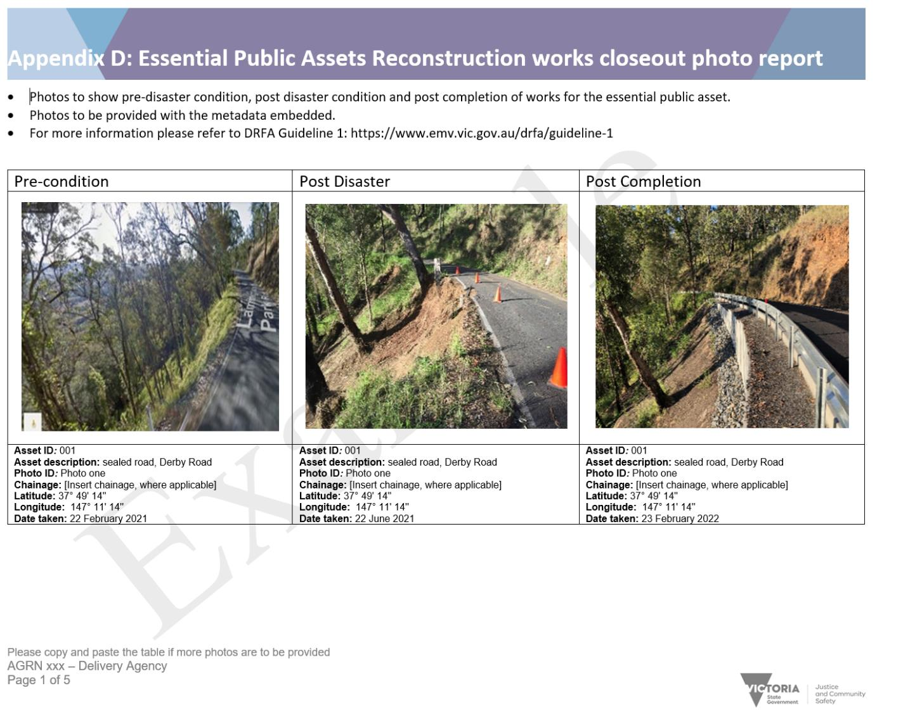

---
## Page 44

 
 
Guideline 1: Claims and eligibility for essential public assets (Category B) 
Victorian Disaster Recovery Funding Arrangements 
Page | 43 
 
Appendix E: Pre-disaster asset condition assessment report template

---
## Page 45

 
 
Guideline 1: Claims and eligibility for essential public assets (Category B) 
Victorian Disaster Recovery Funding Arrangements 
Page | 44 
 
Asset condition surveys 
Asset condition surveys, which provide performance information and overall condition assessment 
of roads are valuable to demonstrate the condition of an asset prior to an eligible disaster event. 
Where such a survey demonstrates a deficient aspect of the asset, and records can be provided 
that this was rectified, this provides a solid basis to demonstrate that the asset was adequately 
maintained prior the eligible disaster event. Delivery Agencies must ensure that they can evidence 
the actual date/s when the survey was undertaken. 
Maintenance records 
Maintenance records that can sufficiently detail the location and type of works undertaken will assist 
as supporting evidence that the asset has been properly maintained. It is important that such 
information records the date of activities and locations to be able to verify against damage that may 
have been sustained by an eligible disaster event. 
Defect log 
A defect log, that identifies defects that existed on the asset prior to the eligible disaster event, can 
support the condition of the asset prior to the event. Similar to maintenance records, it is important 
that log record the date and location of the inspection of the defects to be able to verify damage 
sustained by an eligible disaster event. 
Satellite and aerial images 
Satellite or aerial images (latest available data prior to the eligible event occurring, but no older than 
four years before the eligible disaster for local government assets and no older than two years 
before the eligible disaster for all other State assets) may be used to demonstrate the condition of 
the essential public asset where the extent of the damage being compared against is of an 
appropriate scale to be identified in the satellite/aerial view. This may include large scale scour to 
bridge abutments, large scale geotechnical slips, changes to floodway extents or water courses and 
significant structure damage.   
File and folder naming conventions 
• 
It is proposed that for all claim types, the damage evidence should be filed in a similar manner 
to assist in the assessment process and subsequent audits. 
• 
All photo files are to be assigned a unique photo ID that corresponds with the reference to the 
photo within the relevant claim form.  
• 
All photo files submitted with metadata intact, presented in subfolders and grouped by asset (for 
example, road ID, structure ID or bridge ID).

---
## Page 46

 
 
Guideline 1: Claims and eligibility for essential public assets (Category B) 
Victorian Disaster Recovery Funding Arrangements 
Page | 45 
 
SECTION B process to be followed to complete an 
eligible claim by works type 
Emergency works 
Emergency works activities are urgent activities necessary to temporarily restore an essential 
public asset to enable it to operate or be operated at an acceptable level of service to support 
the immediate recovery of a community. Emergency works are completed before essential public 
asset reconstruction works take place. No approval is required for the Delivery Agency to undertake 
emergency works following an eligible disaster, but the Delivery Agency should inform both the 
Assessing Authority and Administering Authority of the intent to undertake emergency works.  
Emergency works example 
Typical examples of emergency works include: 
• 
Urgent pothole repair (where this is required to open a road to traffic) 
• 
Removal of eligible disaster related debris, including silt and debris from the asset where failure 
to do so would create a health or safety hazard. This includes costs associated with arborist 
reports identifying trees damaged by a disaster 
• 
Removal of disaster related debris impacting on the function/stability of an essential public 
asset 
• 
Removal of damaged trees associated with an eligible disaster, where a significant portion of 
the tree is impacting on the function of an essential public asset 
• 
Removal of damaged /dangerous trees impacting on an essential public asset to make them 
safe and functional 
• 
Clearing of disaster related debris from gutters on the impacted essential public asset 
• 
Transportation and disposal of the above disaster related debris including mulching (excluding 
any sale costs if sold) 
• 
Establishment of temporary dump sites for disposing of disaster related debris (includes 
establishment, operation, and decommissioning costs) 
• 
Any temporary repair works to the essential public asset that ensure it can be safely used until 
reconstruction works are able to be undertaken (for example, pothole repairs, initial grading, 
temporary gravel re-sheeting, constructing flood flow relief causeways across a road) 
• 
Erection of warning signs or barriers to ensure the asset can be safely used for its intended 
purpose 
• 
The repair of road signage 
• 
Permanent replacement of road signage and guideposts 
• 
The removal of silt and debris impacting on a drainage structure 
• 
Installation of temporary traffic management 
• 
Placement of protective treatments (for example, rock) to ensure that no further damage is 
sustained until reconstruction works can be undertaken 
• 
The removal of tree stumps where associated with any of the above typical examples are also 
eligible.

---
## Page 47

 
 
Guideline 1: Claims and eligibility for essential public assets (Category B) 
Victorian Disaster Recovery Funding Arrangements 
Page | 46 
 
In application, emergency works are urgent activities necessary during or immediately following an 
eligible disaster, to protect the health and safety of the public and provide an acceptable level of 
service.  
An acceptable level of service may result in reduction of overall asset function including lane closure, 
speed, weight, height, or width restrictions; however, will allow asset to be used as intended without 
undue risk to user’s health and safety or property.  
Where an acceptable level of service cannot be achieved, detour routes may be established to an 
acceptable level of service under emergency works.  
Individual emergency works items are generally of a singular treatment, ‘reactive maintenance’ type, 
small in scale, short in works duration and low in cost. Do not generally require specialist treatments 
or materials, detailed design or survey, with exception of some geotech stabilisation works. Works 
are usually completed by inhouse crews (only overtime costs considered eligible) or existing panel 
arrangements.  
Works are generally temporary in nature allowing for an acceptable level of service to be gained. 
Permanent treatments may be undertaken where it is economical to do so, providing they are small 
in scale, low in cost and meet the other general criteria of emergency works.  
Emergency Works should be regarded as works which the council would carry out as a matter of 
urgency, even if disaster funding was not made available, and they should not be delayed until a 
natural disaster is declared as an eligible disaster. 
There should be no allowance for betterment to be undertaken in emergency works. Should council 
wish to undertake any betterment it may be considered under reconstruction works only.

---
## Page 48

 
 
Guideline 1: Claims and eligibility for essential public assets (Category B) 
Victorian Disaster Recovery Funding Arrangements 
Page | 47 
Figure 1 shows how a Delivery Agency can determine if a fallen tree is impacting on an essential public asset including:  
• 
the road envelope (which includes the road shoulders and batter) within the wider road reserve 
• 
the tree fall arc, which shows how a non-eligible tree would not impact the road envelope if it fell.  
Figure 1: Eligible tree clearance within the road envelope

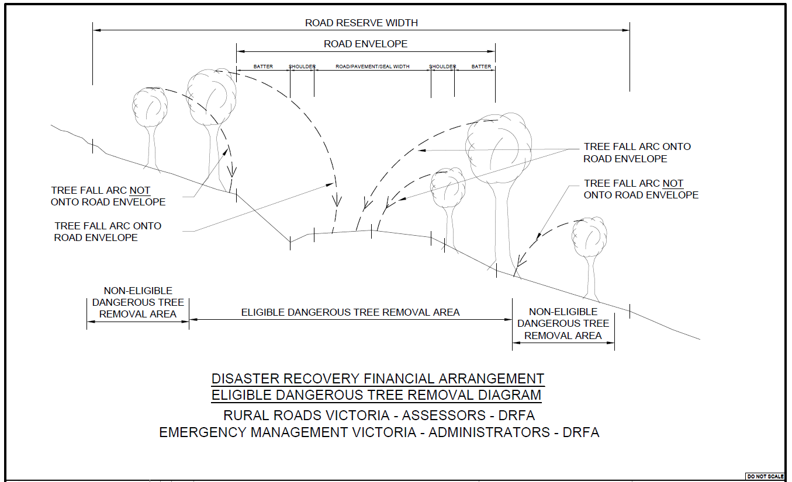

---
## Page 49

 
 
Guideline 1: Claims and eligibility for essential public assets (Category B) 
Victorian Disaster Recovery Funding Arrangements 
Page | 48 
 
Allowable time limit 
Emergency works are to be carried out within three months from the date the asset becomes 
accessible to the Delivery Agency. The date of accessibility of every eligible asset must be 
appropriately documented and evidenced – refer to Table 7 below in this Guideline and the 
Glossary of Terms for a definition of the date of access. 
Extension to the allowable time limit 
The Assessing Authority will consider an extension to the allowable time limit (EOT) request and 
provide a recommendation to the Administering Authority for a determination, where the Delivery 
Agency has demonstrated that the delays relating to the completion of emergency works are a 
result of exceptional circumstances that are either unforeseeable or beyond the control of the 
Delivery Agency. EOT requests are to be entered into the CMS. 
Requests for an extension of time received by the Assessing Authority after the timeframes 
stipulated in Table 5 below will not be considered, and any expenditure incurred beyond the 
required completion date will be ineligible for essential public asset reconstruction works.  
Table 5 Extension of time to allowable time limits - Timeframes 
Type of works  
Allowable time limits 
EOT required to be lodged 
Emergency works 
3 months from date of 
access by the Delivery 
Agency 
2 weeks prior to end of allowable 
time limit 
To be eligible for consideration, Delivery Agencies must be able to demonstrate that they have 
made a legitimate attempt to complete the works within the three-month time limit from the date of 
access to the essential public asset.  
For the purposes of determining when the three-month time frame for completing emergency works 
starts and finishes, an essential public asset is considered to be ‘accessible’ from the time when: 
• 
the disaster is no longer occurring (e.g. flood waters have receded, or a bushfire is out/under 
control) and the site of the damaged asset can be safely accessed by reconstruction workers; 
or 
• 
the Delivery Agency has capacity to undertake the required restoration works. In this situation, 
the Delivery Agency must be able to demonstrate they have made a reasonable attempt to 
undertake works as soon as the disaster was no longer occurring (as per the point above) but 
was not able to complete the works because of: 
o 
competing reconstruction priorities associated with a significant program of works 
caused by a severe disaster or multiple disasters, or 
o 
the unavailability of specialised equipment/resources. 
Should the extension request be approved by the Administering Authority, the Delivery Agency will 
be able to claim this expenditure as emergency works. 
A Delivery Agency is to complete a request for an extension of time the CMS, supporting 
documentation is required on the file upload page.  
When submitting the EOT request, the Delivery Agency must provide the following:

---
## Page 50

 
 
Guideline 1: Claims and eligibility for essential public assets (Category B) 
Victorian Disaster Recovery Funding Arrangements 
Page | 49 
 
• 
a list of essential public assets identifying whether emergency or immediate reconstruction 
works requires an extension of time to enable works to be completed;  
• 
emails or letters from contractors undertaking or anticipated to be undertaking the works 
outlining the reasons for the delay in works being completed, and the anticipated date that they 
expect works to be completed; and 
• 
if the date of access to the impacted essential public asset is different from the date of the 
disaster occurring, appropriate evidence such as an Incident Control Centre Transition to 
Recovery report. 
Should the Assessing Authority reject the extension request, the Delivery Agency will be 
required to prepare and submit a certified cost estimate for essential public asset 
reconstruction works based on actual expenditure, using the V Form C-RW for those costs 
incurred post the three months access time. In the V Form C-RW, the Delivery Agency will be 
required to detail the pre-disaster function of the asset and ensure all columns are filled in. Where 
the Delivery Agency is a local council, they will also need to provide evidence on the pre-disaster 
condition of the asset, dated no later than 4 years prior to the disaster i.e. maintenance logs. Where 
the Delivery Agency is a State Agency, they will need to provide evidence on the pre-condition of 
the asset, dated no later than two years prior to the disaster. 
Cost management 
It is important that effective financial management processes are established to manage, and 
record costs incurred resulting from eligible reconstruction works. 
It is expected that the Work Breakdown Structure (WBS) for emergency and reconstruction works 
will differ due to the level of expenditure and duration of works. The term WBS is referred to when 
describing the way to group or categorise actual costs that are captured in a financial management 
system. 
For emergency works, it is expected that a number of assets may be able to be grouped to form the 
WBS, in which the actual costs are captured. It is required that this grouping of assets is presented 
in a single claim to the Assessing Authority. While assets may be grouped together within the WBS 
of the financial management system it is important to ensure that the following level of detail is able 
to be recorded (i.e. through invoices, delivery dockets, timesheets): 
• 
Date: To ensure emergency works are claimed and undertaken within the eligibility period 
• 
Resource description: The level of detail should be sufficient to establish the items used for 
the emergency works 
• 
Unit of measure: It is important to ensure the metric adopted for the quantity is known (i.e. 
Hours, days, m3, tonnes, lump sum) 
• 
Quantity: Based on the unit of measure to identify the quantity of resource that was utilised 
• 
Unit rate: This should be determined for each resource. It is also important to ensure that rates 
charged for labour and plant are in accordance with any applicable day labour provisions 
• 
Total cost: Calculated by multiplying the quantity by the unit rate. 
For emergency works where there is a large concentration of works, resulting in a high cost (in 
excess of $200,000) it is recommended that the WBS for the financial management system is 
structured to enable these costs to be segregated. This type of works may include (temporary re-
establishment of a bridge, removal of large volume of material following a batter slip).

---
## Page 51

 
 
Guideline 1: Claims and eligibility for essential public assets (Category B) 
Victorian Disaster Recovery Funding Arrangements 
Page | 50 
 
If there is any uncertainty regarding the establishment of an appropriate WBS for the emergency 
works, it is recommended that the Delivery Agency contact the Assessing Authority prior to the 
establishment of the WBS. 
Overtime for standard employees associated with emergency works 
A Delivery Agency can claim overtime costs for employees who have been required to work extra 
time on eligible activities associated with an eligible event. As a result of the overtime the Delivery 
Agency must have incurred additional costs to be eligible for inclusion in a claim, for example an 
employee cannot claim their overtime as Time In Lieu (TIL) which has been taken at a later date. A 
Delivery Agency will need to provide supporting documentation that outlines the reason for the 
overtime, what eligible activities were carried out during the overtime and evidence of the increased 
cost to the Delivery Agency.  
If costs associated with overtime for standard employees cannot be allocated per asset, the 
Delivery Agency is to proportionally allocate the overtime costs against each eligible asset to be 
included in the claim. Delivery Agencies will need to provide supporting documentation that outlines 
the reason for the overtime, how the overtime has been proportioned and what eligible activities 
were carried out during the overtime.  
Claim process and supporting documentation required 
For emergency works undertaken under the DRFA, Delivery Agencies in Victoria will be reimbursed 
by the State through the Administering Authority on actual expenditure. This section outlines the 
process and requirements for making claims for emergency works. 
Funding contributions  
Assistance will be provided to the extent outlined below for emergency works undertaken on 
essential public assets damaged as a direct result of an eligible disaster event. 
Table 6: Funding contributions for emergency works on essential public assets 
Assistance type  
State Government 
agencies and 
statutory bodies (with 
no insurance 
arrangements in 
place) 
Local councils (with no insurance arrangements in 
place) 
Emergency 
works  
100% of approved 
works  
100% of approved works  
For these amounts to apply the total state expenditure 
for the eligible event must be more than $240,000 and 
be notified to the Commonwealth under the DRFA 
Where the event has not been notified to the 
Commonwealth, Delivery Agencies are required to 
incur the first $100,000 in eligible expenditure prior to 
receiving assistance under the NDFA.

---
## Page 52

 
 
Guideline 1: Claims and eligibility for essential public assets (Category B) 
Victorian Disaster Recovery Funding Arrangements 
Page | 51 
 
All emergency works claims are to be lodged with the Administering Authority, no later than eight 
weeks following the end of the emergency works period. It is recommended that emergency 
works claims are lodged on a regular basis throughout the financial year that the expenditure is 
incurred and no later than the 31 July (within one month from the end of the financial year in 
which the expenditure was incurred). Lodged claims are reviewed by the Assessing 
Authority. 
For emergency works claims, the following documentation indicated in Table 5 is to be provided, 
and DRFA Fact Sheet 1 – Claims and Eligibility.  
The supporting documentation for a DRFA claim requires a council to allocate contractor costs per 
eligible asset. 
For example, if a contractor has not tracked costs per eligible asset in their initial response to the 
event, the council will need to provide a clear methodology outlining how they have allocated the 
contractor costs to each asset. 
If contractors were just working to “get roads open” as an initial response, it can be assumed that 
there will be further follow up works completed by the contractor to clean up debris from roadsides, 
drains etc.  
The council is to proportionately allocate the initial response contractor costs against each eligible 
asset to be included in the follow up clean-up costs.  
The initial response costs will still need to be supported by documentation including photos that are 
sufficient to show extent of the damage and can support the costs being claimed.  
Supporting documentation required to show post disaster damage   
For emergency works, there should be representative evidence of each of the key work types (i.e. 
pothole repairs, debris removal) undertaken on an essential public asset. The volume of photos for 
emergency works should be appropriate with the level of damage to the essential public asset. It is 
recommended that photographic evidence collected for all emergency works sites to ensure 
sufficient evidence supports the level of actual costs incurred. 
To establish a basis that the damage sustained was a direct result of an eligible event, and the 
nature of the emergency works undertaken are eligible to be claimed under an emergency works 
claim, the following damage evidence should be provided: 
• 
Emergency works photo report, representative of damaged locations, presented in a logical 
sequence for each asset with information specific to the post-disaster photo presented, refer to 
https://www.emv.vic.gov.au/drfa/guideline-1-photo-template. 
• 
All post-disaster photo files contained within the emergency works photo report, with metadata 
intact, contained within subfolders and grouped by asset (for example, road ID, culvert ID or 
structure ID).

---
## Page 53

 
 
Guideline 1: Claims and eligibility for essential public assets (Category B) 
Victorian Disaster Recovery Funding Arrangements 
Page | 52 
 
When undertaking the emergency works damage assessment process, it is important to consider 
that: 
• 
No pre-disaster photo comparison is required. 
• 
Post-disaster photos to be representative of damage to each asset and of a quantity to be 
appropriate to the area of damage sustained and the value of works undertaken.  
• 
Post-disaster photographic standards and considerations should be adopted as per the ‘Post-
disaster damage – Photographic evidence’ section of this Guideline. 
• 
Post-disaster photos must show actual damage and are to be taken before emergency works 
are completed. A photo of an asset that is inundated (e.g. water over the road) is not 
considered suffice to demonstrate that damage was sustained on the asset). 
• 
Where continuous damage is identified over the length of the asset, representative post-
disaster photos should be provided over the full length of the asset (for example, where a road 
has sustained damage over 5 km, representative post-disaster photos should be provided over 
the full 5 km length of the road at a frequency suitable to the nature of the damage) It is 
recommended that the representative approach undertaken be discussed with the Assessing 
Authority.. 
• 
No completed works photos are required for emergency works claims but can assist in the 
development of a reconstruction works claim if required. 
Table 7 Emergency works claims - Supporting documentation required  
Required Item  
Emergency Works 
Details  
Format  
☐ Evidence of impact of 
disaster in local 
government area  
For example, Bureau of Meteorology data, local media articles 
associated with the disaster 
PDF 
☐ Claim Lodgement 
Declaration Form  
(Form ID V Form-D-DEC) 
Includes: 
• 
Delivery Agency’s internal reference number for the claim 
• 
associated activated event 
• 
type of claim – emergency works claim 
• 
summary details of the claim (that is, assets and value) 
• 
applicants contact officer name 
• 
declaration and signature from the responsible Delivery 
Agency Chief Executive Officer 
Signed PDF 
☐ Completed emergency 
works claim form 
(Form ID V Form-B-EW) 
Each line on the Form ID V Form-B-EW is to represent an asset 
(for example, road link) on which emergency works were 
undertaken 
Excel and signed 
PDF

---
## Page 54

 
 
Guideline 1: Claims and eligibility for essential public assets (Category B) 
Victorian Disaster Recovery Funding Arrangements 
Page | 53 
 
Required Item  
Emergency Works 
Details  
Format  
☐  Date of Access to the 
Asset 
Presented at an asset type level – for example, Road A.  
For the purposes of determining when the three-month time 
frame for completing emergency and immediate works starts 
and finishes, an essential public asset is considered to be 
‘accessible’ from the time when: 
• 
the disaster is no longer occurring (e.g. flood waters have 
receded, or a bushfire is out/under control) and the site of 
the damaged asset can be safely accessed by 
reconstruction workers; or 
• 
the Delivery Agency has capacity to undertake the required 
restoration works. In this situation, the Delivery Agency 
must be able to demonstrate they have made a reasonable 
attempt to undertake works as soon as the disaster was no 
longer occurring (as per the point above) but was not able 
to complete the works because of: 
o 
competing reconstruction priorities associated with a 
significant program of works caused by a severe 
disaster or multiple disasters, or 
o 
the unavailability of specialised equipment/resources. 
Excel 
☐  Detailed General 
ledger/ transaction listing 
Must correlate to expenditure in the Form ID V Form-B-EW. A 
reconciliation statement is to be provided (if the evidence of 
expenditure differs from the amount claimed). 
The Transaction listing must include a minimum of date the 
expenditure was posted to the general ledger, invoice number, 
supplier and description of works undertaken, within a specific 
financial year. 
• 
Detailed general ledger or transactions reports displaying 
all expenditure  
• 
Internal costing/payroll reports/timesheets for any payroll 
costs – reports must include event information  
• 
Tax invoices for external expenditure. 
Excel 
☐  Invoices 
The Assessing Authority will verify invoices against the works 
undertaken and whether the amounts were incurred within the 
allowable time period for emergency works, with a specific 
financial year. Source documents (e.g. contracts and purchase 
orders) supporting the invoice to be available for sampling upon 
request. 
Where invoices do not fully outline the link to the event and/or 
the works undertaken, source documents are to be provided 
when lodging that claim. 
All invoices should correlate to an appropriate line item in the 
general ledger or transaction listing and have appropriate 
description of works undertaken including:  
• 
eligible event name (AGRN),  
• 
date of the eligible event,  
• 
date works completed and  
• 
asset location.  
If an AGRN has not yet been assigned provide details of the 
eligible disaster. 
Claims are exclusive of GST. 
PDF

---
## Page 55

 
 
Guideline 1: Claims and eligibility for essential public assets (Category B) 
Victorian Disaster Recovery Funding Arrangements 
Page | 54 
 
Required Item  
Emergency Works 
Details  
Format  
☐  Payroll reports  
• 
Reports for extraordinary payroll costs (overtime) & 
evidence of the additional resources required.  
• 
Timesheets to be available for sampling upon request. 
• 
If overtime has been included in the claim will need to 
provide additional information including: 
• 
supporting documentation that outlines the reason for 
the overtime,  
• 
what eligible activities were carried out during the 
overtime, and  
• 
evidence of the increased cost to the Delivery Agency. 
PDF 
• Position descriptions for role/s created for eligible activities 
(approved by the Assessing Authority in consultation with the 
Administering Authority) 
PDF 
☐  Day labour  
Evidence required to claim day labour expenses; 
• 
Detailed general ledger or transactions reports outlining 
all expenditure;   
• 
Details of resources claimed for the eligible activities 
including staff names, position descriptions of roles, 
internal costing/payroll reports/timesheets for any payroll 
costs. In relation to plant and equipment used for the 
event, utilisation details (by asset, hours, dates);  
• 
Plant and equipment purchase date, purchase cost, 
written down value, residual value, asset life, depreciation 
to-date;  
• 
Detailed calculation of claimable hourly rate for all plant 
and equipment items including details of costs incurred 
per year that form the basis of the charge out rates;  
• 
The basis of apportionment of the expenses.   
PDF 
☐  Photo report - post 
disaster damage 
Representative, printable report showing damaged locations 
(latitude and longitude), date taken, presented in a logical 
sequence for each asset and showing asset names and asset 
reference number, where available. 
Must include representative evidence of each of the key 
emergency treatments undertaken on an asset, such as 
temporary pavement repairs, clearing of silt and debris, and 
repairing scours. 
The number of photos for each essential public asset, must be 
commensurate with the level of damage. 
Photos must be taken at the earliest opportunity after the 
damage is sustained and before the emergency works are 
undertaken. 
PDF 
☐  Photo files 
All photo files with metadata intact capturing location (longitude 
and latitude) and time taken. 
Photo files should be presented in subfolders and grouped by 
asset (for example, road link). 
JPEG, TIFF, PNG, 
GIF, RAW

---
## Page 56

 
 
Guideline 1: Claims and eligibility for essential public assets (Category B) 
Victorian Disaster Recovery Funding Arrangements 
Page | 55 
 
Example of forms and expenditure – Emergency Works 
Must be signed by 
the CEO
Emergency Works 
V Form-D-DEC
V Form-B-EW
Include any 
additional detail or 
information to 
support the claim. 
Date asset is 
available, must be 
consistent with 
requirements in 
Guideline 1
Ledger reference can be 
invoice numbers or 
accounts payable 
identification number.
$12,415.00
The total amount must 
be the same shown in 
the ACMS claim, V-form 
B-EW and transaction 
listing.
$12,415.00
The total amount be the 
same shown in the ACMS 
claim, D-Dec, V-form and 
transaction listing.
Each cell is to be populated

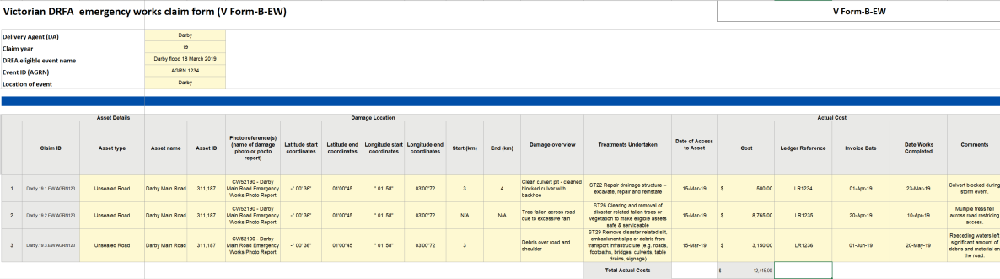

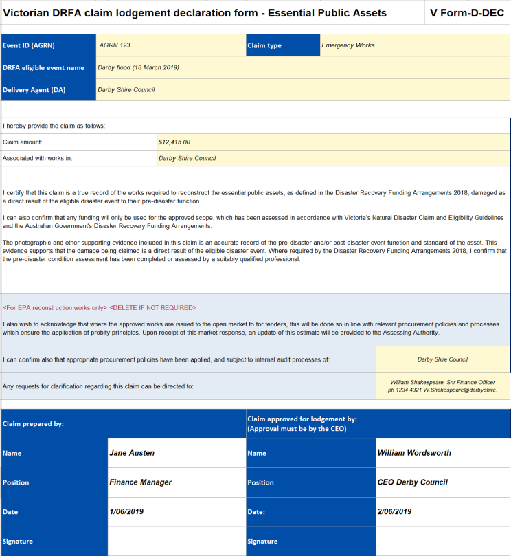

---
## Page 57

 
 
Guideline 1: Claims and eligibility for essential public assets (Category B) 
Victorian Disaster Recovery Funding Arrangements 
Page | 56 
 
The total of the transaction 
listing needs to be the same 
amount shown in the ACMS 
claim, D-Dec, V-form B-EW 
and transaction listing.
Additional information can be 
included to explain discrepancies or 
part payments. Detail provided 
must be sufficient to explain 
damage and link to the disaster.
Amounts on the 
transaction 
listing are 
exclusive of GST 
General Ledger 
This amount needs 
to be the same 
amount shown in 
the ACMS claim, V-
form B-EW and 
transaction listing.
Invoice
Emergency Works continued 
General ledger is a 
direct export from the 
Delivery Agency’s 
financial system  
$12,415.00
Invoice to include:
•
eligible event name (AGRN), 
•
date of the eligible event, 
•
date works completed and 
•
asset location. 
If an AGRN has not yet been assigned 
provide details of the eligible disaster.

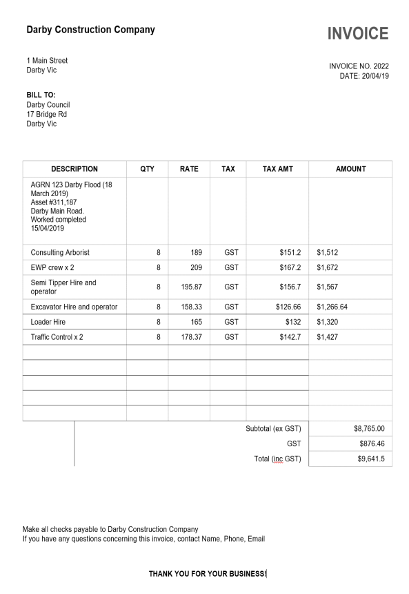

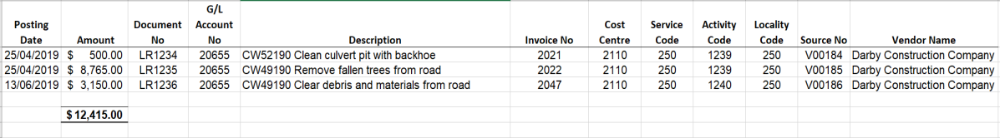

---
## Page 58

 
 
Guideline 1: Claims and eligibility for essential public assets (Category B) 
Victorian Disaster Recovery Funding Arrangements 
Page | 57 
 
Emergency Works continued 
Payroll report
For DRFA approved 
positions, the total cost 
should be relative to the 
salary range agreed at the 
time of approval.
Ordinary hours can only be 
claimed if the position has 
been pre-approved for 
DRFA funding through the 
Administering Authority.
For regular employees, only 
additional costs may be claimed, for 
example: overtime, higher duties. 
Payroll reports should be filtered to 
show these costs only. 
Photo Report
All photos must include metadata 
detailing latitude, longitude and 
date taken.

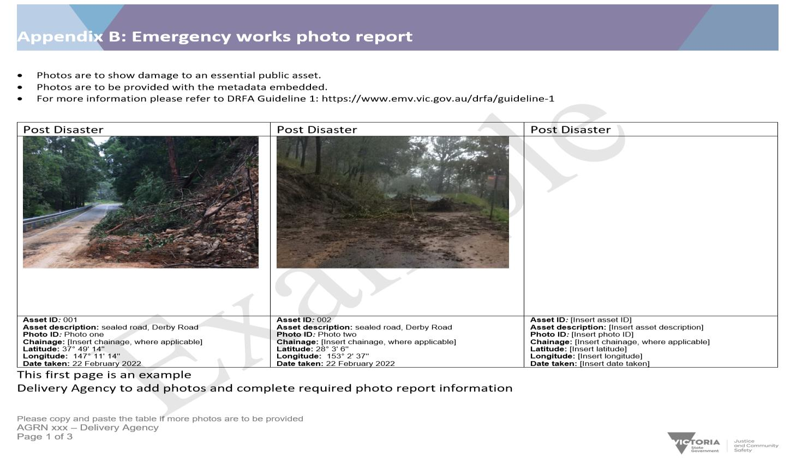

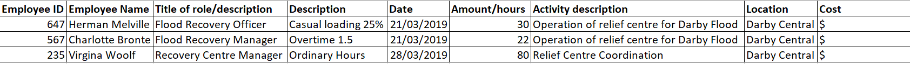

---
## Page 59

 
 
Guideline 1: Claims and eligibility for essential public assets (Category B) 
Victorian Disaster Recovery Funding Arrangements 
Page | 58 
 
Document retention 
The Delivery Agency must keep an accurate audit trail for seven years from the end of each 
financial year in which expenditure is claimed or until such time as the claims are subject to audit by 
the State and Commonwealth appointed auditors (which may be 12-24 months after the end of the 
relevant financial year that the expenditure was incurred). This must include written records that 
correctly record and explain the Delivery Agency’s expenditure claimed for all eligible measures. 
The Delivery Agency must make available within two weeks, all relevant documentation requested 
by the Assessing Authority or Administering Authority, including: 
• 
administrative data and documentation that may include (but is not limited to) contract or work 
orders, timesheets, news articles, email correspondence, funding approval letters, minutes of 
meetings; 
• 
financial data and documentation that may include (but is not limited to) tax and/or financial 
statements, cost-benefit analyses, transaction listings used to reconcile invoices, annual 
reports, proposals and invoices; and 
• 
grant data and documentation that may include (but is not limited to) grant applications and 
grant guidelines.

---
## Page 60

 
 
Guideline 1: Claims and eligibility for essential public assets (Category B) 
Victorian Disaster Recovery Funding Arrangements 
Page | 59 
 
Immediate reconstruction works 
Immediate reconstruction works to fully reconstruct an essential public asset, and where no 
essential public asset reconstruction works are required. Immediate reconstruction works must be 
completed within three months from the date of the eligible disaster event or when the essential 
public asset becomes accessible and should only be undertaken in circumstances where there is 
an urgent requirement to restore that asset to its pre-disaster function, and/or it does not represent 
value for money to undertake emergency works. Approval from the Assessing Authority is required 
before immediate reconstruction works are undertaken. 
Immediate Reconstruction works examples 
Typical examples of immediate reconstruction works include: 
• 
Gravel resheeting, patching, grading and pothole repairs where it fully restores a road 
• 
Replacement of damaged culvert/s 
• 
Repair of major pavement failure/s 
• 
Restoration of landslips utilising engineered structure/s 
 
In application, Immediate reconstruction works are those undertaken to return an asset back to its 
pre disaster function, and where no Essential Public Asset Reconstruction Works are required. Works 
are a permanent repair and should not leave limitations on an assets function additional to any 
preceding the event. Upon completion of Immediate Reconstruction Works there must not be any 
recovery works remaining on the asset to be completed under the DRFA. Works must be completed 
within three (3) months.  
The type of reconstruction works that should be undertaken under the Immediate Reconstruction 
Works sub-category are works that are urgent, essential and limited in nature. They would be 
reconstruction works which the local council would carry out, even if disaster funding was not made 
available. Immediate Reconstruction Works should not be delayed until an eligible disaster is 
declared or until funding approval or assurance is given. 
Any reconstruction works that local councils cannot complete within the three (3) month time limit or 
without assurance of funding should be managed under the Essential Public Asset Reconstruction 
Works category. 
There is no scale or value limit to Immediate Reconstruction Works however are generally of greater 
complexity, scale and value to emergency works. Works may require specialist treatments, materials, 
and detailed design. Works are generally completed under existing panel arrangement or through 
quotation works. It is not generally suitable to tender immediate works due to time constraints.  
Prior to commencing Immediate Reconstruction Works, councils are required to advise the 
assessing authority of the scope of works and obtain their agreement. This may be done in a 
number of stages as the need for Immediate Reconstruction Works is progressively identified, 
following the impact of the eligible disaster. 
Allowable time limits  
Immediate reconstruction works undertaken on damaged essential public assets following an 
eligible disaster are also to be carried out within three months from the date the essential public

---
## Page 61

 
 
Guideline 1: Claims and eligibility for essential public assets (Category B) 
Victorian Disaster Recovery Funding Arrangements 
Page | 60 
 
asset becomes accessible to the Delivery Agency. The date of accessibility of every eligible asset 
must be appropriately documented and evidenced. 
Refer to the Glossary of Terms for a definition of the date of access. 
Extensions to the allowable time limits   
The Assessing Authority will consider an EOT request and provide a recommendation to the 
Administering Authority for a determination, where the Delivery Agency has demonstrated that the 
delays relating to the completion of immediate works are a result of exceptional circumstances that 
are either unforeseeable or beyond the control of the Delivery Agency. EOT requests are to be 
entered into the CMS. 
Requests for an extension of time received by the Assessing Authority after the timeframes 
stipulated in Table 8 below will not be considered and any expenditure incurred beyond the 
required completion date will be ineligible for essential public asset reconstruction works.  
Table 8 Extension of time to allowable time limits - timeframes 
Type of works  
Allowable time limits 
EOT required to be lodged 
Immediate reconstruction 
works 
3 months from date of 
access by the Delivery 
Agency 
2 weeks prior to end of allowable 
time limit 
To be eligible for consideration, Delivery Agencies must be able to demonstrate that they have 
made a legitimate attempt to complete the works within the three-month time limit from the date of 
access to the essential public asset.  
For the purposes of determining when the three-month time frame for completing immediate works 
starts and finishes, an essential public asset is considered to be ‘accessible’ from the time when: 
• 
the disaster is no longer occurring (e.g. flood waters have receded, or a bushfire is out/under 
control) and the site of the damaged asset can be safely accessed by reconstruction workers; 
or 
• 
the Delivery Agency has capacity to undertake the required restoration works. In this situation, 
the Delivery Agency must be able to demonstrate they have made a reasonable attempt to 
undertake works as soon as the disaster was no longer occurring (as per the point above) but 
was not able to complete the works because of: 
o 
competing reconstruction priorities associated with a significant program of works 
caused by a severe disaster or multiple disasters, or 
o 
the unavailability of specialised equipment/resources. 
When submitting the EOT request, the Delivery Agency must provide the following: 
• 
a list of essential public assets identifying whether emergency or immediate reconstruction 
works requires an extension of time to enable works to be completed;  
• 
emails or letters from contractors undertaking or anticipated to be undertaking the works 
outlining the reasons for the delay in works being completed, and the anticipated date that they 
expect works to be completed; and 
• 
if the date of access to the impacted essential public asset is different from the date of the 
disaster occurring, appropriate evidence such as an Incident Control Centre Transition to 
Recovery report.

---
## Page 62

 
 
Guideline 1: Claims and eligibility for essential public assets (Category B) 
Victorian Disaster Recovery Funding Arrangements 
Page | 61 
 
Should the extension request be approved by the Administering Authority, the Delivery Agency will 
be able to claim this expenditure as immediate works. 
Delivery Agencies are to complete the request for an extension of time via the CMS and upload 
supporting documentation to the file upload page.  
Should the Assessing Authority reject the extension request, the Delivery Agency will be required to 
prepare and submit a certified cost estimate for the essential public asset reconstruction works 
based on actual expenditure, using the V Form C-RW for those costs incurred post the three 
months access time. In this form, the Delivery Agency will be required to detail the pre-disaster 
function of the asset and ensure all columns are filled in. Where the Delivery Agency is a local 
council, they will also need to provide evidence on the pre-disaster condition of the asset, dated no 
later than 4 years prior to the disaster i.e. maintenance logs. Where the Delivery Agency is a State 
Agency, they will need to provide evidence on the pre-condition of the asset, dated no later than 
two years prior to the disaster. 
Cost management 
It is important that effective financial management processes are established to manage, and 
record costs incurred resulting from eligible reconstruction works. 
It is expected that the Work Breakdown Structure (WBS) for emergency and reconstruction works 
will differ due to the level of expenditure and duration of works. The term WBS is referred to when 
describing the way to group or categorise actual costs that are captured in a financial management 
system. 
A project within the DRFA is specified as: 
• 
Reconstruction works to be undertaken following an eligible disaster on: 
(a) 
a single essential public asset, or 
(b) 
a group of related essential public assets which could be contracted jointly within 
local government areas notified for the relevant eligible measure. 
To ensure compliance with these requirements each claim lodged for reconstruction works shall be 
made for a single asset as a minimum. This claim (single asset) also meets the definition of a 
project within the DRFA. It is therefore required that a separate WBS be created for each of the 
reconstruction projects. 
Where there are different types of works made within a claim (i.e. general road repairs, bridge 
replacement) and these works are likely to be undertaken by different parties or contractors, then it 
is required that the claims or project for the work type components of the assets are separated in 
the WBS. 
Within a project WBS it is highly recommended that sub-WBS are also created to capture direct and 
indirect costs separately. This cost segregation within the projects assists with providing historic 
indirect cost data for completed projects. 
Where a Delivery Agency wishes to group assets to form a claim and subsequent project this shall 
only be done after consulting with the Assessing Authority.

---
## Page 63

 
 
Guideline 1: Claims and eligibility for essential public assets (Category B) 
Victorian Disaster Recovery Funding Arrangements 
Page | 62 
 
Overtime for standard employees on immediate reconstruction works 
A Delivery Agency can claim overtime costs for employees who have been required to work extra 
time on eligible activities associated with an eligible event. As a result of the overtime the Delivery 
Agency must have incurred additional costs to be eligible for inclusion in a claim, for example an 
employee cannot claim their overtime as Time In Lieu (TIL) which has been taken at a later date. A 
Delivery Agency will need to provide supporting documentation that outlines the reason for the 
overtime, what eligible activities were carried out during the overtime and evidence of the increased 
cost to the Delivery Agency.  
If costs associated with overtime for standard employees cannot be allocated per asset, the 
Delivery Agency is to proportionally allocate the overtime costs against each eligible asset to be 
included in the claim. Delivery Agencies will need to provide supporting documentation that outlines 
the reason for the overtime, how the overtime has been proportioned and what eligible activities 
were carried out during the overtime.  
Claims process and supporting documentation required 
Immediate reconstruction works claims are based on actual eligible expenditure incurred. 
Immediate reconstruction works must be completed within three months from the date of the eligible 
disaster event or when the essential public asset becomes accessible and should only be 
undertaken in circumstances where there is urgent requirement to restore that asset to its pre-
disaster function, and/or it does not represent value for money to undertake emergency works. 
Approval from the Assessing Authority is required before immediate reconstruction works are 
undertaken. 
All immediate reconstruction works claims are to be lodged with the Administering Authority . 
Claims are to be lodged as the expenditure is incurred throughout the year and no later than 
31 July (within one month from the end of the financial year in which the expenditure was 
incurred).

---
## Page 64

 
 
Guideline 1: Claims and eligibility for essential public assets (Category B) 
Victorian Disaster Recovery Funding Arrangements 
Page | 63 
 
Funding contributions 
Assistance will be provided to the extent outlined below for reconstruction of essential public assets 
damaged as a direct result of an eligible disaster event. 
Table 9 Funding contributions 
Assistance type  
State Government agencies and 
statutory bodies (with no insurance 
arrangements in place) 
Local councils (with no insurance 
arrangements in place) 
Immediate reconstruction works 
100% of approved works 
 
 
 
75% of approved reconstruction costs 
between $10,000 and $110,000 (up to 
$35,000 per disaster) for each Delivery 
Agency. 
100% of the proportion of approved 
reconstruction costs greater than 
$110,000, for each Delivery Agency. 
For these amounts to apply the total 
state expenditure for the eligible event 
must be more than $240,000 and be 
notified to the Commonwealth under 
the DRFA. 
Where the event has not been notified 
to the Commonwealth, Delivery 
Agencies are required to incur the first 
$100,000 in eligible expenditure prior to 
receiving assistance under the NDFA. 
Supporting documentation required to show disaster damage   
To establish a basis that the damage sustained was a direct result of an eligible event, and the 
nature of the immediate reconstruction works proposed are eligible to be claimed under an 
immediate reconstruction works claim, the following damage evidence should be provided: 
• 
Immediate Reconstruction works photo report, with pre-disaster photo comparisons, presented 
in a logical sequence for each asset with information specific to the post-disaster photo 
presented, see Appendix C: Immediate Reconstruction works photo report. 
• 
All post-disaster photo files contained within the Immediate reconstruction works photo report, 
with metadata intact, contained within subfolders and grouped by asset (for example, road ID, 
culvert ID or structure ID). 
• 
Supplementary evidence (if applicable). 
When undertaking the immediate reconstruction damage assessment process, it is important to 
consider that: 
• 
Pre-disaster photo comparisons (where available) are to be provided to confirm damage is a 
direct result of event. 
• 
Only pre-disaster photo comparisons that show a ‘step change’ in the condition of the asset 
from the pre-disaster condition to post-disaster condition should be included in the immediate 
reconstruction works claim. 
• 
Post-disaster photos for an immediate reconstruction works claim may be taken up to three 
months following the date the essential public asset becomes accessible to illustrate damage 
from the event. However, the timely collection of event related visual data is essential to ensure 
that the post-disaster damage can be identified and directly attributed to the eligible event.

---
## Page 65

 
 
Guideline 1: Claims and eligibility for essential public assets (Category B) 
Victorian Disaster Recovery Funding Arrangements 
Page | 64 
 
• 
Where continuous damage is identified over the length of the asset, representative post-
disaster photos should be provided over the full length of the asset (for example, where a road 
has sustained damage over 5 km, representative pre-disaster and post-disaster photos should 
be provided. For a relatively flat road, this should be at 100 metre intervals over the full 5 km 
length of the road. For roads which are more hilling or winding, this may vary up to 250 metres 
depending on whether the damage is obvious, the camera angle of the photos are good and 
there are appropriate light conditions.) It is recommended that the representative sample 
approach be discussed with the Assessing Authority. 
• 
Post-disaster photographic standards and considerations should be adopted as per the ‘Post-
disaster damage – Photographic evidence’ section of this guideline. 
For immediate reconstruction works claims, the following documentation is to be provided. Refer to 
DRFA Fact Sheet 1 – Claims and Eligibility. 
Table 10 Immediate reconstruction works claims –Supporting documentation required 
Required item  
Immediate Reconstruction Works 
Details  
Format  
☐ Evidence of impact of 
disaster in local 
government area  
For example, Bureau of Meteorology data, local media articles 
associated with the disaster 
PDF 
☐ Claim Lodgement 
Declaration Form  
(Form ID V Form D-DEC) 
Includes: 
• 
Delivery Agency’s internal reference number for the claim 
• 
associated activated event 
• 
type of claim – immediate reconstruction works claim 
• 
summary details of the claim (that is, assets and value) 
• 
applicants contact officer name 
• 
declaration and signature from the responsible officer from the 
Delivery Agency  
Signed PDF 
☐ Completed 
reconstruction works claim 
template (Form ID V Form 
C-RW). Note, select ‘IR’ 
claim type in template 
Each line on the claim form is to represent the different treatments 
undertaken 
Excel and 
signed PDF 
☐ Date of Access to the 
Asset 
Presented at an asset type level – for example, Road A 
For the purposes of determining when the three-month time frame for 
completing emergency and immediate works starts and finishes, an 
essential public asset is considered to be ‘accessible’ from the time 
when: 
• 
the disaster is no longer occurring (e.g. flood waters have 
receded, or a bushfire is out/under control) and the site of the 
damaged asset can be safely accessed by reconstruction 
workers; or 
• 
the Delivery Agency has capacity to undertake the required 
restoration works. In this situation, the Delivery Agency must be 
able to demonstrate they have made a reasonable attempt to 
undertake works as soon as the disaster was no longer occurring 
(as per the point above) but was not able to complete the works 
because of: 
o 
competing reconstruction priorities associated with a 
significant program of works caused by a severe disaster or 
multiple disasters, or  
o 
the unavailability of specialised equipment/resources. 
Excel

---
## Page 66

 
 
Guideline 1: Claims and eligibility for essential public assets (Category B) 
Victorian Disaster Recovery Funding Arrangements 
Page | 65 
 
Required item  
Immediate Reconstruction Works 
Details  
Format  
☐ Detailed General ledger/ 
transaction listing 
Must correlate to expenditure in the reconstruction works claim form 
(Form ID V Form-C-RW). A reconciliation statement is to be provided 
(if the evidence of expenditure differs from the amount claimed). 
 
The Transaction listing must include a minimum of date the 
expenditure was posted to the general ledger, invoice number, 
supplier and description of works undertaken, within a specific 
financial year. 
Excel 
☐ Invoices 
The Assessing Authority will verify invoices against the works 
undertaken and whether the amounts were incurred within the 
allowable time period for immediate works, with a specific financial 
year.  
Source documents (e.g. contracts) supporting the invoice to be available 
for sampling upon request. 
All invoices should correlate to an appropriate line item in the general 
ledger or transaction listing and have appropriate description of works 
undertaken including:  
• 
eligible event name (AGRN),  
• 
date of the eligible event,  
• 
date works completed and  
• 
asset location.  
If an AGRN has not yet been assigned provide details of the eligible 
disaster. 
Claims are exclusive of GST 
PDF 
☐ Payroll reports 
• Reports for extraordinary payroll costs (overtime) & evidence of 
the additional resources required.  
• 
Timesheets to be available for sampling upon request. 
• 
If overtime has been included in the claim will need to provide 
additional information including: 
• 
supporting documentation that outlines the reason for the 
overtime,  
• 
what eligible activities were carried out during the overtime, 
and  
• 
evidence of the increased cost to the Delivery Agency. 
PDF 
Position descriptions for role/s created for eligible activities (approved 
by the Assessing Authority in consultation with the Administering 
Authority) and a copy of the relevant payroll report. 
 
PDF

---
## Page 67

 
 
Guideline 1: Claims and eligibility for essential public assets (Category B) 
Victorian Disaster Recovery Funding Arrangements 
Page | 66 
 
Required item  
Immediate Reconstruction Works 
Details  
Format  
Day labour 
Evidence required to claim day labour expenses; 
• 
All direct costs must be claimed on a per asset basis;  
• 
Detailed general ledger or transactions reports outlining all 
expenditure;   
• 
Details of resources claimed for the eligible activities including 
staff names, position descriptions of roles, internal costing/payroll 
reports/timesheets for any payroll costs. In relation to plant and 
equipment used for the event, utilisation details (by asset, hours, 
dates);  
• 
Plant and equipment purchase date, purchase cost, written down 
value, residual value, asset life, depreciation to-date;  
• 
Detailed calculation of claimable hourly rate for all plant and 
equipment items including details of costs incurred per year that 
form the basis of the charge out rates;  
• 
The basis of apportionment of the expenses.   
PDF 
☐ Pre-condition 
assessment report 
The information required to determine the pre-disaster asset function 
may be available through the following sources held by the asset 
owner: 
• 
asset registers. 
• 
certification reports. 
• 
inspection reports. 
• 
maintenance reports. 
• 
visual data – photos, videos; or 
• 
geospatial data 
PDF 
☐ Photo report – post 
disaster damage 
Printable report showing each damaged location (presented in a 
logical sequence for each asset and showing road name and 
references). 
For damage that is continuous in nature, the frequency of photos 
must be able to depict the damage is continuous and not intermittent. 
PDF 
☐ Photo report – 
completed works 
Representative, printable report showing each location at which 
immediate reconstruction works were completed (presented in a 
logical sequence for each asset and showing asset name and number 
references, where available). 
PDF 
☐ Photo files 
All photo files with metadata intact capturing location (longitude and 
latitude) and date taken. 
Photo files should be presented in subfolders and grouped by asset 
(for example, road link). 
JPEG, TIFF, 
PNG, GIF, 
RAW

---
## Page 68

 
 
Guideline 1: Claims and eligibility for essential public assets (Category B) 
Victorian Disaster Recovery Funding Arrangements 
Page | 67 
 
Example of forms and expenditure – Immediate Reconstruction Works   
Repair of potholes to 
fully restore road use
Pothole repair
Must be signed by 
the CEO
V Form-D-DEC
Immediate Reconstruction Works 
Date asset is available, 
must be consistent 
with requirements in 
Guideline 1
Include 
detail if 
there are 
any cost 
differences, 
ineligible 
expenditure 
V Form-C-IR
Please note additional lines 
have been hidden in this 
example. 
$87,387.00
Claim amount must be 
consistent with amount 
in ACMS, V Form C-IR 
and General Ledger
$87,387.00
Total cost must be the same as in 
amount shown in the ACMS claim, 
D-Dec, V-form C-IR and transaction 
listing
Each cell is to be populated

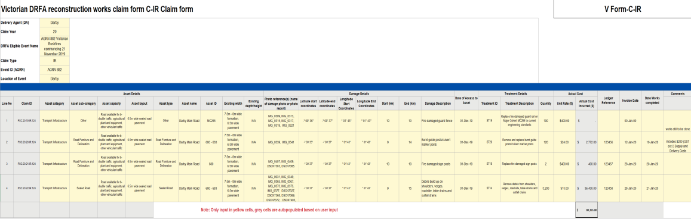

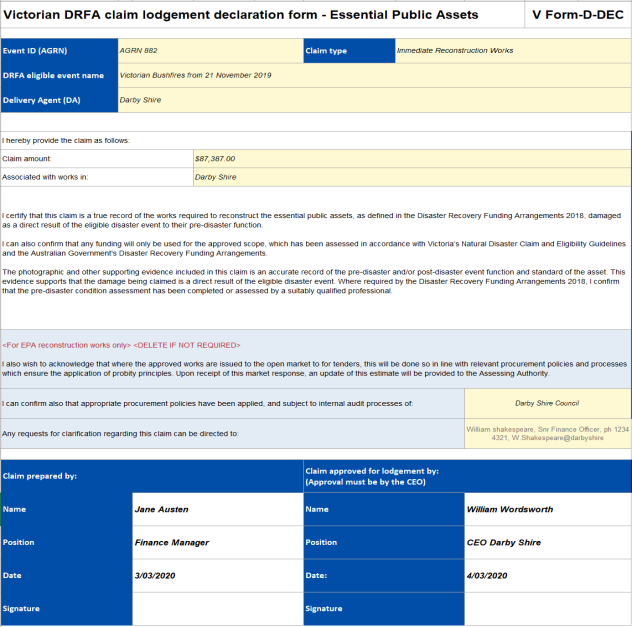

---
## Page 69

 
 
Guideline 1: Claims and eligibility for essential public assets (Category B) 
Victorian Disaster Recovery Funding Arrangements 
Page | 68 
 
General Ledger 
This amount needs to 
be the same amount 
shown in the ACMS 
claim, V-form C-IR and 
transaction listing.
Invoice
Immediate Reconstruction  Works continued 
General ledger is a 
direct export from the 
Delivery Agency’s 
financial system  
$87,387.00
Amounts on the 
transaction 
listing are 
exclusive of GST 
The total of the transaction 
listing needs to be the same 
amount shown in the ACMS 
claim, D-Dec, V-form C-IR 
and invoices.
Additional information can be 
included to explain discrepancies or 
part payments. Detail provided 
must be sufficient to explain 
damage and link to the disaster.
The information in 
the line highlighted 
corresponds to the 
information in the 
invoice.
Invoice to include:
•
eligible event name (AGRN), 
•
date of the eligible event, 
•
date works completed and 
•
asset location. 
If an AGRN has not yet been assigned 
provide details of the eligible disaster.  
Reconstruction Works – Darby main road – repair of 
potholes to fully restore road use.

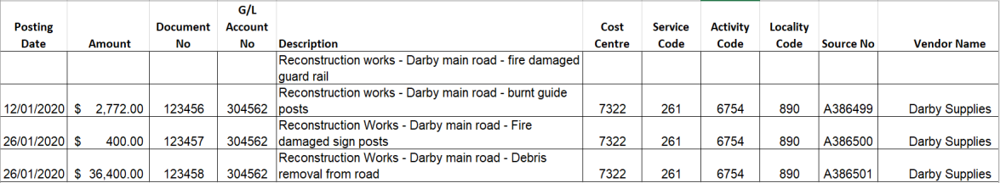

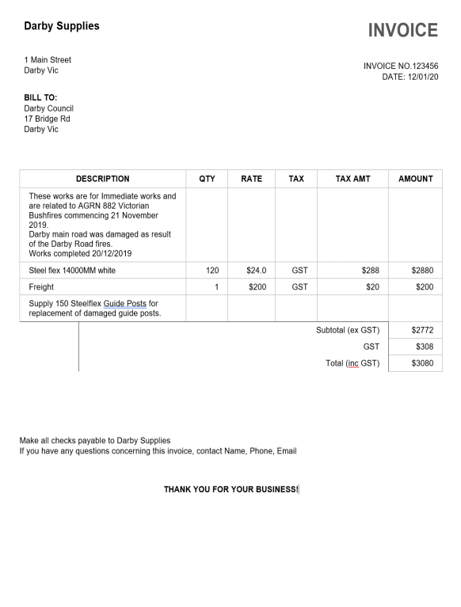

---
## Page 70

 
 
Guideline 1: Claims and eligibility for essential public assets (Category B) 
Victorian Disaster Recovery Funding Arrangements 
Page | 69 
 
Photo Report
Immediate Reconstruction Works continued 
Payroll report
For DRFA approved 
positions, the total cost 
should be relative to the 
salary range agreed at the 
time of approval.
Ordinary hours can only be 
claimed if the position has 
been pre-approved for 
DRFA funding through the 
Administering Authority.
For regular employees, only 
additional costs may be claimed, for 
example: overtime, higher duties. 
Payroll reports should be filtered to 
show these costs only. 
Pre disaster photos 
can be from up to four 
years prior to the 
event for local 
councils and two years 
for State Agencies. 
Post completion photos are to be 
provided as soon as possible or 
within three months in line with 
the claim submission due date. 
All photos must include 
metadata detailing latitude, 
longitude and date taken.

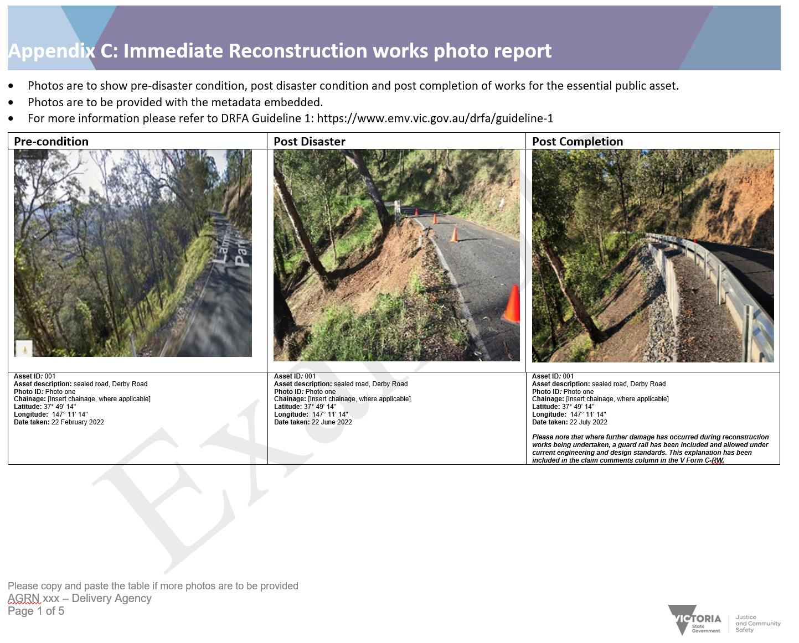

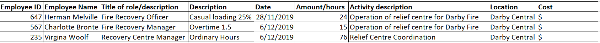

---
## Page 71

 
 
Guideline 1: Claims and eligibility for essential public assets (Category B) 
Victorian Disaster Recovery Funding Arrangements 
Page | 70 
 
Pre-Disaster Condition 
Assessment  Report
Must be conducted or 
verified by a suitably 
qualified profession as 
per Guideline 1.
Assessment must be dated no less 
than 4 years prior to the disaster.
For a State Agency this must be dated 
no later than 2 years prior to the 
disaster.  
Include appropriate 
attachments i.e. 
maintenance logs as 
outlined in Guideline 1.
Must be signed by an 
Assessor prior to 
lodgement.

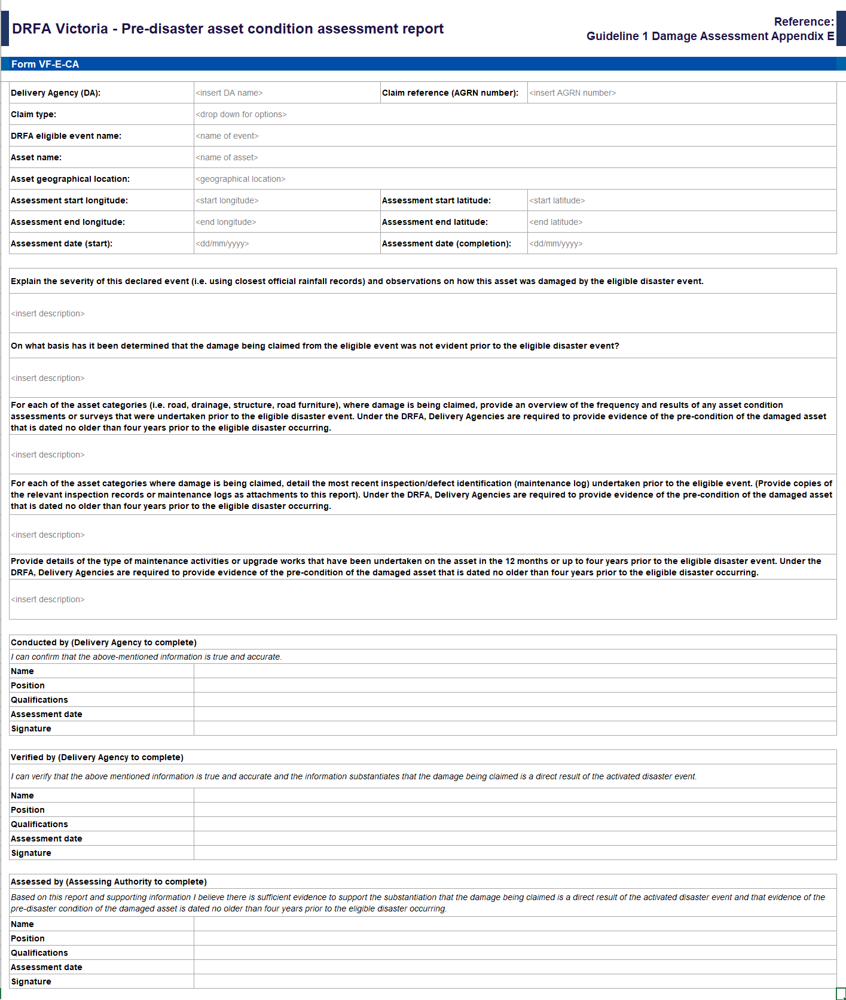

---
## Page 72

 
 
Guideline 1: Claims and eligibility for essential public assets (Category B) 
Victorian Disaster Recovery Funding Arrangements 
Page | 71 
 
Document retention 
The Delivery Agency must keep an accurate audit trail for seven years from the end of each 
financial year in which expenditure is claimed or until such time as the claims are subject to audit by 
the State and Commonwealth appointed auditors (that may be 12-24 months after the end of the 
financial year that the expenditure was incurred). This must include written records that correctly 
record and explain the Delivery Agency’s expenditure claimed for all eligible measures. 
The Delivery Agency must make available within two weeks, all relevant documentation requested 
by the Assessing Authority or Administering Authority including: 
• 
administrative data and documentation that may include (but is not limited to) contract or work 
orders, timesheets, news articles, email correspondence, funding approval letters, minutes of 
meetings; 
• 
financial data and documentation that may include (but is not limited to) tax and/or financial 
statements, cost-benefit analyses, transaction listings used to reconcile invoices, annual 
reports, proposals and invoices; and 
• 
grant data and documentation that may include (but is not limited to) grant applications and 
grant guidelines.

---
## Page 73

 
 
Guideline 1: Claims and eligibility for essential public assets (Category B) 
Victorian Disaster Recovery Funding Arrangements 
Page | 72 
 
Essential public asset reconstruction works 
An essential public asset directly damaged by an eligible disaster event, or a re-damaged essential 
public asset, may be reconstructed to its pre-disaster function. The selected reconstruction 
treatment must be consistent with the DRFA Essential Public Asset Function Framework (refer to 
DRFA clause 6.3). 
An asset is considered to be re-damaged if, after being damaged by one eligible disaster and prior 
to the commencement or completion of reconstruction works, it suffers damage in the same location 
by a subsequent eligible disaster. 
 
In application, Essential Public Asset Reconstruction Works are those reconstruction works, other 
than specified Emergency Works that could not, or was not practical to complete within three (3) 
months of an eligible event and are those undertaken to return an asset back to its pre disaster 
function. Upon completion Essential Public Asset Reconstruction Works there must not be any 
recovery works remaining on the asset to be completed under the DRFA.  
The type of reconstruction works that should be undertaken under the Essential Public Asset 
Reconstruction Works sub-category are works that are of lesser urgency and may require Council to 
gain funding certainty prior to committing to project. 
 Any reconstruction works that local councils cannot complete within the three (3) month time limit or 
without assurance of funding should be managed under the Essential Public Asset Reconstruction 
Works category. 
There is no scale or value limit to Essential Public Asset Reconstruction Works. Works are generally 
of greater complexity, scale and value than Emergency and Immediate work. Works may require 
specialist treatments, materials, and detailed design. Works are generally procured through open 
tender.  
Prior to commencing Essential Public Asset Reconstruction Works, councils are required to  develop 
and submit a detailed project estimate for certification by the Assessing and Administering Authority.  
Essential Public Asset Reconstruction works examples 
Typical examples of essential public asset reconstruction works can be found in the section on 
Eligibility Scenarios at the beginning of this Guideline. 
Re-damaged essential public assets where works have not yet commenced 
If works have not yet commenced to restore the asset damaged by the first event when the re-
damage occurs, then all eligible costs to restore the asset to its pre-disaster function are to be 
claimed against the subsequent eligible disaster. The recommended value for the asset in the first 
event is to be reduced to zero 
Re-damaged assets where works have commenced 
If works have commenced to restore the asset damaged by the first event when the re-damage 
occurs, and the re-damage (or additional damage) is not covered by insurance, the cost to restore 
the asset back to the pre-disaster function is to be claimed across the two events as follows:  
• 
First eligible disaster – the eligible actual costs of approved works carried out by the agency 
up to the date of impact of the subsequent event should be claimed against the first event

---
## Page 74

 
 
Guideline 1: Claims and eligibility for essential public assets (Category B) 
Victorian Disaster Recovery Funding Arrangements 
Page | 73 
 
and associated submission time limits. The recommended value for the asset in the first 
event is to be reduced to the actual expenditure. 
• 
Subsequent eligible disaster – the eligible cost of works carried out by the Delivery Agency 
after the date of impact by the subsequent event is to be lodged under the subsequent event 
and associated submission time limits. 
Allowable time limits  
Reconstruction of essential public assets 
Guideline 2 provides detailed information about the process and requirements for completing a cost 
estimate.  
Cost estimates for reconstruction of essential public assets must be submitted to the Assessing 
Authority and Administering Authority concurrently within nine months after the end of the financial 
year in which the eligible disaster occurred. 
The State (through the Assessing Authority) must approve and lodge to the Commonwealth 
Government the estimated cost of reconstruction works within 12 months after the end of the 
financial year in which the eligible disaster occurred.  
Essential public asset reconstruction works are to be completed within two years after the end 
of the financial year in which the eligible disaster event occurred. 
The Administering Authority website also details timelines to incur expenditure and submit claims 
for reimbursement. Please refer to the Administering Authority website for these timelines.  
Figure 2 Allowable time limits 
 
Where a claim or project is not lodged by the timeframes outlined above, these works will 
not be approved and cannot proceed under that eligible disaster event. 
Note that the Commonwealth Government has established specific reporting requirements, 
whereby updated estimates relating to all types of eligible expenditure across Categories A and B, 
must be submitted by each state for each eligible disaster on a quarterly basis. To meet these 
reporting requirements, it is critical that each Delivery Agency regularly review and update 
estimates. The Administering Authority will email each impacted Delivery Agency on a quarterly 
basis requesting that updates be provided in the CMS. Approved certified estimate packages 
relating to essential public asset reconstruction works cannot be updated once the estimate is 
approved by the Administering Authority.

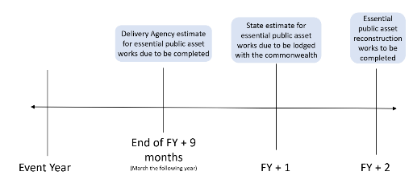

---
## Page 75

 
 
Guideline 1: Claims and eligibility for essential public assets (Category B) 
Victorian Disaster Recovery Funding Arrangements 
Page | 74 
 
Extensions to the allowable time limits (EOT) for essential public assets 
reconstruction works 
The Assessing Authority will consider an EOT request and provide a recommendation to the 
Administering Authority for a determination, where the Delivery Agency has demonstrated that the 
delays are a result of exceptional circumstances that are either unforeseeable or beyond the control 
of the Delivery Agency. EOT are to be entered into the CMS. 
Requests for an extension of time received by the Assessing Authority after the timeframes 
stipulated in Table 11 below will not be considered and any expenditure incurred beyond the 
required completion date will be ineligible for essential public asset reconstruction works.  
Table 11 Extension of time to allowable time limits – Timeframes 
Type of works  
Allowable time limits 
EOT required to be lodged 
Essential public asset 
Reconstruction Works 
24 months 
3 months prior to end of allowable 
time limit 
To be eligible for consideration, the Delivery Agency must be able to demonstrate that the delays 
are a result of exceptional circumstances that are either unforeseeable or beyond the control of the 
Delivery Agency. 
Examples of exceptional circumstances are: 
• 
delays in impacted area returning to conditions considered safe to undertake works. 
• 
discovery of a significant archaeological or environmental site that would require extensive and 
prolonged consultation and negotiations; and 
• 
delays caused by investigations (for example, coroner’s investigations). 
Examples of factors not considered exceptional circumstances: 
• 
agreement for an extension was not sought before the timeframe stipulated in Table 9 above. 
• 
poor project and risk management methodology (poor planning and control); and 
• 
delays in assessing eligibility of the asset. 
In the event that an EOT is not approved, any expenditure incurred beyond the required date will be 
ineligible. 
Cost management 
It is important that effective financial management processes are established to manage, and 
record costs incurred resulting from eligible reconstruction works. 
It is expected that the Work Breakdown Structure (WBS) for emergency and reconstruction works 
will differ due to the level of expenditure and duration of works. The term WBS is referred to when 
describing the way to group or categorise actual costs that are captured in a financial management 
system.

---
## Page 76

 
 
Guideline 1: Claims and eligibility for essential public assets (Category B) 
Victorian Disaster Recovery Funding Arrangements 
Page | 75 
 
A project within the DRFA is specified as: 
• 
Reconstruction works to be undertaken following an eligible disaster on: 
(c) 
a single essential public asset, or 
(d) 
a group of related essential public assets which could be contracted jointly within 
local government areas notified for the relevant eligible measure. 
To ensure compliance with these requirements each claim lodged for reconstruction works shall be 
made for a single asset as a minimum. This claim (single asset) also meets the definition of a 
project within the DRFA. It is therefore required that a separate WBS be created for each of the 
reconstruction projects. 
Where there are different types of works made within a claim (i.e. general road repairs, bridge 
replacement) and these works are likely to be undertaken by different parties or contractors, then it 
is required that the claims or project for the work type components of the assets are separated in 
the WBS. 
Within a project WBS it is highly recommended that sub-WBSs are also created to capture direct 
and indirect costs separately. This cost segregation within the projects assists with providing 
historic indirect cost data for completed projects. 
Where a Delivery Agency wishes to group assets to form a claim and subsequent project this shall 
only be done after consulting with the Assessing Authority. 
Claims process and supporting documentation required 
For essential public asset reconstruction works under the DRFA, Delivery Agencies in Victoria will 
be reimbursed by the State through the Administering Authority. This section outlines the process 
and requirements for making claims for reconstruction of essential public assets works. 
Funding contributions 
Assistance will be provided to the extent outlined below for reconstruction of essential public assets 
damaged as a direct result of an eligible disaster event. 
Table 12 Funding contributions for reconstruction of essential public assets 
Assistance type  
State Government 
agencies and 
statutory bodies (with 
no insurance 
arrangements in 
place) 
Local councils (with no insurance arrangements in 
place) 
Reconstruction 
of essential 
public assets 
Actual expenditure 
capped up to the 
approved certified 
estimate works 
package. 
 
75% of approved reconstruction costs between 
$10,000 and $110,000 (up to $35,000 per disaster) for 
each Delivery Agency 
100% of the proportion of approved reconstruction 
costs greater than $110,000 capped up to the 
approved certified estimate works package 
For these amounts to apply the total state expenditure 
for the eligible event must be more than $240,000 and 
be notified to the Commonwealth under the DRFA

---
## Page 77

 
 
Guideline 1: Claims and eligibility for essential public assets (Category B) 
Victorian Disaster Recovery Funding Arrangements 
Page | 76 
 
 
Before essential public asset reconstruction works are to commence, approval must be sought 
from the Assessing Authority and the Administering Authority. Where reconstruction works have 
commenced or are completed prior to the certified estimate works package being approved by the 
Administering Authority, the Delivery Agency should be aware that they are commencing the work 
at their own financial risk. 
As part of the essential public asset reconstruction works claim, the Delivery Agency must 
demonstrate that the reconstructed essential public asset will perform the same function as prior to 
the eligible disaster event.  
Delivery Agencies in Victoria will be paid on actual costs incurred up to the approved certified 
estimate works package. Essential public asset reconstruction works claims to the Commonwealth 
Government are based on an estimated reconstruction cost, which can be derived from either a 
cost estimate (refer to Victorian DRFA Guideline 2: Cost Estimation) or market response (referred 
to as an ‘open tender’ in these guidelines). For essential public asset reconstruction works, states 
must lodge estimated reconstruction costs with the Commonwealth Government within 12 months 
from the end of the financial year in which the eligible disaster event occurred. 
To support this process, Delivery Agencies are required to lodge either a certified cost estimate or 
open tender price for each essential public asset reconstruction works project by nine months from 
the end of the financial year in which the eligible disaster event occurred. The Assessing Authority 
will review the certified estimate works package and make a recommendation to the Administering 
Authority. Upon approval a terms of funding letter will be issued by the Administering Authority to 
the Delivery Agency. 
Delivery Agencies should ensure that they have engaged with the Assessing Authority as soon as 
practically possible once a final signed cost estimate for essential public asset reconstruction works 
is ready for assessment. 
Figure 3 Cost estimation timeline 
  
Where a cost estimate via a Works Estimates Package is to be the basis of the value of the 
proposed essential public asset reconstruction works, it is recommended that the full claim is 
lodged a minimum of two months prior to the proposed works commencement date.  
Where market response is to be the basis of the value of the proposed reconstruction works, the 
market response (and any other additional estimated costs) is to be lodged a minimum of two 
months prior to commencement of the scheduled works. 
Please refer to the CMS for timelines to incur expenditure and submit claims for reimbursement.

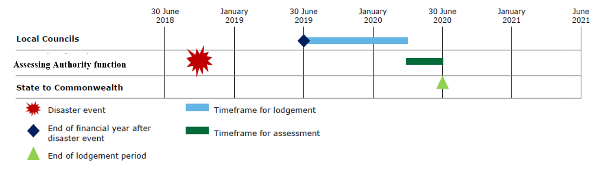

---
## Page 78

 
 
Guideline 1: Claims and eligibility for essential public assets (Category B) 
Victorian Disaster Recovery Funding Arrangements 
Page | 77 
 
All reconstruction works claims are to be validated by the Assessing Authority and lodged with the 
Administering Authority. It is recommended that essential public asset reconstruction works claims 
are lodged on a regular basis. All claims are required to be lodged in the financial year that the 
expenditure is incurred. 
For essential public asset reconstruction works claims, the following documentation is to be 
provided. Refer to DRFA Fact Sheet 1 – Claims and Eligibility. 
Efficiencies framework 
A framework is to be developed to manage the allocation of efficiencies (savings) realised when the 
overall actual costs of reconstruction projects for a program are less than the estimated 
reconstruction costs. 
The Administering Authority can retain savings realised across a program of works for a period of 
36-months from the end of the financial year that is applicable to that program of works. 
Within the 36-month period, the Administering Authority must allocate and spend the savings 
realised for the program of works towards: 
• 
Essential public asset reconstruction works where the actual cost is more than the estimated 
reconstruction cost. 
• 
Natural disaster mitigation fund in accordance with the High-Level Disaster Mitigation 
Principles. 
Savings realised for the program of works do not have to be spent at the location where they were 
realised. The Administering Authority is responsible for determining the allocation of savings 
realised. The first priority of any savings realised is to potentially fund essential public asset 
reconstruction works where the actual cost is more than the estimated reconstruction cost. 
States must report to the Commonwealth Government on how the State has allocated and spent 
the savings for each program of works at the same time as submitting its audited claim for financial 
assistance. 
Note that the efficiencies are calculated by the Commonwealth Government only upon completion 
of all the eligible works for a particular activated event under the DRFA. This may be up to 36 
months after a disaster event. 
Essential Public Asset Function Framework for pre-
disaster asset function assessments  
Under the DRFA, the Commonwealth Government will contribute a portion of the funding required 
to reconstruct an essential public asset to its pre-disaster function. Therefore, the pre-disaster 
function must be established to determine the proposed treatment and subsequent estimated 
reconstruction cost.  
To assist states in defining the pre-disaster function of assets, the Commonwealth Government has 
developed the Essential Public Asset Function Framework, shown below. 
The framework focuses on two key components: 
• 
Primary asset function – purpose of the asset 
• 
Classification – level of service the asset provides.

---
## Page 79

 
 
Guideline 1: Claims and eligibility for essential public assets (Category B) 
Victorian Disaster Recovery Funding Arrangements 
Page | 78 
 
Figure 4 Essential public asset function framework 
 
Primary asset function 
All essential public assets fall into two separate categories: 
• 
Transport 
• 
Public infrastructure 
Examples of transport and public infrastructure assets in Victoria are included in the ‘Eligible works 
for transport infrastructure’ section in this guideline. 
Each category can then be further split into sub-categories. For example, the transport assets 
would be sub-categorised into roads, bridges, culverts, etc. 
Classification 
Essential public assets are classified by the level of service provided to the community by detailing 
the asset type, capacity, layout and materials. 
Asset type 
The primary function of the asset is the key consideration when determining the classification of an 
essential public asset. For example: 
• 
A road may be classified based on its primary function as an arterial road, a sub-arterial 
road or a local road. Or 
• 
A road may also be classified based on the services being provided to the community 
before the disaster, such as a road for vehicular traffic, bicycles and pedestrians.  
Asset capacity  
After defining the essential public asset type, the capacity of the essential public asset should be 
established. This is the capacity of the essential public asset to perform its primary function and, 
additionally, other services it may have been providing to the community prior to the eligible 
disaster. For example, the capacity of the road to perform the primary function of transport vehicles

---
## Page 80

 
 
Guideline 1: Claims and eligibility for essential public assets (Category B) 
Victorian Disaster Recovery Funding Arrangements 
Page | 79 
 
travelling from point A to point B might include two lanes of local traffic in each direction or one lane 
in each direction, a pedestrian walkway on one side of the road, and a breakdown lane on both 
sides of the road. What is the main role of the road—for example, a two-lane highway? Are there 
multiple roles of the road—for example, a two-lane road with pedestrian walkways? 
Asset layout and materials 
Defining the asset layout and materials is strongly linked with the capacity of the asset and is the 
final level in defining the function of an essential public asset. The engineering specifications of the 
asset that need to be captured include: 
• 
dimensions and layout; 
• 
materials used; and 
• 
functional criteria including information on any associated infrastructure e.g. barriers, signage, 
signalling, lighting, noise attenuation, drainage, and associated footpaths and bikeways. 
For example, what are the general dimensions and features (including safety) of the essential 
public asset? In the instance of a road, how wide are the lanes, shoulders and pedestrian 
walkways? What is the depth of the pavement? Does the road have line markings, safety barriers, 
lighting or traffic signals? What materials have been used to construct the road – gravel, granular 
with seal, concrete or asphalt? How does the road interface with its surroundings – are there 
signalised intersections? 
Information sources 
The information required to determine the pre-disaster asset function may be available through the 
following sources held by the asset owner: 
• 
asset registers; 
• 
certification reports; 
• 
inspection reports; 
• 
maintenance reports; 
• 
visual data – photos, videos; or 
• 
geospatial data. 
Supporting documentation required to show disaster damage   
To establish a basis that the damage sustained was a direct result of an eligible event, and the 
nature of the reconstruction works undertaken are eligible to be claimed under an essential public 
asset reconstruction works claim, the following damage evidence should be provided: 
• 
Essential public asset reconstruction photo report, with pre-disaster photo comparisons (where 
available), presented in a logical sequence for each asset with information specific to the post-
disaster photo presented, see  Appendix D: Essential Public Asset reconstruction works photo 
report 
• 
All post-disaster photo files contained within the essential public asset reconstruction photo 
report in, with metadata intact, contained within subfolders and grouped by asset (for example, 
road ID, culvert ID or structure ID). 
• 
Supplementary evidence (If applicable), for example photos obtained from newspaper stories, 
news websites where location and date can be confirmed. 
When undertaking the reconstruction damage assessment process, it is important to consider that:

---
## Page 81

 
 
Guideline 1: Claims and eligibility for essential public assets (Category B) 
Victorian Disaster Recovery Funding Arrangements 
Page | 80 
 
• 
Pre-disaster photo comparisons (where available) are to be provided to confirm damage is a 
direct result of event. 
• 
Where pre-disaster photos are not available, a Pre-disaster asset condition assessment report 
is required for each asset type (i.e. road pavement, bridge, drainage). 
• 
Pre-disaster photo comparisons that show a ‘step change’ in the condition of the asset from the 
pre-disaster condition to post-disaster condition generally demonstrate that the damage is a 
direct result of the event and therefore eligible. 
• 
Post-disaster photos may be taken up to twelve (12) months following the eligible disaster to 
illustrate damage from the event. However, the timely collection of event related visual data is 
essential to ensure that the post-disaster damage can be identified and directly attributed to the 
eligible event.  
• 
Post-disaster photographic standards and considerations should be adopted as per the ‘Post-
disaster damage – Photographic evidence’ section of this guideline. 
Reconstruction works closeout 
Following completion of an immediate reconstruction works or essential public asset reconstruction 
works project, it is necessary to provide photographic evidence of the completed works to 
demonstrate that the works undertaken were synonymous with the works proposed in the 
reconstruction claim.  
To establish the nature of the reconstruction works undertaken, the following completion evidence 
should be provided: 
• 
Reconstruction works closeout photo report, with pre-disaster and post disaster photo 
comparisons and representative post-completion photos presented in a logical sequence for 
each asset with information specific to the post-disaster photo presented. 
• 
All post-disaster and post-completion photo files contained within the Reconstruction Works 
Closeout Photo Report, with metadata intact, contained within subfolders and grouped by asset 
(for example, road ID, culvert ID or structure ID). 
• 
The Delivery Agency is required to submit related works claims within three months after works 
are completed, therefore photos are to be provided as soon as works are practically complete 
or before the claim submission due date.  
When undertaking the reconstruction damage closeout process, it is important to consider that: 
• 
The purpose of reconstruction works closeout photo report is to provide evidence that the 
treatments proposed in the restoration works claim have been undertaken. 
• 
Completion photos should be captured at a scale and orientation that reflects their 
corresponding post-disaster photo to enable a visual comparison between post-disaster 
damage and completion. 
• 
All photos presented in the reconstruction of essential public asset restoration works claim 
should have corresponding post-completion photos presented with the reconstruction works 
closeout, noting that completion photos are to: 
– 
Illustrate pavement treatments and widths undertaken (for example, part-width, half-width, 
full-width) 
– 
Illustrate the various reconstruction works types (e.g. drainage works, bridge works, 
geotechnical works). 
Where continuous damage is identified over the length of the asset, representative post-disaster 
photos should be provided over the full length of the asset (for example, where a road has 
sustained damage over 5 km, representative pre-disaster and post-disaster photos should be

---
## Page 82

 
 
Guideline 1: Claims and eligibility for essential public assets (Category B) 
Victorian Disaster Recovery Funding Arrangements 
Page | 81 
 
provided. For a relatively flat road, this should be at 100 metre intervals over the full 5 km length of 
the road. For roads which are more hilly or windy, this may vary up to 250 metres depending on 
whether the damage is obvious, the camera angle of the photos are good and there are appropriate 
light conditions.) It is recommended that the representative approach to be undertaken be 
discussed with the Assessing Authority. 
Required supporting documents 
DRFA Fact Sheet 1 – Claims and Eligibility also outlines the supporting documentation required.  
Table 13 EPA reconstruction works claims – Estimate and progress reporting – Supporting 
documentation required  
Required item  
Essential Public Asset Reconstruction works estimate 
Details  
Format  
☐ Evidence of impact of 
disaster in local government 
area  
For example, Bureau of Meteorology data, local media articles 
associated with the disaster 
PDF 
☐ Claim Lodgement 
Declaration Form  
(Form ID V Form D-DEC) 
Includes: 
• 
Delivery Agency’s internal reference number for the claim 
• 
associated activated event 
• 
type of claim – essential public asset reconstruction works claim 
• 
summary details of the claim (that is, assets and value) 
• 
applicants contact officer name 
• 
cost estimate approval reference 
• 
declaration and signature from the responsible Delivery Agency 
including a suitably qualified person (as defined in Victorian 
DRFA Guideline 2) and Chief Executive Officer 
Signed PDF 
Date of Access to the Asset 
Presented at an asset type level – for example, Road A 
An essential public asset is considered to be ‘accessible’ from the 
time when: 
• 
the disaster is no longer occurring (e.g. flood waters have 
receded, or a bushfire is out/under control) and the site of the 
damaged asset can be safely accessed by reconstruction 
workers; or 
• 
the Delivery Agency has capacity to undertake the required 
restoration works. In this situation, the Delivery Agency must be 
able to demonstrate they have made a reasonable attempt to 
undertake works as soon as the disaster was no longer 
occurring (as per the point above) but was not able to complete 
the works because of: 
o 
competing reconstruction priorities associated with a 
significant program of works caused by a severe disaster 
or multiple disasters, or 
o 
the unavailability of specialised equipment/resources. 
Excel 
☐ Cost estimate 
Estimated cost of the proposed reconstruction works, presented for 
each treatment for claimed asset.  
See Victorian DRFA Guideline 2 for more detail.  
Excel 
☐ Completed/progress 
essential public asset 
reconstruction works claim 
template  
(Form ID V Form C2-CW) 
Each line on the form is to represent the different treatments 
undertaken 
Excel and 
signed PDF

---
## Page 83

 
 
Guideline 1: Claims and eligibility for essential public assets (Category B) 
Victorian Disaster Recovery Funding Arrangements 
Page | 82 
 
Required item  
Essential Public Asset Reconstruction works estimate 
Details  
Format  
☐ Detailed General ledger/ 
transaction listing 
Must correlate to expenditure in Form ID V Form-C-RW. A 
reconciliation statement is to be provided (if the evidence of 
expenditure differs from the amount claimed). 
The Transaction listing must include a minimum of date the 
expenditure was posted to the general ledger, invoice number, 
supplier and description of works undertaken, within a specific 
financial year. 
Excel 
☐ Invoices 
Assessors will verify invoices against the works undertaken and 
whether the amounts were incurred within a specific financial year, 
within the allowable time period for reconstruction works Source 
documents (e.g. contracts) supporting the invoice to be available for 
sampling upon request. 
All invoices should correlate to an appropriate line item in the 
general ledger or transaction listing and have appropriate 
description of works undertaken including:  
• 
eligible event name (AGRN),  
• 
date of the eligible event,  
• 
date works completed and  
• 
asset location.  
If an AGRN has not yet been assigned provide details of the eligible 
disaster 
Claims are exclusive of GST 
PDF 
☐ Day Labour 
Evidence required to claim day labour expenses; 
• 
All direct costs must be claimed on a per asset basis;  
• 
Detailed general ledger or transactions reports outlining all 
expenditure;   
• 
Details of resources claimed for the eligible activities including 
staff names, position descriptions of roles, internal 
costing/payroll reports/timesheets for any payroll costs. In 
relation to plant and equipment used for the event, utilisation 
details (by asset, hours, dates);  
• 
Plant and equipment purchase date, purchase cost, written 
down value, residual value, asset life, depreciation to-date;  
• 
Detailed calculation of claimable hourly rate for all plant and 
equipment items including details of costs incurred per year 
that form the basis of the charge out rates;  
• 
The basis of apportionment of the expenses.   
PDF 
☐ Payroll Reports 
• Reports for extraordinary payroll costs (overtime) & evidence of 
the additional resources required. Timesheets to be available for 
sampling upon request. 
• Position descriptions for role/s created for eligible activities 
(approved by the Assessing Authority in consultation with the 
Administering Authority) and a copy of the relevant payroll report. 
PDF

---
## Page 84

 
 
Guideline 1: Claims and eligibility for essential public assets (Category B) 
Victorian Disaster Recovery Funding Arrangements 
Page | 83 
 
Required item  
Essential Public Asset Reconstruction works estimate 
Details  
Format  
☐ Pre-condition assessment 
report 
A Pre-disaster asset condition assessment report is to be completed 
where a pre-disaster photo outlining sufficiently the pre-condition of 
the damaged essential public asset is not available (and dated no 
more than four years prior to the disaster occurring). The 
information required to determine the pre-disaster function may be 
available through the following sources held by the Delivery Agency: 
• 
asset registers. 
• 
certification reports. 
• 
inspection reports. 
• 
maintenance reports. 
• 
visual data – photos, videos; or 
• 
geospatial data 
 
PDF 
☐ Photo report – post 
disaster damage  
Representative, printable report showing each damaged location 
(presented in a logical sequence for each asset and showing asset 
name and number references, where available). 
For damage that is continuous in nature, the frequency of photos 
must be able to depict the damage is continuous and not 
intermittent. 
PDF 
☐ Photo files 
All photo files with metadata intact capturing location (longitude and 
latitude) and time taken. 
Photo files should be presented in subfolders and grouped by asset 
(for example, road link). 
JPEG, TIFF, 
PNG, GIF, 
RAW 
Internal Audit Report (if 
requested) 
Upon receiving a written request from the Administering Authority 
(sample based), the Delivery Agency is required to engage their 
internal audit function to provide an opinion on whether appropriate 
procurement practices have been applied. Full copy of Internal Audit 
report to be provided. This cost is not reimbursed. 
PDF 
Examples of forms and expenditure - Essential Public Asset Reconstruction works estimate and 
progress reporting

---
## Page 85

 
 
Guideline 1: Claims and eligibility for essential public assets (Category B) 
Victorian Disaster Recovery Funding Arrangements 
Page | 84 
 
Must be signed by 
the CEO
Essential Public Asset Reconstruction works -
Estimate
V Form-D-DEC
Use comments 
to provide 
additional details 
about the line 
items. 
V Form-C-RW
Date asset is 
available, must be 
consistent with 
requirements in 
Guideline 1
The total amount be the 
same shown in the V 
Form-D-Dec.
$53,969.50
The total amount must 
be the same shown in 
the ACMS claim and V-
form-C-RW.
Estimate must be 
prepared by a 
suitably qualified 
person as per 
Guideline 1
Estimated costs for 
Indirect Costs, 
Contingency and 
Escalation must be 
consistent with 
Guideline 3.
$53,969.50
Each cell is to be populated

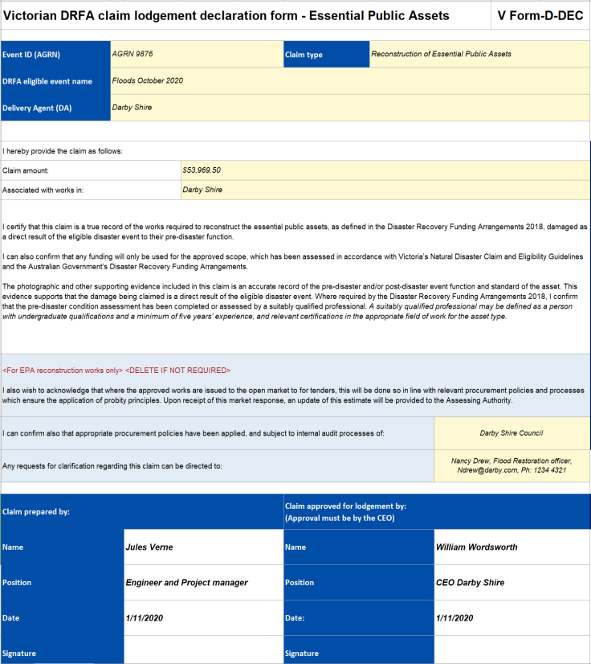

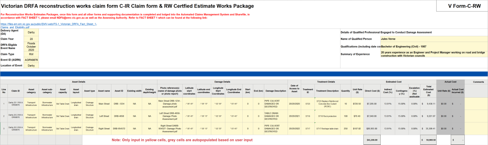

---
## Page 86

 
 
Guideline 1: Claims and eligibility for essential public assets (Category B) 
Victorian Disaster Recovery Funding Arrangements 
Page | 85 
 
Pre-Disaster Asset 
Condition Assessment  
Report
Must be conducted or 
verified by a suitably 
qualified profession as 
per Guideline 1
Assessment must be dated no less 
than 4 years prior to the disaster.
For a State Agency this must be dated 
no later than 2 years prior to the 
disaster.  
Include appropriate 
attachments i.e. 
maintenance logs as 
outlined in Guideline 1.
Must be signed by an 
Assessor prior to 
lodgement.

---
## Page 87

 
 
Guideline 1: Claims and eligibility for essential public assets (Category B) 
Victorian Disaster Recovery Funding Arrangements 
Page | 86 
 
Photo Report
Essential Public Asset Reconstruction works –
Estimate 
Pre disaster photos can be from up 
to four years prior to the event for 
local councils and two years for 
State Agencies. 
All photos must include 
metadata detailing 
latitude, longitude and 
date taken.

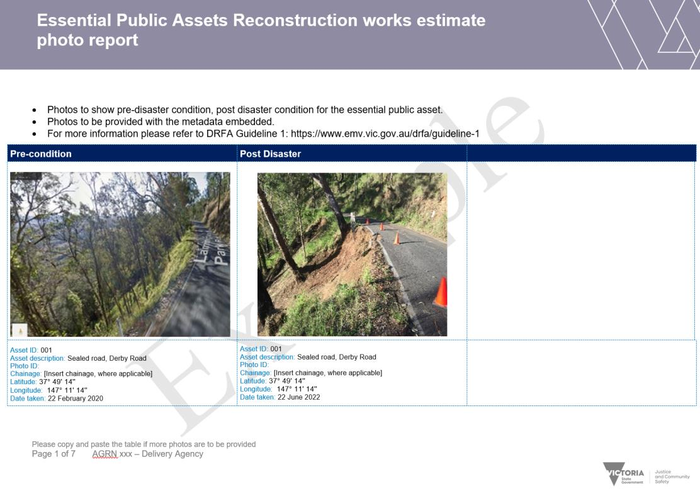

---
## Page 88

 
 
Guideline 1: Claims and eligibility for essential public assets (Category B) 
Victorian Disaster Recovery Funding Arrangements 
Page | 87 
 
Independent technical review 
An Independent Technical Review (ITR) of the reconstruction works must be conducted in the 
following circumstances, prior to finalisation of the claim for reconstruction works. This applies to 
the reconstruction of essential public assets only.  
Table 14 Independent technical review application 
Application  
Details  
Application one  
The estimated reconstruction cost for the project is $25 million or more.  
Application two  
Where an alternative reconstruction project solution is preferred and there is a 
variance between the estimated reconstruction cost for the original project and the 
preferred reconstruction project solution, that is:  
• 
more than 50 per cent lower than the estimated reconstruction cost of the original 
project; and 
• 
to a value of between $5 million and $25 million. 
Application three  
Where special circumstances are encountered that give rise to a variance in the 
estimated reconstruction cost for the project that is:  
• 
greater than 15 percent of the estimated reconstruction cost of the original 
project; and 
• 
greater than $1 million. 
 
The Delivery Agency will be responsible for identifying the need for and procuring an ITR however 
any costs associated will not be , but the Assessing Authority or Administering Authority may also 
recommend an ITR if any of the above conditions are met. 
In addition, the Commonwealth Government, on receiving the estimated reconstruction costs for a 
project from Victoria within its financial year claim, may elect to have it reviewed under 
Application 4. 
Special circumstances – changes required to an approved claim estimate 
Where the estimated reconstruction cost is lower than the actual cost of a project as a result of 
special circumstances, and the variance does not meet the criteria for an ITR, Delivery Agencies 
with the approval of the Administering Authority, can adjust the estimated reconstruction cost to 
reflect the variance.  
The Delivery Agency must provide evidence to the Assessing Authority to demonstrate the special 
circumstances encountered, including why the special circumstances could not reasonably have 
been foreseen. 
Special circumstances may include the following: 
• 
geotechnical conditions that could not reasonably have been foreseen or investigated in the 
design period; 
• 
previously unidentified indigenous and cultural heritage discoveries; 
• 
previously unidentified heritage discoveries; 
• 
delays caused by subsequent eligible disasters; 
• 
environmental conditions that could not reasonably have been foreseen (for example, asbestos 
discovery); and 
• 
critical reduction in water availability that could not reasonably have been foreseen or 
investigated in the design period.

---
## Page 89

 
 
Guideline 1: Claims and eligibility for essential public assets (Category B) 
Victorian Disaster Recovery Funding Arrangements 
Page | 88 
 
Where a cost overrun above the approved certified estimate works package does not meet the 
‘special circumstance’ as defined under DRFA and is not approved by the Commonwealth 
Government, a ‘limited’ contingency may be available funded from the DRFA Efficiencies 
Framework (resulting from realised savings from DRFA funded projects across the State). It is 
‘limited’ to such time that the likely outcome of the expenditure across all the DRFA State program 
of works is known. As such, no guarantee is provided as to Administering Authority funding cost 
overruns that does not meet the DRFA ‘special circumstance’ criteria.   
Reimbursement and payment process 
Once the certified estimate works package is approved by the Administering Authority for essential 
public asset reconstruction works, the estimate will need to be updated in the CMS portal and 
aligned to the approved certified estimate works package.  
Essential public asset reconstruction work claims will be paid on an actual expenditure 
basis capped up to the certified amount. Eligible essential public asset reconstruction 
expenditure incurred is to be lodged throughout the year that the expenditure is incurred 
and no later than 31 July (within one month from the end of the financial year in which the 
expenditure was incurred). 
Upon receiving approval of the Administering Authority, works are able to commence for essential 
public asset reconstruction works and claims are encouraged to be submitted on a regular basis.  
For large claims it is recommended that delivery agencies break down a claim package to a 
reasonable size to facilitate timely claims processing. Delivery Agencies are encouraged to discuss 
the proposed works packages with their assigned assessor.   
Where a claim has all the supporting documentation (as outlined in Table 13) and is complete, 
structured, and cross-referenced, the assessor will seek to review and recommend the claim for 
approval within a 4-week period. Timelines may also be influenced by the number and scale of 
events that take place. 
Once a claim has an Assessing Authority endorsement confirming all aspects of the claim and 
required evidence, the claim will be sought to be processed for payment within a 2-week period. 
These timelines will however be longer if the required claim templates/documentation has not been 
submitted, incomplete or difficult to follow.  
Refer to Table 7, 10 and 13 regarding the relevant claim form to be used.  
Claims will be processed for payment up to the approved certified estimate works package. Where 
claims exceed the approved certified estimate works package and is the result of a ‘special 
circumstance’ as defined under the DRFA, an updated re-certified approved estimate may be able 
to be resubmitted (subject to meeting the special circumstance condition and an independent 
review recommendation). 
Where a cost overrun above the approved certified estimate works package does not meet the 
‘special circumstance’ as defined under DRFA, a ‘limited’ contingency may be available funded 
from the DRFA Efficiencies Framework (resulting from realised savings from DRFA funded projects 
across the State). It is ‘limited’ to such time that the likely outcome of the expenditure across all the 
DRFA State program of works is known. As such, no guarantee is provided as to Administering 
Authority funding cost overruns that does not meet the DRFA ‘special circumstance’ criteria.

---
## Page 90

 
 
Guideline 1: Claims and eligibility for essential public assets (Category B) 
Victorian Disaster Recovery Funding Arrangements 
Page | 89 
 
Advance payments 
Taking into account the payment process policy and timelines for reimbursement, advances are 
supported for claimants that demonstrate a financial need and under exceptional circumstances.  
The required information to be submitted for an advance request to be considered is a forecast 
cashflow statement, month-by-month for the projected period of the works. The forecast cashflow 
will need to capture all cash inflows and outflows from normal business as usual (BAU) activities 
overlaid by the projected essential public asset reconstructions works profile (outflows and 
reimbursement inflows based on the payment period times frames outlined in the Payment Process 
section). This is then compared the Delivery Agency’s cash and cash equivalents balances 
(including term deposits) at the end of each month. Any shortfall, taking into account minimum 
monthly cash reserves required by the Delivery Agency, is the basis of an advance request. 
Advances are paid in the month that financial support is required. 
Any cash and cash equivalents (including term deposits) captured in the Delivery Agency’s most 
recent completed Balance Sheet that are sought to be excluded from the cashflow forecast is 
required to be explained. Excluding a term deposit on the basis that the scheduled maturity date is 
outside the period that the cash is required is not a valid reason. Minimum monthly cash reserves 
or restricted investments need to be supported by appropriate analysis. 
The required information to be submitted for an advance request includes a projected cashflow 
attached to the latest Delivery Agency’s Balance Sheet/Statement of Cashflow for the proceeding 
full month based on actuals. The forecast cashflow is required to be signed by the Delivery 
Agency’s Chief Financial Officer certifying the cashflow forecast as complete and accurate and 
detailing underlying key assumptions of the forecast and any exclusions. 
However for significant disaster events, an alternative approach may be adopted for advances and 
the Administering Authority will provide further advice on the process to be followed. 
Advance requests are to be submitted via the request an advance payment in the CMS with 
supporting documentation to be uploaded on the file upload page. 
Progress reporting 
Throughout the delivery of approved certified estimate works packages relating to essential public 
asset reconstruction works, Delivery Agencies are required to update the Assessing Authority on a 
quarterly basis on the progress of works against each of the works packages. 
The quarterly reports are to be prepared using Form ID V Form D-QTR to record the following: 
• 
actual expenditure incurred; 
• 
budget to actuals; 
• 
current project start and finish dates; 
• 
any variances in scope, cost or time;  
• 
use of project contingency; and 
• 
commentary including risks on meeting the works completion timeline and explanations on 
variances against the approved certified estimates works package. 
Delivery Agencies are required to provide this report quarterly to the Assessing Authority via the 
CMS using the submit quarterly report function and a final report upon project completion. 
Quarterly reporting for each approved certified estimate works package is required to be provided 
by 30 September, 31 December, 31 March 2022, and 30 June 2022.

---
## Page 91

 
 
Guideline 1: Claims and eligibility for essential public assets (Category B) 
Victorian Disaster Recovery Funding Arrangements 
Page | 90 
 
Following completion of the Form ID V Form D-QTR, the Delivery Agency should navigate to the 
access my report tab in the CMS, click on submit quarterly reports and then select the correct 
approved certified estimate to submit the report against. A Delivery Agency will need to submit a 
separate quarterly report for each approved certified estimate package.  The Assessor will review 
the quarterly report and liaise with the Delivery Agency if they require further information. 
Claim acquittal and completion requirements 
The final claim for essential public asset reconstruction works is to be lodged to the Assessing 
Authority no later than three months following completion of the works. All claims are required to be 
lodged in the financial year that the expenditure is incurred. 
The Assessing Authority will consult with the Delivery Agency to ensure all available information 
has been appropriately considered as part of the final claim. 
Once a final claim has been assessed by the Assessing Authority and approved by the 
Administrating Authority a notification to the Delivery Agency will be issued. Final payment will be 
issued, subject to the payments already received to date by the Delivery Agency for that claim. 
All acquitted claims may be subject to further review by the State and Commonwealth appointed 
auditors. 
For the final claim, the following components are to be provided, unless they were provided in 
previous claims submitted.  
All supporting documents submitted are to be structured and cross referenced to allow third 
party verification. This will facilitate the timely processing of claims and the State and 
Commonwealth audit review process.  
Table 15 EPA reconstruction works final claims - Required supporting documents 
Required item  
Essential Public Asset Reconstruction works estimate 
Details  
Format  
☐ Claims lodgement 
declaration form (Form 
ID V Form D-DEC) 
Includes: 
• 
Delivery Agency’s internal reference number for the claim 
• 
associated activated event 
• 
type of claim – EPA reconstruction works claim 
• 
summary details of the claim (that is, assets and value) 
• 
applicants contact officer name 
• 
declaration and signature from the responsible Delivery Agency Chief 
Executive Officer 
Signed PDF 
☐ Completed EPA 
reconstruction works 
claim template  
(Form ID V Form C2- 
CW) 
Each line on the Form ID V Form-C2-CW to represent the different 
treatments completed, confirming the lengths, widths and depths 
completed 
Excel and 
signed PDF 
☐ Final claim value 
Presented at an asset type level – for example, Road A 
Excel

---
## Page 92

 
 
Guideline 1: Claims and eligibility for essential public assets (Category B) 
Victorian Disaster Recovery Funding Arrangements 
Page | 91 
 
Required item  
Essential Public Asset Reconstruction works estimate 
Details  
Format  
Date of Access to the 
Asset 
Presented at an asset type level – for example, Road A 
An essential public asset is considered to be ‘accessible’ from the time 
when: 
• 
the disaster is no longer occurring (e.g. flood waters have receded, 
or a bushfire is out/under control) and the site of the damaged asset 
can be safely accessed by reconstruction workers; or 
• 
the Delivery Agency has capacity to undertake the required 
restoration works. In this situation, the Delivery Agency must be able 
to demonstrate they have made a reasonable attempt to undertake 
works as soon as the disaster was no longer occurring (as per the 
point above) but was not able to complete the works because of: 
o 
competing reconstruction priorities associated with a significant 
program of works caused by a severe disaster or multiple 
disasters, or 
o 
the unavailability of specialised equipment/resources. 
Excel 
☐ General ledger or 
transaction listing 
Must correlate to expenditure in the Form ID V Form-C2-CW). A 
reconciliation statement is to be provided (if the evidence of expenditure 
differs from the amount claimed). 
The Transaction listing must include a minimum of date the expenditure 
was posted to the general ledger, invoice number, supplier and 
description of works undertaken, within a specific financial year. 
Excel 
☐ Invoices 
 
 
Assessors will verify invoices against the works undertaken and whether 
the amounts were incurred within the allowable time period for the 
expenditure type i.e. emergency or immediate works, with a specific 
financial year.  
Source documents (e.g. contracts) supporting the invoice to be available for 
sampling upon request. 
All invoices should correlate to an appropriate line item in the general 
ledger or transaction listing and have appropriate description of works 
undertaken including:  
• 
eligible event name (AGRN),  
• 
date of the eligible event,  
• 
date works completed and  
• 
asset location.  
If an AGRN has not yet been assigned provide details of the eligible 
disaster. 
Claims are exclusive of GST 
PDF

---
## Page 93

 
 
Guideline 1: Claims and eligibility for essential public assets (Category B) 
Victorian Disaster Recovery Funding Arrangements 
Page | 92 
 
Required item  
Essential Public Asset Reconstruction works estimate 
Details  
Format  
☐ Day Labour 
Evidence required to claim day labour expenses; 
• 
All direct costs must be claimed on a per asset basis;  
• 
Detailed general ledger or transactions reports outlining all 
expenditure;   
• 
Details of resources claimed for the eligible activities including staff 
names, position descriptions of roles, internal costing/payroll 
reports/timesheets for any payroll costs. In relation to plant and 
equipment used for the event, utilisation details (by asset, hours, 
dates);  
• 
Plant and equipment purchase date, purchase cost, written down 
value, residual value, asset life, depreciation to-date;  
• 
Detailed calculation of claimable hourly rate for all plant and 
equipment items including details of costs incurred per year that form 
the basis of the charge out rates;  
• 
The basis of apportionment of the expenses.   
PDF 
☐ Payroll reports 
Reports for extraordinary payroll costs (overtime) & evidence of the 
additional resources required. Timesheets to be available for sampling 
upon request. 
Position descriptions for role/s created for eligible activities (approved by 
the Assessing Authority in consultation with the Administering Authority) 
PDF 
☐ Photo report – 
completed works 
Representative, printable report showing each location at which essential 
public asset reconstruction works were completed (presented in a logical 
sequence for each asset and showing asset references, where available) 
PDF 
☐ Photo files 
All photo files with metadata intact capturing location (longitude and 
latitude) and time taken 
Photo files should be presented in subfolders and grouped by asset (for 
example, road link) 
JPEG, TIFF, 
PNG, GIF, 
RAW 
☐ Quarterly Report 
(Form ID V Form D-
QTR) 
Provided on a quarterly basis to the Administering Authority throughout 
the lifespan of the project   
Must correspond to the details in the claim form (Form ID V Form-D-
QTR) 
PDF  
Internal Audit Report (if 
requested) 
Upon receiving a written request from the Administering Authority 
(sample based), the Delivery Agency is required to engage their internal 
audit function to provide an opinion on whether appropriate procurement 
practices have been applied. Full copy of Internal Audit report to be 
provided. This cost is not reimbursed. 
PDF 
Example of forms for claim acquittal

---
## Page 94

 
 
Guideline 1: Claims and eligibility for essential public assets (Category B) 
Victorian Disaster Recovery Funding Arrangements 
Page | 93 
 
Must be signed by 
the CEO
Essential Public Asset 
Reconstruction works - Claim
V Form-D-DEC
V Form-C2-CW
Include information about the 
reason for any variance. Information 
must be succinct and able to be 
understood by a third party.  
The total amount must 
be the same shown in 
the ACMS claim, V-form 
C2-CW and transaction 
listing and not exceed 
the Certified Estimate.
The total amount be the 
same shown in the ACMS 
claim, invoices, transaction 
listings and D-Dec.
$50,893.80
Claim must be 
prepared by a 
suitably qualified 
person as per 
Guideline 1
The Claim total can not 
exceed the Certified 
Estimate
Costs to be itemised per 
estimate line
Each cell is to be populated

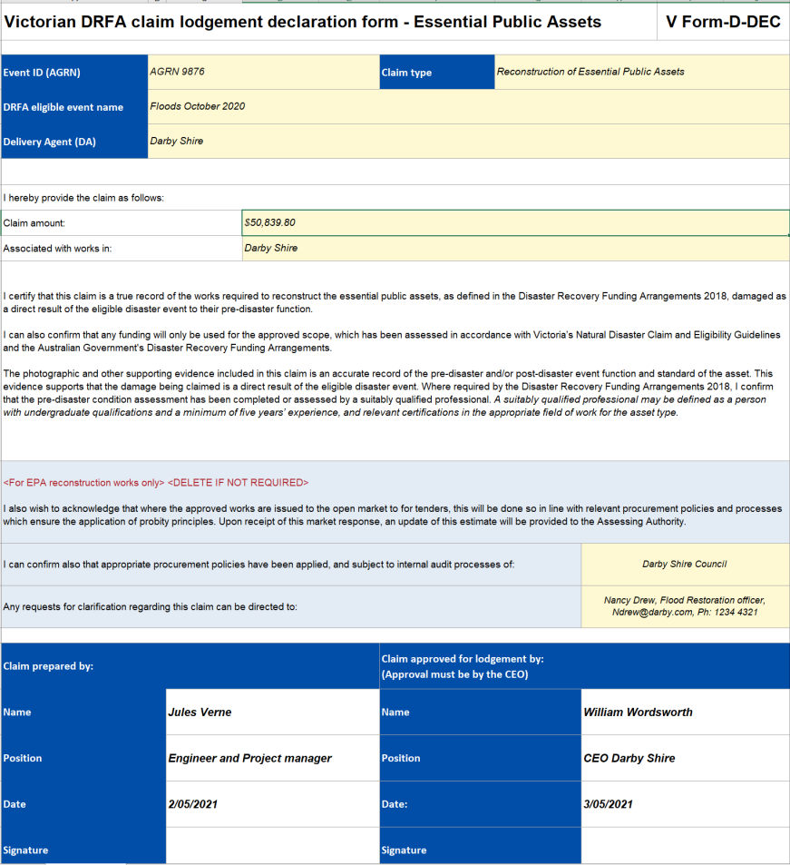

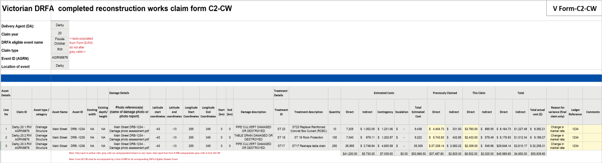

---
## Page 95

 
 
Guideline 1: Claims and eligibility for essential public assets (Category B) 
Victorian Disaster Recovery Funding Arrangements 
Page | 94 
 
General Ledger 
Invoice
Essential Public Asset Reconstruction 
works - Claim continued 
General ledger is a 
direct export from the 
Delivery Agencies 
financial system  
Amounts on the 
transaction 
listing are 
exclusive of GST 
The total of the transaction 
listing needs to be the same 
amount shown in the ACMS 
claim, D-Dec, V-form C2-CW 
and invoices.
Additional information can be included to 
explain discrepancies or part payments. 
Detail provided must be sufficient to explain 
damage and link to the disaster, including 
the date that works were undertaken. 
Invoice to include:
•
eligible event name (AGRN), 
•
date of the eligible event, 
•
date works completed and 
•
asset location. 
If an AGRN has not yet been assigned 
provide details of the eligible disaster.  
This amount needs to 
be the same amount 
shown in the ACMS 
claim, D-Dec, V-Form-
C2-CW and 
transaction listing.

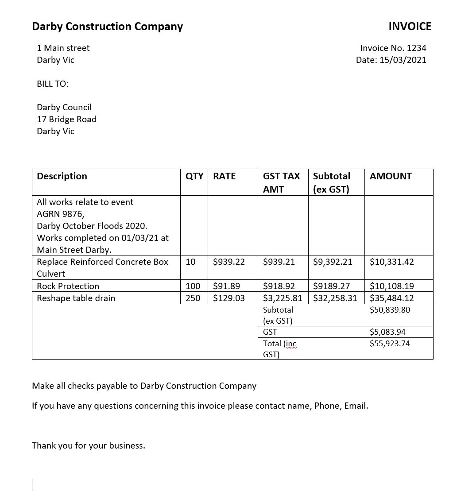

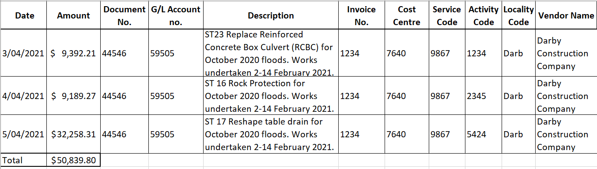

---
## Page 96

 
 
Guideline 1: Claims and eligibility for essential public assets (Category B) 
Victorian Disaster Recovery Funding Arrangements 
Page | 95 
 
Photo Report
All photos must include 
metadata detailing latitude, 
longitude and date taken. 
Essential Public Asset Reconstruction works –
Claim
Pre disaster condition photos can be from 
up to four years prior to the event for local 
councils and two years for State Agencies. 
Post completion photos are to be 
provided as soon as possible or 
within three months in line with 
the claim submission due date.

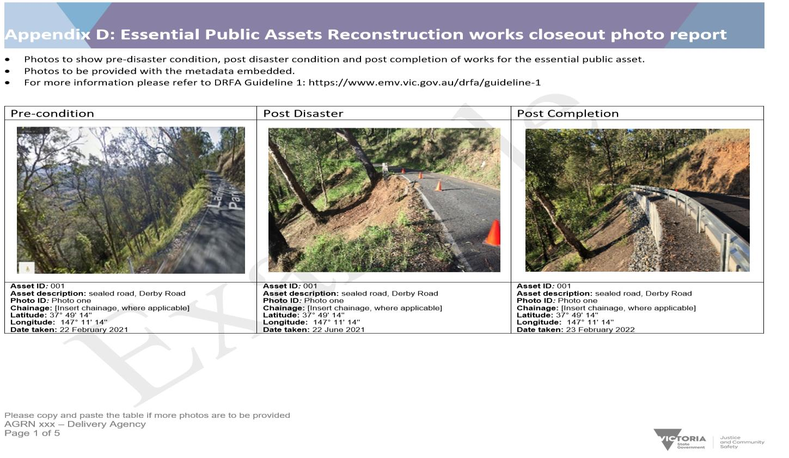

---
## Page 97

 
 
Guideline 1: Claims and eligibility for essential public assets (Category B) 
Victorian Disaster Recovery Funding Arrangements 
Page | 96 
 
Document retention 
The Delivery Agency must keep an accurate audit trail for seven years from the end of each 
financial year in which expenditure is claimed or until such time as the claims are subject to audit by 
the State and Commonwealth appointed auditors (that may be 12-24 months after the end of the 
financial year that the expenditure was incurred). This must include written records that correctly 
record and explain the Delivery Agency’s expenditure claimed for all eligible measures. 
The Delivery Agency must make available within two weeks, all relevant documentation requested 
by the Assessing Authority or Administering Authority including: 
• 
administrative data and documentation that may include (but is not limited to) contract or work 
orders, timesheets, news articles, email correspondence, funding approval letters, minutes of 
meetings; 
• 
financial data and documentation that may include (but is not limited to) tax and/or financial 
statements, cost-benefit analyses, transaction listings used to reconcile invoices, annual 
reports, proposals and invoices; and 
• 
grant data and documentation that may include (but is not limited to) grant applications and 
grant guidelines. 
 
Further information 
For further information, refer to the Victorian DRFA Claims and eligibility documentation as listed in 
Appendix A: Claims and eligibility standard forms and templates.

---
## Page 98

 
 
Guideline 1: Claims and eligibility for essential public assets (Category B) 
Victorian Disaster Recovery Funding Arrangements 
Page | 97 
 
Document information 
Document details 
Criteria 
Details 
TRIM ID: 
 
Document title: 
Victorian DRFA Guideline 1: Claims and eligibility for essential public assets  
Document owner: 
Emergency Recovery Victoria, Department of Justice and Community Safety  
Version control 
Version Date 
Description 
Author 
V1.0 
12 12 18  
Issued for IDC review  
 
V2.0 
24 10 18  
Final issue for approval 
 
V2.1 
26.10.18 
Minor updates to final issue  
 
V2.2  
30.10.18 
Amendment to day labour references. working document.  
 
V2.3 
5.11.18 
Amendment to day labour references. 
 
V2.4 
07.01.19 
Updates to Glossary 
 
V2.5 
28.05.19 
Minor updates to Immediate and Emergency Works (Page 5) 
and Extensions of allowable time limits (Page 7) 
 
V2.6 
07.06.19 
Update to Table 3,5,7 to capture payroll reports 
 
V2.7 
1.07.19 
Inclusion of payment and advance policy for essential public 
asset reconstruction works. Misc. minor edits throughout the 
document 
 
V2.8 
31.07.19 
Reference to Fact Sheet 1 for guidance on where the required 
documentation is to be uploaded (ACMS / ShareFile). 
Update of eligible Essential Public Assets to include water tanks 
(Page 2) on a case by case basis. 
Update the insurance section to clarify arrangements for entities 
with insurance (Page 4). 
Update to Tables 4,5,6 and 8 regarding approval process of 
position description roles.

---
## Page 99

 
 
Guideline 1: Claims and eligibility for essential public assets (Category B) 
Victorian Disaster Recovery Funding Arrangements 
Page | 98 
 
Version Date 
Description 
Author 
V2.9 
V3.0 
06.08.19 
31.10.19 
Updates to Introduction and Eligible Measures Activation (Page 
4) 
Updates to Emergency and Immediate Works (Pages 5, 27 and 
29) 
Updates to Extension of Allowable Time Limit (Pages 7-8) 
Updates to Classification to include Asset type, Asset Capacity 
and Asset layout and material (Page 10) 
Updates to Secondments (Page 23) 
Updates to Funding Contribution (Page 27) 
Updates to Table 4 Emergency Works claims (Page 29) 
Updates to Table 5 Immediate Works Claims (Page 30) 
Updates to Reconstruction Works (Page 32) 
Updates to Independent Technical Review (Page 33) 
Updates to Special Circumstances – Changes to approve claim 
estimate (Page 34) 
Updates to Table 8 EPA reconstruction works final claim (Page 
37) 
Replace reference to DTF with Administering Authority. 
Reference the new DRFA Administering Authority as 
Emergency Recovery Victoria / Department of Justice and 
Community Safety 
Eligible measures activation section captures new form to be 
used (Notification of Event form) and details letters to be issued 
by the Administering Authority 
Requirement that Position Description require the approval of 
the Assessing Authority in consultation with the Administering 
Authority 
Requirement for progress reporting to be undertaken quarterly 
and development of a form 
Update website links from DTF to ERV 
 
V4.0 
08.11.19 
Updates to Definition of Essential Public Asset to include 
regional airports and Flood Monitoring Stations (Page 2) 
 
V5.0 
06.06.20 
Updates to Purpose and Scope (Page 1) 
Updates to Administering and Assessing Authorities (Page 1) 
Updates to Insurance (Page 5) 
Updates to Emergency works (Page 5) 
Updates to Allowable time limits (Page 6) 
Updates to Technical standards (Page 11) 
Updates to Road Pavements and Surfacing (Page 11) 
Updates to Ineligible works (Page 13-14) 
Updates to Essential Public Assets Reconstruction Works Claim 
(Page 32) 
 
V6.0 
14.07.20 
Update to Quarterly reporting (Page 37) 
Update to Emergency works claims (Page 29) 
Update to Immediate Reconstruction works claims (Page 31) 
Update to Essential Public Asset Reconstruction works claims 
(Page 33) 
 
V7.0 
19.04.21 
Structure of document changed 
Copies of examples inserted

---
## Page 100

 
 
Guideline 1: Claims and eligibility for essential public assets (Category B) 
Victorian Disaster Recovery Funding Arrangements 
Page | 99 
 
Version Date 
Description 
Author 
V8.0 
14.05.21 
Inclusion of requirement of photo reports for completed 
emergency works  
 
V 9.0 
18.10.21 
Merging guideline 1 and 2 into the new Guideline 1 
 
V 10.0 
17.03.22 
Inclusion of Transport Infrastructure in Glossary (Page 7) 
Updates on eligibility of footpaths, bike lanes, and pedestrian 
bridges and Intelligent transport systems (Page 7, 18 and 37) 
Update on State and local government assets (Page 10 and 11) 
Updates on re-damaged essential public assets (Page 86)  
Updates to photo report templates for Appendix B, C and D 
 
V11.0 
20.04.22 
Updated examples of pre-disaster asset condition report  
 
V12.0 
26.08.22 
Update to Glossary - definition of eligible disaster (Page 5) 
Update to Eligible events and activation process for: 
• 
State expenditure to include floods and storms (Page 
13) 
• 
Certified estimate works package for reconstruction 
works to include that Delivery Agencies bearing the 
financial risk should any reconstruction works 
commence or are completed prior to the certified 
estimate works package being approved by the 
Administering Authority (Page 14 & 31) 
Update to Supporting documentation required to show disaster 
damage to include photo intervals for Immediate works (Page 
20) 
Update to Supporting documentation required to show disaster 
damage to include photo intervals for Immediate works (Page 
36) 
Update to Removal of Debris to include tree stumps where 
associated with the typical eligible examples (Page 43) 
Additional information included in Emergency, Immediate and 
Reconstruction works regarding the application of each of these 
works (Pages 45-46, 60, 73) 
Update to Progress reporting wording for Reconstruction Works 
(Page 90) 
Reference to EMV replaced with Emergency Recovery Victoria 
Update photo report examples (Pages 101-103) 
 
V13.0 
25.01.23 
Update to Examples of assets that are not eligible as essential 
public assets - fire access tracks which are managed by local 
government (Page 12) 
Update to day labour eligibility and evidence requirements  
 
V14.0 
24.03.23 
Update to Glossary of Terms for Suitably Qualified Professional 
(Page 7) 
Update to Insurance (Page 15) 
Update to Training (Page 33) 
 
V15.0 
14.04.23 
Update to Public Infrastructure examples that Guideline 3 
should be referred to for advice on costs associated with levees 
being used for counter disaster operations (Page 10) 
 
V16 
10.07.23 
Guideline updated to reflect new Claims Management System 
(CMS) including requirement for forms to be completed in the 
system and upload documentation to now be via the CMS.

---
## Page 101

 
 
Guideline 1: Claims and eligibility for essential public assets (Category B) 
Victorian Disaster Recovery Funding Arrangements 
Page | 100 
 
Version Date 
Description 
Author 
V17 
26.10.23 
Update to definition of Suitably Qualified Professional (Page 38) 
in line with the definition on Page 7. 
Update to Ineligible expenditure on day labour to include On-call 
or standby costs (as only actual work hours are eligible for 
reimbursement) (Page 26) 
Update to day labour policy to include REPA works  
 
V18 
20.12.23 
Update of Administering Authority from EM Group to Emergency 
Recovery Victoria (across Guideline 1) 
 
V19 
12.01.24 
Update of Notification of event website link to new CMS portal 
(page 14) 
 
V20 
10.04.24 
Update of Table 7 Emergency works claims - Supporting 
documentation required to remove requirement for completion 
photos for emergency works (page 54) 
 
Reference material 
Attached references 
TRIM ID/location 
 
 
 
Bibliography 
Author 
TRIM ID/location 
Disaster Recovery Funding Arrangements 
2018 
The Commonwealth Government 
 
 
Acronyms  
Acronyms 
Description 
CMS  
Claims Management System  
CMA 
Catchment Management Authority  
DELWP 
Department of Environment, Land, Water and Planning  
DJCS 
Department of Justice and Community Safety  
DRFA  
Disaster Recovery Funding Arrangements  
ERV 
Emergency Recovery Victoria  
EPA 
Essential Public Asset 
ITR 
Independent Technical Review  
LGA 
Local Government Authority  
NDRRA  
Natural Disaster Relief Recovery Arrangements  
OH&S 
Occupational Health and Safety 
RCBC 
Reinforced Concrete Box Culvert 
RCCEF 
Road Construction Cost Escalation Forecasts 
REPA 
Reconstruction of Essential Public Assets

---
## Page 102

 
 
Guideline 1: Claims and eligibility for essential public assets (Category B) 
Victorian Disaster Recovery Funding Arrangements 
Page | 101 
 
Acronyms 
Description 
VAGO 
Victorian Auditor-General’s Office  
VMIA 
Victorian Managed Insurance Authority  
WBS 
Work Breakdown Structure

---
## Page 103

 
 
Guideline 1: Claims and eligibility for essential public assets (Category B) 
Victorian Disaster Recovery Funding Arrangements 
Page | 102 
 
Appendix A: Claims and eligibility standard forms 
and templates  
Item 
Description 
Form/ Doc ID 
1 
Victorian DRFA Guideline 1 - Claims and eligibility for essential public 
assets 
GL-1  
2 
Victorian DRFA Fact Sheet 1 - Claims and eligibility for essential public 
assets 
FS-1  
3 
Victorian DRFA Claim Form B - Emergency works 
V Form B-EW 
4 
Victorian DRFA Claim Form C – Immediate Reconstruction works  
V Form C-IR 
4 
Victorian DRFA Claim Form C - Reconstruction works  
V Form C-RW 
5 
Victorian DRFA Claim Form B2 - Completed works  
V Form C2-CW 
6 
Victorian DRFA Claim Form D - Reporting template 
V Form D-QTR 
7 
Victorian DRFA Claim Form D - Claim lodgement declaration – Asset 
Reconstruction works 
V Form C-RW 
8

---
## Page 104

 
 
Guideline 1: Claims and eligibility for essential public assets (Category B) 
Victorian Disaster Recovery Funding Arrangements 
Page | 103 
 
Appendix B: Emergency works photo report1 
 
 
 
 
 
 
 
1 Templates for photo reports are available as a separate document on the website at 
https://www.emv.vic.gov.au/drfa-ndfa-events-post-1-nov-2018

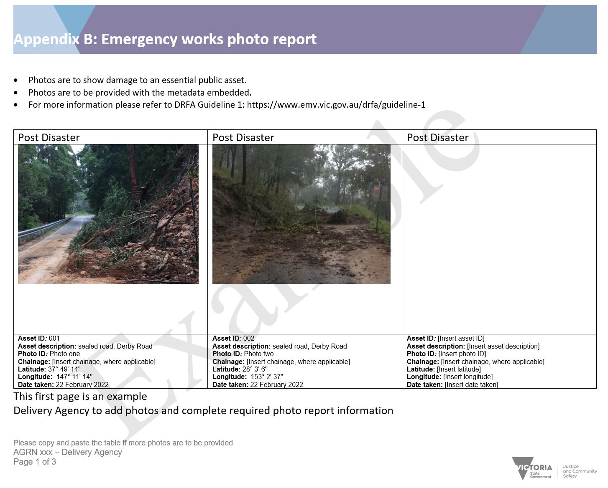

---
## Page 105

 
 
Guideline 1: Claims and eligibility for essential public assets (Category B) 
Victorian Disaster Recovery Funding Arrangements 
Page | 104 
 
Appendix C: Immediate Reconstruction works photo 
report2 
 
2 Templates for photo reports are available as a separate document on the website at 
https://www.emv.vic.gov.au/drfa-ndfa-events-post-1-nov-2018

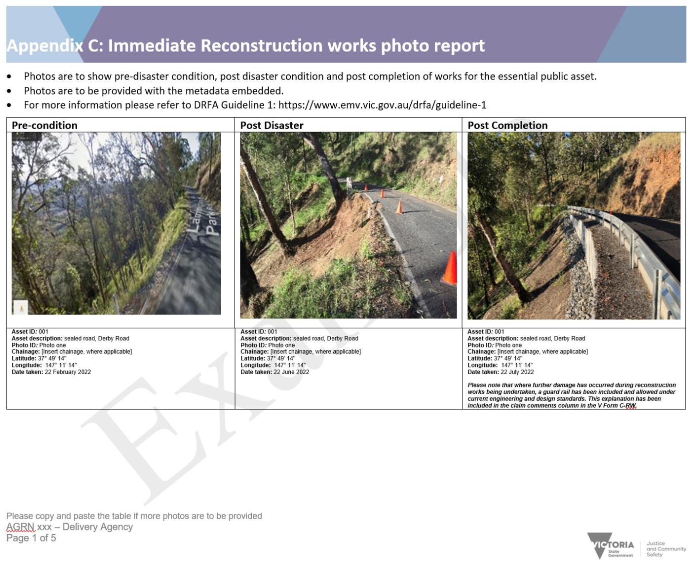

---
## Page 106

 
 
Guideline 1: Claims and eligibility for essential public assets (Category B) 
Victorian Disaster Recovery Funding Arrangements 
Page | 105 
 
Appendix D: Essential Public Assets Reconstruction 
works closeout photo report3 
 
 
3 Templates for photo reports are available as a separate document on the website at 
https://www.emv.vic.gov.au/drfa-ndfa-events-post-1-nov-2018

---
## Page 107

 
 
Guideline 1: Claims and eligibility for essential public assets (Category B) 
Victorian Disaster Recovery Funding Arrangements 
Page | 106 
 
Appendix E: Pre-disaster asset condition 
assessment report template4 
 
 
 
4 Templates for Pre-Disaster asset condition assessment report are available as a separate 
document on the website at https://www.emv.vic.gov.au/drfa-ndfa-events-post-1-nov-2018

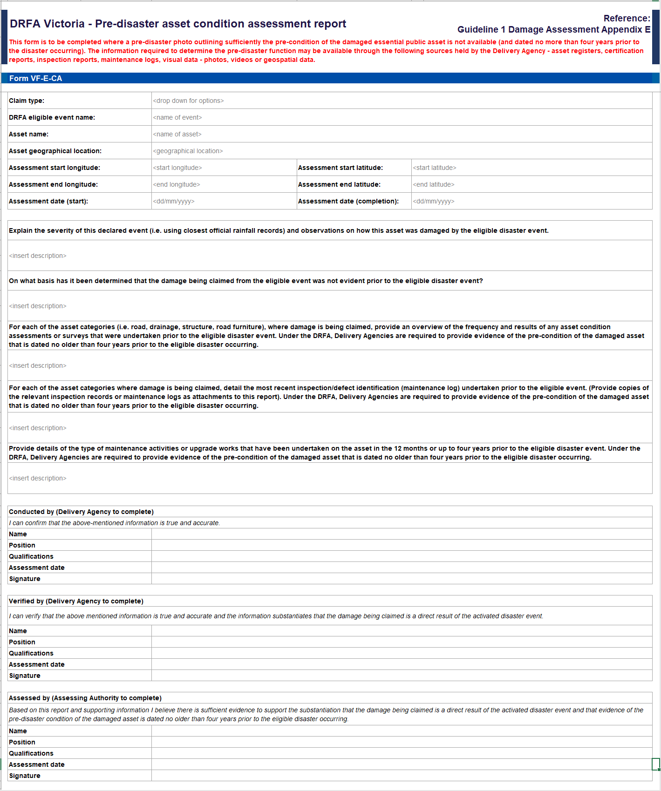

