# Victorian Emergency Operations Handbook (Edition 3 (December 2020))

> **Source**: Emergency Management Victoria
> **URL**: https://files.emv.vic.gov.au/2021-05/Victorian%20Emergency%20Operations%20Handbook%20Edition%203%20December%202020.pdf
> **Licence**: © State of Victoria; emergency-management practitioner reference
> **Retrieved**: 2026-05-07T23:44:34Z
> **SHA-256**: `a6d3c2491a1c38277876228ad5234de2464ba929bdb73ea6703b9fa4541b6e38`
> *Converted from PDF to Markdown format.*

---
## Page 1

Working in conjunction  
with Communities,  
Government, Agencies 
and Business
Victorian Emergency  
Operations Handbook 
Edition 3 – December 2020

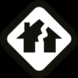

---
## Page 2

Victorian Emergency Operations Handbook
2
Authorised and published by Emergency Management Victoria, 
121 Exhibition Street, Melbourne, 3000
© State of Victoria 2020
You are free to re-use this work under a Creative Commons Attribution 4.0 licence, provided 
you credit the State of Victoria (Emergency Management Victoria) as author, indicate if 
changes were made and comply with the other licence terms. The licence does not apply to 
any images, photographs or branding, including Government logos.
ISBN 978-0-9944236-0-3 (Print) 
ISBN 978-0-9944236-1-0 (pdf)
Published December 2020
If you would like to receive this publication in an accessible format, 
please email media@emv.vic.gov.au
This document is also available in Word/PDF format at www.emv.vic.gov.au

---
## Page 3

Edition 3 – December 2020
3
CONTENTS
FOREWORD	
6
PURPOSE	
7
PART 1 – EMERGENCY RESPONSE ARRANGEMENTS	
9
EMERGENCY MANAGEMENT ARRANGEMENTS	
11
Principles of emergency management	
11
Victorian emergency management arrangements	
12
Incident tier	
22
Regional tier	
25
State tier	
27
Area of Operation tier	
28
Transfer of control	
29
Class 3 emergencies	
31
SAFETY	
36
Safety first approach	
37
Safety considerations	
41
Health monitoring	
42
Communication of safety information	
42
OHS incident reporting	
46
INCIDENT MANAGEMENT	
47
Incident Management Systems	
47
Incident Controller	
52
Deputy Incident Controller	
53
Operations Officer	
53
Division Commanders	
54
Sector Commanders	
55
Incident objective	
55
Incident action planning	
56
Incident communications planning	
57
Communicating incident information	
59
Emergency management locations	
62
Local knowledge	
64
Aircraft and aviation	
66

---
## Page 4

Victorian Emergency Operations Handbook
4
PUBLIC INFORMATION	
67
Provision of warnings to the community	
67
Warning levels and templates	
67
Community meetings	
69
Warning channels	
70
Community sirens	
70
TRAFFIC MANAGEMENT POINTS	
71
Public TMP access	
71 
EVACUATION	
73
Definition of evacuation	
73
The evacuation process	
73
Recommendation to evacuate	
73
Roles and responsibilities	
74
Vulnerable people	
78
INITIAL IMPACT ASSESSMENT	
79
Initial Impact Assessment	
79
Secondary Impact Assessment	
80
RELIEF AND RECOVERY	
81
Transition from response to recovery	
81
Relief and recovery coordination	
82
Emergency relief and recovery public information sources	
83
INFORMATION SYSTEMS	
84
Emergency Management – Common Operating Picture	
84
Emergency Management Drive	
84
Emergency management webmail	
85
Resource requesting	
85
LESSONS MANAGEMENT	
86
EM-Share	
89
Monitoring	
90
Debriefing	
90
Reviews	
92
Assurance and Learning Unit	
92

---
## Page 5

Edition 3 – December 2020
5
PART 2 – BUSHFIRE READINESS AND RESPONSE	
93
READINESS AND RESPONSE TO BUSHFIRE	
91
Preparedness arrangements	
91
Readiness arrangements	
91
Response arrangements	
97
Functional areas 	
99
Post incident	
124
PART 3 – FLOOD AND STORM	
125
Flood and storm	
127
Authorising environment	
127
Emergency risk management	
127
Extreme weather climatology	
128
River systems	
129
Floodplain management	
130
Flood emergency management	
130
Total Flood Warning System (TFWS)	
131
Levee management	
131
Dam management	
132
Community resilience	
132
Readiness and response	
133
Managing the incident response	
136
Triage	
139
Public information	
141
Community safety options	
144
Consequence management	
145
Relief and recovery	
146
After an emergency	
146
PART 4 – REFERENCES AND APPENDICES	
147
Further information	
149
Doctrine	
150
SCC/RCC/ICC contact list	
152

---
## Page 6

Victorian Emergency Operations Handbook
6
Andrew Crisp APM 
Emergency Management Commissioner
FOREWORD
In recent years, Victoria has been working to develop and document processes  
for the management of major emergencies in Victoria.
The Victorian Emergency Operations Handbook summarises the operational 
management structures and systems used by agencies and government 
departments for preparedness, readiness and response to major emergencies  
in Victoria. 
Although this handbook focusses on the management of major emergencies,  
the principles and concepts can apply to all emergencies in Victoria.
To achieve a coordinated response to an emergency, each agency must work 
together to understand the systems, structures, resources, capabilities and statutory 
obligations of the other agencies.
This handbook is an important reference for all those involved in managing  
major emergencies in Victoria. It is particularly relevant for those involved  
in Incident Management.
Consistent with an all emergencies approach, the handbook includes chapters  
on specific hazards, discussing factors that are unique and must be considered  
in managing them. This version includes State Emergency Management Plan  
(SEMP) changes.

---
## Page 7

Edition 3 – December 2020
7
PURPOSE
The purpose of this handbook is to provide emergency personnel with  
a convenient reference to the key agency structures and systems required  
to undertake effective and safe incident management operations in Victoria.
It is important to note that the handbook is a 
subordinate document to the SEMP, procedures  
produced by the Emergency Management 
Commissioner (EMC) and to all other agency 
procedures, plans and manuals.
At the time of printing, the handbook is consistent with these procedures,  
plans and manuals. However, the overarching procedures, plans and manuals  
always remain the primary reference documents.
Part 1 of this handbook provides the overarching operational arrangements  
in Victoria for the management of major emergencies. The following sections 
provide hazard specific information with Part 2 describing bushfire related 
arrangements and Part 3 covering the arrangements for flood and storm.

---
## Page 8

Victorian Emergency Operations Handbook
8

---
## Page 9

Edition 3 – December 2020
9
PART 1 – 
EMERGENCY  
RESPONSE 
ARRANGEMENTS

---
## Page 10

10
Victorian Emergency Operations Handbook

---
## Page 11

Edition 3 – December 2020
11
EMERGENCY MANAGEMENT ARRANGEMENTS
Principles of emergency management
The Principles of Emergency Management underpin the activities undertaken  
by the agencies to address a range of hazards. These principles are not in priority 
order; they are all critical to the effective management of emergencies.
Primacy of life The protection and preservation of human life, including the  
lives of both agency personnel and those of the community, takes priority over  
all other considerations.
Community centric The community and individual community members will be  
at the core of everything we do. Focusing on the impact, outcomes and support  
to the community underpins decision making and actions undertaken in planning 
and responding to all hazards. The intent is to minimise the impacts of emergencies 
and enable affected communities to focus on their recovery as early as practicable.
Unified Working together to achieve common objectives as one team with the 
community, government and business before, during and after emergencies. 
Common goals and interoperability in our systems of work, doctrine, training, 
equipment and infrastructure.
Progressive Anticipation, foresight and continual improvement to predict, prepare, 
plan and respond to likely, unexpected and worst-case scenarios. Our actions have  
a positive effect that enable public value.
Risk driven Our actions and investments are prioritised by risk. Sound risk 
management, involving risk assessment (identification, analysis and evaluation) 
treatment and ongoing monitoring, is applied to the assigning of priorities  
and resources.
Integrated and collaborative Unity of effort towards achieving shared outcomes 
founded on a willingness to work together, share responsibility and act with respect, 
integrity and trust developed through teamwork and strong relationships.
Flexible Being agile and adapting and applying creative and innovative approaches 
in responding to and solving the challenges of emergencies. Understanding that the 
dynamic nature of emergencies sometimes means that plans will change and adapt 
to new circumstances.

---
## Page 12

Victorian Emergency Operations Handbook
12
Communicating information Providing clear, accessible and tailored information 
to those that need it and those at risk. This provides the basis for effective 
management of emergencies and better decision making through a shared 
understanding, accurate situational awareness and enabling the community, 
government and business to make informed decisions.
Victorian emergency management arrangements
The Emergency Management Act 1986 (EM Act 1986) and the Emergency 
Management Act 2013 (EM Act 2013) provide the legislative basis for emergency 
management in Victoria.
STATE EMERGENCY MANAGEMENT PLAN (SEMP)
The SEMP provides for an integrated, coordinated and comprehensive approach to 
emergency management at the state level. The EM Act 2013 requires the SEMP to 
contain provisions for the mitigation of, response to and recovery from emergencies 
(before, during and after), and to specify the roles and responsibilities of agencies in 
relation to emergency management. 
The objectives of the SEMP are:
a.	 foster a sustainable and efficient EM system that minimises the likelihood, effect 
and consequences of emergencies; and
b.	 establish efficient governance arrangements that
i.	
clarify the roles and responsibilities of agencies and
ii.	 facilitate cooperation between agencies; and
iii.	 ensure the coordination of EM reform within the EM sector; and
c.	 implement an ‘all communities, all emergencies’ approach to EM; and
d.	 establish integrated arrangements for EM planning in Victoria at the state level.
There are a number sub-plans for some hazards that provide specific information 
on the arrangements for managing these types of emergencies, these plans are 
available in Emergency Management Common Operating Picture (EM-COP).

---
## Page 13

Edition 3 – December 2020
13
STATE EMERGENCY MANAGEMENT PRIORITIES
The following state emergency management priorities underpin  
decisions during a response to any emergency. 
Protection and preservation of life and relief of suffering is paramount.  
This includes: 
•	 safety of emergency services personnel
•	 safety of community members including vulnerable community members  
and visitors/tourists. 
Issuing of community information and community warnings detailing incident 
information that is timely, relevant and tailored to assist community members  
make informed decisions about their safety.
Protection of critical infrastructure and community assets that supports  
community resilience.
Protection of residential property as a place of primary residence.
Protection of assets supporting individual livelihoods and economic production 
that supports individual and community financial sustainability.
Protection of environmental and conservation assets that considers the cultural, 
biodiversity and social values of the environment.
In the context of protecting human life as the paramount concern, early advice to 
communities is as critical as operations. The Incident Controller (IC) may need to 
vary the state emergency management priorities in some circumstances. This shall 
be done in consultation with the Regional Controller (RC) and State Response 
Controller (SRC) based on sound incident predictions and risk assessments.

---
## Page 14

Victorian Emergency Operations Handbook
14
EMERGENCY MANAGEMENT FUNCTIONAL ARRANGEMENTS 
Victoria bases its emergency arrangements on the management functions of 
control, command, coordination, consequences, communication and community 
connection, broadly described as follows:
Control The overall direction of response activities in an emergency, operating 
horizontally across agencies.
Command The internal direction of personnel and resources of an agency, operating 
vertically within the agency.
Coordination The bringing together of agencies and resources to ensure effective 
preparation for, response to and recovery from emergencies.
Consequences The management of the effect of emergencies on individuals, the 
community, infrastructure and the environment. 
Communication The engagement and provision of information across  
agencies and proactively with the community to prepare for, respond to and  
recover from emergencies.
Community connection The understanding and connecting with trusted networks, 
trusted leaders and all communities to support resilience and decision making.
MAJOR EMERGENCIES
The EM Act 2013 contains specific definitions for emergencies. 
A Class 1 emergency is either:
•	 a major fire or
•	 any other major emergency for which the control agency is the FRV, CFA or 
Victoria State Emergency Services (VICSES).
A Class 2 emergency is a major emergency that is not:
•	 a Class 1 emergency or
•	 a warlike act or act of terrorism, whether directed at Victoria or at any other state 
or territory of the Commonwealth or
•	 a hi-jack, siege or riot.

---
## Page 15

Edition 3 – December 2020
15
The SEMP also defines a Class 3 emergency (also known as security emergencies) as:
•	 a warlike act or act of terrorism, where directed at Victoria or at any other state  
or Territory of the Commonwealth or
•	 a hi-jack, siege or riot.
A Major emergency is:
(a)	 a large or complex emergency (however caused) which:
	- has the potential to cause, or is causing, loss of life and extensive damage  
to property, infrastructure or the environment or
	- has the potential to have, or is having, significant adverse consequences  
for the Victorian community or a part of the Victorian community
	- requires the involvement of two or more agencies (fire service agencies  
if a major fire) to respond to the emergency or 
(b)	 a Class 1 emergency or
(c)	 a Class 2 emergency.
A Major fire is a large or complex fire (however caused) which:
(a)	 has the potential to cause or is causing loss of life and extensive damage to 
property, infrastructure or the environment or
(b)	 has the potential or is having significant adverse consequences for the Victorian 
community or a part of the Victorian community or
(c)	 requires the involvement of two or more fire service agencies to suppress the 
fire or
(d)	 will, if not suppressed, burn for more than one day.
Sections 37 and 38 of the EM Act 2013 prescribe specific arrangements for the  
Class 1 emergencies and fires other than major fires.

---
## Page 16

Victorian Emergency Operations Handbook
16
TIERS OF EMERGENCY MANAGEMENT
Victorian emergency management operates at three tiers:
•	 incident
•	 region
•	 state.
There is also the option for the EMC or Chief Commissioner of Police (CCP) to 
designate an ‘area of operation’ to manage a complex emergency that may be 
geographically located over several municipalities or several regions.
Incident Tier
The tier at which an emergency is likely to occur, is occurring or has occurred.  
In the response phase, it is most commonly the immediate incident area; otherwise 
the local government area.
Typically, in a Class 1 emergency, the incident tier will maintain tactical control and 
coordination for specific response activities (such as firefighting in a specified 
location) and relief and recovery activities (such as the operation of a relief centre).
Regional Tier
The tier at which there are specific EM arrangements for an area that is  
declared by the Governor in Council under the EM Act 2013 s77A. Figure 1 shows 
Victoria’s regions:
•	 Barwon South West
•	 Grampians
•	 Loddon Mallee
•	 Hume
•	 Gippsland
•	 Southern Metropolitan
•	 Eastern Metropolitan
•	 North and West Metropolitan.
Typically, in a major emergency, the regional tier will provide the first level of 
assurance of control, coordination of response, recovery, consequence management, 
communications and resourcing.

---
## Page 17

Edition 3 – December 2020
17
Loddon Mallee
Grampians
Barwon South West
Gippsland
North 
and West 
Metro
Southern
Metro
Eastern
Metro
Hume
FIGURE 1: VICTORIAN GOVERNMENT REGIONS
As the emergency escalates and the incident become more fully occupied with 
response activities, the regional tier assumes increasing responsibility for strategic 
decision making.
State Tier
The state tier is activated when resource requirements, coordination, consequences 
and communications extend beyond the region or area of operation tiers and need 
the highest level of management.
Typically, in a major emergency, the state tier will provide oversight and assurance 
of control, hight level coordination and coordination for specific response and/or 
recovery activities (such as mass evacuations). As the emergency escalates, the 
state tier assumes increasing responsibility for strategic decision making including 
the use of Cabinet, Cabinet sub-committees and strategic committees comprising of 
relevant stakeholders.

---
## Page 18

Victorian Emergency Operations Handbook
18
Area of Operation
A unique area designated by the EMC or Chief Commissioner of Police.  
It is commonly one or more municipal districts or two or more regions.   
For example, an area of operation may be:
•	 a number of local government areas
•	 across municipal boundaries
•	 established for incidents with far reaching consequences.
The EMC or Chief Commissioner of Police may determine arrangements particular 
to the area of operation. For example, the determination may include:
•	 specified phases (such as response or relief only)
•	 officers and team/group arrangements (such as relief and early recovery 
operations and road access operations).
It is expected that Area of Operations arrangements, when activated, would apply 
for the response phase of the emergency and would not extend beyond transition 
from response to recovery.
Regional and state tiers are activated where a major emergency has occurred or is 
anticipated to occur, such as where there is:
•	 a forecast of extreme weather or
•	 intelligence or information of any anticipated large-scale emergency affecting life 
or property.
Where emergencies can be reasonably expected over a period of time the regional 
and state tiers may be activated on a continuing basis.
Not all tiers may be activated for all emergencies.

---
## Page 19

Edition 3 – December 2020
19
EMERGENCY MANAGEMENT COMMISSIONER
Under the EM Act 2013, the EMC has legislated management responsibilities  
across major emergencies, except for security-related emergencies. Section 32 
 of the EM Act 2013 lists the primary functions of the EMC.
Section 33 of the EM Act 2013 gives the EMC the power to do all things that are 
necessary or convenient to be done for or about, the performance of the functions 
of the EMC.
Section 46 of the EM Act 2013 gives the EMC responsibility for the coordination  
of the activities of organisations, including agencies, having roles or responsibilities 
under the state emergency management plan in relation to recovery from  
all emergencies.
The EMC is accountable for ensuring the response to emergencies in Victoria is 
systematic and coordinated.
The EMC’s accountabilities for major emergencies are to:
•	 be responsible for the coordination of the activities of agencies having roles 
or responsibilities in relation to the response to Class 1 emergencies or Class 2 
emergencies
•	 ensure that control arrangements are in place during a Class 1 emergency  
or a Class 2 emergency
•	 appoint a SRC in relation to a Class 1 emergency
•	 manage the State Control Centre (SCC) on behalf of, and in collaboration with,  
all agencies that may use the SCC
•	 ensure that the Minister for Emergency Services is provided with timely and  
up to date information in relation to actual or imminent occurrence of events  
that may lead to major emergencies and the response to major emergencies
•	 be responsible for consequence management for a major emergency in 
accordance with the EM Act 2013 s 45
•	 be responsible for coordinating recovery under EM Act 2013 Div 5
•	 lead and promote the implementation of the Victorian Emergency Strategic 
Action Plan to the extent that it relates to the improvement of the operational 
capability of responder agencies

---
## Page 20

Victorian Emergency Operations Handbook
20
•	 where relevant, oversee the continuation of the operational reforms provided  
for in the fire services reform plan
•	 develop and maintain operational standards for the performance of EM functions 
by responder agencies
•	 develop and maintain incident management operating procedures for  
responder agencies
•	 coordinate data collection and impact assessment process
•	 provide advice to the Minister on any matter relating to the functions of the EMC
•	 issue guidelines in relation to community EM planning
•	 be responsible for the preparation of the SEMP
•	 consider any REMP submitted by a REMPC for approval
•	 provide guidance to REMPCs in relation to compliance with the requirements  
of EM Act 2013 pts 5 and 6A
•	 ask agencies to identify emerging issues and report on the effect and 
consequences of the emergency on their area of responsibility
•	 provide advice to the Premier and Minister for Emergency Services regarding  
a state of disaster declaration under the EM Act 1986
•	 perform any other function conferred on the EMC by or under the EM Act 2013  
or any other Act.
Response coordination is undertaken at each tier though the Senior Police Liaison 
Officer (SPLO), Regional Emergency Response Coordinators (RERCs), Municipal 
Emergency Response Coordinators (MERCs) and Incident Emergency Response 
Coordinators (IERCs).
Recovery coordination is undertaken at the state tier by EMV, regional tier by 
Department of Health and Human Services (DHHS), local tier by local government. 
For communities impacted by the 2019-20 Eastern Victorian Bushfires recovery 
coordination, or as delegated by the EMC (BRV).

---
## Page 21

Edition 3 – December 2020
21
LINE OF CONTROL
Control relates to situations and operates horizontally across agencies. Controllers 
are accountable for the control of the incidents managed within their span of 
control and provide direction to all other agencies responding to the emergency.
The ‘line-of-control’ refers to the line of supervision for those appointed to perform 
the control function.
Support for the line-of-control
For a major emergency, controllers establish the following support teams:
Incident Controller (IC) Supported by an Incident Management Team (IMT)  
and an Incident Emergency Management Team (IEMT).
Regional Controller (RC) Supported by the Regional Control Team (RCT)  
and Regional Emergency Management Team (REMT).
EMC and State Response Controller (SRC)/State Controller (SC)  
Supported by the State Control Team (SCT), State Coordination Team (SCoT)  
and State Emergency Management Team (SEMT).
Area of Operations Controller (AOC) (where established) supported by the  
Area of Operations Control Team (AOCT).
FIGURE 2: THE LINE OF CONTROL FOR CLASS 1 EMERGENCIES
State
Emergency Management Commissioner
State Response Controller/State Controller
Regional Controller  
(where appointed)
Area of Operations 
Controller 
(where appointed)
Incident Controller (where appointed)
Regional/ 
Area of Operations
Incident

---
## Page 22

Victorian Emergency Operations Handbook
22
The IEMT, REMT and SEMT are forums where relevant agencies identify and  
discuss the risks and likely consequences of an emergency and assist the  
controllers to establish priorities and plan the actions of agencies to achieve  
a ‘whole of government’ approach.
Controllers at each tier of control need to have a process for recording their 
decisions and those of their support teams, and a process for maintaining and 
storing these records. The responsibility for this function may be allocated to the 
Executive Officer.
In anticipation of a Class 1 emergency the EMC rosters SRCs, Zone Controllers (ZC)
and RCs throughout the year to ensure their continued availability.
For an incident that is a Class 2 emergency, the control agency may appoint  
a Class 2 SC who may in turn appoint RCs/ ICs as required and, if so, their role is like 
RCs/ ICs for Class 1 emergencies.
The EMC, SRC/Class 2 SCand RC maintain an overview of the emergency through 
contact with agency commanders. Their level of involvement in the management of 
an incident relates to the current activity or potential of the emergency.
Incident tier
INCIDENT CONTROLLER
The IC leads and manages the incident tier response to an emergency.
In first response to an incident, the control agency appoints an IC. The name of 
the IC should be included in incident reports and shared with the other agencies 
responding to the incident.
For an incident that is or that may become a Class 1 emergency the RC will appoint 
an IC, regardless of their agency, from a list of ICs endorsed by the EMC.
For a Class 2 emergency the Class 2 SC may appoint ICs as required.
As the control function operates horizontally across agencies, ICs need to 
communicate with all other agency commanders responding to the incident, 
including the agency commanders of their own agency resources.

---
## Page 23

Edition 3 – December 2020
23
All ICs for major emergencies in Victoria work within the line-of-control.
Further information on the role and responsibilities of the IC may be found  
in the SEMP.
For information on the appointment of ICs for Class 1 emergencies refer to JSOP 
3.08 Appointment of Class 1 RCs and ICs.
INCIDENT MANAGEMENT TEAM
As the incident escalates in size or complexity, the IC may delegate some or 
all management functions of incident control – planning, intelligence, public 
information, operations, investigation, logistics and finance.
In summary, the IC and their IMT have several tasks to address if they are  
to successfully resolve the incident being managed. These include:
•	 build a picture of what has happened, what is happening and what is likely  
to happen
•	 decide what needs to be done and how it will be done
•	 prepare a plan that captures those decisions
•	 gather the resources necessary
•	 implement the plan and monitor its progress
•	 keep people and agencies informed of all these actions
•	 maintain records of their deliberations and decisions
•	 manage environmental impacts and consequences of the response effort
•	 initiate and support the relief and recovery efforts for affected communities.

---
## Page 24

Victorian Emergency Operations Handbook
24
INCIDENT EMERGENCY MANAGEMENT TEAM
For a major emergency, an IEMT should be formed and chaired by the IC.  
The IEMT supports the IC and focuses on managing the effect and consequences  
of the emergency.
If the IC is unable to attend, or there are several disparate emergencies within the 
municipality, the MERC (or representative) should form and chair the IEMT. The IEMT 
usually comprises:
•	 IC
•	 Agency Commanders (or their representatives)
•	 Community and/or business representatives appropriate for the emergency, 
noting that some may not be able to provide a representative at each tier
•	 Incident Health Commander (IHC) (functional commander of supporting  
health agencies)
•	 Municipal Recovery Manager (MRM)
•	 Emergency Response Coordinator (ERC)
•	 other specialist persons as required.
The IC will task support agencies or functional commanders to implement a 
strategy or to provide resources in support of these strategies. Support Agency 
Commanders then implement the allocated strategy through their respective 
command structures, and report back to the IC as to the success or otherwise  
of the strategy.
The IC includes the strategies and the actions of all agencies in the Incident Action 
Plan (IAP).
The effective operation of an IEMT relies heavily upon communication between 
agencies. The importance of an effective IEMT to the successful management of an 
emergency cannot be overstated.
Emergency Management Agency roles are detailed in the SEMP Roles and 
Responsibilities at emv.vic.gov.au/responsibilities/semp/roles-and-responsibilities.

---
## Page 25

Edition 3 – December 2020
25
Regional tier
REGIONAL CONTROLLER
The RC leads and manages the response to emergencies within a Victorian 
emergency management region.
RCs work within the line of control for their respective Class 1 or Class 2 
emergencies. The RC needs to keep the tRC for Class 1 emergencies or the 
 Class 2 SC informed of:
•	 the effectiveness of the control arrangements for managing the emergencies
•	 progress on developing and implementing consequence management plans
•	 the integration of relief and recovery activities with the response.
The RC may appoint a Deputy RC Relief where the scale of the event or 
prioritisation of response resources requires this.
REGIONAL CONTROL TEAM
The RC should establish an RCT to provide advice on a strategic approach to the 
readiness for and response to major emergencies. The RCT usually comprises:
•	 RC
•	 Regional Agency Commanders 
•	 RERC
•	 Regional Recovery Coordinator (RRC)
•	 Regional Health Commander
•	 an Executive Officer. 
The Regional Agency Commanders membership in the RCT will be based on the 
major emergency being managed at the time. The RC may request other people  
to attend.

---
## Page 26

Victorian Emergency Operations Handbook
26
The RCT provides advice to the RC in the following areas:
•	 readiness levels
•	 appointments to the line-of-control
•	 communication of warnings and information to the community
•	 operational and strategic risks and consequences, including those  
to life and property
•	 resourcing priorities
•	 provision of information and situation reports to other agencies and government
•	 the need for state support
•	 support for the functioning of the Regional Control Centre (RCC)
•	 the functioning and operation of systems and technology to support  
incident management.
REGIONAL EMERGENCY MANAGEMENT TEAM 
If an emergency, either anticipated or occurring, requires activation of a regional  
tier response control structure, the RC will chair the REMT. In the event of multiple 
RCs appointed for several disparate emergencies, the RERC (or representative) 
should convene and chair the REMT. The REMT comprises regional tier 
representatives from response, recovery and other agencies.
The role of the REMT is to:
•	 facilitate a discussion to enable agencies to develop a consistent situational 
awareness regarding the emergencies affecting the region
•	 identify regional risks and consequences and plan the actions of agencies to 
manage these risks and consequences
•	 support the RC to develop a regional operational plan for the management  
of the emergency, outlining the regional tier actions of all agencies.

---
## Page 27

Edition 3 – December 2020
27
State tier
STATE RESPONSE CONTROLLER/STATE CONTROLLER
The SRC is the person appointed by the EMC to exercise control over the response 
to a Class 1 emergency. The EMC may appoint more than one SRC.
The SRC, when appointed for a Class 1 emergency has the powers and authority 
of the Chief Officer of the control agency, provided for under the control agency’s 
relevant Act.
The Officer in Charge (OIC) of the control agency for the Class 2 emergency  
is responsible for appointing a Class 2 Controller. In practice the Class 2 Controller 
would be appointed at the state tier and would be known as the Class 2 SC.  
The SC is responsible for managing and leading the operational response to  
a Class 2 emergency.
STATE TIER GOVERNANCE ARRANGEMENTS
At the state tier, there are several teams that support the EMC in managing  
the respective coordination, control, consequence management and  
communication responsibilities in anticipation of, in response to and recovery  
from major emergencies.
The six key teams that operate at the state tier are:
•	 SCoT
•	 SCT
•	 SEMT
•	 State Relief and Recovery Team (SRRT)
•	 Emergency Management Joint Public Information Committee (EMJPIC).
The membership and role of these committees is set out in State Tier Emergency 
Management Governance Arrangements, Operational Readiness, Response and 
Recovery Activities 2017 v5.0.

---
## Page 28

Victorian Emergency Operations Handbook
28
Area of Operation tier
An Area of Operation tier is a unique area designated by the EMC or Chief 
Commissioner of Police. It is commonly one or more municipal districts or two or 
more regions and may be across regional boundaries or established for incidents 
with far reaching consequences.
The EMC or CCP may determine arrangements particular to the area of operation.
AREA OF OPERATIONS CONTROLLER
The AOC leads and manages the response for an Area of Operations.
AREA OF OPERATIONS CONTROL TEAM
The AOCT supports the AOC to manage the response to the emergency.  
The AOCTcomprises of:
•	 AOC
•	 RC(s)
•	 RERC(s)
•	 RRC (if activated)
•	 Commanders of key support agencies.

---
## Page 29

Edition 3 – December 2020
29
Transfer of control
Establishing effective control arrangements in the early stages of the incident  
is critical. There are circumstances where an incident should be managed by  
an IC based in an Incident Control Centre (ICC) and supported by an IMT with 
specialist skills and equipment, rather than by a field-based IC.
These circumstances include where the incident is a major emergency or has  
the potential to become a major emergency, or where there is the need to do one  
or more of the following:
•	 issue warnings and advice to the community
•	 evacuate the community
•	 protect the community
•	 manage significant risks or consequences, for example to:
	- the community
	- community infrastructure
	- essential services such as electricity and water
	- the economy
	- significant environmental or conservation assets
•	 manage a large number of personnel and other specialist resources such  
as aircraft
•	 produce incident predictions
•	 implement health and safety systems for response personnel
•	 provide directions to multiple response agencies
•	 manage multiple incidents within close proximity.
SOP J03.15 – Transfer of Control and IMT relocation, outlines the process for  
the transfer of control from the field-based IC to an ICC based IC.

---
## Page 30

Victorian Emergency Operations Handbook
30
Once notified, the RC, with the support of the involved Agency Commanders,  
will source resources for the IMT. The IMT should be joint-agency (where possible), 
pre-planned and include personnel with relevant local knowledge.
For an incident that is or that may become a Class 1 emergency the RC will appoint 
an IC endorsed by the EMC. For a Class 2 emergency, the IC will be appointed by 
the Class 2 SC.
At predetermined triggers the EMC or SRC may determine all incidents within a 
defined area are to be managed from an ICC regardless of the size of the incident.
The following aspects are to be considered during the transfer of control:
•	 Field-based ICs and Agency Commanders should anticipate the need for the 
transfer of control in advance and notify the RC as early as possible to allow time 
for the ICC and IMT to be established.
•	 The transfer of control needs to be formal and recorded, with the field-based IC 
briefing the incoming IC at the ICC. 
•	 The new control arrangements should be communicated to:
	- All incident personnel – consider issuing a Field Information Update.
	- The people holding key command and coordination roles at the state,  
regional and incident tiers of emergency response (depending on their level  
of involvement), with the expectation they communicate the arrangements  
to their agency personnel and support agencies.
•	 Incident management needs to be continuous throughout the transfer of control.
•	 Where possible, RCs should locate the IMT in an established ICC to minimise the 
need for further relocation.
Following the transfer of control, the previous IC will generally take on a role in 
the Operations Section, such as a Division Commander. They can then focus on 
coordinating field operations and providing information back to the IMT.
Where a major emergency can be reasonably anticipated (such as where there is a 
forecast for elevated fire weather or extreme weather), the EMC, SRC and RCs may 
pre-position ICs and IMTs ready to control emergencies that are or may become 
major emergencies. Refer SOP J02.03 – Incident Management Team – Readiness 
Arrangements.

---
## Page 31

Edition 3 – December 2020
31
Class 3 emergencies
A Class 3 emergency is NOT defined in legislation; however, it is defined by the 
SEMP to include, ‘a warlike act or act of terrorism, whether directed at Victoria or a 
part of Victoria or at any other State or Territory of the Commonwealth, or a hijack, 
siege or riot.’ These emergencies are commonly referred to by Victoria Police and 
the emergency management sector as security emergencies. They also meet the 
definition of a ‘major emergency’ as defined in the EM Act 2013. 
A Class 3 Emergency sub-plan to the SEMP was developed to outline Victorian 
arrangements that deliver a coordinated response to Class 3 emergencies by 
agencies that have a role or responsibility during such events.
PLANS AND ARRANGEMENTS
A number of plans and arrangements contribute to the management of Class 3 
emergencies within Victoria.:
DOCUMENT
DESCRIPTION
POLICIES AND 
PROCEDURES 
Plans and standard operating procedures exist to govern  
the day-to-day operations within Victoria Police relating  
to incident attendance and emergencies. This includes the 
Incident Command Control System (ICCS) which governs how 
Victoria Police structures its response to emergencies. 
EMERGENCY  
MANAGEMENT PLANS 
Victoria Police will coordinate agencies to provide  
consolidated information to the community about required 
activities. Information is provided to inform people and  
support family and vulnerable members of the community. 
Community messaging will vary based on the location, type  
and duration of the emergency. 
VICTORIAN GOVERNMENT 
COUNTER-TERRORISM 
FRAMEWORK 
The Victorian Government Counter-Terrorism Framework 
ensures an integrated and holistic response to terrorist related 
emergencies. The framework recognises the unique nature 
of terrorist acts within the broader Victorian emergency 
management arrangements.

---
## Page 32

Victorian Emergency Operations Handbook
32
ANZCTC NATIONAL 
COUNTER-TERRORISM  
PLAN 
The Australia New Zealand Counter-Terrorism Handbook 
contains nationally agreed guidelines, policies and procedures 
for police commanders, coordinators, senior officials and other 
decision makers involved in the counter-terrorism environment. 
It provides guidance on the procedures, structures and broad 
coordination arrangements for the preparedness, prevention, 
response and recovery phases of a terrorist incident. It should be 
used in conjunction with agency-specific plans and procedures 
at all levels of government. 
VICTORIA POLICE 
COUNTER TERRORISM 
THREAT RESPONSE 
ARRANGEMENTS 
The Victoria Police Counter-Terrorism Threat Response 
Arrangements identify key considerations and provide practical 
guidance for Senior Victoria Police managers when considering 
the organisational response to terrorism related incidents or 
threats (within Victoria and elsewhere). 
ISSUES TO CONSIDER IN 
EMERGENCY RELIEF AND 
RECOVERY FROM AN ACT 
OF EXTREME VIOLENCE 
This document, while not a plan for recovery from an act  
of extreme violence, supports the arrangements contained  
in the State Emergency Relief and Recovery Plan.  
The document identified issues and possible actions  
or mitigation strategies that are specific to the characteristics  
of an act of extreme violence. 
OTHER PLANS 
Other Counter-Terrorism Plans such as the Victoria Police 
Counter-Terrorism Strategy and the Victoria Police CT Handbook. 
It is worth noting that there are also a number of structures and capabilities  
at the National level that support any State response.

---
## Page 33

Edition 3 – December 2020
33
EVENTS AND INCIDENTS
There are any number of planned events and unexpected incidents that could 
escalate to a Class 3 emergency:
PLANNED EVENTS 
UNEXPECTED INCIDENTS 
•	 Rallies, demonstrations and  
mass gatherings. 
•	 Industrial disputes/actions taken  
by unions or other groups that lead  
to mass gatherings and impact  
upon public order and movement. 
•	 Active armed offender(s). 
•	 Incidents involving a hostage or hostages. 
•	 Rallies, demonstrations and mass gatherings. 
•	 Suspicious packages. 
•	 Improvised Explosive Device/Threats. 
•	 Planned visits to Victoria by local and  
foreign dignitaries and Internationally 
Protected Persons (IPPs). 
•	 Major sporting, business, cultural  
and social events. 
•	 Counter-Terrorism operations.
•	 Hostile vehicle incidents.
CONTROL ARRANGEMENTS
The SEMP provision for agency control, with Victoria Police designated as the 
control agency for all Class 3 emergencies. The State Emergency Management 
Priorities should be taken into account when determining agency control during the 
response to a Class 3 emergency. For police activity related to a class 3 emergency, 
Victoria Police would normally undertake their management of this emergency at 
the State Police Operations Centre. The State Emergency Support Centre acts as an 
adjunct to the SPOC and is the facility where support agencies assemble to provide 
services and response activity support to the Police Commander.
The protection and preservation of life must be a primary consideration having 
regard to the agency most capable of retaining control, particularly where  
several agencies could potentially be the control agency, e.g. fire, power outage  
or HAZMAT event.

---
## Page 34

Victorian Emergency Operations Handbook
34
Where an event involves a Class 3 emergency which occurs simultaneously  
with a Class 1 or Class 2 emergency, Victoria Police will maintain control of the  
Class 3 emergency, independent of the control arrangements of the other 
emergency. In such circumstances control of the concurrent Class 1 or Class 2 
emergency may be undertaken by a Deputy IC from the relevant agency  
supporting the Police Forward Commander with his/her overall responsibility 
 for managing the emergency. 
If there is any doubt to the control arrangements during a Class 3 emergency,  
a Victoria Police Emergency Response Coordinator (IERC/MERC/RERC)  
will assess the situation and make a de-termination as to the most appropriate  
control arrangements.
STATE CONTROL CENTRE (SCC)
During a Class 3 emergency the SCC can support the State Police Commander by: 
•	 ensuring the SRC and SCT maintain appropriate situational awareness to support 
strategic decision-making 
•	 providing a central point for engaging and sharing information with key external 
stakeholders including the SEMT 
•	 coordinating consequence management and relief and recovery activities 
•	 leveraging the capability of all agencies to support response, relief and  
recovery activities 
•	 supporting delivery of community information and warnings that are timely and 
coordinated
•	 supporting operation of the State Police Operations Centre and State Emergency 
Support Centre.

---
## Page 35

Edition 3 – December 2020
35
CONSEQUENCE MANAGEMENT
Consequence Management involves managing the effects of emergencies  
on individuals, the community, infrastructure and the environment. It supports 
strategic decision-making before, during and after emergencies and its  
importance lies in its ability to support longer term decision-making following  
a major emergency. 
Consequence management also supports community recovery. Under the  
EM Act 2013, the EMC is responsible for ensuring that the consequences  
of major emergencies in Victoria, including Class 3 emergencies, are considered  
and managed.
TRANSITIONING TO RECOVERY
While Victoria Police will coordinate the operations of all agencies during the 
response to Class 3 emergencies, the coordination of the relief and recovery 
activities will occur across each of the three tiers of response. 
The transfer from response to recovery will be a joint decision between  
Victoria Police, and the relevant recovery coordinator at the relevant tier  
(State, Region or Incident). 
A number of considerations will be taken into account to determine the point  
where response will transition to recovery, and include:
•	 The nature of the emergency and whether there is a risk of ongoing threats. 
•	 The extent of impact on communities, which may determine whether  
a prolonged transition period needs to be implemented. 
•	 The extent and known level of loss and damage associated with the emergency. 
•	 The extent of emergency relief required by communities. 
•	 Considerations regarding the resources required to be activated for effective 
recovery arrangements and continuity of services to the community.

---
## Page 36

Victorian Emergency Operations Handbook
36
SAFETY
Everyone has a responsibility for safety. Emergency activities are inherently 
dangerous and regardless of what systems or controls are put in place, emergency 
personnel may still face hazards. To maintain your safety and contribute to the 
safety of those around you, incident hazards need to be identified, risks need to be 
assessed and decisions made on controls required according to what is occurring.
Personnel will make judgments based on their knowledge, skills, training and 
experience. At incidents, the IC, assisted by a Safety Officer or Field Safety Officer,  
if appointed, also have a responsibility to manage safety.
Individual emergency service personnel who are working on the incident ground 
may be confronted by changing situations and should continually monitor the 
environment to identify the hazards and assess the risks as they apply to the tasks 
they are undertaking.
The control agency, through the IC, is responsible for ensuring they provide and 
maintain, so far as is reasonably practicable, a work environment that is safe and 
without risks to the health of all incident personnel, including responders, support 
agency personnel and contractors.
To help achieve this, personnel deployed to a major emergency should receive  
a safety briefing that includes known hazards and potential risks and any  
mitigation/control measures in place. The safety briefing is usually incorporated  
into the incident briefing and should be supported at handover at all levels within 
the chain of command.
REMEMBER: Safety is the top priority.
There are two components to managing safety during an emergency. The first 
component is the Safe Person Approach. The second component deals with 
assessing risk using a Dynamic Risk Assessment.

---
## Page 37

Edition 3 – December 2020
37
Safety first approach
In line with the state emergency management priorities the safety of emergency 
personnel is required to be given priority over all other considerations and  
activities. All personnel are to avoid putting themselves at risk when working  
at an incident. By adopting the Safe Person Approach (SPA) and using the  
Dynamic Risk Assessment (DRA) emergency personnel may minimise the risk  
of injury to themselves and others.
SAFE PERSON APPROACH
Under the SPA agencies have a responsibility to make sure systems of work  
are in place which allows work to be undertaken safely and, equally, personnel  
have a responsibility to ensure they work in accordance with agreed protocols.  
Each person has a responsibility for ensuring that their work practices do not  
result in an unacceptable level of risk to themselves or to others around them.
Safety is everyone’s responsibility. Personnel should report all incidents and near 
misses and raise safety issues with their supervisor at the earliest opportunity.  
Doing so may prevent them or someone from suffering serious injury or even  
death at some time in the future.
REMEMBER: ALWAYS follow safe work practices and challenge those who do not.
DYNAMIC RISK ASSESSMENT
DRA (see figure 3) is a simple continuous risk assessment process that allows 
operational personnel to rapidly and effectively assess risk, to decide on appropriate 
actions and controls and ensure responder safety in the rapidly changing 
operational environment.
When assessing risk, responder safety is paramount.
DRA applies to all hazards associated with emergency response and operational 
activities and is carried out by all personnel from all agencies whenever there is an 
unexpected change to the plan or work environment. DRA is an intuitive thought 
process and is typically not recorded.
SOP J08.02 – Dynamic Risk Assessment outlines the practice of continuous DRA 
as a component of all operational activities, including emergency response and 
training, to ensure responder safety is maintained.

---
## Page 38

Victorian Emergency Operations Handbook
38
The DRA process is summarised below:
Evaluate – situation, tasks and persons at risk.
What is my task, what is going on and what are the hazards?
Determine the tasks and identify the associated hazards to determine the risk  
for the situation. Utilise information and available tools, such as call information, 
SMEACS briefing, WATCHOUT, pre-plans or familiarity with the conditions.
Select – systems of work
What do I plan to do and how do I plan to do it?
Consider the possible systems of work and choose the most appropriate for  
the situation.
Assess – the chosen systems of work
What are the risks of what I plan to do?
Assess the chosen systems of work and determine the associated level of risk.  
The acceptable level of risk will depend on a range of factors including the potential 
risk to responders and community, whether lives can be saved, value of the assets 
involved, cost of incident and the level of risk of proposed tasks.
Decide – are the risks proportional to the benefits?
Is my plan safe? Do the benefits outweigh the consequences?
Determine whether the risks of the tasks are proportional to the benefits by 
assessing whether the benefits of carrying out the tasks outweigh the consequences 
if the risk was to occur. When assessing risk, responder safety is paramount. If risks 
outweigh the benefits, then the task cannot proceed without further controls.
Modify – can additional control measures be introduced?
Can I make the task safer?
When the risk of the system of work is not proportional to the benefits introduce 
risk controls using the risk control hierarchy of elimination, substitution, engineering 
controls, administrative controls, and personal protective equipment (PPE).
Proceed with task?
As I proceed, what has changed and what do I need to re-evaluate?
If any risk remains, determine whether the benefit gained from carrying out the  
task outweighs the possible consequences if the identified risk was to occur.  
When assessing risk, responder safety is paramount. If the benefits outweigh  
the risks then the task can proceed. If the risks outweigh the benefits, DO NOT 
proceed with the tasks but consider an alternative system of work.

---
## Page 39

Edition 3 – December 2020
39
FIGURE 3: DYNAMIC RISK ASSESSMENT PROCESS
CONSIDER VIABLE ALTERNATIVES
NO
YES
NO
DO NOT PROCEED 
WITH TASK
EVALUATE
The situation,  
task and persons 
at risk
1
MONITOR
Continuously
SELECT
Systems  
of work
2
ASSESS
Chosen systems  
of work
3
PROCEED
With task
6
DECIDE
Are the risks 
proportional  
to the benefits?
4
MODIFY
Can additional 
control measures  
be introduced?
5
STOP
RESPONDER SAFETY IS PARAMOUNT

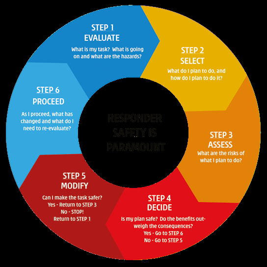

---
## Page 40

Victorian Emergency Operations Handbook
40
LACES
In some emergencies, on ground responders rely on the use of safety zones and 
escape routes for safety as conditions change. In these situations, LACES provides 
a system to maintain safety. Alternate systems of work may be available to manage 
particular risks encountered during emergency work. If an alternative system is not 
available, or is unsuitable, LACES should be considered as part of the Dynamic Risk 
Assessment process.
L
O
O
K
O
U
T
S
A
W
A
R
E
N
E
S
S
C
O
M
M
U
N
I
C
A
T
I
O
N
S
E
S
C
A
P
E
R
O
U
T
E
S
S
A
F
E
T
Y
 
Z
O
N
E
S
The process for implementing LACES is:
LOOKOUTS
A fixed, aerial or mobile lookout shall be deployed to maintain a clear appreciation 
of risks and to provide timely advice of the need to use of escape routes and  
safety zones.
AWARENESS
Responders shall be aware of the impact of changes in incident behaviour including 
those resulting from variations to weather and topography and of other incident 
ground hazards.
COMMUNICATIONS	
All responder crews shall follow the Communications Plan, communicate with your 
crew and surrounding crews to discuss and address safety issues.
ESCAPE ROUTES	
At least two escape routes should be agreed and made known to all relevant 
personnel. The suitability of an escape route should be continually reviewed to 
ensure it remains effective.
SAFETY ZONES	
Safety zones should be identified and made known to all relevant responders. 
Personnel need to consider escape time and safety zone size requirements that  
will change as incident conditions change.

---
## Page 41

Edition 3 – December 2020
41
Safety considerations
SAFETY FACT SHEETS
There are a number of safety fact sheets that have been developed across agencies 
and are available in EM-COP.
HYDRATION
It is important all personnel remain hydrated throughout their shift, especially  
during periods of prolonged or intensive physical activity. Dehydration will occur 
if fluids and electrolytes lost through perspiration are not replaced. The use of 
an agency approved electrolyte drink/powder is important to maintaining good 
hydration levels. The recommended ratio of water to electrolytes is 2:1. Depending 
on workload you should be drinking up to 1200 ml of water and 600 ml of an 
agency approved electrolyte replacement drink/powder per hour.
FATIGUE
Fatigue in both its acute and cumulative forms, can present a real risk to safety 
and performance at emergencies if not recognised and appropriately managed. 
The highest risks are to personal safety when associated with activities involving 
machinery and other equipment, including when driving motor vehicles after  
long shifts.
In addition to managing the fatigue of others within their sphere of influence, 
emergency personnel and incident management personnel need to actively manage 
their own fatigue, particularly in relation to driving vehicles and equipment and 
machinery use.
Agency personnel should adhere to existing agency protocols related to fatigue 
management and report any observation of Occupational Health & Safety (OHS) 
incidents (including near-misses).
ENVIRONMENTAL CONDITIONS
Incident Personnel need to consider the environment in which they are working. 
Conditions to consider include working around trees, flood water, weather such as 
extreme heat or cold, or strong winds.

---
## Page 42

Victorian Emergency Operations Handbook
42
Health monitoring
Health Monitoring helps mitigate health risks to responders and identify those 
who may be at risk of adverse health outcomes as a result of their response to an 
emergency incident.
It includes taking vital signs, and the assessment of presenting symptoms and 
relevant medical history to determine if a person’s health is impacted by their 
involvement in incident response.
All personnel attending and working at major emergencies are strongly encouraged 
to undertake health monitoring to support their health and welfare, however 
health monitoring is not mandatory except in circumstances where the Standard 
for Managing Exposure to Significant Carbon Monoxide Emissions states that all 
personnel are required to undertake health monitoring. 
Health monitoring may be provided by AV or approved private providers.
Please refer to JSOP 8.05 – Health Monitoring – Emergency Service Personnel for 
further information and the process for requesting Health Monitoring.
Communication of safety information
RED FLAG WARNINGS
A Red Flag Warning is a message issued when there is a significant change to any 
critical information that may adversely affect the safety of personnel located at an 
emergency. Further information can be found in SOP J03.11 – Red Flag Warnings.
A Red Flag Warning should be issued when there is, or is predicted to be, a 
significant risk to safety due to changed circumstances, including but not limited to:
•	 weather conditions
•	 incident conditions and/or behaviour
•	 equipment availability
•	 communications arrangements
•	 access.

---
## Page 43

Edition 3 – December 2020
43
A Red Flag Warning for a specific incident may only be issued by the following 
personnel, in their area of responsibility:
•	 Sector Commander
•	 Division Commander
•	 Operations Officer
•	 IC.
The SRC, RC, State and Regional Agency Commanders, State Duty Officer, 
Operations Manager, and the rostered Area or District Duty Officer may advise  
an IC to issue a Red Flag Warning.
Red Flag Warnings can be conveyed by any appropriate means. Red Flag  
Warnings, regardless of how they are conveyed, need to be preceded by  
the words, ‘Red Flag Warning’. The message should be specific to the key  
audience (e.g. the Eastern Division) to minimise radio congestion.
Personnel receiving a Red Flag Warning are required to:
•	 Immediately confirm that they have received the warning.
•	 Repeat the key points of the warning (e.g. time etc.) back to demonstrate  
that they understand the warning.
•	 Notify all responding and supporting agency personnel and any other  
resources that they are supervising or who are reporting to them of the  
Red Flag Warning.
•	 Obtain a confirmation from the response and support agency personnel that  
they are supervising that they have received the Red Flag Warning.
An example of the process outlined in Figure 4.
Should acknowledgement not be received, a reissue of the communication 
containing the Red Flag Warning is to be undertaken.

---
## Page 44

Victorian Emergency Operations Handbook
44
STEP 1
For example, if the Operations Officer initiates a Red Flag Warning, they issue it to 
Division Commanders. The Operations Officer then advises the Incident Controller.
STEP 2
Division Commanders acknowledge receipt and repeat back the key points of the 
Warning to demonstrate understanding.
STEP 3
Division Commanders issue the Red Flag Warning to Sector Commanders.
STEP 4
Sector Commanders acknowledge receipt and repeat back the key points of the Warning 
to demonstrate understanding.
STEP 5
Sector Commanders issue Warning to Strike Team/Task Force Leaders and any others 
they are supervising, who acknowledge receipt (STEP 6), and issue the Warning to their 
crew members (STEP 7), who acknowledge the Warning (STEP 8).
OPERATIONS 
OFFICER
INCIDENT 
CONTROLLER
DIVISION 
COMMANDER
SECTOR 
COMMANDER
STRIKE TEAM/
TASK FORCE 
LEADERS
CREW  
MEMBERS
STEP 2
STEP 1
STEP 3
STEP 4
STEP 5
STEP 6
STEP 7
STEP 8
NOTE: Red Flag Warnings are not a directive to leave the incident ground 
responders should consider local knowledge and situation when determining 
what action to take in response to the warning.
FIGURE 4: RED FLAG WARNING PROCESS

---
## Page 45

Edition 3 – December 2020
45
Any person, to Crew Leader level, who receives and/or forwards a Red Flag  
Warning are required to log:
•	 who communicated the Red Flag Warning
•	 the time it was received 
•	 what information it contained
•	 how it was received (e.g. telephone, radio etc.)
•	 who you disseminated it on to 
•	 the time acknowledgements were received from those you supervise.
If the repeated Red Flag Warning has not been acknowledged, the person  
sending the warning should take appropriate steps to determine the reason  
why the warning has not been acknowledged and report this to the IC  
or immediate supervisor.
FIELD INFORMATION UPDATE
The Field Information Update (FIU) is a method for the distribution of changes  
to strategy, tactics, new intelligence, safety information to the field during  
a shift. It is typically new information that was not included or available at the  
time of the briefing.
It may be delivered via radio broadcast or printed copy, and may include:
•	 weather
•	 incident behaviour
•	 organisation (sectorisation, control)
•	 communications
•	 strategy
•	 local hazards
•	 other issues.
Some ICs use it to structure messages to the field to update weather or advising that 
transfer of control has been completed and new reporting lines.
It complements the Red Flag Warning as a mechanism to broadcast more general 
information than the targeted critical information that is the subject matter of a Red 
Flag Warning.
A FIU does not require acknowledgement. The FIU pro forma is in the IMT toolbox.

---
## Page 46

Victorian Emergency Operations Handbook
46
OHS incident reporting
Emergency Personnel are required to report OH&S incidents to their OIC/Manager/
Supervisor as soon as practical. All incidents are to be recorded in your own 
agency’s hazard and incident reporting system or by using OHS Incident Card 
system (salmon card). All relevant sections are required to be completed and 
forwarded to the IC or delegate (Incident Safety Officer) where an incident is being 
managed by an IMT.
At the end of each shift it is the Incident Safety Officer/Medical Unit Team Leader/
Logistics Officer’s responsibility to ensure all relevant incidents from that shift have 
been recorded and relevant documentation kept.
Minor OH&S incidents are to be resolved at the local level unless otherwise advised 
by the IC. Blank OH&S Incident Report Cards are required to be made available to all 
emergency personnel and used to record all OH&S incidents where ready access to 
online systems are not available.
When a serious injury has occurred to a member, contractor or member of the 
public as a result of agency response activities the IC is required to be notified as 
soon as reasonably practicable. All serious OH&S incidents require the following 
notifications:
•	 Agency Chain of Command
•	 Line of Control
•	 Worksafe
•	 OH&S Executive Advisor
The IC is required to notifiy the relevant agency commander and this is required 
to be escalated through to the State Agency Commander. The notification will 
also occur through the line of control through to the IC, RC to the SRC and to the 
Emergency Management Commissioner. 
When a serious injury, that is a WorkSafe notifiable incident, has occurred to 
emergency personnel, contractor or member of the public as a result of agency 
response activity, WorkSafe must be notified verbally within 24 hours by the home 
agency. Written confirmation on the approved form is required within 48 hours. 
Where an individual agency has notified Worksafe of a serious incident the agency 
is required to notify the IC as soon as practicable. 
SOP J08.01 OH&S Incident Reporting and Investigation – Major Emergencies 
provides further information.

---
## Page 47

Edition 3 – December 2020
47
INCIDENT MANAGEMENT
Incident Management Systems 
To ensure a standardised approach to incident management and so that responders 
have a common hierarchy to work within most emergency management agencies in 
Victoria utilize an incident management system.
The responder agencies and several other agencies utilise the Australasian  
Inter-service Incident Management System (AIIMS). Victoria Police operates its own 
incident and operational management model known as the Incident Command and 
Control System (ICCS).
AIIMS PRINCIPLES AND CONCEPTS
AIIMS applies to incident management, rather than to the region or state tiers of 
emergency response. However, AIIMS is based on principles and underpinning 
concepts that are universal and can be applied to the tiers of emergency management.
Principles
AIIMS is founded on five fundamental principles. These are:
1.	 Flexibility A flexible approach to the application of AIIMS is required. AIIMS 
is adaptable to an all hazards-all- agency environment. It needs to be able to 
respond to changes that occur with the evolution of an incident, both during 
escalation and resolution, and from a focus on response to a focus on community 
and agency recovery.
2.	Management by Objectives A process of management where the IC, consulting 
as appropriate with the Incident Management Team and supporting agencies, 
determines the desired outcomes of the incident.
3.	Functional Management The process of structuring organisation into sections or 
units based on the type of work to be performed. AIIMS identifies several critical 
functions that are required to manage an emergency incident effectively.
4.	Span of Control A principle that to be applied in both the structuring and staffing 
of an Incident Management Team. The concept relates to the number of groups or 
individuals that can be successfully supervised by one person.
5.	Unity of Command There is one set of common objectives for all those involved 
in the response to an incident, leading to one consolidated plan for all responders. 
Each subordinate should report to only one superior.

---
## Page 48

Victorian Emergency Operations Handbook
48
Concepts
There are several critical underpinning concepts that support the five principles  
of AIIMS. An understanding of these concepts is essential to the effective 
application of the system.
They are:
Adaptability and Scalability The size and structure of the IMT should  
reflect the size and complexity of the incident and the stage of the response  
and recovery.
Uniform Terminology If all agencies are to apply the system there needs  
to be agreed terminology and definitions, to enable effective communication 
between agencies and between members of IMTs.
Defined Management Structure In adopting a functional management model,  
there needs to be a clearly defined and agreed management structure that can  
be applied and understood by all.
Common Operating Picture A description of the shared and consistent 
understanding the IMT has of the incident, gathered from a variety of sources  
to support decision making.
Clearly Defined Roles and Responsibilities In defining the management structure, 
there needs to be a set of clearly defined and agreed responsibilities  
for all who are appointed to a role in that structure.
Clearly Defined Information Flow For a functional management structure  
to operate effectively, it needs to be clear what reporting relationships exist,  
and how the sections and units within the structure communicate to ensure  
the development and maintenance of the common operating picture.

---
## Page 49

Edition 3 – December 2020
49
AIIMS STRUCTURE
AIIMS provides a management structure for managing all activities to resolve  
the incident.
To manage an incident, the IC will establish a management structure designed to 
deliver the functions of control, planning, intelligence, public information, operations, 
investigation, logistics and finance.
By delegating functions to others, the IC creates an IMT. Delegation is the 
assignment of functions and tasks to others, together with the necessary authority, 
freedom of action, and resources to complete the task. The person delegating 
retains accountability but is no longer responsible for undertaking the actual task.
When establishing an incident management structure, it is important to remember 
that the incident determines the size and nature of that structure. The structure 
should be adapted to the circumstances being dealt with and reflect the complexity 
and scale of the incident.
The AIIMS functional areas most commonly used in the response to major 
emergencies are:
Control The IC has overall management of the incident and overall responsibility  
for the management of resources allocated to that incident. The IC is responsible  
for controlling the incident and ensuring that all incident management functions  
are undertaken.
Planning The Planning section is responsible for preparing and delivering plans and 
strategies, maintaining a resource management system, and assembling, maintaining 
and providing incident information.
Intelligence The Intelligence section is responsible for collecting and analysing  
data and information, which is recorded and disseminated as intelligence to support 
decision making and planning. The IC may choose to establish an Intelligence 
function within the Planning Section, or as a separate Intelligence Section.

---
## Page 50

Victorian Emergency Operations Handbook
50
Public Information The Public Information section is responsible for the  
preparation, coordination and dissemination of non-operational incident warnings 
and advice to potentially affected communities, the public, media, other agencies 
and incident personnel.
Operations The Operations section is responsible for managing resources  
allocated to the Operations Section to resolve the incident. The Operations  
Section now also includes a Plant Operations Unit, which aligns with current fire 
agency practice in Victoria.
Logistics The Logistics section is responsible for managing activities and  
resources necessary to provide logistical support during an incident. In major  
or long-term incidents with complex financial arrangements, the IC may elevate the 
Finance Unit to be a Section in its own right (in line with the principle of flexibility).
Investigation The Investigation section is responsible for conducting investigations 
to determine the cause of an incident and/or to determine factors that contributed 
to the impact of the incident or specific events.
Finance The Finance section is responsible for managing:
•	 accounts for purchases of supplies and hire of equipment
•	 insurance and compensation for personnel, property and vehicles
•	 the collection of cost data and provision of cost-effective analyses and providing 
cost estimates for the incident.
An example of the AIIMS structure established for a large incident is shown in  
figure 5.

---
## Page 51

Edition 3 – December 2020
51
PLANNING
INTELLIGENCE
PUBLIC 
INFORMATION
OPERATIONS
LOGISTICS
INVESTIGATION
FINANCE
Plans
Situation and 
Analysis
Information  
and Warnings
Divisions
Supply
The structure of 
the Investigation 
Section will be 
determined 
by the specific 
nature of the 
incident
Accounts
Management 
Support
Modelling and 
Predictions
Media
Sectors
Communications 
Support
Compensation 
and Insurance
Resources
Technical Advice
Community 
Liaison
Strike Team and 
Task Forces
Facilities
Financial 
Monitoring
Mapping
Single Resources
Ground Support
Time Keeping
Staging Area
Medical Services
Air Operations
Catering
Plant Operations
LIAISON
EMERGENCY 
MANAGEMENT 
TEAM (EMT)
INCIDENT 
CONTROL
SAFETY
DEPUTY 
IC
FIGURE 5: AIIMS STRUCTURE FOR LARGE INCIDENT

---
## Page 52

Victorian Emergency Operations Handbook
52
Incident Controller
The role of the IC is to provide leadership and management to resolve the incident 
at the incident site. The primary responsibilities of the IC are to:
•	 Carry out the directions of the RC, where appointed, or the SRC or Class 2 SC, 
where appointed.
•	 Take charge and provide leadership for the resolution of the incident, including 
tasking supporting agency commanders.
•	 Establish a control structure to suit the circumstances and monitor its 
performance.
•	 Ensure timely issue of warnings and information to the community or refer  
these to the RC where appointed, or where the RC has not been appointed, the 
SRC or Class 2 SC.
•	 Identify current and emerging risks, or threats, and implement proactive  
response strategies.
•	 Activate relief arrangements through the MRM.
•	 Lead multi-agency planning and develop and implement an IAP (including 
objectives and strategies to manage the incident).
•	 Establish the IEMT, if required.
•	 Oversee the operational functioning of the ICC, if operating.
•	 Ensure the timely flow of information to:
	- RC (if appointed) or the SRC or Class 2 SC control and support agencies
	- MERC
	- IEMT
	- MRM/RRC
	- other stakeholder agencies.

---
## Page 53

Edition 3 – December 2020
53
•	 Continually assess the performance of the response against the IAP.
•	 Request appropriate resources for subordinates to achieve tasks or adapt tasks 
according to available resources.
•	 Initiate Initial Impact Assessment.
•	 Apply the EMC operational standards and incident management procedures, 
where appropriate.
All of these activities should be undertaken with consideration to the  
State Emergency Management Priorities and the Emergency Management 
Functional Arrangements.
Deputy Incident Controller
An individual/s may be nominated by the IC as a Deputy IC/s to support the IC  
in the management of the incident. A Deputy IC has responsibility for management 
of the Incident within the parameters agreed to with the IC.
The Deputy IC may not alter the incident objectives in the IAP. They may amend  
the incident strategies within the parameters provided by the IC. Where the Deputy 
IC does amend incident strategies, they are required to discuss the changes with  
the incoming IMT and IC at shift change over.
A Deputy IC who is appointed for a Class 1 emergency can be appointed to manage 
the hazard or to manage a function for example relief. Where appointed to manage 
the hazard, the person should be an agency endorsed Level 2 IC as a minimum. 
Where appointed to manage a function the person is required to be a person with 
the relevant expertise in the function e.g. recovery or evacuation.
Operations Officer
An Operations Officer, if necessary, may be appointed by the IC to:
•	 implement the strategies to resolve the incident
•	 manage all operational activities that are undertaken directly to resolve  
the incident
•	 manage all resources (people and equipment) assigned to the Operations Section.

---
## Page 54

Victorian Emergency Operations Handbook
54
Division Commanders
A division may be established in the early stages of an incident at the direction  
of the IC. The purpose of a division is to provide operational leadership and  
span of control over a functional or geographical area of an incident. The  
Division Commander has responsibility to manage the incident within the span  
of the division.
Typically, a division will be established when control is transferred from the incident 
ground to an ICC and the Division Commander will then manage incident ground 
operations from a forward location.
The Division Commander will:
•	 Report directly to Operations Officer or alternatively the IC (If the Operations 
Officer role has not been activated).
•	 Be accountable to manage the implementation of the IAP/Incident Shift Plan (ISP) 
relating to their division, and provide input to the IAP/ISP process managed by 
the IC.
•	 Have Sector Commanders (if appointed) reporting to them.
The Division Commander’s responsibilities include:
•	 Maintaining ongoing exchange of information with the Operations Officer on 
incident situation, progress towards the achievement of incident objectives and 
emergency risks and reporting when:
	- the IAP/ISP is to be modified
	- additional resources are needed
	- surplus resources are available
	- hazardous situations are present and significant events occur.
•	 Ongoing liaison with the Intelligence Section/Unit to provide specific information 
on incident situation, progress towards the achievement incident objectives and 
emerging risks.
•	 Providing briefings/debriefings to Sector Commanders within the division.
•	 Reviewing, allocating and modifying specific tasks in relation to their division.
•	 Resolving identified logistics problems.
•	 Reporting to the Operations Officer.

---
## Page 55

Edition 3 – December 2020
55
•	 Observing safe work practices at the incident within the division.
•	 Coordinating activities with adjacent divisions.
•	 Maintaining a log of activities.
As an incident escalates the IC/Operations Officer may deploy additional staff to 
support the Division Commander in these functions.
Sector Commanders
Sector Commanders report to the Division Commander (or Operations Officer  
if a Division Commander is not appointed). Their responsibilities include:
•	 Implementation of their portion of the IAP/ISP.
•	 The allocation of resources within their sector.
•	 Reporting on incident situation, the progress of operations, emerging risks and 
the status of resources within the sector.
Sector Commanders will be advised of the incident objectives and strategy for 
their sector by the Operations Officer or their Division Commander (if appointed). 
The selection of actual tactics to implement the strategy will usually be determined 
by the Sector Commander. Tactics applied in one sector may, however, affect 
other sectors. Division Commanders (or the Operations Officer if a division is not 
established) provide the continuity of tactical operations across Sectors.
Incident objective
An objective is critical for the effective management of an incident.  
The objective should communicate clearly to all those involved what is to  
be achieved. A well worded objective has meaning and provides direction  
for every person at an incident.
The IC has responsibility for the control of the incident and sets the objective. It 
will state what the IC wants done, when and why. The objectives need to also be 
consistent with the state emergency management priorities.
The objective may change with circumstances. There may be a different objective 
for each shift under escalating circumstances or a static but relevant objective for  
a stable or de-escalating incident.
A good objective will include a statement of intent (what and why), a time 
parameter (when) and a space parameter (where).
Example of a good incident objective:

---
## Page 56

Victorian Emergency Operations Handbook
56
‘To protect residential buildings by containing the fire in the grassland as it emerges 
from the bush to the west of Bolton by 2000hrs today.’
Consistent with the above, management theory and practice suggests that an 
objective should be SMART:
S
P
E
C
I
F
I
C
M
E
A
S
U
R
A
B
L
E
A
C
H
I
E
V
A
B
L
E
R
E
L
E
V
A
N
T
T
I
M
E
-
F
 R
A
M
E
D
At the end of each shift, it is desirable that the IC and IMT review progress against 
their stated objectives and evaluate the effectiveness of the strategies implemented 
during the shift. This information can help an incoming shift to review and 
implement the new IAP and agreed strategies.
Incident action planning
Incident Action Planning should be aligned with the state emergency  
management priorities.
For an emergency with low potential, expected to be contained in less than  
four hours and/or of low consequence an IAP may be recorded as a log book entry  
or a situation report or wordback, either written or by radio, with comment on 
control strategy.
For an emergency that is not expected to be contained within four hours  
of reporting and/or has medium to high potential and consequence, the following 
are required:
•	 an IAP summary, documented within four hours of the incident being reported
•	 a documented IAP is required for major emergencies
•	 an Incident Shift Plan (ISP) that addresses as a minimum the next operational 
shift. The plan should include the tour of duty for the IMT and the duration of the 
incident to its conclusion.

---
## Page 57

Edition 3 – December 2020
57
The ISP is the component of the IAP relevant to field operations. ISP word templates 
are available on the IMT tool box.
The IAP should be communicated to personnel at the incident, especially  
any targeted information for specific Divisions/Sectors/Areas and those 
communications logged.
Where changes are made to an IAP, the IC is required to ensure that the information 
is communicated to all incident personnel. Significant changes such as change 
in strategy, tactics, communications, weather etc. should be communicated via 
briefings, Field Information Updates or Red Flag Warnings.
See table 1 for descriptors of the different components of Incident Action Planning.
Incident communications planning
The IC is required to ensure the development, implementation and regular review 
of the integrated Incident Communications Plan as required. This plan will be 
developed by the Incident Communications Planning Officer on behalf of the IC and 
needs to consider the following for all incident personnel:
•	 information and communications technology applications
•	 radio channels, talk groups, radio trunk numbers
•	 interference issues associated with channel selection across geographical area 
including aircraft interference
•	 adjacent ICC that may need to coordinate communications to reduce interference
•	 telephone number (including mobile and satellite phones)
•	 fax number/email
•	 paging
•	 redundancy options
•	 addresses known communications black spots.
An Incident Communications Plan needs to be incident-based, not agency-based. 
The IC needs to ensure that the communications plan is conveyed to all incident 
personnel and is conveyed in written form to all command personnel as soon as 
practicable.

---
## Page 58

Victorian Emergency Operations Handbook
58
DOCUMENT
CONTENT
TIMEFRAME
INPUT FROM
APPROVAL
Incident Action 
Plan (IAP) 
Summary
A concise IAP format.  
It summarises the incident 
situation, incident  
objective, strategies 
adopted, incident structure 
and communications Plan, 
and is supported with  
a map. It may also include 
resources deployed 
and key information 
regarding administration, 
logistics, command and 
communication and safety.
Completed in 
first 4 hours 
(may be 
replaced by 
ISP or IAP as 
developed).
Planning 
Officer (Duty 
Officer if IMT 
not in place).
IC
Incident Action 
Plan (IAP)
The plan used to  
describe the incident 
objectives, strategies, 
structures, resources  
and other information 
relevant to the control  
of the incident. It includes 
an ISP and other relevant 
documentation.
Within the  
first shift  
and reviewed 
each shift.  
Key elements 
may not 
change for 
duration  
of event.
Planning 
Officer
Intelligence 
Officer
Logistics 
Officer
Operations 
Officer
Public 
Information 
Officer
IC
Incident Shift 
Plan (ISP)
The key components  
of the IAP that are essential 
for field operations. The 
documentation follows the 
SMEACS briefing format, 
and is accompanied 
by maps and any other 
supporting documentation 
relevant to field operations 
(an interactive module is 
available on Fireweb).
Within the  
first shift  
and reviewed 
each shift
Planning 
Officer
Intelligence 
Officer
Logistics 
Officer
Operations 
Officer
Public 
Information 
Officer
IC
TABLE 1: INCIDENT ACTION PLANNING DESCRIPTORS

---
## Page 59

Edition 3 – December 2020
59
Communicating incident information
BRIEFINGS
The IC needs to ensure that all emergency personnel are provided with appropriate 
briefings regarding safety-related matters, the incident situation, incident 
objective(s), incident structure, communications plan, and relevant resource 
information and tasking.
All briefings need to be in the SMEACS format (see table 2) and allow time for 
questions after the briefing.
The IC is required to ensure that the appropriate information is efficiently 
communicated through the incident structure to emergency personnel. This may be 
achieved through:
•	 targeting briefings towards a specific audience, e.g. Division Commanders, and 
then cascading the briefing down through the incident structure as appropriate
•	 staggering the IMT and field changeovers to facilitate briefings.
As the situation changes and new information becomes available, updated briefings 
need to be provided throughout the incident structure.
All incident personnel have a responsibility to ensure they are briefed and 
understand their tasks before they commence their task.

---
## Page 60

Victorian Emergency Operations Handbook
60
SITUATION REPORTING
Those in a leadership position are required to provide frequent, concise situation 
reports (SITREPs).
Those on the incident ground (e.g. Crew Leaders) need to recognise that it is an 
important part of their role to provide SITREPs to their supervisor.
SITREPs should include the following information:
•	 incident name
•	 division command call sign
•	 location of incident
•	 potential of incident to become a major emergency
•	 advice regarding any warnings that should be provided to the community
•	 private and community assets at risk, critical community issues
•	 incident status (type/size)
•	 damage and loss
•	 critical control factors
•	 change in incident prognosis If bushfire – fire behaviour (e.g. fuel type and  
hazard rating, wind speed and direction, flame height and estimated forward 
rate of spread)
•	 current control objective
•	 resources on scene
•	 additional assistance required
•	 potential safety hazards on incident ground (e.g. asbestos, tree hazard,  
mine shafts etc.).

---
## Page 61

Edition 3 – December 2020
61
SITUATION
•	 Current situation.
•	 Details of incident.
•	 Operational Risk and Impacts to incident personnel.
•	 Community Risk and Impacts – Incident risk and impacts.  
to the community.
•	 Location.
MISSION
•	 What are we trying to achieve?
•	 Incident objectives.
EXECUTION
•	 How do we plan to achieve objectives?
•	 Sectorisation.
•	 Strategies.
•	 Tactics.
•	 Tasking.
•	 Resource movement details.
•	 Timings.
ADMINISTRATION
•	 Logistics of operation.
COMMAND/ 
COMMUNICATIONS
•	 Incident management structure.
•	 Communications plan.
•	 Radio channels.
•	 Strategic Relevant telephone numbers.
SAFETY
•	 Weather.
•	 Known/anticipated hazards.
•	 PPC/PPE.
•	 Tasking suited to personnel.
QUESTIONS
TABLE 2: SMEACS BRIEFING FORMAT

---
## Page 62

Victorian Emergency Operations Handbook
62
Emergency management locations
Emergency response facilities are named based on the function they support  
e.g. control centre, command centre, coordination centre etc.
The level of activation of a facility could range from a single workstation to a full 
centre facility, with escalation according to the nature and scale of the emergency.
Class 1 and some types of Class 2 emergencies are managed from the SCC, RCC and 
either an ICC, mobile command vehicle, site office or other location determined by 
the EMC. Class 2 and other emergencies, depending on the size, type and nature 
may be managed from an agency specific location.
Agencies may maintain their own command centres.
STATE CONTROL CENTRE
The SCC is the state’s primary control centre for management of Class 1 and some 
Class 2 emergencies; it is the hub of a network of RCCs, which support the ICCs.
To meet the State Emergency Management Priorities, the purpose of the SCC is to: 
•	 Ensure that the EMC and the SCT maintain appropriate situational awareness to 
support strategic decision making.
•	 Engage with and provide information to key stakeholders and SEMT.
•	 Ensure that readiness arrangements are in place.
•	 Ensure that control strategies and arrangements are appropriate.
•	 Ensure that incident progression is predicted.
•	 Ensure information and community warnings are timely and appropriate.
•	 Prioritise the allocation of state and specialist resource.
•	 Provide support to state, regional, incident control and agency personnel.
•	 Provide relief and recovery coordination.
REGIONAL CONTROL CENTRES
An RCC is a facility that enables the implementation of the Command, Coordination 
and Control arrangements within a set Regional boundary.

---
## Page 63

Edition 3 – December 2020
63
INCIDENT CONTROL CENTRES
An ICC is the location where the IC and the IMT manages response activities.  
A Level 3 ICC is a facility used to accommodate an IMT during preparation for,  
or response to, a major emergency.
DIVISION COMMAND POINTS
A Division Command Point (DCP) is a location where the person in the role of 
Division Commander operates.
A DCP could be a mobile point close to the incident ground in a field command 
vehicle (FCV), or a building such as a Local Command Facility (LCF) these  
may include local unit headquarters, district office or brigade station. An LCF  
has resources and facilities maintained to a level so it can be used as a DCP  
when required.
STAGING AREA
A staging area is a location designated and used during an emergency for the 
assembly of control and support agency resources prior to deployment.
All ICs should identify the location where incoming resources meet and are briefed 
prior to deployment to the incident.
Where more than ten resources are en route to an incident and/or the size or 
duration of the incident is likely to make effective control of incoming resources 
difficult, the IC should establish a more formal staging area, managed by a Staging 
Area Manager within the Operations Section. A staging area should also be 
established whenever a Division Command Point is in place.
When determining the location of a staging area, the IC should consider the 
influence of changing incident conditions (e.g. predicted wind change) to ensure the 
safety of incoming resources.

---
## Page 64

Victorian Emergency Operations Handbook
64
Local knowledge
Local knowledge has proven to be a vital element of effective management  
of emergency incidents. Whether it is the detail of an urban building, access  
to airports, history of previous emergencies or information on local business  
or industry local knowledge has proven invaluable.
Within every IMT, there needs to be a source of local knowledge, either a local  
person brought into the IMT specifically for that purpose or appointing local 
personnel to an IMT position where they can use that knowledge and answer 
questions from other members of the IMT. Local knowledge will assist IMTs  
in managing risks and consequences associated with the incident.
Ideally, those with local knowledge will be operating in the Operations Section  
to assist those responding to operations on the incident ground. Their familiarity 
with the incident ground, and perhaps the type of incident or previous incidents,  
will also be of benefit to the Planning Section, Intelligence Section or Unit as it 
considers risks, options and likely courses of action. Regardless of where the 
individuals are located within the IMT, the IC needs to be satisfied that there is 
sufficient local knowledge in the IMT.
ABORIGINAL CULTURAL HERITAGE PROTECTION AND REHABILITATION
Aboriginal cultural heritage in a variety of forms is present throughout the  
whole of Victoria. Ensuring that there are adequate and consistent processes  
for the management and protection of Aboriginal cultural values during  
an emergency is important at all stages of preparedness, incident management  
and relief and recovery.
It should be an integral part of an emergency management response to try and 
avoid, or minimize, impacts on Aboriginal cultural heritage wherever possible. 
Where impacts have occurred, it is important that these are fully documented, 
and the information is provided to Aboriginal Victoria. It is important to ensure 
cultural heritage protection works carried out during an incident are appropriately 
communicated through to the recovery phase of an incident.

---
## Page 65

Edition 3 – December 2020
65
Examples of Aboriginal cultural heritage that might be encountered or impacted  
by emergency management are:
•	 stone artefacts scatters or isolated artefacts
•	 scarred trees
•	 rock art
•	 stone quarries
•	 shell middens
•	 mounds 
•	 grinding grooves 
•	 stone arrangements
•	 burials.
Limited information on Aboriginal cultural values can be accessed in the  
Aboriginal Cultural Heritage data layer through eMap and used by an IC, IMT 
Planning Officer or other relevant roles in an IMT. General information on various 
Aboriginal places and objects can also be found on EM-COP (fact sheets).
If an initial assessment indicates that there is a risk of impacts to Aboriginal  
cultural heritage, it may be necessary to seek specialist, expert advice on the 
interpretation of this data. A list of specialist Aboriginal Cultural Heritage Values 
Advisors from Aboriginal Victoria, Parks Victoria or Department of Environment, 
Land, Water and Planning (DELWP) and their contact details can be found  
on EM-COP.
An Aboriginal Cultural Heritage Values Advisor could be deployed to an IMT 
and provide advice, as well as assisting with liaison with the relevant Registered 
Aboriginal Party (RAP), or any other identified Traditional Owner groups where  
a RAP has not been appointed.
Information about the location and nature of Aboriginal cultural heritage is sensitive 
and any data provided must only be used for of emergency management. After an 
incident, all hard copies of data must be returned to the Aboriginal Cultural Heritage 
Values Advisor (if one was deployed), Aboriginal Victoria and securely stored in any 
official files or records associated with the management of the incident.

---
## Page 66

Victorian Emergency Operations Handbook
66
Aircraft and aviation
The State Air Desk (SAD) operates as a function of the SCC and coordinates the 
operational emergency aviation activity within the state for response activities under 
the control of the EMC/SRC. The SAD also supports land management activities. The 
SAD is supervised daily by the rostered State Aircraft Coordinator to coordinate and, 
where appropriate, dispatch state aviation resources to assist with emergency and 
land management activities.
The Interagency Aviation Operating Procedures (IAOPs) are the procedures that 
govern the operation of aircraft for emergencies and land management activities. 
These procedures are produced to ensure the safety and effectiveness of agency 
aircraft operations by providing one source of agreed procedures which are available 
and relevant for all agency aircraft operations.
The SAD will only action requests for aircraft that are made by an agency person 
performing an approved role as stated in the relevant IAOP. AM 1.05 – Management 
of Aircraft at Incidents and IAOP AM 1.06 – Obtaining Aircraft. These procedures 
have been developed to provide specific requirements for obtaining aircraft for fire 
and non-fire emergency operations or other agency-related operations.
Aircraft deployments will be most efficient when approved personnel requesting 
aircraft provide the following initial information:
•	 location of the incident (i.e. distance and direction from closest town)
•	 aircraft type and quantity required
•	 tasking of aircraft and equipment required
•	 dispatch, incident or fireground channel and/or trunk radio numbers  
to be used
•	 AIIMS roles (Air Operations Unit) that are in place i.e. Air Attack Supervisor, 
Aircraft Officer.
Once dispatched, the aircraft are assigned to the incident and come under the 
control of the respective IC.
SOP J02.06 Aviation Resource Readiness outlines the readiness levels of  
aviation resources.

---
## Page 67

Edition 3 – December 2020
67
PUBLIC INFORMATION
Provision of warnings to the community
To protect life and property, timely, relevant and tailored warnings and information 
must be issued to potentially affected communities.
The IC (or agency authorising officer) is responsible for authorising all warnings  
and information provided to the public. To assist the rapid communication  
of warnings and information, the IC may authorise a Deputy IC or Public  
Information Officer (PIO) to authorise the release of warnings and information  
to the community. No additional authorisation is required once the IC or delegate 
has authorised the information or warning.
For warning content, technical advice may be sought from the relevant authorising 
authority. This may include oversight from Chief Health Officer, Chief Veterinary 
Officer or other Chief Technical Officers as relevant to the emergency.
Where an extreme and imminent threat to life exists and it is not practicable  
to obtain authorisation from the IC in the circumstances, warnings may be  
initiated by any response agency personnel. The IC is required to be advised  
as soon as possible.
WARNING CONTINGENCY PROCESS
In rapidly developing incidents, or if an Information and Warnings Officer  
cannot publish a message, the IC, or delegate, should request assistance from 
 the Warnings Duty Officer at State level (24/7 backup to field-based Information 
and Warnings Officers) on 1800 877 990.
Warning levels and templates
Warning templates provide the IC and Public Information Section personnel 
the opportunity to include targeted information and specific actions for the 
communities affected. Warnings should be tailored to the community and reflect 
the impacts the hazard is having or may have on the community. This includes 
information such as road closures, the direction the emergency is moving in,  
where the community should go and information about what the community  
might see or experience.

---
## Page 68

Victorian Emergency Operations Handbook
68
LEVELS OF COMMUNITY WARNINGS AND INFORMATION
The following levels of warnings and information are used for multiple hazards. 
Examples are shown in table 3 below:
TABLE 3: LEVELS OF WARNINGS AND INFORMATION
ADVICE 
An incident is occurring or has occurred in the area and  
you need to access information and monitor conditions. 
An All Clear when activity in the area has subsided and  
is no longer a danger to you.
WARNING/ 
WATCH  
AND ACT 
 
Conditions are changing and you need to start taking  
action now to protect your life and your family.
An emergency is developing nearby. You need to take  
action now to protect yourself and others.
EMERGENCY  
WARNING 
 
The is the highest level of warning.
You are in imminent danger and need to take action 
immediately. You will be impacted. 
PREPARE  
TO EVACUATE 
/EVACUATE  
NOW/SAFE  
TO RETURN 
An evacuation is recommended or procedures are in place  
to evacuate.
COMMUNITY 
INFORMATION 
A notification that an incident has occurred but there is no 
threat to the community.
Can also be where significant community interest is resulting 
in call outs or calls to ESTA.

---
## Page 69

Edition 3 – December 2020
69
ALL CLEAR MESSAGES
An All Clear message is to be issued to inform the community that they can return 
to normal activity that the risk is over.
An ‘All Clear’ message needs to be issued whenever a Warning (Watch and Act)  
or Emergency Warning or has been issued. An All Clear – Safe to Return is required 
to be issued if Evacuation warnings have been issued.
COMMUNITY INFORMATION
Community Information is used to provide the community with information if an 
incident is creating community interest but does not pose a threat to the community.
PUBLISHING WARNING AND INFORMATION AREAS (POLYGON)
Warnings and information issued to the community will have the warning area 
(polygon) shown on the map published to the VicEmergency website and app. ICs 
should ensure that the polygon associated with the warning or information captures 
the community who needs to act.
Community meetings
So that local communities feel supported and informed, it is important to engage 
in two-way interaction to help foster community connection. The PIO can provide 
advice on the best ways to engage the impacted community.
One key way of engaging the community is through community meetings.   
It is important to ensure that any community meetings planned:
•	 Are led by people with local knowledge, preferably people who are trusted  
by the community.
•	 Are structured for two way conversations.
•	 Use the tools available to properly record issues raised by community members, 
so you can respond.
•	 Outcomes from the meeting should be reported to the Incident, Regional and 
State tiers to add to situational awareness. 
Community meetings should be streamed on Facebook or recorded and uploaded 
to social media after the meeting. This provides community members who cannot 
travel to the meeting a chance to still receive information (This includes those 
impacted by road blocks, who have disabilities or who have carers responsibilities).

---
## Page 70

Victorian Emergency Operations Handbook
70
Warning channels
There are numerous methods for providing information and warnings to the 
community, which include:
•	 emergency broadcasters (designated community radio stations, ABC radio,  
local radio, Sky News). For Emergency Warning and Evacuation Warnings,  
the Standard Emergency Warning Signal (SEWS) can be played prior to the 
warning being read
•	 media releases, press conferences and interviews
•	 social media (Facebook, Twitter)
•	 VicEmergency website
•	 VicEmergency app
•	 email distribution lists (local communities and EMTs)
•	 community sirens
•	 telephone warnings – Emergency Alert (EA)
•	 billing address (both landline and mobile)
•	 location based (mobile only)
•	 VicEmergency Hotline (1800 226 226)
•	 community meetings and door knocks.
Community sirens
There are Community alerting sirens in 39 communities across the state. 
A siren is triggered through the warnings platform with the issue of any Warning 
(Watch & Act), Emergency Warning or Prepare to Evacuate or Evacuate Now, unless 
otherwise requested by the IC.
The siren will sound for 5 minutes to indicate that a significant emergency has been 
identified and the community should ‘seek further information’.
SOP J04.01 Incident Public Information and Warnings provides guidance on 
community information and warnings before, during and after emergencies.

---
## Page 71

Edition 3 – December 2020
71
TRAFFIC MANAGEMENT POINTS
Traffic Management Points (TMP) are set up at the direction of the IC,  
in consultation with Victoria Police, to regulate the flow of traffic into an area  
where an emergency has occurred, is occurring or has the potential to occur.
The purpose is to maintain the safety of emergency personnel and the public, 
as a result of an emergency. Travelling on roads during or immediately after an 
emergency can be particularly hazardous. Emergencies are not static and therefore 
the conditions of TMP may change over the course of and incident, and at any time.
SOP J03.10 Traffic Management outlines the process for the activation and 
ongoing monitoring and deactivation of traffic management points, including 
the appointment of a Traffic Management Manager, development of a Traffic 
Management Plan and associated forms.
Traffic Management Guidelines describe the agreed procedures for the operation 
of a TMP as part of an overall Traffic Management Plan, to assist in the control and 
management of pedestrian and vehicular road travel near an incident.
To facilitate entry into an area, a TMP will be assigned an access level (see table 4). 
The circumstances and groups of people who may be permitted access at each 
access level will be determined by the IC.
Public TMP access
To provide ease of access through Authorised Access – C and Authorised Access – 
D TMPs, people who are to be permitted access may be issued with an identifying 
wristband. Wristbands will be available to people at the TMP upon proof of identity 
relevant to the access level. Where identity cannot be proven at a TMP, wristbands 
may be obtained from a designated community location upon confirmation of 
identity (e.g. electoral roll).

---
## Page 72

Victorian Emergency Operations Handbook
72
TABLE 4: TRAFFIC MANAGEMENT POINT ACCESS LEVELS
RESPONSIBILITY 
AND AUTHORITY
ACCESS 
LEVEL
EMERGENCY 
STATUS AND  
RISK ASSESSMENT
ACCESS *
IDENTIFICATION OR 
AUTHORISATION
Control  
Agency
 
 
 
 
Emergency 
Services  
Only Access
•	Going/new
•	Designated  
area likely  
to be impacted  
by emergency
•	Access route  
blocked and/or 
danger of  
hazardous trees
•	Emergency services or  
emergency contractors
•	Other emergency or essential  
services authorised by Incident  
Controller or delegate 
•	Any person authorised by Incident 
Controller or delegate (this may  
include residents, accredited  
media, etc)
•	Emergency unit
•	Emergency agency ID
•	Emergency agency 
contractor ID
•	Escort by fire unit  
(eg wet escort) 
•	Authority of Incident 
Controller or delegate  
(eg private/temporary 
vehicle pass)
•	Agency Media Accreditation
Restricted 
Access – B
Essential 
Services 
Assessment
•	Contained/assessed
•	Emergency impact 
no longer occurring
•	Access route 
cleared and danger 
of hazardous trees 
removed
•	Access Safety Assessment Vehicle/s 
(to consist of Council, Department  
of Transport (DoT), essential services, 
to conduct road and infrastructure 
assessment as required)
•	Emergency services, as authorised  
by the Incident Controller or delegate
•	People other than emergency-agency 
staff for the purposes of urgent care 
and management of land, or other 
reasons as deemed appropriate by the 
Incident Controller
•	Designated Access Safety 
Assessment Team Vehicle – 
details to be advised by ICC
•	Agency identification
•	Appropriate wristband and/
or authorisation by the IC 
via the TMM
Authorised 
Access – C
Residents, 
Media,  
Recovery 
Services – 
B Access
•	Controlled
•	Infrastructure,  
road integrity, 
essential  
services do not 
present hazard
•	Residents returning to their homes 
•	People providing recovery and  
relief services
•	Council or DoT employees  
or sub-contractors
•	Accredited Media
•	Business owners in immediate area
•	DJPR or DELWP staff or vets 
facilitating the treatment and humane 
destruction of injured animals
•	Individuals or groups delivering relief  
and aid to residents and animals
•	Resident – driver licence, 
authorising wristband
•	Organisation ID
•	Agency Media Accreditation
•	Business owner – suitable 
identification
Road  
Authority 
Authorised 
Access – D
Access Others 
authorised,  
e.g. employees 
– C Access
•	Agency no longer 
requires TMP 
•	Road owner 
requires TMP to 
address road-
related issues
•	Employees working in specified area
•	People bringing food and supplies for 
people and animals
•	Organisation ID
•	Authorising wristband
Open
•	Road owner 
satisfied that  
road-related issues 
no longer impact 
on road users
•	Open to all
•	TMP removed and signed  
off by road owner	
•	Not applicable
Coroners Act 2008 Section 38 Restriction of access to fire area
1) 	 A coroner or the Chief Commissioner of Police may take reasonable steps to restrict access to –  
(a) the place where a fire occurred: or (b) a place reasonably connected to the place where a fire occurred.
2) 	 The coroner or Chief Commissioner of Police may cause a notice in the prescribed form stating that access is restricted 
to a place to be put up at that place or as near as possible to that place.
*	
Incident Controller may authorise access for specific persons or groups and impose restrictions)
NO
ENTRY

---
## Page 73

Edition 3 – December 2020
73
EVACUATION
Definition of evacuation
Evacuation is a risk management strategy that may be used to reduce the loss  
of life or lessen the effects of an emergency on a community, prior to the onset  
of, or during, an emergency. It involves the movement of people threatened by  
a hazard to a safer location and, typically, their eventual safe and timely return. For  
an evacuation to be effective, is should be appropriately planned and implemented.
In line with the State Emergency Management Priorities, as with all emergency 
activities, the main priority when deciding to undertake an evacuation is the 
protection of life.
Evacuation is a scalable activity in that it may be applied to individuals, a house,  
a street, a large facility (i.e. school or hospital), a suburb, a town or a large area of 
the State.
The evacuation process
There are five stages in the evacuation process. 
1. 	Decision to evacuate.
2. Warning or recommendation to persons likely to be affected by an emergency.
3. Withdrawal of an affected community.
4. Sheltering of persons evacuated.
5. Return of affected persons.
A formal evacuation process does not prevent people in the community from 
making the decision to self-evacuate in the appropriate circumstances
Recommendation to evacuate
The IC is responsible for authorising and issuing evacuation messages to the 
community (either a warning to affected people that they need to prepare to 
evacuate or a recommendation to evacuate immediately). This decision, if time 
permits, should be made in consultation with Victoria Police, IEMT and other expert 
advice where available.

---
## Page 74

Victorian Emergency Operations Handbook
74
TABLE 5: EVACUATION ROLES AND RESPONSIBILITIES
ORGANISATION/ 
ROLE
TASK
CONTROL AGENCY (IC)	
•	 Consider and recommend as appropriate evacuation in 
consultation with Victoria Police Evacuation Manager, Health 
Commander and other experts.
•	 Issue warnings, recommendations to evacuate and provide 
situation updates and ongoing advice that may impact an 
evacuation (including the dissemination of public information).
•	 Activate emergency relief services.
•	 Maintain ongoing liaison with Victoria Police once the 
evacuation process has commenced.
A recommendation to evacuate should only be made when it is expected to offer a 
higher level of protection for members of the public than other options and can be 
achieved without endangering response agency personnel.
In some urgent life-threatening circumstances, and in an effort to preserve life, the 
decision to recommend evacuation may be made by any agency representative.
In this circumstance the IC is required to be notified of the decision as soon  
as possible.
Where the IC decides to recommend that people should evacuate, the IC is required 
to immediately communicate this decision to the Victoria Police Commander (for 
implementation), through the line of control and agency chain of command, the IMT 
and to incident personnel/responders.
SOP J03.12 Evacuation for Major Emergencies, outlines the responsibilities, activities 
and forms that are required to be undertaken by the IC and Evacuation Managers.
The Evacuation Guidelines provides further information and guidance for 
conducting evacuations.
Roles and responsibilities
Table 5 sets out the roles and responsibilities of the evacuation process.

---
## Page 75

Edition 3 – December 2020
75
ORGANISATION/ 
ROLE
TASK
VICTORIA POLICE 
(EVACUATION MANAGER) 
(TRAFFIC MANAGEMENT 
MANAGER)
•	 Assist IC with the decision and warning stages if required.
•	 In consultation with the IC and other agencies, where time 
permits prepare a plan for the evacuation.
•	 Form and manage an evacuation planning team, made up of 
representatives of organisations who can assist at any stage of 
the evacuation (e.g. support agencies and service providers, 
traffic management related agencies, road authority etc).
•	 Identify vulnerable persons within the potential evacuation area 
including those residing within potentially vulnerable facilities, 
those designated as vulnerable persons per the Vulnerable 
Persons Register and other vulnerable persons as identified by 
other agencies/services (local councils etc) as required.
•	 Manage the withdrawal, shelter and return stages of the 
evacuation in consultation with the IC and Health Commander.
•	 Source and manage resources to facilitate evacuation in 
consultation with control and support agencies.
•	 Maintain ongoing liaison with IC for the duration of the 
evacuation.
•	 Coordinate the establishment and maintenance of traffic 
management points.
•	 Registration of evacuees (with Red Cross), utilising Register. 
Find. Reunite.
•	 Where cross border operations are in place, liaise with the 
relevant state police or traffic management agency. 
EVACUATION TEAM 
•	 A team led by the Evacuation Manager that is formed  
to plan and administer the withdrawal, shelter and return 
phases of an evacuation.
•	 The Evacuation Team is formed when time and resources 
permit and is composed of the Evacuation Manager, the IC 
or delegate and other stakeholders as required. This may 
include, but not limited to, the Incident Health Commander and 
representatives from DHHS and municipal councils.

---
## Page 76

Victorian Emergency Operations Handbook
76
ORGANISATION/ 
ROLE
TASK
AMBULANCE VICTORIA 
(HEALTH COMMANDER)
•	 Provide health and medical strategy advice to the IC and 
Evacuation Manager.
•	 Manage the withdrawal and return of identified vulnerable 
people from health and aged care facilities.
•	 Support the withdrawal and return of identified vulnerable 
people in the community as required.
SUPPORT  
AGENCIES
•	 Assist with the provision of resources to facilitate evacuation.
•	 Provide support during the evacuation process, under the 
direction of Victoria Police.
MUNICIPAL  
COUNCILS
•	 Coordinate the provision of council resources as required.
•	 Establish and manage relief centres as required and provision  
of emergency shelter.
•	 Assist Victoria Police with management of traffic flow  
including provision of information regarding road availability,  
capacity and safety.
With Municipal Emergency Management Planning Committees:
•	 Develop and maintain Municipal Emergency Management Plans 
in collaboration with emergency services and land managers.
•	 Assist Control Agencies with development and review of 
hazard specific Emergency Plans and associated community 
information.
•	 Identify and document within Municipal Emergency 
Management Plans facilities where vulnerable people are likely 
to be located.
•	 Coordinate and have local oversight of the Vulnerable Persons 
Register to support local planning.
•	 Identify and document within Municipal Emergency 
Management Plans self evacuation strategies and locations  
that community members may assemble that are not identified 
relief centres.
DEPARTMENT  
OF TRANSPORT
•	 Assist, Victoria Police with management of traffic flow  
including provision of information regarding road availability, 
capacity and safety.
•	 Maintain list of road closures (public information).

---
## Page 77

Edition 3 – December 2020
77
ORGANISATION/ 
ROLE
TASK
RESPONDER AGENCIES
•	 Develop and maintain hazard specific Emergency Plans.
•	 Develop and maintain hazard specific community information  
(e.g. Community Information Guides, Local Flood Guides).
AUSTRALIAN 
RED CROSS 
(VICTORIA)
•	 Registration of evacuees (with Victoria Police) utilising  
Register. Find. Reunite (web based or paper based). 
DEPARTMENT  
OF HEALTH AND  
HUMAN SERVICES
•	 Support municipal councils in provision of emergency relief.
•	 Provide guidance to health and human services providers  
and departmental program areas to develop and review their 
emergency preparedness plans (including evacuation and 
relocation) in line with the Health and Human Services Policy 
Preparing for emergencies: A reference guide for organisations 
in the Health and Community Services Sectors, and associated 
Relocation, Evacuation and Sheltering Guide. 
•	 Coordination of emergency accommodation arrangements.
DEPARTMENT OF 
EDUCATION AND 
TRAINING,  
ASSOCIATION OF 
INDEPENDENT SCHOOLS 
OF VICTORIA, CATHOLIC 
EDUCATION OFFICE
•	 Development and maintenance of plans to manage  
evacuation of educational facilities including schools, 
universities, child care centres, etc.
LAND  
MANAGER
•	 Contribute to preparation of local and/or municipal  
emergency plans, with evacuation information,  
e.g. ensure linkage between public land management plans  
and Municipal Emergency Management Plans. Specific  
attention should be placed on the identification of locations  
on the lands managed where transient populations of people 
(non-residential) may expected to occur (festival, camping  
and caravan sites, tourism installations, etc).
•	 Maintain access and egress.
•	 Maintain temporary refuge and assembly areas as a place  
to gather people until and evacuation can occur
•	 Provide relevant information to the IC and relevant  
emergency agencies.

---
## Page 78

Victorian Emergency Operations Handbook
78
Vulnerable people
During an emergency, or imminent threat of an emergency special consideration 
needs to be given to the safety of vulnerable people in the community.
Some people living in the community may be unable to activate their own 
evacuation plan and a small number who do not have a personal support network 
will require assistance to safely evacuate.
The Evacuation Manager (Victoria Police) will be required to identify (where records 
are available) vulnerable persons in the community and in addition, facilities that 
house vulnerable people.
Other factors that may be considered when assessing an individual’s  
vulnerability include:
•	 lives alone and has additional needs and/or lives with an individual with similar  
or greater level of additional needs
•	 physical dependence
•	 inability to make an independent decision due to cognitive or other impairment, 
and/or geographic isolation.
VULNERABLE PERSONS REGISTER 
Vulnerable Persons Register (VPR) contain lists of consenting people living  
in the community who have been assessed as vulnerable to an emergency  
because they are:
•	 frail and/or physically or cognitively impaired 
•	 unable to comprehend warnings and directions and/or respond in an  
emergency situation
•	 unable identify personal or community support networks to help them  
in an emergency.
To access the list of vulnerable persons in the community, the Evacuation Manager 
will be required to access to the web-based VPR. The VPR is accessible in 
preparation for emergencies and in emergencies when an evacuation has been 
deemed necessary. It provides information on the location of the vulnerable person 
as well as any special requirements.

---
## Page 79

Edition 3 – December 2020
79
INITIAL IMPACT ASSESSMENT
Initial Impact Assessment
The IC is responsible for initiating and managing an Initial Impact Assessment (IIA). 
The Incident Management Team and Incident Emergency Management Team  
should work together to determine required metrics for decision making and 
validating the data.
Triggers to determine the requirement for IlA should be considered in accordance 
with the state emergency management priorities. Some practical examples include:
•	 injured/deceased persons (only Victoria Police are authorised to comment upon 
or release data relating to deceased persons)
•	 residential damage indicating displaced people
•	 damage to essential infrastructure (road, rail, power supply, water etc.)
•	 damage to facilities of community significance e.g. schools and hospitals
•	 identification of primary production impact and animal welfare requirements.
IlA arrangements are designed to allow for flexibility in their application as it often 
occurs in a dynamic environment and the circumstance of a particular assessment 
may require adaption. IIA data will be shared across the IEMT and nominated 
recovery role to ensure a seamless approach for the requirements of secondary 
impact assessment.
Dependent on the scale and complexity of the event the IC may:
•	 choose to use existing IMT and field based resources
•	 establish an Intelligence Section (if not established) and utilise field  
based resources
•	 establish a specific functional unit within the IMT/IEMT to support the  
IIA process. This may include appointment of a specific role to manage the task
•	 request additional resource/s to assist in conducting and managing IIA. 
There are a number of systems and resources that support the collection 
information across the agencies including specific teams, ground observers and 
incident personnel.

---
## Page 80

Victorian Emergency Operations Handbook
80
Secondary Impact Assessment 
Good decisions about relief and recovery programs require timely, accurate and 
progressively more comprehensive information about the impact of an emergency 
on affected communities. Such information is vital to plan and provide an 
appropriate, adaptive and evidence-based relief and recovery program.
For Secondary Impact Assessment (SIA) to commence, the IC needs to be satisfied 
the impacted area is safe for non-responder personnel to operate in. The IC is 
required to facilitate the transition from IIA to SIA. Coordination of SIA is the 
responsibility of the nominated recovery role.
See EM-COP library for the Impact Assessment Guideline.

---
## Page 81

Edition 3 – December 2020
81
RELIEF AND RECOVERY
Transition from response to recovery
The Emergency Management Act 2013 recognizes the importance of an integrated 
emergency management approach to drive improved outcomes and build a resilient 
and connected community. To achieve this relief and recovery planning occurs 
before, during and after emergencies.
The response to, and recovery from, a major emergency involves many agencies 
from across government. The people and agencies with roles and responsibilities 
for responding to emergencies work together in emergency management teams at 
the state, regional and local tiers to ensure a collaborative and coordinated whole of 
government approach.
Emergency relief and recovery activities integrate with emergency response 
activities and commence as soon as the effect and consequences of the emergency 
are anticipated. Relief and recovery coordinators/managers should be involved at all 
tiers and in all teams established to manage the emergency response.
Once emergency response activities begin winding down, recovery can be 
prioritised. The IC performs a key role in ensuring the integration of response, relief 
and recovery activities. Whilst the emergency response is concluding and where 
recovery activities need to continue, the arrangements for managing the emergency 
will transition from response to recovery coordination.
The SEMP specifies the arrangements for the coordinated planning and 
management of transition from response to recovery in Victoria.
The teams at the relevant incident, regional and state tiers should discuss and agree 
the timing of the transition. The recovery coordinators/manager s at the relevant 
tiers must be ready to assume responsibility and have the appropriate resources 
assembled prior to the transition. The community must receive continuous services 
during the transition and a phased transition may be appropriate.

---
## Page 82

Victorian Emergency Operations Handbook
82
Considerations regarding the timing of the transition should include the extent to 
which the following are addressed and transition should be delayed if: 
•	 significant emergency risks remain
•	 the powers available to control agencies and response agency personnel (which 
may be available only during an emergency response) are still required
•	 the effect and consequences of the emergency are not yet known
•	 the affected community continues to require relief services
•	 recovery resources are not yet assembled and are ready to undertake their roles.
Emergency response coordinators are responsible for advising all agencies involved 
in the emergency of the termination of the emergency response. Response agencies 
may be required to continue working at the emergency following the transition, but 
as support resources for recovery managers and coordinators.
A schedule of transition actions required is included in the document ‘An Agreement 
for Transition of Coordination Arrangements from Response to Recovery’, which can 
be obtained from Regional or State coordinators, or EM-COP.
Relief and recovery coordination
The Emergency Management Commissioner has responsibility for the coordination 
of the activities of agencies following an emergency and ensuring that satisfactory 
emergency management arrangements are in place to facilitate the recovery 
from emergencies. This responsibility has been delegated to the CEO of Bushfire 
Recovery Victoria (BRV) for coordinating recovery associated with the 2019-20 
Eastern Victoria Bushfires.
At the state level, Emergency Management Victoria supports the Emergency 
Management Commissioner in performing the Commissioner’s relief and recovery 
coordination role. Responsibility for the coordination of relief and recovery at the 
regional and local levels sits with the DHHS and municipal councils respectively.  
BRV supports the CEO BRV in performing the delegated recovery coordination role 
at state and regional tiers. 
Municipal councils coordinate the delivery of relief and recovery and the Victorian 
Government supports councils in fulfilling these responsibilities by establishing and 
coordinating all regional and state relief and recovery arrangements and activities.

---
## Page 83

Edition 3 – December 2020
83
Emergency relief and recovery public  
information sources
The VicEmergency website (emergency.vic.gov.au) is a single source of online 
information for Victorians on all relief and early recovery matters, across all 
emergencies. It can provide independent information on concurrent major 
emergencies, plus archive information on previous emergencies. The VicEmergency 
website is designed for mobile platforms as well as desktop computers.
The BRV website will be utilised for recovery information for major emergencies 
where it is determined that BRV will have lead recovery coordination role. Links will 
be established across websites to ensure seamless access to information.
The VicEmergency Hotline (1800 226 226) is a dedicated 24/7 hotline with surge 
capacity, to handle all relief and recovery queries (via scripts) and if established, 
queries can be transferred through to dedicated area centres.

---
## Page 84

Victorian Emergency Operations Handbook
84
EM DRIVE FOLDER STRUCTURE
INFORMATION SYSTEMS
Emergency Management – Common Operating Picture 
The Emergency Management-Common Operating Picture (EM-COP)  
is a web-based entry point for personnel across the emergency management  
sector to access information and systems using a standard web browser  
on any internet connected device.
EM-COP provides tabs for map-based collaboration, a global log, a desktop  
of links to current operational and other web-based information and a reference 
library. Access is via registered username and password and is open to all persons 
with a legitimate role in emergency.
To sign in, or to register, go to: http://cop.em.vic.gov.au (operations)  
or http://training.cop.em.vic.gov.au (training).
Emergency Management Drive
The ‘EM Drive’ is a shared cloud-based file storage 
available to emergency management agencies to 
enable personnel to create, share, manage and store 
operational information. Access is via a registered 
username and password using a web browser, allowing 
files to be downloaded for editing and uploaded back 
for others to reference.
Documents that should have a copy maintained on the 
EM Drive include, but not limited to,  
completed incident documentation such as:
•	 IAPs
•	 communications plans
•	 options analysis
•	 media releases
•	 photos
•	 completed/published maps.
The EM Drive is to be used for incident management purposes only. Personal 
documents or project related documents or project related documents should  
not be stored directly on EM Drive.

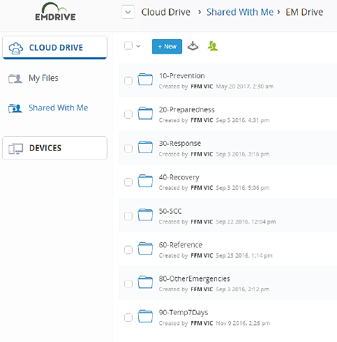

---
## Page 85

Edition 3 – December 2020
85
Separate areas can be set up for agency specific purposes.
For specific guidance on usage and business rules, particularly in relation  
to the 30-Response folder, refer to the library in EM-COP.
An icon to access EM Drive is available on the Operations page of the  
EM-COP desktop.
Emergency management webmail
Role-based email accounts are available for state, regional and incident tiers. 
EMwebmail is hosted in Microsoft Office 365 and uses a web browser to access  
mail accounts. The accounts are accessible to all agencies on all networks  
and allows agency personnel to access incident specific emails using any internet 
connect device.
When using EMwebmail it is critical that the appropriate mailboxes are  
monitored, and important emails followed up with a phone call to ensure 
information not missed.
Use the ‘Subject’ heading to identify the intended recipient(s) and the subject. 
Personal/agency email accounts are not to be used for emails relating to an incident.
Icons to access EMwebmail and login codes are available on the Operations page  
of the EM-COP Desktop.
There are also icons to a User Guide and a document containing descriptions and 
email addresses for all the role-based positions.
Resource requesting
The multi-agency State Resource Request System (SRRS) is designed to make  
it easy for Resources Unit members at incident, regional and state tiers, to submit 
and action requests for additional resources during incidents and planned burning. 
The SRRS is a requesting system only and is not designed for resource tracking.
All Resources Unit personnel, as well as those involved in the dispatch of appliances, 
should ensure that they are familiar with system. Access is via an icon in the 
Resources group in the Sections page of EM-COP Desktop tab, or by going to: 
https://fireweb.ffm.vic.gov.au/ResourceRequest/
SOP J03.09 Resource Request Process sets out how to request resources for  
major emergencies.

---
## Page 86

Victorian Emergency Operations Handbook
86
LESSONS MANAGEMENT
The Emergency Management agencies support a culture of learning by:
•	 Utilising the EM-LEARN Framework (https://www.emv.vic.gov.au/ 
how-we-help/reviews-and-lessons-management) and the  
Lessons Management Life Cycle to support the identifying and learning  
of lessons.
•	 Providing the opportunity to share experiences and learn from others.
•	 Encouraging the sector to share learnings about examples of good  
practice or areas for improvement.
•	 Utilising assurance and learning activities (monitoring, debriefing and reviewing) 
to identify areas to improve and sustain.
•	 Focusing on systems of work, rather than performance of individuals.
•	 Recognising that identifying and implementing sustainable solutions  
takes time, transparency, resources and commitment.

---
## Page 87

Edition 3 – December 2020
87
FIGURE 6 – OPERATIONAL LESSONS MANAGEMENT

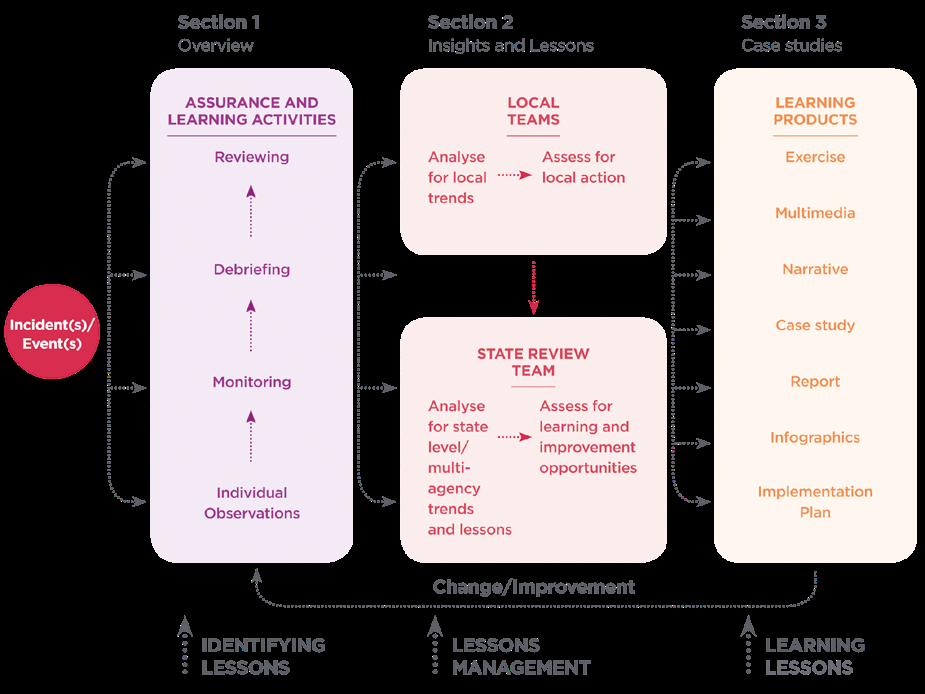

---
## Page 88

Victorian Emergency Operations Handbook
88
Lessons are identified through collecting and analysing data from various levels, 
most often through individual observation capture and assurance and learning 
activities (monitoring, debriefing and reviewing). Lessons need to then be assessed 
for suggested treatments, determining appropriate actions with relevant personnel/
teams/committees, allocating change/improvement activities and monitoring 
progress of implementation. Lessons are only learned once change/improvement is 
evident as a result of action, see figure 6.
Where possible local teams and governance groups (e.g. crews, EMTs, control 
teams, performance improvement teams, committees) should utilise the lessons 
management life cycle outlined in the EM-LEARN Framework to assist with 
analysing the outcomes of assurance and learning activities. This will ensure 
that locally relevant insights and lessons are identified, and actions are taken to 
contribute to continuous improvement.
The State Review Team (SRT) has representatives from the emergency management 
sector who hold the responsibility within their emergency management agency for 
lessons management. In addition to local analysis and action, the SRT, together with 
subject matter experts, identify lessons of state wide/multi-agency significance. 
These will be provided to relevant multi-agency working groups and committees 
for approval. SRT representatives are also accountable for the sharing of lessons 
identified within their agency and advocating for lessons management.
Consistent with the Monitoring and Assurance Framework for Emergency 
Management and EM-LEARN Framework, all assurance and learning activities 
should be guided by the following principles:
Learning focused Focus effort on learning and improvement activities that explore 
what went well and learning opportunities,
System focused Examining systems of work rather than individual performance,
Adding value Providing evidence-based information for the sector,
Minimising burden Using existing mechanisms to capture data where possible.
Trends-based Using multiple information sources to identify lessons (observation, 
insight, lesson (OIL) process).
Future focused Explore events to identify aspects to sustain and areas for 
improvement for the future.
Consistency Using consistent processes, tools and themes to enable trends analysis 
across events and experiences.

---
## Page 89

Edition 3 – December 2020
89
The outcomes of assurance and learning activities will inform the ongoing cycle of 
learning and improvement within the sector by validating and evaluating existing 
doctrine, arrangements, policy, procedure, and incident/emergency management 
application. The outcomes will provide evidence to inform a range of activities 
including training, exercising and briefings.
The list of SRT agency representatives and all documents referenced in this section 
are available in the EM-COP Library > Reviews-Lessons.
EM-Share
All personnel are encouraged to share their observations and initiatives to ensure 
the sector can learn from best practice and drive continuous improvement.
EM-Share is an online application that allows you to share your observations or 
files from operational and non-operational activities. An observation is a record 
of a noteworthy fact or occurrence that someone has heard, seen, noticed or 
experienced as an opportunity for improvement or an example of good practice. 
This is particularly important where personnel have not had the opportunity or 
ability to attend or contribute to assurance and learning activities. Observations can 
be made on behalf of an individual, crew, team, brigade, region or agency. 
Consider submitting outcomes from monitoring, debriefing and reviewing activities 
into EM-Share or report them through the SRT (sccvic.srt@scc.vic.gov.au) to support 
the identification of state wide/multi-agency trends, themes and lessons.
ACCESS
EM-Share is available to personnel from community, business, industry and 
emergency management agencies. You can access EM-Share two ways: EM-Share 
button on the EM-COP Desktop; or using the link https://share.em.vic.gov.au. 
Chrome is the best browser to access EM-Share. If you have registered for EM-COP 
your login details will enable you to login to EM-Share.

---
## Page 90

Victorian Emergency Operations Handbook
90
Monitoring
Victoria has a Real Time Monitoring and Evaluation (RTM&E) which is a systematic 
and objective function that monitors operational performance of systems and 
processes and evaluates the effectiveness of emergency management activities. 
RTM&E adds value to and supports real time learning and improvement to the 
management of emergencies. This is achieved by providing real time feedback  
to participants as well as provide confidence and assurance to the EMC.  
A recommendation to activate RTM&E may be made by a range of state, region  
and incident level personnel as per JSOP12.01 and the RTM&E Guidelines.
Debriefing
The purpose of debriefing is to identify key observations, learning opportunities and 
good practise to ensure learning and improvement occurs within the emergency 
management sector. Debriefing allows participants to, as an individual or group, 
walk through a series of questions enabling reflection on an experience to uncover 
learnings in a non-punitive environment.
DURING EVENT DEBRIEFING
Capturing aspects that are working well and those that could be improved  
while activated during an event reduces the requirement for post event debriefing, 
and enables real time learning and improvement while experiences are fresh in 
people’s minds.
Considerations for aspects to capture during operations include:
•	 reasons for decisions/changes in tactics
•	 innovative practice
•	 what is working well
•	 areas for improvement
•	 ways of capturing learnings during operations may include:
•	 individual sheets for recording learnings before personnel finish shifts/rotations
•	 large sheets for personnel to collectively share learnings
•	 focused discussions as a collective

---
## Page 91

Edition 3 – December 2020
91
•	 promote hot debriefs at the end of shifts/rotations
•	 sharing EM-Share/survey tools
•	 activating an Assurance and Learning Officer to collect learnings and record them 
in EM-Share on behalf of personnel.
Also consider capturing learnings from functions, teams and organisations that 
provide support remotely e.g. SCC Functions.
POST EVENT DEBRIEFING
For non-major emergencies, the control agency is responsible for capturing lessons 
from emergencies, suggesting treatment options to the relevant accountable 
agencies and monitoring change/improvement actions. The scale of the debriefing 
should be in proportion to the complexity of the emergency.
For major emergencies, the MERC or RERC is responsible for ensuring the control 
agency for the emergency has undertaken this process,-including organising an 
operational debrief with participating agencies and teams as soon as practicable.
Representatives of all agencies who participated in the emergency operations 
should participate in debriefs where practicable. These agencies include response 
agencies, recovery agencies, partner organisations and local government. Debriefs 
can also include community, business, or industry groups, where relevant.
Where the debrief process identifies lessons, the control agency is responsible for 
identifying possible local treatments, determining appropriate actions, allocating 
responsibilities and monitoring progress
The control agency should communicate lessons to the EMC through the agency’s 
SRT representative or submitted through EM-Share. The SRT collates and 
analyses lessons from all assurance activities to ensure continuous and consistent 
identification of state trends and themes.

---
## Page 92

Victorian Emergency Operations Handbook
92
Reviews
The purpose of reviewing is to identify key observations, learning opportunities and 
good practise to ensure learning and improvement occurs within the emergency 
management sector. A review is more structured then a debrief (or after action 
review), but less formal then an investigation or inquiry. It is a robust process which 
supports emergency management personnel to explore a specific topic and identify 
key learnings with the intent of instituting change.
Where an agency-led review identifies learning opportunities, the agency is 
responsible for identifying possible local treatments, determining appropriate 
actions, allocating responsibilities and monitoring progress.
Where an EMV-Ied review identifies learning opportunities, EMV will work with 
the SRT and subject matter experts to identify possible treatments, determine 
appropriate change/improvement actions, allocate responsibilities and monitor 
progress. These arrangements will be reported to the EMC, SCT and SCoT.
Assurance and Learning Unit
Agencies undertake a range of activities to provide assurance and identify learnings 
at incident, region and state tier before, during and after emergency incidents. 
When activated at the State Control Centre, the Assurance and Learning Unit 
facilitates the sharing of information and the coordination of resources at a state 
level to support local and regional assurance and learning activities, including:
•	 individual observation capture and analysis
•	 real time monitoring and evaluation deployments
•	 operational debriefing support
•	 operational reviewing support
•	 Before Action Report development.

---
## Page 93

Edition 3 – December 2020
93
PART 2 –  
BUSHFIRE 
READINESS  
AND  
RESPONSE

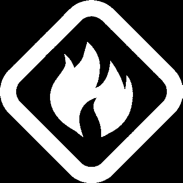

---
## Page 94

94
Victorian Emergency Operations Handbook

---
## Page 95

Edition 3 – December 2020
95
READINESS AND RESPONSE TO BUSHFIRE 
The key to the success and safety of all personnel is the preparedness of  
individuals and teams. It is critical that everyone involved in responding  
to bushfires in Victoria – from RCs, to ICs, to Strike Team Leaders,  
to crew members – understand their responsibilities and take the necessary  
actions to prepare prior to the fire season.
Such efforts in preparedness are an essential element of the shared  
responsibility for bushfire safety that exists between the emergency  
management agencies, state and local government, communities, households  
and individuals. All of us are team members that rely on each other.
First response (also known as initial response or first attack) to fires and  
other emergencies will be fast, determined and thorough and will take  
precedence over normal agency activities.
Preparedness arrangements
Prior to the bushfire season, the EMC and the responder agencies prepare  
an integrated suite of arrangements to help them fulfil their bushfire  
response responsibilities.
Local Mutual Aid Plans (LMAP) identify the preparedness arrangements  
undertaken by the responder agencies in each region. Business Rule  
Local Mutual Aid Plans – Fire agencies provide the details on the content  
of these plans.
CFA in some areas has developed Wildfire Management Plans. These are  
A0 size printed documents at DCP locations as well as district offices.
Readiness arrangements
During the bushfire season the EMC, SRC and RCs, in consultation with  
State and Regional Agency Commanders, give direction regarding the level  
of resources required to be ready at particular times, to provide an effective 
response to bushfire.

---
## Page 96

96
Victorian Emergency Operations Handbook
Readiness arrangements involve establishing support for the line-of-control  
and could include:
•	 preparing and staffing the SCC
•	 preparing and staffing RCCs
•	 positioning IMTs at designated ICCs (in accordance with SOP J02.03  
– Incident Management Teams – Readiness Arrangements)
•	 positioning incident resources to ensure an effective initial response.
Heightened levels of readiness will occur when:
•	 the Fire Danger Rating (FDR) in the region is severe or higher
•	 at the direction of the RC, in consultation with the SRC.
Both the SCC and RCC readiness arrangements will be elevated:
•	 when there is a Code Red FDR in one or more weather forecast districts
•	 when there is an Extreme FDR in three or more weather forecast districts
•	 at the direction of the SRC.
The responder agencies will jointly ensure resources (personnel, equipment,  
and facilities) are ready in accordance with the directions given by the SRC and RCs.
When establishing readiness arrangements ICs need to consider the likelihood  
of fires becoming a major fire and what the consequences may be.
The likelihood of a major bushfire will be increased by:
•	 the presence of ignition sources in the area (e.g. lightening is forecast,  
there is an active arsonist, or it is crop harvesting time)
•	 the presence of high fuel loads and low fuel moisture levels in the area
•	 forecasted weather conditions that indicate that unpredictable fire behaviour  
is likely (e.g. instability, a wind change etc. is forecast)
•	 existing fires in the area that could spot and cause new fires. The potential 
consequences from a major bushfire are increased by:

---
## Page 97

Edition 3 – December 2020
97
	- 	large numbers of people in bushfire prone areas, including tourists during 
holiday periods and special events
	- 	significant public infrastructure assets in the area e.g. infrastructure related  
to gas, electricity, telecommunications, transportation or water storages
	- 	significant community values in the area, for example major industry  
or rural enterprises.
FIRE DETECTION AND DISPATCH
Early detection of and response to bushfires is vital to restricting their spread.  
The fire agencies detect bushfires using a range of methods including reports 
from the public, ‘spotters’ in fire towers, detection aircraft and observation by 
government employees during their daily activities. Fire detection arrangements  
are put in place to meet the forecast fire danger level.
Response arrangements
The Emergency Services Telecommunications Authority (ESTA) provides the link 
between the Victorian community and the state’s emergency service agencies.
It provides Victoria’s 24 hour emergency call taking and dispatch services  
– managing the provision of operational communications for the Victoria  
Police, CFA, FRV, Ambulance Victoria and Victoria State Emergency Service.  
ESTA receive Triple Zero (000) calls from the public to report fires and  
dispatch CFA or FRV resources.
Where a fire is detected on public land, ESTA dispatches the assigned CFA  
or FRV resources and contacts the Forest Fire Management Victoria (FFMVic)  
duty officer who may dispatch additional FFMVic resources.
FFMVic is the name for DELWP’s forest and fire management program. FFMVic 
comprises staff from DELWP, Parks Victoria, Melbourne Water and VicForests  
and is tasked to reduce the risk and impact of bushfires in Victoria’s parks, forests 
and other public land.

---
## Page 98

98
Victorian Emergency Operations Handbook
The responder agencies respond to the notification of bushfires according to their 
agency arrangements. Each bushfire has only one IC, regardless of the number of 
agencies responding.
In first response, the field-based IC communicates to their agency through their 
agency command arrangements. In addition to normal agency communications, the 
information communicated should include:
•	 the effectiveness of the incident control arrangements
•	 potential risks or consequences
•	 the need for specialist resources, including people or equipment.
The EMC, SRCr and RC maintain an overview of the emergency situation, through 
contact with Agency Commanders. Their level of involvement in the management of 
an incident relates to the likelihood of it becoming a major emergency.
COMMAND
The agencies retain command of their own resources and maintain their  
chain-of-command.
For bushfire management, the command structure of each responder agency aligns 
with the state tiers of emergency management as follows:
•	 the Chief Officer is usually the State Agency Commander
•	 operational personnel under the command of a Chief Officer include  
personnel employed by the agency, engaged as volunteers or engaged 
partnership arrangements
•	 each Chief Officer appoints Regional Agency Commanders at the regional tier, 
where the agency holds jurisdiction.
During the bushfire season, Agency Commanders from the responder agencies are 
responsible for monitoring the activities of the resources within their command, 
ensuring they are supporting the line-of-control.

---
## Page 99

Edition 3 – December 2020
99
Functional areas 
CONTROL
To assist the IMT and IEMT achieve the state emergency management priorities, 
 the IC should be mindful of the following activities:
•	 dynamic risk assessment
•	 continuous situational awareness
•	 issuing information and warnings
•	 incident intelligence
•	 incident prediction
•	 weather prognosis
•	 mapping
•	 resources
•	 incident management structure – division (field) command,  
incident, regional and state control
•	 understanding community impact and consequences  
– discuss with IEMT
•	 communications – maintain two-way communications with 
IMT, IEMT and regional/state control.

---
## Page 100

100
Victorian Emergency Operations Handbook
FIGURE 7: TRAFFIC MANAGEMENT POINT VEHICLE STICKER
Traffic management points
In addition to the TMP access levels the following stickers are provided to those 
wishing to gain access to the fire area.
Emergency response personnel TMP access
All FFMVic vehicles with government (red) plates need staff suitability attired in 
PPE (i.e. green overalls and helmets) and displaying either the ‘Fire and Emergency 
Management’ adhesive label on the windscreen or FFMVic external vehicle 
markings. FFMVic vehicles without red plates (e.g. vehicles or prime movers hired 
over the summer, and Melbourne Water/VicForests vehicles) will need ‘Private 
Firefighting Equipment’ stickers (see figure 7).

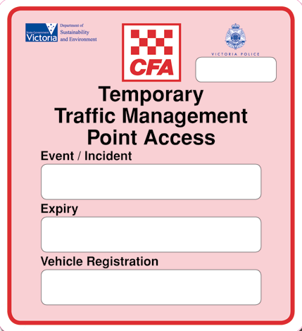

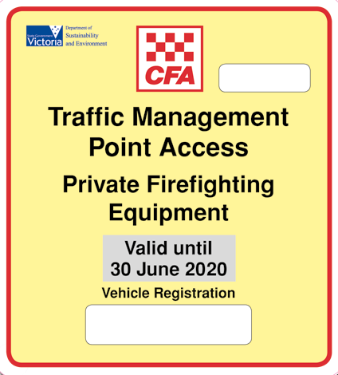

---
## Page 101

Edition 3 – December 2020
101
FIGURE 8: MEDIA PASS
Media TMP access
Media representatives are permitted access at a TMP designated as Authorised 
Access – C. Such access will be subject to authorisation by, and in accordance with 
conditions set, by the IC.
The IC may authorise access for media personnel through a TMP at access 
level Emergency Service Only access or Restricted Access – B, under escort by 
emergency response agency personnel and any other conditions, where they deem 
it safe and appropriate. Such arrangement and the conditions of such access will be 
communicated to the TMP prior to the arrival of the media.
In all cases where media representatives are permitted access, they are required to 
be in possession of a CFA/FFMVic accreditation and authorised PPE.
Media passes expire after three years (see figure 8) after which individuals are 
required to undertake further training. The expiry date on the pass will need to be 
checked by TMP personnel before granting entry.

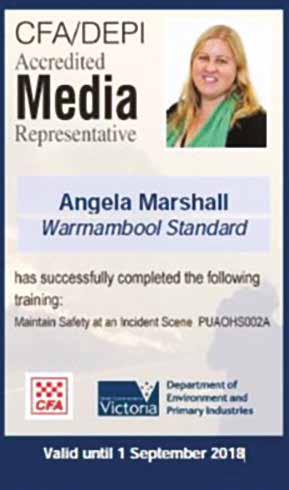

---
## Page 102

102
Victorian Emergency Operations Handbook
OPERATIONS
Bushfire status
CFA and FFMVic use common terms to define the status of a bushfire, however 
FFMVic subdivide the statuses Controlled and Safe (see table 6 below).
INCIDENT 
STATUS
DEFINITION
FFMVIC 
SUBDIVISION
DEFINITION
GOING 
Fire expanding 
in a certain 
direction  
or directions.
CONTAINED
The spread  
of the fire  
is halted.	
CONTROLLED
The complete  
perimeter  
of a fire is 
secured and  
no breakaway  
is expected.
Under  
Control 1
The complete perimeter of the fire  
is secured, no breakaway is expected.
Under  
Control 2
The complete perimeter of the fire is 
secured, and no breakaway is expected. 
Control line quality or depth is such that 
only patrol is required.
SAFE
No further 
suppression 
action or  
patrols are 
necessary.
Safe
No further suppression action or patrols  
are necessary.
Safe –  
False alarm
Mistaken or hoax report
Safe –  
Not found
The fire has not been located, and  
it is expected that no further action  
or patrol will be required.
Safe –  
Overun
The fire has been overrun by another fire.
TABLE 6: INCIDENT STATUS – FFMVIC

---
## Page 103

Edition 3 – December 2020
103
INCIDENT 
STATUS
DEFINITION
NOT YET UNDER CONTROL 
(CFA)\ ALARM LEVEL (FRV)
The fire or incident has the potential to spread or increase  
in difficulty. The appliances and personnel in attendance may 
not be sufficient.
UNDER CONTROL 
(CFA & FRV)
The resources in attendance and en route are sufficient  
to contain the incident.
STOP (CFA & FRV)
The resources presently in attendance at the incident are 
sufficient. Resources that are en route are not required and 
may return to their own locations.
TABLE 7: CFA AND FRV
The fire agencies also have a range of incident status terminology for use in a 
Computer Aided Dispatch (CAD) environment (see table 7). These wordbacks 
reflect incident status and are also linked to resource requirements.

---
## Page 104

104
Victorian Emergency Operations Handbook
Bushfire classification
Bushfires are classified in a range from Level 1 to Level 3.
Level 1
A small, simple fire (or group fires) which is controlled with local resources  
(may include other agencies) with the IC probably undertaking more than  
one function.
Example – A fire where a second shift unlikely to be required and may be 
approximately 0–5ha with no complex problems.
Level 2
A fire that cannot be contained by the first attack of local resources and becomes 
more complex. A Level 2 incident is characterised by the need for:
•	 the deployment of resources beyond initial response
•	 sectorisation of the incident
•	 the establishment of functional sections due to the levels of complexity
•	 a combination of the above.
Example – A fire where it is expected that is will be controlled within 24 hours. 
Approximately 5–20ha (or much larger if the complexity is low), or with some 
complexity and control problems.
Level 3
A large or complex fire where resources from a range of locations are involved. 
Generally, it will involve multiple agencies and will normally be expected to exceed 
24 hours.
Level 3 incidents are characterised by degrees of complexity that may require 
the establishment of Divisions for effective management of the situation. These 
incidents will usually involve delegation of all functions.
These fires are major emergencies.

---
## Page 105

Edition 3 – December 2020
105
Aircraft and aviation – Predetermined Dispatch
Predetermined Dispatch (PDD) is a system which authorises the dispatch  
of aircraft by pager, often concurrently with ground resources when specific  
criteria (time of day and FDI) are met. Aircraft dispatched via the PDD system 
operate from various regional locations.
This will sometimes result in aircraft operating at fires prior to, or very soon after,  
the arrival of ground resources.
All aircraft can still be dispatched by the SAD and all aircraft (including those 
dispatched by PDD) are required be re-tasked through the SAD.
It is important that communications are established and maintained between  
the aircraft and ground resources at all times to ensure both the safety of aircraft 
and ground resources, together with the effective tasking of aircraft.
In some instances, aircraft may undertake initial attack without an Air Attack 
Supervisor (AAS). IAOP SO 4.07 – Firebombing Operations outlines when this  
can occur and the ICs responsibilities.
The combined effort of ground resources and aircraft improves the effectiveness 
of response operations. It is vital that strategies and tactics are consistent and 
understood by aircraft and ground commanders.
RCs manage the requirements of SOP J02.06 Readiness Arrangements  
– Aviation Resources. To support this, the FireWeb Aviation readiness tab  
is required to be populated and updated with current information.

---
## Page 106

106
Victorian Emergency Operations Handbook
PLANNING
Incident communications planning
Agencies need to ensure that Joint Default Communications Plans are prepared  
to cover their respective districts before each fire season. Refer to SOP J02.02  
– Incident Communications Planning.
Joint Default Communications Plans are documented in all relevant Local  
Mutual Aid Plans in accordance with Joint Business Rule – Local Mutual Aid Plans  
– Fire agencies.
Joint Default Communications Plans are required to be implemented at each  
multi-agency incident, until the IC replaces it with a specific Incident 
Communications Plan, if required.
Aboriginal cultural heritage planning
Specific risks associated with impacts to Aboriginal cultural heritage can occur  
in the planning and preparation phase for bushfires.
The greatest risk to Aboriginal cultural heritage at this time is the construction  
of fire breaks, control lines and other logistical infrastructure that requires 
earthmoving machinery. Risks include harming surface or sub-surface artefact 
scatters, freshwater or coastal middens and mounds.
In addition, fire suppression actives, such as dropping chemical fire retardants  
could harm rock art. The greatest risks during a bushfire is scarred trees being 
burned and either destroyed outright or made hazardous due to significant  
burning. The greatest risks in the recovery phase are the felling of scarred trees that 
have been marked as hazardous, but not identified as Aboriginal cultural heritage.
There are also the same risks to Aboriginal cultural heritage being impacted  
by earthmoving equipment as in the planning and preparation phase. A lack  
of due diligence when reinstating or relocating assets and rehabilitating land  
is also a risk to both known and unknown cultural values.
Seeking input from an Aboriginal Cultural Heritage Values Advisor early in the 
process and deploying one into an IMT will aid in minimising the chances of 
accidental impacts to Aboriginal cultural heritage and assisting with assessments 
during all phases on the incident management process.

---
## Page 107

Edition 3 – December 2020
107
LOGISTICS
Catering
Red Cross provide food and water emergency relief to affected communities, 
including at relief centres, but no longer provide these services to the emergency 
service agencies.
The Municipal Emergency Management Plans (MEMPs), LMAPs and any other 
relevant agency plans should have details of local arrangements for catering.
Base camps
The State owns infrastructure for three base camps, each with a capacity  
to support 200–500 personnel. A base camp usually provides services such  
as catering facilities, hygiene facilities, first aid, laundry, accommodation facilities,  
a car park, maintenance and service facilities, PPE/PPC, small equipment 
replacement supply, water supply and other services (e.g. telephone access, 
information boards).
Base camp components can be deployed individually or as a ‘set’ including:
•	 kitchen and kitchen support
•	 laundry
•	 supply cache
•	 base camp support
•	 camping set for 75
•	 camping set for 100
•	 showers
•	 toilets.
For example, kitchen and kitchen support containers can be set up at a staging  
area to provide catering for longer incidents.
Requests for base camps are approved through the line of control. Further 
information is available on the IMT toolbox (FFMVic staff can also access this 
information through the Altona Warehouse Management System (AWMS)).

---
## Page 108

108
Victorian Emergency Operations Handbook
When considering the establishment of a base camp, ensure that:
•	 Appropriately trained logistics personnel are available to plan and implement.
•	 Planning is undertaken incorporating the size, scalability, costs, duration, location 
and adequate resourcing for set up, maintenance and demobilisation.
•	 Consideration on whether a base camp is the best option; a base camp  
is a resource intensive and expensive service.
Mobilisation for a small camp (under 200 pax) can occur within approximately 
24–72 hours of a request, with meals available after 24 hours (depending on the 
incident location proximity to Melbourne).
Demobilisation for a small camp (under 200 pax) takes 3–5 days contingent upon 
dry weather. The Logistics section in the IMT is required to continue to function 
under the direction of the IC until demobilisation is complete.
INTELLIGENCE
Fire Behaviour Analysts
Fire Behaviour Analysts (FBANs) analyse factors including fuels, fire history,  
weather and topography to forecast likely fire behaviour. They may do this  
manually and/or using computer simulation models. FBANs use a combination  
of forecast and field verified data in their predictions. It is important that FBANs  
are notified when more detailed information is obtained (e.g. fire location)  
or if on-ground conditions differ significantly from the predicted 
FBANs can assist in decision-making before, during and after an incident.  
They can provide a variety of services including:
•	 Identification of areas and times of greatest risk.
•	 Fire behaviour prediction maps, showing likely fire progression and potential 
impact zones.
•	 Advice on incident objectives, strategies and tactics.
•	 Information on the factors impacting on spread and behaviour of a grass  
or bushfire.
•	 Assessment of the fire behaviour potential of going, contained and controlled 
fires. It is critical that FBAN intelligence is shared with IMT members and the  
field personnel through IAPs and briefings to support safe effective operations. 
Critical FBAN intelligence can be conveyed via a Field Information Update  
or Red Flag Warning as appropriate.

---
## Page 109

Edition 3 – December 2020
109
Incident weather forecasts
An Incident Weather Forecast is provided by the Bureau of Meteorology for  
a specific location, focusing on weather parameters that affect fire behaviour.  
It typically covers 24 hours and includes a table of forecast temperature, dew  
point, relative humidity, wind direction, windspeed, windgust, upper winds,  
Forest Fire Danger Index (FFDI), Grass Fire Danger Index (GFDI), cHaines Index, 
mixing height and Thunderstorm Activity Level at hourly intervals for the first  
12 hours, then 3 hourly out to 24 hours. The tabular weather parameters are 
prefaced by written commentary that address forecast certainty associated  
with significant wind changes, thunderstorm potential, precipitation and cloud 
as well as spatial variations within the vicinity of the forecast site (particularly 
important mountainous terrain). 
Only when other readily available forecast information does not supply the 
necessary detail, consider requesting an incident weather forecast, this may  
include the use of BoM MetEye service.
Incident Weather Forecasts have a very high priority in the BoM Victoria  
forecast office, second only to the preparation and distribution of Wind Change 
Forecast Maps. This means forecasters will stop work on other products  
to prepare an Incident Weather Forecast. Requests should only be submitted  
for going fires, not those considered contained or controlled, unless previously 
agreed. The complexity of the terrain surrounding the request site affects the 
preparation time, as numerous local weather effects may need to be considered. 
Typical turnaround times range from 20 to 45 minutes. If numerous requests are 
received in a short period, turnaround times may be longer.

---
## Page 110

110
Victorian Emergency Operations Handbook
PUBLIC INFORMATION
Fire danger ratings
Fire Danger Ratings are communicated to the public to inform them about the fire 
risk on any given day and the associated suggested actions (see figure 9).
Fire Dangers Ratings for the Wimmera, Mallee and Northern Country weather 
districts (see figure 10) are forecast using the grassland Fire Danger Index triggers. 
Fire Danger Ratings for the remaining weather districts are forecast using the forest 
Fire Danger Index triggers. The community is presented with one Fire Danger Rating 
for each district.
The Fire Danger Rating predicts how difficult it would be to put out the fire.
The higher the rating, the more dangerous the conditions. The rating is your  
trigger to act, so to stay safe you need to stay aware of the Fire Danger Rating  
in your district.
FIGURE 9: FIRE DANGER INDICES
 
FIRE DANGER RATING
GRASSLAND  
FIRE DANGER INDEX
FOREST  
FIRE DANGER INDEX
CODE RED
150+
100+
EXTREME
100–149
75–99
SEVERE
50–99
50–74
VERY HIGH
25–49
25–49
HIGH
12–24
12–24
LOW-MODERATE
0–11
0–11

---
## Page 111

Edition 3 – December 2020
111
STAY AWARE OF THE FIRE DANGER 
RATING AND KNOW WHAT TO DO.
During the fire season, the Fire Danger Rating will feature in weather forecasts,  
be broadcast on radio and TV, and appear in some newspapers.
It can also be found on the websites of CFA, DEWLP and Bureau of Meteorology,  
by calling the VicEmergency Hotline on 1800 226 226 or via National Relay Service 
on 1800 555 677. 
Mallee
Wimmera
Northern 
Country
South West
Central
West 
and South
Gippsland 
East Gippsland
North 
East
North 
Central
FIGURE 10: WEATHER FORECAST AND TOTAL FIRE BAN DISTRICTS

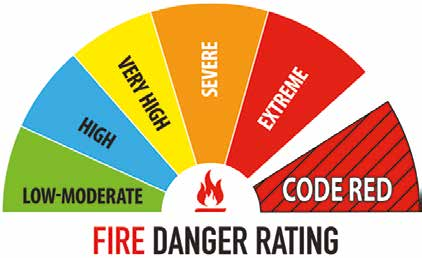

---
## Page 112

112
Victorian Emergency Operations Handbook
FIGURE 11: FIRE DANGER RATING DESCRIPTORS
FIRE  
DANGER 
RATING
WHAT DOES IT MEAN?
WHAT SHOULD I DO?
CODE  
RED
These are the worst conditions  
for a bush or grass fire.
Homes are not designed  
or constructed to withstand  
fires in these conditions.
The safest place to be  
is away from high-risk  
bushfire areas.
Leaving high-risk bushfire areas the night 
before or early in the day is your safest option  
– do not wait and see.
Avoid forested areas, thick bush or long,  
dry grass.
Know your trigger – make a decision about:
•	 when you will leave
•	 where you will go
•	 how you will get there
•	 when you will return
•	 what you will do if you cannot leave.
EXTREME
Expect extremely hot, dry  
and windy conditions.
If a fire starts and takes  
hold, it will be uncontrollable, 
unpredictable and fast  
moving. Spot fires will start, 
move quickly and come from 
many directions.
Homes that are situated  
and constructed or modified  
to withstand a bushfire, that 
are well prepared and actively 
defended, may provide safety.
You must be physically and 
mentally prepared to defend  
in these conditions.
•	 Consider staying with your property only  
if you are prepared to the highest level.  
This means your home needs to be situated 
and constructed or modified to withstand  
a bushfire, you are well prepared and you can 
actively defend your home if a fire starts.
•	 If you are not prepared to the highest level, 
leaving high-risk bushfire areas early in the 
day is your safest option.
•	 Be aware of local conditions and seek 
information by listening to ABC Local Radio, 
commercial and designated community 
radio stations or watch Sky News TV, visit 
cfa.vic.gov.au, call the VicEmergency Hotline 
on 1800 226 226 or via the National Relay 
Service on 1800 555 677.

---
## Page 113

Edition 3 – December 2020
113
FIRE  
DANGER 
RATING
WHAT DOES IT MEAN?
WHAT SHOULD I DO?
SEVERE
Expect hot, dry and possibly 
windy conditions.
If a fire starts and takes hold,  
it may be uncontrollable.
Well prepared homes that  
are actively defended can 
provide safety.
You must be physically and 
mentally prepared to defend  
in these conditions.
•	 Well prepared homes that are actively 
defended can provide safety – check your 
Bushfire Survival Plan.
•	 If you are not prepared, leaving  
bushfire-prone areas early in the day  
is your safest option.
•	 Be aware of local conditions. Seek 
information by listening to ABC Local  
Radio, commercial and designated 
community radio stations or watch Sky  
News TV, visit cfa.vic.gov.au, call the 
VicEmergency Hotline on 1800 226 226  
or via the National Relay Service  
on 1800 555 677.
VERY  
HIGH
If a fire starts, it can  
most likely be controlled  
in these conditions.
•	 Check your Bushfire Survival Plan 
•	 Monitor conditions
•	 Action may be needed
•	 Leave if necessary.
HIGH
LOW-
MODERATE

---
## Page 114

114
Victorian Emergency Operations Handbook
Community fire refuges
A community fire is a designated public building that may provide short-term 
shelter from the immediate life-threatening effects of a bushfire.
Victoria has five official community fire refuges:
•	 East Warburton
•	 Ferny Creek
•	 Lavers Hill
•	 Millgrove
•	 Blackwood
Media attendance at incidents – protocols 
Working with the media
Fire agencies work in partnership with media agencies and media representatives 
during emergencies. Media have a critical role, communicating critical community 
safety messages and newsworthy information, stories, interviews and images.  
Media is one of the most commonly used sources of information about emergencies 
by the community.
The control agency, through the IC, is responsible for ensuring they provide and 
maintain, so far as is reasonably practicable, a work environment that is safe and 
without risks of impacting the safety of all incident personnel, including firefighters 
and media representatives.
Accreditation and identification of media
To work with fire agencies at bushfires, all media representatives are required  
to have:
•	 a current media accreditation card (obtained on completing CFA safety training)
•	 fire agency approved PPE, including CFA approved ‘MEDIA’ patches on the upper 
back, front left pocket and right sleeve of the equipment, all to be worn  
as directed during the time the media are on the fireground.
The IC may grant permission to attend the incident, particularly the fire ground,  
only if it has been deemed safe and practicable to do so, and if the media 
representatives have achieved all the minimum requirements for working with  
fire agencies at bushfires.

---
## Page 115

Edition 3 – December 2020
115
Upon deeming it safe and appropriate for media representatives to attend 
the incident, the control agency will articulate the specific conditions for that 
attendance on each occasion and refer the media representative to the Public 
Information Officer or Media Officer.
The Media Officer will ensure that media representatives receive a safety  
briefing prior to entering the fire ground and that appropriate communication 
arrangements are in place.
Victoria Police Officers may remove media representatives from the fire ground  
who are endangering their own lives or the lives of others.
While on the fire ground, media representatives are required to comply with  
any instruction provided to them by the Media Officer, PIO, IC or Victoria Police.  
This includes immediate departure from the fire ground, should this be deemed  
a necessary safety measure.
Non-compliance
Media accreditation may be withdrawn, and media representatives may be  
escorted from the fire ground and not permitted to return in instances where  
a media representative:
•	 Has endangered their own safety, or the safety of others.
•	 Failed to comply with instructions of the Media Officer, PIO, Incident  
Controller or any representative of the fire agencies or Victoria Police while  
n the fire ground.
•	 Failed to depart immediately from the fire ground after instruction by the  
Media Officer, or any representative of the responder agencies, or Victoria Police.
•	 Accessed any area beyond TMP without the permission of the IC or an escort by 
CFA or FFMVic staff.
The agencies may formally advise WorkSafe of the incident if appropriate.  
The SCC Public Information Section can contact the relevant media agency  
to advise them that their media representative has failed to comply.

---
## Page 116

116
Victorian Emergency Operations Handbook
SAFETY
WATCHOUT
WATCHOUT is an acronym used to remind firefighters of potential dangers to their 
safety and to give advice on safe work practices. Understanding the meaning of the 
acronym will help you perform a more comprehensive risk assessment.
W EATHER dominates fire behaviour, so keep informed
A CTIONS need to be based on current and expected fire behaviour
T RY OUT at least two safe escape routes
C OMMUNICATE with your supervisor, your crew and adjoining crews
H AZARDS beware of variations in fuels and steep slopes
O BSERVE changes in wind speed, direction, temperature, humidity and cloud
U NDERSTAND your instructions, make sure that you are understood
T HINK clearly, be alert and act decisively before your situation becomes critical

---
## Page 117

Edition 3 – December 2020
117
You should familiarise yourself with your agency’s current WATCHOUTs.  
Firefighter’s watchout when:
•	 building a control line downhill towards a fire
•	 on a slope – rolling material can ignite fuel below you
•	 the wind changes speed or direction
•	 the weather gets hotter or drier
•	 there are unburnt fuels between you and the fire
•	 terrain or vegetation impedes travel or visibility
•	 working in country areas you have not seen in daylight
•	 you are unfamiliar with the weather and local fire behaviour
•	 frequent spot fires occur over your control line
•	 you cannot see the main fire or communicate with anyone who can
•	 unclear instructions or tasks are given
•	 you feel exhausted or want to take a nap near the fire
•	 attacking a fire or constructing a fire control line without a safe anchor point
•	 working alone with no communications link to crew members or supervisor
•	 you are not fully informed about strategy, tactics and hazards
•	 safety zones and escape routes have not been identified
•	 fire not scouted or the potential of the fire has not been assessed
•	 water levels are getting low.

---
## Page 118

118
Victorian Emergency Operations Handbook
Smoke
Significant smoke or emissions from fires or hazardous materials incidents need 
consideration in terms of protecting both workforce and community from harmful 
effects. Smoke is harmful and early in any incident the composition will be unknown, 
so basic protective actions i.e. avoid exposure, minimise exposure, personal 
protective respiratory protection should be considered.
If the density of smoke or emissions is predicted to last a considerable time and 
potentially impact workers or the community, consideration must be given to:
•	 The provision of advice to protect both workers and the community.
•	 Deployment of monitoring equipment to the incident site to monitor composition 
and exposure of workforce.
•	 If smoke or emissions are significant, potentially deploy monitoring within the 
community that is impacted by smoke or emissions.
Early consideration for the need for monitoring of significant events, along with 
early activation will help inform decision making by ICs. Fire agencies and the 
Environment Protection Authority, have a range of monitoring tools available for 
agencies to deploy, as required.
The following documents contain more information on smoke:
•	 State Smoke Framework.
•	 SOP J031.8 Incident Air Quality Monitoring.
•	 SOP J031.9 Managing Significant Community Exposures to Fine Particles and 
Carbon Monoxide in smoke from fires.

---
## Page 119

Edition 3 – December 2020
119
Tree hazard
Tree hazard is a major risk to firefighters and responders at all stages of operations, 
from active suppression, mopping up and patrol through to recovery. The key steps 
to protect responders from tree hazard are:
Step 1 Identify the potential existence of tree hazard during bushfire response.
Step 2 Mitigate the risk arising from tree hazard during access to bushfire incidents.
Step 3 Mitigate the risk arising from tree hazard on the fire ground.
Step 4 Mitigate the risk of unidentified hazard trees on the fire ground.
Step 5 Complete operations.
For further information on Tree Hazards see SOP J08.03 Tree Hazard  
– Bushfire Response.
Initial attack and tree hazard
Awareness and identification of trees which present a hazard need to form part of 
the ongoing dynamic risk assessment performed by all personnel on the fire ground 
at all times. During an attack on a going fire, personnel need to be particularly 
vigilant in identifying hazard trees and treating any unacceptable risks.
Following the passage of the fire
Hazard trees within striking distance of access/control lines are assessed,  
marked and treated as soon as possible after the passage of fire, and before  
the commencement of any mop-up/blacking out/patrol. Prescribed qualified  
or experienced personnel can carry out tree hazard assessments.
Marking system
Yellow dot ‘•’ is sprayed on non-hazard trees to be protected (i.e. hand raked  
or machine cleared around and/or fire suppressant applied) prior to the fire  
or back burn.
Yellow cross ‘X’ is sprayed on hazardous trees (not yet Clear and Present  
Danger), or potential Clear and Present Danger trees which cannot be reliably 
protected. These trees will normally be pushed over or felled as part of access/
control line construction.

---
## Page 120

120
Victorian Emergency Operations Handbook
FIGURE 12: TREE HAZARD IDENTIFICATION

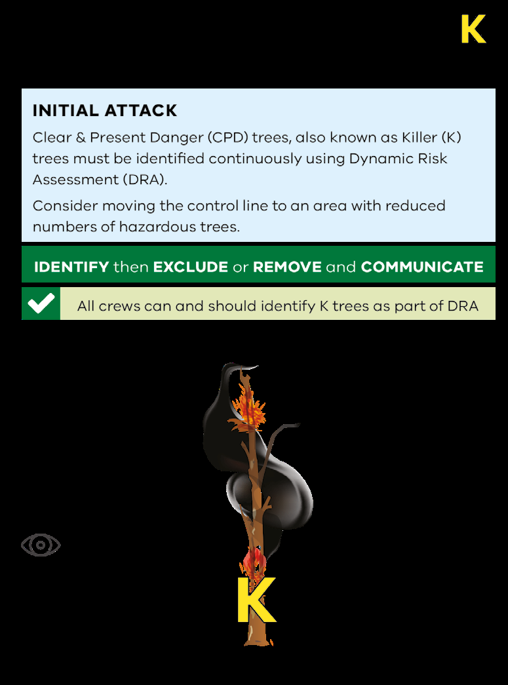

---
## Page 121

Edition 3 – December 2020
121

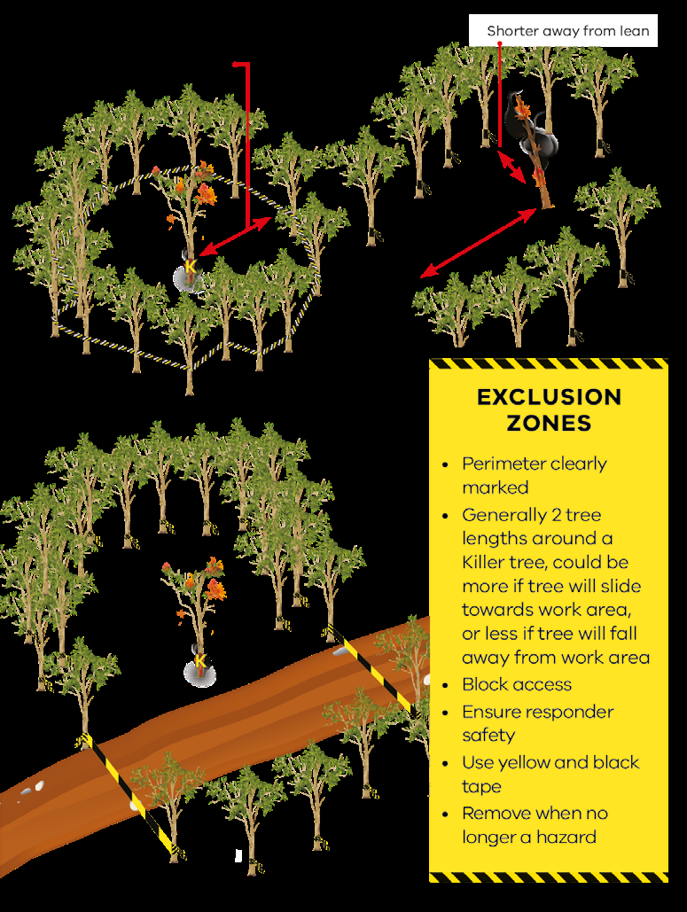

---
## Page 122

122
Victorian Emergency Operations Handbook
FIGURE 12: TREE HAZARD IDENTIFICATION (CONTINUED)

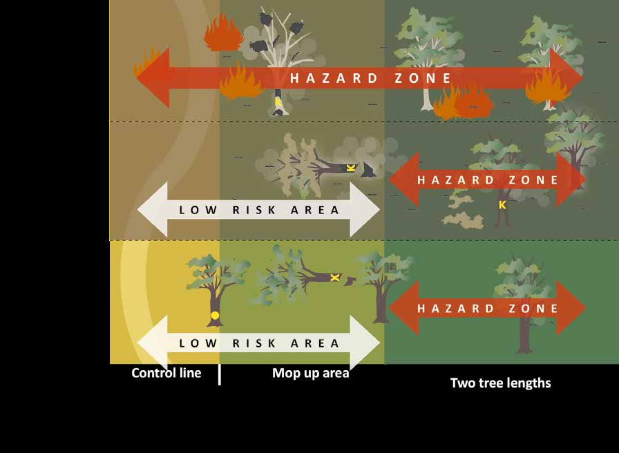

---
## Page 123

Edition 3 – December 2020
123
Yellow ‘K’ is sprayed on trees that present a ‘Clear and Present Danger’ which are 
likely to fall on personnel while working in the area.
All responders can identify Clear and Present Danger (CPD) Trees (‘K’) through  
a DRA. As a minimum, an exclusion zone should be established and the location  
of an identified Clear and Present Danger Tree (‘K’) reported. ‘K’ should only  
be spray painted when they are assessed as being safe enough to approach by  
a qualified or experienced person.
Exclusion zones
An exclusion zone is marked with yellow and black tape tied around a tree  
or trees at the perimeter of the exclusion zone on the approach to a ‘K’ tree.  
No one should enter the exclusion zone unless they are tasked to assess or treat  
the risk. Personnel wanting to access the area are required to either wait until the 
hazard has been safely treated or find other means of access outside the exclusion 
zone. In exceptional circumstances (e.g. where life is under threat) DRA should  
be applied.
The exclusion zone is generally two tree lengths; however, it may be larger, or in 
some cases smaller depending on site conditions such as topography and tree lean.
If it is unsafe or not possible to fall or push over a ‘K’ tree then other options include 
retaining the exclusion zone, moving, re-aligning or abandoning the control line 
where the risk poses cannot be treated.

---
## Page 124

124
Victorian Emergency Operations Handbook
Post incident
FIRE INVESTIGATION
In the event of a fire being suspicious, the IC is to ensure the scene is preserved and 
request Victoria Police and a Fire Investigator to attend scene. The IC should provide 
Victoria Police the details of why the fire is deemed suspicious.
Joint Business Rule – Bushfire investigation, describes the procedures for  
bushfire investigation.
REHABILITATION
Rehabilitation initially involves emergency stabilisation activities which are 
considered necessary for the restoration or re-establishment of infrastructure, other 
assets and environmental values affected by the impact of bushfire and suppression 
activities and to prevent further degradation from these impacts.
Emergency stabilisation and rehabilitation should be initiated by the IC as soon as 
possible after firefighting operations commence, but without compromising control 
of the fire. Emergency stabilisation should be carried out prior to suppression 
machinery leaving the fire ground.
Emergency stabilisation works include:
•	 Emergency erosion control to protect life and property post fire.
•	 Works to protect road network from increased risk of flooding or erosion.
•	 Removal of hazardous trees along the road network or at recreation sites.
•	 Opening or closing roads post fire for public safety.
•	 Rehabilitation of fire control lines on public or private land.
•	 Repair or replacement of fences damaged directly by the fire agencies during  
the course of suppression.
•	 Essential water replacement.
•	 Deployment of Bushfire Rapid Risk Assessment Teams to initiate recovery  
plans. Rehabilitation will often continue post incident as part of the transition  
to longer term recovery.

---
## Page 125

Edition 3 – December 2020
125
PART 3 –  
FLOOD  
AND STORM

---
## Page 126

126
Victorian Emergency Operations Handbook

---
## Page 127

Edition 3 – December 2020
127
FLOOD AND STORM
Authorising environment 
In addition to the common emergency management and agency specific acts,  
there are a number of other Acts and Regulations that impose restriction on control 
and support agencies when working in flood and storm events.
The functions of VICSES as described in the Victoria State Emergency Service Act 
2005 (Vic) are to respond to floods and storms and their effects; and providing 
rescue services.
The Water Act 1989 (Vic) lists the floodplain management functions of  
Catchment Management Authorities and Melbourne Water. These functions  
include the determination of the extent and depth of floodwater; the development 
and implementation of plans; take any action necessary to minimise flooding and 
flood damage; and to provide advice about flooding and controls. Additional 
requirements relate to controlling works and structures on floodplains, although 
enforced through planning controls in planning schemes.
The Meteorology Act 1955 (Cth) contains the functions of the Bureau of Meteorology 
(BoM) including the issue of warnings of gales, storms and other weather conditions 
likely to endanger life or property, including weather conditions likely to give rise to 
floods or bushfires.
Emergency risk management
Emergency management involves managing the risk of emergency events on the 
community and its values. In order to manage risk, we need to understand the 
hazard and its impacts.
In the context of this document, extreme weather and storm events includes 
phenomena associated with severe weather systems and severe thunderstorms  
such as:
•	 damaging and destructive winds
•	 heavy rainfall that may lead to flash flooding
•	 large hail
•	 tornados
•	 blizzards
•	 storm surge.
Flooding is generally categorised into two types; riverine and flash.

---
## Page 128

128
Victorian Emergency Operations Handbook
Extreme weather climatology
The most frequent type of extreme weather events are thunderstorms.  
Although severe thunderstorms can occur at any time, the potential is higher  
during September through to April.
Wind storms (land gale-force winds) associated with the passage of a cold front  
or intense low-pressure systems across Victoria can occur at any time of year 
although are more common in the winter and spring months when intense low 
pressure systems and cold fronts are stronger.
On a seasonal basis, rainfall over the central and southwestern areas of  
Victoria is at a maximum in late winter and early spring. Flooding in Victoria  
is largely influenced by rainfall distribution and rainfall intensity and is commonly 
a winter-spring phenomenon in Victoria, associated with frequent low-pressure 
systems and fronts. Some major flood events have occurred in the summer  
period, commonly associated with weather systems of tropical origin extending  
or moving south.
FIGURE 13: STORM RADAR IMAGE

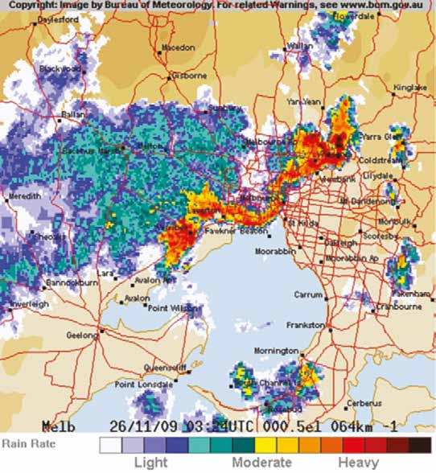

---
## Page 129

Edition 3 – December 2020
129
Blizzards are confined to alpine areas in Victoria and mainly occur during the 
winter and early spring months but can also occur in autumn. It does not have to 
be snowing to have blizzard conditions and the winds should be at least gale force 
(average 63km/h or more).
River systems
The river systems in Victoria are divided into 29 catchments, with the Murray River 
falling under the jurisdiction of New South Wales government to the low water mark 
on the Victorian bank.
FIGURE 14: VICTORIAN RIVER CATCHMENTS

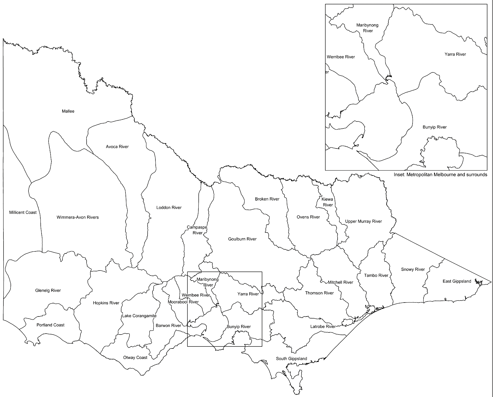

---
## Page 130

130
Victorian Emergency Operations Handbook
Floodplain management
DELWP is responsible for policy and oversight of floodplain risk management 
arrangements.
Floodplain Risk Management Planning is a subset of the community  
emergency risk management process focused on identifying and analysing  
flood risks; and evaluating and recommending appropriate flood risk treatment 
options. This is best achieved through a flood study, floodplain risk management 
study and a floodplain risk management plan to identify the flood risks and  
how these might be best managed. The State Floodplain Management Strategy  
– sets out the policy framework for managing floodplains in Victoria.
Prevention activities cover both structural and non-structural measures. 
Structural measures have traditionally included flood mitigation works, such as 
levees, retarding basins, channel modifications and the structural or floor level 
modifications to buildings. Non-structural measures include land use planning, 
building controls, and community risk awareness programs.
Catchment Management Authorities (CMAs) and Melbourne Water have  
statutory functions under the Water Act 1989 to manage waterways, floodplains  
and drainage.
Local government has a significant role to play in the administration of land use 
planning arrangements and flood mitigation at the local level.
Flood emergency management
Flood emergencies by their nature require a multi-agency response. Part 7 of the 
EMMV, identifies VICSES as the control agency for Flood Response.
Flood emergency management brings together Whole-of-Victorian-Government 
resources and the community to take appropriate and timely action in relation to 
flood preparedness, response, relief and recovery.

---
## Page 131

Edition 3 – December 2020
131
Total Flood Warning System (TFWS)
The goal of flood warning is to help flood management agencies and the members 
of flood-prone communities to understand the nature of developing floods so that 
they can take action to mitigate their effects. To achieve this goal, flood warning 
systems are established and operated across the state.
A flood warning system is made up of a number of components which need be 
integrated if the system is to operate effectively. The components of the TFWS are:
•	 monitoring of rainfall and river flows that may lead to flooding
•	 prediction of flood severity and the time of onset of particular levels of flooding
•	 interpretation of the prediction to determine the likely flood impacts on  
the community
•	 construction of warning messages describing what is happening and will happen, 
the expected impact and what actions should be taken
•	 dissemination of warning messages
•	 response to the warnings by the agencies.
Levee management
There are many levee systems within Victoria and the design, operation and 
maintenance arrangements vary widely across the state. Some levees are formally 
maintained, but many are not, therefore, unless documented in emergency response 
plans, no reliance should be placed on levees that are not maintained. Where 
maintained, levee managers are required keep the control agency informed of 
the levee status and be prepared to provide expert advice about the design and 
construction of their levee, and any concerns over its performance.
During an incident the Victoria State Emergency Service Act 2005 provides for 
personnel authorised by VICSES the power to construct, remove, or alter a levee 
and/or remove debris where there is a reasonable belief that removal is required to 
protect life or property.

---
## Page 132

132
Victorian Emergency Operations Handbook
Dam management
DELWP has a regulatory role in the safety of dams in Victoria. This includes dams 
categorised as farm dams, private dams and dams operated by water corporations, 
Parks Victoria and local government.
Dam owners and operators are responsible for the maintenance, operation and 
management of the dam.
Generally, large dams in Victoria are not designed or operated specifically for flood 
mitigation, although some flood mitigation is provided as a result of the flow being 
attenuated by the dam.
Only a small number of dams have spillway gates, providing the capability to make 
flow releases prior to or during flooding.
Community resilience
UNDERSTANDING COMMUNITY RISK
Catchment Management Authorities regularly undertake flood studies across  
the state to assist in the planning and prevention of flooding on communities.  
The outcomes of these studies inform flood protection and planning schemes.
To assist the community in understanding their risk and to support informed 
decision making, VICSES has developed a number of flood guides and emergency 
plans to explain local flood risks for at risk communities and provide advice  
on how to prepare for and respond to flood events.
LOCAL KNOWLEDGE
There are a range of information sources available to emergency services before, 
during and after incidents. Information sources many include local knowledge 
obtained from trusted sources such as community members and organisations. 
Local knowledge information can provide valuable local information about incidents 
on how they have or may evolve.
Community observer networks have been established by VICSES in areas where 
existing networks are not available, and the need for local knowledge has been 
identified. VICSES also works with other organisations and agencies to access local 
knowledge through existing networks. Where these network arrangements exist, 
they are documented within Municipal Flood Emergency Plans.

---
## Page 133

Edition 3 – December 2020
133
Readiness and response
CAPACITY
In order to respond to flood and storm events the agencies have established  
a number of mechanisms to enhance the state’s capacity.
These include:
•	 Contractual arrangements in order to access personnel from the private sector 
providing expertise, in flood hydrology, mapping and engineering, to support 
intelligence and operational decision making.
•	 Memorandums of Understanding have been established with NSW and SA  
to ensure that operational activity across the borders is managed in a unified  
and consistent manner.
•	 Use of local knowledge through the community observer networks established 
through VICSES and other local networks such as local government, CMAs,  
other agencies and community groups.
•	 Investment in the development of a flood intelligence platform and monitoring 
systems, assist in the gathering and collating data.
STATE PLANNING, READINESS AND ACTIVATION
The State Flood sub-plan and State Storm Sub-plan provides sources of  
information and to outline the arrangements for ensuring an integrated and 
coordinated approach to the State’s management of flood and storm events,  
in order to reduce the impact and consequences of these events on the  
community, infrastructure and services.
A copy of the State Flood and State Storm sub-plan is available via the  
EM-COP website.

---
## Page 134

134
Victorian Emergency Operations Handbook
Readiness and activation
Readiness arrangements for the State are scalable, adaptable, and based on risk.  
On a monthly basis BoM provide DELWP and VICSES risk assessment briefings  
on the rainfall outlook and flood potential. The outcomes from these briefings 
inform the readiness planning undertaken by these agencies.
State Readiness and Activation is to be in line with SOP J02.03 Incident 
Management Team (IMT) Readiness Arrangements and VICSES Readiness and 
Activation Triggers.
The State tier is to have documented plans and processes for the activation of 
State Resources and Facilities in the occurrence of a no notice event. Each State 
Duty Officer and State Agency Commander is to be aware of these plans, with the 
processes regularly exercised.
REGIONAL READINESS, ACTIVATION AND PLANNING
Planning
Each Emergency Management Region has a documented Flood sub-plan and Storm 
sub-plan to outline the response arrangements to flood and storm incidents within 
that Region’s area of responsibility.
A copy of each Regions plan is available via EM-COP or the VICSES website.
Readiness and activation
Regional Readiness and Activation is to be in line with SOP J02.03 Incident 
Management Team (IMT) Readiness Arrangements and VICSES Readiness and 
Activation Triggers.
Actions that may be undertaken by the Regional Agency Commander and Regional 
Duty Officer include:
•	 Briefings to Units on the forecast event.
•	 Prepositioning of specialist teams such as USAR or LBSWR.
•	 Relocation of state/regional/unit assets.
•	 Identification of members to undertake IMT roles at Incident Control Centres.
•	 Briefings to State on readiness and response actions.

---
## Page 135

Edition 3 – December 2020
135
Each Region is to have documented plans and processes for the activation  
of Regional Resources and Facilities in the occurrence of a no notice event.  
Each Regional Duty Officer and Regional Agency Commander is to be aware  
of these plans, with the processes regularly exercised within the Region.
UNIT READINESS, ACTIVATION AND PLANNING
For day to day VICSES Operations, Unit Duty Officers and Unit Management  
Teams need to be aware of the current resources available to their individual unit.  
If a Unit believes that they do not have sufficient resources available for response, 
they are to escalate this to the Regional Duty Officer for consideration.
It is also recommended that Units have established plans in place for:
•	 pre-determined Incident Control Point activation
•	 pre-identified sectors within the Unit response boundary
•	 arrangements with other Emergency Services and Council for support response
•	 activation of the Unit Business Continuity Plans
•	 activation of Code Red Day plans (if applicable) in line with VICSES Policy 12.01 
Code Red (Catastrophic) Day Response.
Unit readiness, activation and planning
For routine day to day operations involving a single crew attending a single incident, 
the Crew Leader will assume the role of IC where VICSES is the Control Agency.
Where activity levels see multiple crews and/or a low level of multiple incidents the 
IC should operate from a facility that is capable of running an Incident Control Point.
Once there is the need for deployment of significant resources beyond initial 
response and neighbouring Units, and/or sectorisation of the emergency event,  
and/or the establishment of functional sections due to the levels of complexity 
or the size (particularly the establishment of a public information unit to manage 
warnings and advice) an ICC should be established with the IC establishing an IMT 
and relevant EMT.

---
## Page 136

136
Victorian Emergency Operations Handbook
MULTI AGENCY OPERATIONS
In line with JSOP 2.03 IMT Readiness Arrangements, VICSES has established  
VICSES Readiness and Activation Triggers to outline  
the required level of prepositioned response to a forecast or no notice event.  
A copy of these trigger documents is available via EM-COP.
Where events meet the trigger points for Readiness and Activation Levels  
of 3B and above, the response to an event moves from ‘Business as Usual’  
response by VICSES, to a multi-agency response as outlined in JSOP 2.03  
IMT Readiness Arrangements.
Resources from other Emergency Service Organisations will be deployed to assist 
with tasks such as IMT roles and incident response.
In line with JSOP 2.03 IMT Readiness Arrangements, predetermined  
footprints for Incident Control Centres in response to Flood and Storm events  
have been established.
Managing the incident response
USE OF POWERS UNDER THE VICSES ACT
VICSES policy 12.10 Use of Powers under the VICSES Act during Operations  
outlines the policy requirements including those authorised to undertake actions  
in accordance with:
•	 Section 32AB of the VICSES Act 2005 which provides the power to enter  
land or premises without the consent of the occupier of the land or premises  
if a Service member reasonably believes that entry to the land or premises  
is urgently required to protect life or property in the course of responding  
to, or preparing for, a flood, earthquake or storm; or providing a rescue service.
•	 Section 32AC of the VICSES Act 2005 which provides the power to construct, 
remove or alter a levee on land or premises if it is determined that the 
construction, removal or alteration is required to protect life or property.
•	 Section 32AC of the VICSES Act 2005 which enables the service to remove from 
land or premises debris (including any fallen tree) if that removal is required to 
protect life or property.

---
## Page 137

Edition 3 – December 2020
137
ENTERING LAND OR PREMISES DURING OPERATIONS
Only ICs, VICSES Crew Leaders and VICSES Agency Commanders at Incident, 
Regional and State Tier are authorised to make a decision to enter property with 
oral consent or without the consent of occupiers.
VICSES SOP035 Entering Land or Premises During Operations outlines the 
procedure for entering land and/or premises with oral consent or without the 
consent of the occupier(s) during emergency operations.
LEVEE CONSTRUCTION, REMOVAL, ALTERATIONS AND  
DEBRIS REMOVAL
The decision to construct, remove or alter a levee during an emergency rests  
with the following authorised persons:
•	 SRC
•	 RC
•	 State or Regional Agency Commander
•	 an endorsed Level 2 or Level 3 IC (where appointed).
The decision to construct, remove or alter a levee should be made having first 
undertaken an Options Analysis which considers the risks and consequences to the 
community, utilising the approved Options Analysis tool on the EM-COP Library.
The decision to remove debris from a levee rests with an endorsed Crew Leader  
or a Controller at Incident, Regional or State tiers.
VICSES SOP036 Construction, Removal or Altering of Levee and Removal of 
Debris outlines the approach to the construction, removal or alteration of levee and 
removal of debris during emergency operations.

---
## Page 138

138
Victorian Emergency Operations Handbook
INTELLIGENCE
The existence and development of intelligence supports emergency services  
to determine the most appropriate course of action to resolve the incident.
Flood intelligence enables an incident management team to determine,  
the likely impacts, what actions will need to be taken by agencies and what 
information and advice should be provided to community members.
VICSES works closely with CMAs, DELWP, other agencies and trusted local  
sources, as appropriate, to ensure available sources of flood intelligence are  
utilised. Flood Emergency Plans are the key source of flood information this  
is complemented with realtime data and monitoring.
DATA COLLECTION
In partnership, DELWP, CMAs, VICSES and municipalities coordinate the  
collection, collation, analysis, interpretation and dissemination of post-flood  
extent and survey levels and ensure that relevant information is available  
through the impact assessment process.
Stream gauges and other equipment utilised for flood warning services are 
maintained and repaired by Regional Water Monitoring Partnerships managed  
by DELWP.
DATA ANALYSIS
VICSES has entered into agreements with a number of engineering consulting  
firms to deliver technical services to support the intelligence unit during  
operations. These agreements include water engineering (capable of providing  
flood intelligence) and geotechnical engineers (capable of providing advice  
on levees and dams).

---
## Page 139

Edition 3 – December 2020
139
Triage
During business as usual operations, emergency services respond to Requests for 
Assistance (RFA) in the order in which they are received. If a large number of RFAs 
are received, a process of triaging should be utilised to prioritise the tasking of 
emergency personnel.
FLOOD TRIAGE
Consistent with the State Emergency Management Priorities the following triaging 
priorities are to be adopted during flood events:
TABLE 8: FLOOD TRIAGE PRIORITY
PRIORITY
EXAMPLE
1. RESCUE OF PERSONS
•	 Rescue from flood water, trapped in cars or buildings.
2. PROTECTION FROM  
THREAT TO LIFE
•	 Evacuation of vulnerable people from the flood affected  
or potential flood affected areas.
•	 Evacuation of people from flood affected or potential flood 
affected areas.
•	 Restriction of movement of people in flood affected areas  
(road closures).
3. PROTECTION OF 
CRITICAL COMMUNITY 
INFRASTRUCTURE1
•	 Installation of protective barrier to reduce the impact of  
floodwater on infrastructure.
•	 Ensure maintenance of critical community infrastructure 
and/or services to the community.
4. PROTECTION OF  
PRIMARY RESIDENCE
•	 Installation of protective barrier to reduce the impact  
of floodwater on infrastructure.
1 	 Infrastructure are those items or places necessary for the maintenance of community function 
e.g. schools, essential services, care facilities, water pumping stations etc.

---
## Page 140

140
Victorian Emergency Operations Handbook
STORM TRIAGE
Consistent with the State Emergency Management Priorities the following triaging 
priorities are to be adopted during storm events:
TABLE 9: STORM TRIAGE PRIORITY
PRIORITY
EXAMPLE
1. THREATENED OR  
ENTRAPPED PERSONS
•	 Trapped in cars, buildings, etc.
•	 Evacuation of persons, in the event of flash flooding.
2. TRAFFIC HAZARD 
PRESENTING A POTENTIAL 
THREAT TO LIFE
•	 Major arterials, main roads and single access roads.
3. RENDER CRITICAL 
INFRASTRUCTURE  
AND COMMUNITY  
ASSETS SAFE AND  
PROVIDE PROTECTION 
FROM FURTHER DAMAGE1
•	 Removal of trees from structure or that are likely to cause 
further damage.
•	 Tarping to reduce impacts of weather on the structure.
•	 Shoring (if safe to do so) of building to reduce the risk 
•	 of collapse.
•	 Flood protection (where possible).
4. RENDER PRIMARY  
RESIDENCE (BUILDING  
ONLY) SAFE AND  
PROVIDED PROTECTION  
FROM FURTHER DAMAGE2
•	 Removal of trees from primary residence structure  
or that are likely to cause further damage.
•	 Tarping to reduce impacts of weather on the structure.
•	 Shoring (if safe to do so) of building to reduce the risk  
of collapse.
•	 Flood protection (where possible).
5. TREE DOWN BLOCKING 
ACCESS AND/OR EGRESS
• FOR PROPERTY OWNER.
• FOR PUBLIC FOOTPATHS
•	 Removal of tree from driveway and paths that prevent 
entry and/or exit either by foot or vehicle from property.
•	 Removal of tree from public footpath that has the  
potential to impede foot traffic.
6. RENDER PRIVATE  
PROPERTY SAFE AND 
PROVIDE PROTECTION  
FROM FURTHER DAMAGE3
•	 Making safe fences.
•	 Removal of trees from structures.
•	 Tarping to reduce impacts of weather on the structure.
•	 Shoring (if safe to do so) of building to reduce the risk  
of collapse.
1 	 Infrastructure are those items or places necessary for the maintenance of community function 
e.g. schools, essential services, care facilities, water pumping stations etc. 
2	 Out buildings and fencing of primary residence are deemed ‘private property’ and form part 
of priority 6. 
3	 Property includes residence and other private assets, i.e. vehicles.

---
## Page 141

Edition 3 – December 2020
141
Public information
INFORMATION AND WARNINGS
Warnings for extreme weather events are provided by the BoM, Melbourne Water 
and VICSES.
Principles applied in the provision of public information and warnings shall be 
consistent with the concepts outlined in the Victoria Emergency Warning Protocol 
and Total Flood Warning System.
Warnings will be issued where predictions are available. In the case where there  
is no or limited prediction information available, warnings will only be issued  
based on local knowledge and/or advice from the Incident Emergency Management 
Team (IEMT).
If the incident crosses the border, warnings and information will be issued in 
conjunction with the control agency of the neighbouring state.
Under the BOM Service Level Specification for Flood Forecasting and Warning 
Services for Victoria the Bureau flood forecasting and warning services is confined 
to dealing with riverine flooding where typical rain-to-flood times are six hours  
or more. Flash flooding (rain-to-flood times less than six hours) and flooding caused 
by elevated sea levels are not covered, nor are the weather forecasting and other 
services the Bureau provides that contribute to the flood forecasting and warning 
Service, including Severe Thunderstorm and other Weather Warnings, provision of 
radar data and rainfall forecasts.
The responsibility for flood modelling and prediction services for the Melbourne 
Metropolitan catchment rests with Melbourne Water. 
BOM RESPONSIBILITIES
BOM are required under the Meteorology Act 1955 (Cth), S6.1c for the issue  
of warnings of gales, storms and other weather conditions likely to endanger life  
or property, including weather conditions likely to give rise to floods or bushfires.
The official forecasts and warnings for extreme weather and flood events are issued 
using the following areas:
•	 river basins (Flood Watches)
•	 key locations on rivers and creeks (Flood Warnings)
•	 land and coastal forecast districts  
(Severe Weather and Severe Thunderstorm Warnings).

---
## Page 142

142
Victorian Emergency Operations Handbook
The BOM provide forecasts for predicted levels or flood class levels (minor, 
moderate and major) for some locations in Victoria. Not all flood risk locations 
across Victoria are covered by this level of service.
The BOM service level standards (SLS) define the nature and type of warnings 
provided for various locations across the state. Prediction locations are categorised 
into the following types; forecast, data and information. The prediction type may be 
quantitative, qualitative or generalised and includes height and timing information 
where available.
MELBOURNE WATER RESPONSIBILITIES
Melbourne Water acts as a flood prediction and warning agency for Greater 
Melbourne Metropolitan catchments and provides flood forecasts to the BOM  
who disseminate official forecasts and warnings.
WATER STORAGE OWNERS RESPONSIBILITIES
Water storage owners are required to provide information to the downstream 
community where increased flows from the water storage are expected. In the 
instance that the increased flow will be at or above the minor flood warning level 
the water storage owner is required to advise BOM in order for flood warnings  
to be issued.
VICSES RESPONSIBILITIES
VICSES has a duty to ensure timely issue of warnings and information to  
the community.
Flood
VICSES will issue warnings for flood events on advice of a BoM flood prediction. 
These warnings contain information such as current flood situation, likely future 
flood consequences, actions required to protect life and property, how to access 
further information about flooding and how to obtain emergency assistance.
Storm
VICSES will issue warnings with enhanced community actions and advice, where  
this adds value to the BOM warning and prediction, and/or the potential for large 
scale community consequences are foreseen. Where possible local input will be 
sought to inform messages issued to the community.

---
## Page 143

Edition 3 – December 2020
143
Dam
In the instance of dam incidents that have the potential to have community 
consequences VICSES will support DELWP in providing warning and/or advice  
to the community.
ISSUING WARNINGS
There are a variety of methods that agencies use to disseminate warnings, and 
multiple formats should be utilised where possible to allow maximum reach to the 
affected community.
In the initial stages of some emergencies there may be little or no opportunity to 
provide a warning. In extreme weather events the warning issued by the BOM may 
be assessed as the most appropriate warning, with no supplementary warning 
issued by the control agency.
The following table describes the linkages between the alert category and the types 
of extreme weather and flood warnings issued by VICSES.
TABLE 10: ALERT LEVELS
ALERT LEVEL 
STORM 
FLOOD DAM
DAM
ADVICE
•	 Severe weather
•	 Severe thunderstorm
•	 Flood watch
•	 Dam incident
WATCH  
AND ACT
 
•	 Flood  
(no flood class level)
•	 Minor flood
•	 Moderate flood
•	 Dam emergency
EMERGENCY  
WARNING
•	 Very dangerous
•	 Severe thunderstorm
•	 Major flood
•	 Prepare to evacuate
•	 Evacuate immediately
•	 Prepare to evacuate
•	 Evacuate immediately

---
## Page 144

144
Victorian Emergency Operations Handbook
Community safety options
Community members respond to the threat of an emergency in a variety of ways.  
A range of safety options, both personal and communal, are required to support 
their responses.
The range of safety options available should be appropriate to the local 
circumstances and identified in local plans. Not all safety options will be available  
in all circumstances, and some options will be more viable for some groups than  
for others.
SHELTER IN PLACE
Shelter-in-place may be indicated where it is considered that the process of 
evacuation poses a greater risk to life than that remaining in-situ.
Where indicated, if taking shelter in flash flood environments, people are advised  
to take shelter in the highest point such as, within a building.
RESCUE
Rescue activities should be seen as an option of last resort, as they place  
emergency responders into high risk environments. Rescue should only be 
undertaken by trained personnel.
In flood environments, rescue needs to be considered when planning for evacuation 
or shelter-in-place is being undertaken.
EVACUATION
Evacuation is a risk management strategy which may be used as a means  
of mitigating the effects of an emergency or disaster on a community. It involves  
the movement of people to a safer location.
Flood evacuation plans exist as part of Municipal Flood Emergency Plan in  
some high risk communities.
Evacuation is conducted in line with the SOP J3.12 Evacuation, and the  
Evacuation Guidelines.
Levees are primarily a mechanism for the protection of property, not life.  
No levee is flood proof. Where there is potential for levee over-topping  
or a levee breach, a decision to evacuate needs to be considered.

---
## Page 145

Edition 3 – December 2020
145
ISOLATED PROPERTIES
Isolation of properties can often occur in flood events. Where possible, people 
should be encouraged to relocate from their property prior to any threat of isolation, 
as isolation is not without risk.
RESTRICTING ACCESS
Agencies may restrict the access into the incident area to maintain the safety  
of personnel and community members; and to protect the incident area.
Consequence management
The State aims to achieve a safer and more resilient community through reducing 
the consequences of emergency events on the community and its values. ICs are 
responsible for identifying the broader risks and consequences of the emergency 
and putting in place processes to manage these.
The following outline potential consequences of extreme weather and flood on  
the state:
•	 Substantial damage or demand to the continuity to electricity supplies.
•	 Sustained or widespread critical telecommunication outage.
•	 Large scale or wide spread evacuation.
•	 Major disruption to transport infrastructure significantly affecting passenger and 
freight operations.
•	 Major economic cost to State.
•	 Significant loss of water supply for a large community or regional area.
•	 Significant loss and damage to environment.
•	 Residual water in the landscape after flood peaks increase risks to human health, 
community wellbeing and the functioning of regional economies.

---
## Page 146

146
Victorian Emergency Operations Handbook
Relief and recovery
PROVISION OF RELIEF
The provision of relief is applied consistent with Fundamentals of  
Emergency Management (Class 1 emergencies). However, during flood events  
there may be a requirement to focus on the delivery of essential supplies  
to community members who may be isolated or have chosen to remain with  
their property.
TRANSITION TO RECOVERY
Due to the potential prolonged nature of flood events, an IC may consider the 
requirement to transition part of an incident area to recovery agencies, before the 
response has concluded.
This transition needs to be planned and agreed between the control and  
recovery agencies.
After an emergency
DEMOBILISATION
Consistent with Fundamentals of Emergency Management (Class 1 emergencies)  
the removal of response agencies from an incident area is undertaken in a planned 
and considered way.
Consideration needs to be given for the decontamination and maintenance of 
vehicles, equipment and clothing, which has been in contact with floodwater. 
Specific arrangements have been established for the environmentally responsible 
disposal of sandbags.

---
## Page 147

PART 4 –  
REFERENCES  
AND  
APPENDICES 
147
Edition 3 – December 2020

---
## Page 148

148
Victorian Emergency Operations Handbook

---
## Page 149

Edition 3 – December 2020
149
FURTHER INFORMATION
 
DOCUMENT
 
LOCATION
AFTER ACTON REVIEW FORM
EM-COP > Library > Reviews > Debriefing
AIIMS MANUAL – 4TH EDITION 2017
AFAC website: www.afac.com.au
CASE STUDIES
EM-COP > Library > Reviews-Lessons  
> Learning Products > Case Studies
CFA/FFMVic FIREFIGHTER REFERENCE 
MANUAL
CFA online
 
CFA FIRE AND EMERGENCY MANAGEMENT 
FIELD GUIDE AND CHECKLISTS
CFA online
CFA/FRV JOINT OPERATIONAL ACTIVITIES 
MEMORANDUM OF UNDERSTANDING
Agency intranets
EMERGENCY MANAGEMENT TEAM 
ARRANGEMENTS
EMV website: www.emv.vic.gov.au
FUNDAMENTALS OF EMERGENCY 
MANAGEMENT (CLASS 1 EMERGENCIES)
EMV website: www.emv.vic.gov.au
JOINT SOPS
EM-COP > Library > Doctrine > JSOPs
SCC STANDARD OPERATING PROCEDURES
EM-COP > Library > State Control Centre (SCC)  
> Procedures
STATE EMERGENCY MANAGEMENT PLAN 
(SEMP)
EMV website: www.emv.vic.gov.au
TREE HAZARD PICTORIAL GUIDE
EMV website: www.emv.vic.gov.au/treehazard
VIDEO – TREE HAZARD AWARENESS
Fireweb and CFA online

---
## Page 150

Victorian Emergency Operations Handbook
150
Doctrine
The following is a list of current doctrine that is available.
Business Rules
Mapping Team
Local Mutual Aid Plans – Fire
Requesting & Deploying of Remote Piloted Aircraft Systems
Bushfire Investigation
State Response Controller Endorsement Process
JSOPs
J02.02
Incident Communications Planning
J02.03
Incident Management Team Readiness Arrangements
J02.04
Local Knowledge – Bushfire
J02.06
Readiness Arrangements - Aviation Resources (Bushfire)
J03.02
Incident Naming – Major Emergencies
J03.03
Incident Action Planning
J03.04
Incident Safety Management Functions
J03.06
Incident Briefings
J03.08
Appointment of Regional and Level 3 Incident Controllers

---
## Page 151

Edition 3 – December 2020
151
J03.09
Resource Request Process
J03.10
Traffic Management
J03.11
Red Flag Warnings
J03.12
Evacuation for Major Emergencies
J03.15
Transfer of Control and IMT Relocation 
J03.16
Significant Event Notification
J03.17
Regional Operations Plan
J03.18
Incident air quality monitoring for community health
J03.19
Managing significant community exposures to fine particles and carbon 
monoxide in smoke from fires
J04.01
Public Information and Warnings
J08.01
OH&S Incident Reporting and Investigation
J08.02
Dynamic Risk Assessment
J08.03
Tree Hazard – Bushfire Response
J08.04
Managing Potential Asbestos Exposure 
J08.05
Health Monitoring
J12.01
Real Time Monitoring and Evaluation
Operational Policy
Emergency Response Driving

---
## Page 152

Victorian Emergency Operations Handbook
152
SCC/RCC/ICC Contact List
STATE
STATE CONTROL CENTRE
Level 4, 8 Nicholson St 
East Melbourne 3002
Ph 1300 368 722 
sccvic.sccmgr@scc.vic.gov.au
BARWON SOUTH WEST
REGIONAL CONTROL CENTRE
Geelong
61 Separation St 
Geelong 3220
Ph (03) 5221 6667 
Fax (03) 5240 2726
rccbsw.all@rcc.vic.gov.au
INCIDENT CONTROL CENTRES
Casterton
147 Bahgallah Rd 
Casterton 3311
Ph (03) 5554 2301 
Fax (03) 5581 2151
icccas.all@icc.vic.gov.au
Colac
83–85 Gellibrand St 
Colac 3250
Ph (03) 5233 5565 
Fax (03) 5233 5574
icccol.all@icc.vic.gov.au
Geelong
90–94 Furner Ave  
Bell Park 3215
Ph (03) 9256 7399 
Fax (03) 9256 7367
iccgee.all@icc.vic.gov.au
Hamilton
915 Mt Napier Rd 
Hamilton 3300
Ph (03) 5551 4700 
Fax (03) 5571 1636
iccham.all@icc.vic.gov.au
Heywood
12 Murray St  
Heywood 3304
Ph (03) 5527 0444 
Fax (03) 5527 1809
icchew.all@icc.vic.gov.au
Warrnambool
Cnr Raglan Pde  
and Walsh Rd  
Warrnambool 3280
Ph (03) 5559 2500 
Fax (03) 5560 5296
iccwar.all@icc.vic.gov.au
EASTERN METROPOLITAN
REGIONAL CONTROL CENTRE
272 Maroodah Hwy 
Chirnside Park 3116
Ph (03) 8739 1391 
Fax (03) 8739 1382
rccemr.all@rcc.vic.gov.au

---
## Page 153

Edition 3 – December 2020
153
INCIDENT CONTROL CENTRES
Ferntree Gully 27/69 Acacia Rd 
Ferntree Gully 3156
Ph (03) 9751 5700 
Fax (03) 9751 5705
iccftg.all@icc.vic.gov.au
Woori Yallock
7–9 Symes Rd  
Woori Yallock 3139
Ph (03) 5961 5917 
Fax (03) 5964 7410
iccwor.all@icc.vic.gov.au
GIPPSLAND
REGIONAL CONTROL CENTRE
181 Franklin St  
Traralgon 3844
Ph (03) 5177 3240 
Fax (03) 5177 3284
rccgip.all@rcc.vic.gov.au
INCIDENT CONTROL CENTRES
Bairnsdale
574 Main St  
Bairnsdale 3875
Ph (03) 5150 1320 
Fax (03) 5152 0444
iccbai.all@icc.vic.gov.au
Bendoc
2 Nichol St  
Bendoc 3888
Ph (02) 6459 0508 
Fax (02) 6459 0522
iccbnd.all@icc.vic.gov.au
Erica
Thomson Valley Hwy 
Parkers Corner 3825
Ph (03) 5165 2200 
Fax (03) 5165 2233
icceri.all@icc.vic.gov.au
Heyfield
1 Firebrace Rd  
Heyfield 3858
Ph (03) 5139 7756 
Fax (03) 5139 7733
icchey.all@icc.vic.gov.au
Leongatha
14A McCartin St 
Leongatha 3953
Ph (03) 5667 1100 
Fax (03) 5662 2408
iccleo.all@icc.vic.gov.au
Noojee
McCarthys Spur Rd 
Noojee 3833
Ph (03) 5624 8100 
Fax (03) 5268 9563
iccnoo.all@icc.vic.gov.au
Orbost
171–173 Nicholson St 
Orbost 3888
Ph (03) 5161 1333 
Fax (03) 5161 1300
iccorb.all@icc.vic.gov.au
Sale
64–66 Foster St  
Sale 3850
Ph (03) 5149 1201 
Fax (03) 5144 5493
iccsal.all@icc.vic.gov.au
Swifts Creek
McMillan Ave 
Swifts Creek 3896
Ph (03) 5159 5150 
Fax (03) 5159 5155
iccswi.all@icc.vic.gov.au
Traralgon
Level 2, 181 Franklin St 
Traralgon 3844
Ph (03) 5177 3200 
Fax (03) 5176 3295
icctra.all@icc.vic.gov.au

---
## Page 154

Victorian Emergency Operations Handbook
154
GRAMPIANS
REGIONAL CONTROL CENTRE
 
19 Learmonth Rd 
Wendouree 3355
Ph (03) 5330 9130 
Fax (03) 5329 5582
rccgmp.all@rcc.vic.gov.au
INCIDENT CONTROL CENTRES 
Ararat
31–33 Baird St 
Ararat 3377
Ph (03) 5352 9600 
Fax (03) 5352 5517
iccara.all@icc.vic.gov.au
Ballarat
25 Vickers St  
Sebastopol 3356
Ph (03) 5335 0700 
Fax (03) 5335 0731
iccbal.all@icc.vic.gov.au
Horsham
110 Natimuk Rd  
Horsham 3400
Ph (03) 5362 0720 
Fax (03) 5381 0268
icchor.all@icc.vic.gov.au
HUME
REGIONAL CONTROL CENTRE
 
89 Sydney Rd  
Benalla 3672
Ph (03) 5761 0724 
Fax (03) 9562 7852
rcchum.rctrl@rcc.vic.gov.au
INCIDENT CONTROL CENTRES
Alexandra
5 Binns Macrae Rd 
Alexandra 3714
Ph (03) 5772 0200 
Fax (03) 5772 2892	
iccale.all@icc.vic.gov.au
Benalla 
64 Sydney Rd  
Benalla 3672
Ph (03) 9256 7799 
Fax (03) 9256 7767
iccbnases.all@icc.vic.gov.au
Corryong
2 Jardine St  
Corryong 3707
Ph (02) 6076 3100 
Fax (02) 6076 1348
icccor.all@icc.vic.gov.au
Mansfield
128 Highett St  
Mansfield 3722
Ph (03) 5733 1200 
Fax (03) 5775 1063
iccman.all@icc.vic.gov.au
Ovens
5338 Great Alpine Rd 
Myrtleford 3737
Ph (03) 5731 1222 
Fax (03) 5731 1223
iccove.all@icc.vic.gov.au
Seymour
39 McIntyre St  
Seymour 3660
Ph (03) 5735 3300 
Fax (03) 5735 3381	
iccsey.all@icc.vic.gov.au

---
## Page 155

Edition 3 – December 2020
155
Shepparton
195–205 Numurkah Rd 
Shepparton 3630
Ph (03) 5822 9900 
Fax (03) 5833 2483
iccshe.all@icc.vic.gov.au
Tallangatta
34 Toowong St 
Tallangatta 3700
Ph (02) 6071 5300 
Fax (02) 6071 2889
ictal.all@icc.vic.gov.au
Wangaratta
1 Ely St  
Wangaratta 3677
Ph (03) 5720 2300 
Fax (03) 5722 3021
iccwan.all@icc.vic.gov.au
Wodonga
55 Moorefield Park Dr  
Wodonga 3690
Ph (02) 6043 4600 
Fax (02) 6059 8210	
iccwod.all@icc.vic.gov.au
NORTHERN AND WESTERN METROPOLITAN
REGIONAL CONTROL CENTRE
239 High St  
Melton 3337
Ph (03) 8746 1400 
Fax (03) 8746 1480
rccnwm.rctrl@rcc.vic.gov.au
INCIDENT CONTROL CENTRES
Burnley
450 Burnley St 
Richmond 3121
Ph (03) 9665 4545
iccbur.all@icc.vic.gov.au
Sunshine 
239 Proximity Dr 
Sunshine West 3020
Ph 1800 045 939 
Fax (03) 9314 6288	
iccsun.all@icc.vic.gov.au
SOUTHERN METROPOLITAN
REGIONAL CONTROL CENTRE
 
Level 3, 45 Assembly Dr 
Dandenong South 3020
Ph (03) 9767 3840 
rccrctrl@rcc.vic.gov.au
INCIDENT CONTROL CENTRE
Dandenong
Level 3, 45 Assembly Dr 
Dandenong South 3020
Ph (03) 9767 3800 
Fax (03) 9706 7447
iccdan.all@icc.vic.gov.au

---
## Page 156

emv.vic.gov.au
Working in conjunction with communities,  
government, agencies and business

