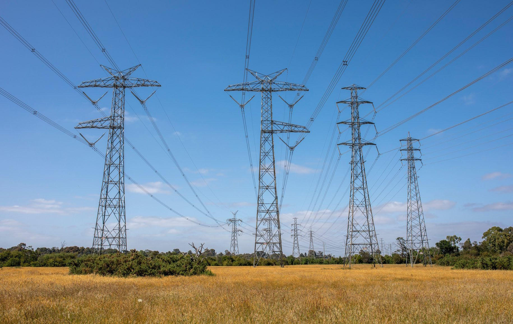
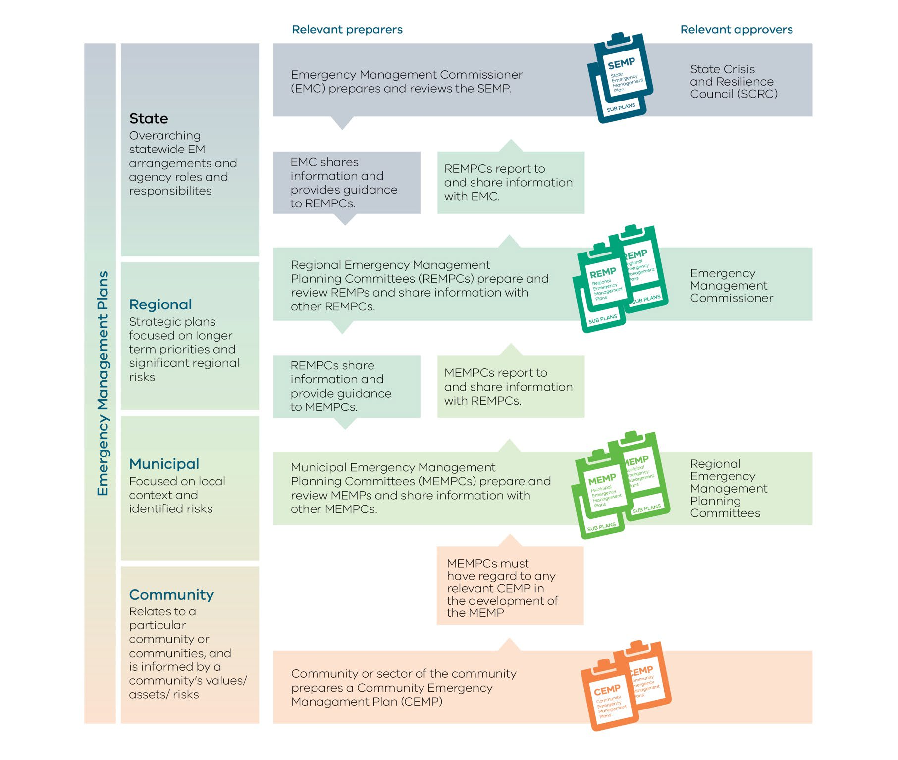
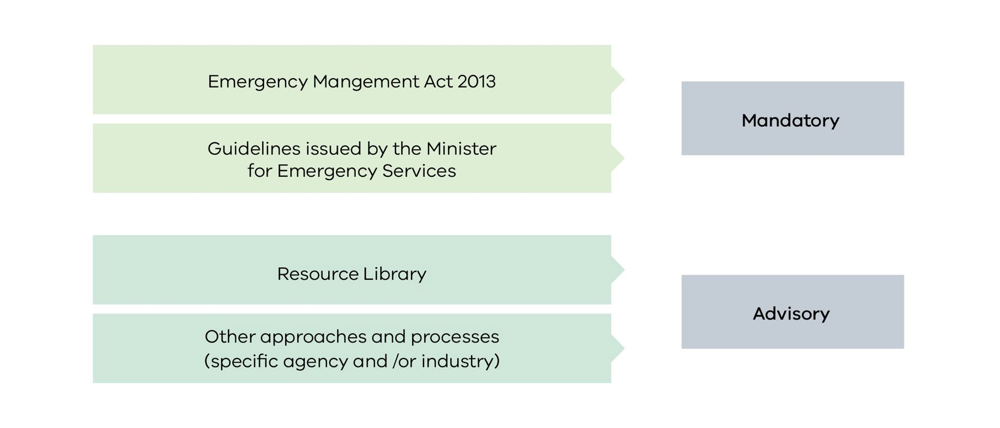
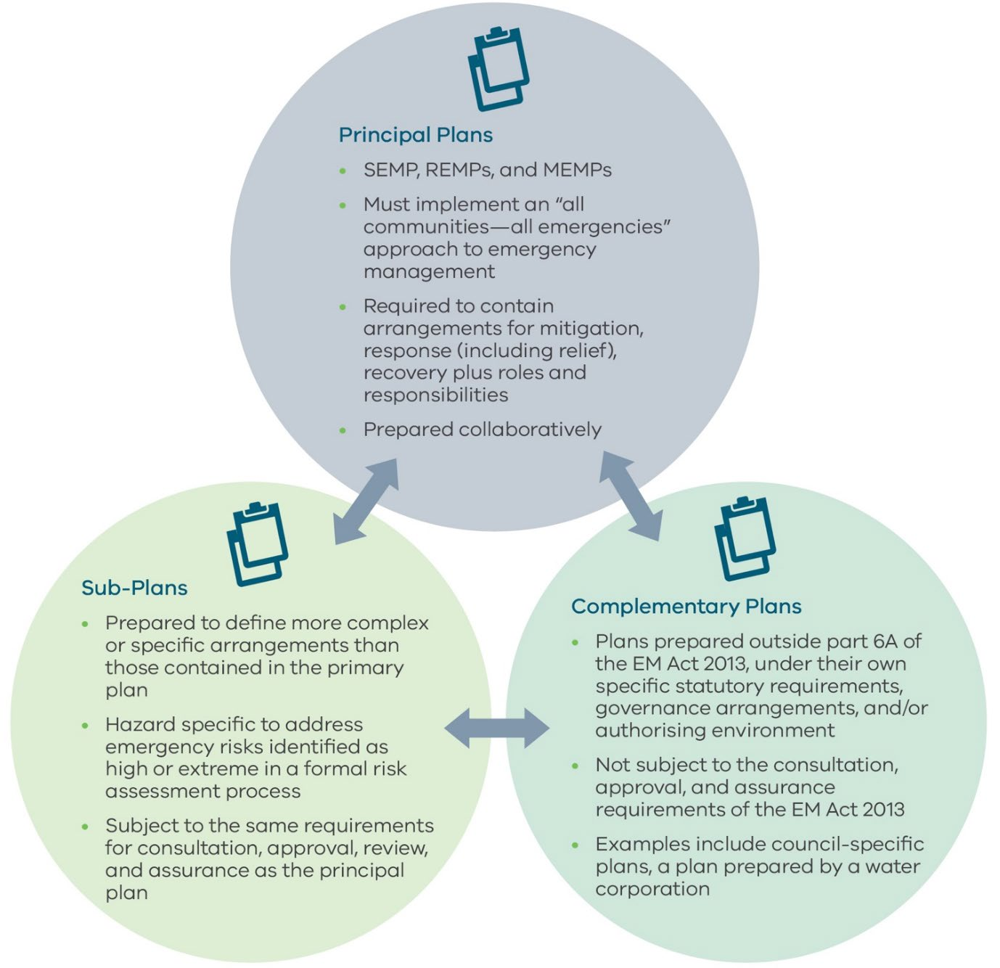
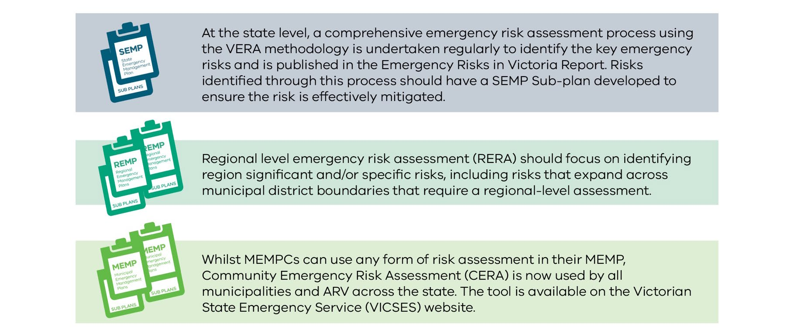
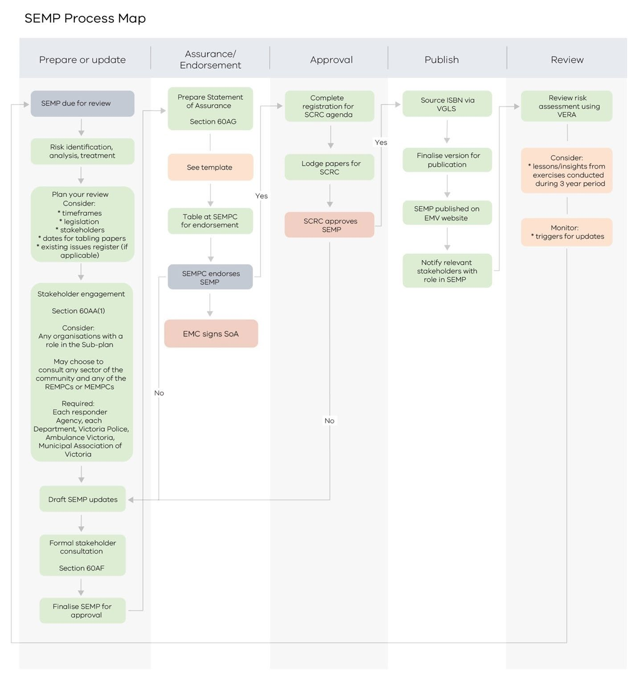
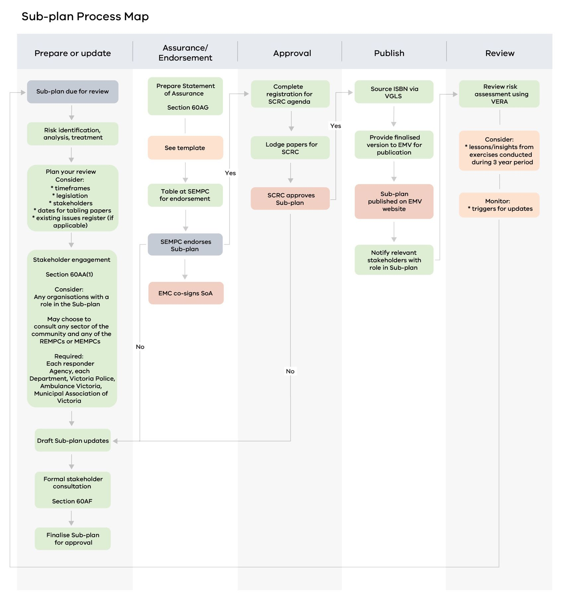
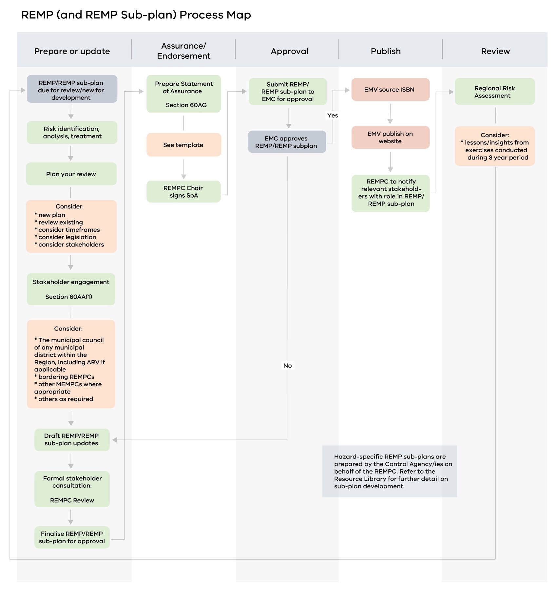
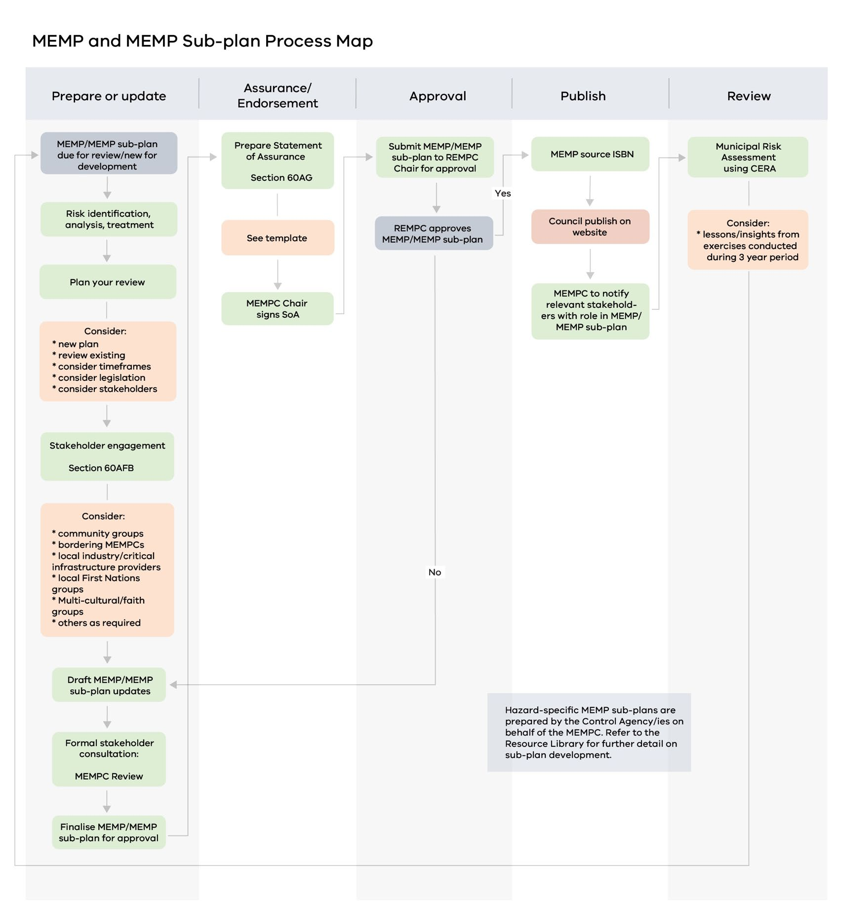

# Guidelines for Preparing State, Regional and Municipal Emergency Management Plans (Version 4 (November 2024))

> **Source**: Emergency Management Victoria
> **URL**: https://files.emv.vic.gov.au/2024-11/Guidelines%20for%20preparing%20State%20Regional%20and%20Municipal%20Emergency%20Management%20Plans%20V4.pdf
> **Licence**: © State of Victoria; emergency-management practitioner reference
> **Retrieved**: 2026-05-07T23:44:30Z
> **SHA-256**: `cfa645a419dc6af06d9f1f5e3f9d802ccd2d44cf1307f94f39803c54ba60e605`
> *Converted from PDF to Markdown format.*

---
## Page 1

 
 
Guidelines for  
preparing  
State, Regional  
and Municipal  
Emergency Management  
Plans 
 
 
 
 
 
 
 
 
 
 
 
 
Issued by the Minister for Emergency Services 
October 2024

---
## Page 2

Guidelines for preparing State, Regional and Municipal Emergency Management Plans 
Page 2 
Acknowledgement of Country 
The Honourable Jaclyn Symes, Minister for Emergency Services acknowledges Aboriginal 
and Torres Strait Islander people as the First Peoples and Traditional Owners and 
custodians of the land and waterways of Victoria and their ongoing strength in practising 
the world’s oldest living culture. 
The Victorian Government acknowledges and pays our respects to ancestors of this 
country, Elders, knowledge holders and leaders – past and present. We extend that 
respect to all Aboriginal and Torres Strait Islander peoples. We recognise that Aboriginal 
and Torres Strait Islander communities are steeped in culture and lore having existed 
within Australia continuously for some 65,000 years. 
The Victorian Government is committed to working with Aboriginal and Torres Strait 
Islander communities to achieve a shared vision of safer and more resilient communities.

---
## Page 3

Guidelines for preparing State, Regional and Municipal Emergency Management Plans 
Page 3 
Publication information 
Published by 
Emergency Management Victoria (EMV), 121 Exhibition Street, Melbourne, 3000 
© State of Victoria 2024 
You are free to re-use this work under a Creative Commons Attribution 4.0 licence, 
provided you credit the State of Victoria (Emergency Management Victoria) as author, 
indicate if changes were made and comply with the other licence terms. The licence does 
not apply to any images, photographs or branding, including Government logos. 
If you would like to receive this publication in an accessible format please email 
media@emv.vic.gov.au This document is also available in PDF format at emv.vic.gov.au 
ISBN 978-1-921699-13-9 
Authority 
These Guidelines are issued by the Minister for Emergency Services under section 77 of the 
Emergency Management Act 2013 (EM Act 2013) for emergency management planning. 
Prior to issuing these Guidelines, the Minister consulted the State Crisis and Resilience 
Council (SCRC) in accordance with section 77(4) of the EM Act 2013. 
Reviews and updates 
EMV will review these Guidelines on behalf of the Minister for Emergency Services at least 
every 3 years, or at the request of the Minister. 
The Minister will consult with SCRC in relation to any update. 
Document information 
Date of Approval October 2024 
Version: Version 4 issued by the Honourable Jaclyn Symes, Minister for Emergency 
Services 
This document supersedes the previous version published in December 2020.

---
## Page 4

Guidelines for preparing State, Regional and Municipal Emergency Management Plans 
Page 4 
Table of Contents 
1. 
Introduction ......................................................................................................................................................................... 6 
1.1 
Key Definitions ....................................................................................................................................................................7 
1.2 
Victoria’s emergency management planning framework ................................................................7 
1.3 
Planning objectives ........................................................................................................................................................ 9 
1.4 
Additional planning tools ........................................................................................................................................ 10 
2. 
Types of emergency management plans ..................................................................................................... 12 
2.1 
Principal plans .................................................................................................................................................................. 12 
2.2 
Subordinate plans ......................................................................................................................................................... 12 
2.3 
SEMP sub-plans ............................................................................................................................................................... 12 
2.4 
Regional and municipal level sub-plans ...................................................................................................... 13 
2.5 
Complementary plans ............................................................................................................................................... 14 
2.6 
Community Emergency Management plans ............................................................................................ 16 
2.7 
Relevant preparers and relevant approvers ............................................................................................ 16 
2.8 
Legislated Requirements .......................................................................................................................................... 17 
3. 
Emergency management arrangements .................................................................................................... 18 
3.1 
Risk assessment ............................................................................................................................................................. 18 
3.2 
Mitigation (including preparedness) .............................................................................................................. 19 
3.3 
Response (including readiness and relief) .................................................................................................. 21 
3.4 
Recovery ............................................................................................................................................................................... 21 
3.5 
Roles and responsibilities ........................................................................................................................................ 22 
4. 
Emergency management plan development ...........................................................................................23 
4.1 
Planning collaboration (section 60AA(1)) ....................................................................................................23 
5. 
State-level emergency management plans .............................................................................................. 25 
5.1 
SEMP consultation requirements (section 60AF) ................................................................................. 26 
5.2 
State level Statement of Assurance (section 60AG) ........................................................................... 27 
5.3 
Approval of the SEMP and SEMP Sub-plans (section 60AH) ........................................................ 27 
5.4 
Non-approval of the SEMP and SEMP Sub-plans ................................................................................. 27 
5.5 
Publication (section 60AI) ....................................................................................................................................... 28 
5.6 
Review of the SEMP and SEMP sub-plans (section 60AN) ............................................................. 29 
6. 
Regional emergency management plans ...................................................................................................32 
6.1 
REMP consultation requirements (section 60AFA) ............................................................................. 33 
6.2 
Regional level Statement of Assurance (section 60AG) .................................................................. 34

---
## Page 5

Guidelines for preparing State, Regional and Municipal Emergency Management Plans 
Page 5 
6.3 
Approval of a REMP (section 60AH) ................................................................................................................ 35 
6.4 
Non-approval of the REMP .................................................................................................................................... 35 
6.5 
Publication of a REMP (section 60AI) ............................................................................................................ 35 
6.6 
Review of REMPs (section 60AN) ...................................................................................................................... 36 
7. 
Municipal emergency management plans ................................................................................................ 38 
7.1 
MEMP consultation requirements (section 60AFB) ............................................................................ 39 
7.2 
Municipal level Statement of Assurance (section 60AG) ................................................................ 41 
7.3 
Approval of a MEMP (section 60AH) ................................................................................................................ 41 
7.4 
Non-approval of the MEMP .................................................................................................................................... 41 
7.5 
Publication of a MEMP (section 60AI) ............................................................................................................ 42 
7.6 
Review of MEMPs (section 60AN) ..................................................................................................................... 43 
8. 
Urgent updates of emergency management plans (section 60AM) ...................................... 45 
9. 
Resolving disputes ....................................................................................................................................................... 46 
10. 
Appendix A – Acronyms ........................................................................................................................................... 47

---
## Page 6

Guidelines for preparing State, Regional and Municipal Emergency Management Plans 
Page 6 
1. Introduction 
These Guidelines are prepared under section 77 of the Emergency Management Act 2013 
(EM Act 2013) to: 
• 
strengthen the alignment of planning activities with the legislation by clearly 
outlining the requirements for preparing an emergency management plan 
including content and consultation 
• 
outline the process for preparation and approval of an emergency management 
plan 
• 
provide greater cohesion across the state, regional and local levels by promoting 
integrated arrangements for emergency management planning 
• 
assist with the development of plans and/or processes that are created outside 
the provisions in the EM Act 2013, to ensure all active plans fit seamlessly together 
• 
help make emergency management planning consistent and effective across 
Victoria. 
The intended audience of these Guidelines is any individuals or emergency management 
planning committee responsible for preparing, reviewing, or approving an emergency 
management plan under Part 6A of the EM Act 2013, or these Guidelines issued under the 
Act. This includes: 
• 
the State Crisis and Resilience Council (SCRC) in approving the State Emergency 
Management Plan (SEMP) or SEMP sub-plans 
• 
the Emergency Management Commissioner (EMC) in preparing and reviewing the 
SEMP and in approving Regional Emergency Management Plans (REMPs) 
• 
each Regional Emergency Management Planning Committee (REMPC) in 
preparing, reviewing and assuring its REMP and in approving Municipal 
Emergency Management Plans (MEMPs) 
• 
each Municipal Emergency Management Planning Committees (MEMPCs) in 
preparing, reviewing and assuring its MEMP 
• 
anyone preparing a sub-plan to an emergency management plan 
• 
agency heads consulting with agencies or responsible entities during the 
preparation of the relevant emergency management plan. 
These Guidelines outline the requirements for each planning tier including the preparation 
review, assurance and approval of emergency management plans.

---
## Page 7

Guidelines for preparing State, Regional and Municipal Emergency Management Plans 
Page 7 
1.1 Key Definitions 
 
 
Agencies 
For the purposes of the Guidelines, agencies include government 
and non-government organisations, government departments, 
councils and volunteer organisations with a role in emergency 
management. 
Complementary Plan 
Plans prepared outside Part 6A of the EM Act 2013 or these 
Guidelines. 
Control Agency 
The control agency is the agency with the primary responsibility 
for responding to a specific form of emergency as listed in the 
SEMP (EM Act 2013 s 54). 
Relevant Approver 
The approver of an emergency management plan as identified in 
the EM Act 2013 or these Guidelines. 
Relevant Preparer 
The preparer of an emergency management plan as identified in 
the EM Act 2013 or these Guidelines. 
Table 1 
Key definitions of terms used throughout these Guidelines 
1.2 Victoria’s emergency management planning framework 
The EM Act 2013 sets out how planning for emergencies is organised at the state, regional 
and local levels. 
The aim of Victoria's emergency management planning framework is to make preparing 
emergency management plans efficient and effective, support different parts of the 
planning framework to work together smoothly, address the specific needs of 
communities, promote community resilience and emphasise the importance of working 
together on emergency management plans. 
The EM Act 2013 requires the preparation of state, regional and municipal emergency 
management plans to ensure an integrated, coordinated, and comprehensive approach to 
emergency management planning. The legislation outlines what needs to be included in 
each emergency management plan, which must be tailored to the specific identified risks 
and needs of that planning area. 
The EM Act 2013 recognises the importance of community emergency management 
planning.

---
## Page 8

Guidelines for preparing State, Regional and Municipal Emergency Management Plans 
Page 8 
Figure 1 
Framework for Emergency Management Planning 
(note: community emergency management plans are not outlined in these Guidelines1) 
 
1 Under s32(1)(ma) of the EM Act 2013, the EMC may issue guidelines in relation to community emergency management 
planning. As these Guidelines are issued by the Minister for Emergency Services, arrangements for Community Emergency 
Management Plans are not provided for in this document, however information on their relationship with MEMPs is included 
for context.

---
## Page 9

Guidelines for preparing State, Regional and Municipal Emergency Management Plans 
Page 9 
1.3 Planning objectives 
Emergency management plans are prepared to meet the objectives of the EM Act 2013 for 
the relevant planning footprint to: 
• 
foster a sustainable and efficient emergency management system that minimises 
the likelihood, effect and consequences of emergencies 
• 
support efficient governance arrangements that: 
o 
clarify the roles and responsibilities of agencies 
o 
facilitate cooperation between agencies 
o 
ensure the coordination of emergency management planning within the 
emergency management sector 
o 
embed the concept the concept of shared responsibility for emergency 
management planning 
• 
strengthen the “all communities - all emergencies” approach to emergency 
management2 
• 
promote community resilience 
• 
recognise the importance of shared responsibility for emergency management 
planning with a focus on people most at risk in emergencies, through collaboration 
amongst agencies and with communities 
• 
adopt strengths-based (risk assessment) approaches to improve cohort-specific, 
agency and local, regional and state emergency management plans and 
arrangements 
• 
establish integrated arrangements for emergency management planning in 
Victoria. 
Emergency management plans should address how arrangements work together during 
emergencies, making sure they support integration and promote interoperability of 
emergency management systems. This might include sub-plans to outline specific or 
complex arrangements, consideration of the changing nature of emergencies or a focus 
on identifying cohorts most at risk in a specific emergency (for example, people with 
asthma may be most at risk during an epidemic thunderstorm asthma event and least at 
risk in another type of emergency). 
 
2 The “all communities-all emergencies” phrase and objective reinforces that communities are at the centre of decision-
making in all of arrangements for managing emergencies, regardless of the form of emergency.

---
## Page 10

Guidelines for preparing State, Regional and Municipal Emergency Management Plans 
Page 10 
As per section 60AE, emergency management plans must contain provisions: 
a. providing for the mitigation of emergencies; and 
b. providing for the response to emergencies; and 
c. providing for the recovery from emergencies; and 
d. specifying the roles and responsibilities of agencies in relation to emergency 
management. 
While many of the requirements outlined in the EM Act 2013 apply to all emergency 
planning, there are some considerations that apply specifically to each of the 3 planning 
tiers (state, regional, and municipal). Where this is the case, the information is called out 
separately in these Guidelines. 
As the planning framework is made up of integrated plans and the SEMP sets the 
arrangements for all of Victoria, arrangements in SEMP sub-plans, REMPs and MEMPs 
cannot conflict with those set out in the SEMP. REMPs and MEMPs should build on the 
SEMP by articulating governance, risks and roles and responsibilities that are specific to 
each region or municipality. Preparers of REMPs and MEMPs should take care to avoid 
unnecessary duplication of content from the SEMP, instead referring readers to the SEMP 
to access relevant information where required. 
1.4 Additional planning tools 
The Emergency Management Planning Resource Library (Resource Library), located on 
the Emergency Management Victoria (EMV) website, offers additional templates, 
documents and contemporary resources, such as the Victorian Emergency Management 
Planning Toolkit for People Most at Risk, to support emergency management planning and 
risk assessment processes. 
Emergency management planning committees are encouraged to use the mandatory 
Statement of Assurance templates and contemporary resources in the Resource Library 
to support consistency and improve integration of plans across Victoria. For example, 
informing, enhancing and strengthening existing emergency management risk 
assessment and planning processes at all levels.

---
## Page 11

Guidelines for preparing State, Regional and Municipal Emergency Management Plans 
Page 11 
Figure 2 shows the hierarchy of guidance documents available for developing emergency 
management plans. 
 
Figure 2 
Hierarchy of mandated and advisory resources for developing emergency management 
plans

---
## Page 12

Guidelines for preparing State, Regional and Municipal Emergency Management Plans 
Page 12 
2. Types of emergency management plans 
2.1 Principal plans 
The SEMP, REMPs and MEMPs are the principal emergency management plans within the 
Victorian emergency management planning framework. Together they form Victoria’s 
planning framework to mitigate, plan and prepare for, respond to, and recover from 
emergencies. Each plan must reflect the appropriate level of emergency management for 
that tier. 
• 
At the state level, the SEMP sets out the overall arrangements for emergency 
management in Victoria, including roles and responsibilities of agencies. 
• 
At the regional level, the 8 REMPs outline arrangements for their region where 
different from the SEMP, and consider relevant MEMPs, regional issues and risks. 
• 
At the local level, a MEMP is informed by its REMP, identified emergency risks 
specific to that local geographical area and considers any community emergency 
management plans that may be in place within their municipal district. 
All principal emergency management plans are multi-agency plans prepared under Part 
6A of the EM Act 2013 and must be prepared in accordance with these Guidelines. All 
agencies required to be members of an emergency management planning committee (as 
per section 54 and 59A) need to contribute to the ongoing development of these plans. As 
principal plans, the SEMP, REMPs and MEMPs must: 
• 
implement an “all communities – all emergencies” approach to emergency 
management 
• 
not conflict or duplicate other plans currently in force, and where relevant should 
identify and refer to those plans to ensure effective interoperability 
• 
address each emergency management phase. 
2.2 Subordinate plans 
Whilst there may be any number of plans in existence that have an emergency 
management component, there are two main types of subordinate plans: sub-plans and 
complementary plans. 
2.3 SEMP sub-plans 
The EMC or an emergency management planning committee may determine that a sub-
plan is necessary to manage a hazard or risk identified as having significant 
consequences or to detail complex/specific arrangements that are additional or differ 
from those contained in the principal plan.

---
## Page 13

Guidelines for preparing State, Regional and Municipal Emergency Management Plans 
Page 13 
At the state-level, the SEMP and SEMP sub-plans outline the state’s emergency 
management arrangements to mitigate, respond to and recover from hazards and risks 
identified in the Emergency Risks in Victoria report. 
When determining if a SEMP sub-plan is required, the proposed risk should first undergo a 
risk assessment using the Victorian Emergency Risk Assessment (VERA) process. 
Emergency risks must meet the VERA scope: 
• 
the hazard or risk is a Class 1 or Class 2 emergencies (Class 3 are out of VERA’s 
scope) 
• 
the hazard or risk is defined as a major emergency 
• 
the hazard or risk would activate the state emergency management tier. 
If the emergency risk identifies catastrophic consequences or a very high-extreme overall 
risk rating, a SEMP sub-plan should be considered. 
The EMC may also determine that a sub-plan is required to manage the residual risk 
remaining after risk treatments. Risks that fall outside of the above criteria may be 
considered at the discretion of the EMC who may determine that a sub-plan is necessary 
to manage a risk that is not the responsibility of a legislated control agency and where an 
integrated effort is required. 
In addition to risk considerations, SEMP sub-plans are prepared to detail 
additional/special planning arrangements and activities outside the scope of the SEMP to 
manage a particular risk or hazard. 
Specific SEMP sub-plans are prepared by the relevant Control Agency on behalf of the 
EMC and require the same consultation, assurance, approval and review process as the 
SEMP and in accordance with these Guidelines. Where multiple control agencies are 
identified for the risk, the relevant approver may determine that: 
• 
a single agency will lead the development of the sub-plan on behalf of the EMC, in 
consultation with the other control agencies 
• 
the control agencies jointly lead the preparation of the sub-plan. 
In line with the principal emergency management plan, sub-plans should consider 
referencing relevant supporting arrangements at an international, national, state, or local 
level rather than duplicating existing arrangements. 
2.4 Regional and municipal level sub-plans 
Emergency management plans under the planning framework, must implement an “all 
communities - all emergencies” approach to emergency management and must address 
each emergency management phase. Relief and recovery arrangements should be 
outlined in the principal plan. Additional information can form an appendix to the REMP or 
MEMP.

---
## Page 14

Guidelines for preparing State, Regional and Municipal Emergency Management Plans 
Page 14 
If a sub-plan is in effect at the state-level, a regional or municipal sub-plan specific to that 
same hazard or risk should only be prepared where regionally or locally significant and the 
emergency management arrangements or agency roles and responsibilities differ from 
those outlined in the state-level plans. All sub-plans are intended to be multi-agency 
plans. 
Where the SEMP, SEMP sub-plans, regional or municipal plans, sub-plans or relevant 
complementary plans (including operational plans) are not sufficient to address the local 
risks identified through the risk assessment process, a sub-plan may be required as 
determined by the Control Agency/ies or the relevant emergency management planning 
committee with agreement from the Control Agency/ies. Hazard-specific REMP and MEMP 
sub-plans should be prepared by the relevant Control Agency/ies on behalf of, and in 
collaboration with, the appropriate planning committee members to ensure coordination, 
cooperation and clarity of roles and responsibilities of agencies. 
A sub-plan may seek to define more complex or specific arrangements that are additional, 
or differ from, those contained in the principal plan. On determining if a regional or 
municipal sub-plan is required, the following factors should be considered: 
• 
the emergency risk assessment indicates the subject of the sub-plan requires 
attention 
• 
the principal plan requires clarification or variation for certain circumstances 
• 
specific emergency situations are likely to have significant consequences based 
on risk assessments 
• 
there is a need to outline more complex or specific arrangements than those 
provided in existing current emergency management plans 
• 
the need to manage a risk or consequence based on risk assessments that is not 
the responsibility of a legislated control agency and where an integrated effort is 
required 
• 
the sub-plan will not create inconsistencies with or duplicate other plans in effect. 
2.5 Complementary plans 
For the purpose of these Guidelines, plans prepared outside part 6A of the EM Act 2013 are 
referred to as complementary plans. 
Complementary plans are often prepared under their own specific statutory requirements, 
governance arrangements, and/or authorising environment, and are not subject to the 
consultation, approval and assurance requirements of the EM Act 2013. 
Examples of complementary plans are:

---
## Page 15

Guidelines for preparing State, Regional and Municipal Emergency Management Plans 
Page 15 
• 
a plan outlining multi-agency arrangements for risks or hazards that do not meet 
the VERA criteria 
• 
a plan prepared by a water corporation under the Water Act 1989 
• 
a responsible entity’s emergency risk management plan prepared under the 
critical infrastructure resilience arrangements in Part 7A of the EM Act 2013 
• 
a plan for a specific form of emergency developed by an individual agency that 
does not require a coordinated multi-agency response. 
Preparers of complementary plans are encouraged to consider the principles and 
requirements outlined in these Guidelines to promote cohesion and integration, although 
compliance is not mandated for complementary plans. 
The distinction between the 3 types of emergency management plans is outlined in Figure 
3 below. 
 
Figure 3 
Distinction between the three types of emergency management plans

---
## Page 16

Guidelines for preparing State, Regional and Municipal Emergency Management Plans 
Page 16 
2.6 Community Emergency Management plans 
While the Guidelines do not provide arrangements for Community Emergency 
Management Plans (CEMPs), CEMPs are recognised in, but not required by, the EM Act 
2013 as “a plan in relation to preparing for emergencies that is prepared by the 
community, or a sector of the community, located within one or more municipal districts.” 
Under Victoria’s emergency management planning framework, MEMPCs must, during the 
course of preparing their MEMP, have regard to any relevant CEMP that is prepared wholly 
or partly in relation to the relevant municipal district (section 60AFB of the EM Act 2013). In 
order for this to take place a MEMPC must be aware of the CEMP. 
Once a CEMP is prepared, the CEMP should be provided to the relevant MEMPC/s, care of 
the relevant municipal council/s (who chair MEMPCs). 
2.7 Relevant preparers and relevant approvers 
As outlined in Table 2 below, these Guidelines refer to the roles of a relevant preparer and 
relevant approver specified in the EM Act 2013. 
The Sections 60AC, 60AG advises that a relevant preparer must ensure that: 
a. an emergency management plan is prepared in accordance with this Act; and 
b. any relevant guidelines issued under section 77 are had regard to in the course of 
preparing the emergency management plan; and 
c. to the extent possible, the emergency management plan does not conflict with, or 
duplicate, any other plans in relation to emergency management currently in 
force within Australia 
d. they must prepare and submit to the plan’s relevant approver, a Statement of 
Assurance having regard to these Guidelines, that outlines how the emergency 
management plan meets the requirements of the EM Act 2013 and the date on 
which the plan was last reviewed 
e. they advise each Department and agency that has a role in the plan that the 
emergency management plan has been published.

---
## Page 17

Guidelines for preparing State, Regional and Municipal Emergency Management Plans 
Page 17 
The relevant preparers and approvers at each tier are identified below: 
Emergency Management Plan 
Relevant Preparer 
Relevant Approver 
SEMP 
EMC 
SCRC 
SEMP Sub-Plans 
Control Agency 
on behalf of the EMC 
SCRC 
REMP 
REMPCs 
EMC 
REMP Sub-Plans 
(if required) 
Control Agency on behalf of, and in 
collaboration with, the REMPC 
EMC 
MEMP 
MEMPCs 
REMPCs 
MEMP Sub-Plans 
(if required) 
Control Agency on behalf of, and in 
collaboration with, the MEMPC 
REMPCs 
Table 2 
Relevant preparers and approvers of Emergency Management Plans 
2.8 Legislated Requirements 
All emergency management plans must: 
• 
be prepared collaboratively, efficiently and effectively (section 60AA(1)) 
• 
be consistent with other existing in force emergency management plans and 
where possible not duplicate or conflict with those plans (section 60AC) 
• 
adopt an integrated, coordinated and comprehensive approach to emergency 
management (sections 60AD, 60ADA and 60ADB) 
• 
contain emergency management arrangements for mitigation, response, and 
recovery plus roles and responsibilities (section 60AE) 
• 
be assured, approved and published every 3 years, or more frequently if required 
(sections 60AG, 60AH, and 60AI) 
• 
be accompanied by a Statement of Assurance (comprising a checklist and 
certificate) – templates are available in the Resource Library.

---
## Page 18

Guidelines for preparing State, Regional and Municipal Emergency Management Plans 
Page 18 
3. Emergency management arrangements 
As outlined above, all emergency management plans must contain arrangements for 
mitigation, response (including relief), recovery, and roles and responsibilities of agencies. 
The SEMP, REMPs and MEMPs, form the planning framework to mitigate, plan and prepare 
for, respond to, and recover from emergencies. 
Regional and municipal emergency management plans and required sub-plans should 
refer to other published plans such as the SEMP or SEMP sub-plans rather than replicate 
applicable arrangements for mitigation, response (including relief), recovery, and roles 
and responsibilities. The REMPs and MEMPs should therefore focus on outlining 
differences and arrangements in place to address the risks identified in their risk registers. 
3.1 Risk assessment 
Victoria’s emergency risk management approach aligns with the outcomes and objectives 
of the Sendai Framework for Disaster Risk Reduction 2015–2030 and the National Strategy 
for Disaster Resilience (NSDR). This approach recognises that risk management must be 
embedded in all EM phases and that responsibility for risk reduction must be shared 
across all sectors of society. The National Disaster Risk Reduction Framework sets out risk 
reduction priorities and guiding principles at the national, state and local levels. 
Emergency management planning committees are responsible for undertaking regular 
emergency risk assessments to understand and manage their risk profiles and to support 
planning. 
Where a new or emerging emergency risk is identified by a participating agency or risk 
owner outside of the REMP or MEMP review processes, the risk owner must bring this to the 
attention of any impacted REMPC or MEMPC to ensure there is consistent planning and 
treatment performed at all levels. 
There are various risk evaluation tools and mechanisms available for the identification of 
existing and emerging risks including the National Emergency Risk Assessment Guidelines 
(NERAG). Formal risk assessments must be reviewed at least every 3 years in line with the 
planning cycle to inform the emergency management plan 
Across Victoria, emergency risk is: 
• 
assessed at a state, regional and municipal level 
• 
addressed within corresponding emergency management plans. 
All tiers of emergency risk assessment are currently performed based on: 
• 
ISO 31000:2018 
• 
concepts from the NERAG.

---
## Page 19

Guidelines for preparing State, Regional and Municipal Emergency Management Plans 
Page 19 
Figure 4 
Risk assessment tools available to inform emergency management planning 
Further information on risk identification, assessment, planning, approval and reporting 
and how this relates to emergency management plans can be found on the EMV website. 
At the state level, the VERA methodology, risk assessments, treatment plans and outputs 
are living documents that require regular review. The entire VERA process should be 
performed for all emergency risks at least every 3 years. This review should include 
evaluating emerging risks, changes to prioritisation of emergency risks across Victoria 
and changes in emergency risks previously identified. 
Risk prioritisation is critical and should be included early in the planning process to ensure 
the appropriate attention is given to the highest value mitigation strategies. The relevant 
agency/ies should advance investment prioritisation through their respective budget bid 
processes and use the outcomes of these processes to further inform decision making. 
3.2 Mitigation (including preparedness) 
Mitigation is the action taken to eliminate or reduce the incidence or severity of 
emergencies and minimise their effects. Actions should seek to build effective 
partnerships and align with the National Disaster Risk Reduction Framework. Mitigation 
acknowledges that resilience of critical infrastructure sectors and effective relationships 
with industry are key to ensuring mitigation activities outlined in emergency management 
plans are integrated and comprehensive. 
A number of mitigation activities and arrangements are outlined in the SEMP and often 
exist as part of specific regulatory requirements and/or policy settings.

---
## Page 20

Guidelines for preparing State, Regional and Municipal Emergency Management Plans 
Page 20 
All emergency management plans need to include proactive mitigation strategies, 
activities and coordination arrangements that are intended to eliminate or reduce the 
incidence or severity of emergencies and minimise their effects on and consequences for 
communities. All agencies should consider their communities when planning to make sure 
local situations inform mitigation activities. 
Mitigation strategies must be developed to address known and emerging risks from a 
consequence management perspective. The EMC and emergency management planning 
committees must undertake regular and comprehensive emergency risk assessments to 
better understand and manage the risk profile based on likelihood and consequences. 
Community focused, emergency risk assessments may be for a defined geographical area, 
be hazard specific or scenario based. 
Mitigation activities should complement existing programs or contribute to new initiatives 
and may include, but are not limited to: 
• 
planning and regulation, such as formulation and implementation of policy and 
procedures 
• 
infrastructure projects, such as building and/ or maintenance of structural works 
and infrastructure 
• 
education and awareness, including the delivery of related programs such as 
training, engagement and other activities to build community preparedness and 
resilience 
• 
exercising plans and encouraging learning from assurance activities and national 
or international contemporary good practice 
• 
communication systems, establishing robust systems for effective information 
dissemination 
• 
collaboration and partnerships, fostering cooperation with various organisations 
• 
technological innovation, such as using technology for risk assessment and 
monitoring 
• 
training to prepare and equip response teams with the necessary skills and 
resources to handle a wide range of emergency scenarios effectively. 
In the development or review of its plan, the emergency management planning committee 
may share recommendations with an agency or department with regard to its mitigation 
activities, however a committee does not have the power to direct an agency.

---
## Page 21

Guidelines for preparing State, Regional and Municipal Emergency Management Plans 
Page 21 
3.3 Response (including readiness and relief) 
All emergency management plans should define the integrated and comprehensive 
response arrangements that apply across all communities and all emergencies including 
agreed escalation thresholds. 
The response phase refers to the actions taken during and in the first period after an 
emergency to reduce the effects and consequences of the emergency on people, their 
livelihoods, wellbeing and property, on the environment, and to meet basic human needs. It 
also includes readiness activities, which are the actions taken immediately before an 
emergency event and increases the ability for timely response. 
Relief is the provision of assistance to meet the essential needs of individuals, families and 
communities during and in the immediate aftermath of an emergency. Relief coordination 
brings together agencies, departments, councils and resources to ensure effective delivery 
of relief services and support community involvement in all relief activities. 
3.4 Recovery 
All emergency management plans should set out arrangements for recovery, which is the 
assisting of persons and communities affected by emergencies to achieve a proper and 
effective level of functioning. 
This content should align with the principles, outcomes and arrangements articulated in 
the SEMP. This includes the use of recovery environments as a framework to plan, report, 
monitor and evaluate recovery. The environments are social, economic, built and natural, 
with Aboriginal Culture and Healing also able to be included to ensure recovery 
coordination and delivery aligns with Victorian Government commitments to advancing 
Aboriginal self-determination. 
Planning for recovery is integral to emergency preparation, and mitigation actions may 
often be initiated as part of recovery. Recovery should provide an opportunity to improve 
beyond previous conditions, contributing to a more resilient community. 
When an emergency occurs, recovery roles should be considered at the first available 
opportunity, as decisions made during response will affect recovery outcomes. These will 
then continue beyond when relief ceases. Recovery planning and activities will often occur 
alongside mitigation, response and relief activities. 
Emergency management plans should recognise that the participation of agencies in 
recovery may occur across an extended timeframe. 
Further information about how recovery is coordinated in Victoria can also be accessed 
from the Emergency Recovery Victoria Recovery Framework.

---
## Page 22

Guidelines for preparing State, Regional and Municipal Emergency Management Plans 
Page 22 
3.5 Roles and responsibilities 
Agencies with roles or responsibilities under an emergency management plan must act in 
accordance with that plan (section 60AK of the EM Act 2013) and are accountable to the 
extent possible for meeting all resourcing requirements to do so. 
The agency roles and responsibilities detailed in the SEMP should be consistent with but 
not necessarily limited to the legislative and administrative responsibilities of those 
agencies. Where roles or responsibilities outlined in the SEMP differ at a regional or local 
level, the relevant emergency management plan should further define requirements and 
obligations in a similar manner to the SEMP, to ensure the effective operation of the plan. 
An emergency management planning committee may also introduce additional agencies 
to an emergency management plan if those agencies are relevant to the planning 
footprint and not addressed in the SEMP. 
Emergency management plans are multi-agency plans and are not required to define 
command arrangements.

---
## Page 23

Guidelines for preparing State, Regional and Municipal Emergency Management Plans 
Page 23 
4. Emergency management plan development 
When developing an emergency management plan, preparers must seek to align the plan 
with existing legislation, frameworks, procedures and contemporary resources such as the 
Victorian Preparedness Framework, the Community Resilience Framework for Emergency 
Management, the Victorian Emergency Management Planning Toolkit for People Most at 
Risk and the Assurance Framework for Emergency Management. The relevant preparer 
must ensure enough time is allowed to undertake the review of an emergency 
management plan, which may take six to twelve months depending on scope and 
complexity, to allow for the variable volume of changes required, and the following 
processes. 
Each emergency management plan should reference any doctrine that has been 
considered and explain how it is integrated. Effective planning will incorporate 
collaboration, consultation, integration and coordination at each phase of the plan cycle. 
4.1 Planning collaboration (section 60AA(1)) 
Collaboration is critical to developing efficient and effective emergency management 
plans that meet the needs of communities, industry and government across all the 3 
planning levels. In this context, collaboration involves sharing information, joint decision-
making, integration of complementary arrangements and a commitment to work together 
to achieve a common goal. 
When preparing and implementing an emergency management plan, collaboration should 
occur in a way that: 
• 
places the community at the centre 
• 
makes effective use of resources 
• 
focuses on risks, consequences, community outcomes and resilience 
• 
considers existing capability and capacity, and future development needs 
• 
encourages participation, as well as debate and independent thought 
• 
represents diversity within the community 
• 
embeds partnerships with First Peoples to acknowledge their sovereignty and 
wisdom and learn from their ways of knowing and being 
• 
is respectful, inclusive and fosters trust 
• 
seeks consensus and collective action 
• 
uses transparent decision-making processes 
• 
shares key learnings and information.

---
## Page 24

Guidelines for preparing State, Regional and Municipal Emergency Management Plans 
Page 24 
Collaboration arrangements are diverse in nature and may range from informal to highly 
structured and integrated approaches. The relevant emergency management planning 
committee is authorised to do all things that are necessary or convenient to the 
performance of its functions, however it does not have the power to direct an agency. 
Obtaining expert advice to inform a specific aspect of an emergency management plan is 
an example of how this provision may be applied. Agencies with emergency management 
planning responsibilities are encouraged to seek and build collaborative participation and 
partnerships with the community and recognise the importance of shared responsibility. 
Collaborative partnerships in emergency management planning promote co-design and 
inclusive participation, to reflect unique local, cultural, social and/or economic needs to 
develop tailored and informed approaches. This ensures planning is informed by 
strengths-based approaches that recognise the capability and support needs of the 
community. 
Where relevant, emergency management planning committees are required to share 
information with other planning committees horizontally across that tier and vertically 
between the EMC, REMPCs and MEMPCs. Examples of relevant information could include 
lessons identified from a community engagement campaign, training, exercising or 
response activity, or research and analysis. 
Where it may be necessary to share confidential information, the committee must seek the 
agreement of the person or agency that owns the information. It must also ensure that the 
recipients of confidential information are aware of its confidential nature and undertake 
to maintain such confidentiality. 
Preparers are encouraged to consider guidance material in the Resource Library and 
emergency management lessons management platform to ensure leading practices are 
incorporated in plans.

---
## Page 25

Guidelines for preparing State, Regional and Municipal Emergency Management Plans 
Page 25 
5. State-level emergency management plans 
The development of a SEMP is required under section 60AD of the EM Act 2013 to outline 
state level emergency management arrangements and roles and responsibilities of 
agencies. State planning arrangements specific to particular emergency hazards are 
outlined further in SEMP sub-plans. 
The EMC is the relevant preparer of the SEMP. Hazard specific SEMP sub-plans should be 
prepared by the relevant Control Agency on behalf of the EMC. 
The SEMP and its sub-plans promote the shared responsibility approach to emergency 
management by recognising that building safer and more resilient communities is the 
shared responsibility of all Victorians, not just the emergency management sector. 
Individuals, communities, organisations, businesses, all levels of government and the not-
for-profit sector all have some role to play in planning for, responding to and recovering 
from emergencies. Sharing responsibility means identifying and supporting people most 
at-risk before, during and after an emergency in emergency management plans. 
The 21 core capabilities and the critical tasks outlined in the Victorian Preparedness 
Framework set the foundation for how we prepare, respond to and recover from 
emergencies. Agencies are guided to use this framework to assess existing and future 
capability requirements in consideration of the critical tasks required to achieve those 
targets. To ensure that roles and responsibilities are agreed, accurate and understood, 
consultation with agencies during the development of the emergency management plan, 
and its subsequent reviews, is essential. Collaboration at this time will provide clarity and 
reduce the potential for conflict when the plan is in operation. 
It is important to note that the roles for the emergency management sector that are 
outlined in the SEMP are, in most cases, required by legislation or government policy. Roles 
outside the sector that are listed are included to demonstrate the importance of shared 
responsibility. 
The SEMP is not an aggregation of REMPs or their sub-plans.

---
## Page 26

Guidelines for preparing State, Regional and Municipal Emergency Management Plans 
Page 26 
5.1 SEMP consultation requirements (section 60AF) 
The EMC (or Control Agency in the case of SEMP sub-plans) must, at a minimum, consult 
with the following bodies and allow enough time for consultation with any other relevant 
stakeholders: 
• 
each responder agency (Fire Rescue Victoria, Country Fire Authority, VICSES and 
the Secretary to the Department of Energy, Environment and Climate Action) 
• 
each Victorian Government Department 
• 
Victoria Police 
• 
Ambulance Victoria 
• 
the Municipal Association of Victoria. 
In preparing the SEMP or SEMP sub-plan, the EMC or relevant preparer, may choose to 
consult any sector of the community and any of the REMPCs or MEMPCs, including 
targeted consultation with community groups considered relevant or most at-risk by the 
EMC or relevant preparer. This could include Traditional Owners and Aboriginal 
communities to ensure arrangements align with Victorian Government commitments to 
advancing Aboriginal self-determination. Consideration should be given to most at-risk 
groups, or sectors of the community that may be more heavily impacted during an 
emergency, by hazard or risk assessment where relevant. 
The EM Act 2013 requires broad consultation and engagement to ensure that the SEMP 
considers and incorporates the needs of stakeholders. As such the time required to 
engage effectively with relevant stakeholders will vary based on the topic and complexity 
of the plan. Effective consultation and engagement will ensure a shared understanding of 
the roles, responsibilities, people, resources and systems needed for managing 
emergencies. 
The EMC must allow enough time in the development of the SEMP to ensure that the 
knowledge and expertise of agencies and technical experts is considered which may 
include emergency risk management studies, literature or case study reviews. There is 
broad ownership of the SEMP, including a shared responsibility for its management, 
implementation and review. 
In relation to the SEMP or SEMP sub-plans, the preparing agency is required to consult 
with any agency that has a role or responsibility in the SEMP or SEMP sub-plan, as 
necessary. In addition, Part 6A of the EM Act 2013 requires ‘relevant departments’ to 
consult with operators of vital critical infrastructure and responsible entities (section 74B), 
where it is considered appropriate. 
These provisions recognise that agency heads are best placed to decide which of their 
portfolio agencies and stakeholders should be consulted in relation to emergency 
management planning.

---
## Page 27

Guidelines for preparing State, Regional and Municipal Emergency Management Plans 
Page 27 
5.2 State level Statement of Assurance (section 60AG) 
The EMC, as relevant preparer of the SEMP must develop a Statement of Assurance that 
confirms the SEMP complies with the requirements outlined in Part 6A of the EM Act 2013 
and specifies the date when the SEMP was last reviewed. Complete and accurate records 
to support the Statement of Assurance should be kept and provided to SCRC, as the 
relevant approver if required. 
The Statement of Assurance assists SCRC, as the relevant approver to decide whether to 
approve the SEMP. For SEMP sub-plans, the statement of assurance should be completed 
by the relevant Control Agency who prepared the plan. 
5.3 Approval of the SEMP and SEMP Sub-plans (section 60AH) 
The EMC, as relevant preparer must submit the SEMP and Statement of Assurance to 
SCRC for approval. 
Control agencies who prepare a SEMP sub-plan on behalf of the EMC must submit the 
SEMP sub-plan and Statement of Assurance to the SCRC for approval. Where the 
preparing agency is not a member of SCRC the EMC will submit the SEMP sub-plan on 
their behalf. 
SCRC, as the relevant approver may, as soon as practicable, approve the SEMP or SEMP 
sub-plan if satisfied that it complies with the EM Act 2013. Where deemed necessary, SCRC 
may seek further information, for example evidence of the consultation that has occurred. 
SCRC, as the relevant approver will manage conflicts of interest in approving the SEMP or 
SEMP sub-plan. For example, as members of the SCRC, the EMC and the Chief Executive 
EMV should not be involved in the decision to approve the SEMP or SEMP sub-plan. In 
making its assessment, SCRC should have regard to the resources and expertise available 
and recognise that planning will involve a process of continuous improvement over time. 
SCRC as the approver is encouraged to advise the EMC where there are specific areas for 
improvement of the SEMP or SEMP sub-plan to facilitate continuous improvement 
throughout the next planning cycle. 
The approval process is intended to ensure compliance with the requirements of the EM 
Act 2013. Approving the SEMP or SEMP sub-plan does not mean the approver becomes 
accountable for the implementation or effectiveness of the plan. 
5.4 Non-approval of the SEMP and SEMP Sub-plans 
If the SEMP, SEMP sub-plan and/or Statement of Assurance does not comply with the EM 
Act 2013, SCRC as relevant approver may decline to approve the plan. If this occurs, SCRC 
as the relevant approver should provide clear advice to the EMC about what is required 
and support efforts to achieve compliance as soon as possible and within an agreed 
period of not more than 12 months.

---
## Page 28

Guidelines for preparing State, Regional and Municipal Emergency Management Plans 
Page 28 
Should the preparer disagree with the decision of the approver and efforts to resolve the 
dispute fail, either party may escalate the issue in accordance with the dispute resolution 
process. 
5.5 Publication (section 60AI) 
The SEMP will be published on the EMV website as soon as practicable after approval, 
within one month from the date of SCRC approval. EMV will facilitate this process for the 
SEMP and SEMP sub-plans. 
EMV will provide a copy of the published plan to the State Library of Victoria within 2 
months of the date of publication, in accordance with the legal deposit requirements in 
section 49 of the Libraries Act 1988. For SEMP sub-plans, the preparing agency is 
responsible for this requirement. 
The following information is sensitive and may be excluded from the published version of 
the SEMP or SEMP sub-plans: 
• 
information about critical infrastructure, such as its location and criticality rating 
• 
personal information, such as contact lists 
• 
commercially sensitive information, such as intellectual property or trade secrets 
that may result in damage to a party’s commercial interests 
• 
information about illegal and high-risk activity, including those that may be 
subject to ongoing investigations or court processes (e.g. illegal chemical 
storages) 
• 
information about the location of potential emergency relief centres. 
On advice that information provided in the SEMP is sensitive and should not be published, 
EMV will work with the relevant stakeholders as appropriate to exclude this information 
from the published SEMP. 
In addition to information provided by agencies, EMV should have regard to sensitivity of 
critical infrastructure information and information privacy principles in the Privacy and 
Data Protection Act 2014. 
The SEMP and SEMP sub-plans do not come into effect until published. The EMC will notify 
all agencies with a role under the SEMP that is has been published and where it can be 
accessed. The preparer of a SEMP sub-plan is responsible for notifying stakeholders with a 
role in the relevant sub-plan that is has been published and where it can be accessed.

---
## Page 29

Guidelines for preparing State, Regional and Municipal Emergency Management Plans 
Page 29 
5.6 Review of the SEMP and SEMP sub-plans (section 60AN) 
The SEMP and SEMP sub-plans must be reviewed at least every 3 years, or more 
frequently as required, to ensure it is current, integrated, coordinated and comprehensive. 
The SEMP and SEMP sub-plans should consider monitoring and evaluation arrangements, 
including who is responsible for monitoring and evaluation. A review may be required more 
often where the plan has been exercised or implemented and opportunities to improve the 
plan are identified. 
Monitoring and evaluation should occur through the life of the plan, with information 
disseminated to stakeholders where relevant to promote continuous improvement and 
ensure a learning culture that supports sharing observations and insights. 
The relevant preparer should have a schedule for reviewing and approving each 
emergency management plan to ensure resources are available for review, assurance and 
approval and enough time is allowed to undertake the required consultation on the plan.

---
## Page 30

Guidelines for preparing State, Regional and Municipal Emergency Management Plans 
Page 30 
 
Figure 5 
Process to prepare, assure and approve the SEMP

---
## Page 31

Guidelines for preparing State, Regional and Municipal Emergency Management Plans 
Page 31 
 
Figure 6 
Process for preparing, assuring and approving a SEMP Sub-Plan

---
## Page 32

Guidelines for preparing State, Regional and Municipal Emergency Management Plans 
Page 32 
6. Regional emergency management plans 
A REMP and any relevant REMP sub-plans are prepared by a REMPC and should add value 
to municipal level emergency management planning by considering the broader risk 
profile and integrating the various plans to ensure cohesion during complex or major 
emergencies. The REMP is not an aggregation of the MEMPs from within that region. 
REMPs should not replicate the state or municipal plans. Rather, they should: 
• 
analyse risk specific to the region 
• 
provide specific and/or additional information tailored to the region’s context and 
regionally significant emergency risks 
• 
establish common direction, strategy and targets for the region. 
The REMP documents the considerations and the strategy to coordinate actions and 
resources where the consequences of the emergency escalate beyond the capability or 
capacity of an agency or municipal district. The REMP will support and guide activities 
related to major emergencies, particularly where a coordinated, multi-agency effort is 
required, and which may occur: 
• 
in distinct locations 
• 
across municipal boundaries within the region 
• 
across regional boundaries. 
To meet the regional needs, the REMP may have sub-plans or complementary plans 
appended or identified, to manage the consequences of locally significant specific 
emergencies within the district. 
Where the SEMP, SEMP sub-plans, REMP, MEMP, MEMP sub-plans or relevant 
complementary plans (including operational plans) are not sufficient to address the local 
risks identified through the REMP risk assessment process, a REMP sub-plan may be 
required as determined by the Control Agency/ies or the REMPC with agreement from the 
Control Agency/ies. Hazard-specific REMP sub-plans should be prepared by the relevant 
Control Agency/ies on behalf of, and in collaboration with, the REMPC. 
In general, the REMP will not take the form of traditional operational response plans or 
incident action plans. Instead, it will provide a clear set of arrangements to contextualise 
the SEMP, MEMP and the other plans within the region and address the requirements 
detailed in section 2.8 of these Guidelines. It is assumed the reader of the REMP 
understands that these plans add local context of emergency arrangements to the SEMP’s 
state perspective. Where relevant and appropriate, the REMP may also detail 
arrangements for interoperability with neighbouring municipal districts particularly where 
the emergency is likely to cross municipal districts.

---
## Page 33

Guidelines for preparing State, Regional and Municipal Emergency Management Plans 
Page 33 
REMPs will seek to: 
• 
provide a brief regional level overview and environmental scan that explains the 
hazard profile and key considerations for emergency management arrangements 
across the key areas of mitigation, response and recovery 
• 
detail the arrangements for known and emerging risks and outline management 
strategies particularly where there are gaps in existing planning arrangements, 
capability or capacity 
• 
detail the additional or different arrangements to manage the transition from 
response to recovery 
• 
identify and plan for cross-agency/cross-boundary/cross-border training and 
exercising opportunities 
• 
identify and plan for cross-agency/cross-boundary/cross-border community 
engagement and education opportunities 
• 
identify opportunities to support and enhance the operation of MEMPs, where 
needed. 
6.1 REMP consultation requirements (section 60AFA) 
In addition to the consultation and collaboration that occurs within the REMPC during the 
development of the plan, the REMPC should consult with the municipal council of any 
municipal district within the Region, including Alpine Resorts Victoria in the case of the 
Hume region3. 
The EM Act 2013 requires broad consultation and engagement to ensure that all REMPs 
consider the MEMPs from within that region and incorporate the needs of communities. 
Effective consultation and engagement will ensure a shared understanding of the roles, 
responsibilities, people, resources and systems needed for managing emergencies. As 
such, the time required to engage effectively with relevant stakeholders will vary based on 
the topic and complexity of the plan. 
The REMPC may choose to consult any sector of the community, agencies, groups, other 
REMPCs or MEMPCs it considers appropriate, including targeted consultation with 
community groups considered relevant or most at-risk by the REMPC. Consideration 
should be given to most at-risk groups, or sectors of the community that may be more 
 
3 Alpine Resorts Victoria is considered to be a municipal council for the alpine resorts (being Mount Hotham, Falls Creek, 
Mount Buller, Mount Stirling, Mount Baw Baw and Lake Mountain) and the alpine resorts are taken to be a municipal district 
for the purpose of the EM Act 2013. All alpine resorts are designated in Hume region for the purposes of EM planning. This 
includes Mount Baw Baw Alpine Resort which is geographically located within Gippsland region and will remain in Gippsland 
for EM operations.

---
## Page 34

Guidelines for preparing State, Regional and Municipal Emergency Management Plans 
Page 34 
heavily impacted during an emergency, by hazard or risk assessment where relevant to 
ensure that the REMP is comprehensive and fit for purpose. 
The REMPC should circulate the draft or revised REMP or REMP sub-plan to their 
respective portfolio agencies and key stakeholders to obtain feedback. Agencies with new 
or revised identified roles and responsibilities in the plan must be asked to acknowledge 
their commitment and capacity to meet the obligations as defined in the plan. 
The REMPC may identify stakeholders who are unavailable to participate in consultation 
processes. Documenting engagement attempts and any feedback provided will support 
the REMPC to demonstrate compliance with the consultation requirements. 
The REMPCs must allow enough time in the development of their REMP to ensure that: 
• 
a thorough risk assessment is undertaken and review for previous lessons 
• 
the interests, values and expectations of stakeholders, including community 
members are understood and considered, including: 
o 
community members 
o 
multi-cultural and multi-faith groups 
o 
Local First Peoples 
o 
relevant industry/critical infrastructure providers 
o 
ensuring participation is possible for all members of the community 
o 
others as appropriate 
• 
the knowledge and expertise of agencies and technical experts is considered 
which may include emergency risk management studies, literature or case study 
reviews, e.g. Parks Victoria prepares emergency management plans for each of 
the parks and reserves it manages, which provide important content for REMPs 
• 
there is broad ownership of the REMP, including a shared responsibility for its 
management, implementation and review. 
6.2 Regional level Statement of Assurance (section 60AG) 
The REMPC, as relevant preparer of the REMP under Part 6A of the EM Act 2013 must 
develop a Statement of Assurance and submit it to the EMC, along with the REMP or REMP 
sub-plan for approval, to confirm the REMP or REMP sub-plan complies with the 
requirements of the EM Act 2013 and specify the date when the plan was last reviewed. 
Complete and accurate records to support the Statement of Assurance should be kept 
and provided to the EMC, as relevant approver if required. For REMP sub-plans, the 
Statement of Assurance should be completed by the relevant Control Agency who 
prepared the plan on behalf of and in conjunction with the REMPC.

---
## Page 35

Guidelines for preparing State, Regional and Municipal Emergency Management Plans 
Page 35 
6.3 Approval of a REMP (section 60AH) 
The EMC may, as soon as practicable, approve the REMP or REMP sub-plan if satisfied that 
it complies with the EM Act 2013. Where deemed necessary, the EMC as relevant approver 
may seek further information, for example evidence of the consultation that has occurred. 
The EMC will manage conflicts of interest in approving the REMP or REMP sub-plan. In 
making its assessment the EMC should have regard to the resources and expertise 
available and recognise that planning will involve a process of continuous improvement 
over time. 
The EMC is encouraged to advise the preparer where there are specific areas for 
improvement of the REMP or REMP sub-plan to facilitate continuous improvement 
throughout the next planning cycle. 
The approval process is intended to ensure compliance with the EM Act 2013. Approving a 
REMP or REMP sub-plan does not mean the approver becomes accountable for the 
implementation or effectiveness of the plan. 
6.4 Non-approval of the REMP 
If a REMP, REMP sub-plan and/or Statement of Assurance does not comply with the EM Act 
2013, the EMC as relevant approver may decline to approve the plan. If this occurs, the 
EMC should provide clear advice to the REMPC about what is required and support efforts 
to achieve compliance as soon as possible and within an agreed period of not more than 
12 months. 
Should the REMPC disagree with the decision of the EMC and efforts to resolve the dispute 
fail, either party may escalate the issue in accordance with the dispute resolution process 
outlined in section 10 of the EM Act 2013. 
6.5 Publication of a REMP (section 60AI) 
REMPs are required to be published on the EMV website as soon as practicable after 
approval, no longer than one month after approval. EMV will facilitate this and will advise 
the relevant REMPC once completed. 
EMV will provide a copy of the published REMPs to the State Library of Victoria within 2 
months of the date of publication, in accordance with the legal deposit requirements in 
section 49 of the Libraries Act 1988. 
The following information is sensitive and may be excluded from the published version of a 
REMP: 
• 
information about critical infrastructure, such as its location and criticality rating 
• 
personal information, such as contact lists

---
## Page 36

Guidelines for preparing State, Regional and Municipal Emergency Management Plans 
Page 36 
• 
commercially sensitive information, such as intellectual property or trade secrets 
that may result in damage to a party’s commercial interests 
• 
information about illegal and high-risk activity, including those that may be 
subject to ongoing investigations or court processes (e.g. illegal chemical 
storages) 
• 
information about the location of potential emergency relief centres. 
On agency advice that information it has provided in the REMP is sensitive and should not 
be published, the REMPC will work with EMV to exclude this information from the published 
REMP. In addition to information provided by agencies, the REMPC should have regard to 
sensitivity of critical infrastructure information and information privacy principles in the 
Privacy and Data Protection Act 2014. 
The REMPs do not come into effect until they are published. The relevant preparer will 
notify all agencies with a role under the REMP that is has been published and where it can 
be accessed. Notification should include the date on which the REMP was published and 
takes effect. 
6.6 Review of REMPs (section 60AN) 
A REMP and any relevant sub-plans must be reviewed at least every 3 years, or more 
frequently as required, to ensure it is current, integrated, coordinated and adequately 
addresses the emergency risks identified in the most recent risk assessment. 
The REMP and REMP sub-plans should consider monitoring and evaluation arrangements, 
including who is responsible for monitoring and evaluation. A review may be required more 
often where the plan has been exercised or utilised and opportunities to improve the plan 
are identified. A review may be required when a new regionally significant risk is formally 
identified through Regional Emergency Risk Assessment (RERA). Monitoring and 
evaluation should occur through the life of the plan, with information shared with relevant 
stakeholders to promote continuous improvement and ensure a learning culture that 
supports sharing observations and insights. 
All REMPCs should keep a schedule for reviewing their REMP and relevant sub-plans to 
ensure enough time is allowed to undertake the required consultation on the plan.

---
## Page 37

Guidelines for preparing State, Regional and Municipal Emergency Management Plans 
Page 37 
Figure 7 
Process for preparing and approving REMPs

---
## Page 38

Guidelines for preparing State, Regional and Municipal Emergency Management Plans 
Page 38 
7. Municipal emergency management plans 
The MEMP and any relevant MEMP sub-plans outline the mitigation, response (including 
relief) and recovery arrangements for managing emergencies which may occur within a 
municipal district. 
The MEMP is likely to be more operational and tactical in nature than a REMP, as effective 
emergency response is best managed at the lowest possible level. Whilst the MEMP will 
contain similar considerations and arrangements as the SEMP and REMP, these will be 
specific to the municipal district. 
Victorian local government is made up of 79 councils, Alpine Resorts Victoria are 
considered municipal councils for the purposes of emergency management planning. 
MEMPs should not replicate the state or regional plans. Rather, they should provide 
specific and/or additional information tailored to the Council’s context and emergency 
risks. It is assumed the reader of the MEMP understands that these plans add local context 
of emergency arrangements to the SEMP’s state perspective. 
To meet the operational needs, the MEMP may have a greater number of sub-plans and 
complementary plans appended or identified, to manage the consequences of locally 
significant specific emergencies within the district. Where the SEMP, SEMP sub-plans, 
REMP, REMP sub-plans, MEMPs or relevant complementary plans (including operational 
plans) are not sufficient to address the local risks identified through the MEMP risk 
assessment process, a MEMP sub-plan may be required as determined by the Control 
Agency/ies or the MEMPC with agreement from the Control Agency/ies. Hazard-specific 
MEMP sub-plans should be prepared by the relevant Control Agency/ies on behalf of, and 
in collaboration with, the MEMPC. The MEMP should not duplicate in force plans or 
arrangements. Instead, it will consider community consequences, clearly identify the 
coordination arrangements that will be applied when the sub-plan or complementary plan 
is implemented, and a multi-agency response is required. 
MEMPCs, not the Council, are responsible for the preparation and consultation for the 
MEMP and sub-plans. All agencies required to be members of the MEMPC (as per section 
59A of the EM Act 2013) need to contribute to the ongoing development of these plans. 
MEMPC members must collaborate with each other in preparing their MEMPs to leverage 
experience and resources where similar environmental conditions or hazards exist, or 
where to do so will create efficiencies. This may include two or more MEMPCs working 
together on shared issues and risks to increase planning efficiencies and ease the burden 
for those who are represented on more than one committee and may include 
incorporating or referring to documents in the MEMP that have been developed in 
collaboration with other MEMPCs. Each MEMPC must still develop and publish its own 
MEMP in accordance with the EM Act 2013 which applies locally specific context.

---
## Page 39

Guidelines for preparing State, Regional and Municipal Emergency Management Plans 
Page 39 
7.1 MEMP consultation requirements (section 60AFB) 
In addition to the consultation and collaboration that occurs within the MEMPC, extensive 
consultation with stakeholders at the local tier is extremely important as the MEMPCs 
have a direct interface with the communities they represent. Broad consultation and 
engagement with key stakeholders will make a notable difference when an emergency 
plan is required to be implemented. 
To meet these consultation obligations, the MEMPC should actively engage with any 
sector of the community and any Department or agency that they deem appropriate 
including targeted consultation with community groups considered relevant or most at-
risk by the MEMPC. Consideration should be given to targeted consultation with most at-
risk groups, or sectors of the community that may be more heavily impacted during an 
emergency, by hazard or risk assessment where relevant. 
MEMPCs should also consider any relevant emergency management plan developed by 
the community, or a sector of the community, which has application in the municipal 
district or a part thereof. 
The EM Act 2013 requires broad consultation and engagement to ensure that all MEMPs 
consider and incorporate the needs of communities. As such, the time required to engage 
effectively with relevant stakeholders will vary based on the topic and complexity of the 
plan. 
Effective consultation and engagement will ensure a shared understanding of the roles, 
responsibilities, people, resources and systems needed for managing emergencies and 
supports communities and organisations to work together to plan for emergencies by 
understanding: 
• 
the people who live, work in and visit the community 
• 
strengths such assets, values and support systems including what the community 
describe as important from a range of different perspectives 
• 
local and emerging medium to long term priorities including the likely emergency 
scenarios and real events which may affect the community 
• 
what is already in place, what is considered suitable and what can be improved 
• 
the goals and actions which may be completed in partnership or separately as 
required 
• 
different ways of learning and working together which can be adapted and used 
before, during and after different times of need.

---
## Page 40

Guidelines for preparing State, Regional and Municipal Emergency Management Plans 
Page 40 
The MEMPCs must allow enough time in the development of their MEMP to ensure that: 
• 
the interests, values, and expectations of stakeholders, including community 
members are understood and considered, including: 
o 
community members 
o 
multi-cultural and multi-faith groups 
o 
local First Peoples 
o 
groups representing people with disability 
o 
relevant industry/critical infrastructure providers 
o 
ensuring participation is possible for all members of the community 
o 
others as appropriate 
• 
the knowledge and expertise of agencies and technical experts is considered 
which may include emergency risk management studies, literature or case study 
reviews 
• 
there is broad ownership of the MEMP, including a shared responsibility for its 
management, implementation and review. 
Agencies with new or revised identified roles and responsibilities in the plan need to be 
consulted to acknowledge and confirm capacity to meet the obligations as defined in the 
plan. 
All communities are different, so there is no one-size-fits-all approach to consultation and 
engagement. Depending on the community’s unique characteristics, community 
engagement might involve informal or formal approaches. 
Informal approaches can be a fast and effective way to identify community needs and 
priorities. The MEMPC can work in partnership with these community members to ensure 
their needs and priorities are captured and considered through its planning processes. 
Formal approaches can build on existing community structures or networks to aid 
engagement. They can support existing groups within the community and engage them to 
support planning efforts. Examples of this kind of approach include an existing community 
group taking on the role of MEMPC representative or holding facilitated workshops to 
bring different views together. Structure, membership and involvement can be tailored to 
the needs of the community. 
The MEMPC may identify stakeholders who are unavailable to participate in consultation 
processes. Documenting engagement attempts and any feedback provided will support 
the MEMPC to demonstrate compliance with the consultation requirements.

---
## Page 41

Guidelines for preparing State, Regional and Municipal Emergency Management Plans 
Page 41 
7.2 Municipal level Statement of Assurance (section 60AG) 
The MEMPC, as the relevant preparer of a MEMP must develop a Statement of Assurance 
that confirms the MEMP or MEMP sub-plan complies with the requirements of the EM Act 
2013 and specifies the date when the MEMP or MEMP sub-plan was last reviewed. For 
MEMP sub-plans, the Statement of Assurance should be completed by the relevant Control 
Agency who prepared the plan on behalf of and in conjunction with the MEMPC. 
Complete and accurate records to support the Statement of Assurance should be kept 
and provided to the REMPC, as the relevant approver if required. The Statement of 
Assurance assists the REMPC, as the relevant approver to decide whether to approve the 
MEMP. 
7.3 Approval of a MEMP (section 60AH) 
The relevant MEMPC, as the preparer, must submit the MEMP, MEMP sub-plan and 
Statement of Assurance to the relevant REMPC for approval. 
The REMPC may, as soon as practicable, approve the MEMP or MEMP sub-plan if satisfied 
that it complies with the EM Act 2013. Where deemed necessary, the REMPC may seek 
further information, for example evidence of the consultation that has occurred. 
The REMPC, as the relevant approver will manage conflicts of interest in approving the 
MEMP or MEMP sub-plan. 
Agencies that are represented on both a MEMPC and REMPC are not required to declare a 
conflict of interest in the REMPC’s approval of the respective municipal district’s MEMP or 
MEMP sub-plan. 
In making its assessment the REMPC, as the relevant approver should have regard to the 
resources and expertise available and recognise that planning will involve a process of 
continuous improvement over time. The REMPC is encouraged to advise the preparer 
where there are specific areas for improvement of the MEMP or MEMP sub-plan to 
facilitate continuous improvement throughout the next planning cycle. 
The approval process is intended to ensure compliance with the requirements of the EM 
Act 2013. Approving a MEMP or MEMP sub-plan does not mean the approver becomes 
accountable for the implementation or effectiveness of the plan. 
7.4 Non-approval of the MEMP 
If a MEMP, MEMP sub-plan and/or Statement of Assurance does not comply with the EM 
Act 2013, the REMPC, as the relevant approver may decline to approve the plan. If this 
occurs, the approving REMPC should provide clear advice to the MEMPC about what is 
required and support efforts to achieve compliance as soon as possible and within an 
agreed period of not more than 12 months.

---
## Page 42

Guidelines for preparing State, Regional and Municipal Emergency Management Plans 
Page 42 
Should the preparer disagree with the decision of the approver and efforts to resolve the 
dispute fail, either party may escalate the issue in accordance with the dispute resolution 
process. 
7.5 Publication of a MEMP (section 60AI) 
The REMPC must provide the relevant council with a copy of the approved MEMP in a 
format suitable for publication (which is the approved MEMP with any information 
identified as sensitive or restricted removed for the purpose of publication). The council is 
then required to publish the approved MEMP on their website on behalf of the MEMPC 
within an agreed period of not more than one month and will advise the MEMPC when this 
has been completed. 
The MEMPC will also provide a copy of the published MEMP to the State Library of Victoria 
within 2 months of the date of publication. 
The following information is sensitive and may be excluded from the published version of a 
MEMP: 
• 
information about critical infrastructure, such as its location and criticality rating 
• 
personal information, such as contact lists 
• 
commercially sensitive information, such as intellectual property or trade secrets 
that may result in damage to a party’s commercial interests 
• 
information about illegal and high-risk activity, including those that may be 
subject to ongoing investigations or court processes (e.g. illegal chemical 
storages) 
• 
information about the location of potential emergency relief centres. 
On agency advice that information provided in the MEMP is sensitive and should not be 
published, the relevant preparer will exclude this information from the published 
emergency management plan. In addition to information provided by agencies, the 
relevant MEMPC should have regard to sensitivity of critical infrastructure information 
and information privacy principles in the Privacy and Data Protection Act 2014. 
MEMPs do not come into effect until they are published. The relevant MEMPC will notify all 
agencies with a role under the emergency management plan that is has been published 
and where it can be accessed. Notification should include the date on which the MEMP was 
published and takes effect.

---
## Page 43

Guidelines for preparing State, Regional and Municipal Emergency Management Plans 
Page 43 
7.6 Review of MEMPs (section 60AN) 
A MEMP and any relevant sub-plans must be reviewed at least every 3 years, or more 
frequently as required, to ensure it is current, integrated, coordinated and reflects an up-
to-date risk profile. 
The MEMP and MEMP sub-plans should consider monitoring and evaluation 
arrangements, including who is responsible for monitoring and evaluation. A review may 
be required more often where the plan has been exercised or implemented and 
opportunities to improve the plan are identified. Monitoring and evaluation should occur 
through the life of the plan, with information disseminated to stakeholders where relevant 
to promote continuous improvement and ensure a learning culture that supports sharing 
observations and insights. 
REMPCs should maintain a schedule of the approval cycle of the relevant MEMPs within 
their region to ensure resources are available for review, assurance and approval in the 
required timeframes.

---
## Page 44

Guidelines for preparing State, Regional and Municipal Emergency Management Plans 
Page 44 
Figure 8 
Process for preparing, assuring and approving a MEMP

---
## Page 45

Guidelines for preparing State, Regional and Municipal Emergency Management Plans 
Page 45 
8. Urgent updates of emergency management 
plans (section 60AM) 
In some circumstances, it may be necessary for the EMC or a planning committee to 
update an emergency management plan without complying with the consultation and 
approval requirements of the EM Act 2013. For this provision to apply, the following 
conditions must exist: 
• 
there is significant risk to life or property 
• 
it’s urgently required 
• 
consultation, assurance and approval as required under sections 60AF, 60AG or 
60AH of the EM Act 2013 (as the case may be), is not practical. 
The urgent update comes into effect when published under section 60AI(1) of the EM Act 
2013 and remains in force for a maximum period of 3 months, unless revoked sooner by 
the approver. 
The relevant preparer must ensure affected agencies and the relevant approver are made 
aware of any urgent updates as soon as possible. 
If the relevant approver intends to revoke the urgent update, the preparer should be 
consulted. Considerations for revoking the urgent update include: 
• 
life or property are no longer endangered 
• 
the situation is no longer considered urgent 
• 
the update is otherwise no longer appropriate. 
If the urgent update is revoked, or if the emergency management plan is not updated 
within 3 months using the usual process, the original emergency management plan is 
reinstated and re-published. All affected agencies must be advised by the preparer when 
the original emergency management plan is back in force.

---
## Page 46

Guidelines for preparing State, Regional and Municipal Emergency Management Plans 
Page 46 
9. Resolving disputes 
All those involved in emergency management planning should work collaboratively to 
achieve effective outcomes through consensus. Nonetheless, disputes may arise about 
matters including but not limited to: 
• 
an agency’s role or responsibility under the emergency management plan 
• 
an agency’s capacity to undertake planning tasks 
• 
the process, content and approval of the plan 
• 
the decision of a relevant approver 
• 
the assurance and review of the emergency management plan 
• 
timeliness, as soon as practical, preferably within 6 to 9 months of raising, 
ensuring resolution within a period not exceeding 12 months. 
Each planning level remains accountable for its own planning. Where a dispute arises, the 
parties should seek to resolve the differences as soon as possible in a constructive, 
respectful and transparent way. 
Escalation of disputes to the next planning level, should only occur as a last resort, and 
where an issue is significant. For example, disputes regarding the SEMP that cannot be 
resolved may be referred to the SCRC for consideration and matters related to a REMP or 
the non-approval of a MEMP may be escalated to the EMC. 
Any formal escalation should be done via formal correspondence and include details of 
the issue and the steps taken to resolve it.

---
## Page 47

Guidelines for preparing State, Regional and Municipal Emergency Management Plans 
Page 47 
10. Appendix A – Acronyms 
 
Acronym 
Description 
ARV 
Alpine Resorts Victoria 
CEMP 
Community Emergency Management Plan 
CERA 
Community Emergency Risk Assessment 
EM Act 2013 
Emergency Management Act 2013 
EMC 
Emergency Management Commissioner 
EMV 
Emergency Management Victoria 
MEMP 
Municipal Emergency Management Plan 
MEMPC 
Municipal Emergency Management Planning Committee 
REMP 
Regional Emergency Management Plan 
REMPC 
Regional Emergency Management Planning Committee 
SCRC 
State Crisis and Resilience Council 
SEMP 
State Emergency Management Plan 
VERA 
Victorian Emergency Risk Assessment

