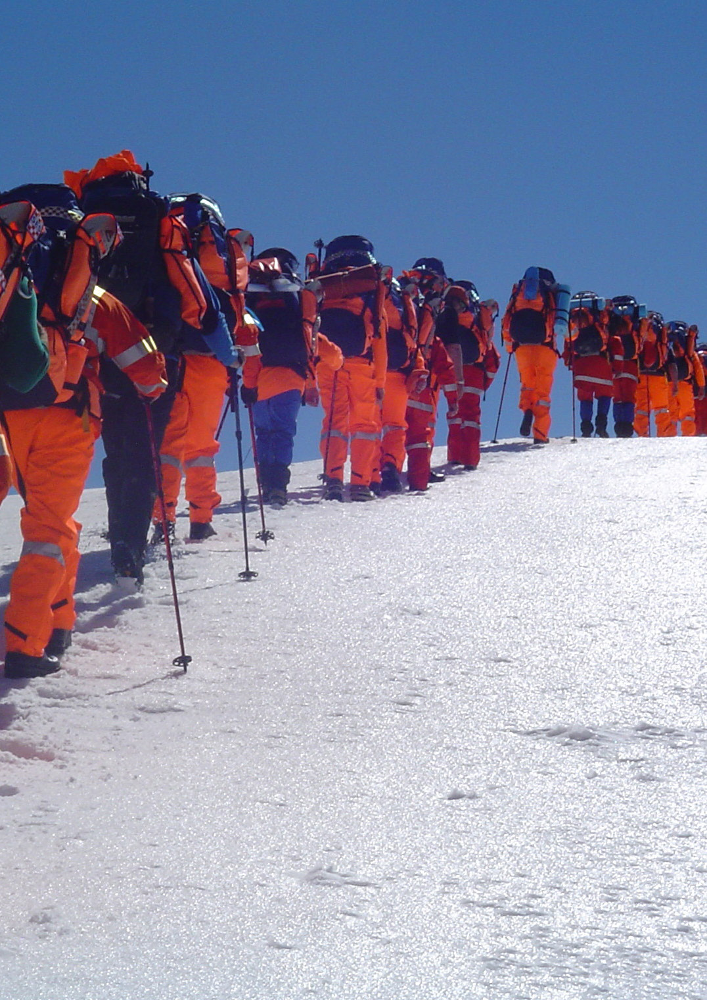
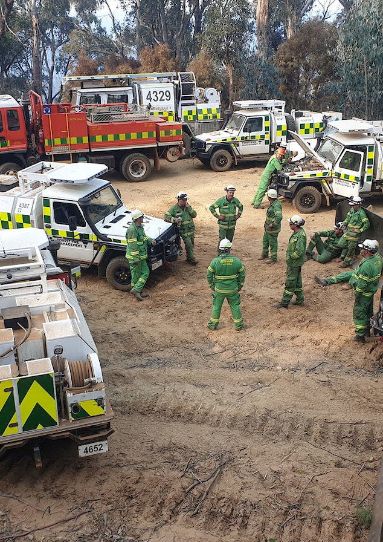
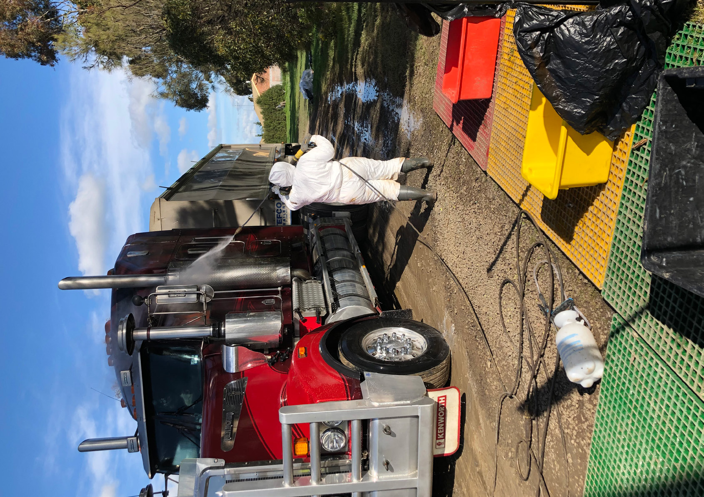
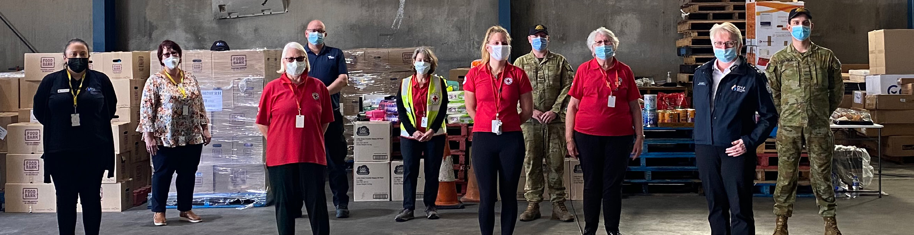
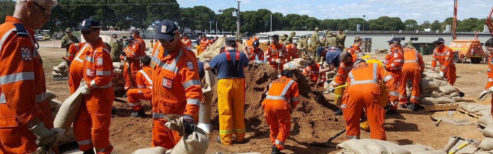

# Victorian Preparedness Framework (December 2024 update)

> **Source**: Emergency Management Victoria
> **URL**: https://files.emv.vic.gov.au/2024-12/Victorian%20Preparedness%20Framework_updated.pdf
> **Licence**: © State of Victoria; emergency-management practitioner reference
> **Retrieved**: 2026-05-07T23:44:03Z
> **SHA-256**: `954b4bbbaaa64bdf44d359326ee214d521a8c75fb07342508cd5f38814050ad9`
> *Converted from PDF to Markdown format.*

---
## Page 1

Victorian 
Preparedness 
Framework
Emergency Management
2022 Update

---
## Page 2

Emergency Management Victoria acknowledges 
Aboriginal and Torres Strait Islander people as 
the Traditional Custodians of the land. Emergency 
Management Victoria also acknowledges and 
pays respect to the Elders, past and present and is 
committed to working with Aboriginal and Torres 
Strait Islander communities to achieve a shared 
vision of safer and more resilient communities.
Acknowledgements 
Version 1 of this document was developed by 
the emergency management sector in Victoria 
in collaboration with the Federal Emergency 
Management Agency (FEMA) in the United 
States.
Emergency Management Victoria 
acknowledges the lessons learnt by FEMA in 
developing this document.
Authorised and published by 
Emergency Management Victoria, 
121 Exhibition Street, Melbourne, 3000
© State of Victoria 2022 
 
Published October 2022 
 
ISBN 978-1-922262-89-9 (PDF / online /  
MS word)
Copyright information 
You are free to re-use this work under a 
Creative Commons Attribution 4.0 Licence 
provided you credit the State of Victoria 
(Emergency Management Victoria) as author, 
indicate if changes were made and comply 
with the other licence terms. The licence does 
not apply to any images, photographs or 
branding, including Government logos.
Accessibility information 
If you would like to receive this publication 
in an accessible format, please email 
media@emv.vic.gov.au
This document is also available in word and 
PDF format at www.emv.vic.gov.au

---
## Page 3

Table of Contents
Introduction. .  .  .  .  .  .  .  .  .  .  .  .  .  .  .  .  .  .  .  .  .  .  .  .  .  .  .  .  .  .  .  .  .  . . . . . . . . . . . . . . . . . . . . . . . . . . . . . . . . . . . . 6
Victorian Preparedness Goal. .  .  .  .  .  .  .  .  .  .  .  .  .  .  .  .  .  .  .  .  .  .  .  .  .  .  . . . . . . . . . . . . . . . . . . . . . . . . . . 8
We all have a role to play in emergency management preparedness. .  .  .  .  .  . . . . . . 10
Consequence management . .  .  .  .  .  .  .  .  .  .  .  .  .  .  .  .  .  .  .  .  .  .  .  .  .  . . . . . . . . . . . . . . . . . . . . . . . . . . . . 11
Using risk to determine scenarios for assessing capability and capacity. .  .  .  .  . . . . 12
Introducing Victoria’s 21 core capabilities . .  .  .  .  .  .  .  .  .  .  .  .  .  .  .  .  .  .  .  . . . . . . . . . . . . . . . . . . . 16
Core capabilities and their critical tasks. .  .  .  .  .  .  .  .  .  .  .  .  .  .  .  .  .  .  .  . . . . . . . . . . . . . . . . . . . . . 20
Five core capability elements. .  .  .  .  .  .  .  .  .  .  .  .  .  .  .  .  .  .  .  .  .  .  .  .  .  . . . . . . . . . . . . . . . . . . . . . . . . . . 41
Better prepared, together: How the Framework is beneficial to our work. .  .  . . . . . 42
Appendix A: Assessing our capability and capacity. .  .  .  .  .  .  .  .  .  .  .  .  .  . . . . . . . . . . . . . . . . 46
Appendix B: Process for determining capability targets. .  .  .  .  .  .  .  .  .  .  .  . . . . . . . . . . . . . 48
Appendix C: Summary of plausible scenarios developed. .  .  .  .  .  .  .  .  .  .  .  . . . . . . . . . . . . . 52

---
## Page 4

Victoria faces various challenges 
and emerging threats from both 
natural and non‑environmental 
risks. As the risk profile of 
Victoria shifts, driven by 
climate change, demographic 
changes and transitions, 
increased population density in 
high‑risk areas and advances 
in technology, the likelihood and 
impact of emergencies grows. 
This subsequently increases 
the demand on the capability 
and capacity of the emergency 
management sector and 
Victorian communities.
The development of Victoria’s 
preparedness model started in 2015 and 
is based on the United States’ National 
Preparedness Goal. Victoria’s model 
includes:
1. Victorian Emergency Management 
Capability Blueprint 
 
The Victorian Emergency Management 
Capability Blueprint outlines the State 
Capability Principles and desired 
future state for Victoria’s emergency 
management capability. The overall 
aim of the Blueprint is to have effective 
emergency management capability 
across Victoria that can meet future 
needs.
2. Victorian Preparedness Framework 
(this document; the Framework) 
 
This Framework is developed to enable 
Victoria to achieve the desired future 
state for capability outlined in the 
Blueprint. The Framework was first 
released in 2016 and updated in 2018. In 
2022, Emergency Management Victoria 
worked with emergency management 
agencies to strengthen and validate the 
Framework. The Framework now also 
incorporates the Victorian Preparedness 
Goal that was previously published 
separately:
"A safer and more resilient community 
that has the capabilities to withstand, 
plan for, respond to and recover from 
emergencies that pose the greatest 
risk" (Page 8).
The Framework is established to be a 
planning tool that can be used in a variety 
of ways. It sets out a common language 
and processes that planners at the State, 
regional, municipal, community, agency or 
group levels are encouraged to integrate 
into their emergency management 
planning. The Framework also provides 
a level of confidence and visibility of 
preparedness to identify what ownership 
is required at each level of emergency 
management preparedness. 
We all have a role to play in 
emergency management. The 
Framework encapsulates an ‘all 
communities, all emergencies’ 
approach which emphasises that 
emergency management is a shared 
responsibility across all of Victoria’s 
diverse communities, Victoria’s First 
Peoples, community groups, networks, 
businesses, individuals, households, 
visitors to Victoria, government and 
non-government organisations, and the 
emergency management sector.
The Framework sets out 21 core 
capabilities and their critical tasks as 
a foundation of how we can mitigate, 
plan, prepare, respond to and recover 
from emergencies. The core capabilities 
embedded in the Framework are what 
Victoria and the emergency management 
sector requires to meet the challenges 
and risks Victoria faces. By understanding 
what core capabilities Victoria needs, we 
can work to identify and maintain our 
capability strengths and where there are 
opportunities to improve our capabilities. 
The capacity of each of these core 
capabilities is determined by the extent 
to which the five core elements (people, 
resources, governance, systems and 
processes) can be sustained during 
the mitigation, planning, preparedness, 
response and recovery phases of 
emergency management.
To test Victoria’s preparedness for 
emergencies (i.e. our capability and 
capacity), risk assessment results 
are used to inform which emergency 
scenarios have been developed. These 
scenarios can be used to determine 
anticipated emergency impacts and the 
desired outcomes, known as capability 
targets.
In a commitment to continuous 
improvement, the Framework to be 
reviewed at regular intervals and adapted 
in line with changing emergency risks, 
government policies and sector reforms.
Figure 1: Capability and capacity 
definitions
Appendices A and B outline the processes 
to assess capability and capacity in line 
with this framework. These processes can 
be used for assessments of capability 
and capacity at State, regional, municipal 
and community level, and even within 
agencies.
EMV is available to provide guidance on 
how to use these processes in any context 
(emergencyplanning@emv.vic.gov.au).
Introduction
Capability
Our collective ability to 
reduce the likelihood 
and consequences of an 
emergency before, during 
and after.
Capacity
The extent to which 
the five core capability 
elements (people, 
resources, governance, 
systems and processes) 
can be sustained, before, 
during and after an 
emergency.
6
7
Victorian Preparedness Framework

---
## Page 5

Victorian 
Preparedness 
Goal
The Victorian Preparedness Goal 
is – “A safer and more resilient 
community that has the 
capabilities to withstand, plan 
for, respond to and recover 
from emergencies that pose the 
greatest risk.”
This Goal is the foundation of the 
Framework, and it seeks to represent all 
Victorian communities, Victoria’s First 
Peoples, community groups, networks, 
businesses, individuals, households, 
visitors to Victoria, government, and non-
government organisations, along with the 
emergency management sector.
The emphasis on resilient communities 
aligns with the concept of preparedness 
as a shared responsibility, where effective 
mitigation, planning, preparedness, 
response and recovery activities are 
dependent on all of Victorians working 
together in emergencies. 
Figure 2 shows how the Goal is the 
foundation of the Victorian Preparedness 
Framework’s process for assessing 
capability and capacity (further 
expanded in Appendix A).
	
	
   
   
A
ll 
C
o
m
m
u
ni
ti
e
s,
 A
ll
 E
m
er
g
e
n
ci
es
	
	
	
	
	
   
P
e
o
pl
e,
 R
e
s
o
ur
ce
s,
 G
ov
er
n
a
n
ce
, 
S
y
st
e
m
s,
 a
n
d 
P
ro
c
es
se
s
A safer and more  
resilient community that 
has the capabilities to 
withstand, plan for, respond 
to and recover from 
emergencies that pose  
the greatest risk.
Leverage 
capability via 
available means
Use risk to determine 
scenarios for assessing 
capability and capacity
Evaluate 
required 
capability 
elements 
of core 
capabilities
Identify 
sources of 
additional 
capability 
and capacity
Identify capability 
gaps
Estimate current 
capability
Figure 2: Emergency management capability model
8
9
Victorian Preparedness Framework

---
## Page 6

Shared responsibility 
The State Emergency Management 
Plan (SEMP) recognises that emergency 
management is the shared responsibility 
of all Victorians, not just the emergency 
management sector. A commitment to 
shared responsibility recognises that 
no single actor can be responsible for 
mitigation, planning, preparedness, 
response and recovery. All members 
of Victoria, First Peoples, community 
groups, networks, businesses, individuals, 
households, visitors to Victoria, 
government and non-government 
organisations, along with the emergency 
management sector have a role to play. 
Preparing for emergencies requires a 
collaborative approach that integrates 
the abilities and skills from across our 
State. This shared responsibility is 
reflected in the emergency sectors shared 
goal “We Work as One”.
Resilient communities 
Shared responsibility paves the way 
for more resilient communities that are 
engaged, informed and involved in all 
phases of emergency management, 
because “every community, every history, 
every landscape and every emergency is 
different.”1
Resilient communities and individuals 
recover more quickly and are better 
placed to respond to and recover from 
subsequent emergencies. Through 
sharing responsibility for our collective 
vulnerabilities, we can minimise the 
impacts of emergencies and build safer 
communities.
Communities will have different levels 
of resilience, which is dependent on 
available resources, access to services, 
previous experience in emergencies 
and the extent to which the community 
has ownership over their level of 
preparedness. It is important that 
communities are engaged in emergency 
management planning, and in particular 
having community representative / s on 
each Municipal Emergency Management 
Planning Committee2.
We all have a role to play in 
emergency management 
preparedness
1	
Community member, Engage Victoria survey, Victorian Preparedness 	
	
Goal and Victoria Preparedness Framework Review, 2022
2	
Emergency Management Act 2013, s 59A(1)(b)(i) 
In order to effectively manage the impact 
and consequences of emergencies on 
communities, it is critical that Victoria’s 
mitigation, planning, preparedness, 
response and recovery from emergencies 
is integrated, comprehensive and 
coordinated across all levels of 
government, agencies and businesses, in 
conjunction with communities.
“Emergencies are now so big and so 
damaging that we need to work together 
(community and government) to 
realistically plan for such major events 
that are increasing in frequency across 
our State.”3
Consequence management is important 
when considering preparedness because, 
despite how resilient a community is, or 
how well prepared it is for emergencies, 
events will occur that exceed a 
community’s levels of resilience and 
preparedness. 
Victoria manages consequences through 
considering the wider ramifications of an 
emergency, and through the coordination 
of agencies and government departments 
to identify and implement appropriate 
mitigation actions, with the intent of:
•	
minimising adverse consequences 
from major emergencies to the 
community
•	
preventing the impact of an incident 
escalating
•	
focusing on potential wider impacts 
of events
•	
providing a mechanism to inform 
decision making.
Consequence management is organised 
around nine principles. Consequence 
management:
1.	
is everyone’s responsibility (a shared 
responsibility)
2.	
establishes and sustains value
3.	
uses existing structures and systems
4.	
engages with key agencies, 
departments and communities
5.	
uses the best available data and 
intelligence
6.	
is predominantly a coordination 
function
7.	
is a vital component of planning
8.	
informs decision making
9.	
is dynamic, iterative, and responsive 
to change.
Through the Victorian Preparedness 
Framework, consequence management 
can be applied across all agency 
activities that align with the 21 core 
capabilities. 
Consequence management
3	
Community member, Engage Victoria 	
	
	
survey, Victorian Preparedness Goal and 	
	
Victoria Preparedness Framework Review, 	
	
2022
10
11
Victorian Preparedness Framework

---
## Page 7

Using risk to determine 
scenarios for assessing 
capability and capacity
Emergency Risks in Victoria Report (2020) 
Understanding the types, likelihood, and consequences of 
emergency risks that Victoria faces is crucial to determining 
Victoria’s preparedness, including the identification of core 
capability requirements for the sector and community.
The Emergency Risks in Victoria report (2020) focused 
on a series of state significant risks and assessed them 
against the criteria of catastrophic consequences 
and major consequences. The state significant risks of 
bushfires, heatwaves and plant pest were the top risks 
when it came to the highest impact and likelihood for a 
worst-case scenario. Catastrophic or major consequences 
from earthquake or pandemic influenza were considered 
comparatively rare, whilst major consequences from flood 
and storm were determined to be more likely to occur. The 
report also considered that a scenario for water supply 
disruption, where consequences greater than high impact 
was not deemed plausible.
Catastrophic consequences criteria:  
•	
Deaths and / or critical injuries directly from the 
emergency are greater than 600 people
•	
Decline of economic activity loss of asset value greater 
than $15 billion
•	
Permanent destruction of an ecosystem or species 
recognised at the national level
•	
The affected community ceases to function effectively, 
breaks down and entirely disperses
•	
Governing bodies are unable to deliver their core 
functions.
Major consequences criteria: 
•	
Deaths and / or critical injuries directly from the 
emergency greater than 60 people
•	
Decline of economic activity loss of asset value greater 
than $1.5 billion
•	
Permanent destruction of an ecosystem or specifics 
species recognised at the state level
•	
The community of interest’s social connectedness is 
significantly broken with significant permanent dispersal
•	
Governing bodies encounter severe reduction in the 
delivery of core functions.
12
13
Victorian Preparedness Framework

---
## Page 8

Scenario development 
Scenarios can be used 
to determine Victoria’s 
preparedness and assess the 
State’s capability and capacity.
This Framework identifies eight 
significant risks that Victoria 
faces. As per the Emergency 
Risks in Victoria report (released 
in 2020). The scenarios listed 
in Table 2 were developed with 
consideration to the outcomes 
of an earlier version of the 
Emergency Risks in Victoria risk 
assessment4. This information 
helped subject matter experts 
to prioritise and decide which 
scenarios to develop. 
The scenarios are intended 
to be evidence-based, high 
impact, most plausible scenarios, 
which allow the extrapolation 
of aspirational requirements 
(capability targets) of emergency 
management preparedness and 
activities. The scenarios are not 
an extreme worst case.
Table 2: Scenarios that have been developed
	 Bushfire / Heatwave
	 Earthquake / Transport Infrastructure
	 Pandemic Influenza
	 Flood / Storm
	 Electricity Supply Disruption
	 Plant Disease
	 Hazmat Emergency
	 Animal Disease
A summary of each scenario is provided in 
Appendix C5.
4	
Future development of new scenarios by the sector and the community should use the 	
	
most up-to-date risk assessment to inform which scenarios to develop, especially for 	
	
risks where a scenario is not currently prepared.
5	
The scenarios developed are not publicly available due to their sensitive information 	
	
and may be made available to emergency management sector stakeholders on request, 	
	
if appropriate, through contacting Emergency Management Victoria.
Understanding our preparedness is based 
on high impact, plausible emergency 
scenarios and not the extreme worst 
case. Circumstances, or a combination of 
circumstances, may arise for which it is 
not reasonably possible to be prepared. 
This understanding was reinforced in the 
final report of the Queensland Floods 
Commission of Inquiry that stated:
‘A great deal can be done to improve 
readiness to deal with disasters generally, 
but it is impossible that any government 
could be permanently ready to come 
at once to the assistance of everyone 
needing help in a disaster of that 
scale and suddenness, unless it were 
to maintain a standing force of rescue 
personnel beyond the present capacity of 
society to fund’.6
As a result, it is not reasonably 
possible to be at the highest level of 
preparedness at all times. ‘Finding the 
right balance in maintaining a level 
of readiness to respond to bushfire in 
Victoria is a complex calculation. The 
required resources in terms of personnel, 
vehicles, equipment and aircraft need 
to be scalable according to seasonal 
requirements and cannot readily be 
switched on and off if conditions alter 
rapidly.’7
Once Victoria considers itself prepared 
for these scenarios, it may choose to 
consider low probability scenarios that 
some may consider to be implausible. 
Victoria’s recent experience in 
emergencies shows that even these 
events could eventuate. Other possibilities 
include exploring complex, protracted 
and concurrent emergencies.
6	
Commissioner C.E Holmes, Queensland Floods Commission of Inquiry, 2012, p 30.
7	
Inspector General for Emergency Management, Inquiry into the 2019-20 Victorian Fire 	
	
Season – Phase 1 Community and Sector Preparedness for and Response to the 2019-20 	
	
Fire Season, 2020, p 15. 
14
15
Victorian Preparedness Framework

---
## Page 9

Introducing Victoria’s 
21 core capabilities
The Victorian Preparedness Framework’s 
core capabilities and their critical tasks 
set the foundation for how we mitigate, 
plan, prepare, respond to and recover from 
emergencies.
The delivery of the Framework’s 
capabilities align with the State Emergency 
Management Priorities (outlined in the 
State Emergency Management Plan), which 
provides clear direction on the factors that 
are required to be considered and actioned 
throughout all phases of an emergency. 
The 21 core capabilities are each expressed 
as a statement with associated critical 
tasks.
Core capability 
Core capabilities outline what Victoria needs to manage emergencies, 
coordinate and unify efforts, improve training and ensure capabilities 
are effectively applied to all stages of a major emergency.8
Each core capability is expressed as a statement that details the 
requisite abilities in a specific area to reduce the likelihood and 
consequences of an emergency.
Figure 2
•	
A core capability’s critical tasks are detailed in the following 
section, in tables like this.
•	
Critical tasks are the fundamental activities of the core 
capability. These are the tasks that need to be undertaken and 
delivered to fulfil the intent of the core capability.
•	
Critical tasks are tangible, definable activities and are agency 
agnostic.
8	
“Major emergency” means: 
	
	
(a)	
a large or complex emergency (however caused) which 
	
	
	
(i)	
has the potential to cause or is causing loss of life and extensive 	
	
	
	
	
damage to property, infrastructure or the environment; or 
	
	
	
(ii)	
has the potential for adverse consequences for all parts of the 	
	
	
	
	
Victorian community; or 
	
	
	
(iii)	
requires a multi-agency response; or 
	
	
(b)	
a Class 1 emergency; or 
	
	
(c)	
a Class 2 emergency.
16
17
Victorian Preparedness Framework

---
## Page 10

Figure 3 aligns with the State Emergency Management Plan and provides a snapshot  
of the 21 core capabilities required to deliver emergency management. 
To be effective, the core capabilities are interdependent, coordinated and overlap  
across mitigation (including planning and preparedness), response (including relief)  
and recovery.
Capabilities
Mitigation
Response 
(including 
relief)
Recovery
1. Planning

–
–
2. Community Information and Warnings



3. Operational Management



4. Intelligence and Information Sharing



5. Public Order and Community Safety


–
6. Building Community Resilience



7. Fire Management and Suppression


–
8. Fatality Management
–

–
9. Critical Transport
–


10. Logistics and Supply Chain Management
–


11. Impact Assessment
–


12. Search and Rescue
–


13. Health Protection
–


14. Health Emergency Response
–


15. Relief Assistance
–


16. Environmental Response
–


17. Economic Recovery
–
–

18. Natural and Cultural Heritage 
Rehabilitation
–
–

19. Built Recovery
–
–

20. Social Recovery
–
–

21. Assurance and Learning

–
–
Figure 3: Victoria’s 21 emergency management core capabilities
18
19
Victorian Preparedness Framework

---
## Page 11

This section provides a description of each core capability 
and details their critical tasks.
Core capabilities and their 
critical tasks
1.	
Planning
Description
Conduct a systematic process engaging the whole community as appropriate in the 
development of executable strategic, operational, and / or tactical level approaches 
to meet defined objectives.
Critical tasks
1.1
Share information with relevant stakeholders to assist effective emergency 
management planning
For example: planning principles, priorities and governance arrangements for the relevant 
level of planning, including an understanding of the planning footprint’s emergency risk profile, 
resilience, and the likely emergencies that may impact their communities.
1.2
Community and agency stakeholders participate in emergency management 
planning, preparation, and review of relevant emergency management plans
1.3
Identify, analyse and evaluate the likelihood and consequences of emergency 
events holistically, and document within relevant emergency risk assessments 
and relevant emergency management plans
1.4
Community and agency stakeholders are engaged to explore, determine and 
implement mitigating actions to reduce or manage the likelihood and / or 
consequences of emergency events
1.5
Communicate information to communities and agency stakeholders on the 
residual likelihood and consequences of an emergency after planning and 
mitigation is undertaken
1.6
Exercise, review and updated emergency management plans regularly with 
agencies and community stakeholders using scenarios related to the relevant 
emergency risk profile
2.	
Community Information and Warnings
Description
Deliver public information and warnings that are authoritative, consistently 
constructed and relevant for all Victorians and visitors in all emergencies.
Provide timely and tailored information that supports the community to make 
informed decisions before, during and after emergencies.
Critical tasks
2.1
Provide information to people and communities on the risks, risk mitigation 
actions, and incident / events that may affect them
2.2
Deliver a whole-of-Victorian-Government preparedness and awareness 
campaign
2.3
Deliver timely, coordinated, accessible, tailored and relevant information and 
warnings to communities
2.4
Undertake evaluations and research to understand community information 
needs and effectiveness of warnings
2.5
Plan for and deliver collaborative and proactive messaging to promote 
recovery in impacted communities
20
21
Victorian Preparedness Framework

---
## Page 12

3.	
Operational Management
Description
Establish and maintain a unified and coordinated operational structure and process 
that appropriately integrates all critical stakeholders and supports the execution of 
core capabilities, including operational communications.9
Critical tasks
3.1
Establish command and control to effectively deliver emergency management
3.2
Activate established coordination networks to support operational response
3.3
Identify and maintain facilities for emergency management activities
3.4
Identify, maintain and protect operational communications networks used by 
emergency services
3.5
Develop communication networks connecting communities and emergency 
managers
9	
Operational Communications are the communications within and between emergency 	
	
	
management agencies, when responding to emergency incidents, performing business 	
	
	
as usual activities in the field or responding to multi-agency, large scale emergency events.
4.	
Intelligence and Information Sharing
Description
To provide timely, accurate, tailored and actionable intelligence to inform decision 
making and planning, by collecting, processing, and analysis of multiple data sources, 
to assist with anticipating and forecasting hazards and risks across all phases of 
an emergency. It also includes the assessment of risks and hazards so that decision 
makers, responders, and community members can take informed action to reduce 
their entity’s risk and increase their resilience. 
Critical tasks
4.1
Collaboratively identify and plan for intelligence requirements
4.2
Develop and implement effective governance, processes, and networks to 
improve intelligence capacity and doctrine
4.3
Develop, establish and monitor surveillance systems, integrated information 
sharing systems, tools and networks of trained personnel to deliver intelligence 
requirements
4.4
Collect, collate, process, analyse and where appropriate share data and 
information for current and emerging risks and hazards across all phases of 
an emergency 
4.5
Tailor and disseminate relevant intelligence to stakeholders
4.6
Provide relevant and actionable intelligence and predictive assessment
4.7
Systematically review and adjust intelligence processes based on feedback 
and evaluation
22
23
Victorian Preparedness Framework

---
## Page 13

5.	
Public Order and Community Safety
Description
Provide a safe, secure and orderly society through the active prosecution of 
regulations and laws related to the prevention of serious emergencies and to afford 
a safe environment for those communities affected by an emergency and any 
responding personnel engaged in emergency operations.
Critical tasks
5.1
Secure the affected area
5.2
Evacuation of affected persons (no mandatory evacuation order in Victoria)
5.3
Establishment of traffic management points and the maintenance of supply 
lines
5.4
Maintain security and meet the protection needs of affected communities and 
responders
6.	
Building Community Resilience
Description
Building community safety and resilience includes working together at the local level. 
Communities can strengthen their lifelines by better connecting and working together 
with appropriate support from organisations.
Build on combined community and organisational strengths across all phases of an 
emergency through the below critical tasks.
Critical tasks
6.1
Connecting with people and by supporting them to use their networks to 
communicate effectively
6.2
Using local knowledge to better understand and identify local needs
6.3
Working through likely scenarios to manage underlying stresses and cope with 
shocks that may continue to impact the community
6.4
Working together to identify local context and develop local solutions
6.5
Sharing information and learning from experiences to make better decisions 
in the future
6.6
Encourage self-reliance by enabling communities to cope for up to 72 hours 
without significant external assistance
24
25
Victorian Preparedness Framework

---
## Page 14

7.	
Fire Management and Suppression
Description
Provide firefighting capabilities to manage and suppress fires while protecting lives, 
property, and the environment in the affected (land and water) area.10
Critical tasks
7.1
Reduce incidence and consequence of fire
7.2
Suppress, contain and extinguish major fires
7.3
Co-ordinate deployment of local, state, national and international people and 
resources
8.	
Fatality Management
Description
Provide fatality management services, including search, recovery, victim identification 
(following Interpol Standards), and repatriation. As well as the sharing of accurate 
and timely information with other agencies and the community, and the provision of 
support to the bereaved.
Critical tasks
8.1
Oversee all coronial investigations of fatalities
8.2
Establish and maintain operations to recover a significant number of fatalities 
over a geographically dispersed area
8.3
Provide investigative and operational support services for victim identification
8.4
Establish and maintain temporary mortuaries ensuring they have adequate 
storage for the predicted number of fatalities
8.5
Provide staffing and equipment to adequately examine and document all 
fatalities to enable accurate identification and support coronial / police 
investigations
8.6
Manage family communication regarding coronial process and repatriation
8.7
Communicate accurate and timely information to emergency services and 
communities about the safe handling of fatalities
10	
Based on US Federal Emergency Management Agency learnings we have included Fire 
Management and Suppression as the only hazard specific capability.
26
27
Victorian Preparedness Framework

---
## Page 15

9.	
Critical Transport
Description
Plan for and provide response and recovery services during emergencies that affect 
the road network including alternative routes, emergency permits and escorts for 
responders, clearing and restoration of damaged roads.
Provide response to major public transportation emergencies including infrastructure 
access and accessible transportation services to ensure community movement 
including coordination of all private rail, tram and bus services to support priority 
response objectives.
Critical tasks
9.1
Secure disaster area
9.2
Establish physical access for responders
9.3
Identify and enact alternate / detour routes
9.4
Coordinate alternate public transport provision
9.5
Clear debris from critical routes
9.6
Undertake engineering / safety assessments
9.7
Undertake temporary remediation works
10.	
Logistics and Supply Chain Management
Description
Deliver essential commodities, equipment, and services in support of impacted 
communities and survivors, to include emergency power and fuel support, as well as 
the coordination of access to community staples.
Synchronise logistics capabilities and enable the restoration of impacted supply 
chains, including removal of debris.
Critical tasks
10.1
Identification of essential supplies and equipment to support agency 
emergency management activities
10.2
Identification of essential supplies and equipment to aid affected communities
10.3
Manage, coordinate the end-to-end procurement and distribution of essential 
supplies and equipment, and services
10.4
Manage and coordinate the demobilisation and reconciliation of essential 
supplies, equipment and facilities
28
29
Victorian Preparedness Framework

---
## Page 16

11.	
Impact Assessment
Description
Provide all decision makers with relevant information regarding the nature and extent 
of the hazard, and any potential consequences during and after an emergency to 
ensure efficient, timely and appropriate support for communities.
Critical tasks
11.1
Gather information regarding extent of damage, immediate threats, loss of life 
and persons displaced
11.2
Collect progressive assessment data of the scale and characteristics of the 
impact across the social, economic, built and natural environments
11.3
Provide consistent and meaningful impact assessment data through a  
co-ordinated process to decision makers
13.	
Health Protection
Description
Promotes and protects the public health of Victorians by monitoring notifiable 
diseases and responding to any disease outbreaks in order to control and minimise 
the risk of infection. This includes regulating the safety of food, drinking water and 
human environmental health hazards such as radiation, legionella and pesticides. 
Includes informing the community and health providers about public health risks and 
promoting behaviours and strategies to mitigate and avoid risk. It also includes the 
development of national policies, standards and strategies to promote improvements 
in public health generally and supports the health system to respond to national 
public health risks.
Critical tasks
13.1
Maintain an ongoing state of preparedness to respond to a public health 
emergency
13.2
Identify and characterise risks and commence enhanced arrangements
13.3
Prepare and support public and private health entities to manage and control 
public health risks
13.4
Effectively communicate public health and clinical health management 
guidance to the health sector
13.5
Effectively communicate the health risks, through public health promotion and 
prevention campaigns
12.	
Search and Rescue
Description
Deliver traditional and atypical search and rescue capabilities, including people and 
resources with the goal of saving the greatest number of endangered lives in the 
shortest time possible.
Critical tasks
12.1
Conduct search operations to locate persons
12.2
Coordinate spontaneous volunteers
12.3
Conduct rescue of trapped or isolated persons
12.4
Coordinate the deployment of interstate, national and international people 
and resources
30
31
Victorian Preparedness Framework

---
## Page 17

14.
Health Emergency Response
Description
The planning, provisioning, response and coordination of pre-hospital and health 
emergency care, including triage, treatment and distribution of patients, in a timely 
and structured manner, using all available resources to maximise positive health 
outcomes.
Critical tasks
14.1
Identify existing and developing health risks
14.2
Assess patients
14.3
Establish primary patient treatment points
14.4
Deploy specialised resources as required
14.5
Undertake and coordinate patient transport
14.6
Work with hospitals to identify strategies and resources that may be 
implemented in response to a surge in demand
14.7
Provide treatment and ongoing medical care
14.8
Coordinate across the health sector to provide advanced clinical care, 
speciality services, and investigations required for patient treatment and care
15.
Relief Assistance
Description
The provision of well-coordinated, integrated and timely assistance to meet the 
immediate health, wellbeing, financial and essential needs of affected communities, 
during and immediately after an emergency event.
Critical tasks
15.1
Establish temporary shelter options for displaced persons
15.2
Coordinate and manage services to meet the physical needs of affected 
populations
15.3
Coordinate and manage services to meet the psychosocial needs of affected 
populations
15.4
Assess and provide financial hardship assistance payments
15.5
Monitor emerging needs and adapt services to minimise the long term 
consequences on health and wellbeing
15.6
Facilitate the reunification of family and friends separated during an 
emergency
15.7
Coordinate and manage services to meet the immediate needs of affected 
livestock
32
33
Victorian Preparedness Framework

---
## Page 18

16.
Environmental Response
Description
To assess and manage the consequences to the community, environmental values, 
domestic animals and livestock of a hazardous materials release, naturally occurring 
pests or biological hazard.
Critical tasks
16.1
Conduct risk / epidemiological assessments and identify consequence 
management strategies
16.2
Conduct monitoring and surveillance activities
16.3
Coordinate the delivery of diagnostic services
16.4
Restrict the movement of spread vectors or hosts using legislative instruments 
(includes ‘standstill’)
16.5
Restrict the movement of hazardous materials or organisms using physical 
containment methods
16.6
Destroy the organism and / or susceptible hosts
16.7
Render (disperse / dilute / neutralise) the hazardous material safe
16.8
Dispose of contaminated waste
16.9
Decontaminate affected people, places and equipment
17.
Economic Recovery
Description
Support the recovery and resilience of economic and business activities (including 
food and agriculture) to provide the community with jobs, goods and services, and 
higher living standards.
Critical tasks
17.1
Assess and identify business and economic needs
17.2
Assist impacted businesses to access information and advice
17.3
Coordinate insurance industry information and advice
17.4
Provide technical advice on re-establishment or alternative strategies
17.5
Deliver targeted intervention strategies if required
34
35
Victorian Preparedness Framework

---
## Page 19

18.
Natural and Cultural Heritage Rehabilitation
Description
Protect natural values and cultural heritage values through appropriate planning, 
mitigation, response, and recovery actions to preserve, conserve, rehabilitate, and 
restore them consistent with post-disaster community priorities and best practices. 
This process is to be undertaken in compliance with applicable environmental and 
heritage preservation laws, along with consultation with all affected communities, 
including Victoria’s First Peoples and Traditional Owner groups.
Critical tasks
18.1
Identify natural heritage values and cultural heritage values at risk in affected 
areas, in consultation with all affected communities, including Victoria’s First 
Peoples and Traditional Owner groups
18.2
Undertake assessment of risk posed to natural and cultural heritage values, in 
consultation with all affected communities, including Victoria’s First Peoples 
and Traditional Owner groups
18.3
Coordinate and undertake stabilisation works on private and public land to 
remediate response actions
18.4
Coordinate and undertake natural values rehabilitation works, in consultation 
with all affected communities, including Victoria’s First Peoples and Traditional 
Owner groups
18.5
Coordinate and undertake cultural heritage values rehabilitation works, in 
consultation with all affected communities, including Victoria’s First Peoples 
and Traditional Owner groups
18.6
Establish recovery monitoring of natural and cultural heritage values, in 
consultation with all affected communities, including Victoria’s First Peoples 
and Traditional Owner groups
18.7
Transition recovery services and programs to previous management 
arrangements
19.
Built Recovery
Description
To restore critical and community infrastructure and establish safe areas during and 
following an emergency, ensuring the provision of facilities and services to support 
and benefit communities.11
Critical tasks
19.1
Undertake technical assessments for critical infrastructure
19.2
Undertake technical assessments for community infrastructure
19.3
Undertake stabilisation and remediation works
19.4
Assess and prioritise restoration needs of the affected community
19.5
Restore community infrastructure to be sustainable and more resilient to 
future events
19.6
Ensure continuity of critical infrastructure during restoration works
19.7
Undertake and facilitate the restoration of critical infrastructure
19.8
Work with communities to transition recovery services and programs to 
mainstream community delivery / services.
11
Note: Residential properties are the responsibility of the owner, however individuals and 	
		
communities are supported regarding residential property loss through personal and social support.
36
37
Victorian Preparedness Framework

---
## Page 20

20.	
Social Recovery
Description
The longer-term provision of assistance and access to services that allows individuals, 
families and communities to achieve an effective level of functioning after an 
emergency event. This includes safety, security, shelter, health and psychosocial 
wellbeing and re-establishment of those elements of society necessary for well-being.
Critical tasks
20.1
Assess and provide for medium to long term psychosocial needs
20.2
Provide housing / accommodation options
20.3
Assess and provide financial re-establishment assistance
20.4
Coordinate and adapt health programs to ensure continuity and availability of 
advice / activities
20.5
Assess community service needs, including socio-economic disadvantage
20.6
Work with communities to transition recovery services and programs to 
mainstream community delivery / services
20.7
Provide bereavement support for communities
21.	
Assurance and Learning
Description
Support continuous improvement to improve emergency management practice 
and community safety by extracting understanding from experience and research, 
reviewing community consequences, investigating causes and outcomes, providing 
assurance and translating lessons into behaviour change.
Critical tasks
21.1
Undertake assurance activities before, during and after major emergency 
events
21.2
Analyse insights and identify lessons from assurance activities
21.3
Assess identified lessons for change / improvement activities
21.4
Monitor and measure improvement activities and outcomes
21.5
Provide opportunities for all personnel to access and utilise identified lessons
38
39
Victorian Preparedness Framework

---
## Page 21

Five core capability elements
There are five core capability elements that are required to deliver 
each of the 21 core capabilities and their critical tasks. These 
capability elements are the lens through which each critical task can 
be examined.
Table 3: Five core capability elements
Core capability 
element
Description
Application and examples
People
All personnel involved in 
undertaking emergency 
management activities from 
all parts of the community, 
government, agencies and 
businesses. 
Includes people with appropriate 
knowledge and skills with a focus 
on leadership skills, technical 
skills and a culture of working as 
one.
Resources
The physical equipment and 
assets needed to undertake 
emergency management 
activities. 
For example, infrastructure, 
fleet, IT equipment, radios, 
communications equipment, 
consumables and personal 
protective clothing and 
equipment.
Governance
The enabling factors that 
emergency management 
operates within.
Including legislation, funding, 
authorising environment, 
emergency management 
arrangements, doctrine and 
policy.
Systems
The systems, including data, 
that are used to deliver 
emergency management 
outcomes.
For example, learning and 
development, information 
technology, financial, 
infrastructure and assets 
management, workforce 
management, workplace health 
and safety, quality control and the 
Australasian Inter-service Incident 
Management System (AIIMS).
Processes
Documented or 
undocumented ways of 
delivering emergency 
management.
For example, capacity planning, 
risk management, continuous 
improvement, information flow 
and planning.
40
41
Victorian Preparedness Framework

---
## Page 22

Better prepared, together: 
How the Framework is 
beneficial to our work
The language of capability and capacity that is used within the 
Victorian Preparedness Framework is intended to be a common 
language across all preparedness work in Victoria. 
The following case studies are examples of how the Framework 
has been used to improve awareness of emergency management 
preparedness in Victoria and paves the way for making more 
educated decisions around resource allocation into the future.
Case Study: Emergency 
Management Capability and 
Capacity Project
In May 2020, Victoria’s Emergency 
Management Capability and Capacity 
Project agreed to a mixture of three 
assessment methodologies to assess the 
Framework’s 21 core capabilities:
•	
maturity assessments
•	
physical assessments
•	
exercise / real event assessments.
The Fire Management and Suppression 
core capability’s physical assessment has 
been the first of the 21 core capabilities to 
be assessed using the process outlined in 
this Framework. It applied the Heatwave 
/ Bushfire scenario, with Country Fire 
Authority (CFA) as the coordinating 
agency. The gaps identified in this 
assessment are useful for the planning 
of all agencies that conduct activities in 
relation to this core capability, making it a 
far-reaching resource. 
In a similar fashion, the Operational 
Management core capability’s physical 
assessment used the Foot and Mouth 
disease scenario, with Emergency 
Management Victoria (EMV) as the 
coordinating agency. 
The Fatality Management physical 
assessment is the next to progress, with 
Victorian Institute of Forensic Medicine as 
the coordinating agency. This assessment 
is using a high consequence product 
transport (HAZMAT) scenario for its 
assessment. 
The Search and Rescue core capability 
assessment is also underway, with both 
Fire Rescue Victoria and Victoria Police 
coordinating it, using the earthquake 
scenario.
Following the lead of these first 
four assessments, the remaining 
core capabilities are due to be 
completed using a mixture of the three 
methodologies, until all 21 are assessed. 
This creates a baseline to compare a 
future round of assessments against.
42
43
Victorian Preparedness Framework

---
## Page 23

Case Study: State Emergency Management Plan
As the sector’s planning tool to prepare for emergencies,  
the Framework has been used in the development of the  
State Emergency Management Plan, which was initially  
prepared in 2020. The SEMP’s critical task tables map agency 
roles and responsibilities (as found in agency role statements)  
to the Framework core capabilities and critical tasks, and  
vice versa, agency role statements are aligned to critical tasks. 
The SEMP also aligns emergency phases to the Framework  
core capabilities.
Case Study: Regional Emergency Risk Assessments
In accordance with the National Emergency Risk Assessment 
Guidelines (NERAG) and ISO 31000 Risk Management Guidelines, 
risk assessments should be updated regularly to ensure they 
remain current, effective and the recommended priorities remain 
relevant. Completing risk assessments is addressed in the 
Planning Core Capability’s critical tasks.
In 2021, EMV secured funding through the National Partnerships 
Agreement to contract the development of a consistent 
methodology and facilitate Regional Emergency Risk 
Assessments (RERA) workshops across all eight Regional 
Emergency Management Planning Committees (REMPCs). As  
a result, a RERA was completed by each REMPC, with input from 
any agency subject matter experts that the REMPCs invited  
to participate. 
The completed RERA are expected to be used by REMPCs to 
inform the Regional Emergency Management Plans (REMPs) at 
their point of next update, as well as to identify the need to create 
any specific sub plans and assist regions in prioritising and 
focussing on mitigation, response and recovery actions. 
44
45
Victorian Preparedness Framework

---
## Page 24

Appendix A: Assessing 
our capability and 
capacity
To ensure effective and efficient emergency management, it is 
fundamental that the core capabilities are tested.
Levels of capability are measured through determining if 
Victoria can deliver on its capability target (see Appendix B). 
This is done in the context of the developed scenarios (See 
Appendix C).
By comparing reported levels of capability with the capability 
target, gaps may be identified. These gaps can then drive 
priorities, planning and decision making into the future as 
we work to close or manage the gaps identified. The process 
outlined in Table 4 outlines how to assess capability.
Step
Step Summary
1
Evaluate the capability elements 
required to deliver each capability 
target. 
What is required to deliver each target?
(See Appendix B) for a process to 
determine capability targets.
2
Estimate the capability elements 
currently available in Victoria to 
deliver each capability target.
What is currently available in Victoria 
to deliver each target? 
3
Explain the gaps identified for each 
capability target.
Identify what is missing.
4
Identify where additional capability 
and capacity is available to assist 
with identified gaps.
Where else is agreed capability 
available? (Including state, interstate 
and international agreements, 
arrangements and supporting 
relationships; additional expected 
volunteer capability). 
5
Select and describe the most 
significant areas to leverage 
capability through partnerships or 
other means.
Where could capability be leveraged in 
the future? 
Table 4: Five-step process to assess capability and capacity
46
47
Victorian Preparedness Framework

---
## Page 25

Appendix B: Process 
for determining 
capability targets
A capability target is a desired outcome.
Table 5 describes how to estimate or determine a capability 
target. By combining the impacts and desired outcomes 
(steps 2 and 3 below), a capability target can be developed.
The targets are aspirational and based on evidence‑based, 
high impact, most plausible scenarios. They provide 
a common approach for the sector to understand the 
requirements for emergencies and are a tool to identify what 
the community, businesses and other organisations could 
provide, so Victoria is better prepared for major emergencies.
Using this process, capability targets have been prepared 
in consultation with emergency management agencies12. 
The capability targets assist the sector to understand its 
own capability and capacity requirements and provides an 
opportunity for the sector to look at optimising community, 
business and government capability and capacity for 
mitigation, planning, preparedness, response, and recovery 
for emergencies.
Step
Step Summary
Example
1
Select which capability to estimate
Choose the:
a.	
core capability 
b.	
critical task and 
c.	
scenario.
a.	
Core capability 14: Health 
Emergency Response.
b.	
Critical task 14.5: Undertake and 
coordinate patient transport.
c.	
Scenario: Hazmat emergency.
2
Identify impacts
Identify the impacts from the 
scenarios related to the critical 
task.
18,275 ill / affected, with approximately 
6,289 requiring transport.
3
Consider desired outcomes
Consider the desired outcomes that 
are being aimed for.
Within 60 minutes after the 
establishment of an Emergency 
Management Team (EMT), a Patient 
Distribution Plan is developed, and 
implementation commenced within 15 
minutes.
4
Develop capability requirements
Combine the impact and the 
desired outcomes to develop the 
capability target.
Develop a Patient Distribution Plan 
within 60 minutes of the establishment 
of an EMT, to manage up to 6,289 
patients.
Within 15 minutes, commence 
implementation of the Patient 
Distribution Plan to transport identified 
patients as required.
5
Repeat Steps 2-4 for all 8 scenarios
The scenario that resulted in the 
highest capability requirements across 
all scenarios becomes the capability 
target for that particular critical task.
Table 5: How to estimate or determine a capability target
12	
The capability targets prepared through this process are not 	
	
	
distributed widely, as a widespread knowledge of each target may  
	
encourage respondents to provide aspirational responses when 	 	
	
undergoing an actual assessment of a particular core capability.  
	
The capability targets are held by Emergency Management 	
	
	
Victoria.
48
49
Victorian Preparedness Framework

---
## Page 26

Appendix C: Summary 
of plausible scenarios 
developed
The following fictional but plausible scenarios 
have been developed by subject matter experts. 
They are used to help us understand Victoria’s 
capability and capacity against the 21 core 
capabilities. 
These scenarios were developed based on the outcomes of 
the Emergency Risks in Victoria report of 2012 / 13 and whilst a 
majority of the risks remain the same in the Emergency Risks 
in Victoria report of 2020, some risks may differ.
	 Bushfire / Heatwave
The scenario outlines that the Bureau of Meteorology has projected seven consecutive 
days of temperatures exceeding 40 degrees in Melbourne. On the last day of the 
heatwave, the Forest Fire Danger Index peaks at 130, and a south-westerly wind change 
is forecast in the evening, followed by a bushfire event.
Over 17,500 calls are made to Ambulance Victoria, across the State, there are in excess of 
900 confirmed deaths during the heatwave, and the number of daily hospital emergency 
department presentations increases.
Widespread consequences are experienced across the State from the heatwave 
affecting public transport, power outages and flow on effects from these. Nine fires of 
significance occur, three of these are fast moving grass fires through the western region 
of the State. Two fires of high impact consequences occur, one in a National Park and 
another in a State Park. Four fires of long duration (28 days) occur in the Alpine and 
Gippsland regions.
Source: Country Fire Authority, Department of Environment, Land, Water and Planning and 	
	
	
Ambulance Victoria
	 Earthquake / Transport Infrastructure
The scenario is modelled on a magnitude 5.2 event centred under the CBD of the City 
of Melbourne and corresponds with the recurrence interval for ground shaking of 
approximately 500 years, as defined in the current building regulations.
The damage predicted for this scenario indicates significant damage to older buildings 
on softer soil sites with many severely damaged. A small number of road and rail bridges 
are damaged. The shaking, however, will require an extensive and systematic survey of 
central Melbourne bridges to assess serviceability immediately after the earthquake. 
Disruption to other infrastructure is also anticipated due to tripping of electricity 
transformers, some substation damage and the loss of the operation of traffic signals 
and wastewater pumping due to lost electricity supply. Collectively these consequences 
are consistent with an earthquake event that is at the threshold of causing severe 
damage.
Source: Geoscience Australia
14	
Source: Geoscience Australia
50
51
Victorian Preparedness Framework

---
## Page 27

	 Pandemic Influenza
The pandemic influenza scenario outlines that the Australian Health Protection Principal 
Committee (AHPPC) has met and Australia has declared that we are in the Initial 
Action stage of a pandemic. Within 3 weeks Victoria has 10,000 cases (2,500 require 
hospitalisation and of those 1,000 have died).
Cases are also occurring in every other State / Territory as well as spreading across 
the world. Hospital emergency departments and general practices are overwhelmed 
with cases and the worried as well. Selected school closures are taking place. Voluntary 
quarantine and isolation is taking place in the community. Victoria has up to 580,000 
cases (presumptive). The duration of the pandemic in Australia could be seven to ten 
months.
Source: Department of Health (previously Department of Health and Human Services)
	 Flood / Storm
The scenario describes major impacts from flooding in the La Trobe Valley area, some 
minor flooding in the North East and Metropolitan areas primarily affecting local roads 
and farmland. This flooding has occurred after several years of drought Victoria.
Two weeks after the flood occurs a large band of severe thunderstorms move across the 
State resulting in severe flash flooding across the Geelong area and hail up to 7cm in size 
across the Central and Eastern parts of Melbourne.
	 Electricity Supply Disruption
The scenario describes the consequences and impacts of a power outage from  
loss of power from the Elwood and St Kilda substations in March prior to the Labour  
Day weekend.
Source: Department of Environment, Land, Water and Planning and Emergency Management Victoria
	 Plant Disease
The scenario details the consequences from an outbreak of Red Imported Fire Ants 
which is confirmed at a nursery in Victoria. Twenty palms that are infected have been 
sold to a landscaper in Brunswick from the nursery. Nine further cases are identified  
in the Shepparton area, a 5km restricted area around the infestation areas is put in 
place. Overall there are 40,000 properties located within 1km of each incursion, they  
all require inspection.
Source: Department of Jobs, Precincts and Regions
	 Hazmat Emergency
The scenario models a truck carrying a large load of hazardous chemicals that overturns 
on a major freeway. A rupture has occurred and a large quantity has escaped. The gas 
plume is affecting an area of 10km downwind from the accident and spreading 2km wide.
Security-related risks, such as malicious attacks, were not included in this work as they 
are being assessed under other national arrangements.
Source: Victoria Police and Fire Rescue Victoria
	 Animal Disease
The scenario outlines an outbreak of foot and mouth disease that has occurred at a 
saleyard in regional Victoria, on further investigation it is found to have started at a 
dairy farm. Three properties are quarantined, 3km radius formed around the infected 
properties and a large number of animals to be destroyed.
Source: Department of Jobs, Precincts and Regions
52
53
Victorian Preparedness Framework

---
## Page 28

