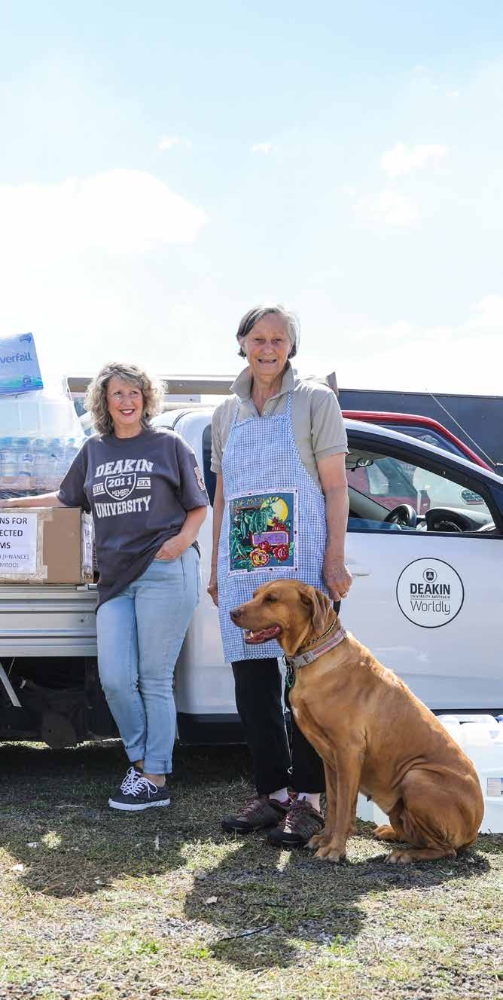
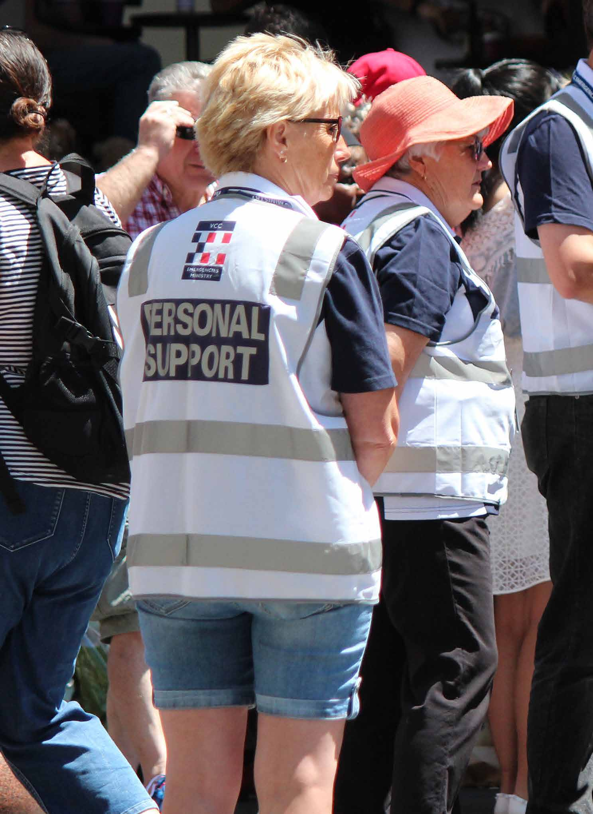

# Victoria's Resilient Recovery Strategy (August 2021)

> **Source**: Emergency Management Victoria
> **URL**: https://files.emv.vic.gov.au/2021-08/Resilient%20Recovery%20Strategy.pdf
> **Licence**: © State of Victoria; emergency-management practitioner reference
> **Retrieved**: 2026-05-07T23:44:32Z
> **SHA-256**: `664a473cd2016bcb11cec86192b2ce42b03242a1222582318b4c44f164931790`
> *Converted from PDF to Markdown format.*

---
## Page 1

Resilient  
recovery  
strategy

---
## Page 2

2
Emergency Management Victoria Resilient recovery strategy
Authorised and published by  
Emergency Management Victoria, 
121 Exhibition Street, Melbourne  
© State of Victoria 2019
You are free to re-use this work under a Creative 
Commons Attribution 4.0 licence, provided you 
credit the State of Victoria (Emergency Management 
Victoria) as author, indicate if changes were made and 
comply with the other licence terms. The licence does 
not apply to any images, photographs or branding, 
including Government logos.
If you would like to receive this publication in an 
accessible format please email media@emv.vic.gov.au
Acknowledgment of Country 
Emergency Management Victoria (EMV) 
acknowledges Aboriginal and Torres Strait Islander 
people as the Traditional Custodians of the land.  
EMV also acknowledges and pays respect to the 
Elders, past and present and is committed to  
working with Aboriginal and Torres Strait Islander 
communities to achieve a shared vision of safer and 
more resilient communities.
Contents
Message from the Emergency Management Commissioner	
3
Introduction	
4
The need for change	
5
The current recovery system	
6
Figure 1: Victoria’s current recovery model	
7
Towards Resilient Recovery	
8
Table 1: Resilient Recovery Outcomes Framework	
8
1.	 Deliver people- and community-centred recovery	
9
2.	Strengthen recovery through better emergency management planning	
10
3.	Streamlined and flexible recovery system	
11
4.	Support the recovery workforce	
12
Taking the strategy forward	
13
Glossary	
14
References	
14

---
## Page 3

3
Emergency Management Victoria Resilient recovery strategy
The changing climate  and increasingly complex types of emergencies is challenging Victoria’s 
emergency management arrangements. The way we plan for, respond to and support recovery  
needs to reflect this and build on our experiences to deliver better services to Victorians affected  
by emergencies.  
Victoria needs a recovery system that supports  
more timely and more streamlined services that meet 
what people need in the aftermath of an emergency. 
And we need to enable individuals to help themselves 
and each other through longer-term recovery.
Surviving an emergency is often life-changing. 
Everyone recovers from an emergency event differently. 
It is vital that emergency recovery practitioners work 
across government and with communities to get the 
best outcomes for those affected.
The Resilient Recovery Strategy is our shared vision 
for those supporting recovery. It puts individuals and 
communities at the centre of the recovery effort.  
It also shows how resilience can be built over time  
– in individuals, communities, the private sector and  
in Victoria’s recovery system.
We heard from state government agencies, councils, 
community, emergency services, businesses and 
others when we were developing this strategy. During 
this extensive engagement process, we heard about 
positive recovery experiences and areas that need 
reform. We also discussed how we can deliver that 
reform over time, with the support of the recovery 
workforce and communities.
This strategy is the Victorian Government’s 
commitment to improving our recovery system so that 
it supports community resilience, streamlines services 
and allows individuals and communities to lead and 
act to shape their future after an emergency.
This strategy alone cannot deliver all the agreed 
outcomes, but it will focus our efforts. By 
implementing this strategy, working with councils and 
recovery practitioners, we aim to decrease the huge 
social and economic costs of disasters and improve 
recovery and resilience outcomes for individuals and 
communities over time.
We can all act to improve the resilience of Victorian 
communities. This strategy is a key step in planning 
how to make that happen in recovery.
 
Message from the Emergency Management Commissioner 
1	 Beyond Bushfires: Community Resilience and Recovery study, 2016; 
Australian Business Roundtable, Building resilience to natural disasters 
in our states and territories, 2017; Australian Business Roundtable,  
The economic cost of social impact of natural disasters, 2016
Andrew Crisp APM 
Emergency Management Commissioner
is forecast to be about  
$33 billion by 2050.1 
Australia-wide, the cost 
of natural disasters to 
governments, business 
and communities 
about $1 billion  
per year. This is predicted 
to increase to $3.2 billion 
by 2050.
Natural disasters 
cost Victoria

---
## Page 4

Emergency Management Victoria Resilient recovery strategy
4
The Resilient Recovery Strategy is a strategy  
for the Victorian Government that sets agreed  
outcomes and strategic priorities to guide  
how government improves recovery approaches  
and systems and supports and empowers councils  
and the recovery workforce.
Across Victoria, individuals and their communities  
will benefit from a more robust and resilient 
emergency recovery system guided by this strategy.
Emergency events are becoming more frequent,  
varied and complex. There are also rarer types  
of emergencies emerging, such as thunderstorm 
asthma, acts of extreme violence and cyber-threats. 
This is putting greater pressure on the current 
recovery system.
Recovering from emergencies is also costly.  
The 2009 Victorian Bushfires demonstrate the 
complexity of an emergency and the far-reaching 
effects on the community. This event also shows 
the enormous social, environmental and economic 
costs associated with ongoing recovery.  
The Resilient Recovery Strategy recognises the 
challenges involved in long-term emergency recovery 
and the critical importance of the people, systems and 
structures that enable recovery to occur. It provides 
a strategy for the Victorian Government to improve 
current arrangements to meet future needs and build 
resilience in communities.
The strategy is built on national and international 
evidence and frameworks. It sets out shared outcomes 
and strategic priorities for the Victorian Government. 
These outcomes and priorities are based on extensive 
engagement with those impacted by disasters, as well 
as workers from across the recovery sector, including 
local communities and businesses, NGOs, local and 
state governments.
This strategy outlines the current recovery system 
and identifies areas that can improve through better 
integration, streamlining and strengthening what 
already works well. Victoria’s recovery system relies 
on multiple government agencies to build on the 
leadership role of councils in recovery coordination 
and delivery at place. The involvement of state 
agencies will depend on the nature and scale of the 
emergency event, and the escalation of activities to 
support councils in their role. 
The Resilient  
Recovery Strategy  
seeks to improve  
the way the current  
system operates  
across multiple levels of  
government and in building  
community resilience before  
and after events.
The strategy will be supported  
by a comprehensive implementation  
plan that further details the Victorian  
Government’s agreed actions.
 
Introduction
no matter what kind  
of chronic stresses 
and acute shocks they 
experience.1 
institutions, businesses 
and systems to survive, 
adapt and thrive 
Resilience  
is the capacity  
of individuals, 
communities
associated with mental 
health, family violence, 
environmental impacts 
and chronic disease.3
was due to tangible  
and intangible 
relief, recovery and 
reconstruction, including 
the substantial costs 
Nearly all  
the $7 billion 
cost of the 
2009 Victorian 
bushfires 
 can be largely  
influenced by both 
the pre-disaster resilience 
of that community and 
the responsiveness  
of recovery services  
and support.2
The social 
and economic 
recovery of  
a community 
1 	100 Resilient Cities 2016 – Community Resilience Framework, Emergency Management Victoria
2 	Economic Recovery After Disaster Strikes, SGS Economics & Planning
3	 Australian Business Roundtable, The economic cost of social impact of natural disasters, 2016

---
## Page 5

5
Emergency Management Victoria Resilient recovery strategy
The need for change
The frequency, intensity and consequences of emergencies have continued to increase in recent years. Communities that have always lived with  
the risk of natural disasters are likely to experience them more often and with greater intensity. Victorians are increasingly facing new types  
of emergencies. Demographic and technological shifts have also changed what community expect from government and the ways that government  
and communities interact.
These shifts are challenging traditional approaches 
to emergency recovery. This includes the established 
roles, responsibilities and relationships across 
government and non-government partners,  
and the processes that enable effective recovery. 
There is an opportunity to improve the timeliness  
and integration of recovery services by working  
with all partners to respond to these challenges 
together. In doing this, we can reduce duplication  
of effort, enhance the use of collective resources  
and help individuals to better understand the services 
and support they can expect from government.
To support timely delivery of services, the sector 
is also in need of a flexible and sustainable funding 
model for recovery that provides clarity and 
confidence in the funding available. This will  
support recovery agencies to seek funding  
to deliver necessary services that support the  
long-term resilience of impacted communities.
While government endeavours to act quickly  
to support communities, it is important to engage  
with communities in the design and delivery of 
services. By applying evidence and insights about 
what works in recovery, and implementing more 
community-centred models, the recovery workforce 
can achieve better long-term outcomes that reflect  
the needs of the entire community.
As a sector, this presents significant opportunities 
to work more closely with communities. Empowered 
communities are stronger and have more resilience  
as they continue through their recovery journey.  
This approach supports state government and  
councils to be clearer on our shared responsibility  
with community. It also helps to ensure that 
government’s recovery services and commitments  
are equitable and well considered. 
There are clear opportunities for improvement  
to ensure that recovery activities support, rather  
than erode, existing individual and community 
resilience and local leadership. This recognises  
the important role of councils and communities  
to shape and inform their recovery. 
the recovery workforce 
can achieve better  
long-term outcomes that 
reflect the needs of the 
entire community.
By applying evidence  
and insights about what 
works in recovery,  
and implementing  
more community- 
centred models, 
…engage with 
communities  
in the design  
and delivery  
of services.

---
## Page 6

6
Emergency Management Victoria Resilient recovery strategy
There is a well-established recovery system in Victoria, with committed recovery workers across the state and within the government and  
non-government sectors. This strategy builds on what works well within the current system so that people can quickly and easily access more  
streamlined support for recovery.
Roles and responsibilities 
Councils and state government and government 
agencies work in partnership with non-government 
organisations, community groups and businesses  
to deliver Victoria’s recovery programs and services. 
Service delivery is generally place-based and,  
where possible, led by councils in both delivery  
and coordination.
Large-scale, complex emergency events or those  
with significant consequences are coordinated  
at a regional or state level. When escalated  
to region or state, the Victorian Government will  
lead coordination and will partner with councils,  
local organisations and communities through 
Community Recovery Committees (CRCs) and  
other community governance structures to deliver 
place-based recovery services. 
Effective coordination relies on a clear and  
shared understanding of roles and responsibilities  
that are adhered to at all levels. These are set  
out in the  Emergency Management Act 2013 and  
the Emergency Management Manual Victoria. 
Context of events and communities
The recovery workforce needs to better understand 
the context of an emergency event and the individuals 
and communities affected. If community is involved 
early in the planning and design of recovery programs 
and services, these services are more likely to meet  
the needs of those affected. 
There have been many examples of the improved 
recovery outcomes for communities who have 
been more actively involved in their recovery 
through governance bodies such as CRCs and local 
government emergency planning collaborations.  
There is opportunity to identify best practice and 
lessons learned in these partnerships and apply these 
more consistently across the state.
Clearer governance and planning arrangements 
will empower all levels of government to work with 
communities more effectively before and after 
emergencies. This will help communities to shape  
their own recovery.
Integration of services
Government has agreed leads who will act in an 
emergency and respond to the various impacts 
to community and the environment, within their 
portfolios. This allows the design and delivery  
of appropriate recovery services and programs.  
While these arrangements enable specific elements  
of recovery to be addressed, integration across 
programs and services can be lacking.
In complex recovery environments (that escalate  
to region or state) recovery services and programs  
can be even more siloed within different parts  
of government. This can lead to fractured  
connections to community services and programs.  
The more complex the recovery environment, the 
more challenging this becomes, yet it is critical. 
Enabling arrangements
The recovery system is supported by enabling 
functions of planning (pre and post emergencies), 
funding and communications. These are critical 
functions to support the coordination and delivery of 
services at any level. Effective communication relies on 
good community engagement practices and leverages 
the relationships and networks of community 
groups and CRCs. This will better place all levels of 
government to tailor the information being provided 
to communities, ensuring that it is appropriate, timely 
and relevant for their recovery journey.
Councils and state government deliver recovery 
services that draw on existing resources and  
expertise. However, significant events may rely  
on ‘surge capacity’ to rapidly divert existing  
or additional resources to support recovery, which  
may even see the deployment of recovery resources 
from other jurisdictions.
The sporadic nature of emergencies means that  
some councils and recovery agencies have  
developed more experience and have better 
resources in recovery. If councils and agencies are 
better supported to rapidly connect skilled recovery 
practitioners from different locations, recovery 
services can be delivered more swiftly and efficiently. 
A significant challenge for Victoria’s recovery system 
is being able to mobilise resources in a timely way to 
meet the needs of affected communities and sustain 
resourcing through longer-term recovery when 
necessary. This starts with the existing resources 
available, but rapid and comprehensive impact 
assessment also informs if and what additional 
resourcing is required. The ability to meet surge 
demand requires flexibility in the system to respond 
and adapt in a timely way. It also requires strong 
relationships to quickly identify what resources are 
available and agree how to put these in place.  
  
The current recovery system
Victoria’s recovery system  
is based on the principles of 
managing locally, closest to the 
community and with the ability 
to scale up to deal with more 
widespread and complex issues 
and support needs. 
This recognises the key role of non-government 
organisations, community groups, businesses 
and others. This system is underpinned by the 
National Principles for Disaster Recovery.
Understand the context
Successful recovery is based on an 
understanding of community context, with 
each community having its own history,  
values and dynamics.
Recognise complexity
Successful recovery is responsive to the 
complex and dynamic nature of both 
emergencies and the community.
Use community-led approaches
Successful recovery is community- centred, 
responsive and flexible, engaging  
with community and supporting them  
to move forward.
Coordinate all activities
Successful recovery requires a planned, 
coordinated and adaptive approach,  
between community and partner  
agencies, based on continuing assessment  
of impacts and needs.
Communicate effectively
Successful recovery is built on effective 
communication between the affected 
community and other partners.
Recognise and build capacity
Successful recovery recognises, supports, 
and builds on individual, community and 
organisational capacity and resilience.

---
## Page 7

7
Emergency Management Victoria Resilient recovery strategy
RECOVERY ENVIRONMENTS
ECONOMIC
SOCIAL
BUILT
NATURAL
ECONOMIC
SOCIAL
BUILT
NATURAL
ECONOMIC
NATURAL
SOCIAL
BUILT
DELIVERY
COMMUNITIES
COUNCIL 
EXTERNAL 
–NGOS
STATE 
AGENCIES
COMMUNITIES
COUNCIL 
EXTERNAL 
– NGOS
STATE 
AGENCIES
COMMUNITIES
COUNCIL 
EXTERNAL 
– NGOS
STATE 
AGENCIES
PLANNING
ONGOING 
EMERGENCY 
MANAGEMENT 
PLANNING 
Municipal Emergency 
Management Plan 
(MEMP)
RECOVERY PLAN  
IN RESPONSE  
TO AN EMERGENCY
MEMP
RECOVERY PLAN  
IN RESPONSE  
TO AN EMERGENCY
ONGOING 
EMERGENCY 
MANAGEMENT 
PLANNING 
Regional Emergency 
Management Plan 
(REMP)
MEMP
MEMP
REMP
RECOVERY PLAN  
IN RESPONSE  
TO AN EMERGENCY
ONGOING 
EMERGENCY 
MANAGEMENT 
PLANNING 
State Emergency 
Management Plan 
(SEMP)
REMP
MEMP
MEMP
SEMP
COMMUNICATIONS 
Delivery of relevant, clear and targeted communications with key stakeholders to provide consistent messaging across agencies and ensure issues are being addressed. Focuses on two way communication with communities.
INCIDENT  
JOINT PUBLIC INFORMATION COMMITTEE
EMERGENCY MANAGEMENT  
JOINT PUBLIC INFORMATION COMMITTEE
REGIONAL  
JOINT PUBLIC INFORMATION COMMITTEE
FUNDING
Includes funding of base level standing arrangements for recovery; reallocation of resources and services post an emergency event; cost sharing arrangements between State and Commonwealth through Disaster 
Recovery Funding Arrangements (DRFA); additional services and surge capacity may require additional funding 
ASSURANCE AND OVERSIGHT: ASSURANCE FRAMEWORK
COORDINATION AND LEADERSHIP
State Coordination
EMERGENCY MANAGEMENT  
VICTORIA (EMV)
EMV is responsible for providing 
assurance to the Emergency 
Management Commissioner  
that relief and recovery activities  
are effective. For state-level  
incidents, EMV is responsible for 
coordinating recovery activities. 
For incidents across multiple councils, 
the DHHS has a responsibility  
to coordinate recovery activities  
and report up to state.
Regional 
Coordination
DEPARTMENT OF HEALTH  
AND HUMAN SERVICES (DHHS)
DHHS is responsible for 
coordinating relief and recovery 
at the regional level.
For incidents across multiple 
Councils, DHHS coordinates  
relief and recovery activities  
and reports up to state.
Local Coordination
COUNCILS
Councils are responsible for 
coordinating recovery at 
the local level for affected 
individuals and communities.
Type of scale of event is within 
councils capability and capacity 
to lead recovery coordination 
and identify funding available.
Escalation
Increased complexity,  
scale and consequence
Escalation
Increased complexity,  
scale and consequence
COORDINATION – DELIVERY
ENABLERS
Figure 1: Victoria’s current recovery model

---
## Page 8

8
Emergency Management Victoria Resilient recovery strategy
Table 1: Resilient Recovery Outcomes Framework
The Resilient Recovery  
Outcomes set an agreed  
direction to guide  
the Victorian  
Government’s  
recovery  
programs  
and  
services:
The Resilient Recovery Strategy sets out a plan for the Victorian Government to improve how we 
deliver recovery services and ensure that individuals and communities are at the centre of recovery.
Outcomes framework
There is no timeframe for recovery. Recovery cannot 
be measured by how long it takes or by a definition  
of what a successful recovery looks like. It is impossible 
to return to a pre-disaster state. In many instances, 
people may never recover fully from a disaster.  
This can sometimes be a challenge to how the sector, 
with impacted communities, determines success  
in the recovery and the supporting recovery system.
Through the development of this strategy, community 
and government agreed there was a need for a shared 
set of Resilient Recovery Outcomes that guides 
recovery programs and the actions taken under this 
strategy to improve the Victorian recovery system.
These draw on broader outcomes that guide Victorian 
Government departments with key roles in recovery. 
Linking emergency recovery outcomes to broader 
Victorian Government outcomes highlights how 
recovery connects to other priorities of government 
and to our key partners in the sector. It also recognises 
how improved recovery approaches can contribute to 
the broader resilience of Victorians.
This strategy alone cannot achieve these  
outcomes, but it will contribute to them and provide  
a common goal for government departments and  
the recovery workforce.
These outcomes will help to focus what the Victorian 
Government wants to achieve in emergency recovery 
and will reflect our understanding of community 
impacts and values.
Strategic priorities
Embedded within the outcomes framework are  
four strategic priorities and the Victorian  
Government’s commitment to tangible action.  
These reflect insights and lessons gained through 
research, national and international frameworks, 
reviews, inquiries and engagement.
Where possible, the agreed actions will build on and 
complement existing initiatives, to recommit and 
invest in what already works well across the state.
There is not one strategic priority or supporting 
action that will achieve the agreed outcomes. It is the 
collective delivery of all the actions within this strategy, 
and future actions yet to be determined, that will 
enable the sector to contribute towards the outcomes.
The Resilient Recovery  
Strategy has been developed 
through extensive consultation 
and engagement. 
The focus and priorities have been  
adapted over time to reflect local feedback. 
The foundations of the outcomes and  
strategic priorities were set through an 
engagement process and a series of  
regional workshops delivered across Victoria  
to co-develop the strategy.
The current strategic priorities aim  
to represent the collective picture of local  
issues and priorities, with insights from 
over 400 participants from state and local 
government, community, non-government 
organisations, emergency services, academia 
and others. 
There were strong themes identified through 
this engagement process including:
•	 working to ensure that all voices within  
the community can be heard and help  
shape the recovery
•	 streamlining and  
integrating services
•	 building capabilities  
at a local level 
•	 drawing more on strengths  
that already exist within  
the area 
•	 better supporting those  
that work in recovery.
These themes have been explored  
through further consultation and are 
represented as four strategic priorities  
in the strategy.
Towards Resilient Recovery
GOVERNMENT  
RESPONSES AND 
SERVICES ARE 
PEOPLE-CENTRED, 
ADAPTABLE AND 
SUSTAINABLE
VICTORIA  
HAS THRIVING 
REGIONS AND 
A HEALTHY 
ENVIRONMENT
VICTORIANS  
ARE CONNECTED 
TO PEOPLE, 
PLACES AND 
CULTURE
VICTORIANS  
ARE SAFE, RESILIENT  
AND HEALTHY
The Victorian Government will initially focus 
on four strategic priorities that we believe 
will see the most significant benefit towards 
contributing to our shared outcomes. 
We will deliver these in consultation and  
partnership with councils and other critical  
recovery leaders and practitioners:
1. Deliver people and community-centred recovery
We will better recognise the individual and diverse 
needs within communities and deliver recovery 
engagement, planning and activities in partnership 
with all parts of the community.
2. Strengthen recovery through better emergency 
management planning
We will work to ensure that recovery thinking 
and planning is a focus in all stages of emergency 
management, and deliver planning and activities that 
support and enhance community resilience
3. Streamlined and flexible recovery system
We will streamline and improve the recovery operating 
system to create a more integrated approach that 
effectively delivers government services and can be 
scaled and tailored to better support communities.
4. Support the recovery workforce
We will build the skills and capabilities of our recovery 
workforce and support the wellbeing of all those who 
work in recovery.
How will we know we are succeeding?
The Victorian Government Outcomes Framework 
identifies a number of indicators through which we can 
track trends and progress against outcomes. These  
are not direct measures of recovery but indicators of 
how we are tracking in key areas such as mental health 
and wellbeing, connection to culture and communities 
and the impact from major emergencies on individuals, 
property and the environment. Trends in these themes 
can contribute to the success of recovery, as well as be 
influenced by our approach to recovery.
In addition, an Implementation Plan will further  
define when and how our agreed strategic actions  
are achieved. It will assign appropriate measures  
of success against those actions, ensuring that  
we continue to deliver resilient recovery initiatives  
in line with agreed outcomes.

---
## Page 9

9
Emergency Management Victoria Resilient recovery strategy
A community-centred approach allows individuals to play a greater role in their recovery. To achieve this, all levels of government must partner with 
community leaders, business, non-government organisations and others.
 
In partnership with councils, we will design and  
deliver the enabling structures and approaches  
to deepen community participation in recovery.  
This will draw on existing and emerging local networks 
to plan for recovery and co-design recovery programs.
Together, we will focus on building partnerships  
to deliver shared outcomes that reflect the needs  
of the community. This approach aims to enable  
and empower communities to lead their recovery  
more actively.
Local leadership
The unique circumstances of the post-disaster 
environment often identifies local leaders and defines 
roles within a community.
Effective recovery planning and governance models 
will better include local leaders, both established and 
those that emerge after an emergency. This can be 
improved through the consistent establishment and 
prior planning of the role of CRCs and the partnerships 
with councils in recovery. 
These models will also better support councils to 
respond to the unique pressures they face, given their 
key roles in recovery and local partnerships.
To enable these models, all levels of government 
must engage with the diverse range of individuals 
that represent the community, before, during and 
after an emergency. Engagement should use existing 
community groups and governance to ensure it 
does not create additional burdens for impacted 
communities and individuals.
Place-based programs and  
accessible services
Councils, state government agencies and community 
organisations play a critical role in recovery through 
the coordination and delivery of support services. 
A community-centred approach ensures these 
services are accessible and tailored to the needs of 
the community, including the individuals, businesses, 
organisations and environments. This approach also 
allows us to provide the services and systems that 
individuals need, when they need it, as those affected 
by emergencies go through stages of recovery at 
different rates. 
A people and community-centred model will focus 
on effective delivery of support services, integrating 
services with partners and using local capabilities.
On-going and authentic engagement will be led  
at place, bringing together relevant agencies and  
a breadth of community representatives. Place can 
have a very broad meaning, including residential 
places, economic and business environments, and  
the recreational and natural environments.
This engagement is important before, during  
and after an emergency to understand local risks, 
values and recovery priorities; as well as existing  
or changed relationships and interactions that make 
communities strong.
Conversations about recovery need to be part of 
a broader discussion on emergencies. This will be 
reflected in the way communities and emergency 
managers plan together, acknowledging that everyone 
has a role to play in preparing for, responding to and 
recovering from emergencies. 
 
1.	Deliver people- and community-centred recovery  
CASE STUDY:
Community emergency 
hubs – harnessing 
community capital
The Wellington Region Emergency 
Management Office (WREMO), New Zealand 
has flipped the command and control approach 
on its head. It now has a structure that links 
to and channels community capital in times 
of stress, meaning communities can better 
coordinate their own response. 
This program recognises that communities 
will self-mobilise following an emergency and 
will want to be involved in their own recovery. 
The community emergency hubs provide the 
space and the tools for communities to come 
together to do what they can to help each 
other. The hubs promote a community-led 
response to the challenges they will face and 
provides a direct communication link with the 
official response. 
Two-way communication is essential.  
The hubs give information to the official 
response which feeds into the situational 
awareness and allows resources to be 
distributed where they are most needed. 
Hubs also receive and spread key safety and 
public information messages from the official 
response back to the community.
This approach acknowledges that most  
people can solve problems in their everyday 
lives, and disasters simply present a different 
set of problems.
1. Deliver people-  
and community- 
centred recovery
Actions
1.1. Establish clear and available points for 
individuals to connect with recovery services in 
a tailored, accessible, and integrated way 
1.2. Ensure there are formal opportunities 
for community roles in recovery governance 
and planning, tailored to the context of the 
community and the event
1.3. Design and deliver recovery programs  
that are place-based, reflecting the  
community characteristics while mobilising 
and supporting local leaders
Highlighting that  
even when we consult 
with communities, we 
may only be connecting 
with the same groups  
of people. 
and receive recovery 
communications  
and assistance after  
the disaster. 
that the ‘quieter voices’ 
are also part of the 
decision making, short 
and long-term.1
have been identified  
as being more likely  
to be a part of initial 
recovery planning 
This speaks volumes to 
the ways we engage with 
individuals within the 
community and ensure 
Individuals 
with strong and 
established local 
networks 
1 	IGEM, Review of community 
recovery following the 
2013–14 Victorian bushfires, 
2016

---
## Page 10

10
Emergency Management Victoria Resilient recovery strategy
2. Strengthen recovery through better emergency management planning
The recovery journey starts shortly after the emergency, but the planning, preparing and consideration for recovery should begin long before the  
disaster occurs.
Better planning for emergencies is the collective 
responsibility of all levels of government and its 
agencies, businesses and communities. The recent 
introduction of the Emergency Management 
Legislation Amendment Act 2018 will see more 
comprehensive and integrated planning for 
emergencies incorporating preparedness, response 
and recovery thinking.
This planning, at state, regional and local levels,  
will bring community into the planning process 
before an emergency, and also draw on community 
involvement after an emergency to better  
incorporate community needs and values into  
recovery activities. This recognises the shared 
responsibility and collective action needed to build 
resilience to emergencies.
Planning for recovery
The Emergency Management Legislation Amendment 
Act 2018 provides the avenue to incorporate recovery 
in all stages of emergency management.  
Planning approaches will have a stronger  
outcomes-focus that more effectively involves 
community and key partners in decision-making. 
Planning will have better results if it considers  
local context and supports long-term community 
resilience. To do this, recovery planning should draw 
on broader regional and community development  
and resilience plans.
Clarifying the roles and responsibilities across all  
parts of the recovery system will also improve  
planning and outcomes. This will streamline the 
recovery system and help individuals prepare and  
plan for their own recovery ahead of an emergency.
Connecting plans and programs
Existing community development and planning 
programs can play a critical role in building  
community resilience. Even if they are not explicitly 
focused on emergency management, these  
programs help to enhance people’s connections,  
skills and confidence. Emergency management 
planning committees should use the strengths  
of such information and programs when planning, 
responding and recovering from emergencies.
In addition, the planning regime should deliver  
timely, effective recovery plans both during an  
event and through the transition from the immediate 
emergency. This recovery planning will improve 
consistency and timeliness of recovery, providing 
support and advice to individuals, communities, 
partners and government. 
CASE STUDY:
Response and recovery  
in Anglesea – community-
based planning
The local community in Anglesea is working 
together to better connect and build a safer 
and more resilient future for the local and 
broader community. This includes building 
on combined strengths to better plan for 
emergencies and manage stresses and shocks 
when emergencies occur.
The plan is locally-driven and underpinned by 
the Victorian Community-Based Emergency 
Management (CBEM) approach. Community 
members of all ages and abilities are 
encouraged to connect through the Anglesea 
Community Network. This network connects 
to schools, local groups and organisations to 
share information and drive community-led 
initiatives. The initiatives include engaging 
other communities and organisations to run 
emergency scenarios to better position the 
community and resources, so they are ready 
to cope and recover from emergencies and 
unforeseen events. 
These processes also help give the community 
a stronger voice in influencing broader 
planning, community development and 
infrastructure decision making processes which 
affect them. 
2. Strengthen recovery 
through better emergency 
management planning
Actions
2.1 Establish planning processes for all  
stages of emergencies, across state, regional 
and municipal scales (implementing the 
Emergency Management Legislation 
Amendment Act 2018)
2.2 Establish clear processes and guidance 
for scalable post-disaster recovery planning, 
based on impact and consequence assessment 
and community input 
2.3 Create clear roles, responsibilities  
and processes for community input into 
planning processes

---
## Page 11

11
Emergency Management Victoria Resilient recovery strategy
3.	Streamlined and flexible recovery system
Quickly connecting with service providers and communities to identify resource and service needs will enhance the confidence of recovery leaders to act early and effectively. The enablers of the  
recovery system – planning, funding and communications – are key in supporting recovery practitioners to act quickly and decisively. This strategy focuses on improving these arrangements and  
ensuring greater coordination.
We will build on the strengths of the current  
recovery system and best practice examples  
at local level, focusing on improving coordination 
and responsiveness, planning, assurance  
and evaluation.
Streamlining recovery
Improved operating processes and clearer, more  
timely resourcing and actions will produce better 
outcomes within the current system. 
A review is required of the resourcing and funding  
for existing recovery arrangements to ensure that 
critical support is available when it is needed.
Developing resourcing arrangements that establish 
immediate recovery funding for identified early 
recovery actions will build the confidence of recovery 
leaders and allow them to act early and effectively. 
Developing flexible resource and workforce 
arrangements to support councils and communities 
through longer-term recovery will enable  
communities and recovery partners to build  
resilience through their recovery where possible.  
Working with councils, we aim to deliver a recovery 
system that is more streamlined and provides  
more timely and tailored services and support for 
those who need it, when they need it.
Flexible recovery
Improved recovery thinking during an emergency, 
and in the transition from short-term to longer-term 
recovery, will also enhance outcomes. 
This requires using good-quality information  
to guide planning and delivery. Critical elements 
include accessible, accurate and timely impact 
and consequence assessments, with information 
on community characteristics (such as community 
resilience factors, municipal planning scheme 
aspirations and data, and land management plans)  
to guide recovery decision making.
Recovery actions and programs are largely specific 
to the recovery context and may require government 
to develop and deliver new or different support 
services that fit local needs. This means that the 
resources and capabilities required to deliver place-
based services are not always the same. The system 
must be scalable and be able to handle surges of 
demand with an emphasis on early actions, local-level 
recovery and control, and escalation when needed.
The recovery system should enhance and build  
on the current strengths while recognising the need 
for flexibility. 
An effective system for emergency recovery will  
reflect a community-centred approach, while 
remaining flexible and well-supported at all levels  
and through all phases of emergencies.
CASE STUDY:
Rapid risk assessment
The Rapid Risk Assessment Teams (RRATs) 
are multi-disciplinary Victorian Government 
teams with specialist skills who rapidly identify, 
assess, prioritise and evaluate risks on public 
land after an emergency. 
RRATs provide valuable early information on 
impacts, risks and actions to support recovery 
on public land. Their assessment helps to 
minimise further threat to life, property, critical 
infrastructure and the environment following an 
emergency incident. 
Teams are made up of specialists who assess 
biodiversity (flora and fauna), built assets, 
cultural heritage, flooding and erosion, forest 
management and are supported by mapping to 
assess impacted areas.
Within seven days they produce a report for 
the public land managers that identifies priority 
risks and practical treatment solutions, helping 
more timely and effective recovery planning 
and delivery. 
The RRATs process and report gives the land 
manager a clearer picture of what is required 
after an incident, helping more timely and 
effective recovery planning and delivery.
3. Streamlined and flexible 
recovery system
Actions
3.1 Strengthen the Impact Assessment 
approach to provide more timely and accurate 
intelligence to inform recovery needs
3.2 Review funding arrangements to provide 
more streamlined, sustainable and responsive 
recovery for individuals, environments and 
places in need
3.3 Develop and implement a Monitoring, 
Evaluation and Assurance Framework that 
includes lessons management and is supported 
by best-practice 
of the current recovery 
system and best practice 
examples at local level
We will build  
on the strengths

---
## Page 12

12
Emergency Management Victoria Resilient recovery strategy
4. Support those who work in recovery 
Disaster recovery work is often intense. The need to provide services during uncertain times and in rapidly changing situations increases acute and ongoing stress for recovery workers. People may continue 
working in recovery long after an emergency, often providing support to individuals and communities experiencing ongoing distress and trauma. Exposure to direct and indirect trauma and long periods of 
intense emotional engagement can weigh heavily on recovery workers.
Individuals who work in recovery, professionals and 
volunteers, may come from any part of society, not 
just the emergency management sector. This diversity 
is a strength but also presents challenges to ensuring 
that workers from across multiple sectors are well 
supported when working in recovery.
This strategy aims to better connect and enhance 
existing support and wellbeing programs across the 
sector to ensure appropriate support for all those 
working in recovery. The necessary frameworks and 
structures will also be established to more consistently 
build and share recovery capabilities across 
government and the state
Keeping people safe and well
The challenges and impacts of working in recovery 
need to be better recognised. More needs to be 
done to recognise individual, community and local 
contributions of the recovery workforce, and the 
critical importance of their roles.
Continued learning from other professions  
with similar pressures (such as social work and 
medicine) is essential, as is identifying ways  
to support people to build their personal resilience. 
This will involve a broader system of support, 
networking and recognition for all recovery leaders; 
including community leaders, local partners and  
other recovery practitioners.
Keeping people safe and well over the long term 
should be everyone’s priority.
Networks, skills and knowledge
To support people to continue to do a great job, 
investment in the recovery workforce is critical, 
including building the skills and knowledge needed 
to work in these environments. It is also important 
to recognise the often extended nature of recovery 
activities and the need to maintain these capabilities 
long-term.
At a community and practitioner level, this means 
improved connections through formal networks that 
aim to better support people to share their lessons 
and experiences. All those working in recovery should 
continue to strive to improve recovery practices by 
applying the lessons learned from across Victoria, 
Australia and internationally.
Within state and local government, stronger recovery 
capabilities also need to be built and embedded in all 
stages of emergency management.
Many councils and government agencies have valuable 
recovery experience, capabilities and relationships at 
the local level. There are also existing resource sharing 
models to support various levels of government 
in delivery of their services. However, continued 
investment in recovery capabilities and networks 
can be challenging, depending on the frequency of 
emergency events that the council experiences.
Expanding and strengthening the network of the 
recovery workforce who can be mobilised across the 
state can help to bolster capabilities when needed. 
Having a skilled, supported recovery workforce 
available at the right times, and for the long term, will 
drive more timely and effective services throughout 
the recovery process.  
 
CASE STUDY:
DELWP Wellbeing Hub 
– Supporting recovery 
workers
The Department of Environment, Land, Water 
and Planning (DELWP) Recovery Team has 
recognised the potential psychological impacts 
of recovery work on their recovery workforce. 
There are many factors that contribute to 
these impacts such as long-term fatigue and 
complex community engagement. Recognising 
that these are likely to continue to be 
components of working in recovery, the team 
saw an opportunity to improve the way the 
department supported its staff.
In 2018, the team developed a package of 
tools to support mental health and wellbeing 
for DELWP staff, including psychological first 
aid training across the state with a specific 
recovery focus for those who work in disaster-
impacted communities. The project has 
provided recovery workers a safe place to 
connect with each other through an online 
Recovery Wellbeing Hub which contains video 
stories, advice from experienced recovery 
workers and links to support services and other 
useful information. 
Through this project, the team were able to 
raise awareness of the risks to the mental 
health after emergencies and the impact on 
staff and to the organisation. The project 
reflects a shift in the department and 
across the sector that better recognises the 
importance of the recovery workforce and the 
demanding work they do. 
4. Support the  
recovery workforce 
Actions
4.1. Develop a wellbeing program for  
all recovery leaders and practitioners  
to better support the wellbeing of those 
working in recovery
4.2. Develop a formal network for all  
recovery leaders and practitioners to share 
knowledge, experience and learnings
4.3. Establish a capabilities framework  
for state and local government recovery 
practitioners that aligns to broader  
emergency management capability
4.4. Enhance approaches for resource  
sharing across the sector to support  
longer-term recovery

---
## Page 13

13
Emergency Management Victoria Resilient recovery strategy
Taking the strategy forward
Through this strategy, the Victorian Government has committed to a series of priority actions to be 
delivered within the first stages of implementation. These actions will be further detailed within a 
comprehensive Implementation Plan, including agreement to the responsibilities by lead agencies, 
partnerships in delivery, timing and prioritisation.
This strategy will guide the work of agencies in their 
recovery programs and set ambitious, but important, 
expectations of government.
Measures
The supporting Resilient Recovery Implementation 
Plan will assign appropriate indicators and measures  
of success against the agreed actions within the 
Resilient Recovery Strategy.
Annual reporting will occur on the progress  
of the resilient recovery program of actions and 
Implementation Plan. Review of this work will  
be considered under a continuous improvement  
model to ensure relevance and continued alignment  
to this Strategy and the agreed outcomes within.
Associated programs and projects may have specific 
monitoring and evaluation requirements at project 
level but should inform the broader program reporting 
where possible.
Oversight
The State Crisis and Resilience Council will oversee 
and monitor the delivery of key actions within the 
strategy, recognising its whole-of-government 
intention. It is proposed that Emergency Management 
Victoria will provide support in implementation 
planning, monitoring and evaluation. 
Complementary initiatives
The emergency management sector in Victoria,  
across Australia and internationally has been  
working on building more meaningful community 
involvement, more effective partnerships and stronger 
recovery arrangements.
The Resilient Recovery Strategy aims to build on and 
complement this work by:
•	 considering and aligning to community,  
council and regional development or resilience 
initiatives such as the Resilient Melbourne  
Strategy and the Community Resilience  
Framework for Emergency Management
•	 recognising achievements and opportunities to 
leverage community-centred engagement programs 
such as Safer Together
•	 working closely with interdependent initiatives  
and programs such as the Councils and 
Emergencies program.
In addition, the direction provided under the 
Emergency Management Legislation Amendment 
Act 2018 will establish the foundation for community 
focus and improvement to recovery outcomes, 
through formal planning arrangements that reflect the 
importance of community participation in emergency 
management planning. The implementation of these 
planning amendments will be a primary channel to 
deliver key actions of this strategy.

---
## Page 14

14
Emergency Management Victoria Resilient recovery strategy    
Glossary 
References
Acute shocks 
Sudden, sharp events that can threaten  
individuals, households and communities. These 
include bushfire, floods, earthquakes, disease 
outbreaks and shared trauma events such as acts  
of extreme violence.
Chronic stresses
Long-term issues weaken the fabric of communities  
on a daily or cyclical basis. Examples include:  
high unemployment, inefficient public transport 
system, poor health, endemic violence, food  
or water shortages and the impact of climate change.
Communities 
A group sharing common characteristics, attributes 
or interests including communities of place (such as 
a township or locality) and communities of interest 
(such as faith, club, business or virtual). Individuals 
belong to many communities at any one time and 
these are constantly changing and evolving.
Consequence
Changes in circumstances experienced by individuals, 
communities, businesses, industry or infrastructure 
which are the result of an emergency event.
Cultural Heritage
The legacy of physical artefacts and intangible 
attributes of Aboriginal Australians that is  
inherited from past generations. Cultural heritage 
includes tangible culture, intangible culture, and 
natural heritage.
Disaster/Emergency 
A situation where people need immediate  
assistance to cope with an acute shock. This includes 
all forms of emergencies, natural or otherwise.  
The use of the terms interchangeably recognise  
the differing terminology used across government  
and non-government organisations, interstate and  
by the Commonwealth.
Impact assessment
The analysis of the consequences of an event, 
including psychosocial (emotional and social), 
economic, natural and built environment.
Public Land Manager
Departments, organisations and agencies that  
are legislated to manage and control public land  
on behalf of the Crown, governments and 
communities, past, present and future. This can 
also refer to appointed trustees, a committee of 
management, Minister or Secretary. 
The land can refer to national parks, state forests, 
coastal crown land and land reserved under the  
Crown Land (Reserves) Act 1978.
Recovery context
The considerations to be taken into account  
when managing consequence of impacts from  
an emergency.
Recovery practitioners or recovery workers 
All individuals and organisations that work in or 
contribute to recovery, both formal and informal, 
directly and indirectly.
Recovery system
The way in which individuals, communities,  
businesses and industry work together, supported  
by all levels of government and community 
organisations to recover from an emergency.
Resilience
The capacity of individuals, communities, institutions, 
businesses and systems to survive, adapt and thrive  
no matter what kinds of chronic stresses or acute 
shocks they experience. 
Sector 
All levels of government, departments and agencies 
and organisations that work together to plan for, 
respond to and recover from emergencies.
Self-mobilise
An individual and communities’ ability to organise  
and take initiative independent of any formal support 
or guidance.
Shared responsibility
A common understanding that communities and 
organisations have significant roles to play in building 
resilience before, during and after emergencies. 
This includes increasing capacity and capability 
for individuals, households and communities to 
take greater responsibility for their own safety and 
resilience levels; together with the appropriate support 
from emergency services, government, business, 
industry and non-government organisations.
AUSTRALIAN BUSINESS ROUNDTABLE FOR 
DISASTER RESILIENCE & SAFER COMMUNITIES,  
The economic cost of social impact of natural 
disasters, 2016
AUSTRALIAN BUSINESS ROUNDTABLE FOR 
DISASTER RESILIENCE & SAFER COMMUNITIES, 
Building resilience to natural disasters, 2017
AUSTRALIAN INSTITUTE FOR DISASTER RESILIENCE, 
National Principles for Disaster Recovery, 2018
EMERGENCY MANAGEMENT VICTORIA,  
Community Resilience Framework: for Emergency 
Management, 2017
INSPECTOR GENERAL OF EMERGENCY 
MANAGEMENT (IGEM), Review of community 
recovery following the 2013-14 Victorian bushfires, 
2016
SGS ECONOMICS & PLANNING, Economic  
Recovery After Disaster Strikes, 2019
UNIVERSITY OF MELBOURNE, Beyond Bushfires,  
2016
100 Resilient Cities, online, 2016

---
## Page 15

15
emv.vic.gov.au
Working in conjunction with communities, 
government, agencies and business

