# State Emergency Management Plan — Animal, Plant, Marine and Environmental Biosecurity Sub-Plan (August 2024)

> **Source**: Emergency Management Victoria
> **URL**: https://files.emv.vic.gov.au/2024-08/SEMP%20Animal%2C%20Plant%2C%20Marine%20and%20Environmental%20Biosecurity%20Sub-Plan.pdf
> **Licence**: © State of Victoria; emergency-management practitioner reference
> **Retrieved**: 2026-05-07T23:44:28Z
> **SHA-256**: `2bb8e39cfa46a1a640e4d76d431732c5711ecd2402b1f94d06611248fcfe3d8e`
> *Converted from PDF to Markdown format.*

---
## Page 1

 
OFFICIAL 
State Emergency Management Plan 
Animal, Plant, Marine and Environmental Biosecurity Sub Plan 
 
August 2024

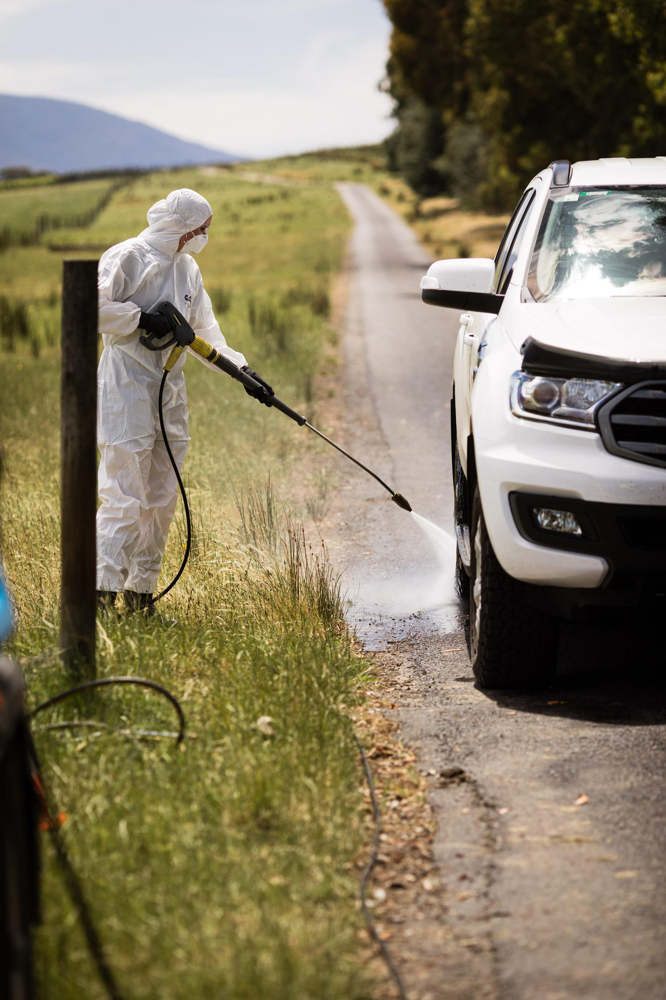

---
## Page 2

 
OFFICIAL 
Acknowledgements 
We are committed to genuinely partner, and meaningfully engage, with Victoria's Traditional Owners and 
Aboriginal communities to support the protection of Country, the maintenance of spiritual and cultural 
practices and their broader aspirations in the 21st century and beyond.  
 
  
© The State of Victoria Department of Energy, Environment and Climate Action August 2024. 
Creative Commons 
This work is licensed under a Creative Commons Attribution 4.0 International licence, visit the Creative 
Commons website (http://creativecommons.org/licenses/by/4.0/). 
You are free to re-use the work under that licence, on the condition that you credit the State of Victoria as 
author. The licence does not apply to any images, photographs or branding, including the Victorian Coat of 
Arms, and the Victorian Government and Department logos. 
ISBN 978-1-76136-844-8 (pdf/online/MS word) 
Disclaimer 
This publication may be of assistance to you but the State of Victoria and its employees do not guarantee 
that the publication is without flaw of any kind or is wholly appropriate for your particular purposes and 
therefore disclaims all liability for any error, loss or other consequence which may arise from you relying on 
any information in this publication. 
Accessibility 
To receive this document in an alternative format, phone the Customer Service Centre on 
136 186, email customer.service@delwp.vic.gov.au, or contact National Relay Service on 
133 677. Available at DEECA website (www.deeca.vic.gov.au).  
We acknowledge and respect Victorian Traditional Owners as the original 
custodians of Victoria’s land and waters, their unique ability to care for 
Country and deep spiritual connection to it. 
We honour Elders past and present whose knowledge and wisdom  
has ensured the continuation of culture and traditional practices. 
DEECA is committed to genuinely partnering with Victorian 
Traditional Owners and Victoria’s Aboriginal community 
to progress their aspirations.

---
## Page 3

 SEMP 
 Animal, Plant, Marine and Environmental Biosecurity Sub Plan 
1 
OFFICIAL 
Contents 
 
1. Introduction ................................................................................................................... 3 
1.1 Purpose ................................................................................................................................... 3 
1.2 Objective .................................................................................................................................. 4 
1.3 Risk management standard ..................................................................................................... 4 
2. The biosecurity threat .................................................................................................. 5 
2.1 Biosecurity risk environment .................................................................................................... 5 
2.2 Biosecurity threats ................................................................................................................... 6 
3. Authorising environment ........................................................................................... 10 
3.1 International ........................................................................................................................... 10 
3.2 National .................................................................................................................................. 10 
3.3 State ...................................................................................................................................... 11 
3.4 Legislation .............................................................................................................................. 12 
4. Mitigation ..................................................................................................................... 13 
4.1 Government ........................................................................................................................... 13 
4.2 Individuals and Community .................................................................................................... 13 
4.3 Traditional Owners ................................................................................................................. 13 
4.4 Industry .................................................................................................................................. 14 
5. Biosecurity Planning .................................................................................................. 15 
6. Preparedness .............................................................................................................. 16 
6.1 Victorian State, Regional and Municipal Planning Arrangements and interoperability ............ 17 
6.2 Regional Planning .................................................................................................................. 17 
6.3 Municipal Planning ................................................................................................................. 17 
7. Response ..................................................................................................................... 18 
7.1 Investigations and alert .......................................................................................................... 18 
7.2 Biosecurity responses have distinct characteristics. ............................................................... 19 
7.3 Incident Management System ................................................................................................ 22 
7.4 Strategic policy and technical direction................................................................................... 29 
7.5 Control ................................................................................................................................... 29 
7.5.1 Zoonotic risk management in a biosecurity response ................................................................. 30 
7.6 Planning ................................................................................................................................. 30 
7.7 Operations ............................................................................................................................. 31 
7.8 Logistics ................................................................................................................................. 32 
7.9 Finance and administration .................................................................................................... 32

---
## Page 4

2 
SEMP  
Animal, Plant, Marine and Environmental Biosecurity Sub Plan  
7.10 Public information ................................................................................................................ 32 
7.11 Emergency information and warnings .................................................................................. 34 
7.12 Liaison ................................................................................................................................. 35 
7.13 Coordination......................................................................................................................... 35 
7.14 Stand down .......................................................................................................................... 36 
7.15 Transfer of control ................................................................................................................ 36 
7.16 Relief function ...................................................................................................................... 36 
8 Consequence management ........................................................................................ 36 
9 Relief and recovery ...................................................................................................... 38 
9.1 Compensation and/or owner reimbursement costs – Valuation and compensation 
schemes ...................................................................................................................................... 39 
10 Capability .................................................................................................................... 39 
10.1 Human resources ................................................................................................................. 39 
10.2 Assistance from interstate .................................................................................................... 40 
10.3 Mutual aid arrangements...................................................................................................... 40 
10.4 Assistance from overseas .................................................................................................... 40 
10.5 Assistance from industry and the community ....................................................................... 40 
10.6 Support agencies ................................................................................................................. 41 
10.7 Shared responsibility ............................................................................................................ 41 
10.8 Concurrent emergencies ...................................................................................................... 42 
10.9 Interoperability ..................................................................................................................... 42 
11 Review and evaluation .............................................................................................. 43 
12 Appendices ................................................................................................................ 44 
Appendix 12.1: Acts relevant to biosecurity in Victoria ................................................................. 44 
Appendix 12.2 Glossary ............................................................................................................... 46

---
## Page 5

 
 
 SEMP
 Animal, Plant, Marine and Environmental Biosecurity Sub Plan 
3 
OFFICIAL 
1. Introduction  
1.1 Purpose  
The Animal, Plant, Marine and Environmental Biosecurity Sub Plan (‘the Plan’) provides an overview of the 
current arrangements for the management of biosecurity emergencies—excluding human health 
emergencies and non-Emergency Animal Disease (EAD) wildlife emergencies—in Victoria and contains 
information on biosecurity mitigation, preparedness, response, relief, and recovery.  
Environmental biosecurity is inclusive of pests and diseases that may impact terrestrial and freshwater 
environments and ecosystems. The Plan reflects an integrated approach and shared responsibility for 
biosecurity management between government, agencies, industries, businesses, Traditional Owners, and 
the community. 
The Department of Energy, Environment and Climate Action (DEECA) has developed this Plan to be 
consistent with national arrangements for biosecurity emergencies and with input from a range of other 
emergency management agencies. The Plan refers to a range of existing plans and documents but does not 
duplicate the information contained in these, instead providing directions to websites or other sources where 
the reader can obtain further information if required.  
The Plan joins a suite of other hazard-specific plans as a sub plan of the State Emergency Management 
Plan (SEMP).  
In accordance with the Victorian Emergency Management Act 2013 (the Act), major biosecurity emergencies 
are classified as ‘Class 2’ emergencies. The SEMP identifies DEECA as the Control Agency in Victoria for 
biosecurity incidents covering:  
 emergency animal disease outbreaks (including aquaculture) 
 emergency plant pest or disease outbreaks (including bee pests or diseases) 
 high risk invasive plant, animal and exotic marine pest incursions. 
This Plan does not cover emergency management activities that DEECA delivers as a Support Agency, such 
as emergency animal welfare relief or agricultural loss and damage assessment in Class 1 emergency 
responses. These activities are described in the Victorian Emergency Animal Welfare Plan and the Victorian 
Agricultural Response Plan.  
The Plan does not cover wildlife emergencies, which are defined within the SEMP and for which DEECA is 
the nominated Lead Agency. Response arrangements for these emergencies are defined within hazard 
specific wildlife response plans.  
This is the second version of the Plan under the Emergency Management Act 2013. These arrangements 
are described at a point in time, and there may be changes resulting from reviews and evaluations of 
exercises, biosecurity emergencies and ongoing reform in the Victorian emergency management sector.  
As the Control Agency for biosecurity emergencies, DEECA is responsible for the maintenance of this Plan. 
The Plan will be reviewed every three years, in accordance with the provisions of the Act. If the relevant 
preparer considers urgent updates are required, these may be made in accordance with s60AM of the Act. 
DEECA applies an integrated, unifying approach that aims to sustainably balance and optimise the health of 
people, animals, and ecosystems.  
This Plan has been endorsed by the State Crisis and Resilience Council (SCRC) as a Sub Plan to the 
SEMP.

---
## Page 6

 
 
4 
SEMP  
Animal, Plant, Marine and Environmental Biosecurity Sub Plan  
1.2 Objective 
The objective of biosecurity is to minimise adverse impacts of pests and diseases on Australia’s economy, 
environment, and the community, while facilitating trade. Effective biosecurity is essential to the ongoing 
health of Victoria’s agricultural production, community, economy, and environment. 
1.3 Risk management standard 
The adoption of emergency risk management, and its underlying concept of risk, has helped communities 
and emergency managers move beyond the narrower concept of ‘hazard’ to ‘risk’. Risk deals more broadly 
with the interaction of the exposure to hazard and specific vulnerabilities. 
The risk management standard AS/NZS ISO 31000:2018 (the Standard) is applied to guide decision making 
where uncertainty exists. The Standard is adapted to support emergency management planning, which 
involves modifications to the context. This includes setting objectives that focus on community safety and 
wellbeing, rather than organisational objectives. Other key elements of the context include developing criteria 
that reflect community values and support robust assessments and results. 
Emergency Plant Pests (EPPs, exotic pests and diseases not present in Victoria) and Emergency Animal 
Diseases (EADs) have been assessed as significant risks for Victoria in state level multi-hazard emergency 
risk assessment projects, such as Emergency Risks in Victoria (July 2020).

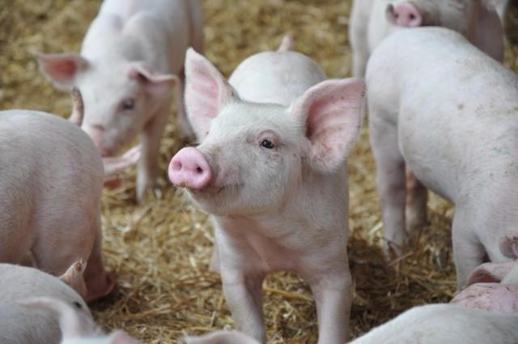

---
## Page 7

 
 
 SEMP
 Animal, Plant, Marine and Environmental Biosecurity Sub Plan 
5 
OFFICIAL 
2. The biosecurity threat  
Biosecurity is defined as the collective effort to prevent and manage the harms caused by plant and animal 
pests and diseases, and the impact they have on what we value most: our farms and parks, our pets and 
gardens, our native plants and animals, the cultural integrity of the landscape, the safety of our food, and the 
success of our industries. 
Victoria’s agriculture industry and the economy rely on protection by the biosecurity system. Biosecurity 
threats cause direct production and financial losses for farms through reduced crop and livestock yield and 
diminished output quality. Incursions can also result in loss of market access, increased costs to fulfill 
protocols, and reduced-price premiums.  
Social impacts arising from biosecurity incursions can result at individual, household, and community levels. 
Our natural environment is under continued threat from pests and diseases, which poses a significant risk to 
Victoria’s unique ecology. Exotic and established pests and diseases are recognised as a major driver of the 
decline in ecosystems and wildlife and are responsible for over 80 percent of mammal extinctions. 
Biosecurity threats are also a risk to human health. At least 75 percent of the new human infectious diseases 
that have emerged since the 1970s have originated from animal diseases, otherwise known as zoonotic 
diseases.  
A strong biosecurity system is also crucial to preserving the important cultural heritage of Traditional Owners. 
Many indigenous flora and fauna species hold cultural importance as totems for Aboriginal peoples. 
Consequently, any harm inflicted upon indigenous plants, animals and their habitats by pests and diseases 
and their management directly impacts on the cultural values of Aboriginal peoples. 
The biosecurity system ultimately plays an important role in protecting and preserving vital aspects of 
Victoria’s way of life, including living standards, community and social cohesion, security, and safety. For 
example, plant pests and diseases can impair the visual appeal of our landscapes and the quality of social 
amenity in our communities. Severe animal disease outbreaks can have devastating impacts on community 
wellbeing, tourism, and recreational use of the landscape, particularly in rural and regional areas. 
2.1 Biosecurity risk environment 
Key drivers of risk (See Figure 1) include the increased movement of people, goods and vessels into 
Victoria, climate change, criminal activities such as international smuggling, and changes to land use and 
industry practices. These challenges overlay existing inherent risks of biological agents which can be 
susceptible to mutations and recombination that enable pests and diseases to evolve into more pathogenic 
variants.  
 
Figure 1: Key drivers of risk in a changing environment

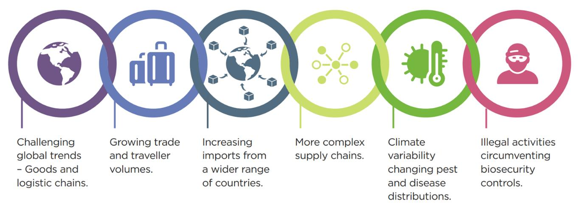

---
## Page 8

 
 
6 
SEMP  
Animal, Plant, Marine and Environmental Biosecurity Sub Plan  
2.2 Biosecurity threats 
There are hundreds of pest and disease threats recognised for Victoria and Australia that would necessitate 
an investigation and emergency response if detected. Examples of the significant pest and disease threats 
are: 
African swine fever (ASF): ASF is a contagious viral 
disease of domestic and feral pigs. The virus is spread 
directly between pigs, by consumption of infected meat, 
by bites of some insects, and/or from contaminated 
feed, water, clothing, footwear, vehicles, and equipment. 
Since ASF was detected in China in 2018 it has spread 
rapidly throughout southeast Asia and parts of Timor 
Leste, Indonesia, and Papua New Guinea.  If introduced 
into Australia, ASF could have a significant impact on 
pig health and production and have major impacts on 
the domestic pork industry and regional economies. 
There is no registered vaccine for ASF and the disease 
kills about 80 percent of the pigs it infects. Testing of 
pork products intercepted at international mail centres in 
Australia has detected ASF viral fragments in more than 20 percent of samples. A legislated ban on the 
feeding of meat products to pigs aims to reduce the risk of infected product being fed to pigs however, these 
seizures of pork products containing ASF virus fragments reinforces the ongoing risk faced by Australia, the 
need for sound preparedness and the importance of compliance with Australia’s strict biosecurity 
requirements. A 2021 rapid ‘structured expert judgement’ exercise by the Centre of Excellence for 
Biosecurity Risk Analysis estimated there is a 21% (range 5%-39%) probability of an outbreak in the next 
five years.  ABARES estimated the economic cost of a small scale-outbreak in domestic pigs followed by 
eradication of the disease to be between $117 million and $263 million1.   
Avian influenzas: Low pathogenic avian influenza (LPAI) 
viruses circulate in wild birds without causing disease. On 
occasion the virus spills over into domestic poultry populations 
and mutates into high pathogenicity avian influenza (HPAI) 
strains causing severe disease and high levels of mortality. In a 
change from this typical pattern of infection, a new HPAI 
variant, known as HPAI H5N1 clade 2.3.4.4b, has been 
spreading globally since 2020 through wild birds, resulting in 
significant mortalities of both wild birds and poultry, as well as 
marine and terrestrial mammals. A small number of human 
infections have been reported globally for HPAI clade 2.3.4.4b. 
Oceania is the only remaining region where the HPAI clade 
2.3.4.4b virus has not been detected. 
Outbreaks of high pathogenicity avian influenza (not HPAI clade 
2.3.4.4b) have occurred on poultry farms in Victoria in 1976, 
1985, 1992, 2019 (small backyard flock), 2020 and 2024. All 
bird samples submitted to the state animal health laboratory are 
screened for avian influenza virus and annual wild bird testing 
also provides valuable surveillance to monitor the types of avian 
influenza virus circulating in Victoria. 
 
1 Australian Bureau of Agricultural and Resource Economics and Sciences, 2023 (ABARES) 
Image: courtesy of Megan Scott 
Image: sourced from 
www.afrivip.org/sites/default/files/ASF/diagnosis.h
tml

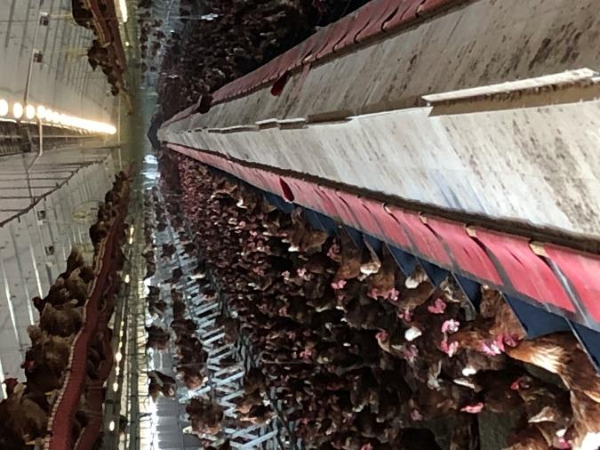

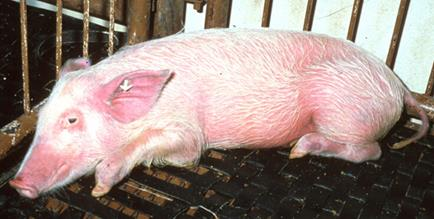

---
## Page 9

 
 
 SEMP
 Animal, Plant, Marine and Environmental Biosecurity Sub Plan 
7 
OFFICIAL 
Foot-and-mouth disease (FMD): FMD is a highly contagious 
viral disease affecting a wide range of livestock species such as 
cattle, sheep, goats, deer, and pigs. Vehicles, equipment, 
people, and footwear/clothing can spread the disease. Control 
measures include strict movement restrictions, depopulation of 
infected properties and decontamination of sites. 
Consequences of an outbreak are significant to not only 
livestock and agricultural industries but also broader businesses 
and economies. A 2022 ABARES report stated that the 
economic impact of a large multi-state outbreak of FMD in 
Australia could be as high as $80 billion over 10 years2. 
Australia relies heavily upon exports and international market 
access for livestock products is lost immediately upon detection 
of FMD. These markets can take many years to regain or may 
be lost permanently, causing significant economic loss. The 
United Kingdom experienced a FMD outbreak in 2001 that cost 
approximately AUD$19 billion to its economy, required 11 
months to contain the outbreak and involved the destruction of 
six million animals. A recent incursion in Indonesia has 
increased the risk of an outbreak of FMD. A rapid ‘structured 
expert judgement’ exercise by the Centre of Excellence for 
Biosecurity Risk Analysis estimated there is a probability of an 
outbreak of an outbreak in Australia of 11.6 percent over the 
next five years (increased from 9 percent in 2021). 
Hendra virus (HeV): HeV is a disease transmitted to horses by flying-foxes. On rare occasions, infected 
horses have transmitted disease to humans with fatal consequences. The mortality rate in horses is 80 
percent and in humans four of seven confirmed cases have died (mortality rate of ~57 percent). There has 
never been a confirmed clinical case of Hendra virus infection in any species in Victoria to date, however 
henipavirus (Hendra virus genotype 2) has been detected in Victorian flying-foxes. The frequent movement 
of horses from known Hendra-areas (Queensland and northern NSW) and movement of flying-foxes 
presents ongoing risks of Hendra virus transmission into Victoria. Incidents require a close collaboration 
between animal health and public health response agencies.  
 
 
2 Australian Bureau of Agricultural and Resource Economics and Sciences, 2022 (ABARES) 
Image: courtesy of abc.net.au 
Image: courtesy of Megan Scott

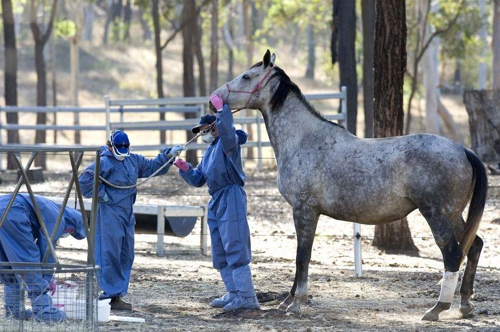

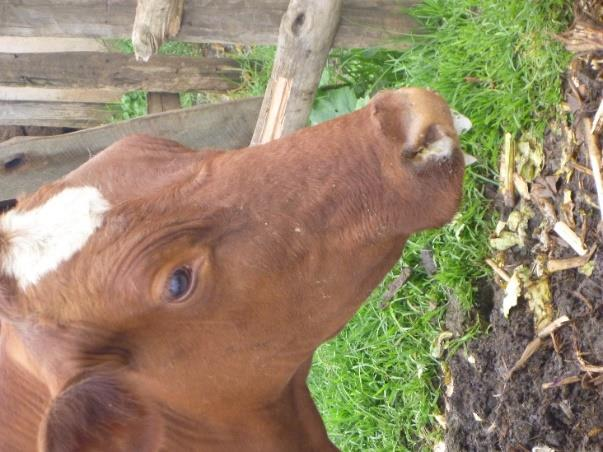

---
## Page 10

 
 
8 
SEMP  
Animal, Plant, Marine and Environmental Biosecurity Sub Plan  
Lumpy skin disease: Lumpy skin disease is a viral disease 
of cattle and buffalo which causes firm, raised nodules around 
the skin of the head, neck and body. Animals can become 
infected through biting insects or close contact with 
contaminated equipment and clothing for example. 
The disease would have significant and far-reaching impacts 
should there be an incursion in Australia. There would be 
considerable economic losses with restrictions being placed 
on both domestic and international markets. In 2022, 
detections of both FMD and lumpy skin disease in Indonesia 
significantly increased Australia’s risk of an EAD incursion. At 
the time, the combined probability of a major EAD incursion 
into Australia in the next five years was estimated to be 56 
percent which includes 28 percent for lumpy skin disease. 
Brown marmorated stink bug (BMSB) Brown marmorated 
stink bug (BMSB) is a plant sucking bug which presents a 
significant biosecurity risk to Australia due to its hitch-hiking 
tendencies, broad host range and highly mobile nature.  At 
risk is over 300 agricultural, nursery and ornamental plant 
hosts. Feeding damage on fruit make the fruit unmarketable 
as a fresh product, and in severe cases can render the crop 
unusable for processed products. Piercing wounds also 
provide a pathway for disease to enter the host plant. The 
ability of BMSB to feed on such a wide range of hosts makes 
it difficult to manage across landscapes. BMSB are dormant 
in cooler winter temperatures where large numbers will seek 
shelter in man-made structures, emerging only as the 
temperature increases in spring. This aggregating ability 
helps BMSB to spread rapidly outside its native range by 
sheltering in shipping containers, machinery, packing crates, 
vehicles and luggage which are transported across the 
globe. Goods arriving in Australia in September to April, 
coinciding with late autumn and winter in the Northern 
Hemisphere, are high risk for BMSB. Adults will fly long 
distances in search of food. In large numbers, BMSB 
becomes a considerable nuisance invading dwellings and 
producing a foul smell when disturbed. At stake is Victoria’s 
horticulture industry which has a gross value of $3.2 billion3.   
Khapra beetle:  Khapra beetle is number two on Australia’s National 
Priority Plant Pest list. Khapra beetle prefers grains, particularly 
wheat, but has been recorded on over 100 commodities. The larval 
stages infest the stored produce which taint the quality of commodity 
rendering it unfit for consumption. Contact with the larvae and skin 
moults can cause skin irritation and ingesting contaminated food can 
cause gastro-intestinal inflammation or a severe allergic reaction. The 
larvae can survive in stored food and packaging material in conditions 
with little moisture for extended periods of time. The preference for 
hiding in cracks and crevices makes khapra beetle difficult to locate 
and enables them to be easily, and unintentionally, transported via 
movement of people and goods around the world. Khapra beetle has 
been detected in the food-less consignments of packaging material 
associated with industrial and domestic equipment/supplies. 
Economic loss of valuable grain or other domestic or export products 
is a 
 
3 Agriculture Victoria – Victorian Horticultural Industry Factsheet – January 2023 
Image: courtesy of Animal Health Australia 
Image: Agriculture Victoria  
Image: Agriculture Victoria

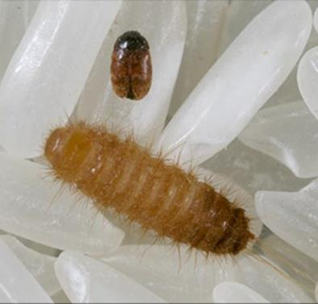

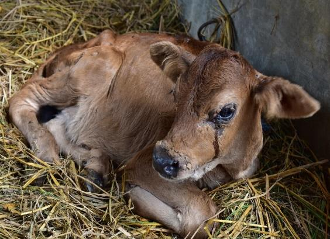

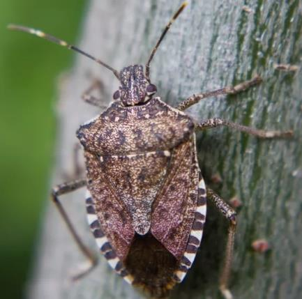

---
## Page 11

 
 
 SEMP
 Animal, Plant, Marine and Environmental Biosecurity Sub Plan 
9 
OFFICIAL 
major consideration given the gross value of Victoria’s grain production was $3.6 billion in 2020-214. The 
establishment of khapra beetle in Australia would see production costs increase for prevention and treatment 
measures. It is not easily controlled with insecticides, nor other nonchemical methods, that are usually 
effective against other similar pests. It is estimated that a widespread incursion of khapra beetle could cost 
the Australian $15.5 billion over 20 years5 . 
Red Imported Fire Ant (RIFA): RIFA is a highly aggressive ant 
species known for their painful sting. RIFA presents a serious threat to 
agricultural production, native ant species and the environment, 
significantly impact on amenity use in backyards, playgrounds, parks 
and gardens, damage infrastructure and can potentially be fatal to 
young children, pets and the elderly. RIFA has been detected on 
multiple occasions in Australia, and thus far either successfully 
eradicated or under current eradication programs. The most significant 
eradication response is currently being delivered in South-East 
Queensland since 2001. In 2021, a benefit cost analysis by the 
Central Queensland University estimated that in the absence of the 
eradication program annual costs of RIFA impacts would exceed $1 
billion within 15 years6. RIFA has been detected previously in Victoria 
in shipments from Brisbane, USA and China. Most recently, in 
February 2023, a RIFA queen was found at Thomastown in 
Melbourne in a consignment of potted plants from Queensland. Early 
intervention on each occasion successfully eliminated the pest. RIFA 
is just one example of exotic invasive ants that pose similar risks to 
Australia.  
Image: RIFA bites can cause strong reactions in humans. Image courtesy of Murray S Blum, University of 
Georgia.Buwood.org.  
Xylella fastidiosa: This exotic bacterial pest has been 
identified as the number one threat on the National 
Priority Plant Pest list in Australia and listed on the 
National Priority List of Exotic Environmental Pests, 
Weeds, and Diseases due to its potential to significantly 
impact a broad range of commercial (production), 
ornamental and native species. This bacterium is 
transmitted by insects that feed on the plant’s xylem and 
causes plant death through stopping water movement. 
There are no chemical treatments to manage X. 
fastidiosa, and therefore infected trees must be 
destroyed, while spread is managed by suppressing the 
insect vectors. In Australia, the potential impact on the 
Australian horticulture industry due to this disease has 
been estimated to be between AU$1.2 billion and AU$8.9 
billion over 50 years7 while the potential impacts on the 
wine sector have been estimated between $2.8 billion 
and $7.9 billion over 50 years8. 
 
 
4  ABS Australian Bureau of Statistics Value of agricultural commodities produced - Australia, states and territories 2021-
22     
5 Department of Agriculture, Fisheries and Forestry 
6 Star,M., Rolfe, J. 2021. Assessing the Impacts of the Red Imported Fire Ant Report for Biosecurity Qld, Department of Agriculture and 
Fisheries 
7 Department of Agriculture, Fisheries and Forestry, Protecting Australia’s horticultural industries from disease 
8 DAFF, Economic impacts of Xylella fastidiosa on the Australian wine grape and wine-making industries 
Image: Leaf scorch symptoms produced by 
Xylella fastidiosa infection.  Courtesy of John 
Hartman, University of Kentucky, Bugwood.org.

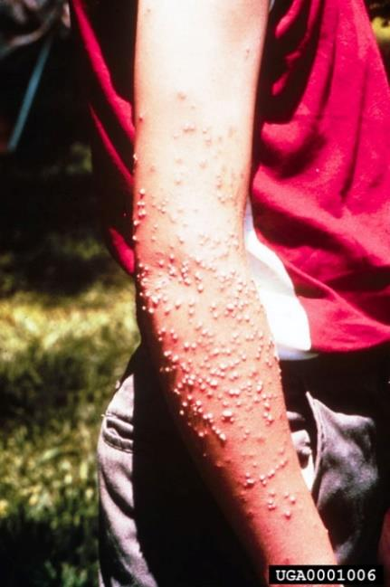

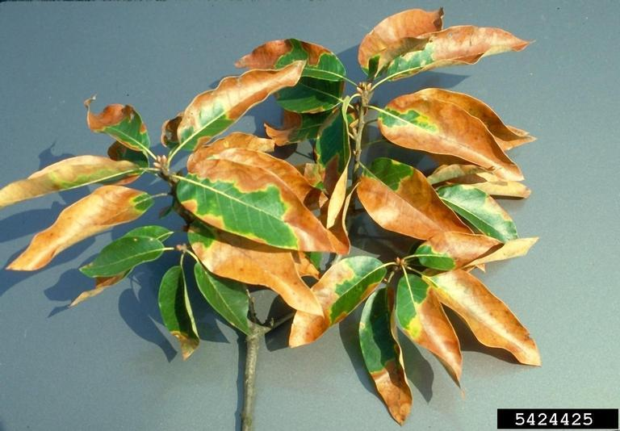

---
## Page 12

 
 
10 
SEMP  
Animal, Plant, Marine and Environmental Biosecurity Sub Plan  
3. Authorising environment 
Australia has well-developed emergency biosecurity arrangements implemented through state and federal 
legislation and arrangements.  
3.1 International 
Australia is a signatory to a range of international agreements that impact biosecurity obligations and 
operational responses. These include agreements and standards that apply to Australia as a member of the 
World Trade Organisation, the World Organisation for Animal Health, formerly known as the Office 
International des Epizooties (OIE) and the International Plant Protection Convention. Resumption of trade in 
agricultural products after an outbreak may be dependent on demonstrating compliance with these 
standards and will be expected to come under significant scrutiny from trading partners. 
3.2 National 
The Intergovernmental Agreement on Biosecurity (IGAB) is a domestic agreement between all Australian 
governments, that sets out commitments, outline agreed national goals and objectives and clarify roles, 
responsibilities, and governance arrangements. Under the IGAB, the National Biosecurity Committee and 
associated arrangements provides national, strategic management and oversight of the national biosecurity 
system, to assist in addressing biosecurity threats, and oversees operation of the agreement, facilitating 
intergovernmental relationships. 
There are also three key response agreements to which Victoria is a signatory. These outline commitments 
made by signatories, and guide the decision making process and cost sharing of responses to emergency 
pests and diseases: 
 Emergency Animal Disease Response Agreement (EADRA) 
 Emergency Plant Pest Response Deed (EPPRD) 
 National Environmental Biosecurity Response Agreement (NEBRA) 
For the EADRA and EPPRD, national decision making brings together all affected parties for that response 
(Commonwealth Government, all state/territory governments, and signatory affected Industry Bodies). These 
parties also contribute to the cost sharing for response activities. Where the biosecurity incidents relate to an 
exotic emergency environmental pest or disease of national significance then the NEBRA, to which the 
Commonwealth and all state/territory governments are signatories, may be used.  
Operating outside of, or inconsistent with, these agreements may have consequences in terms of Victoria’s 
ability to recoup costs. 
Animal Health Australia (EADRA), Plant Health Australia (EPPRD) and the Australian Government 
Department of Agriculture, Fisheries and Forestry (DAFF) are the custodians of the agreements. Animal 
Health Australia (AHA) and Plant Health Australia (PHA) are independent national bodies in Australia whose 
members include the Commonwealth, State and Territory governments, animal or plant industries, service 
providers and associate members. These bodies manage the development and review of underpinning plans 
such as AUSVETPLAN (EADRA) and PLANTPLAN (EPPRD), which detail the nationally agreed approaches 
for the response to different emergency pests and diseases. Refer to the relevant websites9,10,11 for further 
details regarding the national response and deed agreements. 
Under these arrangements, in the event of a biosecurity incursion in Victoria, the Victorian representative is 
responsible for briefing the relevant Consultative Committee and providing a response plan and budget for 
recommendation.  
 
9 https://www.animalhealthaustralia.com.au/what-we-do/emergency-animal-disease/ead-response-agreement/ 
10 https://www.planthealthaustralia.com.au/biosecurity/emergency-plant-pest-response-deed/ 
11 https://www.agriculture.gov.au/biosecurity/emergency/nebra

---
## Page 13

 
 
 SEMP
 Animal, Plant, Marine and Environmental Biosecurity Sub Plan 
11 
OFFICIAL 
The relevant Consultative Committee is responsible for recommending to the National Management Group 
(NMG)12 whether a response should proceed, based on an assessment of whether the pest, weed or 
disease meets the EADRA, EPPRD or NEBRA criteria, the technical feasibility of eradication, and whether 
eradication would be cost-beneficial (Figure 2). 
The NMG is responsible for endorsing the response plans and associated budgets, which binds parties to 
financially contribute to the response through defined cost-sharing arrangements. 
 
Figure 2: National Biosecurity Framework for emergencies13, including Victorian representatives 
3.3 State 
Under the Emergency Management Act (2013), the Emergency Management Commissioner has legislated 
response coordination responsibilities, ensuring effective control arrangements are in place, consequence 
management and recovery coordination. 
In Victoria, the State Emergency Management Plan outlines the Victorian arrangements for the mitigation of, 
response to and recovery from emergencies, and specifies the roles and responsibilities of agencies in 
relation to emergency management14. Whereas DEECA is the Control Agency for biosecurity emergencies in 
Victoria.  
DEECA, as the Control Agency, will implement its biosecurity emergency management arrangements 
(including this Plan) to mitigate biosecurity risks, plan, prepare and respond effectively to the emergency in 
line with state, national and international arrangements. 
 As a Control Agency, DEECA is responsible for: 
 Providing Victoria’s affected industries and communities with advice about biosecurity risks and 
mitigation strategies, as well as education materials on the state’s biosecurity emergency management 
arrangements.  
 Partnering with Traditional Owners to share information and advice about biosecurity risk, as well as the 
state’s biosecurity emergency management arrangements. 
 
12 For responses conducted under NEBRA, the NMG is referred to as the National Biosecurity Management Group (NBMG) 
13 Emergency response standing consultative committees accurate as of early 2024. Additional response-specific consultative 
committees exist and new standing consultative committees may be formed. 
14 https://www.emv.vic.gov.au/responsibilities/state-emergency-management-plan-semp/roles-and-responsibilities/role-statements/role-
statement-department-of-energy-environment-and-climate-action

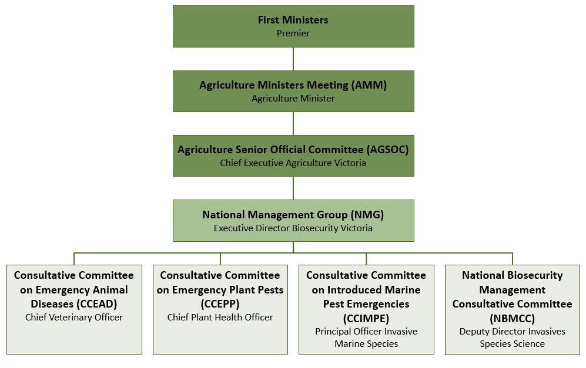

---
## Page 14

 
 
12 
SEMP  
Animal, Plant, Marine and Environmental Biosecurity Sub Plan  
 Advising the Emergency Management Commissioner on the existence of, or potential for, a biosecurity 
emergency in Victoria. 
 Working with organisations at the source of a biosecurity emergency to develop and oversee the 
implementation of effective incident response plans, including strategies to contain and eradicate active 
biosecurity threats. 
 Undertaking the control activities and eradication activities associated with the biosecurity incursion.    
 Working with support agencies, Victoria Police, other government departments and private businesses to 
undertake operational response activities.  
 Supporting the Emergency Management Commissioner through provision of regular situation updates 
and expert biosecurity advice.  
 Providing information and strategic advice to the Premier and Cabinet (including any Cabinet 
subcommittees), and SCRC on whole-of-government response activities for biosecurity emergencies. 
3.4 Legislation 
The following legislation, while not exhaustive, represents the principal foundation for biosecurity 
management in Victoria, although other Acts and regulations may be used depending on the situation. 
Biosecurity Act 2015 (Commonwealth) 
Catchment and Land Protection Act 1994 
Emergency Management Act 1986 and Emergency Management Act 2013 
Fisheries Act 1995 
Livestock Disease Control Act 1994  
Livestock Management Act 2020 
Plant Biosecurity Act 2010 
A complete list of relevant legislation is provided in Appendix 12.1. 
This legislation provides a broad range of powers to biosecurity staff to facilitate the effective management of 
pest, disease and weed incidents. Some examples of the powers that are distinct from other emergencies 
include: 
 Designating Restricted and Control Areas where specific biosecurity requirements and movement 
controls can be implemented. 
 Application of Infested Lands Notices and Quarantine Notices on premises where a biosecurity risk is 
known to occur, which restricts movement on and off the premise, and directs for risk mitigation activities 
to be carried out. 
 Requiring industry and members of the public to report detections of specific pests and diseases to the 
government within specified timeframes. 
 Requiring businesses to undertake pest or disease control activities where a biosecurity risk is known to 
occur. This may include requiring the destruction of property, including livestock, plants, plant products 
and packaging. 
Traditional Owners: DEECA is committed to supporting Traditional Owner self-determination, as outlined in 
the Victorian Aboriginal Affairs Framework 2018-2023 and Self-Determination Reform Framework (2019). In 
addition to these whole-of-government policies, Government also has legal obligations to support Traditional 
Owners’ rights and responsibilities, outlined in the Traditional Owner Settlement Act 2010 (Vic), the 
Aboriginal Heritage Act 2006 (Vic), the Native Title Act 1993 (Cwth) and the Charter of Human Rights and 
Responsibilities Act 2006 (Vic).

---
## Page 15

 
 
 SEMP
 Animal, Plant, Marine and Environmental Biosecurity Sub Plan 
13 
OFFICIAL 
4. Mitigation 
4.1 Government 
The Commonwealth Government has responsibility for pre-border and border surveillance and quarantine 
activities, limiting the potential for pests and diseases to enter and establish in Australia in line with 
Australia’s appropriate level of protection. Similarly, Victoria sets entry conditions for products entering the 
state from elsewhere in Australia based on biosecurity risks. In Victoria, a range of agencies have identified 
responsibilities for mitigation activities. These are outlined in table 8 of the SEMP.  
Victoria conducts a range of surveillance programs for animal, plant and marine pests and diseases to detect 
new incursions before they become widely established, increasing the chance of successful eradication or 
containment and demonstration of state or area freedom to support market access. Victoria provides 
information on biosecurity that builds awareness and engagement across business, industry, and the wider 
community with respect to biosecurity.   
Victoria’s favourable pest and disease status is primarily maintained by the ongoing regulation of activities 
that have the potential to cause a pest or disease outbreak. These regulations are wide-ranging and apply to 
activities such as the import, keeping, movement and sale of plants, animals, and their products (e.g. milk, 
fruit, eggs). Wherever possible, DEECA works with the community and industry to encourage voluntary 
compliance and industry co-regulation. 
Where DEECA identifies non-compliance with biosecurity legislation, it will take enforcement action 
proportionate to the risk posed by the non-compliance. Penalties for failing to comply with biosecurity 
regulations can be severe and include imprisonment. 
4.2 Individuals and Community 
Building safer and more resilient communities is a shared responsibility of all Victorians. Community 
members can play a key role in mitigating biosecurity risks by educating themselves on what is ‘normal’ in 
their environment, thereby recognising and reporting any irregularities they notice in the flora and fauna of 
their area. Early detection is critical to minimising the size of a response. Some pests, diseases and weeds 
can spread very rapidly before they are detected. 
State legislation requires all those who suspect or know of the presence of specified pests and diseases to 
report that knowledge to the relevant authorities. 
Any suspected detections of plant or bee pests and diseases are reported through the Exotic Plant Pest 
Hotline – 1800 084 881. Plant pests can also be reported via online reporting forms while bee pests can be 
reported via email  honeybee.biosecurity@agriculture.vic.gov.au. 
Suspected detections of Emergency Animal Disease (EAD) are reported to the Emergency Animal Disease 
Hotline on 1800 675 888 (sick livestock, poultry, wildlife, and aquatic animals). 
Reports of invasive animal or plant species are reported to the DEECA Customer Contact Centre on 136 
186 or via the relevant online reporting forms.  
Marine pests can be reported via the relevant online form 
Further information can be obtained via https://agriculture.vic.gov.au/biosecurity. 
4.3 Traditional Owners  
DEECA will work in partnership with Traditional Owners to ensure biosecurity risks are understood and will 
support Traditional Owners to use cultural practices to manage and mitigate those risks. Mitigation can 
combine traditional Aboriginal practices like the use of fire and listening to Country with the latest advice from 
academics, botanists, ecologists, and farmers to ensure Country stays healthy.

---
## Page 16

 
 
14 
SEMP  
Animal, Plant, Marine and Environmental Biosecurity Sub Plan  
4.4 Industry 
Animals Health Australia (AHA) and Plant Health Australia (PHA) work with the Commonwealth, state and 
territory governments and member industries to support the delivery of biosecurity outcomes. Industry 
biosecurity plans developed and owned by industry associations on behalf of their members outline how 
growers and producers, industry associations and government will collectively minimise the impact of 
emergency pests and diseases on their industry.  
Industry organisations may also provide industry specific farm-biosecurity plans that can be readily adopted 
and implemented on-farm by growers and producers. Farm or business biosecurity management plans 
provide a way for producers to record how they are managing biosecurity risks including preventing the 
introduction of pests, disease, weeds, and contaminants to their property, spreading around their property, or 
spreading from their property. Biosecurity planning is also important for businesses involved in the 
agricultural sector to minimise their potential to spread pests and diseases from one property to another. 
Producers are strongly encouraged by industry, national and state peak bodies to develop these plans and 
they are often an integral part of farm assurance programs such as the Livestock Production Assurance 
Program for the red meat industry. 
In some industry sectors there are well-established traceability systems (e. g., electronic animal identification 
and Property Identification Codes) that help track animal or plant movements and facilitate timely and 
effective response by allowing rapid confirmation of movements that may have spread the pest or disease. 
DEECA works with industry and community stakeholders to ensure biosecurity risks are understood. DEECA 
also supports stakeholders to adopt practices to manage and mitigate those risks and to build resilience. 
These activities include creation of formal or informal collaborations and partnerships to build capacity and 
capability to undertake surveillance, monitoring activities and enhance early detection of outbreaks and 
targeted stakeholder engagement and strategic communication to increase understanding of biosecurity 
risks, appropriate measures and reporting mechanisms. 
General information regarding biosecurity including the latest updates/alerts, diagnostic services and pest or 
disease information can be found at https://agriculture.vic.gov.au/biosecurity

---
## Page 17

 
 
 SEMP
 Animal, Plant, Marine and Environmental Biosecurity Sub Plan 
15 
OFFICIAL 
5. Biosecurity Planning 
There is a robust process in place to undertake biosecurity planning to support risk identification and 
mitigation, management of emergency response and business continuity. This process is delivered at the 
farm, region, state, national and international levels. Biosecurity planning includes: 
 Commodity and pest/disease-specific import risk analysis to determine national border restrictions. 
 Industry biosecurity planning to identify priority pest threats and recommended mitigation measures to be 
driven by industry. 
 Contingency planning and strategy development for priority pests and diseases that inform and direct 
emergency response operations.  
 Participating in the development and maintenance of nationally agreed response management 
procedures such as PLANTPLAN, AUSVETPLAN and the Emergency Marine Pest Plan (EMPPLAN).  
Development and maintenance of farm or business biosecurity plans is implemented at the business level to 
mitigate the introduction and establishment of pest, diseases, and weeds. 
Victoria contributes to the development and implementation of these plans through well-established national 
arrangements and linkages with state-based industry bodies.  
The national documents can be accessed through DAFF15, AHA16 and PHA17 websites. 
DEECA also develops and maintains plans in relation to managing biosecurity emergencies, which are 
reviewed periodically. These include the Victorian State Emergency Animal Disease (EAD) Response Plan. 
DEECA plans align to those produced at the national level and ensure risk assessments and available 
biosecurity measures align to Victoria’s environment, industries and legislation. In addition, DEECA regularly 
engages in cross sector consultation with other government departments and agencies to consider cross 
portfolio risks, mitigation methods and different sector strategies and plans. Biosecurity planning also needs 
to consider aspects such as psychosocial, mental health and wellbeing of all parties involved even though 
such aspects are not directly related. 
 
 
15 www.agriculture.gov.au 
16 https://animalhealthaustralia.com.au/ 
17 https://www.planthealthaustralia.com.au/

---
## Page 18

 
 
16 
SEMP  
Animal, Plant, Marine and Environmental Biosecurity Sub Plan  
6. Preparedness 
The National Biosecurity Committee (NBC), established under the Intergovernmental Agreement on 
Biosecurity (IGAB), brings together all Australian governments in recognition that biosecurity is a shared 
responsibility and that a national, strategic approach to biosecurity threats and intergovernmental 
cooperation is required to mitigate and prepare for these threats. 
The NBC is supported by four sectoral committees and a communications and engagement network (Figure 
3). These provide policy, technical and scientific advice on matters affecting their sector, covering all pests 
and disease risks to the terrestrial and aquatic (inland water and marine) animals and plants, and the 
environment. The NBC may form expert groups and short-term task specific groups from time to time to 
provide advice and deliver key initiatives.  
 
Figure 3. National Biosecurity Framework for preparedness, including the Victorian representatives 
Preparing for biosecurity emergencies includes developing arrangements to ensure that, should a pest or 
disease outbreak occur, all the resources and services needed to respond can be efficiently mobilised and 
deployed. Preparedness activities include: 
 identifying and assessing the risk (i. e., Australia and Victoria maintain lists of high priority pest/disease 
threats which could impact on production, the community or the environment and actively monitor the 
situation overseas and within Australia and gather information to identify risks)  
 developing policy, operational arrangements, and plans (i.e. state or national disease strategies or 
contingency plans developed to guide the required response activities e.g. PLANTPLAN and 
AUSVETPLAN and Victorian State Emergency Animal Disease Response Plan) 
 ensuring adequate resources, systems and processes are in place 
 training response personnel and educating stakeholders and potentially affected industries and 
communities 
 maintaining and developing expertise 
 conducting exercises 
 evaluating preparedness and response activities 
 ensuring the necessary relationships, formal and informal mechanisms are in place across government 
industry and with Traditional Owners to support biosecurity outcomes. 
 ensuring relief and recovery activities are ready to commence concurrently with response activities.

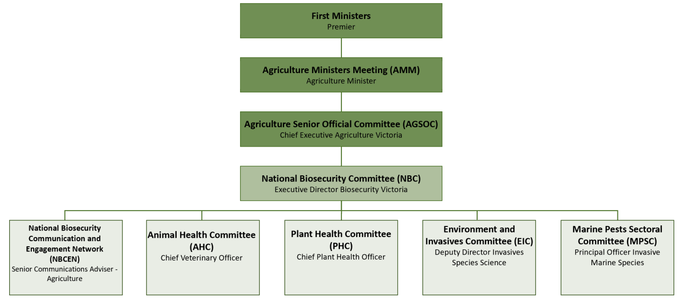

---
## Page 19

 
 
 SEMP
 Animal, Plant, Marine and Environmental Biosecurity Sub Plan 
17 
OFFICIAL 
DEECA maintains a 24/7 roster of veterinarians and authorised officers to ensure that all reports of 
suspected emergency animal diseases are responded to immediately. In addition, duty officers are available 
seven days a week to respond to emergency plant pest reports. 
A State Agency Commander, multiple Regional Agency Commanders and a Resource Officer are on duty 
every weekend and public holiday to ensure that DEECA can fulfill its biosecurity emergency management 
responsibilities and quickly initiate an incident management team if required. Availability and standby 
arrangements are in place so that necessary resources can be accessed. 
6.1 Victorian State, Regional and Municipal Planning 
Arrangements and interoperability 
There are several Australian and Victorian Government Ministers responsible for various aspects of 
biosecurity prevention, response and recovery and they all support the emergency management planning 
process. In Victoria, under the Emergency Management Act 2013, responsibility for preparation of 
emergency management plans, rests: 
 at state level, with the Emergency Management Commissioner 
 at regional level, with Regional Emergency Management Planning Committees (REMPCs)  
 at municipal level, with Municipal Emergency Management Planning Committees (MEMPCs).  
The SEMP outlines the roles of Emergency Management Commissioner, REMPCs and MEMPCs, including 
function and composition. 
Emergency-specific sub-committees at state, regional and municipal levels may provide at-level technical 
advice and guidance relating to biosecurity emergency management planning.  
6.2 Regional Planning 
The functions of REMPCs are outlined in the SEMP. DEECA provides representation to REMPCs in 
accordance with the provisions of the Emergency Management Act 2013.  
6.3 Municipal Planning  
The functions of MEMPCs are outlined in the SEMP. DEECA provides representation to MEMPCs as 
required.

---
## Page 20

 
 
18 
SEMP  
Animal, Plant, Marine and Environmental Biosecurity Sub Plan  
7. Response 
Biosecurity emergencies can vary greatly, in both their scale and complexity, and involve a range of 
dynamics not seen in a Class 1 natural disaster responses. Operational requirements such as surveillance, 
tracing, vector management, movement restrictions, treatment, destruction, and disposal require an incident 
management system which is specific to biosecurity emergencies.  
Biosecurity responses rely upon a close interoperability between agencies particularly in incidents involving 
zoonotic diseases (diseases that transmit from animals to humans) that require close collaboration with the 
Department of Health (DH); and outbreaks in native wildlife and feral animals that require collaboration with 
DEECA and some public land managers that have responsibilities for wildlife management and conservation 
as well as feral animal interventions. 
It is important to note that there is a clear differentiation between biosecurity “incidents” and “emergencies”. 
A biosecurity incident would not trigger a biosecurity emergency response. Biosecurity incidents can be 
small, localised events that are managed within business as usual (BAU) arrangements as Level 1 events.  
7.1 Investigations and alert 
When a significant pest or disease is detected, DEECA is required to immediately notify all affected parties 
(governments and industry bodies) through the Australian Government under the Emergency Animal 
Disease Response Agreement (EADRA), Emergency Plant Pest Response Deed (EPPRD) or National 
Environmental Biosecurity Response Agreement 2.0 (NEBRA).  
The Executive Director Biosecurity Victoria, Chief Veterinary Officer, and Chief Plant Health Officer also 
advise the Emergency Management Commissioner on the identification of imminent significant biosecurity 
threats. 
Biosecurity arrangements apply on a continuing basis and do not need to be activated. 
DEECA will immediately commence surveillance activities to delimit the extent of the incident, trace the 
potential movement pathways of the pest/disease back to the original source of introduction (if possible) and 
likely movements forward from the detection point, together with implementing quarantine or movement 
controls to limit further spread.

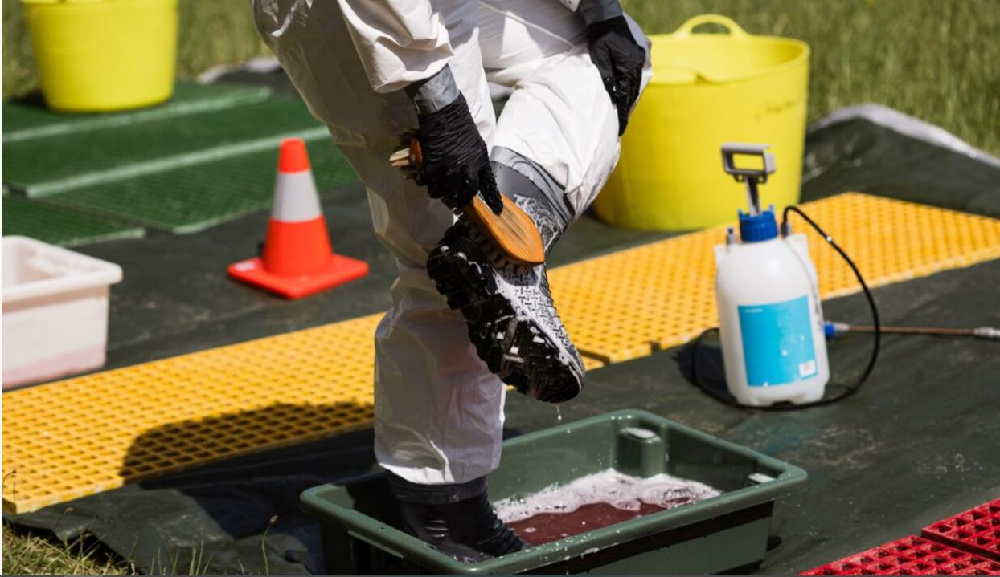

---
## Page 21

 
 
 SEMP
 Animal, Plant, Marine and Environmental Biosecurity Sub Plan 
19 
OFFICIAL
7.2 Biosecurity responses have distinct characteristics. 
Biosecurity responses have distinct characteristics which impacts the management structures and operational approaches (Table 1). 
Table 1: Characteristics of a biosecurity emergency response 
Facet 
Characteristics of a biosecurity emergency response 
Complexity 
• Different pests or diseases may require completely different approaches to their control.  
• Policies and control measures, often vary over time, depending on the stage of the response and as developments arise, and may be 
influenced by scientific, industry and political drivers.  
• This evolution recognises the need to adapt to the changing situation and, particularly in the case of emerging pests and diseases, the 
availability of new information. 
Movement 
• Spread of the disease or pest can be rapid and wide via the movement of hosts (e.g. animals, plants), vectors (e.g. insects, products, 
vessels), or fomites that passively carry the disease or pest (e.g. clothing, equipment, machinery). Spread can also be by aerosol or in 
water. 
• Biosecurity measures typically need to be established very rapidly to limit the spread and may include widescale restrictions on the 
movement of animals, products, people and vehicles. 
Spread 
• Rapid dispersal of pests and diseases by natural means (i.e., wind or water-borne spread) or of animal and plant products by road, rail, air 
and ship can result in a wide affected area, at times including more than one jurisdiction. 
• Areas and sites affected by the pests and diseases need to be determined by extensive testing and surveillance and may not be easy to 
determine, especially in the early stages when it is likely that the actual extent of the pest or disease is much greater than what is known at 
the time. 
• This can have implications for the impact on industries, the community, tourism and trade, and the resources required to control the disease 
or pest. 
Level of public 
and industry 
engagement 
• Biosecurity emergencies require early education and information, and continuing engagement with industries, support agencies and the 
community if they are to succeed.  
• A unique feature of biosecurity emergencies is that potentially affected industries play a significant role in preparing for and responding to 
biosecurity incidents. 
• Industry may be required to part-fund some disease responses, under national cost-sharing arrangements. 
Economic and 
social Impact 
• A pest or disease outbreak will affect not only individuals, industry, and the local community, but also, potentially, export trade and the 
Australian community in general.  
• The direct impacts on associated industries can also be severe. The most effective way to minimise the impact is through rapid detection of 
disease or pest and implementation of effective control measures.

---
## Page 22

 
 
20 
SEMP  
Animal, Plant, Marine and Environmental Biosecurity Sub Plan  
Facet 
Characteristics of a biosecurity emergency response 
• Impacts are often beyond the immediate area infected and can have significant social, economic, and reputational consequences for 
producers/industries without disease.  
Public health 
• Many emergency animal diseases are caused by zoonotic infectious agents — that is, agents that can also infect humans.  
• Human, pets, livestock, and native animals may be impacted by chemical control measures implemented as part of the response, or directly 
from the pests under eradication (e.g. invasive ants).  
• This has important implications for those impacted by the response activities and those working in the response.  
• In addition, mental health and wellbeing of producers, industry employees and those working in the response operation can be significantly 
impacted.  
• It is important that response personnel are aware of appropriate measures to minimise risk to people and ensure appropriate workplace 
health and safety controls are applied.   
• Appropriate safety measures need to be part of the public information messaging. 
Duration 
• Biosecurity emergencies can go for months and in some cases years at a high tempo requiring sustained effort to deliver the response 
outcomes.  
• These features influence many aspects of the response including selection of control centre locations (e.g. sports grounds and community 
halls are not appropriate) and the ability to meet the personnel requirements. 
• There are also challenges with business continuity for staff removed from their roles for extended periods. 
Context 
• Victoria works within both established Australian frameworks as well as international standards for biosecurity.  
• Cost-sharing arrangements for the response are already set for many diseases and are agreed by industry as well as Commonwealth, state 
and territory jurisdictions. 
Scale 
• Information on the extent of the pest or disease spread and/or the potential host range is often incomplete.  
• It is therefore appropriate to commence a wide-scale response (within reason for the pest or disease and its likely impact), and then scale 
the response as more information becomes available. Resources should be deployed commensurate with need. 
Unusual 
workplace 
conditions  
• Although the chemical, physical and psychological hazards encountered during a pest or disease response are not unique, they are likely to 
be experienced on an unusual scale and for an extended duration.  
• This requires that special consideration is given to managing the associated risks. 
Biodiversity 
• Impacts to wildlife and introduced pest species are likely to be extremely challenging to manage because of the numbers of animals 
potentially impacted, the fact that many species are highly mobile across the landscape and the difficulty in identifying, treating, and 
monitoring wild populations.   
• An effective response will include supporting wildlife rehabilitators in implementing appropriate biosecurity measures for animals within their 
care.

---
## Page 23

 
 
 SEMP
 Animal, Plant, Marine and Environmental Biosecurity Sub Plan 
21 
OFFICIAL
Facet 
Characteristics of a biosecurity emergency response 
• The response may include the management of risk of disease spread by human intervention through interaction with wildlife and introduced 
pest species. 
Aboriginal 
Cultural 
Heritage 
• Impacts to wild animals that are totemic species will be extremely challenging to manage. 
• Impacts to plant species that have cultural significance may be extremely challenging to manage. 
• Potential for control measures to limit access to Country or the practice of traditional land management activities. 
• Potential for increased obligations for Traditional Owners as land managers where Joint Management Plans may apply.

---
## Page 24

 
 
22 
SEMP  
Animal, Plant, Marine and Environmental Biosecurity Sub Plan  
7.3 Incident Management System  
In responding to a biosecurity emergency, DEECA will implement a structure according to the principles of 
the Australasian Inter-service Incident Management System (AIIMS) and the national Biosecurity Incident 
Management System (BIMS), with contextual modifications to facilitate the complexity and nuances of 
biosecurity responses. BIMS is designed to complement state and legislative obligations and sector-specific 
arrangements described in AUSVETPLAN, AQUAVETPLAN, PLANTPLAN and EMPPLAN (see Figure 6 for 
two examples of how an Incident Management Team can be structured under BIMS).  
The structure of biosecurity incident management will have two functions: 
 provision of strategic policy and technical direction; and 
 planning and implementation of operational activities. 
Under the national Biosecurity Incident Management System (BIMS), five incident levels are recognised to 
account for escalating complexities and the potential for responses that need coordination of national or 
international resources (Table 2).  
In Victoria, biosecurity emergencies are classified as Level 1, 2 or 3 based on the size, scale and risk of the 
incident and the resources required to manage it. Level 3 biosecurity emergencies are infrequent, more 
complex and are classified as major emergencies. 
Level 1 Response: 
A Level 1 response is a localised response that is managed as a biosecurity incident. In a Level 1 biosecurity 
response, an Incident Controller will be appointed to control field operations. The Incident Controller could be 
a Regional/ Senior Manager and will be operating under strategic and technical advice provided by the Chief 
Technical Officer who has responsibility for the entire response (Table 2). The senior manager will also have 
responsibility for national or state level coordination under the direction of the Chief Technical Officer and 
Executive Director Biosecurity Victoria if required. 
Level 2 Response: 
A Level 2 response is a local or regional response where the size, scale, risk or resource requirements 
require the establishment of the BIMS structure. A Level 2 response may require activation of the state 
biosecurity operations centre (SBOC) to support the interface with the national biosecurity emergency 
arrangements. 
The specific characteristics of the locality or area, affected industry sectors, the type of pest or disease and 
required control measures will determine the appropriate control structures and level of the response. 
However, in general a Level 2 response may involve multiple sites within a defined geographic area. Control 
will require a local command centre with potential for forward command posts within or outside the area. It is 
possible that other forward command posts or local command centres may be established to support 
incident management, but a small scale and low complexity of each incident may not warrant escalation to 
level 3 (see 2020 Avian influenza example below). 
In some circumstances a Level 2 biosecurity emergency may require the appointment of a State Controller 
Biosecurity to ensure effective management of the emergency.  
A State Controller Biosecurity will be appointed for: 
 any Class 2 major biosecurity emergency (regardless of whether this is managed at a level 2 or level 3 
arrangement) 
 any level 2 or 3 response where Victoria is the lead under national cost-sharing arrangements activated 
under the EADRA, EPPRD or NEBRA, or  
 other circumstances as approved by the Control Agency Officer in Charge. 
Where a State Controller Biosecurity is to be appointed, the Agriculture Victoria Chief Executive will brief the 
Secretary, as the Control Agency Officer in Charge of the biosecurity emergency, recommending the 
appointment of suitable executives to be appointed as State Controller Biosecurity.

---
## Page 25

 
 
 SEMP
 Animal, Plant, Marine and Environmental Biosecurity Sub Plan 
23 
OFFICIAL 
The Emergency Management Commissioner will be consulted as part of the appointment as per the 
requirements of the State Emergency Management Plan.  
In a Level 2 biosecurity emergency, the State Controller Biosecurity will control the response, acting on 
strategic and technical directions set by the Chief Technical Officer in line with a nationally agreed response 
plan, when applicable (Figure 5), and reporting to the Executive Director Biosecurity Victoria. The Chief 
Technical Officer oversees the technical and policy aspects of the response.  
A Level 2 event may require activation of the Class 2 cell of the State Control Centre to provide additional 
coordination support particularly with accessing surge resources. Level 2 responses may require the 
assistance of resources and specialist support from other jurisdictions, the private sector (e.g. vets) or from 
other government agencies.  
Level 2 responses may also require relief and recovery activities at the local level (see Section 9).  
A level 2 response may have national and international implications mostly due to disruptions to export 
arrangements.  
Level 3 Response:  
A Level 3 response is a large, complex event across multiple regions or state-wide occurrence of the hazard. 
A Level 3 response will require significant whole of government coordination owing to the coordination 
requirements triggering the need for activation of the state control centre and state arrangements.   
A Level 3 event will have significant economic impacts and with flow on community impacts and public 
concern. A Level 3 event will have significant national and international implications.  
A Level 3 biosecurity emergency will require the appointment of a State Controller Biosecurity. The 
Agriculture Victoria Chief Executive will brief the Secretary, as the Control Agency Officer in Charge of a 
biosecurity emergency, recommending the appointment of suitable executives to be appointed as State 
Controller Biosecurity. 
The Emergency Management Commissioner will be consulted as part of the appointment as per the 
requirements of the State Emergency Management Plan.  
The State Controller Biosecurity will control the response, acting on strategic and technical directions set by 
the Chief Technical Officer in line with a nationally agreed response plan (Figure 5), and reporting to the 
Control Agency Officer in Charge. 
The separation of the State Controller Biosecurity and Chief Technical Officer roles in Level 3 biosecurity 
emergencies is required to facilitate differentiation of state-wide operational control and the Chief Technical 
Officer role in national engagement and provision of technical direction (Figure 5). 
A Level 3 event will require activation of the State Control Centre to provide additional whole of government 
coordination and support.  
Victoria has never conducted a level 3 response. Recognising that a level 3 response would be required for 
a foot-and-mouth disease or similar outbreak, significant planning has been undertaken and detail is 
provided in the State Emergency Animal Disease Response Plan. 
Escalation of a response to a higher level 
The Executive Director Biosecurity Victoria is responsible for monitoring the progress, risks and changing 
circumstances of a response and will advise on whether an emergency should be escalated to a higher level 
(e.g. from Level 2 to Level 3).  
An event specific escalation plan will be developed in the early stages of the event to describe the triggers 
and considerations for monitoring and escalating a response from level 2 to level 3.  
The decision to escalate from Level 2 to Level 3 resides with the Control Agency Officer in Charge and will 
be made in consultation with the Emergency Management Commissioner. 
The factors that will inform escalation are set out in Table 2 and include:

---
## Page 26

 
 
24 
SEMP  
Animal, Plant, Marine and Environmental Biosecurity Sub Plan  
 the spread of the disease/pest from a localised event to multiple regions or state-wide with consideration 
to the size or complexity of the situation in each locality,  
 the level of involvement and coordination needs relating to other departments and agencies in supporting 
the response, and 
 the subsequent increase in impacts and consequences. 
Example of a level 2 response: 2020 avian influenza response whereby one local command centre was 
established and three forward command posts. While there were three different localities (Gannawarra, 
Gippsland and Meredith), each locality was a relatively small and straightforward response. (Figure 4). 
Figure 4: Example of a level 2 response from the 2020 avian influenza response

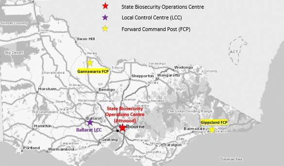

---
## Page 27

 
 
 SEMP
 Animal, Plant, Marine and Environmental Biosecurity Sub Plan 
25 
OFFICIAL
Table 2: National and Victorian Biosecurity Incident Categories 
National BIMS 
Classification 
Victorian Incident Level 
Classification 
Description 
Considerations for 
classification 
Impacts and consequences 
Level 1 
Localised 
response 
Level 1 
Localised response  
Regional / Senior Manager 
controls field operations. 
The CTO sets strategic and 
technical direction.  
Investigation for pest or disease exclusion or very 
small/limited low complexity incident. 
Generally managed with local resources under BAU 
arrangements and would not trigger an emergency 
response. However, may require regional or state 
assistance in some circumstances.  
National response plan may be developed. 
A report of a suspected or 
confirmed biosecurity threat 
that can be managed with 
local resources and under 
BAU arrangements. 
Potential for impacts if the threat is 
confirmed to market access, public 
health, environmental implications or 
reputational harm to agency or 
industry. 
Level 2 
Local or regional 
response 
Level 2 
Local or regional response  
IC reports to SCB (f 
appointed) who reports to 
the Executive Director 
Biosecurity. The CTO sets 
strategic and technical 
direction for the response. 
Confirmation of identification of high-risk biosecurity 
threat.  
Establishment of IMT structure, including establishment 
of the SBOC and one or more LCCs or FCPs. 
SCB appointed by the CAOiC (DEECA Secretary) to 
control the response. Deputy SCBs may also be 
appointed as required.  
Response may be state-wide, in coordination with 
national arrangements and other jurisdictions.  
National response plan likely to be developed. 
Emergency resourcing arrangements implemented. 
Partner agencies informed through SEMT, REMTs or 
local emergency management teams and support may 
be required. 
Response may require partner agency staff resourcing 
support. 
Response may require resources from other 
jurisdictions. 
The size, scale, risk or 
resource requirements 
exceed the capacity to be 
effectively managed under 
BAU arrangements with local 
resources.  
Resourcing may extend 
across DEECA, other 
agencies and includes 
interjurisdictional 
arrangements. 
The complexity of the 
response is also considered. 
The biosecurity threat raises 
significant public concern. 
Biosecurity threat poses economic 
impacts to affected businesses and 
a threat to life and/or mental well-
being in a limited area (locality) or 
industry. 
Localised community impacts (e.g. 
due to restrictions in Control or 
Restricted areas) 
Market access issues affect one or 
more industry sectors in Victoria for 
the medium to long term.

---
## Page 28

 
 
26 
SEMP  
Animal, Plant, Marine and Environmental Biosecurity Sub Plan  
National BIMS 
Classification 
Victorian Incident Level 
Classification 
Description 
Considerations for 
classification 
Impacts and consequences 
Level 3 
State-wide 
response 
Level 4 
Response with 
resources from 
other 
jurisdictions18 
Level 5 
Response with 
international 
resources19 
Level 3 
State-wide response, in 
coordination with national 
arrangements and other 
jurisdictions 
IC reports to SCB with 
strategic and technical 
direction set by CTO under 
national response plan.  
 
Large and or complex biosecurity response. 
Multi-jurisdictional impacts requiring national response  
Establishment of IMT structure, including establishment 
of SCC, SBOC and one or more LCCs. 
SCB appointed by the CAOiC (DEECA Secretary). 
Deputy SCBs may also be appointed as required.  
National response plan will to be developed. 
Emergency resourcing arrangements implemented. 
Partner agencies support required through SCT, SCoT, 
SEMT and SRRT. 
Response with resources from other jurisdictions and 
international resources. 
Large scale and protracted response requiring early 
initiation of partner agency staff resourcing support. 
A state-wide response being 
managed at the state level. 
Response exceeds capacity 
of DEECA to resource 
effectively. 
Significant involvement and 
coordination needs across 
government 
Outbreak or incursion requires 
national or international 
resources. 
 
Biosecurity threat and response 
raise significant public concerns. 
Biosecurity threat and/or response 
poses significant economic impacts 
to businesses and threat to life 
and/or mental wellbeing across 
multiple localities (state-wide) or 
industries. 
Lengthy international and interstate 
market access issues for multiple 
large industry sectors. 
Significant impacts on Victorian 
communities 
Viability of producers in affected 
sectors is significantly compromised 
over a long length of time. 
Acronyms: BAU = business as usual  |  BIMS = Biosecurity Incident Management System  |  CTO = Chief Technical Officer  |  DEECA = Department of Energy, Environment and Climate Action  |  IC = Incident Controller  |  IMT = 
Incident Management Team  |  LCC = Local Control Centre  |  SBOC = State Biosecurity Operations Centre  |  SCB = State Controller Biosecurity  |  SCT = State Control Team  |  SCoT = State Coordination Team  |  SEMT = State 
Emergency Management Team  |  SRRT = State Relief and Recovery Team
 
18 May apply to Level 2 and Level 3 Victorian Incident Level Classification  
19 May apply to Level 3 Victorian Incident Level Classification

---
## Page 29

 
 SEMP 
 Animal, Plant, Marine and Environmental Biosecurity Sub Plan 
27 
OFFICIAL 
 
Figure 5: Governance arrangements for Level 2 and Level 3 biosecurity emergency response in Victoria 
In some circumstances interstate biosecurity incidents may trigger the need for an emergency response to 
be established even though the pest or disease is not present in Victoria. In this case the focus of activities 
will be preventing the spread of the pest or disease to Victoria, completing surveillance to demonstrate 
freedom of the pest or disease and facilitating safe trade, along with managing relief and recovery activities 
associated with wider consequences, such as suspension of exports that may impact on Victorian producers 
and businesses.

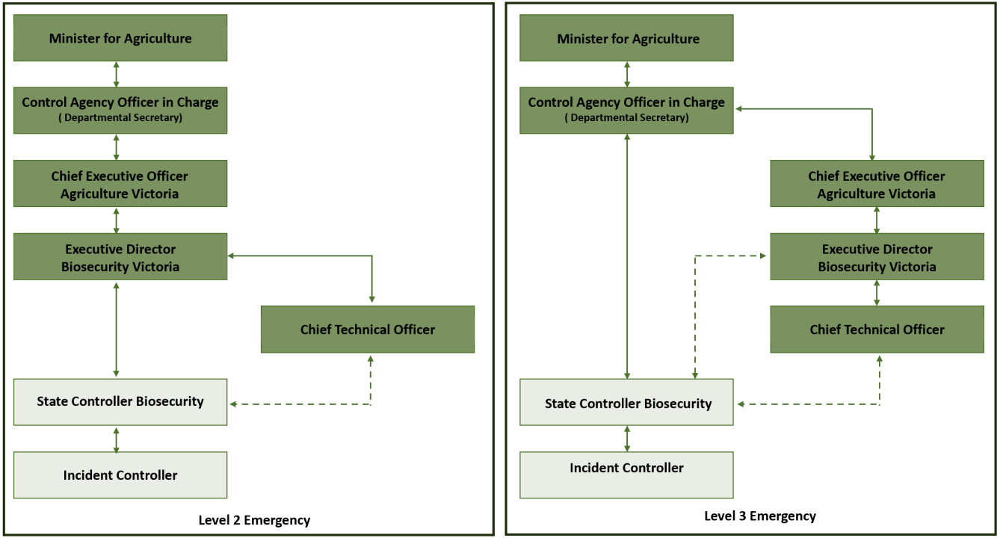

---
## Page 30

 
28 
SEMP  
Animal, Plant, Marine and Environmental Biosecurity Sub Plan  
 
Figure 6: Example of an indicative BIMS Incident Management Team structure at the State and Local Control 
Centres – Level 3 event. Functional areas may be combined or split further for flexibility and span of control

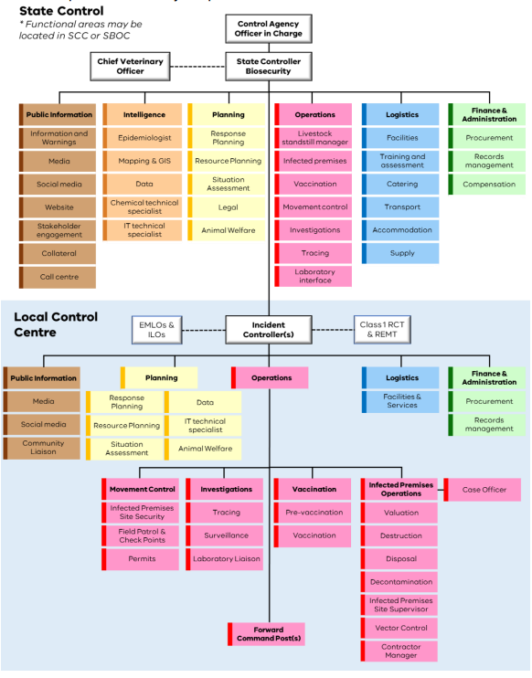

---
## Page 31

 
 SEMP 
 Animal, Plant, Marine and Environmental Biosecurity Sub Plan 
29 
OFFICIAL 
7.4 Strategic policy and technical direction 
Delivery of the response is guided by national and state plans such as the Victorian State Emergency Animal 
Disease (EAD) Response Plan. 
For each biosecurity response, an incident specific Response Plan is developed under the EADRA, EPPRD 
or NEBRA. These documents provide the high-level strategy and details of the activities to be undertaken, 
together with an indicative budget. Response Plans must be agreed by all affected parties (governments and 
industry) through the relevant National Management Group prior to implementation. 
The Chief Veterinary Officer or Chief Plant Health Officer leads engagement on behalf of Victoria in national 
arrangements, is generally the media spokesperson and is responsible for the strategic and technical 
direction of the response. The Chief Veterinary Officer or Chief Plant Health Officer works very closely with 
the State Controller Biosecurity and provides technical input, undertakes strategic planning and leads 
response communications and industry engagement.  
Table 3: Nominated Chief Technical Officer for biosecurity hazards 
Chief Technical Officer 
Hazard 
Relevant Consultative 
Committee20 
Chief Plant Health Officer 
Emergency Plant Pest (including bees) 
CCEPP 
Marine pest incursion 
CCIMPE 
Vertebrate pest incursion 
NBMCC 
Weed and environmental pest incursion 
NBMCC 
Chief Veterinary Officer 
Emergency Animal Disease 
CCEAD 
Aquatic Emergency Animal Diseases 
AqCCEAD 
7.5 Control 
During a biosecurity emergency response, DEECA will implement a response control structure and establish 
operations centres at levels appropriate for the incident. In the case of a biosecurity incident of national 
significance, the response will require a coordinated approach across multiple government agencies and 
affected industries. Consequently, response activities will occur and be managed at multiple levels. These 
may include national, state, local, and field. Where necessary, adjustments may be made to the pre-
determined governance structures to facilitate an effective response, for example, adding additional Deputy 
State Controllers where necessary. 
For a biosecurity emergency response, strategic decision-making for the response occurs at the national and 
state level with state level control and coordination being managed through the State Biosecurity 
Operations Centre. If required, DEECA can request activation of the State Control Centre (SCC) managed 
by Emergency Management Victoria. The Local Control Centre and Forward Command Posts focus on 
operational delivery within those parameters.  
 State Control Centre (SCC): The SCC is Victoria’s primary control centre for managing emergencies 
and would be activated in a Level 3 response. The SCC’s responsibility is to ensure the control and 
coordination strategies and arrangements are appropriate and adequate for current emergencies. 
 State Biosecurity Operations Centre (SBOC): primary responsibility for the strategic planning and 
coordination of biosecurity operational activities across Victoria.  
 Local Control Centre (LCC): primary responsibility for planning, conducting, and supporting all 
operational activities in its geographical area of responsibility. 
 Forward Command Post (FCP): There may be a need to establish one or more FCPs. The FCPs will 
manage field activities within a defined geographic area, with a focus on an identified task or range of 
 
20 Representative may be different from the Chief Technical Officer (see Figure 2)

---
## Page 32

 
30 
SEMP  
Animal, Plant, Marine and Environmental Biosecurity Sub Plan  
tasks. FCPs are usually established to manage field activities associated with several premises or well-
defined area, manage specific operational tasks in a defined area or conduct operational activities in a 
remote area. 
A Regional Control approach is rarely established for biosecurity responses, however regional emergency 
management structures and arrangements may be important for supporting operational activities and for 
coordinating activities between agencies.  
7.5.1 Zoonotic risk management in a biosecurity response 
Some biosecurity emergencies involve zoonotic diseases which can have an impact on human health. 
Incidents involving zoonotic diseases will be reported to DH which is responsible for undertaking the 
assessment of human health risks and responding to human health issues. 
All human health issues will be led by DH in accordance with the State Health Emergencies Sub-Plan.  
In responding to incidents affecting both human and animal health, the appropriate governance is 
determined by the Chief Veterinary Officer, Chief Health Officer or delegates, and may include the formation 
of:  
 a joint IMT, or  
 concurrent animal health and human health IMTs with liaison officers appointed to enable a coordinated 
response.   
The response to outbreaks, incidents and emergencies affecting human and animal health will be delivered 
in keeping with: 
 the Memorandum of Understanding between DEECA and DH for the Joint Management of Zoonotic 
Diseases and Related Human and Veterinary Public Health Matters, and  
 the subordinate Zoonotic diseases joint protocol between the Department of Health and Agriculture 
Victoria.  
7.6 Planning 
Planning manages the collection, collation, analysis, interpretation, and dissemination of information, and in 
biosecurity responses is delivered at the strategic and operational levels. The planning function acts as an 
information centre and through providing information contributes to the situational awareness of all staff 
involved in the response. 
Epidemiology is a critical function within planning in biosecurity emergencies. It informs planning on the 
evolution of a disease outbreak or pest incursion and the appropriate management interventions. 
Biosecurity responses generate very large amounts of data which requires analysis to provide information to 
inform decision making. Therefore, planning will include a large technical analyses and data management 
sub-function. The exercise of legislated powers with respect to movement controls, activities on properties 
and potential payment of compensation require a significant legal function to be included within the planning 
function. 
The planning unit also forecasts future needs and acquires human resources from across DEECA, the 
Emergency Service Organisations through Emergency Management Victoria and other departmental 
agencies.

---
## Page 33

 
 SEMP 
 Animal, Plant, Marine and Environmental Biosecurity Sub Plan 
31 
OFFICIAL 
7.7 Operations 
Operational activities in a biosecurity response can be very significant encompassing multiple regions and 
several different activities. The main activities are: 
 Investigation – gathering information that will assist in identifying the source and potential spread of the 
pest or  
– Tracing - to identify where pests or disease may have moved from or to. 
– Surveillance – initially this is focused on undertaking surveillance within a region or across the state 
to identify any affected sites that have not been detected through investigations.  
 Proof of Freedom - the later stages of the response may become focused on gathering evidence 
to demonstrate the successful eradication in order to reinstate a disease or pest-free status for 
Victoria and regain market access. 
 Movement Controls – Depending on the situation and level of risk, a Control Area, Restricted Area, or 
Infected Premises may be declared (see Figure 7). These declarations will specify any prohibitions, 
restrictions and requirements which are required to operate in the declared area. A national livestock 
standstill is the highest level of movement control, where the movement of all susceptible species is 
prohibited for a minimum of 72 hours. 
 Suspected and Infected site operations – Typically including quarantine, valuation, destruction, waste 
disposal, decontamination, and monitoring. In the first instance, advice on waste disposal strategies may 
be sought internally from DEECA (Climate Action and Circular Economy Division- Waste Emergencies 
Unit). Specialist advice on disposal options may be sought from the Environment Protection Authority 
Victoria (EPA), landfill operators and local councils (as appropriate) as disposal on site (on property) may 
not be an option. Approvals from EPA may be required for both onsite disposal and offsite transport and 
disposal of wastes. During a major biosecurity event where significant volumes of waste requires offsite 
disposal to either existing waste infrastructure or event specific disposal locations, a separate cell may 
be required to be established in the operations area to coordinate the logistics associated with offsite 
waste transport and disposal.  
 Relief – Considerations for the welfare of animals is an important priority when enacting quarantine, 
movement controls and other biosecurity measures. Relief services may also be provided to primary 
producers and rural landholders impacted by biosecurity emergencies as well as impacted industry 
employees (note: if the only relief services are compensation and animal welfare, these would not be 
services coordinated by regional relief coordinators (responsible for multi-agency coordination) as both 
are the responsibility of DEECA (Agriculture Victoria).  
 Wild and feral pest populations – Movement controls, exclusion, monitoring, and other operational 
activities for wild and feral pest populations may be different to those applicable for livestock.  Setting up 
operational activities for these wild populations will also require an understanding of the ecological 
impacts of a species being impacted.

---
## Page 34

 
32 
SEMP  
Animal, Plant, Marine and Environmental Biosecurity Sub Plan  
 
Figure 7: An example of declared areas during the 2020 Avian Influenza outbreak. 
7.8 Logistics 
The logistics function delivered in a biosecurity emergency response is consistent with that implemented for 
other emergencies. It is responsible for the provision of contracted resources including human and physical 
resources, facilities, services, and materials required by the other functions in the response. The delivery of 
this function may differ from other sectors primarily in the requirement to acquire specific biosecurity or 
animal/plant health skills in the response staff and the specialist equipment they may require. 
7.9 Finance and administration 
A significant component of the operational activities, especially those on site, may be undertaken by the 
private sector. Therefore, a finance and administration function is often established separate to logistics, to 
ensure that the capability and capacity required is procured and the financial aspects managed effectively. 
The area is also responsible for ensuring document management and record keeping for the emergency. 
7.10 Public information 
Public information is time-critical information that audiences need to respond appropriately during and after a 
biosecurity incident. Information is disseminated to, and received from, the public/communities, affected 
industries, the media, stakeholders and within an agency/organisation.  
Timely, accurate, consistent, and tailored information helps the community and affected stakeholders prevent 
the spread of pests, diseases and invasive species and aid containment, control and eradication efforts.  
Public information also plays an important role in informing media and the public about invoked laws, such as 
movement restrictions and controlled quarantine areas.  
Effective communication and engagement are vital in responding to an incident. In addition to assisting with 
the response, keeping the public informed improves the perceived effectiveness of a response and can 
assist with recovery.

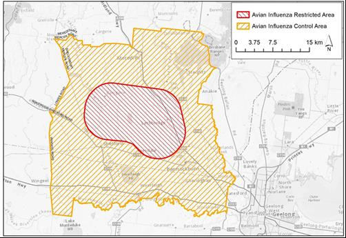

---
## Page 35

 
 SEMP 
 Animal, Plant, Marine and Environmental Biosecurity Sub Plan 
33 
OFFICIAL 
In biosecurity emergencies, the early education and continuing engagement with industries, border animal 
care and welfare sector, support agencies and the community are crucial. A successful response relies on 
wide-scale voluntary compliance with restrictions, public reporting of suspected cases or breaches of 
movement controls and maintaining public and industry trust and confidence over an extended duration 
when they may be experiencing very difficult circumstances owing to the impacts of the pests or disease or 
the measures to control it. 
The public information section will adapt communications and engagement techniques and channels as the 
situation needs, which can include but is not limited to: paid advertising, community and stakeholder 
engagement such as events and webinars, VicEmergency, outbound calls and SMS and leveraging other 
channels appropriate to the incident and the audience.  
The National Biosecurity Communication and Engagement Network (NBCEN) is the national group tasked 
with producing and disseminating nationally consistent public information in response to animal, plant, and 
other biosecurity incidents. Regardless of incident level, the NBCEN can be used to coordinate the public 
information response nationally. The NBCEN will circulate media releases, talking points and other public 
information material across jurisdictions to ensure consistent messaging. 
During a biosecurity incident the NBCEN:  
 develops National Talking Points and facilitates the consultation process of those messages 
 reports to and provides strategic communication advice to the relevant technical consultative committee 
or National Management Group  
 develops a national communication and engagement strategy for agreement by the relevant technical 
consultative committee or National Management Group and oversees its implementation where required 
 ensures that national media and communication procedures for biosecurity incidents are activated and 
implemented accordingly  
 explains policies, plans and practices to all stakeholders clearly, consistently, openly and quickly  
 facilitates the flow of information between jurisdictions (related to public information activities)  
 provides experienced public information officers to other jurisdictions (where available and/or necessary)  
 ensures the key principles of crisis communication are upheld throughout a response to a biosecurity 
incident. 
The national Biosecurity Incident Public Information Manual also provides valuable templates and guidance 
for use in a biosecurity incident.  
For major emergency animal disease responses, a whole of Victorian Government Communications plan is 
in place. 
Emergency Management Joint Public Information Committee (EMJPIC) meets for those incidents where 
coordination of messaging across the Victorian Government is required. The overarching responsibilities of 
EMJPIC include: 
1. Provide assurance to the Emergency Management Commissioner, State Control Team and State 
Emergency Management Team that Whole of Government communications planning, strategy and 
delivery before, during and after major emergencies, are in place. 
2. Develop and implement media, communication and engagement planning where: 
a. An emergency requires a multiple-agency response, or 
b. the portfolio responsibility is shared by multiple Ministers, or 
c. an incident has the potential for significant consequences for communities. 
3. Strengthening Whole of Victorian Government communications as well as state, region and incident 
communications and community engagement before, during and after major emergencies. 
4. Discuss and determine media, communication and community engagement functions and responsibilities 
before, during, and after emergencies for all communities including Culturally and Linguistically Diverse 
(CALD) communities and people with a disability.

---
## Page 36

 
34 
SEMP  
Animal, Plant, Marine and Environmental Biosecurity Sub Plan  
7.11 Emergency information and warnings 
Issuing of community information is a key incident priority. This encompasses community warnings detailing 
incident information that are timely, relevant, and tailored to assist community members make informed 
decisions.  
Following the detection of a biosecurity outbreak, DEECA will work quickly to publish key information online. 
This may be on the Agriculture Victoria website for most incidents, and for Level 3 incidents of concern, a 
standalone website may be activated through the Victorian Government’s Single Digital Presence. This 
online information will include the following messages:  
 a description of the pest or disease 
 symptoms of the disease and how to report suspected detections 
 details about the outbreak 
 what government is doing 
 what the government requires the community to do 
 what can be done to reduce the risk (biosecurity measures) 
 what are the rules / legal obligations (e.g. movement controls) 
DEECA will also work with the Warnings and Advice Duty Officer at the State Control Centre to provide 
community information, advice, or warnings as appropriate. In extreme threat circumstances (such as an 
outbreak of foot-and-mouth disease), the Class 2 State Controller Biosecurity may determine that public 
warnings are required. These warnings will be issued by the Warnings and Advice Duty Officer. DEECA will 
liaise with local agencies as appropriate to ensure affected communities are receiving timely and relevant 
advice.  The public will be asked (and are required under legislation) to report suspicion of a pest or disease.  
DEECA will also use its social media and industry networks to disseminate information.  
DAFF will also publish relevant information on the federal Outbreak website with information based on 
National Talking Points: outbreak.gov.au   
The DEECA Customer Contact Centre (136 186) will be used to manage incoming enquiries for Level 1 
incidents. For a Level 2 and 3 outbreaks, Agriculture Victoria may consider activating the VicEmergency 
Hotline through the Memorandum of Understanding between the State of Victoria through DEECA and 
Agriculture Victoria. Other hotlines may be used as required, such as the Emergency Animal Disease Hotline 
on 1800 675 888 and the Exotic Plant Pest Hotline on 1800 884 881.  
The Chief Technical Officer may determine that public warnings are required. These warnings will be issued 
following the Joint Standard Operating Procedure (JSOP) 4.02 and Victorian Warning Arrangements.  
Where warnings are required, the State Control Centre will issue them on behalf of DEECA. These will be 
available at: www.emergency.vic.gov.au 
Consideration will also be given to multicultural communities and local needs – including provision of 
information through diverse languages and communication channels.  
In the event of a Level 3 emergency animal disease, the Whole of Victorian Government Emergency Animal 
Disease (EAD) Communications Plan will be activated in collaboration with the State Control Centre.

---
## Page 37

 
 SEMP 
 Animal, Plant, Marine and Environmental Biosecurity Sub Plan 
35 
OFFICIAL 
7.12 Liaison 
The Liaison function is a key part of the biosecurity response and acts as the point of contact for 
communication and coordination between the Incident Management function and industry, other 
departments and agencies, as well as organisations including wildlife welfare stakeholders and groups. 
There are different types of liaison functions which include: 
Industry liaison: The cost sharing arrangements under the response agreements mean that industries have 
a say in emergency response decisions. There is a clear expectation that affected industries will be engaged 
closely at all levels of the response. There are designated roles for Industry Liaison Officers within the 
response structure, provided by the affected industries, to support those responses occurring under national 
arrangements. In accordance with BIMS, these roles may be referred to as Liaison Livestock Industry or 
Liaison Plant Industry Depending on the size and number of sectors impacted, an Industry Liaison 
Coordinator may be appointed.  
The liaison officers will report to the State Controller Biosecurity. In a complex event where, multiple 
industries are impacted and multiple liaison officers are established, an Industry Liaison Coordinator may be 
appointed to facilitate the industry liaison function and would report to the State Controller Biosecurity. 
Traditional Owner and/or Traditional Owner Corporations liaison: Given that a response to a biosecurity 
emergency may have significant state-wide implication that impact Aboriginal Cultural Hertiage and 
Traditional Owner groups’ cultural rights, practices, and relationship to Country, DEECA will work to ensure 
engagement and partnership with Traditional Owner groups occurs through regional or emergency 
management mechanisms that are in place during a biosecurity emergency. In addition, a liaison officer role 
may be appointed to operate at a state-wide level to ensure that there is a key point of contact to coordinate 
and partner with those Traditional Owner groups that are impacted by a biosecurity response. An officer may 
similarly also be appointed at an incident management level to identify cultural heritage considerations, and 
also liaise with impacted Traditional Owner groups21. Importantly, these liaison officers will not represent or 
make decisions for Traditional Owner groups.  
7.13 Coordination 
The response may require operational engagement with other parts of state and local governments and 
agencies.  
Emergency Management Liaison Officers (EMLOs) will be put in place to support effective 
interoperability, coordination of resources, and the achievement of the State Emergency Management 
Priorities as required. The requirement for EMLOs will vary depending on the nature and scale of the incident 
which may for example, require a coordinated approach to manage the safety of emergency services 
personnel, safety of community members, including vulnerable community members or tourists, the 
protection of livelihoods and economic production, or the protection of cultural, biodiversity and social values 
of the environment.  
As the Control Agency, DEECA will liaise with other departments and agencies in accordance with their 
responsibilities outlined in the SEMP and consider adjusting the governance structure as required. 
For significant responses the State Controller Biosecurity will liaise with EMV through the Emergency 
Management Commissioner to identify current and emerging risks, or threats regarding the emergency, and 
implement proactive response strategies.  
 
 
21 Depending on the event, this support may be delivered via the Agriculture Victoria or DEECA regional directors.

---
## Page 38

 
36 
SEMP  
Animal, Plant, Marine and Environmental Biosecurity Sub Plan  
7.14 Stand down 
A biosecurity response can enter the stand down phase following one of the following determinations: 
 The successful eradication of the pest or disease. 
 The determination that a pest or disease cannot be eradicated, but it can be contained within a defined 
area. 
 The determination that a pest or disease cannot be eradicated, and no further emergency actions are to 
be implemented. 
Should a pest or disease eradication be determined not to be feasible, there may be a Transition to 
Management Phase implemented. In this phase, specified activities will be undertaken to facilitate the 
smooth transition from an emergency response to ongoing industry management. 
7.15 Transfer of control  
A detailed description of transfer of control arrangements is provided in the SEMP. 
7.16 Relief function 
Whilst Victorian arrangements incorporate relief into response structures, national biosecurity arrangements 
and the nature of biosecurity incidents means relief and recovery activities commence at the onset of the 
response and occur concurrently with response activities.  
The consequences and therefore the required relief and recovery activities are highly interdependent on the 
decisions and actions taken as part of responding to the biosecurity emergency. This is further described in 
Section 9: Relief and recovery. 
8 Consequence management 
The consequences of a biosecurity emergency can vary greatly depending on factors such as: the pest or 
disease involved, the type of industry, natural or human environment affected, and the extent to which the 
pest or disease have consequences for producers and access to national and international markets. 
Outbreaks in other jurisdictions can also have significant consequences to Victorian producers and other 
businesses, even though the pest or disease is not present in Victoria. 
Biosecurity emergencies may have significant consequences for the economy, domestic and international 
markets, the natural environment, cultural heritage, as well as social impacts to individuals, community, and 
amenity.  
Where response operations require the destruction of plants or animals, imposition of movement restrictions 
that limit trade, or treatments that reduce the value of the product, there will be flow-on impacts to 
businesses and the broader community. 
There can be loss or trauma in the community because of: 
 The destruction of stock or crops and a farming enterprise that may have been built up over an extended 
time with immediate loss of livelihood and sense of purpose. 
 Personal trauma from the destruction of gardens and street plantings or from suffering, death or 
destruction of pets, livestock, and wildlife. 
 Changes in the community perceptions of those that have been affected by the pest or disease – for 
example being ostracised by the community or blamed for bringing the pest or disease to the area. 
 Impacts to First Nations Peoples ‘connection to land and Country, cultural heritage values and 
aspirations for self-determination. 
 Impacts to human health, including mental health and wellbeing.

---
## Page 39

 
 SEMP 
 Animal, Plant, Marine and Environmental Biosecurity Sub Plan 
37 
OFFICIAL 
 Impacts on conservation and wildlife welfare and care groups who may feel helpless if there are no 
viable interventions to mitigate deaths of wildlife. 
 Impacts on native flora fauna, and habitats and loss of access to public land from response activities. 
 Disruption to cross-border communities in conducting daily business or accessing services. 
 Social impacts to individuals, households, and communities. 
 Impacts to groups who may be disproportionally affected by biosecurity risks due to their transient 
nature, limited access to resources or specific community practices. 
 Impacts to individuals from relocation due to direct or indirect business impacts e.g. businesses closing. 
Businesses and individuals that operate in the affected industry, or are dependent on it, may be directly or 
indirectly affected with loss of income or impacted by the restrictions or loss of domestic or international 
market access. 
The consequences of many small biosecurity incidents that meet the definition of ‘emergency’ are managed 
through normal or business continuity arrangements of industry, agencies, or government. These are defined 
as non-major emergencies in the SEMP. 
Under the Emergency Management Act (2013), the Emergency Management Commissioner is responsible 
for the coordination of agencies who are managing consequences of major emergencies, including 
biosecurity emergencies. The Emergency Management Commissioner fulfills this function through the State 
Consequence Coordinator. 
The State Consequences Coordinator will provide systems-level consequence management coordination, 
with agencies remaining responsible for the management of consequences specific to their respective 
portfolios as per the SEMP.  
Joint planning will be required in circumstances where concurrent emergencies in and around impact areas 
could significantly affect the community and potentially an agency’s ability to respond.  
Owners and operators of critical infrastructure providers maintain the continuity of services and minimise the 
adverse consequences to the community of service interruptions and impacts to infrastructure. In an 
emergency, relevant lead and support agencies and government departments are responsible for managing 
the consequences of existing or possible impacts on the specific infrastructure or service that they are 
responsible for managing or regulating under relevant legislation.  Control and lead agencies, as well as 
critical infrastructure providers must also communicate how they are doing this to communities, stakeholders, 
and government.

---
## Page 40

 
38 
SEMP  
Animal, Plant, Marine and Environmental Biosecurity Sub Plan  
9 Relief and recovery 
Owing to the potential risks associated with trade and market access, as well as the potentially lengthy 
(months to years) duration of biosecurity responses undertaken in Australia, planning for recovery should 
commence during the response phase.  Relief and recovery activities may need to be stood up and delivered 
concurrently with response activities for Level 2 and Level 3 events. For this reason, relief and recovery 
planning and activities are initially considered together, noting relief services may not always be needed.  
In some circumstances (e. g., foot-and-mouth disease incursions), interstate biosecurity incidents may trigger 
the need for relief and recovery services to Victorian producers even though the disease is not physically 
present in Victoria. 
The nature and extent of relief and recovery support required for a biosecurity event will depend on the size, 
scale and complexity of the event and emerging economic and social impacts that arise over potentially long 
response and recovery phases.  
Planning for and delivery of relief and recovery in a biosecurity event is a shared responsibility that requires 
collaboration and coordination between individuals, communities, Traditional Owners and/ or Traditional 
Owner Corporations, non-government organisations, businesses, all levels of government (local, state, and 
federal) and other partners. In addition, providing relief and recovery assistance to Traditional Owner groups 
including Aboriginal communities affected by a biosecurity incident requires adherence to culturally 
competent and sensitive approaches.  
The SEMP sets out relief and recovery responsibilities for government departments and agencies in relation 
to emergency management. Agencies with relief and recovery responsibilities prepare and maintain a range 
of relevant plans, strategies and frameworks, ensuring that these align with National Principles for Disaster 
Recovery.  
In most circumstances, relief and recovery will be delivered at the local level aligned with the localised 
response activities, subject to funding. DEECA will coordinate relief and recovery activities in collaboration 
with the relevant local councils and other relevant agencies. This may be facilitated through emergency 
management teams being established at local or regional levels as appropriate. 
In some Level 3 events (such as foot-and-mouth disease), regional and/or state arrangements may be 
established as per the State EAD response plan.  
Impact assessment and consequence mapping will be undertaken in the early stages of a response to 
identify relief and recovery needs unique to each biosecurity emergency. Information from these 
assessments will be used to develop a relief and/or recovery plan, as required, to appropriately support 
individuals, industries and communities for a given biosecurity emergency. DEECA will work with other 
relevant departments and agencies to plan for and deliver relief and recovery activities associated with the 
biosecurity emergency.  
Relief and recovery support may be provided to support individuals, businesses, and communities, in 
addition to the valuation and compensation scheme (see Section 9.1) which aims to offset losses from the 
destruction of stock and property as part of biosecurity control measures. Relief and recovery are not 
covered under national cost sharing arrangements for a biosecurity emergency, such as the EADRA. 
Funding arrangements for relief and recovery will be determined by the Victorian Government in accordance 
with the scale and complexity of the emergency. 
Relief and recovery activities may include: 
 Payment of compensation or reimbursement of costs for destroyed stock, crops and or property subject 
to conditions (see section 9.1).  
 The provision of information, including how to access available relief and recovery services for affected 
industries and communities including tailored support for CALD communities as needed.  
 Provision of rural counselling services to support affected producers to access financial and other 
relevant services.

---
## Page 41

 
 SEMP 
 Animal, Plant, Marine and Environmental Biosecurity Sub Plan 
39 
OFFICIAL 
 Other support mechanisms for impacted industry and communities, potentially including: 
– Support to affected communities and businesses including psychological and psychosocial support to 
address mental health and wellbeing issues.  
– Coordination of measures to support re-establishment of trade. 
9.1 Compensation and/or owner reimbursement costs – 
Valuation and compensation schemes 
To support the effective control and eradication of diseases and pests, financial compensation or owner 
reimbursement costs may be payable to producers for livestock, crops, product, and property that is 
destroyed for the purpose of controlling, eradicating, or preventing the spread of certain exotic diseases or 
pests. 
All industry and government parties who are a signatory to the national emergency response deeds 
contribute to funding the costs of responding to an emergency plant pest or animal disease, which includes 
compensation arrangements or owner reimbursement costs. 
Compensation (EADRA) and/or owner reimbursement costs (EPPRD) are shared under the relevant deed 
and may be paid to those owners who are directly impacted by the biosecurity response (i.e. those whose 
loss was incurred for the purpose of eradicating the emergency pest or disease). It is important to note that 
this is limited to industries who are signatories to the EADRA and EPPRD. 
Payments are not available for consequential or production losses. 
In Victoria financial compensation is paid under the Livestock Disease Control Act 1994. 
For example, the Livestock Disease Control Act 1994 governs the valuation and compensation 
arrangements for compensable exotic diseases, to the owner for any domestic livestock, premises, livestock 
products, fodder, fittings, or vehicles destroyed under the Act for the purpose of controlling, eradicating or 
preventing the spread of an exotic disease; and livestock that is certified by an inspector as having died of 
the disease.  
Compensation under the Livestock Disease Control Act 1994 is irrespective of national cost-sharing 
arrangements. Victoria is expected to appropriately respond to biosecurity emergencies regardless of the 
availability of national cost-sharing funding. However, under the EADRA and EPPRD, eligible 
compensation/owner reimbursement costs may be recouped by the Victorian government under the cost-
sharing arrangements. 
 10 Capability 
10.1 Human resources 
DEECA will, in the first instance, utilise its own human resources or those directly within its control (through a 
pre-existing resourcing arrangement) prior to requesting support from other agencies. 
There are a range of options available to DEECA when requesting external resources, including: 
 Emergency Response Coordinator at the appropriate tier (municipal or regional) 
 Emergency Management Commissioner (if seeking state-wide or federal resources) 
 National Emergency Management Agency via the Emergency Management Commissioner (if seeking 
generic federal, inter-state or international resources, including Australian Defence Force) 
 Interstate Deployment Arrangements for Biosecurity Responses (if seeking interstate biosecurity 
personnel, including the National Biosecurity Response Team) 
 DAFF may provide staff or coordinate international biosecurity personnel through the International 
Animal Health Emergency Reserve. 
Surge workforce resources may be derived from the broader Victorian Public Service (VPS) and emergency 
services organisations. VPS surge workforce resources will be requested and coordinated by DEECA

---
## Page 42

 
40 
SEMP  
Animal, Plant, Marine and Environmental Biosecurity Sub Plan  
through resource sharing arrangements. Modelling for a large-scale EAD such as foot-and-mouth disease 
indicates that a large workforce of approximately 5,000 personnel would be required to manage a large-scale 
event for the first 12 weeks. Additional information for the resourcing and management of an EAD surge 
workforce is set out in the State Emergency Animal Disease (EAD) Response Plan.  
10.2 Assistance from interstate 
The National Biosecurity Response Team (NBRT) comprises government personnel from around Australia, 
with skills and expertise in the planning and practical implementation of biosecurity emergency responses. 
NBRT members are equipped to fill key management positions in control centres during a response. They 
can be deployed as individuals, small teams, or a large team in the event of a biosecurity emergency 
response in one or more states. 
During a response, NBRT members and other State/Territory resources with the required capabilities are 
deployed through the Interstate Deployment Arrangements for Biosecurity Responses. 
10.3 Mutual aid arrangements 
Victoria has a Memoranda of Understanding in place with South Australia and New South Wales to enhance 
collaboration for biosecurity emergencies that occur near the border. Collaboration activities include resource 
sharing, co-location and management of control centres and development of consistent policies. 
An agreement is also in place with the Australian Veterinary Association to support DEECA with veterinary 
expertise in emergencies. 
These mutual aid arrangements apply only to the initial response to the emergency and do not require 
approval prior to activation. 
10.4 Assistance from overseas 
The National Emergency Management Agency, in conjunction with the Department of Foreign Affairs and 
Trade, is responsible for coordinating information on offers of physical assistance from overseas countries. 
In addition to these general arrangements, there are specific international support arrangements managed 
by DAFF to facilitate access to veterinarians and other specialist animal health personnel from New Zealand, 
Canada, the United States of America, Ireland and the United Kingdom. Requests for assistance will be 
coordinated through the DAFF, in consultation with the National Emergency Management Agency.  
Prior to deployment and/or receipt of international or Australian Government resources the State Controller 
Biosecurity will consult with the Emergency Management Commissioner.  
10.5 Assistance from industry and the community 
DEECA works with a number of industry sectors to develop specialist capabilities that can be mobilised in 
the event of biosecurity emergencies. 
For example, in the apiary sector the State Quarantine Response Team consists of private and professional 
apiarists who are trained to work alongside DEECA staff in conducting surveillance and treatment for 
emergency pests and diseases of honeybees. 
Veterinary expertise is often one of the limiting resources during large scale animal health emergencies. 
DEECA works with other jurisdictions and the Australian Veterinary Association (AVA) to maintain 
arrangements for engaging private veterinary practitioners to assist in an outbreak response.  Private 
veterinarians will be engaged either by service level agreements or casual employment arrangements.  
Other specialised experts and services from industry and the private sector may be engaged through 
contracts, supplier panel arrangements, as casuals or through labour hire to support specific activities.

---
## Page 43

 
 SEMP 
 Animal, Plant, Marine and Environmental Biosecurity Sub Plan 
41 
OFFICIAL 
10.6 Support agencies 
A range of government and non-government agencies/organisations have the skills, expertise, and/or 
resources to support biosecurity emergency response, relief and recovery.  
These agencies include:  
 Aboriginal Cultural Heritage: First Peoples State Relations 
 Ambulance Victoria 
 Australian Veterinary Association Primesafe 
 Bureau of Meteorology 
 Civil Aviation Safety Authority 
 Country Fire Authority 
 Dairy Food Safety Victoria 
 Department of Education and Training 
 Department of Families, Fairness and Housing 
 Department of Government Services 
 Department of Health 
 Department of Jobs, Skills, Industry and Regions 
 Department of Transport and Planning 
 Emergency Management Victoria 
 Emergency Recovery Victoria 
 Environment Protection Authority 
 Game Management Authority 
 Municipal Councils 
 Parks Victoria 
 Royal Society for the Prevention of Cruelty to Animals  
 Veterinary Practitioners Registration Board of Victoria 
 Victoria Police 
 Victoria State Emergency Service 
 Victorian Cross Border Commissioner 
 Victorian Farmers Federation 
 Victorian Fisheries Authority 
Refer to the SEMP for further details of the roles and responsibilities support agencies may undertake 
during a biosecurity emergency response. 
10.7 Shared responsibility  
The SEMP recognises that building safer and more resilient communities is the shared responsibility of all 
Victorians, not just the emergency management sector. Everyone has some role to play to plan and prepare 
for, prevent, respond to and support recovery from emergencies. Further information about shared 
responsibility is outlined in the SEMP.

---
## Page 44

 
42 
SEMP  
Animal, Plant, Marine and Environmental Biosecurity Sub Plan  
10.8 Concurrent emergencies 
Given the potentially prolonged duration of a major biosecurity emergency, a response is likely to occur 
concurrently with other major emergencies.  When concurrent emergencies arise, they may require 
consideration of how control measures, resources and other operations are deployed to address different 
priorities in accordance with the State Emergency Management Priorities.  
There may be some cases where resources from other jurisdictions may need to be considered to control a 
concurrent emergency that is threatening life and provide relief from suffering.  
Reallocating resources from a biosecurity response may result in significant uncontrolled spread of the pest 
or disease, as well as the increase in consequences and impacts on industry and community owing to the 
nature of the risk.  
The State Controller Biosecurity must consult with the Emergency Management Commissioner, the State 
Response Controller, and other relevant Class 2 State Controllers to determine and document appropriate 
control and coordination arrangements in a concurrent emergency.  
Whenever there are concurrent major emergencies and competing demands for resources, the Emergency 
Management Commissioner will work with appointed state and regional controllers of relevant Class 1 and 
Class 2 events to ensure that state emergency management priorities are met, including examining whether 
other resources can be accessed.  
10.9 Interoperability 
Interoperability provides a mechanism for achieving better outcomes by allowing Control and Support 
agencies to effectively work together before, during and after an incident. It also provides a foundation for 
meaningful connections with the community and a wide range of partner agencies. 
To achieve a cooperative response to emergencies, each agency maintains an understanding of the 
systems, structures, resources, capabilities and statutory obligations of the other agencies, and there are 
multiple inter-agency agreements to allow operations across footprints and define how agencies interact in 
those circumstances. Interoperability maximises the capability of the agencies to work effectively and 
efficiently together to deliver seamless information, communications, and technology.  
Emergency management agencies also work collaboratively with a wide range of industry bodies, community 
groups, Traditional Owners, and other stakeholders regarding risk related issues. This includes collaboration 
with Victorian, interstate, and international emergency management agencies in order to share knowledge, 
improve emergency management policy and practice, and to optimise use of resources.

---
## Page 45

 
 SEMP 
 Animal, Plant, Marine and Environmental Biosecurity Sub Plan 
43 
OFFICIAL 
11 Review and evaluation 
In accordance with the provisions of the Emergency Management Act 2013, this Plan will be reviewed every 
three years, or more frequently as appropriate. This Plan will be exercised within this three-year planning 
cycle. DEECA as the Control Agency will organise an operational debrief with participating agencies after 
cessation of a Level 2 or 3 biosecurity emergency response in accordance with EMV guidelines. All 
agencies, including recovery agencies, will be represented with a view to evaluating the effectiveness of the 
response and to recommend any changes to improve future biosecurity emergency responses.

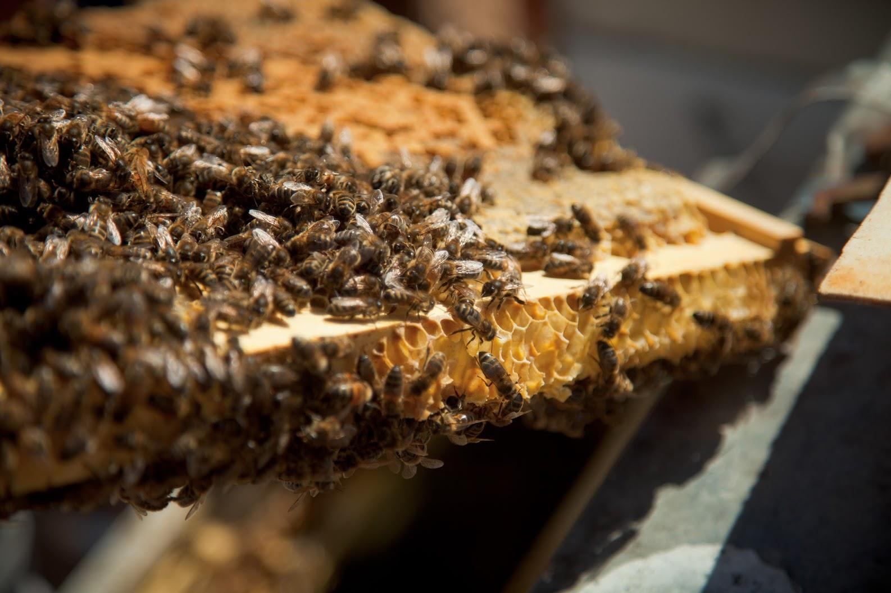

---
## Page 46

 
 
OFFICIAL 
12 Appendices 
Appendix 12.1: Acts relevant to biosecurity in Victoria 
Title 
Commonwealth or State 
legislation 
Aboriginal Heritage Act 2006 
State 
Agricultural and Veterinary Chemicals (Control of Use) Act 1992  
State 
Agricultural and Veterinary Chemicals (Control of Use) Regulations 2017  
State 
Agricultural and Veterinary Chemicals (Control of Use) (Ruminant Feed) 
Regulations 2015  
State 
Biological Control Act 1986 
State 
Biosecurity Act 2015 
Commonwealth 
Biosecurity Regulations 2016 
Commonwealth 
Catchment and Land Protection Act 1994 
State 
Catchment and Land Protection Regulations 2012 
State 
Conservation, Forests and Lands Act 1987 
State 
Crown Land (Reserves) Act 1978 
State 
Dairy Act 2000 
State 
Drugs, Poisons and Controlled Substances Act 1981 
State 
Emergency Management Act 1986 and 2013 
State 
Environment Protection Act 2017 
State 
Environment Protection and Biodiversity Conservation Act 1999 
Commonwealth 
Firearms Act 1996 
State 
Food Act 1984 
State 
Fisheries Act 1995 
State 
Flora and Fauna Guarantee Act 1988 
State 
Impounding of Livestock Act 1994 
State 
Livestock Disease Control Act 1994 
State 
Livestock Disease Control Regulations 2017  
State 
Livestock Management Act 2010 
State 
Marine and Coastal Act 2018 
State 
Marine Safety Act 2010 
State 
Meat Industry Act 1993 
State 
Native Title Act 1993 
Commonwealth 
National Parks Act 
State 
Planning and Environment Act 1987 
State 
Plant Biosecurity Act 2010 
State

---
## Page 47

 
 
OFFICIAL 
Plant Biosecurity Regulations 2016 
State 
Port Management Act 1995 
State 
Prevention of Cruelty to Animals Act (POCTA) 1986 
State 
POCTA Regulations 2019 
State 
Public Health and Wellbeing Act 2008 (Vic) and Public Health and 
Wellbeing Regulations 2019 
State 
Sale of Land Act 1962 
State 
Seafood Safety Act 2003 
State 
Stock (Seller Liability and Declarations Act) 199 
State 
Traditional Owner Settlement Act 2010 
State 
Wildlife Act 1975 
State 
Wildlife Regulations 2013 
State

---
## Page 48

 
 
OFFICIAL 
Appendix 12.2 Glossary  
Refer to the SEMP for a detailed list of emergency management terms and definitions used in Victoria.  
TERM 
DESCRIPTION 
Animal Health Australia 
(AHA) 
An independent national animal health body in Australia that brings 
together government and industry to coordinate advocacy and 
development of programs to support Australia’s animal health and 
biosecurity systems. AHA is represented by 34 organisations from 
Commonwealth, state and territory governments, livestock 
industries, service providers and associate members. 
AQUAVETPLAN  
Australian Aquatic Veterinary Emergency Plan – the national 
contingency planning framework for the management of aquatic pest 
and disease emergencies in Australia. 
AUSVETPLAN  
Australian Veterinary Emergency Plan – the national contingency 
planning framework for the management of animal pest and disease 
emergencies in Australia. 
Biodiversity 
The variability among living organisms from all sources including 
inter alia terrestrial, marine and other aquatic ecosystems and the 
ecological complexes of which they are part; this includes diversity 
within species, between species and of ecosystems. 
Biosecurity 
The protection of the economy, environment and human health from 
the negative impacts associated with entry, establishment or spread 
of exotic pests (including weeds) and diseases. 
Biosecurity Incident 
Management System 
(BIMS) 
The agreed national incident management system for biosecurity 
incidents. It is based on established incident management systems 
such as the Australasian Inter-Service Incident Management System 
(AIIMS). 
Case Officer 
A Case Officer is a person employed by DEECA who will be 
appointed to act as a single point of contact to support information 
flow between the department and an affected producer or producers. 
The number of producers for whom they Case Officer will act as the 
point of contact will depend on the scale and complexity of the 
incident.  
Chief Technical Officer 
(CTO) 
The Chief Veterinary Officer (CVO), the Chief Plant Health Officer 
(CPHO), or their equivalent. 
Consultative Committee 
A national committee of technical representatives from Affected 
Parties which strategically directs (and monitors progress of) the 
technical aspects of the response. These are often referred to by 
their acronyms which include: CCEAD, CCEPP, NBMCC and 
CCIMPE. 
Containment 
Application of quarantine measures in and around an infested / 
infected area to prevent the further spread of a pest or disease. 
Control Area 
A legally declared area around the Restricted Area in which the 
conditions applying are of lesser intensity than those in the 
Restricted Area (the limits of a Control Area and the conditions 
applying to it can be varied according to need). 
Control Measures 
The collective term used to describe the eradication, containment or 
suppression of a pest or disease.

---
## Page 49

 
 
OFFICIAL 
Cost Sharing 
The process of government and industry jointly funding the costs 
arising from the implementation of a Response Plan. Described in 
the emergency response deeds. 
Delimiting surveillance 
Surveillance conducted to establish the boundaries of an area 
considered to be infested/infected by or free from a pest or disease. 
Department of 
Agriculture, Fisheries 
and Forestry (DAFF) 
Australian Government department established on in July 2022. 
Previously known as the Department of Agriculture, Water and the 
Environment (DAWE). The department enhances Australia's 
agriculture, unique environment, heritage and water resources 
through regulation and partnership. 
Department of Energy, 
Environment and 
Climate Action (DEECA) 
DEECA brings together Victoria’s energy, environment, water, 
agriculture, forestry, resources, climate action and emergency 
management functions into a single department. DEECA has a 
range of responsibilities in mitigation, response, and recovery. These 
are further outlined here: 
https://www.emv.vic.gov.au/responsibilities/state-emergency-
management-plan-semp/roles-and-responsibilities/role-
statements/role-statement-department-of-energy-environment-and-
climate-action 
Emergency Animal 
Disease Response 
Agreement (EADRA) 
A contractual arrangement between Animal Health Australia, the 
Commonwealth, all state and territory governments and national 
animal industry body signatories (23 in total). It covers the 
management and funding of responses to 66 categorised animal 
diseases, including the potential for owner reimbursement costs. It 
also formalises the role of animal industries’ participation in decision 
making, as well as their contribution towards the costs related to 
approved responses. 
Emergency Management 
Commissioner (EMC) 
The EMC provides leadership for emergency management in 
Victoria. During a major emergency, the EMC has an overarching 
role to ensure that the response and recovery is coordinated, and 
control arrangements are in place. EMC has responsibility for 
coordination before, during and after major emergencies, including 
consequence management, as defined in the Emergency 
Management Act 2013. 
Emergency Management 
Victoria (EMV) 
EMV is a central body for emergency management in Victoria. EMV 
acts as the agency responsible for the coordination of the 
development of whole-of-government policy for emergency 
management in Victoria. Further details about the functions of EMV 
can be found here: https://www.emv.vic.gov.au/responsibilities/state-
emergency-management-plan-semp/roles-and-responsibilities/role-
statements/role-statement-emergency-management-victoria 
Emergency Marine Pest 
Plan (EMPPLAN) 
Rapid Response Manuals for marine pests provide detailed 
information and guidance for emergency response to key marine 
pest species or groups of pest species. 
Emergency Plant Pest 
Response Deed 
(EPPRD) 
A legal agreement between Plant Health Australia, the 
Commonwealth, all state and territory governments and national 
plant industry body (including bees) signatories (49 in total). It covers 
the management and funding of responses to emergency plant pest 
(EPP) incidents, including the potential for owner reimbursement 
costs for growers. It also formalises the role of plant industries’ 
participation in decision making, as well as their contribution towards 
the costs related to approved responses.

---
## Page 50

 
 
OFFICIAL 
Emergency Recovery 
Victoria (ERV) 
The nominated agency in Victoria for the coordination of relief at the 
State tier, and recovery coordination at both Regional and State 
tiers.   
Emergency Response 
Deeds 
Pre-agreed cost sharing and response framework for dealing with an 
incursion of an emergency animal or plant pest or disease and 
biosecurity incidents that impact on the economy, the environment 
and/or social amenity. 
Eradication 
The elimination of a pest or disease from a geographic area (or 
production system) that is sufficiently isolated to prevent re-
establishment. 
Established Pests and 
Diseases 
Pests and diseases affecting plants or animals, including humans, 
that are known to occur in a particular country or region. 
Exotic Pests and 
Diseases 
Pests and diseases affecting plants or animals (and possibly 
humans) that do not normally occur in a particular country or region. 
Forward Command Post 
A field operations centre, subsidiary to a Local Disease Control 
Centre. 
Host 
A plant or animal species that, under certain conditions, is capable of 
sustaining a pest, disease or infectious agent.  
Incursion 
An isolated occurrence of a pest or disease recently detected in an 
area, not known to be established, but expected to survive for the 
immediate future. 
Infected Premises (IP) 
Premises (or locality) at which an emergency pest or disease is 
confirmed or believed to exist; or in the case of animals an infective 
agent of that emergency disease. Infected premises are subject to 
quarantine served by notice and to control measures. 
Intergovernmental 
Agreement on 
Biosecurity (IGAB) 
An agreement between the Australian and state and territory 
governments. It aims to strengthen partnership between Australian 
governments and improve the national biosecurity system by 
outlining agreed national goals and objectives, clarifies roles, 
responsibilities and governance arrangements and sets out 
commitments for the Australian Government, and state/territory 
governments. 
International Plant 
Protection Convention 
(IPPC) 
An intergovernmental treaty signed by over 180 countries, aiming to 
protect the world's plant resources from the spread and introduction 
of pests, and promoting safe trade. Its main objectives are to: 
• ensure transparency of the global plant health situation 
• set standards that support the safe trade in plants and plant 
products  
• provide expertise and encourage international cooperation in the 
control of plant pests and diseases 
Local Control Centre 
The operations centre from which all field operations aimed at 
containing and eradicating the pest or disease are managed. (Is the 
equivalent to Incident Control Centre in the AIMS structure). 
Monitoring and 
Surveillance 
Activities to investigate the presence or prevalence of a pest or 
disease in a given plant or animal population and its environment. 
National Environmental 
Biosecurity Response 
Agreement (NEBRA) 
A legal agreement between the Commonwealth and state and 
territory governments. It covers emergency response arrangements, 
including cost-sharing arrangements, for responding to biosecurity

---
## Page 51

 
 
OFFICIAL 
incidents that primarily impact the environment and/or social amenity 
and where the response is for the public good. 
National Management 
Group (NMG) 
A group chaired by the Secretary of DAFF Membership comprises 
senior officials from the Australian, state and territory governments 
and industry. The group is responsible in biosecurity emergencies for 
endorsing the response plan and budget. 
Outbreak 
A recently detected pest or disease, including an incursion or a 
sudden significant increase of an established pest population in an 
area (for example, Australian plague locusts). 
Pest Free Area 
An area in which a specific pest or disease does not occur as 
demonstrated by scientific evidence, and in which, where 
appropriate, this condition is being officially maintained. 
Plant Health Australia 
(PHA) 
Plant Health Australia is the national coordinator of the government-
industry partnership for plant biosecurity in Australia, that minimises 
pest impacts on Australia, enhances market access and contributes 
to industry and community sustainability. PHA membership includes 
the Commonwealth, all state and territory governments, 39 peak 
industry bodies and 10 associate members. 
PLANTPLAN 
Australian Emergency Plant Pest Response Plan – the national 
contingency planning framework for the management of plant pest 
emergencies in Australia. 
Quarantine 
1. The system of measures which are used to manage risks of the 
entry and establishment of pests and diseases which threaten 
animal, plant or human health. 
2. The act of issuing a legally enforceable quarantine notice to 
restrict the exit or removal of things that could spread pests or 
diseases from premises specified in the notice. 
Recovery 
The assisting of persons and communities affected by emergencies 
to achieve a proper and effective level of functioning.  
(Emergency Management Act 2013 section 3) 
Relief 
Provision of assistance to meet essential needs of individuals, 
families, and communities during and in the aftermath of an 
emergency. 
Response Plan 
An integrated plan, developed by the Chief Technical Officer of one 
or more states or territories that: outlines the strategic response to a 
specific emergency pest or disease outbreak; is endorsed by the 
consultative committee and approved by the NMG; and which is 
subject to cost sharing in accordance with the relevant emergency 
response deed. 
Restricted Area 
A relatively small, declared area (compared to a Control Area) 
around infected premises that is subject to intense surveillance and 
movement controls. 
Restricted Area 
Movement Controls 
Establishment of control over the movement of animals, animal 
products, plants, plant products, vehicles, other things and people 
into, within and out of the restricted area/s, in order to limit the 
spread of the pest or disease.

---
## Page 52

 
 
OFFICIAL 
State Biosecurity 
Operations Centre 
The emergency operations centre established at a state level, that 
coordinates the disease or pest control operations to be undertaken 
in that state or territory. 
State Controller 
Biosecurity (SCB) 
Level 3 response: The role responsible for leading and managing 
responses to a Class 2 Level 3 biosecurity emergency. Ensures 
effective operational management of the State Control Centre 
functions that relate to a biosecurity emergency and functional 
management between the State Biosecurity Operations Centre 
(when activated) and the State Control Centre.  
Level 2 response: The State Controller Biosecurity leads the State 
Biosecurity Operations Centre to implement the pest/disease control 
strategy and policy, develops state level objectives and priorities for 
the response, and oversees the coordination of the activities of Local 
Control Centre(s).  
Suppression 
The application of movement restrictions and other disease control 
measures in an infected area to reduce pest populations or disease 
spread. 
Tracing 
The process of locating animals, animal products, plants, plant 
products, vehicles, people, or things which may be implicated in the 
spread of an emergency pest or disease. 
World Organisation for 
Animal Health (OIE) 
The World Organisation of Animal Health (OIE) is an inter-
governmental organisation. Its main objectives are to: 
• ensure transparency of the global disease situation 
• set standards that support the safe trade in animals and animal 
products  
• provide expertise and encourage international cooperation in the 
control of animal diseases 
• improve the legal framework and resources of national veterinary 
services 
Zoonosis (or Zoonotic 
Disease) 
Any disease or infection which is naturally transmissible from 
animals to humans.

---
## Page 53

 
 
OFFICIAL 
 
deeca.vic.gov.au

