# State Emergency Management Plan — Bushfire Sub-Plan (December 2023)

> **Source**: Emergency Management Victoria
> **URL**: https://files.emv.vic.gov.au/2023-12/Attachment%20A%20-%20Final%20SEMP%20Bushfire%20Sub-Plan.pdf
> **Licence**: © State of Victoria; emergency-management practitioner reference
> **Retrieved**: 2026-05-07T23:44:09Z
> **SHA-256**: `fc91d63181fd750e2b0327f0bab908cc02c1c05465fd68a7cacbcd1d9e4c66b0`
> *Converted from PDF to Markdown format.*

---
## Page 1

 
 
State Emergency Management Plan 
Bushfire Sub-Plan

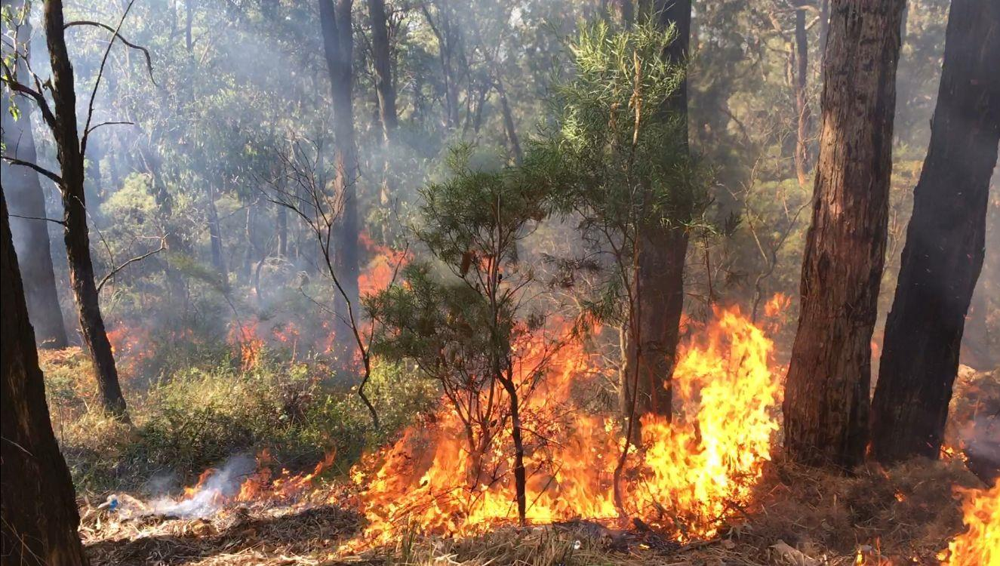

---
## Page 2

 
 
 
 
2 
 
 
OFFICIAL 
 
OFFICIAL 
 
OFFICIAL 
OFFICIAL 
 
© The State of Victoria 2023 
This work is licensed under a Creative Commons Attribution 4.0 International licence. You are free 
to re-use the work under that licence, on the condition that you credit the State of Victoria as author. 
The licence does not apply to any images, photographs or branding, including the Victorian Coat of Arms and the 
Victorian Government logo. To view a copy of this licence, visit http://creativecommons.org/licenses/by/4.0/ 
Acknowledgment of Country 
EMV acknowledges Aboriginal and Torres Strait Islander people as the Traditional Custodians of the land. 
EMV also acknowledges and pays respect to the Elders, past and present, and is committed to working with 
Aboriginal and Torres Strait Islander communities to achieve a shared vision of safer and more resilient 
communities. 
Documentation 
This document is available in Word and PDF format at www.emv.vic.gov.au/responsibilities /state-emergency-
management-plan-subplans 
ISBN 978-1-76136-504-1 
Version control  
Title 
Version date 
Amendment 
State Bushfire Plan 
2012 
June 2012 
First version was based on provisions of the Emergency 
Management Act 1986 and the Fire Services Commissioner Act 
2010 
State Bushfire Plan 
(Version 2 – 2014) 
October 2014 
An update of the first version to align the document with the 
Emergency Management Act 2013 (which repealed the Fire 
Services Commissioner Act 2010) and the updated State 
Emergency Response Plan (July 2014 version) 
State Emergency 
Management Plan 
Bushfire Sub-Plan 
September 2021 
The previous State Bushfire Plan was a sub-plan of the State 
Emergency Response Plan. 
This Sub-Plan is now updated to reflect the State Emergency 
Management Plan, published in September 2020 under reformed 
planning arrangements adapted into the Emergency Management 
Act 2013 by the Emergency Management Legislation Amendment 
Act 2018. 
State Emergency 
Management Plan 
Bushfire Sub-Plan 
October 2023 
An update to incorporate the implementation of the AFDRS, which 
commenced on 1 September 2022 and Victorian “Machinery of 
Government” (MoG) changes which took effect on 1 January 2023.

---
## Page 3

 
 
 
 
3 
 
 
OFFICIAL 
 
OFFICIAL 
 
OFFICIAL 
OFFICIAL 
 
Contents 
1. 
Introduction ....................................................................................................................................................... 8 
1.1 
About the State Emergency Management Plan Bushfire Sub-Plan ................................................................... 8 
1.1.1 
Purpose and scope .................................................................................................................................. 8 
1.1.2 
Audience .................................................................................................................................................. 8 
1.1.3 
How to read this document ...................................................................................................................... 8 
1.1.4 
Plan preparation, approval and review..................................................................................................... 9 
1.1.5 
Plan activation .......................................................................................................................................... 9 
1.1.6 
Concurrent emergencies .......................................................................................................................... 9 
1.2 
Legislative Framework ........................................................................................................................................ 9 
1.3 
State Emergency Management Plan (SEMP) .................................................................................................. 10 
1.3.1 
SEMP Sub-Plans .................................................................................................................................... 10 
1.3.2 
This Plan and other key documents ....................................................................................................... 11 
1.4 
State Emergency Management Priorities and Bushfire ................................................................................... 13 
1.4.1 
Guiding principles ................................................................................................................................... 13 
1.5 
Victoria’s Bushfire Threat ................................................................................................................................. 14 
1.6 
Shared Responsibility ....................................................................................................................................... 15 
1.6.1 
Interoperability of fire agencies .............................................................................................................. 18 
1.7 
Risk Management Standards ........................................................................................................................... 18 
1.7.1 
Strategic Bushfire Management Planning .............................................................................................. 19 
1.7.2 
Victorian Fire Risk Register – Bushfire (VFRR–B) ................................................................................. 19 
1.7.3 
Bushfire Simulation Software ................................................................................................................. 19 
1.8 
Evaluation and continuous improvement ......................................................................................................... 20 
1.8.1 
Lessons management principles ............................................................................................................ 20 
1.8.2 
Identifying lessons .................................................................................................................................. 21 
1.8.3 
Research ................................................................................................................................................ 21

---
## Page 4

 
 
 
 
4 
 
 
OFFICIAL 
 
OFFICIAL 
 
OFFICIAL 
OFFICIAL 
 
2. 
Mitigation and Prevention.............................................................................................................................. 22 
2.1 
Office of Bushfire Risk Management ................................................................................................................ 22 
2.2 
Fuel management ............................................................................................................................................. 22 
2.2.1 
Roadsides .............................................................................................................................................. 23 
2.2.2 
Public Land ............................................................................................................................................. 23 
2.2.3 
Private Land ........................................................................................................................................... 24 
2.3 
Land use planning and building controls .......................................................................................................... 25 
2.4 
Bushfire Prone Areas (BPAs) ........................................................................................................................... 25 
2.5 
Bushfire Management Overlay (BMO) ............................................................................................................. 25 
2.6 
Powerline Safety ............................................................................................................................................... 25 
2.7 
Fire Restrictions ................................................................................................................................................ 26 
2.8 
Total fire ban days ............................................................................................................................................ 26 
2.9 
Restricted access to public land ....................................................................................................................... 27 
2.10 Arson and enforcement .................................................................................................................................... 27 
2.11 Community education, awareness and engagement to prevent and respond to bushfire ............................... 27 
3. 
Planning........................................................................................................................................................... 28 
3.1 
State, Regional and Municipal Fire Management Planning ............................................................................. 28 
3.2 
Strategic Bushfire Management Planning ........................................................................................................ 29 
3.3 
Forecasting risk ................................................................................................................................................ 30 
3.4 
Local Mutual Aid Plans (LMAPs) ...................................................................................................................... 30 
3.5 
Public media campaigns ................................................................................................................................... 31 
4. 
Preparedness .................................................................................................................................................. 32 
4.1 
Community preparedness ................................................................................................................................ 32 
4.2 
Community resilience ....................................................................................................................................... 33 
4.3 
Neighbourhood Safer Places–Bushfire Place of Last Resort (NSP-BPLR) ..................................................... 34 
4.4 
Community Fire Refuges .................................................................................................................................. 34 
4.5 
Community information ..................................................................................................................................... 34 
4.6 
Business preparedness .................................................................................................................................... 35 
4.7 
Household and individual preparedness .......................................................................................................... 35 
4.8 
Australian Fire Danger Rating System (AFDRS) ............................................................................................. 35 
4.8.1 
Fire Danger Ratings ............................................................................................................................... 35 
4.8.2 
Fire Behaviour Index .............................................................................................................................. 36 
4.8.3 
Components of the Operational Build .................................................................................................... 37 
4.9 
Control Agency Preparedness ......................................................................................................................... 38 
4.10 Human resources ............................................................................................................................................. 38 
4.11 Cross border arrangements.............................................................................................................................. 39

---
## Page 5

 
 
 
 
5 
 
 
OFFICIAL 
 
OFFICIAL 
 
OFFICIAL 
OFFICIAL 
 
4.12 Capability .......................................................................................................................................................... 39 
4.12.1 
Training, Equipment and Information Communication Technology (ICT) .............................................. 39 
4.12.2 
Shared ICT platforms ............................................................................................................................. 40 
4.12.3 
Aviation ................................................................................................................................................... 40 
4.12.4 
Logistics ................................................................................................................................................. 41 
4.13 Intelligence and Predictive Services ................................................................................................................. 41 
4.13.1 
Bureau of Meteorology ........................................................................................................................... 41 
4.13.2 
Intelligence products and Fire Behaviour Analysts (FBANs) ................................................................. 41 
4.13.3 
Remote sensing and other technology................................................................................................... 41 
5. 
Response......................................................................................................................................................... 42 
5.1 
Concept of Emergency Operations .................................................................................................................. 42 
5.2 
Tiers of Emergency Management .................................................................................................................... 42 
5.3 
Readiness ......................................................................................................................................................... 43 
5.3.1 
Daily readiness arrangements ............................................................................................................... 43 
5.3.2 
Resource readiness ............................................................................................................................... 43 
5.3.3 
Operational planning .............................................................................................................................. 44 
5.4 
Initial Response ................................................................................................................................................ 44 
5.4.1 
Initial attack ............................................................................................................................................ 44 
5.4.2 
Pre-determined dispatch of aircraft ........................................................................................................ 45 
5.4.3 
Operational Safety .................................................................................................................................. 45 
5.4.4 
Safe Person Approach (SPA) ................................................................................................................ 45 
5.4.5 
Dynamic Risk Assessment (DRA) .......................................................................................................... 45 
5.4.6 
Red Flag Warnings ................................................................................................................................. 46 
5.4.7 
Field Information Update (FIU) ............................................................................................................... 46 
5.4.8 
LACES .................................................................................................................................................... 46 
5.4.9 
Health Monitoring ................................................................................................................................... 47 
5.4.10 
Hazard Trees .......................................................................................................................................... 47 
5.4.11 
WATCHOUT ........................................................................................................................................... 47 
5.4.12 
Occupational Health and Safety (OH&S) Incident Reporting................................................................. 48 
5.5 
Control .............................................................................................................................................................. 49 
5.5.1 
Control Agency and Support Agencies .................................................................................................. 49 
5.5.2 
Determining the Control Agency ............................................................................................................ 49 
5.5.3 
Transfer of Control ................................................................................................................................. 50 
5.6 
Coordination ..................................................................................................................................................... 51 
5.7 
Command ......................................................................................................................................................... 51 
5.8 
Incident Management ....................................................................................................................................... 52

---
## Page 6

 
 
 
 
6 
 
 
OFFICIAL 
 
OFFICIAL 
 
OFFICIAL 
OFFICIAL 
 
5.9 
Incident levels ................................................................................................................................................... 53 
5.9.1 
Level 1 incident ...................................................................................................................................... 53 
5.9.2 
Level 2 incident ...................................................................................................................................... 54 
5.9.3 
Level 3 incident ...................................................................................................................................... 56 
5.10 Incident Controller (IC) ..................................................................................................................................... 56 
5.11 Incident Management Team (IMT) ................................................................................................................... 56 
5.11.1 
Deputy Incident Controller (Deputy IC) .................................................................................................. 57 
5.12 Supplementary resources................................................................................................................................. 57 
5.12.1 
Resource Requesting ............................................................................................................................. 57 
5.12.2 
Interstate and International Resources .................................................................................................. 57 
5.13 Emergency Management Team(s) (EMT) ........................................................................................................ 58 
5.13.1 
Incident Emergency Management Team (IEMT) ................................................................................... 58 
5.14 Control facilities ................................................................................................................................................ 58 
5.14.1 
State Control Centre (SCC) ................................................................................................................... 58 
5.14.2 
Regional Control Centres (RCCs) .......................................................................................................... 59 
5.14.3 
Incident Control Centres (ICCs) ............................................................................................................. 59 
5.14.4 
Control Point ........................................................................................................................................... 59 
5.14.5 
Operations Point ..................................................................................................................................... 59 
5.14.6 
Division and Sector Command Point ..................................................................................................... 59 
5.15 Operational communications ............................................................................................................................ 60 
5.16 Bushfire naming convention ............................................................................................................................. 60 
5.17 Traffic management .......................................................................................................................................... 60 
5.18 Evacuation ........................................................................................................................................................ 61 
5.19 Smoke ............................................................................................................................................................... 62 
5.20 Public Information ............................................................................................................................................. 63 
5.20.1 
Provision of warnings to the community ................................................................................................. 63 
5.20.2 
Warning levels and templates ................................................................................................................ 63 
5.20.3 
Levels of community warnings and information ..................................................................................... 63 
5.20.4 
All Clear Messages ................................................................................................................................ 64 
5.20.5 
Community Information .......................................................................................................................... 64 
5.20.6 
Publishing Warning and Information Areas (Polygon) ........................................................................... 64 
5.20.7 
Community meetings.............................................................................................................................. 65 
5.20.8 
Warning channels ................................................................................................................................... 65 
5.20.9 
Community Alert Sirens.......................................................................................................................... 65

---
## Page 7

 
 
 
 
7 
 
 
OFFICIAL 
 
OFFICIAL 
 
OFFICIAL 
OFFICIAL 
 
5.21 Relief (as a part of response) ........................................................................................................................... 66 
5.21.1 
Initial Impact Assessment ...................................................................................................................... 67 
5.22 Animal (livestock and companion) and wildlife welfare .................................................................................... 67 
5.23 Consequence Management ............................................................................................................................. 67 
5.24 Transition to Recovery ...................................................................................................................................... 68 
6. 
Recovery.......................................................................................................................................................... 69 
6.1 
Public land recovery ......................................................................................................................................... 70 
6.2 
Fences and control lines after bushfires ........................................................................................................... 70 
6.3 
Essential water replacement after bushfire ...................................................................................................... 71 
7. 
Document information ................................................................................................................................... 72 
7.1 
Acronyms and Terms ....................................................................................................................................... 72 
7.2 
Linked resources .............................................................................................................................................. 76

---
## Page 8

 
 
 
 
8 
 
 
OFFICIAL 
 
OFFICIAL 
 
OFFICIAL 
OFFICIAL 
 
1. 
Introduction 
1.1 About the State Emergency Management Plan Bushfire Sub-Plan 
1.1.1 Purpose and scope 
Victoria’s State-level emergency risk assessment, Emergency Risks in Victoria, was published 
in 2020 and set Victoria’s emergency risk profile. Bushfire was assessed as a ‘State significant 
risk’, meaning bushfire was assessed as being a critical and credible scenario for the State. 
This State Emergency Management Plan (SEMP) Bushfire Sub-Plan (this plan) outlines the 
current arrangements for the management of bushfires in Victoria. This supports a 
comprehensive, integrated and coordinated approach and reflects a shared responsibility for 
bushfire management. In alignment with the SEMP, this plan contextualises the current 
arrangements, roles and responsibilities for bushfire mitigation, planning, preparedness, 
response (including relief) and recovery. 
The Department of Energy, Environment and Climate Action (DEECA) coordinated the 2023 
update of this plan in conjunction with the other fire services agencies: Country Fire Authority 
(CFA), and Fire Rescue Victoria (FRV), with input from a range of other emergency 
management agencies. 
This plan does not include arrangements for the management of structural fires. 
1.1.2 Audience 
This plan recognises that emergency management and supporting communities to be safer 
and more resilient is the shared responsibility of all Victorians, not just the emergency 
management sector.  
The audience for this plan comprises government, business, the community of Victoria and, 
primarily, agencies within the emergency management sector. 
1.1.3 How to read this document 
This plan should be read in conjunction with the SEMP. 
Acronyms 
A list of acronyms used throughout this plan is included at section 7.1 and is consistent with 
the acronyms used throughout the SEMP. 
Hyperlinks 
This plan refers to a range of existing resources relating to bushfire, including documents and 
websites. This plan does not seek to duplicate the information contained in these resources 
and instead provides links to where the reader can obtain further information. 
For more operational or sensitive information, a log-in may be required, such as for documents 
saved on the Emergency Management Common Operating Picture (EM-COP; see section 
4.12.2), including Joint Standard Operating Procedures (JSOPs). 
Documents or resources that are referred to frequently throughout this plan (such as the 
SEMP) are not hyperlinked in each instance however a table outlining all links provided 
throughout this plan is included at section 0 for completeness. 
All hyperlinks were accurate at time of publication.

---
## Page 9

 
 
 
 
9 
 
 
OFFICIAL 
 
OFFICIAL 
 
OFFICIAL 
OFFICIAL 
 
1.1.4 Plan preparation, approval and review 
This is the fourth version of a State-tier bushfire plan, and the second in the form of a SEMP 
Bushfire Sub-Plan that is prepared under the reformed emergency management (EM) planning 
arrangements outlined in the Emergency Management Act 2013 (EM Act 2013), as amended 
by the Emergency Management Legislation Amendment Act 2018.  
This plan aligns with the SEMP and was prepared with regard to the Guidelines for Preparing 
State, Regional and Municipal Emergency Management Plans; and was approved by the State 
Crisis and Resilience Council (SCRC) on  29 November 2023. This plan was published and 
took effect on December 2023. 
The EM Act 2013 requires this plan to be tested, reviewed and updated at least every three 
years with consideration given to earlier revisions as required to ensure the plan provides for a 
current, integrated, coordinated and comprehensive approach to bushfire management at a 
State level. Earlier reviews may be triggered by the sub-plan being applied in a major 
emergency or exercise or following a substantial change to relevant legislation or 
arrangements, including the SEMP. 
This plan was reviewed in 2023 due to sector changes in emergency management relevant to 
the management of bushfires, as well as the implementation of the Australian Fire Danger 
Rating System (AFDRS). 
1.1.5 Plan activation 
The arrangements in this plan apply on a continuing basis and do not require activation. 
1.1.6 Concurrent emergencies 
In the case of a concurrent emergency (e.g. extreme heat or an energy disruption), the 
arrangements detailed in this plan may need to be adjusted as required. To affect this the 
State Response Controller – Class 1 should consult with the Emergency Management 
Commissioner (EMC) and other relevant State Controllers, to determine (and document) 
appropriate control arrangements. 
1.2 Legislative Framework 
The following legislation, while not exhaustive, is the principal legislation for bushfire 
management in Victoria: 
• 
Emergency Management Act 2013 (EM Act 2013) 
• 
Emergency Management Act 1986 
• 
Country Fire Authority Act 1958 (CFA Act 1958) 
• 
Fire Rescue Victoria Act 1958 (FRV Act 1958; formerly the Metropolitan Fire 
Brigades Act 1958) 
• 
Forests Act 1958. 
In addition to these, the Code of Practice for Bushfire Management on Public Land is a 
legislative instrument established under the Conservation, Forests and Lands Act 1987 that 
defines the objectives, principles, and approach to the management of bushfires on public land 
in Victoria.

---
## Page 10

 
 
 
 
10 
 
 
OFFICIAL 
 
OFFICIAL 
 
OFFICIAL 
OFFICIAL 
 
1.3 State Emergency Management Plan (SEMP) 
Under the EM Act 2013, the EMC is required to arrange for the preparation of the SEMP. The 
SEMP provides for an integrated, coordinated, and comprehensive approach to emergency 
management at the State level. It contains provisions for the mitigation of, response to and 
recovery from emergencies (before, during and after), and specifies the roles and 
responsibilities of agencies in relation to emergency management. 
The mitigation, response (including relief) and recovery arrangements for emergencies are 
outlined in the SEMP, including the role of the EMC. 
The EM Act 2013 defines a major fire as a large or complex fire (however caused) that: 
• 
has the potential to cause, or is causing, loss of life and extensive damage to 
property, infrastructure or the environment or 
• 
has the potential to have, or is having, significant adverse consequences for the 
Victorian community or a part of the Victorian community or 
• 
requires the involvement of two or more fire service agencies to suppress the fire 
or 
• 
will, if not suppressed, burn for more than one day. 
Under the EM Act 2013, major fires are a Class 1 emergency, given a Class 1 emergency is 
either a major fire or any other major emergency for which CFA, FRV or the Victoria State 
Emergency Service Authority (VICSES) is the control agency. 
1.3.1 SEMP Sub-Plans 
The Guidelines for Preparing State, Regional and Municipal Emergency Management Plans 
provide more information about the requirements relating to SEMP sub-plans; they are 
developed to define more complex or specific arrangements than those contained in the 
SEMP. This plan seeks to add further detail about the specific arrangements for the 
management of bushfires in Victoria than what is outlined in the SEMP.

---
## Page 11

 
 
 
 
11 
 
 
OFFICIAL 
 
OFFICIAL 
 
OFFICIAL 
OFFICIAL 
 
1.3.2 This Plan and other key documents 
The below table indicates key documents for the State’s bushfire context. This is not an 
exhaustive list. For example, agencies with a role in bushfire management may develop 
agency-specific plans to manage specific risks that are not included in this table. Likewise, 
doctrine and agency Standard Operating Procedures (SOPs) apply at all tiers and so are not 
represented in the table. 
Bushfires have far-reaching impacts for people, communities and the environment. In some 
cases, this may require the activation of other emergency management arrangements to 
manage significant consequences and other emergencies caused by bushfire (such as energy 
supply disruptions or impacts to wildlife). 
Table 1: Plans and documents for the State’s bushfire context 
 
Community resilience 
Emergency Management 
Plans 
Operational arrangements, 
and agency-specific plans 
National 
National Disaster 
Risk Reduction 
Framework 
National Bushfire 
Management Policy 
Statement for Forests 
and Rangelands 
Strategic Directions 
for Fire and 
Emergency Services 
in Australia and New 
Zealand 2022-2026 
 
Agreements for resource 
sharing 
Australian Disaster 
Resilience Handbook 
Collection 
State 
Strategic Roadmap 
for Emergency 
Management in 
Victoria 2022–28 
Safer Together Policy 
Bushfire Safety Policy 
Framework 
Victorian Planning 
Provisions 
State Emergency 
Management Plan  
SEMP Bushfire Sub-
Plan (this Plan) 
Code of Practice for 
Bushfire Management on 
Public Land 
Joint agency SOPs 
Joint agency Business 
Rules 
Interagency MOUs 
Regional 
Victorian planning 
schemes 
Regional Emergency 
Management Plans 
(REMPs) 
Optional: Regional Fire 
Management Sub-Plans 
(sub-plans of REMPs) 
CFA/DEECA/FRV/SES 
Local Mutual Aid Plans 
CFA Regional Operational 
Management Plans  
CFA/DEECA Regional 
Bushfire Management 
Strategies 
CFA/DEECA) Joint Fuel 
Management Program

---
## Page 12

 
 
 
 
12 
 
 
OFFICIAL 
 
OFFICIAL 
 
OFFICIAL 
OFFICIAL 
 
 
Community resilience 
Emergency Management 
Plans 
Operational arrangements, 
and agency-specific plans 
Municipal 
Resilient Recovery 
Strategy 
Municipal Emergency 
Management Plans 
(MEMPs) 
Optional: Municipal Fire 
Management Sub-Plans 
(sub-plans of MEMPs) 
 
Community Community 
Resilience 
Framework for 
Emergency 
Management 
Optional: Community led 
action plans 
Pre-incident Response 
Plans 
Household 
 
Household Plans

---
## Page 13

 
 
 
 
13 
 
 
OFFICIAL 
 
OFFICIAL 
 
OFFICIAL 
OFFICIAL 
 
1.4 State Emergency Management Priorities and Bushfire 
The State Emergency Management Priorities are outlined in the SEMP and underpin and 
guide all decisions during a response to any emergency, including bushfires. 
The Incident Controller (IC) may need to vary the priorities in some circumstances. This shall 
be recorded, reported and disseminated in consultation with the Regional Controller (RC) and 
State Response Controller (SRC) based on sound incident predictions and risk assessment. 
1.4.1 Guiding principles 
The following guiding principles are supplementary to the State Emergency Management 
Priorities. 
Leadership 
The EMC and the fire services agencies are accountable, on behalf of the Victorian 
Government, for leading other agencies, the community and individuals to make appropriate 
arrangements to reduce the impact and consequence of bushfire. 
Protection of human life 
As per the State Emergency Management Priorities, the protection and preservation of human 
life and relief of suffering, which includes the lives of both community members and emergency 
services personnel, takes priority above all other considerations in bushfire management. 
Responsibility for building resilience 
Bushfires are inevitable and not all bushfires are preventable. All levels and sectors of society 
share responsibility, within their sphere of influence, for building a more resilient community 
and environment that can prevent, respond to and recover from bushfire. 
Community involvement 
Community involvement is essential to ensure bushfire management approaches are inclusive, 
integrated, and comprehensive across diverse communities and landscapes. 
A seamless approach 
The fire agencies work together with emergency management sector partners, using resources 
efficiently and effectively, to provide the community with a seamless approach to all aspects of 
bushfire management. 
Risk-driven 
Plans and priorities for bushfire management should aim to achieve a measurable reduction in 
the impact and consequences of bushfire. 
Learning and knowledge 
Local knowledge, experience, and operational and scientific evidence are all integral to the 
ongoing improvement of bushfire management policy and practice.

---
## Page 14

 
 
 
 
14 
 
 
OFFICIAL 
 
OFFICIAL 
 
OFFICIAL 
OFFICIAL 
 
1.5 Victoria’s Bushfire Threat 
Victoria is one of the most bushfire-prone areas in the world and has had regular bushfires 
since European records began in the mid-1800s. The last two decades have seen a dramatic 
increase in the number, size, extent and severity of bushfires. Prior to 2002-03, the previous 
century had recorded one fire season (1938-39) where more than one million hectares of 
Victoria were burnt by bushfires; there were three such seasons between 2002-03 and 2019-
20 (2002-03, 2006-07 and 2019-20). Some of the State’s most catastrophic fires include Black 
Thursday in 1851, Black Friday in 1939, Ash Wednesday in 1983 and Black Saturday in 2009 
and most recently Black Summer in 2019–20. 
The 2019-20 fires provided further evidence that climate change is increasing the frequency 
and severity of seasonal bushfire conditions throughout Australia’s east, extending from 
Victoria to Queensland. 2019 was Australia’s hottest and driest year recorded. Record heat 
and drought leading up to the summer of 2019-20 primed much of eastern Australia for 
bushfires and, by the end of January 2020, approximately 21 per cent of all of Australia’s 
forests had burnt. 
In Victoria, the fire season is now starting at least a month earlier than it was in the 1990s and 
an increase in the number of days with an elevated fire behaviour index is having an impact on 
the fire activity we are experiencing. We have seen an increase in the number of fires and in 
the last 20 years we have had four fire seasons (2002-03, 2005-06, 2008-09 and 2019-20) that 
each had over 400,000 hectares burnt, all stretching our capacity to respond and having 
devastating consequences for the community and environment. 
Models of future climate show that this pattern is likely to continue – conditions will be hotter, 
drier and with more extreme weather events.  This is expected to lead to worse fire seasons, 
including the potential for more frequent large fires (like the 2019-20 season) and more 
extreme fire behaviour (including an increase in fire generated thunderstorms).  This will have 
flow on effects to the safety of the community and firefighters. 
Bushfire is a significant risk facing the State and is also a natural part of the Victorian 
environment that drives regeneration and maintains the health of some species and 
ecosystems. 
Bushfire can be ignited by natural causes such as lightning, or human activity. The high 
bushfire risk is the consequence of a combination of factors including: 
• 
large areas of highly flammable dry eucalypt forest 
• 
expanses of highly flammable grassland 
• 
a climatic pattern of mild, moist winters followed by hot dry summers 
• 
protracted droughts 
• 
agricultural practices where fire is used routinely 
• 
an increasing population density in bushfire-prone areas, such as in the peri-urban 
fringe.

---
## Page 15

 
 
 
 
15 
 
 
OFFICIAL 
 
OFFICIAL 
 
OFFICIAL 
OFFICIAL 
 
1.6 Shared Responsibility 
Royal Commissions and inquiries continue to highlight how critical a shared responsibility 
approach is to emergency management. Victoria’s approach to bushfire management is 
underpinned by the principle of shared responsibility and involves all levels of government, 
community, individuals and the private sector. Integration and collaboration are at the core of 
existing Victorian Government arrangements for bushfire management. 
The SEMP recognises that developing safer and more resilient communities is a shared 
responsibility of all Victorians, not just the emergency management sector. That said, Victoria’s 
fire services agencies hold the primary responsibility for bushfire management in their 
respective jurisdictions. The State has a duty to prevent, plan and prepare for, respond to and 
support recovery from bushfires. 
In Emergency Management, the concept of ‘shared responsibility’ refers to the collective 
obligations and accountabilities held by a range of actors. A commitment to shared 
responsibility recognises that no single actor can be responsible for emergency mitigation, 
preparedness, response or recovery, and that shared responsibility in emergency 
management is everyone’s business. Individuals, communities, organisations, businesses, all 
levels of government and the not-for-profit sector all have some role to play in planning for, 
responding to and recovering from emergencies. 
Government, across a wide range of ministerial portfolios, develops legislation, and plans and 
implements programs to reduce the risk of bushfire. Although the protection and preservation 
of life and relief of suffering is paramount, during a bushfire, the State cannot absolutely 
guarantee the safety of all community members. 
Agencies are encouraged to seek genuine participation from the community, empowering them 
to achieve shared responsibility. 
All roles and responsibilities for the mitigation of, preparedness for, response to and recovery 
from bushfire are as per the SEMP: 
• 
The SEMP outlines participating agencies for mitigation activities specific to bushfire 
• 
The SEMP identifies three control agencies for bushfire response: CFA, DEECA and 
FRV. 
• 
The Chief Officer (CFA)/Chief Fire Officer (DEECA)/Commissioner (FRV) of each fire 
services agency is a statutory officer, accountable for delivering the bushfire-related 
responsibilities of their respective agency.

---
## Page 16

 
 
 
 
16 
 
 
OFFICIAL 
 
 
OFFICIAL 
 
OFFICIAL 
OFFICIAL 
 
Table 2: Actors and functions of responsibility 
Actor 
Agency 
Function 
Emergency 
Management 
Sector 
CFA 
 
Responsible for the prevention and suppression of fire in the country area of Victoria (private property outside 
the FRV fire district). 
Responsible for leading community education and preparedness. 
Detailed role and responsibilities are outlined in the SEMP’s CFA role statement. 
DEECA 
 
Responsible for the prevention and suppression of bushfire in State forests, national parks and on protected 
public land. 
Responsible for coordinating recovery of the natural environment, public land and waterways following bushfire. 
Following the 2019-20 bushfires, the Victorian Government established the Office of Bushfire Risk Management 
within DEECA responsible for overseeing the development and implementation of an end-to-end framework for 
bushfire risk management, with a primary focus on fuel management.  The Office’s role does not extend to 
seasonal preparedness, readiness and response activities, or the on-ground delivery of bushfire risk reduction 
activities. Statutory authorities remain accountable for their statutory functions. Land managers and landholders 
retain primary responsibility for delivering bushfire risk reduction activities on their land. 
Detailed role and responsibilities are outlined in the SEMP’s DEECA role statement. 
FRV 
 
Responsible for the prevention and suppression of fire in the FRV fire district. 
Detailed role and responsibilities are outlined in the SEMP’s FRV role statement 
 
Department of 
Transport and 
Planning (DTP) 
Responsible for developing policy and regulation to mitigate bushfire through land use planning and building. 
Responsible for the protection and management of listed historic heritage places through mitigation of and 
recovery from bushfire. 
Responsible for taking all practicable steps to prevent the occurrence of fires and minimise the danger of the 
spread of fires on and from any land or roads under DTP control or management (as per the CFA Act 1958). 
Responsible for providing fire agencies with access (via permits) to Department owned land to conduct fuel 
management activities as per Road Management Act 2004. 
Responsible for reopening of transport access to communities (including to support restoration of power and 
telecommunications) once it is safe to do so. 
 
Response Support 
Agencies (RSAs) 
See the SEMP table: Response support agencies, by functional area for the lead response support agency.

---
## Page 17

 
 
 
 
17 
 
 
OFFICIAL 
 
 
OFFICIAL 
 
OFFICIAL 
OFFICIAL 
 
Actor 
Agency 
Function 
 
Councils 
Responsible for administering and enforcing the planning scheme, including ensuring strategic settlement 
planning activities and development responds to bushfire hazard and risk. 
Responsible for appointing a Municipal Fire Prevention Officer (MFPO), Municipal Emergency Management 
Officer (MEMO) and Municipal Recovery Manager (MRM). 
A significant focus is on land use planning, Responsible for hazard mitigation on council-owned or managed 
land, fire prevention programs on private land (including the issuing of fire prevention notices and permits), 
broader emergency planning and response support. 
Responsible for taking all practicable steps to prevent the occurrence of fires and minimise the danger of the 
spread of fires on and from any land or roads under council control or management (as per the CFA Act 1958). 
Councils play a key role in designating and recording Neighbourhood Safer Places-Bushfire Places of Last 
Resort (NSP-BPLRs) as last resort shelter options during bushfires (see section 0). 
During and following bushfires, councils are responsible for coordinating the relief and recovery services and 
support for local communities. This includes establishing Emergency Relief Centres and conducting secondary 
impact assessments. 
Detailed role and responsibilities are outlined in the SEMP’s Municipal Council role statement. 
Individuals and households 
Individual community members are responsible for learning the risks of their environment and making decisions 
about how to respond to risks commensurate with their risk appetite. 
Owners and occupiers of land are responsible to manage their properties to reduce the risk of bushfire (see 
section 0). 
Each household is responsible for preparing their property for bushfire for example, retrofitting existing dwellings 
and clearing vegetation around the house, in accordance with State planning controls for the clearing of native 
vegetation and planning scheme requirements. 
Information to assist householders and landowners to prepare their property for bushfire can be found on the 
CFA website. 
Every household should have a well-practised written bushfire survival plan. 
Small, medium and large businesses 
Every business and farm should have a well-practised written bushfire survival plan. 
Community groups and networks 
As per the SEMP.

---
## Page 18

 
 
 
 
18 
 
 
OFFICIAL 
 
OFFICIAL 
 
OFFICIAL 
OFFICIAL 
 
1.6.1 Interoperability of fire agencies 
Interoperability provides a mechanism for achieving better outcomes by allowing the control and 
support agencies to effectively work together before, during and after an incident. It also provides a 
foundation for meaningful connections with the community and a wide range of partner agencies 
(see section 5.5.1. for information about control and support agencies). 
To achieve a cooperative response to bushfire emergencies, each fire agency maintains an 
understanding of the systems, structures, resources, capabilities and statutory obligations of the 
other agencies, and there are also multiple inter-agency agreements to allow operations across fire 
districts and define how agencies interact in those circumstances. Interoperability maximises the 
capability of the agencies to work effectively and efficiently together to deliver information, 
communications, and technology. 
The Australasian Interservice Incident Management System (AIIMS) provides the basis for control 
structures. Joint Standard Operating Procedures (JSOPs) for bushfire management are developed 
and agreed between relevant agencies (such as fire agencies) and are managed by EMV. 
Fire agencies also work collaboratively with a wide range of industry bodies, community groups 
and other stakeholders regarding bushfire-related issues. This includes collaboration with Victorian, 
interstate and international fire and emergency management agencies in order to share knowledge, 
improve bushfire and emergency management policy and practice and to optimise the use of 
resources. 
1.7 Risk Management Standards 
The adoption of emergency risk management, and its underlying concept of risk, has helped 
communities and emergency managers move beyond the narrower concept of ‘hazard’ to ‘risk’. 
Risk deals with the interaction of the exposure to hazard and specific vulnerabilities. 
Bushfire has been assessed as a significant risk for Victoria in all State-level multi-hazard 
emergency risk assessment projects, including studies undertaken in 2008, 2012 and 2017. The 
results of the 2017 assessment are published in Emergency Risks in Victoria (July 2020).  The 
report is scheduled to be updated following review and approval in November 2023. 
Approaches for managing bushfire risk in Victoria include the application of customised risk 
management systems, planning frameworks and tools, tailored for reducing bushfire risk. This 
includes: 
• 
Bushfire Risk Engagement Areas (BREAs; see section 0) 
• 
Fire Management Zones (FMZ) 
• 
Strategic bushfire management planning (see section 0) 
• 
Victorian Fire Risk Register – Bushfire (VFRR–B; see section 1.7.2) and 
• 
Bushfire Simulation Software (see section Error! Reference source not found.).

---
## Page 19

 
 
 
 
19 
 
 
OFFICIAL 
 
OFFICIAL 
 
OFFICIAL 
OFFICIAL 
 
1.7.1 Strategic Bushfire Management Planning 
Managing bushfire risk is an ongoing and shared responsibility. Local communities are now 
involved in decision making about bushfire management all year round and determine local 
solutions to reduce bushfire risk. 
Victoria has adopted a risk-based approach to bushfire management.  Bushfire risk reduction 
targets and decision support tools inform the timing and location of fuel management activities, 
ensuring they are prioritised for delivery where they deliver the greatest impact in reducing risk.   
The fire agencies have undertaken to work with communities to develop regional bushfire 
management strategies through a strategic bushfire management planning process that: 
• 
identify values to be protected from bushfire; 
• 
assesses bushfire risk to those values; and 
• 
set out strategies to manage this risk. 
1.7.2 Victorian Fire Risk Register – Bushfire (VFRR–B) 
VFRR-B is a process in which representatives from council, fire services, public land managers, 
utilities and community groups map assets at risk from bushfire and assess the level of risk to the 
assets. Assets may include residential areas, children’s services, hospitals, aged-care facilities, 
infrastructure, commercial industry, tourism events, and those that are culturally significant. Agency 
representatives also record the current treatments which are carried out to mitigate the risk to the 
asset. 
The VFRR-B can support the preparation of Municipal Emergency Management Plans (MEMPs) or 
MEMP sub-plans (see section 3.1). Several agencies also use VFRR-B as an evidence-based data 
to support bushfire planning and decision-making. 
1.7.3 Bushfire Simulation Software 
Phoenix RapidFire (Phoenix) is a sophisticated bushfire simulation tool used to model fuel-driven 
bushfire risk. Phoenix uses information about weather, topography, vegetation and fire history to 
simulate and predict the spread and impact of bushfires. It helps to understand bushfire behaviour 
– including flame height, ember density, spotting distance, convection column strength and 
intensity. 
CFA and DEECA, use Phoenix to understand how different fuel management activities affect the 
amount and location of bushfire risk across landscapes. Phoenix is one of the tools used to help 
identify the most effective fuel management strategies to reduce bushfire risk. 
Phoenix is also used to support bushfire preparedness, informing the preparation and positioning of 
firefighters, aircraft and equipment on days of elevated fire danger, as well as in response, 
including planning attack strategies, evacuations and potential impacts. 
Phoenix bushfire simulations are also used to help communities understand how bushfires behave. 
Maps and simulations are used in conversations with, and advice to, communities about what 
bushfire risk means for them in both the readiness and response phases of bushfire management. 
Victorian fire agencies continue to review current and emerging bushfire simulation software to 
ensure that bushfire modelling is as accurate as possible. In February 2021, a partnership between 
CSIRO's Data61 and the Australian and New Zealand National Council for fire and emergency 
services (AFAC) announced the development of a nationally consistent bushfire modelling and 
prediction capability, known as Spark. Agencies will review how this simulation software could be 
incorporated into the current risk modelling approach and operational predictions used in Victoria.

---
## Page 20

 
 
 
 
20 
 
 
OFFICIAL 
 
OFFICIAL 
 
OFFICIAL 
OFFICIAL 
 
1.8 Evaluation and continuous improvement 
1.8.1 Lessons management principles 
The emergency management sector’s approach to identifying and learning operational lessons, 
including for bushfire operations is documented in EM-LEARN Lessons Management Framework 
and includes the lessons management life cycle below. 
Figure 1: Victorian’s Lessons Management Life Cycle  
 
Source: EM-LEARN Lessons Management Framework

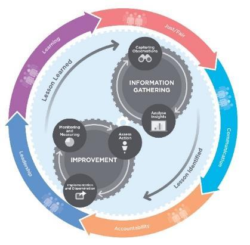

---
## Page 21

 
 
 
 
21 
 
 
OFFICIAL 
 
OFFICIAL 
 
OFFICIAL 
OFFICIAL 
 
1.8.2 Identifying lessons 
The process of identifying lessons is based on a trend analysis of observations collected through 
learning activities, including exercising, monitoring, debriefing and reviewing. An observation is a 
record of a noteworthy fact or occurrence that someone has heard, seen, noticed or experienced 
as an opportunity for improvement or an example of good practice. 
Observations are collected through various processes, including: 
• 
Exercises (refer to Australian Institute for Disaster Resilience (AIDR) Managing exercises 
handbook) 
• 
Real time monitoring and evaluation (refer to JSOP012.01 – Real Time Monitoring and 
Evaluation) 
• 
Operational debriefing, including hot debriefs, informal debriefs, seasonal debriefs or 
After-Action Reviews  
• 
Operational reviews, including agency-specific, multi-agency or external reviews  
• 
Directly through online observations capture tools, including surveys and EM-Share. 
Operational learning activities are the responsibility of the relevant agency or emergency 
management tier and should be conducted in line with any relevant guidelines, policy and 
legislation. It is good practice to invite representatives of relevant community, business and 
industry groups to debriefs where possible. Often, a post-incident community forum may be 
appropriate. 
1.8.3 Research 
Over the past century, Victoria has amassed a wealth of science-based knowledge about bushfire 
behaviour and management that has fundamentally changed the way bushfire is managed across 
the State. This science is nationally and internationally significant and has led to Victorian 
communities being safer. 
The fire services agencies are involved in several ongoing research programs in partnership with a 
range of other organisations, such as Natural Hazards Research Australia (NHRA; which has 
transitioned from the Bushfire Cooperative Research Centre (Bushfire CRC) and the Bushfire and 
Natural Hazards Cooperative Research Centre (BNHCRC)), universities and industry. 
NHRA is Australia’s national centre for natural hazard resilience and disaster risk reduction. Its 
mission is to work with partners (which includes state and local government) and the community on 
research that is useful, actionable and supportive of better decision-making to save lives and 
protect communities. 
NHRA comprises the fire and land management agencies in Australia and New Zealand, 
universities, state and territory governments, the Bureau of Meteorology, the Australian 
Government Attorney General’s Department and several other fire and emergency management 
related agencies.

---
## Page 22

 
 
 
 
22 
 
 
OFFICIAL 
 
OFFICIAL 
 
OFFICIAL 
OFFICIAL 
 
2. 
Mitigation and Prevention 
Emergency Risks in Victoria (July 2020) outlines broad mitigation strategies for bushfire.  This 
document is due for re-publishing in November 2023. 
Managing bushfire risk is an ongoing and shared responsibility and everyone has a role. Victoria is 
moving to a more integrated approach across public and private land, with fuel management just 
one of a range of different management actions we take to protect lives, homes, jobs and the 
environment. 
2.1 Office of Bushfire Risk Management 
The Victorian Government has established the Office of Bushfire Risk Management (OBRM). 
OBRM sits within DEECA and is supported by an advisory panel.  
The OBRM is responsible for overseeing the development and implementation of an end-to-end 
framework for bushfire risk management, with a primary focus on fuel management.  The Office’s 
role does not extend to seasonal preparedness, readiness and response activities, or the on-
ground delivery of bushfire risk reduction activities. Statutory authorities remain accountable for 
their statutory functions. Land managers and landholders retain primary responsibility for delivering 
bushfire risk reduction activities on their land. 
2.2 Fuel management 
The Joint Fuel Management Program (JFMP) is a State-wide program that manages fuel on public 
and private land over a rolling three-year period. The JFMP is updated annually with the latest 
information, and built on the current long term regional Bushfire Management Strategies. 
The JFMP prescribes a range of delivery activities to reduce the amount of fuel and fuel-driven 
bushfire risk in a landscape. Methods used include planned burning, and mechanical works such 
as slashing, mowing and clearing vegetation. Other operational programs inform the creation and 
maintenance of strategic fuel breaks and carrying out fire infrastructure maintenance (such as 
roads and bridges, fire dams and lookout towers). 
Fuel management helps reduces the spread, intensity and severity of bushfires across the 
landscape. This contributes to reducing impacts on communities and the environment. 
Fuels are managed differently across different areas in Victoria. In areas close to towns, fuel 
treatments are more frequent to protect people and the things they value. 
In other areas, burns can be managed to reduce the spread of bushfires across the landscape or 
promote ecological outcomes. Some areas are excluded from planned burning to protect areas that 
are less tolerant of fire. 
CFA, Forest Fire Management Victoria (FFMVic) and FRV partner with Traditional Owner 
Corporations and groups to support implementation of their cultural fire priorities as set out in, but 
not limited to, Whole of Country plans and the Victorian Traditional Owner Cultural Fire Strategy 
(VTOCS). 
In high risk areas, mechanical treatment is carried out as either an alternative treatment option to 
planned burning in whole or part, particularly where treatment provides immediate bushfire risk 
reduction or assists delivery of a burn at a future time. 
CFA, FFMVic and FRV firefighters routinely work together on planned burns.

---
## Page 23

 
 
 
 
23 
 
 
OFFICIAL 
 
OFFICIAL 
 
OFFICIAL 
OFFICIAL 
 
2.2.1 Roadsides 
Under the CFA Act 1958 and FRV Act 1958 it is the responsibility of every municipality and public 
authority (including the Department of Transport and Planning, DEECA and Parks Victoria) to take 
all practicable steps, including burning, to prevent the occurrence of fires and minimise the danger 
of the spread of fires on and from any land under its control and any road under its care and 
management. 
Councils and road managers routinely work with fire agencies through an integrated planning 
process to identify, plan and deliver a planned program of works that aims to mitigate the risks 
associated with fire and roadside fuels. Typical roadside fuel management treatments include 
mowing, slashing, spraying and burning. 
2.2.2 Public Land 
Approximately one third of Victoria is public land managed by DEECA, Parks Victoria and other 
public authorities. The Code of Practice for Bushfire Management on Public Land provides the 
primary objectives for bushfire management on public land in Victoria which are: 
• 
to minimise the impact of major bushfires on human life, communities, essential and 
community infrastructure, industries, the economy and the environment. Human life will be 
afforded priority over all other considerations. 
• 
to maintain or improve the resilience of natural ecosystems and their ability to deliver 
services such as biodiversity, water, carbon storage and forest products. 
To support fire and emergency management, DEECA) maintains a network of approximately 
50,000 kilometres of fire access roads. 
Fuel management on public land is informed by the  four Fire Management Zones (FMZs): 
• 
Asset Protection Zone - An area around properties and infrastructure where fuel is 
managed intensively to provide localised protection to reduce radiant heat and ember 
attack on life and property in the event of a bushfire. 
• 
Bushfire Moderation Zone - An area around properties and infrastructure where fuel is 
managed to reduce the speed and intensity of bushfires and to protect nearby assets, 
particularly from ember attack in the event of a bushfire. 
• 
Landscape Management Zone - An area where fuel is managed to minimise the impact 
of major bushfires, to improve ecosystem resilience and for other purposes (such as to 
regenerate forests and protect water catchments). 
• 
Planned Burning Exclusion Zone - An area where planned burning is avoided, mainly 
because ecological assets in this zone are less tolerant of fire.

---
## Page 24

 
 
 
 
24 
 
 
OFFICIAL 
 
OFFICIAL 
 
OFFICIAL 
OFFICIAL 
 
2.2.3 Private Land 
Private landowners and occupiers are responsible for ensuring their activities, use of fire and the 
level of vegetation on their land does not present an unacceptable danger to life or property from 
the threat of fire. 
As part of the strategic bushfire management planning process, land and fire management 
agencies have undertaken an analysis to define Bushfire Risk Engagement Areas (BREAs). 
BREAs identify parts of the landscape where managing bushfire fuels is most effective in reducing 
risk. This helps to indicate the priority areas in a region where agencies can work with communities 
to reduce bushfire fuels. 
BREAs help focus conversations on the range of treatment options to reduce bushfire risk. This 
may include other actions where reducing fuels may not be possible. On-ground discussions and 
assessments between agencies and the community will determine the treatments that best suit a 
particular place. Other measures for preparing a property include retrofitting existing dwellings so 
they can better withstand bushfires. 
Landowners and occupiers are encouraged to remove fire hazards and manage fuels around their 
property before the Fire Danger Period. This routinely includes cutting long grass, removing fallen 
timber and rubbish, and clearing leaves and branches from gutters. Information on the clearing of 
native vegetation around houses can be found by contacting the relevant council. 
To assist property owners in the management of vegetation on their land and mitigate their bushfire 
risk, specific planning permit exemptions exist in Victorian planning schemes to allow the clearance 
of vegetation around certain dwellings to create or maintain defendable space that assists bushfire 
protection. The level of hazard reduction on private land can influence fire behaviour, survivability 
and can either complement or detract from the effectiveness of hazard reduction on adjoining 
private and public land.  Where unacceptable risks are identified, Municipal Fire Prevention Officers 
(MFPOs) appointed under the CFA Act (1958) and the FRV Act (1958) enforce fuel hazard 
management on private land. Authorised Officers under the Forests Act 1958 may also direct any 
owner or occupier or person or body of persons having the control or management of any land 
within 1⋅5 kilometres (unless excised) of the boundary of any State forest, national park or 
protected public land - to remove, destroy by burning or abate in any manner directed, a fire hazard 
on such land. 
Farmers, farm managers and other primary produces have special need to consider fire safety, 
actively plan for and mitigate fire risk, manage vegetation and on occasion undertake farming 
activities that present a fire risk. Fire safety on the farm | CFA (Country Fire Authority) content has 
been developed for farmers and other rural landholders. 
Planned burning is conducted by CFA brigades on behalf of and at the request of private 
landowners or managers of other reserves such as roads and rail corridors, council reserves and 
water authority land.  Many of these landowners and managers are actively developing capabilities 
to support an expanded fuel management program.

---
## Page 25

 
 
 
 
25 
 
 
OFFICIAL 
 
OFFICIAL 
 
OFFICIAL 
OFFICIAL 
 
2.3 Land use planning and building controls 
Land use planning and building systems are key risk mitigation measures in Victoria by regulating 
land use and development to ensure bushfire hazard and risk are considered and managed. They 
influence where growth and development occur and ensure that development can better withstand 
impacts.  The systems also help communities recover following an emergency by streamlining 
processes relating to temporary buildings for housing and business, and rebuilding. 
Land use planning that considers natural hazard risks is a critical mitigation measure in preventing 
future disaster losses in areas of new development. 
Working with councils and the fire services agencies, the Department of Transport and Planning 
(DTP) administers the land use planning and building systems relevant to bushfires. Land use 
planning and building systems are important for creating more bushfire resilient communities. 
Particularly, strategic planning, through local planning schemes is critical in setting out how 
settlements and rural areas will grow and change in response to the threat of bushfire. Building 
regulations ensure new buildings are constructed with regard to likely forms of bushfire attack. 
Bushfire mapping is a key element of the land use planning and building regulatory framework.  
Mapping criteria identifies whether an area should be designated a Bushfire Prone Area (BPA; see 
section 2.4), and if a Bushfire Management Overlay (BMO; see section 2.42.5) should apply. 
2.4 Bushfire Prone Areas (BPAs) 
Victoria’s BPAs are designated areas under the Building Act 1993 where the bushfire hazard has 
been identified and mapped. They make up most of the State. 
These areas are subject to or likely to be subject to bushfires. These areas are subject to building 
permit requirements, where new buildings are required to build to a national bushfire construction 
standard. This is known as a Bushfire Attack Level (BAL). 
2.5 Bushfire Management Overlay (BMO) 
The BMO is a planning control that applies to bushfire prone areas with very high and extreme 
bushfire hazards. These areas are subject to planning permit requirements including mandatory 
bushfire protection measures such as defendable space, water supply, access and ongoing 
vegetation management requirements. Areas where a BMO applies are also by default BPAs (see 
section 2.4).  Bushfire may also need to be considered in planning proposals which are outside a 
BMO but within a BPA. 
2.6 Powerline Safety 
Electricity powerlines contacting vegetation is one cause of bushfire. The Electricity Safety Act 
1998 requires electricity distribution companies to prepare bushfire mitigation plans, which are 
audited by Energy Safe Victoria. The Electricity Safety Act 1998 also creates the Electric Line 
Clearance Consultative Committee, which manages a code to ensure vegetation remains clear of 
powerlines. 
Energy Safe Victoria works with power companies to install new protection mechanisms to reduce 
the risk of starting fires, and work closely with fire agencies to review expected conditions to assist 
in identifying priority areas over high-risk periods. The bushfire mitigation programs of electricity 
distribution companies typically include activities such as asset inspection, maintenance, 
construction, upgrading, replacement, vegetation management, performance monitoring and 
auditing.

---
## Page 26

 
 
 
 
26 
 
 
OFFICIAL 
 
OFFICIAL 
 
OFFICIAL 
OFFICIAL 
 
2.7 Fire Restrictions 
CFA and DEECA use fire restrictions to reduce the likelihood of bushfire ignition through regulating 
activities known to start fires on days of elevated fire danger or throughout the high-risk weather 
season. The fire services actively work with Victoria Police to enforce any breaches. During periods 
in which fire restrictions apply, permits may be issued by CFA, DEECA , and FRV in certain 
circumstances to individuals that provide for otherwise restricted activities to be undertaken within a 
defined set of prescriptions. 
During periods of increased fire risk: 
• 
CFA declares and terminates the Fire Danger Periods by municipalities (or part thereof) in 
the country area of Victoria across Fire Districts. 
• 
DEECA declares and terminates the seasonal Prohibited Period across private property 
located within 1.5 kilometres of a State forest, national park, and protected public land 
situated within 14 municipalities and 6 Alpine Resorts in the east of Victoria.  Because the 
1.5km margin overlays the Country Area of Victoria, there are pockets of land where both 
DEECA’s Prohibited Period or CFA’s seasonal restrictions (the Fire Danger Period) may 
apply. 
These declarations are published in the Victorian Government Gazette. The status of the 
declarations can be found on the CFA and FFMVic websites.  
The Prohibited Period in State forests, national parks, and on protected public land remains in force 
all year round. The Forests (Fire Protection) Regulations 2014 outline activities that can be 
undertaken without a permit, however, certain conditions must be followed. 
Councils also have local laws restricting activity involving fire. Information on these can be obtained 
from the relevant council. 
2.8 Total fire ban days 
Section 40 of the CFA Act 1958 provides for the CFA Chief Officer to declare a Total Fire Ban 
(TFB) on days when the danger of fires occurring is elevated where any fire that occurs will be 
extremely difficult to control. The declaration of a TFB imposes strict rules and regulations 
regarding the circumstances in which fires may be lit and activities which pose a risk of causing a 
fire must be conducted. TFBs are declared for the whole part of Victoria or parts thereof defined by 
the Bureau of Meteorology’s weather districts. 
CFA, DEECA and FRV may issue permits for their respective jurisdictions under section 40 of the 
CFA Act 1958 on days of TFB to allow for activities such as essential catering, welding, grinding, 
gas flare off, hot air ballooning and heating and spreading of bitumen. 
The penalties for lighting fires illegally on TFBs, during the Fire Danger Period and during the 
Seasonal/Prohibited Period include large fines and possible imprisonment.

---
## Page 27

 
 
 
 
27 
 
 
OFFICIAL 
 
OFFICIAL 
 
OFFICIAL 
OFFICIAL 
 
2.9 Restricted access to public land 
The Safety on Public Land Act 2004 (section 4(1)) creates a provision to declare public safety 
zones in State forests. 
Some of the intents of public safety zones are to: 
• 
protect flora and fauna to allow rehabilitation of a site in a heavily used area. 
• 
allow for forest regeneration following a bushfire or other disturbance. 
• 
allow the orderly and safe management of fuel reduction and fire suppression activities. 
On days of forecast Catastrophic Fire Danger Rating, DEECA and Parks Victoria will close parks 
and forests (including State forests,national parks, state parks and other reserves) in the bushfire 
prone areas of the relevant weather district for public safety.  In certain cases, exemptions to 
closure when the forecast fire danger rating is catastrophic are approved by the Chief Executive 
Parks Victoria.  These exemptions may include parks managed by Parks Victoria in urban areas, 
and marine and coastal parks. 
2.10 Arson and enforcement 
Victoria Police, in recognising the serious impact bushfire can have on communities, undertakes an 
intelligence-led, partnership approach to preventing the incidence of bushfire arson, preserving life, 
protecting property and detecting offenders. 
Enforcement links inextricably to community education, because the main aim is to change the 
behaviour of people. 
The fire services share a Victorian Fire Investigation Policy and Procedures agreement with 
Victoria Police, Victoria Forensic Science Centre, Office of Gas Safety, Energy Safe Victoria and 
WorkSafe Victoria regarding an integrated approach to fire investigation. The approach aims to 
identify trends and improve the targeting of fire prevention and community safety strategies. 
2.11 Community education, awareness and engagement to prevent and 
respond to bushfire 
Bushfire community education, awareness and engagement programs are a suite of specific 
interventions consisting of various programs that are intended to increase people’s knowledge and 
understanding of bushfire risk and ultimately generate changes in behaviour that lead to a 
reduction of their exposure to bushfire risk. The extension of these programs in part aims to 
encourage disaster resilience within communities and to provide accessible, accurate and 
authoritative information. This empowers people to become more self-reliant and better prepared 
and is a key element of Victoria’s shared responsibility approach. 
Fire and land management agencies develop and deliver a variety of programs that take many 
forms reflecting the differences in individual and community needs, different risk environments, 
priorities and values. Current programs can be accessed online (CFA, DEECA or FRV). These 
programs within the Community Engagement and Education area are designed to prompt 
behaviour change within the Victorian community through knowledge transfer and information 
exchange. 
The Department of Health and the Environment Protection Authority have important roles in 
supporting community members to manage impacts from bushfire smoke.

---
## Page 28

 
 
 
 
28 
 
 
OFFICIAL 
 
OFFICIAL 
 
OFFICIAL 
OFFICIAL 
 
3. 
Planning 
3.1 State, Regional and Municipal Fire Management Planning 
The EM Act 2013 sets out a range of planning responsibilities: 
State Fire Management Planning 
At State level, the EMC is responsible for preparing the SEMP to provide for an integrated, 
coordinated and comprehensive approach to emergency management across Victoria. The SEMP 
is approved by the State Crisis and Resilience Council (SCRC). 
This plan is a sub-plan to the SEMP and provides more detail regarding the specific arrangements 
for the management of bushfires in Victoria. 
Updates to the SEMP Bushfire Sub-Plan are led jointly by the fire services agencies (DEECA, CFA 
and FRV) on behalf of the Bushfire Risk Mitigation Committee which has responsibility for oversight 
of updates to the SEMP Bushfire Sub-plan. The SEMP Bushfire Sub-plan is approved by SCRC. 
Regional Fire Management Planning 
At regional level, Regional Emergency Management Planning Committees (REMPCs) are 
responsible for regional emergency management planning, including the development of Regional 
Emergency Management Plans (REMPs). 
REMPCs may adopt a fire management planning sub-committee or similar to provide technical 
advice and guidance relating to the management of fire to inform the development of a REMP 
and/or to prepare a fire management sub-plan to the REMP under Part 6A of the EM Act 2013. 
CFA, DEECA and FRV are legislated members for all of Victoria’s REMPCs. It is important that the 
fire services agencies contribute their subject matter expertise to regional level planning. 
Municipal Fire Management Planning 
At local level, Municipal Emergency Management Planning Committees (MEMPCs) are responsible 
for preparing Municipal Emergency Management Plans (MEMPs).  
MEMPCs may adopt a fire management planning sub-committee or similar to provide technical 
advice and guidance relating to the management of fire to inform the development of a MEMP 
and/or to prepare a fire management sub-plan to the MEMP under Part 6A of the EM Act 2013. 
CFA and FRV are legislated members to MEMPCs that are wholly or partly in the fire agencies 
footprints, and DEECA is able to be invited as a standing committee member at a MEMPCs 
discretion.  
It is important that the fire services agencies contribute their subject matter expertise to local level 
planning. 
The SEMP outlines the roles of the EMC, REMPCs and MEMPCs in further detail, including 
function and composition.

---
## Page 29

 
 
 
 
29 
 
 
OFFICIAL 
 
OFFICIAL 
 
OFFICIAL 
OFFICIAL 
 
3.2 Strategic Bushfire Management Planning 
Strategic bushfire management planning is undertaken to develop regional Bushfire Management 
Strategies. This process identifies where important values and assets are located across the 
landscape. It considers the current extent and quality of these values and where possible considers 
future trends including population, industry and environmental change. Strategic planning identifies 
objectives for the important values and assets and develops an approach to manage the risks 
posed to them. The resulting regional Bushfire Management Strategies describe landscape 
approaches to deliver bushfire risk reduction and improved ecological resilience outcomes. 
Strategic bushfire management planning brings together land and fire managers, communities and 
stakeholders to develop a common understanding of bushfire risk and determine strategies and 
actions to reduce that risk. 
Strategic bushfire management planning is jointly delivered by FFMVic, CFA, FRV, EMV, 
Department of Transport and Planning and councils in consultation with communities. 
The key output of strategic planning are six Bushfire Management Strategies aligned to Victoria’s 
Emergency Management Regions: 
• 
Barwon South West 
• 
Gippsland 
• 
Grampians 
• 
Hume 
• 
Loddon Mallee 
• 
Metropolitan (a joint strategy for Eastern, Northern and Western, and Southern 
Metropolitan regions) 
The regional Bushfire Management Strategies focus on fuel management options which involve the 
modification of bushfire fuels such as leaves, bark, twigs and shrubs from the landscape. It can 
include activities such as planned burning and mechanical treatments including mowing, slashing, 
mulching and using herbicides. Each regional Bushfire Management Strategy includes a Fuel 
Management Strategy which outlines the arrangement of Fire Management Zones (FMZ) on public 
land, and a Bushfire Risk Engagement Area (BREA) strategy which covers both public and private 
land. 
Strategic bushfire management planning for other bushfire management actions, including 
prevention of ignition and first attack suppression, has been piloted. Further improvement is being 
undertaken in this area and future Bushfire Management Strategies will include an expanded range 
of risk reduction strategies. 
Strategic bushfire management planning enables agencies and communities to set clear objectives 
and devise strategies to achieve them. It results in a common understanding of risk, and approved 
strategies for reducing it. Regional Bushfire Management Strategies inform more detailed 
operational-level planning, including municipal fire prevention planning, CFA and FFMVic JFMP, 
and readiness and response planning. 
The community is informed about regional Bushfire Management Strategies through an interactive 
online mapping platform and the publication of the strategies.

---
## Page 30

 
 
 
 
30 
 
 
OFFICIAL 
 
OFFICIAL 
 
OFFICIAL 
OFFICIAL 
 
3.3 Forecasting risk 
Fire services agencies use Fire Behaviour Analysts (FBANs) and bushfire risk analysts to combine 
meteorological and fire science inputs to develop fire behaviour predictions and assess where and 
when bushfire risk occurs. The predictions help fire management agencies to identify the potential 
likelihood and consequences of bushfires and help inform the development of strategic bushfire 
management, risk mitigation and public safety strategies. 
In 2015, Victoria introduced a risk-based approach to fuel management on public land. Intelligence 
gathering and forecasting systems and techniques have allowed a greater quantification of bushfire 
risk. Victoria has adopted a system that allows simulation and assessment of many thousands of 
potential bushfires. This allows identification of the likelihood of bushfire occurring across the 
landscape and where the greatest potential impact will occur, such as loss of life or property. 
A risk-based approach allows bushfire management activities, such as fuel management, to be 
targeted to reduce risk most effectively. 
The drivers for bushfire risk differ across the State, from the types of forestsand other vegetation, 
the topography, and the location of communities. One important driver of bushfire risk is the fuel 
hazard levels across the landscape. The modelled fuel hazard data for Victoria is derived from 
analytical models which consider the fuel types (vegetation types), fire history and fuel 
accumulation equations. 
The community is informed about bushfire risk through the publication of clear, meaningful 
information through multiple channels, such as Victoria’s Bushfire Risk Management Report. EMV 
also communicates bushfire risk information through public media. 
AFAC publish bushfire seasonal outlooks developed in consultation with the Bureau of Meteorology 
and fire and land management agencies. Seasonal outlooks are published in the last month of the 
preceding season for winter, spring, summer and autumn. Over the last several years, fire and land 
management agencies have worked closely with the Bureau of Meteorology in developing new 
capability and science to more accurately predict the physical drivers behind fire weather 
conditions. This new capability allows the prediction of fire weather and fuel state from multi-week 
to seasonal time scales at high spatial resolution. 
3.4 Local Mutual Aid Plans (LMAPs) 
LMAPs are developed by the fire agencies on an annual basis for each emergency management 
region in accordance with a Joint Business Rule. These plans detail agreed arrangements and 
procedures that support and enable a consistent, effective and integrated approach to bushfire 
readiness and response. LMAPs are required to meet the preparedness arrangements specified in 
JSOP02.03 – Incident Management Team Readiness Arrangements.

---
## Page 31

 
 
 
 
31 
 
 
OFFICIAL 
 
OFFICIAL 
 
OFFICIAL 
OFFICIAL 
 
3.5 Public media campaigns 
Fire services, often in partnership with Government, design and deliver media campaigns as a 
major component in the suite of activities and programs that support community safety in the 
context of bushfire. Media campaigns provide an outlet to get information to a large audience in a 
practical and timely manner. All forms of media are utilised that range from community and local 
information to State-wide campaigns, with dedicated efforts made to support and inform CALD 
communities through translation services and partnering with trusted community networks. Media 
includes television and radio, as well as press advertising, social media and feature articles in print. 
A multi-agency State-wide bushfire media campaign is conducted annually in Victoria. The 
campaign is phased to reflect the fire season with the initial phase usually commencing in 
November. The campaign includes key safety messages and information encouraging residents to 
participate in other programs and activities and to get information from the agency websites and 
dedicated hotline, the VicEmergency Hotline. Local and regional press are heavily utilised to 
disseminate information. The next phase, which runs during the fire season, more specifically 
targets residents in high bushfire risk areas and promotes ways to access up to date information 
during bushfires. 
Ultimately the outcomes sought from these activities include the increased awareness and 
acceptance of the bushfire risk, particularly amongst members of the public who are exposed to an 
elevated level of bushfire risk. This awareness is generally accepted as a necessary pre-cursor for 
residents living in fire-prone areas to find out more locally specific information, undertake 
preparedness activities and act to mitigate their risk.

---
## Page 32

 
 
 
 
32 
 
 
OFFICIAL 
 
OFFICIAL 
 
OFFICIAL 
OFFICIAL 
 
4. 
Preparedness 
There are a range of activities carried out by the emergency management sector, individuals and 
households, businesses and community groups to fulfil their shared responsibility in preparing for 
bushfires. The State provides a variety of supports to facilitate this. 
All Victorians, no matter where they live, must understand their bushfire risk. They have a 
responsibility to learn about bushfire and to undertake measures to mitigate their own exposure to 
it. They must act to ensure their own safety. 
Bushfire safety involves effective planning and preparation prior to a bushfire, making informed 
decisions during the event, and having access to a range of safety options, in particular places to 
shelter from the effects of the fire. 
4.1 Community preparedness 
The Bushfire Safety Policy Framework is reviewed annually to provide government, agencies and 
other stakeholders with direction on the development and implementation of bushfire-related public 
safety policies and programs. It reflects the findings and recommendations of the 2009 Victorian 
Bushfires Royal Commission and is informed by the latest bushfire research. 
The Bushfire Safety Policy Framework establishes the following context for bushfire-related public 
safety policies and programs: 
• 
The protection of human life is paramount. 
• 
Risk management is fundamental to bushfire safety. 
• 
Bushfire safety is a shared responsibility between the government and a range of 
stakeholders. However, individuals are ultimately responsible for making their own 
decisions about how to respond to the bushfire risk. 
• 
The State has a duty in equal measure to prepare for, prevent, mitigate, respond to and 
support recovery from bushfire. The State cannot absolutely guarantee the safety of all its 
citizens from bushfire. 
• 
All bushfires are different. Bushfires are complex and dynamic events. Safe responses will 
always depend on specific circumstances, so agencies and the community need to plan 
for a variety of situations. 
• 
Bushfire safety depends on people having access to a range of safety options. 
• 
All options other than being out of the fire area involve varying degrees of danger. 
The State will provide timely advice to the community of forecast dangerous fire conditions and will 
warn communities wherever possible if a fire is likely to affect their location so that people are able 
to make informed decisions about how to respond. 
Bushfire safety information, warnings and other safety interventions must recognise the diversity in 
the community and be accessible, address different needs and be relevant to local situations. The 
State will endeavour where possible to inform visitors to Victoria of the local bushfire risk and how 
best to ensure their safety. 
The Bushfire Safety Policy Framework aims to create safe and resilient communities through 
setting directions for: 
• 
increasing the level of public understanding and preparedness for bushfire 
• 
enhancing the ability of those at risk from bushfires to make informed decisions about how 
to respond 
• 
enabling safe response during bushfires by establishing a range of bushfire safety 
options.

---
## Page 33

 
 
 
 
33 
 
 
OFFICIAL 
 
OFFICIAL 
 
OFFICIAL 
OFFICIAL 
 
4.2 Community resilience 
The National Strategy for Disaster Resilience provides high-level guidance on disaster 
management to federal, state, territory and councils, businesses, community leaders and the not-
for-profit sector. 
Foremost in the Strategy is the principle of all of society taking responsibility for preparing for 
disasters. The application of this strategy within a bushfire context includes: 
• 
individuals taking responsibility for their own safety and actively planning and preparing 
for bushfire 
• 
councils and communities conducting local fire prevention and preparedness programs 
• 
industry, including critical infrastructure providers, tourism and agriculture, recognising the 
potential risk of bushfire on their businesses and planning for continued service provision 
• 
non-government and community organisations, to which the community may turn for 
support or advice, preparing for major bushfires 
• 
government agencies through: 
o applying risk-based land management and planning 
o creating organisational partnerships to build community capacity and capability 
o providing bushfire education 
o supporting individuals and communities to prepare to respond to and recover from 
bushfires 
o ensuring an effective, well-coordinated response to bushfires 
o providing information to the community during bushfires 
o helping communities to recover and learn following bushfires. 
The community, businesses and individuals can better withstand and recover from a bushfire 
through early financial recovery. Having insurance that adequately covers the different types of 
losses that can be experienced from a bushfire, is a key factor in supporting early financial 
recovery. 
The National Recovery and Resilience Agency helps support local communities respond to large-
scale natural disasters and undertake new initiatives to manage the impact of future events and the 
changing climate.

---
## Page 34

 
 
 
 
34 
 
 
OFFICIAL 
 
OFFICIAL 
 
OFFICIAL 
OFFICIAL 
 
4.3 Neighbourhood Safer Places–Bushfire Place of Last Resort (NSP-BPLR) 
CFA works with councils in fire prone areas to identify 'Neighbourhood Safer Places'; they are 
known as a 'Bushfire Place of Last Resort' (NSP-BPLR).  These are places of last resort for people 
to move to and seek safety from a bushfire when all other bushfire plans have failed.  NSP-BPLR’s 
are locations that may provide some protection from direct flame and heat from a fire. 
These places of last resort are at an existing location and do not generally have a purpose-built, 
fire-proof structure. In the main, NSP-BPLRs consist of a clearing that provides separation distance 
from the bushfire hazard (e.g. forest). They are often simply an open space at a local sports field, 
foreshore or park, or they may be located within a community building such as a hall or sports 
pavilion. 
Councils play a key role is establishing NSP-BPLRs which are included in fire management 
planning activities and are assessed by the CFA against strict guidelines to ensure designated 
sites meet a range of criteria NSP-BPLRs do not guarantee the safety of community members 
during a bushfire. 
4.4 Community Fire Refuges 
A Community Fire Refuge is a last resort shelter option. It is a designated building that can be 
opened during a bushfire to provide the public with short-term shelter from the immediate life-
threatening effects of a bushfire. They are purpose-built or modified buildings that have been 
formally endorsed by the EMC and can provide protection from radiant heat and embers. 
Victoria currently has five Community Fire Refuges at Millgrove, East Warburton, Ferny Creek, 
Blackwood and Lavers Hill. Each is a dual-purpose building, co-located with either schools or 
emergency services facilities and placed in communities with no other real last resort options in the 
event of fire. 
Community Fire Refuges are one of a number of contingency shelter options contained in Victoria's 
Bushfire Safety Policy Framework and should be considered in the context of all of the survival 
options available to a community in a high bushfire risk area. The Bushfire Safety Policy 
Framework acknowledges that there will be circumstances in which people may need to seek a last 
resort shelter option because their plans, such as leaving early or defending a well-prepared home, 
have failed. 
4.5 Community information 
The CFA website provides community information and advice tailored to user location, sourced 
through a postcode or locality search on the Local Information webpage. 
The types of local bushfire information available includes: 
• 
The relevant fire district. 
• 
Total Fire Ban status and four-day Fire Danger Ratings predictions in the area. 
• 
Location of the nearest brigade and any Neighbourhood Safer Place (NSP-BPLR; see 
section 0). 
• 
Upcoming meetings and bushfire safety events. 
Previously published Community Information Guides are no longer available.

---
## Page 35

 
 
 
 
35 
 
 
OFFICIAL 
 
OFFICIAL 
 
OFFICIAL 
OFFICIAL 
 
4.6 Business preparedness 
Every business and farm should have a written bushfire survival plan that is well-practised (see 
section 0). Business are also encouraged to use the Tourism Business Fire Ready Kit as the basis 
for a plan to help understand risks, prepare businesses and employees, plan how to inform 
customers and identify triggers to act. 
4.7 Household and individual preparedness 
Each household is responsible for preparing their own property for bushfire, for example, clearing 
vegetation around the house, in accordance with State planning controls for the clearing of native 
vegetation and council requirements (see section 0). 
The CFA has a range of programs (including meetings, home visits, phone and online services) to 
assist householders and landowners to prepare their property for bushfire. Information on these 
programs can be found on the CFA website. 
Every household should have a written bushfire survival plan that is well-practised. CFA has a 
wealth of resources and publications to support households and individuals develop bushfire plans. 
A private bushfire shelter (commonly referred to as a bushfire bunker) is an option of last resort 
where people can take refuge during a bushfire while the fire front passes. Further information, 
including on permit requirements, is available on the Victorian Building Authority website. 
4.8 Australian Fire Danger Rating System (AFDRS) 
The AFDRS is the new Fire Danger Rating System, which commenced on 1 September 2022, and 
is being used across Australia. This means that whether people are at home or travelling, the same 
Fire Danger Rating System will apply. 
The AFDRS calculates, forecasts and reports fire danger using up-to-date fuel state data, spatial 
and satellite data, weather data, science and technology. For an overview of the AFDRS see: 
AFAC | Australian Fire Danger Rating System Overview. 
In the AFDRS, there are two main ways to look at fire danger: Fire Danger Ratings and the Fire 
Behaviour Index.  
4.8.1 Fire Danger Ratings 
The purpose of Fire Danger Ratings is to provide an efficient and easy way to communicate fire 
danger broadly to the community. 
The new Fire Danger Rating System has four levels. 
Figure 3: Sample Australian Fire Danger Rating Display

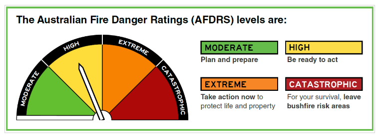

---
## Page 36

 
 
 
 
36 
 
 
OFFICIAL 
 
OFFICIAL 
 
OFFICIAL 
OFFICIAL 
 
Daily forecast maximum fire danger ratings will be shown for the BoM Fire Weather District on 
roadside signs (where installed), emergency services websites, the BoM webpage and are 
broadcast where required through media such as television, radio, newspapers and the internet. 
The Fire Danger Ratings feature: 
• 
Broad categories representing levels of fire danger risk. 
• 
Four fire danger rating levels. 
• 
Simple fire danger rating names and intuitive colours. 
• 
Distinct action orientated messages for each fire danger rating level. 
An AFDRS Communications Kit for the community is published on the CFA website, available at: 
Australian Fire Danger Rating System Communications Kit | CFA (Country Fire Authority). 
4.8.2 Fire Behaviour Index 
The Fire Behaviour Index (FBI) is a simple numerical scale that can be used consistently across 
Australia, allowing users to make decisions that require finer detail than the four Fire Danger Rating 
categories allow. The FBI runs from 0 to 100 and beyond, with increasingly high values indicating 
increasing dangerous fire behaviour and therefore fire danger risk. 
The FBI is designed to support fire management professionals and decision makers.  
FBI forecasts are available on government agency intranet portals, through the registered users’ 
section of the Bureau of Meteorology website and publically available during the high-risk weather 
season on the Bureau of Meteorology Victorian Fire Danger Ratings webpage. 
Figure 4: Fire Behaviour Index scale 
 
 
The Fire Behaviour Index features: 
• 
A fine-grained scale of fire danger that runs from 0 to 100 and beyond. 
• 
A stepped design to aid in operational decision making. 
• 
Transition between steps based on changes in fire behaviour that have operational 
consequences. 
• 
Management guidelines for each stepped category.

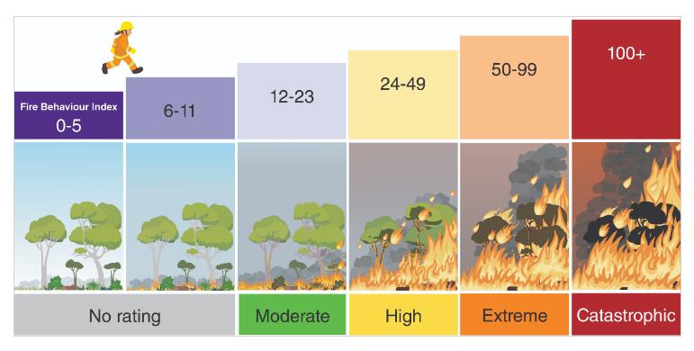

---
## Page 37

 
 
 
 
37 
 
 
OFFICIAL 
 
OFFICIAL 
 
OFFICIAL 
OFFICIAL 
 
4.8.3 Components of the Operational Build 
The Operational Build of the AFDRS is the underlying infrastructure that enables the latest science, 
technology and data to be used to produce accurate and timely fire danger information. There are 
four main components that work together to provide fire danger information. 
Figure 5: Components of the Operational Build 
 
 
Fuel State Editor (FSE) 
The FSE is an interactive tool that allows fire and land management agencies to capture field 
information and update maps relating to the fuel component of fire danger; this data is then 
exported to the Fire Danger Calculation Engine. 
Fire Danger Calculation Engine 
This is the component that combines the various fire behaviour models with fuel, weather, and 
climate data sets to derive Fire Danger Ratings, a Fire Behaviour Index and other outputs on a 
seamless timescale. The calculation engine outputs data sets to various portals or feeds where 
users can see and/or interact with the information. 
Fire Danger Viewer (FDV) 
The FDV is an interactive and common visualisation tool for states and territories to view and 
interrogate fire hazard information; it includes the Fire Danger Ratings in map and table format as 
well as inputs such as weather and fuel data. 
BOM Products 
The Bureau of Meteorology (BOM) produces products as part of the AFDRS suite of services that 
provide nation-wide standard information about fire danger for a variety of uses. 
Further information on the Operational Build including access to AFDRS eLearning courses is 
available at: AFAC | Australian Fire Danger Rating System Design.

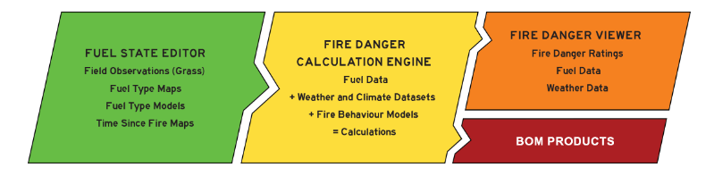

---
## Page 38

 
 
 
 
38 
 
 
OFFICIAL 
 
OFFICIAL 
 
OFFICIAL 
OFFICIAL 
 
4.9 Control Agency Preparedness 
The EMC and the fire agencies prepare a suite of arrangements for responding to bushfire, 
including: 
Ensuring a sufficient resource capacity for sustained response, including: 
• 
A sufficient number and distribution of trained and experienced personnel 
• 
Firefighting equipment, such as tankers and bulldozers, designed specifically for bushfire 
• 
An aircraft fleet to support ground firefighters 
• 
A network of airbases and communications infrastructure such as radio and fire towers 
• 
Modern logistics systems to support firefighters. 
Maintaining a science and technology capability to: 
• 
Forecast fire risk and impact 
• 
Provide firefighters with information about the fire. 
Arrangements for the readiness of resources, including: 
• 
Readiness plans 
• 
Pre-positioning of resources. 
Procedures for initiating response to fires, including: 
• 
Bushfire detection systems 
• 
Call-taking and dispatch arrangements. 
In the lead up to each summer season, the EMC also requests assurance from fire services 
agencies and other key support agencies regarding their preparedness for the upcoming season. 
4.10 Human resources 
CFA has a strong volunteer workforce consisting of approximately 50,000 volunteers (with 
approximately 30,000 having an operational role in service delivery) supported by other staff who 
collectively deliver services across the emergency management spectrum for bushfire and other 
hazards. 
DEECA works with FFMVic partner agencies to access approximately 1,800 staff with bushfire and 
emergency management skills during emergencies. DEECA employs seasonal project firefighters 
over the summer to complement permanent firefighting staff. FFMVic hosts significant specialised 
forest firefighting capability including staff trained and equipped to operate in remote settings, 
enabling rapid suppression and campaign fire response capabilities. FFMVic also provides 
approximately 1,300 incident management resources and support capabilities for bushfire at the 
State, regional and incident levels throughout Victoria. 
FRV relies on a workforce of over 3,500 career firefighters supported by over 600 other staff.  
Additionally: 
• 
The fire services agencies have agreements with a wide range of agencies and interest 
groups regarding the delivery of specialist services during bushfires. 
• 
The fire services agencies have pre-emptive agreements with comparative interstate and 
international agencies to provide reciprocal support during major fires and, in some cases, 
during preparedness arrangements. 
• 
Arrangements are in place to source Commonwealth resources (such as the Australian 
Defence Force) if required.

---
## Page 39

 
 
 
 
39 
 
 
OFFICIAL 
 
OFFICIAL 
 
OFFICIAL 
OFFICIAL 
 
4.11 Cross border arrangements 
The Arrangement for Interstate Assistance (AIA) is the primary arrangement for mutual assistance 
in emergency management activities being conducted by Australian emergency response 
agencies. The AIA outlines processes for when significant resource deployments are requested by 
states to assist in response to large scale events, including bushfires. 
Victoria has appointed a Cross Border Commissioner who works with border residents, businesses 
and community organisations to identify and advocate for change along Victoria’s borders. This 
involves working with Victoria’s departments, agencies and councils, helping them to Ask the 
Border Question on specific issues and across their portfolios of work. 
The Cross Border Commissioner also works with interstate counterparts for cross-border advice 
and support, including the NSW Cross Border Commissioner and SA Cross Border Commissioner. 
A Memorandum of Understanding with NSW is now in place. 
There are also a number of cross border agreements in place between Victorian emergency 
response agencies and their interstate counterparts, on both the New South Wales and South 
Australian border. The agreements cover first response, requests for immediate assistance and 
resource sharing with neighbouring jurisdictions. 
The cross-border agreements can be accessed through the EM-COP Cross Border portal and 
through the relevant REMPC. 
4.12 Capability 
State capability and capacity is more effective and efficient as the emergency management sector 
has an all-agency, all-hazards approach where the agencies work as a unified, interoperable and 
agile team. 
The fire agencies need to adequately respond to bushfire and other emergencies in order to 
effectively manage the impacts of such events on the community. The fire agencies undertake a 
range of planning and preparatory activities to ensure the State can respond effectively and 
efficiently to emergencies. 
No single fire agency can manage a major bushfire alone. Agencies work together to provide a 
collective response force that builds on the strengths of individual agencies. Each agency 
strengthens the overall State capability and capacity to prevent or respond to bushfires by 
maintaining their own specialised skills and expertise related to the sphere of emergencies for 
which they have legislative responsibility. 
The fire agencies actively work towards shared systems, common standards, consistent processes 
and comparable training of roles to better support efficient and effective operational activities. 
The fire services train their personnel in a wide range of bushfire response, incident management 
and support roles. They conduct their training and exercises as joint–agency events wherever 
possible to ensure an effective integrated bushfire response. 
4.12.1 Training, Equipment and Information Communication Technology (ICT) 
Each response agency maintains its own vehicle and equipment fleet designed to meet its 
jurisdictional responsibilities. 
Wherever possible, the fire services agencies collaborate during equipment design to improve 
interoperability for the future. 
Where appropriate, the fire services agencies maintain a comprehensive register of contract 
equipment that can be hired during an emergency.

---
## Page 40

 
 
 
 
40 
 
 
OFFICIAL 
 
OFFICIAL 
 
OFFICIAL 
OFFICIAL 
 
4.12.2 Shared ICT platforms 
The EM sector uses several shared platforms to enable personnel to access information and 
systems across agencies. This includes shared storage, mapping systems, webmail, and incident 
management systems. 
Emergency Management Common Operating Picture (EM-COP) 
EM-COP is a web-based entry point for personnel across the emergency management sector to 
access information and systems using a standard web browser on any internet connected device. 
EM-COP provides tabs for map-based collaboration, a desktop of links to current operational and 
other web-based information and a reference library. Access is via registered username and 
password and is open to all persons with a legitimate role in emergency management. 
State Resource Request System 
The multi-agency State Resource Request System (SRRS) is designed to make it easy for 
Resources Unit members at incident, regional and State tiers, to submit and action requests for 
additional resources during incidents and planned burning. The SRRS is a requesting system only 
and is not designed for resource tracking. 
JSOP03.09 Resource Request Process sets out how to request resources for major emergencies. 
4.12.3 Aviation 
The fire agencies annually establish a fleet of contract and on-call aircraft, comprising both 
helicopters and fixed wing aircraft, to assist ground-based firefighters. Throughout periods of high 
fire risk, aircraft resources are strategically located at air bases around the State to support 
response activities.  
Tactical and non-tactical aircraft undertake a wide range of operational and support activities and 
are crewed by appropriately trained and accredited personnel. Procedures detail readiness of 
aviation personnel and equipment in response to the risk environment. The procedures and 
contract arrangements provide for flexibility and scalability that provide for an adequate number 
and type of assets to be made available commensurate with the desired readiness level or meet 
the operational demand. 
The State Air Desk operates as a function of the State Control Centre (SCC; see section 5.14.1) 
and coordinates the operational emergency aviation activity within the State for response activities 
under the control of the agencies. The Interagency Aviation Operating Procedures (IAOPs) are the 
procedures that govern the operation of aircraft for emergencies and land management activities. 
These procedures are produced to ensure the safety and effectiveness of agency aircraft 
operations by providing one source of agreed procedures which are available and relevant for all 
agency aircraft operations. 
Once dispatched to an event, the aircraft are assigned to the incident and come under the control 
of the respective Incident Controller (IC). 
The EMC is also able to request access to additional aircraft in the national fleet, coordinated 
through the National Aerial Firefighting Centre (NAFC). This national aircraft fleet complements 
aerial firefighting resources that are arranged directly by the State. 
JSOP02.06 Aviation Resource Readiness (Bushfire) outlines the readiness levels of aviation 
resources.

---
## Page 41

 
 
 
 
41 
 
 
OFFICIAL 
 
OFFICIAL 
 
OFFICIAL 
OFFICIAL 
 
4.12.4 Logistics 
Each of the fire services agencies maintains an extensive store of logistical supplies so they can 
sustain a firefighting effort over a prolonged period. 
The stores are: 
• 
Fire Equipment Development Centre (DEECA) at Altona North 
• 
State Logistics Centre (CFA) at Scoresby 
• 
Sunshine Warehouse (FRV). 
Arrangements are also in place with suppliers to obtain additional logistical supplies at short notice. 
4.13 Intelligence and Predictive Services 
4.13.1 Bureau of Meteorology 
The Bureau of Meteorology (BoM) under agreement with the State’s fire agencies produce a 
number of intelligence products that attempt to forecast fire weather and fire risk. BoM embeds a 
meteorologist in the SCC (see section 5.14.1). These products are informed by a number of data 
sources and published by BoM at regular intervals. Supplementary intelligence products that depict 
fire danger and bushfire risk are produced by the SCC and disseminated across the EM sector to 
inform decisions. 
At a micro level, the fire agencies use fire behaviour analysts to combine meteorological and fire 
science inputs to develop fire behaviour predictions. The predictions help firefighters identify the 
potential impact and consequences of bushfires and help inform the development of bushfire 
control and risk mitigation strategies. 
4.13.2 Intelligence products and Fire Behaviour Analysts (FBANs) 
When a fire starts predictions of the potential impact of the fire are assessed at multiple levels 
including in the field by responding crews. To assist in more detailed analysis of fire spread 
potential, Fire Behaviour Analysts (FBANs) can be used to predict the areas of potential impact for 
up to several days in advance. The FBAN role relies on experience, predictive bushfire 
mathematical models and bushfire simulators across a range of fuel types to predict fire behaviour. 
The positioning of the FBAN role as part of the incident, regional or State management teams 
operating at the incident or State levels is relevant. The role is important for procuring reliable fire 
intelligence as well as providing early warnings (several days in advance) of largescale fire 
behaviour. 
4.13.3 Remote sensing and other technology 
The fire services agencies collaborate where possible on the development and use of technology 
to support firefighting. They primarily use technology to develop an operating picture of a bushfire 
that can be shared at the incident, region, State and community levels. 
Technology such as remote sensing can also provide bushfire managers with a strategic overview 
of major bushfire.

---
## Page 42

 
 
 
 
42 
 
 
OFFICIAL 
 
OFFICIAL 
 
OFFICIAL 
OFFICIAL 
 
5. 
Response 
5.1 Concept of Emergency Operations 
The State approach to the management of bushfire or any Class 1 emergency, consistent with the 
philosophy adopted Australia wide, is to ensure that: 
• 
The protection and preservation of life and the relief of suffering is paramount 
• 
Timely, relevant and tailored warnings and information are communicated to the 
community 
• 
Agencies, which have personnel trained and equipped to provide a particular emergency 
response service, respond to the emergency 
• 
All agencies are coordinated in their activities 
• 
The provision of relief and recovery is integrated with response management at an early 
stage in the emergency 
• 
There is ongoing assessment and management of the impact and consequences of the 
emergency 
• 
The immediate needs of affected people and the impacts upon the community as a whole 
are managed 
• 
State, regional and municipal plans are developed and executed, defining the operational 
needs for a multi-agency approach 
• 
Control measures are in place at appropriate levels and an effective incident control 
structure is in place for all incidents to achieve protection of life and property 
• 
Emergency Management Teams at State, region and incident levels are effectively led, 
managed and engaged. 
These concepts apply to the response to an emergency, regardless of the size of the emergency, 
and regardless of how many agencies are involved in the response. 
5.2 Tiers of Emergency Management 
In line with the SEMP, Victoria has three operational tiers (incident, region and State) with the 
option of an ‘area of operation’ being declared to manage a complex emergency that may be 
geographically located over several municipalities or several regions. 
Some bushfires have implications beyond the incident tier that require specific actions: they need 
more resources, have greater consequences and recovery needs or need messages sent to 
broader groups of people. In these cases, regional, State or area of operation arrangements may 
be enacted to support the incident. 
Victoria’s emergency management regions are declared by the Governor in Council under section 
77A of the EM Act 2013. Region and State tier arrangements are constantly activated and scale up 
with resources and functional activities when a major emergency has occurred or is anticipated to 
occur through intelligence and commensurate with the desired levels of readiness. 
The readiness and response structure for some emergencies may be enhanced by other 
arrangements or enhanced to cater for multiple emergencies of different types that may occur 
concurrently.  The SEMP details how an Area of Operations may be established to meet the needs 
of a complex emergency; such an arrangement would operate in addition to the three tiers listed 
above.

---
## Page 43

 
 
 
 
43 
 
 
OFFICIAL 
 
OFFICIAL 
 
OFFICIAL 
OFFICIAL 
 
5.3 Readiness 
The State has a standing capacity and capability for responding to bushfires through standard 
agency arrangements. Agencies jointly develop local arrangements that document agreed 
arrangements for jointly preparing for and responding to bushfires. 
Readiness arrangements are scalable and adaptable to ensure an efficient and effective response 
to bushfires of any size and complexity; they are often documented in a matrix style commensurate 
with the fire danger ratings system. Examples of adjusting agency readiness activities can include 
elevating arrangements when a significant emergency can be reasonably expected, such as a 
bushfire occurring on a day of elevated fire danger. Enhanced readiness arrangements can include 
activities such as pre-positioning incident management personnel, identifying surge resources, 
moving key assets such as aircraft to locations that better address the risk environment or 
increasing fire detection activities such as patrols, tower observers and fire detection flights. 
5.3.1 Daily readiness arrangements 
During the fire season, the fire agencies together with their partners within the State and Regional 
Control Teams (SCT and RCTs) jointly ensure response resources (personnel, equipment, facilities 
etc.) are set at appropriate level of readiness, commensurate with the risk and operational 
requirements. This can include pre-positioning fire-fighting resources and incident management 
teams on days of high fire risk. 
At State and regional levels, a matrix for bushfire readiness summarise arrangements and guides 
decision making processes to ensure the appropriate capabilities are set to respond to outbreaks of 
fire quickly and effectively. 
Fire agency readiness levels in respect to Incident Management Teams (IMT’s), aviation and other 
specialist resources are recorded in operational systems that provide an overview or dashboard of 
readiness arrangements for bushfire. 
The introduction of the AFDRS (section 4.8) provides a consistent basis for agencies and 
jurisdictions across Australia to plan and implement readiness arrangements for bushfire. This 
decision making is supported by other inputs including forecast fire danger indices (forest and 
grass), resource availability, existing fire activity and forecast lightning activity. 
5.3.2 Resource readiness 
In respect to some specialist resources, the fire agencies have an agreed set of arrangements for 
ensuring a minimum level of resources are ready to respond to bushfire emergencies in Victoria.  
JSOPs document these arrangements in respect to both IMTs and aviation. 
During the fire season, aircraft are positioned at various locations around the State to support 
response activities. JSOP (JSOP02.06 – Aviation Resource Readiness (Bushfire)) for aviation 
readiness relates to the pre-positioning and readiness of aviation personnel and equipment to 
support bushfire response activities. These arrangements specify a minimum specification that can 
be adjusted and enhanced to suit the environment and other factors and the approvals required for 
this. 
IMT and Incident Control Centre (ICC) arrangements in the fire season is specified in JSOP02.03 – 
Incident Management Team – Readiness Arrangements. 
The approach to IMT readiness does not include the arrangements that control agencies may put 
in place to manage initial response and day to day activities, such as non-major fires, or normal fire 
response.

---
## Page 44

 
 
 
 
44 
 
 
OFFICIAL 
 
OFFICIAL 
 
OFFICIAL 
OFFICIAL 
 
5.3.3 Operational planning 
Operational planning and readiness arrangements informed by an environmental scan, resource 
availability and risk assessments are detailed and summarised in key operational planning 
documents. 
The State Operations Plan is produced at the State tier and amongst other information provides a 
risk overview across Victoria for a defined period that can be used by fire agencies to inform 
readiness levels. The State Operations Plan also provides an operational overview, key State 
objectives and risks, and key strategic communication messages and activities. 
Regional Control Teams (RCT) may produce a Regional 7 Day Action Plan relevant to each week 
across the fire season that considers similar information applied at the local level and considering 
the local risk environment. This Action Plan, approved by the Regional Controller (RC), describes 
and details the specific risks and activities of the fire agencies and support agencies in respect to 
bushfire readiness. It can be used to inform stakeholders of the necessary readiness arrangements 
in respect to bushfire risk for that planning period. 
5.4 Initial Response 
Following the ignition of a bushfire, the fuel, topography and weather in the area where the bushfire 
is burning will determine its size, direction and intensity. The fire agencies are responsible for the 
first response to bushfire according to their respective legislative and jurisdictional responsibilities, 
often supported by privately owned and managed resources in rural areas. 
In light fuels such as grass, firefighters generally extinguish bushfires using water. Where water is 
scarce or where fuels are heavier, such as in a forest, firefighters generally contain bushfires within 
mineral earth firebreaks, created using either hand tools or heavy machinery. 
Aircraft can assist in halting the intensity and spread of a fire for a temporary period, allowing 
ground firefighters to approach with increased safety.Predetermined dispatch of aircraft is a key 
measure to achieve this initial reduction in bushfire development. 
5.4.1 Initial attack 
Early detection of and response to bushfires is vital to restricting the spread and development of 
bushfires. The fire agencies detect bushfires using a range of methods including reports from the 
public, ‘spotters’ in fire towers, detection aircraft and observation by government employees during 
their daily activities. Enhanced levels of fire detection arrangements are activated commensurate 
with the forecast fire danger (see section 4.8). 
The Emergency Services Telecommunications Authority (ESTA) provides the link between the 
Victorian community and the State’s emergency services agencies; they provide Victoria’s 24-hour 
emergency call taking and dispatch services and receive Triple Zero (000) calls from the public to 
report fires and dispatch CFA or FRV resources. Where a fire is detected on public land, ESTA 
dispatches the assigned CFA or FRV resources and contacts the FFMVic State Agency 
Commander who may dispatch additional FFMVic resources. 
Where response is undertaken quickly to a bushfire, fires can generally be contained before they 
reach their maximum potential. An efficient first response will keep the area of impact of the 
bushfire as small as possible and will minimise the potential for bushfire to have broader 
consequences. On days of elevated fire danger, fire agencies adjust their readiness and response 
arrangements by planning for the initial response or first attack to fail and the fire to grow rapidly. 
Once a bushfire has been contained, firefighters must ensure they consider and manage the risk of 
bushfire escaping containment.  This will normally involve careful monitoring of the weather and on-
going patrol of the area for several days to ensure there is no re-ignition of fuels previously thought 
extinguished.

---
## Page 45

 
 
 
 
45 
 
 
OFFICIAL 
 
OFFICIAL 
 
OFFICIAL 
OFFICIAL 
 
5.4.2 Pre-determined dispatch of aircraft 
At specific fire danger trigger levels, the State Aerial Firefighting fleet has a number of firebombing 
aircraft that provide pre-determined dispatch to have aircraft working over fires in the shortest 
possible time – rapid initial attack. 
5.4.3 Operational Safety 
In line with the State Emergency Management Priorities the safety and the protection of human life, 
including emergency services personnel and community members, takes priority above all other 
considerations in bushfire management. 
All emergency services personnel are to avoid putting themselves at risk when working at an 
incident. By adopting the Safe Person Approach (SPA; see section 5.4.4) and using the Dynamic 
Risk Assessment (DRA; see section 5.4.5), emergency personnel may minimise the risk of injury to 
themselves and others. 
5.4.4 Safe Person Approach (SPA) 
Applying the SPA, agencies have responsibility to make sure systems of work are in place which 
allow work to be undertaken safely and, equally, personnel have a responsibility to ensure they 
work in accordance with agreed protocols. Each person has a responsibility for ensuring that their 
work practices do not result in an unacceptable level of risk to themselves or to others around 
them. 
5.4.5 Dynamic Risk Assessment (DRA) 
DRA is a simple continuous risk assessment process that allows operational personnel to rapidly 
and effectively assess risk, to decide on appropriate actions and controls and ensure responder 
safety in the rapidly changing operational environment. 
When assessing risk, emergency services personnel safety is paramount. 
DRA applies to all hazards associated with emergency response and operational activities and is 
carried out by all personnel from all agencies whenever there is an unexpected change to the plan 
or work environment. DRA is an intuitive thought process and is typically not recorded. 
JSOP08.02 – Dynamic Risk Assessment outlines the practice of continuous DRA as a component 
of all operational activities, including emergency response and training, to ensure responder safety 
is maintained. 
During established incidents, documented risk assessments are used to assess the options 
developed for fire containment and control.

---
## Page 46

 
 
 
 
46 
 
 
OFFICIAL 
 
OFFICIAL 
 
OFFICIAL 
OFFICIAL 
 
5.4.6 Red Flag Warnings 
Red Flag Warnings is a process used by fire agencies for communicating critical safety information 
to all incident personnel, to support decision making regarding strategy, tactics and deployment of 
resources.  
JSOP03.11 – Red Flag Warnings details this process. 
A Red Flag Warning is a message issued when there is a significant change to any critical 
information that may adversely affect the safety of personnel located at an emergency.  
A Red Flag Warning should be issued when there is, or is predicted to be, a significant risk to 
safety due to changed circumstances, including but not limited to: 
• 
weather conditions 
• 
incident conditions and/or behaviour 
• 
equipment availability 
• 
communications arrangements 
• 
access. 
5.4.7 Field Information Update (FIU) 
The FIU is a method for the distribution of changes to strategy, tactics, new intelligence, safety 
information to the field during a shift. It is typically new information that was not included or 
available at the time of the briefing. It may be delivered via radio broadcast or printed copy, and 
may include: 
• 
weather 
• 
incident behaviour 
• 
organisation (sectorisation, control) 
• 
communications. 
5.4.8 LACES 
In emergencies like bushfires, on ground responders rely on the use of safety zones and escape 
routes for safety as conditions change. In these situations, LACES provides a system to maintain 
safety. Alternate systems of work may be available to manage particular risks encountered during 
emergency work. If an alternative system is not available, or is unsuitable, LACES should be 
considered as part of the Dynamic Risk Assessment process (see section 5.4.5). 
 
L 
OOKOUTS 
A 
WARENESS 
C 
OMMUNICATIONS 
E 
SCAPE ROUTES 
S 
AFETY ZONES

---
## Page 47

 
 
 
 
47 
 
 
OFFICIAL 
 
OFFICIAL 
 
OFFICIAL 
OFFICIAL 
 
5.4.9 Health Monitoring 
Health Monitoring helps mitigate health risks to responders and identify those who may be at risk of 
adverse health outcomes as a result of their response to an emergency incident. 
It includes taking vital signs, and the assessment of presenting symptoms and relevant medical 
history to determine if a person’s health is impacted by their involvement in incident response. 
All personnel attending and working at bushfires are strongly encouraged to undertake health 
monitoring to support their health and welfare, however health monitoring is not mandatory except 
in circumstances where the Standard for Managing Exposure to Significant Carbon Monoxide 
Emissions - Responder Health states that all personnel are required to undertake health 
monitoring. 
JSOP08.05 – Health Monitoring – Emergency Personnel for further information and the process for 
requesting Health Monitoring. 
5.4.10 Hazard Trees 
Tree hazard is a major risk to firefighters and responders at all stages of operations, from active 
suppression, mopping up and patrol, through to recovery. All reasonable steps must be taken to 
protect firefighters and responders (including those providing relief and recovery functions) from 
tree hazards. Awareness and identification of trees which present a hazard need to form part of 
ongoing dynamic risk assessment performed by all personnel. During an attack on a going fire, 
personnel need to be particularly vigilant in identifying hazard trees and treating any unacceptable 
risk.  
Following the passage of the fire, hazard trees within striking distance of access/control lines or 
transport corridors require assessment and treatment as soon as possible, and before the 
commencement of any mop-up/blacking out/patrol. Only appropriately qualified or endorsed 
personnel can assess, mark and treat hazardous trees on the fire ground (including 
staging/briefing/assembly points), where practicable. Hazardous trees often cause roads and 
access around bushfire affected areas to remain closed for extended periods until assessment and 
treatments can be completed to mitigate these hazardous tree risks. 
JSOP08.03 – Tree Hazard – Fire has developed to mitigate the risk to emergency services 
personnel. 
5.4.11 WATCHOUT 
WATCHOUT is an acronym used to remind firefighters of potential dangers to their safety and to 
give advice on safe work practices. Understanding the meaning of the acronym will help perform a 
more comprehensive risk assessment. 
W EATHER dominates fire behaviour, so keep informed 
A CTIONS need to be based on current and expected fire behaviour 
T 
RY OUT at least two safe escape routes 
C OMMUNICATE with your supervisor, your crew and adjoining crews 
H AZARDS beware of variations in fuels and steep slopes 
O BSERVE changes in wind speed, direction, temperature, humidity and cloud 
U NDERSTAND  your instructions, make sure that you are understood 
T 
HINK clearly, be alert and act decisively before your situation becomes critical

---
## Page 48

 
 
 
 
48 
 
 
OFFICIAL 
 
OFFICIAL 
 
OFFICIAL 
OFFICIAL 
 
5.4.12 Occupational Health and Safety (OH&S) Incident Reporting  
Emergency Personnel are required to report OH&S incidents through the line of control (to their 
Officer in Charge/manager/supervisor/etc) as soon as practical. All incidents are to be recorded in 
the relevant agency’s hazard and incident reporting system or by using OH&S Incident Card 
system (salmon card).  All relevant sections of the OHS incident report card are required to be 
completed and forwarded to the Incident Controller or Logistics Officer. The Incident Safety Officer 
may also support this process (where appointed). 
Minor OH&S incidents are to be resolved at the local level unless otherwise advised by the IC.  
When a serious injury has occurred to a member, contractor or member of the public as a result of 
agency response activities the IC is required to be notified as soon as reasonably practicable.  
The IC is required to notify the relevant agency commander and this is required to be escalated 
through to the State Agency Commander (SAC). The notification will also occur simultaneously 
through both the line of control through to the IC, Regional Controller (RC) and the State Response 
Controller (SRC), and to the employer(s) of personnel involved in the incident. 
When a serious injury, that is a WorkSafe notifiable incident, has occurred to emergency 
personnel, contractor or member of the public as a result of agency response activity, WorkSafe 
must be notified verbally within 24 hours by the home agency. Written confirmation on the 
approved form is required within 48 hours. 
Where an individual agency has notified WorkSafe of a serious incident the agency is required to 
notify the IC as soon as practicable. 
JSOP08.01 - Occupational Health &Safety (OHS) Hazard, Incident and Investigation reporting - 
Major Emergencies provides further information.

---
## Page 49

 
 
 
 
49 
 
 
OFFICIAL 
 
OFFICIAL 
 
OFFICIAL 
OFFICIAL 
 
5.5 Control 
5.5.1 Control Agency and Support Agencies 
Control is the overall direction of response activities in an emergency, operating horizontally across 
agencies, including the tasking of other agencies as per the SEMP. Authority for control is 
established in legislation or in an emergency response plan and carries with it the responsibility for 
tasking other agencies in accordance with the needs of the situation. Only one agency can be the 
nominated control agency for any emergency. Similarly, only one Incident Controller (IC) can be 
appointed at any one time for a bushfire event. 
Support agencies provide services, personnel, or material to support or assist control agencies or 
affected community members. Support agencies integrate into the broader operational structure by 
being included into the emergency management team operating at the respective tier(s). 
Agency Chief Officers/Chief Fire Officers and the FRV Commissioner retain their existing statutory 
powers, authorities and responsibilities at all times, and are required to exercise these powers, 
authorities and responsibilities in accordance with the SEMP. 
5.5.2 Determining the Control Agency 
The fire services agencies are responsible for the first response to bushfires according to their 
respective legislative and jurisdictional responsibilities. As with each emergency and 
commensurate with the SEMP, each bushfire will have a single control agency and subsequently a 
single Incident Controller (IC). This is regardless of the number of agencies responding. 
The control agency is determined by a number of factors, including initial location of the fire, 
predicted area of impact, and agreement between the fire agencies. 
During initial response, the IC communicates to their agency through their agency command and 
control arrangements.   
The ‘line-of-control’ refers to the line of supervision for those appointed to perform the control 
function in the context of a major emergency. For bushfire emergencies, the line of control is shown 
in Figure 6 Line of control in bushfire emergencies. 
Figure 6: Line of control in bushfire emergencies 
 
Additionally, and in order to meet the objectives of emergency management in Victoria, those 
performing the control functions need to ensure: 
• 
the consequences of the emergency are managed, and 
• 
there is communication that meets the information needs of communities, Government, 
agencies and business. 
State
•State Response Controller (SRC)
Region
•Regional Controller (RC)
Incident
•Incident Controller (IC)

---
## Page 50

 
 
 
 
50 
 
 
OFFICIAL 
 
OFFICIAL 
 
OFFICIAL 
OFFICIAL 
 
State Control Team (SCT) 
In a Class 1 emergency, the EMC must appoint a State Response Controller (SRC) to be 
responsible for the control of response activities, in accordance with the SEMP. The SRC: 
• 
is responsible for the control of response activities 
• 
may exercise all the statutory powers and authorities of the chief 
• 
officers of the relevant Control Agencies 
• 
may appoint and deploy controllers in accordance with the SEMP 
• 
is responsible for issuing warnings providing information to the community. 
The SRC will establish a State Control Team (SCT) to provide advice on a strategic approach to 
the risk environment across the State. 
The SCT for a bushfire usually comprises of: 
• 
State Response Controller (SRC) 
• 
State Agency Commanders (SACs; Class 1 agencies) 
• 
Senior Police Liaison Officer (SPLO) 
• 
State Recovery Coordinator (SReC) 
• 
An Executive Officer will provide support to the team.  
The SRC may request other functions to attend. Examples include the State Health Commander 
(Ambulance Victoria) or functional leads from the SCC such as Aviation, Public Information or the 
State Consequence Manager. 
Regional Control Team (RCT) 
The Regional Controller (RC) will establish an RCT to provide advice on a strategic approach to 
bushfire readiness and response and support the functions of the Region. 
The RCT for a bushfire usually comprises of: 
• 
Regional Controller (RC) 
• 
Regional Agency Commanders (RACs; Class 1 agencies) 
• 
Regional Emergency Response Coordinator (RERC) 
• 
Regional Recovery Coordinator (RRC) 
• 
An Executive Officer will provide support to the team. 
The RC may request other functions to attend. Examples can include the Regional Health 
Commander (Ambulance Victoria), Commanders representing other agencies / departments or 
functional roles such as a Regional Resources or Intelligence Officer.  
5.5.3 Transfer of Control 
Establishing effective control arrangements in the early stages of the incident is critical. Control for 
a bushfire emergency will always be exercised at the incident tier. Once control is established, the 
Incident Controller (IC) can transfer control to another IC, provided this is done formally, a record is 
kept, and all involved agencies are informed of the transfer. The IC may be from another agency. 
There are circumstances where an IC based in an Incident Control Centre (ICC) and supported by 
an Incident Management Team (IMT) with specialist skills and equipment should manage an 
incident, rather than a field-based IC. These circumstances include where the incident is a major 
emergency or has the potential to become a major emergency, or where the bushfire becomes

---
## Page 51

 
 
 
 
51 
 
 
OFFICIAL 
 
OFFICIAL 
 
OFFICIAL 
OFFICIAL 
 
complex and there is a need to delegate the operation of a number of functions under the AIIMS 
system.  In these transfer of control circumstances, the previous IC will generally connect the ICC 
with field operations by assuming a role in the Operations Section, such as a Division Commander. 
They can then focus on tasking field operations and providing information back to the IMT. 
There are circumstances where the initial IC should transfer control of a bushfire emergency to an 
IC within a preformed IMT almost immediately. These include where: 
• 
the incident shows clear potential to become a major emergency, 
• 
initial attack has failed, fire weather is extreme or control is unlikely in the short term, 
• 
the IC requires immediate specialist support, 
• 
a number of similar incidents are expected within the area (such as multiple roof damage 
following a storm), best managed as the one incident. 
Control may be transferred from one ICC to another more suitable ICC if it is better able to support 
the incident. This transfer may be required for various reasons, including personnel capability, 
functionality of the facility, escalation of the incident, or movement of the incident through the 
landscape. In some cases, a staged transfer of responsibilities to an IMT in an ICC may be the 
most appropriate course of action. 
JSOP03.15 – Transfer of Control and IMT Relocation for Class 1 Emergencies, outlines the 
process for the transfer of control from the field-based IC to an ICC based IC. 
5.6 Coordination 
The EMC is responsible for the coordination of agencies at the State tier with roles and 
responsibilities for response to bushfire. 
Victoria Police members are appointed as Regional Emergency Response Coordinators (RERCs) 
and Municipal Emergency Response Coordinators (MERCs) and undertake the coordination of 
resources at the regional and municipal / incident tiers of emergency management respectively.  
Under the EM Act 2013, the Chief Commissioner of Police must appoint a Senior Police Liaison 
Officer (SPLO), who advises the EMC about regional and municipal emergency response 
coordination and other police matters and is the liaison channel with the RERC and MERC. 
5.7 Command 
Command is the direction of activities internally within an agency to use its people, resources, 
governance, systems and processes to discharge its responsibilities in line with relevant legislation. 
Each agency appoints agency commanders to supervise their personnel and ensure they are 
working safely. 
The ‘chain-of-command’ refers to an agency’s organisational hierarchy that defines the 
accountability of people or positions and identifies the link between individuals and their supervisor. 
An agency might formally agree for a person from another agency to supervise their personnel for 
a fixed period during emergencies. However, this does not replace the home agency’s 
responsibility to their personnel.

---
## Page 52

 
 
 
 
52 
 
 
OFFICIAL 
 
OFFICIAL 
 
OFFICIAL 
OFFICIAL 
 
5.8 Incident Management  
Bushfire will be controlled at the incident level through the application of the Australasian Inter-
service Incident Management System (AIIMS). AIIMS uses the following principles to manage 
incidents: 
• 
Flexibility 
• 
Management by objectives 
• 
Functional management 
• 
Span of control, and 
• 
Unity of command 
AIIMS also applies the principles of risk management described in AS/NZS ISO 31000: 2009 Risk 
Management – Principles and Guidelines. 
The IC is appointed for every incident and is responsible and accountable for all the functions of 
incident management. AIIMS identifies eight functional areas, as depicted in Figure 7 AIIMS 
Incident Management Functions and described in Table 3 Function Descriptions. 
Figure 7: AIIMS Incident Management Functions 
 
 
 
 
 
 
 
 
Source: AIIMS 2017

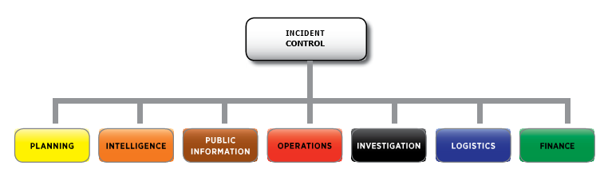

---
## Page 53

 
 
 
 
53 
 
 
OFFICIAL 
 
OFFICIAL 
 
OFFICIAL 
OFFICIAL 
 
Table 3: Function Descriptions 
Function 
Description 
Control 
The management of all the activities necessary for the resolution of an 
incident. 
Planning 
The development of objectives, strategies and plans for the resolution of an 
incident based on the outcomes of collection and analysis of information. 
Intelligence 
The task of collecting and analysing information or data, which are recorded 
and disseminated as intelligence to support decision making and planning. 
Public 
Information 
Provision of warnings, information and advice to the public, and liaison with 
the media and affected communities. 
Operations 
The tasking and application of resources to achieve resolution of the 
incident. 
Investigation 
The task of conducting investigations to determine the cause of an incident 
and/or to determine factors that contributed to the impact of the incident or 
specific events. 
Logistics 
The acquisition and provision of human and physical resources, facilities, 
services and materials to support achievement of incident objectives. 
Finance 
The task of managing: 
• accounts for purchases of supplies and hire of equipment; 
• insurance and compensation for personnel, property and vehicles; and 
• the collection of cost data and provision of cost-effective analyses and 
providing cost estimates for the incident. 
5.9 Incident levels 
The classification of bushfire is based on the size, scale and risks of the incident and the resources 
needed to manage it. This classification allows the agencies to communicate the complexity of the 
incident and scale the response to suit the incident. Escalation of incident levels usually generates 
greater oversight by the region and state levels, which may include guidance on the classification. 
5.9.1 Level 1 incident 
Level 1 bushfire incidents are characterised by being resolved through the use of local or initial 
response resources only. Control is limited to the immediate area and the Incident Controller (IC) 
can usually perform all the necessary functions. 
The IC may delegate some functions to personnel on scene (e.g. operations managed by crew 
leader) or remote to the incident (e.g. warnings issued by duty officer in district headquarters).

---
## Page 54

 
 
 
 
54 
 
 
OFFICIAL 
 
OFFICIAL 
 
OFFICIAL 
OFFICIAL 
 
Figure 8: Example of Level 1 incident management structure 
 
Source: AIIMS 2017 
5.9.2 Level 2 incident 
Level 2 bushfire incidents may be more complex either in size, resources or risk. They are 
characterised by the need for: 
• 
deployment of resources beyond initial response; or 
• 
the operations being divided into geographic or functional sectors; or 
• 
the establishment of incident management functional roles due to complexity levels; or 
• 
a combination of the above.

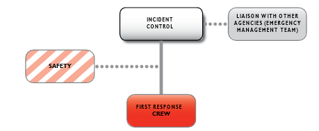

---
## Page 55

 
 
 
 
55 
 
 
OFFICIAL 
 
OFFICIAL 
 
OFFICIAL 
OFFICIAL 
 
Figure 9: Example of Level 2 incident management structure 
 
Source: AIIMS 2017

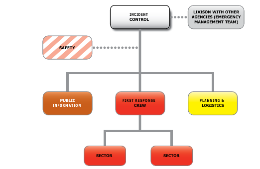

---
## Page 56

 
 
 
 
56 
 
 
OFFICIAL 
 
OFFICIAL 
 
OFFICIAL 
OFFICIAL 
 
5.9.3 Level 3 incident 
Level 3 bushfire incidents are characterised by degrees of complexity that may require a more 
substantial organisational structure to manage the emergency. These emergencies will usually 
involve delegation of all incident management functions and are considered major bushfire events. 
An example of an incident management structure for a Level 3 incident is shown in Figure 10. 
Figure 10: Example of Level 3 incident management structure 
 
Source: AIIMS 2017 
5.10 Incident Controller (IC) 
The appointment, function, location and role of the IC is outlined in the SEMP. 
As per JSOP03.08 – Appointment of Class 1 Regional Controllers and Incident Controllers, the 
control agency is responsible for the appointment of an IC for Level 1 and 2 incidents. If the 
incident is or is likely to become a major emergency the RC is required to ensure that an IC is 
appointed from the EMC’s endorsed list of Level 3 ICs. 
5.11 Incident Management Team (IMT) 
Where required, the IC is supported by an IMT, Incident Emergency Management Team (IEMT) 
and any additional specialist resources. The appointment, function and composition of the IMT and 
IEMT are outlined in the SEMP. 
There is only one IMT for each incident, at any point in time, regardless of the number of agencies 
in attendance. IMTs will be established and operate in accordance with the AIIMS incident 
management system.

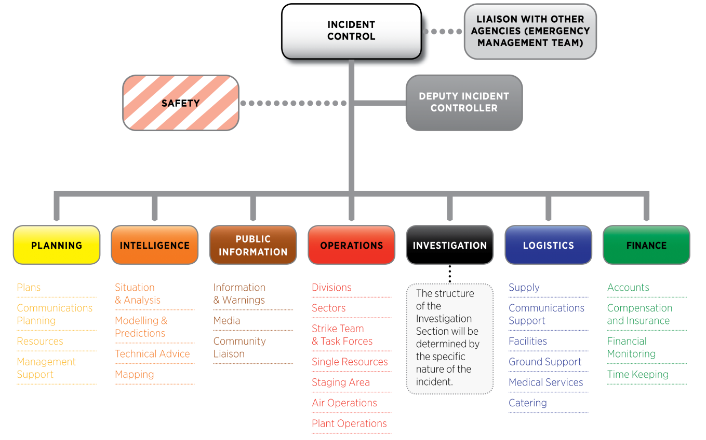

---
## Page 57

 
 
 
 
57 
 
 
OFFICIAL 
 
OFFICIAL 
 
OFFICIAL 
OFFICIAL 
 
5.11.1 Deputy Incident Controller (Deputy IC) 
To support the management of the incident, the Incident Controller may appoint a Deputy Incident 
Controller(s) to have oversight of specific tasks or to cover times that the Incident Controller is 
absent from the ICC.  The appointment of Deputy ICs ensures that the overall control of the 
incident can be maintained by a single person, the IC. 
If appointed and required to do so by the IC, the Deputy IC will act as the IC in their absence; this is 
often the case for a night shift of a prolonged incident. Appointment, delegation and transition of 
responsibilities should be documented and communicated to the IMT and IEMT. 
To ensure continuity, Deputy ICs may not alter the incident objectives in the Incident Action Plan. 
However, they may amend the incident strategies within the parameters provided by the IC. 
5.12 Supplementary resources 
The IC is responsible for identifying the resources needed to efficiently and effectively respond to 
the incident, sourcing these and establishing a safe area for them to stage prior to deployment to 
the incident. Local readiness, mutual aid arrangements, memorandums of understanding or local 
cross border arrangements between the control and supporting agencies should be used where 
established. 
The SEMP’s Requesting Additional Resources section provides further information. 
5.12.1 Resource Requesting 
The Incident Controller (IC) is responsible for providing direction, across all agencies, to the 
resources responding to the bushfire and for requesting and releasing resources. They are also 
responsible for identifying and sourcing the appropriate number and type of resources required to 
execute their Incident Action Plan. Local readiness, mutual aid arrangements, memorandums of 
understanding or local cross border arrangements between the control and supporting agencies 
are used to inform local resource allocation and deployment to an incident.  
Once the IC has determined that all resources (from control and support agencies) within the 
district have been exhausted, resources may be requested by the State Resource Request System 
(SRRS) and escalated to the regional tier. The Regional Controller (RC) will seek out appropriate 
resources from within the region to fill regional or incident requests. When an RC cannot obtain 
resources within their own region, the RC will escalate the request to the State tier. JSOP03.09 
Resource Request Process details this process. 
Where the IC has requested further resources beyond the initial response, they should establish a 
staging area to assemble these as they arrive. A staging area assists the IC to control access and 
egress to the incident site, to brief resources prior to deployment, to assemble resources into work 
units (for example strike teams and task forces), to manage welfare needs and to ensure all the 
resources are working and communicating within the command and control structure. 
5.12.2 Interstate and International Resources 
Victoria is a partner in the Commissioners and Chief Officers Strategic Committee (CCOSC). When 
jurisdictions are likely to require additional resources outside of their jurisdiction, it directs the 
activation of the Australian Fire Authorities Council – National Resource Sharing Centre (AFAC 
NRSC). AFAC NRSC meetings are held as required and more regularly during times of national 
crisis. There are emergency management hubs across Australia which hold an annual expression 
of interest process for personnel to register their interest in being deployed interstate and 
international. 
Victoria is identified as a partner under the Australasian Arrangement for Interstate Assistance - 
Fire and Emergency Services (AIA; see section 4.11). This is a mutual aid agreement between

---
## Page 58

 
 
 
 
58 
 
 
OFFICIAL 
 
OFFICIAL 
 
OFFICIAL 
OFFICIAL 
 
Australasian fire services, emergency services and land management agencies. It is intended for 
use within Australia and between Australia and New Zealand. 
Victoria has formal written agreements with Canada and USA which formally allow for the 
exchange of Wildland Fire Management Resources between these countries. 
The induction of interstate or international personnel is critical to safety and functionality. 
5.13 Emergency Management Team(s) (EMT) 
The SEMP outlines the appointment, function and composition of Emergency Management Teams 
(EMTs) at each activated tier of emergency response management, for the function of response 
(including relief) and recovery coordination: 
• 
State Emergency Management Team (SEMT) 
• 
Regional Emergency Management Team (REMT) 
• 
Incident Emergency Management Team (IEMT). 
Not all agencies have the capability to provide a representative for EMT at each tier. For example, 
a person may represent their agency at both the REMT and IEMT. 
5.13.1 Incident Emergency Management Team (IEMT) 
The SEMP outlines the composition of an IEMT. Membership may also include: 
• 
Support agency commanders (or their representatives) 
• 
Health Commander (functional commander of supporting health agencies) 
• 
Municipal Emergency Management Coordinators (MERCs) representing councils 
• 
Utility providers / operators, and 
• 
Other specialist persons as required. 
Support agency commanders then implement the allocated strategy through their respective 
command structures, and report back to the Incident Controller (IC) as to the success or otherwise 
of the strategy. 
The effective operation of an IEMT relies heavily upon communication between agencies. The 
importance of an effective IEMT to the successful management of an emergency cannot be 
overstated. 
Although the IEMT facilitates a collaborative decision-making process, with the primary intent of 
unity and purpose of effort, the IC leads the team and retains control of the emergency. 
5.14 Control facilities 
A range of static or mobile facilities support the line of control by providing the appropriate physical 
and technical infrastructure. These may be activated in anticipation of an incident to monitor 
impacts in the potentially affected area. 
5.14.1 State Control Centre (SCC)  
The SCC is the State’s primary control centre for management of emergencies and acts as a hub 
for a state-wide network of regional and incident control centres. The facility supports the State 
Response Controller (SRC), State Control Team (SCT), State Emergency Management Team 
(SEMT) and other key stakeholders.

---
## Page 59

 
 
 
 
59 
 
 
OFFICIAL 
 
OFFICIAL 
 
OFFICIAL 
OFFICIAL 
 
5.14.2 Regional Control Centres (RCCs) 
An RCC is the predetermined location where the Regional Controller (RC) operates from for a 
particular region. RCC functionality is maintained at all times to ensure immediate capability for all 
control agencies for all threats and hazards. 
The RC, Regional Control Team (RCT) and other personnel that operate from the RCC form part of 
the line of control and chain of command structures, with direct responsibility for all ICCs and 
operations identified within their area of responsibility. 
5.14.3 Incident Control Centres (ICCs) 
An ICC is the location where the IC and the IMT manages response activities. An ICC may be 
established for any size incident to cater for the needs of the incident management structure. Each 
ICC should, where possible, be at a pre-defined location that allows an appropriate level of 
communication with personnel at incidents within its ‘footprint’. 
A Level 3 ICC is a facility used to accommodate an IMT during preparation for, or response to a 
large or complex (Level 3) incident. A Level 3 ICC will have all the facilities and services required to 
support the operation of a multi-agency IMT, including those facilities required by support agencies. 
5.14.4 Control Point 
A Control Point is a field location where the role of IC may operate from, often used during the 
initial stages of an incident and may be supported by purpose-built vehicles.   
Regardless of the number of agencies at an incident, it is important that only one facility is 
identified as the place from which the incident is controlled. For larger scale or more complex 
incidents, control should transfer to an ICC. 
Once control has transferred to the ICC, the original control point may be re- established as an 
Operations Point, Division Command Point, Sector Command Point or disbanded as appropriate. 
5.14.5 Operations Point 
An Operations Point is the location from which the overall field operations are commanded by the 
Operations Officer, once this role has been delegated. An incident will have only one Operations 
Point. 
In large scale incidents, the Operations Officer will be located at the ICC in most circumstances. 
Where an ICC is established at some distance from the incident, the Operations Officer (in 
consultation with the IC may appoint a Deputy Operations Officer to attend the Operations Point. 
5.14.6 Division and Sector Command Point 
A Division Command Point (DCP) is a location where the person in the role of Division Commander 
operates. A Sector Command Point is the location from which the role of Sector Commander 
operates, if required. 
A Division or Sector Command Point could be a mobile point close to the incident, a Field 
Command Vehicle (FCV) or a building such as a Local Command Facility (LCF).

---
## Page 60

 
 
 
 
60 
 
 
OFFICIAL 
 
OFFICIAL 
 
OFFICIAL 
OFFICIAL 
 
5.15 Operational communications 
Fire agencies need to ensure that Joint Default Communications Plans are prepared to cover their 
respective districts before each fire season. Local Mutual Aid Plans (see section 3.4) will detail 
these default communications plans that are to be implemented at each multi-agency incident, until 
the IC replaces it with a specific Incident Communications Plan; which may only occur to support 
complex bushfire operations. 
JSOP02.02 – Incident Communications Planning sets out the process for the development, 
implementation and review of default and Incident Communications Plans.   
5.16 Bushfire naming convention 
Agencies are required to use a standard bushfire naming process to ensure that incidents are 
consistently named, quickly located and easily referenced. The incident name should be 
recognisable at all emergency management tiers and determined at a level as close to the incident 
as possible. The incident name is also a critical element of information provided to the community. 
The application of naming conventions ensures there is consistency in warning and advice 
messages. 
The control agency is responsible for determining the incident name. For multi-agency incidents, 
agencies will ensure that their respective reporting systems show the correct incident name. 
Standard processes should be followed if incident name needs to be amended due to the 
escalation, merging, or other changes to the situation.   
JSOP03.02 – Incident Naming – Major Emergencies provides further details surrounding the 
naming convention and requirements. 
5.17 Traffic management 
Traffic Management Points (TMPs) are established at the direction of the IC, in consultation with 
Victoria Police and Department of Transport and Planning, to regulate the flow of traffic into an 
area where bushfire has occurred, is occurring or has the potential to occur. Smoke, fire, 
hazardous trees, emergency services vehicles, wildlife and electrical assets are all hazards that 
can be reasonably expected on and around roadways in bushfire affected areas. For these reasons 
travelling on roads during or immediately after a bushfire can be particularly hazardous. 
Emergencies are not static and therefore the conditions of TMP may change over the course of 
and incident, and at any time. 
JSOP03.10 – Traffic Management at emergencies outlines the process for the activation and 
ongoing monitoring and deactivation of traffic management points, including the appointment of a 
Traffic Management Manager, development of a Traffic Management Plan and associated forms. 
Traffic Management Guidelines describe the agreed procedures for the operation of a TMP as part 
of an overall Traffic Management Plan, to assist in the control and management of pedestrian and 
vehicular road travel near an incident. 
To facilitate entry into an area, a TMP will be assigned an access level. The circumstances and 
groups of people who may be permitted access at each access level will be determined by the 
Incident Controller (IC).

---
## Page 61

 
 
 
 
61 
 
 
OFFICIAL 
 
OFFICIAL 
 
OFFICIAL 
OFFICIAL 
 
5.18 Evacuation 
AIDR’s Evacuation Planning Handbook defines evacuation as a risk management strategy that 
may be used to reduce loss of life or lessen the effects of an emergency on a community, prior to 
the onset of, or during, an emergency. It involves the planned movement of people threatened by a 
hazard to a safer location and, typically, their eventual safe and timely return. For an evacuation to 
be effective, it should be appropriately planned and implemented. Evacuations are not compulsory 
in Victoria and requirements for undertaking evacuations are detailed in JSOP03.12 – Evacuation 
for Major Emergencies. 
The Incident Controller (IC) is responsible for making a decision as to whether evacuation is a safe 
option for communities and individuals. In making this decision the IC may seek advice from other 
agencies or communities. 
Depending on the hazard and its impact and consequences on the community, the evacuation 
process, including withdrawal and return, may take days, weeks or months to complete. Some 
evacuations may be carried out very quickly and over very short distances. For example, people 
may be warned to move to higher ground pending a potential tsunami impact, to avoid a flash 
flood, or to move two streets away from a peri-urban interface to avoid a grass fire. In other 
circumstances, people evacuated from an area may be relocated many kilometres from their home 
and be unable to return for a considerable period of time. 
Evacuation is a scalable activity in that it may be applied to individuals, a house, a street, a large 
facility (i.e. school or hospital), a suburb, a town or a large area of the State. Where an area is 
identified (by means of local knowledge, prior history of a higher risk of evacuation, etc.) as 
requiring a specific detailed evacuation plan, consideration should be made to include this plan as 
part of the respective Municipal Emergency Management Plan (MEMP).

---
## Page 62

 
 
 
 
62 
 
 
OFFICIAL 
 
OFFICIAL 
 
OFFICIAL 
OFFICIAL 
 
5.19 Smoke 
Exposure to smoke or emissions from fires, especially when prolonged, should be addressed to 
protect both workforce and community from potential health impacts, including:  
• 
Health advice to protect both the responders (response, relief and recovery personnel) 
and the community 
• 
For responders, deployment of monitoring equipment to the incident site to monitor 
composition and exposure 
• 
For community exposure, potentially deploy monitoring where there are smoke impacts, in 
line with JSOP03.18 – Incident Air Monitoring and Advice for Community Health. 
The following documents contain more information on smoke and the process for initiating 
monitoring and the provision of public information and warnings, including public health advice: 
• 
State Smoke Framework1 
• 
Standard for Smoke, Air Quality and Community Health – Significant fires with fine 
particles (PM2.5) as the primary smoke component of health concern  
• 
Standard for Managing Exposure to Significant Carbon Monoxide Emissions - Community 
Health 
• 
Standard for Managing Exposure to Significant Carbon Monoxide Emissions - Responder 
Health 
• 
JSOP03.18 – Incident Air Quality Monitoring and Advice for Community Health 
• 
JSOP03.19 – Managing Significant Community Exposures to Fine Particles and Carbon 
Monoxide in Smoke from Fires 
• 
JSOP04.01 – Public Information and Warnings for Class 1 Emergencies 
 
 
 
 
1 The State Smoke Framework was developed following the Hazelwood coal mine fire with the last revision made in November 2016. Whilst the 
framework requires significant review, in-principle, the purpose of the Framework remains relevant and important.

---
## Page 63

 
 
 
 
63 
 
 
OFFICIAL 
 
OFFICIAL 
 
OFFICIAL 
OFFICIAL 
 
5.20 Public Information 
The provision of warnings and information in relation to fires in Victoria is detailed in the State 
priorities and also fire agencies have legislated responsibilities.  
The EMC may also seek support from the Emergency Management Joint Public Information 
Committee (EMJPIC) to ensure the state-level messages from all agencies involved in the 
management of emergency response, recovery and the consequences of the emergency are 
included in the key messages to the public. Regional and Incident Joint Public Information 
Committees may be stood up if required or directed by the Regional Controller (RC) or Incident 
Controller (IC). 
5.20.1 Provision of warnings to the community 
Timely, relevant and tailored warnings and information must be issued to potentially affected 
communities. The Incident Controller (IC) is responsible for authorising all warnings and 
information provided to the public. To assist the rapid communication of warnings and information, 
the IC may authorise a Deputy IC or Public Information Officer (PIO) to authorise the release of 
warnings and information to the community. No additional authorisation is required once the IC or 
delegate has authorised the information or warning. 
Where an extreme and imminent threat to life exists and it is not practicable to obtain authorisation 
from the IC in the circumstances, warnings may be initiated by any response agency personnel. 
The IC is required to be advised as soon as possible. 
Victoria’s emergency warnings arrangements include the use of Standard Emergency Warning 
Signal (SEWS), telephone alerts and message standards. 
5.20.2 Warning levels and templates 
Warning templates provide the Incident Controller (IC) and Public Information personnel the 
opportunity to include targeted information and specific actions for the communities affected. 
Warnings should be tailored to the community and reflect the impacts the bushfire is having or may 
have on the community. This includes information such as road closures, the direction the fire is 
moving in, where the community should go and information about what the community might see or 
experience; relief and support services, and health advice as required. 
5.20.3 Levels of community warnings and information 
The Australian Warning System has three warning levels, with a consistent set of icons for a 
number of emergencies, including bushfire.

---
## Page 64

 
 
 
 
64 
 
 
OFFICIAL 
 
OFFICIAL 
 
OFFICIAL 
OFFICIAL 
 
Figure 11: Australian Warning System relevant to bushfire 
Icon 
Warning Level 
Description 
 
Advice 
An incident has started.  
There is no immediate danger.  
Stay up to date in case the situation changes. 
 
Watch and Act 
There is a heightened level of threat.  
Conditions are changing and you need to start taking 
action now to protect you and your family. 
 
Emergency Warning 
An Emergency Warning is the highest level of 
warning.  
You may be in danger and need to take action 
immediately.  
Any delay now puts your life at risk. 
5.20.4 All Clear Messages 
An All Clear message is to be issued to inform the community that they can return to normal activity 
that the risk from fire is over. An ‘All Clear’ message needs to be issued whenever a Warning 
(Watch and Act) or Emergency Warning has been issued. An All Clear – Safe to Return is required 
to be issued if Evacuation warnings have been issued. 
5.20.5 Community Information 
Community Information is used to provide the community with information if an incident is creating 
community interest but does not pose a threat to the community. 
5.20.6 Publishing Warning and Information Areas (Polygon) 
Warnings and information issued to the community will have the warning area (polygon) shown on 
the map published to the VicEmergency website and app. Incident Controllers (ICs) should ensure 
that the polygon associated with the warning or information captures the community who needs to 
act.

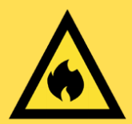

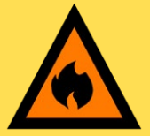

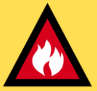

---
## Page 65

 
 
 
 
65 
 
 
OFFICIAL 
 
OFFICIAL 
 
OFFICIAL 
OFFICIAL 
 
5.20.7 Community meetings 
To ensure that local communities feel supported and informed, it is important to engage in two-way 
interaction to help foster community connection. The Public Information Officer (PIO) can provide 
advice on the best ways to engage the impacted community. 
A key way of engaging the community is through community meetings. It is important to ensure that 
any community meetings planned: 
• 
Are led by people with local knowledge, preferably people who are trusted by the 
community. 
• 
Are structured for two way conversations. 
• 
Use the tools available to properly record issues raised by community members, so you 
can respond. 
• 
Outcomes from the meeting should be reported to the Incident, Regional and State tiers to 
add to situational awareness, with a focus on sharing outcomes with councils. 
5.20.8 Warning channels 
There are numerous methods for providing information and warnings to the community, which 
include: 
• 
emergency broadcasters (designated community radio stations, ABC radio, local radio, 
Sky News). For Emergency Warning and Evacuation Warnings, the SEWS can be played 
prior to the warning being read 
• 
media releases, press conferences and interviews 
• 
social media (Facebook, Twitter) 
• 
VicEmergency website 
• 
VicEmergency app 
• 
VicTraffic 
• 
variable message signs and VicRoads overhead gantry signs 
• 
email distribution lists (local communities and EMTs) 
• 
community meetings and door knocks. 
5.20.9 Community Alert Sirens 
There are Community Alert Sirens in 40 communities across the State; many in bushfire prone 
areas. 
A siren is triggered through the warnings platform with the issue of any Warning (Watch & Act), 
Emergency Warning or Prepare to Evacuate or Evacuate Now, unless otherwise requested by the 
IC. The siren will sound for five minutes to indicate that a significant emergency has been identified 
and the community should ‘seek further information’. 
JSOP04.01 Public Information and Warnings for Class 1 Emergencies provides guidance on 
community information and warnings before, during and after emergencies.

---
## Page 66

 
 
 
 
66 
 
 
OFFICIAL 
 
OFFICIAL 
 
OFFICIAL 
OFFICIAL 
 
5.21 Relief (as a part of response) 
During and in the immediate aftermath of a bushfire, the relief needs of individuals, families and 
communities will be complex and specific to each incident. However, there are a number of 
overarching Relief Priorities for bushfire emergencies which are:  
• 
Provision of need-based assistance for the immediate health and wellbeing of individuals 
and communities.  
• 
Planned and timely access to restore critical infrastructure (including transport 
infrastructure, power, and telecommunications). 
• 
Planned and timely return of communities to bushfire impacted areas to minimise further 
physical and psychological harm.  
• 
Provision of timely, relevant and tailored relief information to assist community members 
to make informed decisions.   
• 
Effective and efficient state, region/incident and local relief coordination arrangements.  
• 
Coordination of transition from response (including relief) to recovery in partnership with 
the lead recovery agency and relevant councils. 
Some of these priorities support the broader needs of communities beyond the relief phase. 
In line with the SEMP, coordination of relief arrangements will be managed across the municipal, 
regional, and state levels by:  
• 
Municipal –councils are responsible for coordinating relief at a local level, which includes 
establishing relief centres.  
• 
Regional – the Department of Families, Fairness and Housing (DFFH) will coordinate 
relief at the Regional Level.  
• 
State – Emergency Recovery Victoria (ERV) will coordinate relief arrangements at the 
State Level.  
At the state level a number of agencies, government departments and non-government 
organisations have responsibilities for coordinating or providing direct assistance  to individuals, 
families, and communities or indirect assistance through the resupply of essential goods or 
services to communities isolated in an emergency. Tables 11 and 12 in the SEMP serve as a guide 
for agencies involved in providing relief, which forms part of the response phase. It details the 
range and types of assistance, and the providers of each, to support community relief during and 
immediately after emergencies. State leads are identified the SEMP’s Relief Services and Co-
ordination table.

---
## Page 67

 
 
 
 
67 
 
 
OFFICIAL 
 
OFFICIAL 
 
OFFICIAL 
OFFICIAL 
 
5.21.1 Initial Impact Assessment 
The Incident Controller (IC) is responsible for initiating an Initial Impact Assessment (IIA). The aim 
of IIA is to capture, during the initial 48 hours of an emergency, the nature and scale of the bushfire 
impact on people, community infrastructure, and the economic, natural and built environments, in 
order for emergency relief and early recovery activities to commence.  EMV have published 
updated Impact Assessment Guidelines in 2022 to assist in the planning and conduct of Impact 
Assessment (IA) following an emergency event. 
The information also informs emergency management agencies and all levels of government of the 
actual and potential consequences of the bushfire. 
To ensure the expedient collection of information, the Incident Controller (IC) may task personnel 
from any response agency to collect relevant information. 
The EMC is responsible for ensuring the coordination, collection, collation and reporting of incident 
data and impact assessment processes as required. All agencies have a responsibility to assist the 
EMC with the Impact Assessment process as per the SEMP. 
The data from IIAs is used to identify where to focus early recovery activities (including secondary 
impact assessments) and must be shared immediately with the relief tier coordinators. 
5.22  Animal (livestock and companion) and wildlife welfare 
If animals are impacted during fire, Victoria’s emergency management arrangements provide that 
DEECA is: 
• 
the primary agency for animal (livestock and companion) welfare (support services); and  
• 
the control agency for wildlife welfare. 
Using the Victorian Animal Emergency Welfare Plan, DEECA will establish links with other 
agencies and organisations with emergency responsibilities as well as those organisations involved 
in the management of animal welfare to coordinate the delivery of animal welfare support services.  
They will operate as part of the established emergency response structures and arrangements, 
quite often commencing in the response phase of a fire. 
5.23 Consequence Management  
As defined in the EM Act 2013, consequence management means the coordination of agencies, 
including agencies who engage the skills and services of non-government organisations, which are 
responsible for managing or regulating services or infrastructure which is, or may be, affected by a 
major emergency. 
Consequence management occurs through the consideration of the wider ramifications of a 
bushfire. This approach moves the focus from the bushfire to broader consequences affecting a 
community, regardless of hazard source. Some of the consequences of bushfires to communities 
that may need to be considered include isolated communities, loss of power, loss of 
telecommunications, chain supply disruptions, air quality, and economic loss to businesses 
(particularly tourism-based industries). 
Consequence management informs and works in conjunction with relief and recovery activities. It 
also supports community recovery.

---
## Page 68

 
 
 
 
68 
 
 
OFFICIAL 
 
OFFICIAL 
 
OFFICIAL 
OFFICIAL 
 
5.24 Transition to Recovery 
The SEMP specifies the arrangements for the coordinated planning and management of transition 
from response to recovery in Victoria.  
Transition Plans should be developed collaboratively between Incident Controllers (ICs) and 
Regional Controllers (RCs), and Recovery Coordinators/Managers at the relevant tiers with 
appropriate and agreed resources both prior to and post transition. The community must receive 
continuous services during the transition. 
An important component of transition is a seamless transition of communications where relief and 
recovery messaging should be integrated with response information as early as possible to 
facilitate a smooth transition to recovery, alongside other components required for effective 
transition to recovery. 
Key concepts guiding transition include: 
• 
Integration of relief and recovery within the Incident Management Team (IMT) – 
supporting knowledge management into recovery (this is an opportunity to more broadly 
discuss council presence in the IMT that supports this concept 
• 
Seamless transition of information, impact data and consequence planning 
• 
The use of data from initial impact assessments to identify where to focus early recovery 
activities and identify resources needed to support immediate recovery needs 
 
• 
Continuity of relief activities into the recovery phase, if required 
Transition from response to recovery is not always a clearly defined step. During large campaign 
fires there may be a legitimate need to instigate recovery in some areas while the response phase 
is still in operation. This is a phased transition to recovery. The teams at the relevant incident, 
regional and State tiers should agree on the timing and phasing of the transition, the activities 
required and who is responsible.

---
## Page 69

 
 
 
 
69 
 
 
OFFICIAL 
 
OFFICIAL 
 
OFFICIAL 
OFFICIAL 
 
6. 
Recovery 
The Emergency Recovery Victoria (ERV) has responsibility for the coordination of the activities of 
agencies following an emergency and ensuring that satisfactory emergency management 
arrangements are in place to facilitate the recovery from emergencies.  In line with the SEMP, 
recovery tier coordination responsibilities are: 
• 
for state recovery coordination: Emergency Recovery Victoria (ERV) 
• 
for regional recovery coordination: Emergency Recovery Victoria (ERV)  
• 
for municipal recovery coordination: councils 
Following a bushfire, the recovery needs of individuals, families and communities will be wide-
ranging and complex, however the following recovery priorities may apply:  
• 
The safety, security, physical and mental health of individuals, families and the 
community, including at risk persons 
• 
The management of debris, waste and physical damage to private assets 
• 
The continuity, restoration, and reconstruction of essential services, critical and 
community infrastructure to enable the functioning of a community 
• 
Assisting people and communities displaced from their primary place of residence 
• 
The reconnection, re-establishment, and integration of local social and economic systems 
and networks which provide opportunities for growth, renewal, and innovation  
• 
The establishment and maintenance of effective communication structures to ensure 
ongoing information flow 
• 
Ensuring community systems and networks are understood, informed, and involved in 
planning and leading recovery 
• 
Restoration and reconstruction activities to support regeneration of the natural 
environment and its inhabitants. 
The appropriate Recovery Managers/Coordinators should work collaboratively to create event 
specific recovery plans that are informed by data and information (consider information gathered 
through response) and an understanding of community context, to build a needs and outcomes 
based recovery plan where required.   
Incident-specific recovery assistance may depend on the scale of the bushfire. Communities 
should be engaged and supported to lead their recovery. Over time recovery activities will transition 
into regular mainstream services. The focus will then shift from recovery to community 
development, renewal and future mitigation planning.

---
## Page 70

 
 
 
 
70 
 
 
OFFICIAL 
 
OFFICIAL 
 
OFFICIAL 
OFFICIAL 
 
6.1 Public land recovery 
DEECA’s and Parks Victoria’s roles for public land recovery involve: 
• 
rehabilitating and restoring the damage caused by fire control operations 
• 
reopening our strategic road network and protecting it from erosion 
• 
restoring forest and park infrastructure 
• 
protecting water quality and supply 
• 
preventing harm to cultural heritage 
• 
developing and implementing response activities to support ecosystem recovery and 
regeneration 
• 
helping other agencies with the recovery of the local community when a fire has affected 
the community's safety or economic or social well-being. 
Generally native vegetation will recover from fire over time.  How long this takes, depends on how 
particular ecosystems respond to fire, and the frequency of successive fire events in the same 
area. 
To help some ecosystems recover, rehabilitation and regeneration activities may include: 
• 
controlling invading weeds, whether from seed stock in the soil or from surrounding areas 
• 
controlling or preventing invasions of feral animals 
• 
stabilising areas at risk of soil erosion and replanting them with local indigenous plants 
• 
replanting vegetation damaged by fire control activities. 
Control of soil erosion is extra important within water catchments or where sedimentation will 
otherwise affect river or wetland ecosystems. 
Together with Parks Victoria, DEECA target and prioritise treatment of hazardous trees along 
strategic roads, fire breaks, recreation sites, dams and helipads across Victoria’s public land. 
6.2 Fences and control lines after bushfires 
Landholders are expected to manage risks to their assets from the potential impact of bushfire. 
All landholders are expected to have appropriate levels of insurance cover for boundary and 
internal fences, in the same way any business venture or private householder should protect and 
insure their assets. 
In line with the Fences Act 1968, the Victorian Government does not have any ownership or 
financial stake in fences along the boundary of private and public land except in cases where 
specific fencing agreements have been entered into with landholder. 
It is the responsibility of the owner of private land to fence their property and secure stock within 
their boundary. 
Victoria offers support to the reestablishment of boundary fences between private land and national 
parks, State parks and State forests, where these fences are destroyed or damaged by bushfire as 
detailed in the Repair of rural fencing and fire control line and stabilisation policy. 
The policy is based on shared responsibility and our government encourages landholders to 
assess and manage their risks with regard to fire taking up adequate insurance where available.

---
## Page 71

 
 
 
 
71 
 
 
OFFICIAL 
 
OFFICIAL 
 
OFFICIAL 
OFFICIAL 
 
6.3 Essential water replacement after bushfire 
The Victorian Government has a policy regarding replacing essential water used during bushfire 
fighting operations. This scheme helps to relieve hardship in the community by replenishing 
essential private water supplies that have been used by fire services during bushfire emergencies. 
CFA FFMVic and FRV firefighters have the legislative powers to take water from any waterway or 
water source for firefighting purposes. 
The water owner can request replacement of essential water under this scheme. The water 
replacement scheme recognises that, while farmers understand the urgency of firefighting, their 
basic water interests have to be protected too. 
If taken for firefighting purposes, a reasonable and sufficient volume of essential water will be 
provided to sustain the: 
• 
health of affected residences and pets 
• 
health and productivity of stock.

---
## Page 72

 
 
 
 
72 
 
 
OFFICIAL 
 
OFFICIAL 
 
OFFICIAL 
OFFICIAL 
 
7. 
Document information 
7.1 Acronyms and Terms 
Acronyms 
Description 
AIA 
Arrangement for Interstate Assistance 
AIDR 
Australian Institute for Disaster Resilience 
AFAC 
Australasian Fire and Emergency Service Authorities Council  
AFDRS 
Australian Fire Danger Rating System 
AIIMS 
Australasian Interservice Incident Management System 
BAL 
Bushfire Attack Level 
BMO 
Bushfire Management Overlay 
BoM 
Bureau of Meteorology 
BPA 
Bushfire Prone Area 
BNHCRC 
Bushfire and Natural Hazards Cooperative Research Centre (refer to 
NHRA) 
BREAs 
Bushfire Risk Engagement Areas 
CCOSC 
Commissioners and Chief Officers Strategic Committee 
CFA 
Country Fire Authority 
CFA Act 1958 
Country Fire Authority Act 1958 
Chief Fire 
Officer 
The Chief Fire Officer of the Department of Energy, Environment and 
Climate Action, who may perform the functions of the Secretary to the 
Department of Energy, Environment, and Climate Action in respect of 
fire related activities. 
Chief Officer 
The Officers-in-Charge of: 
• 
Country Fire Authority 
• 
Victoria State Emergency Service. 
Also, any person nominated by an officer in charge above to exercise 
their powers under the EM Act 2013 s38 
Commissioner 
(FRV) 
The Officer-in-Charge of: 
• 
Fire Rescue Victoria 
Also, any person nominated by an officer in charge above to exercise 
their powers under the EM Act 2013 s38 
DCP 
Division Command Point 
DEECA 
Department of Energy, Environment and Climate Action 
DFFH 
Department of Families, Fairness and Housing 
DRA 
Dynamic Risk Assessment 
DTP 
Department of Transport and Planning 
- 
includes VicRoads and Rural Roads Victoria

---
## Page 73

 
 
 
 
73 
 
 
OFFICIAL 
 
OFFICIAL 
 
OFFICIAL 
OFFICIAL 
 
Acronyms 
Description 
EM 
Emergency management 
EM Act 2013 
Emergency Management Act 2013 
EMC 
Emergency Management Commissioner 
EM-COP 
Emergency Management Common Operating Picture 
EMJPIC 
Emergency Management Joint Public Information Committee 
EMTs 
Emergency Management Teams. Can be at an Incident (IEMTs); 
Regional (REMTs) or State (SEMT) level. 
EMV 
Emergency Management Victoria 
ERV 
Emergency Recovery Victoria 
ESTA 
Emergency Services Telecommunications Authority 
FBAN 
Fire Behaviour Analyst 
FBI 
Fire Behaviour Index 
FCV 
Field Command Vehicle 
FDRs 
Fire Danger Ratings 
FFMVic 
Forest Fire Management Victoria (Agency partnership between 
DEECA, Parks Victoria, VicForests, Melbourne Water) 
FIU 
Field Information Update 
FMZ 
Fire Management Zones 
FRV 
Fire Rescue Victoria 
FRV Act 1958 
Fire Rescue Victoria Act 1958  
(formerly the Metropolitan Fire Brigades Act 1958) 
IAOPs 
Interagency Aviation Operating Procedures 
IC 
Incident Controller 
ICC 
Incident Control Centre 
IIA 
Initial Impact Assessment 
ICT 
Information and Communications Technology 
IMT 
Incident Management Team 
JFMP 
Joint Fire Management Program 
JSOPs 
Joint Standard Operating Procedures 
- 
Standard Operating Procedures that are endorsed by control 
agencies (CFA, FRV, DEECA, VICSES) and approved by EMC 
- 
JSOPs are available to agency personnel via EM-COP  
- 
See also SOPs 
LCF 
Local Command Facility  
LMAP 
Local Mutual Aid Plan

---
## Page 74

 
 
 
 
74 
 
 
OFFICIAL 
 
OFFICIAL 
 
OFFICIAL 
OFFICIAL 
 
Acronyms 
Description 
MEMP 
Municipal Emergency Management Plan 
MEMPC 
Municipal Emergency Management Planning Committee 
MERC 
Municipal Emergency Response Coordinator 
MFPO 
Municipal Fire Prevention Officer 
MOU 
Memorandum of Understanding 
MRM 
Municipal Recovery Manager 
NAFC 
National Aerial Firefighting Centre 
NHRA 
Natural Hazards Research Australia 
NSP-BPLR 
Neighbourhood Safer Places-Bushfire Places of Last Resort 
OBRM 
Office of Bushfire Risk Management 
OH&S 
Occupational Safety and Health 
PIO 
Public Information Officer 
RC 
Regional Controller 
RCC 
Regional Control Centre 
RCT 
Regional Control Team 
REMP 
Regional Emergency Management Plan 
REMPC 
Regional Emergency Management Planning Committee 
RERC 
Regional Emergency Response Coordinator 
RSA 
Response Support Agency 
SAC 
State Agency Commander 
SCC 
State Control Centre 
SCRC 
State Crisis and Resilience Council 
SCT 
State Control Team 
SEMP 
State Emergency Management Plan 
SEMT 
State Emergency Management Team 
SOPs 
Standard Operating Procedures 
- 
single agencies standard operating procedures 
- 
see also JSOPs 
SPA 
Safe Person Approach 
SPLO 
Senior Police Liaison Officer 
SRC 
State Response Controller 
SReC 
State Recovery Coordinator 
SRRS 
State Resource Request System 
SEWS 
Standard Emergency Warning Signal

---
## Page 75

 
 
 
 
75 
 
 
OFFICIAL 
 
OFFICIAL 
 
OFFICIAL 
OFFICIAL 
 
Acronyms 
Description 
TFB 
Total Fire Ban 
TMP 
Traffic Management Point 
VFRR-B 
Victorian Fire Risk Register – Bushfire 
VPF 
Victorian Preparedness Framework 
VTOCS 
Victorian Traditional Owner Cultural Fire Strategy

---
## Page 76

 
 
 
 
76 
 
 
OFFICIAL 
 
OFFICIAL 
 
OFFICIAL 
OFFICIAL 
 
7.2 Linked resources 
All hyperlinks were accurate at time of publication. Currency of the linked content remains the 
responsibility of the host agency. 
Linked Resource 
Linked Resource 
AIDR’s Evacuation Planning Handbook 
Joint Fuel Management Program 
Arrangement for Interstate Assistance 
Land use planning and building controls 
Australian Disaster Resilience Handbook 
Collection 
Municipal Council role statement 
Australian Fire Danger Rating System 
Municipal Emergency Management Plans 
Australian Warning System 
National Aerial Firefighting Centre 
Bushfire Management Overlay  
National Strategy for Disaster Resilience 
Bushfire Management Strategies 
Natural Hazards Research Australia 
Bushfire Prone Areas  
Neighbourhood Safer Places - 'Bushfire Place 
of Last Resort'  
Bushfire Risk Management Report 
Office of Bushfire Risk Management 
Bushfire Safety Policy Framework 
On the Land - Agriculture Fire Management 
Guidelines 
CFA 
Participating agencies for mitigation activities 
specific to bushfire 
CFA role statement. 
Permits 
Code of Practice for Bushfire Management on 
Public Land 
Regional Bushfire Management Strategies 
Community Alert Sirens 
Regional Emergency Management Plans 
Community Fire Refuge 
Relief Services and Co-ordination table. 
Community Information Guides 
Repair of rural fencing and fire control line and 
stabilisation policy 
Control agencies for fire response 
Response support agencies, by functional area 
DEECA 
Seasonal Prohibited Period 
DEECA role statement. 
SEMP 
Emergency Risks in Victoria 
SEMP roles and responsibilities 
EM-LEARN Lessons Management Framework, 
Standard for Managing Exposure to Significant 
Carbon Monoxide Emissions 
EM-Share 
State Emergency Management Priorities 
ERV  
Strategic bushfire management planning 
ERV’s role statement 
Total Fire Ban 
FFMVic 
Tourism Business Fire Ready Kit 
FRV 
Victorian Animal Emergency Welfare Plan 
FRV role statement 
Victorian Building Authority website: private 
bushfire shelters  
Guidelines for Preparing State, Regional and 
Victorian Preparedness Framework

---
## Page 77

 
 
 
 
77 
 
 
OFFICIAL 
 
OFFICIAL 
 
OFFICIAL 
OFFICIAL 
 
Linked Resource 
Linked Resource 
Municipal Emergency Management Plans 
Information to assist householders and 
landowners prepare property for bushfire 
Victorian Traditional Owner Cultural Fire 
Strategy

