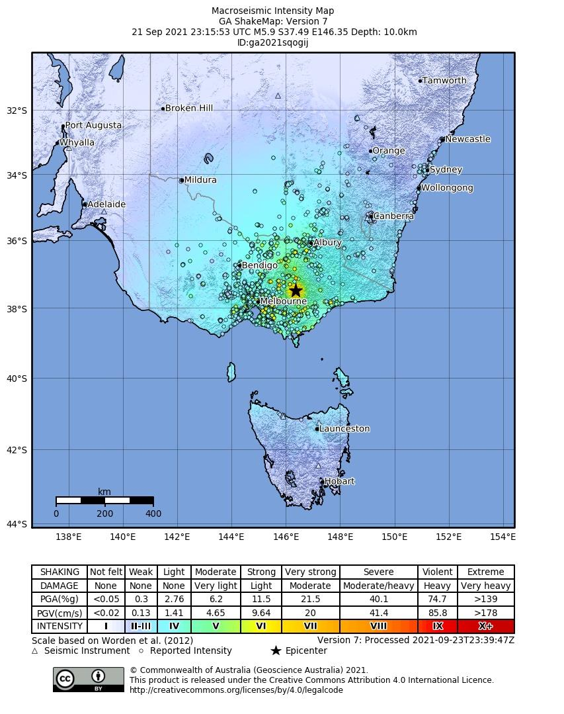
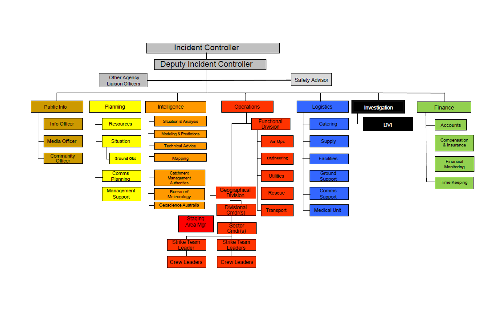

# State Emergency Management Plan — Earthquake Sub-Plan (Edition 2.0 (May 2023))

> **Source**: Emergency Management Victoria
> **URL**: https://files.emv.vic.gov.au/2023-05/SEMP%20Earthquake%20Sub-plan%20Edition%202.0.pdf
> **Licence**: © State of Victoria; emergency-management practitioner reference
> **Retrieved**: 2026-05-07T23:44:06Z
> **SHA-256**: `c01a5636f7a660024808900b13714185e72982d9916b3d9a106439f0178d499f`
> *Converted from PDF to Markdown format.*

---
## Page 1

 
 
 
State Emergency 
Management Plan, 
Earthquake Sub-Plan 
2023 
Edition 2.0

---
## Page 2

 
SEMP EARTHQUAKE SUB-PLAN - EDITION 2 – May 2023 
2 
Acknowledgment of Traditional Owners 
The Victoria State Emergency Service respectfully acknowledges the Traditional Owners of the 
land and waters. We pay our respects to Elders past, present and emerging, and are 
committed to working with Aboriginal and Torres Strait Islander communities to achieve a 
shared vision of safer and more resilient communities.   
 
 
 
 
 
 
 
 
 
 
 
 
 
 
 
 
 
 
 
 
 
Authority 
This plan has been endorsed by the State Crisis and Resilience Council (SCRC) as a  sub-plan 
to the State Emergency Management Plan. 
 
Authorised and published by 
Authorised and published by the Victorian Government  Melbourne May 2023  
 
© Copyright State of Victoria 2023 
 
You are free to re-use this work under a Creative Commons Attribution 4.0 licence, provided 
you credit the State of Victoria (Emergency Management Victoria) as author, indicate if 
changes were made and comply with the other licence terms. The licence does not apply to 
any images, photographs or branding, including Government logos. 
 
If you would like to receive this publication in an accessible format, please email 
emergencyplanning@emv.vic.gov.au. This document is also available in PDF format at 
emv.vic.gov.au 
 
Document information 
Date of approval May 2023

---
## Page 3

 
SEMP EARTHQUAKE SUB-PLAN - EDITION 2 – May 2023 
3 
Executive summary  
 
This State Emergency Management Plan (SEMP) – Earthquake Sub-Plan Edition 2 (this plan), 
replaces the State Earthquake Sub-Plan V 1.1 published in February 2023 as an ‘urgent update’, 
ensuring that in the event of any potential earthquakes the most current plan reflected current 
operational practices, allowing time to complete a full review with formal consultation.  
 
This Edition has built on that urgent update which recognised the need to: 
▪ 
Commence the development and implementation of standard operating procedures in relation 
to activation triggers for earthquakes in Victoria. 
▪ 
Update public information and warnings and public publishing business rules to reflect these 
triggers.  
▪ 
Update public websites on community information relating to earthquakes reflected in the 
2016 State Earthquake Sub-Plan. 
▪ 
Ensure the plan reflects current legislation.  
 
Permission for publication was granted by the Emergency Management Commissioner (EMC) as per 
the SEMP Guidelines, noting that consultation and further review of this plan commenced after the 
publication of this plan. 
 
The plan included provision of current and accurate information relating to: 
▪ 
Any VICSES changes in organisation, agency roles and responsibilities. 
▪ 
Operational response in a complex and multi-hazard environment that has impacted Victoria 
since the previous version published in 2016.  
▪ 
Alignment with arrangements contained in the SEMP approved in October 2021 and 
subsequent Machinery of Government changes that took effect on 1 January 2023 
 
This State Emergency Management Plan (SEMP) – Earthquake Sub-Plan Edition 2 (this plan), 
replaces the State Earthquake Sub-Plan V 1.1 and was prepared with regard to the SEMP, and the 
Guidelines for Preparing State, Regional and Municipal Emergency Management Plans (SEMP 
Guidelines), including formal consultation and statement of assurance.

---
## Page 4

 
SEMP EARTHQUAKE SUB-PLAN - EDITION 2 – May 2023 
4 
Table of contents 
Executive summary.................................................................................................................... 3 
1.1 
Purpose ....................................................................................................................... 5 
1.2 
Objective ...................................................................................................................... 5 
1.3 
Scope .......................................................................................................................... 6 
1.4 
Authorising environment ............................................................................................. 6 
1.5 
Activation of the plan .................................................................................................. 7 
1.6 
Audience ...................................................................................................................... 7 
1.7 
Exercise and evaluation ............................................................................................. 7 
1.8 
Review ......................................................................................................................... 7 
1.9 
How to read this plan ................................................................................................. 7 
2. 
The emergency context .................................................................................................... 9 
2.1 
Risks ............................................................................................................................ 9 
2.2 
Impacts and consequences ...................................................................................... 10 
3. 
Managing earthquake emergencies .............................................................................. 15 
3.1 
Emergency management priorities ........................................................................... 15 
3.2 
Shared responsibilities .............................................................................................. 15 
3.3 
Roles and responsibilities ......................................................................................... 16 
3.4 
Mitigation ................................................................................................................... 17 
3.5 
Preparedness ............................................................................................................ 19 
3.6 
Response .................................................................................................................. 20 
3.7 
Recovery ................................................................................................................... 25 
Appendix ................................................................................................................................ 28 
APPENDIX 1 ........................................................................................................................... 28 
APPENDIX 2 ........................................................................................................................... 30

---
## Page 5

 
SEMP EARTHQUAKE SUB-PLAN - EDITION 2 – May 2023 
5 
1. Introduction 
 
 
1.1 
Purpose  
This plan outlines the Victorian arrangements for managing earthquake events across all emergency 
management phases and replaces the State Earthquake Sub-Plan V 1.1   published in February 
2023. 
 
The plans’ purpose is to provide sources of information and to outline the arrangements for ensuring 
an integrated and coordinated approach to the state’s management of earthquake events, and to 
reduce the impact and consequences of these events on the community, infrastructure, and services.  
1.2 
Objective  
Victoria’s state-level emergency risk assessment, Emergency Risks in Victoria, was published in 2020 
and sets out Victoria’s emergency risk profile. Earthquakes were assessed as a state significant risk, 
meaning significant earthquakes were assessed as being a critical and credible scenario for the state. 
 
In alignment with the SEMP, this plan contextualises the current arrangements, roles and 
responsibilities for earthquake mitigation, preparedness, response (including relief) and recovery. 
VICSES, on behalf of the Emergency Management Commissioner (EMC), coordinated the 
development of this plan in conjunction with primary (direct) stakeholders including, but not limited to: 
▪ 
Ambulance Victoria (AV) 
▪ 
Australian Red Cross 
▪ 
Bureau of Meteorology (BOM) 
▪ 
Country Fire Authority (CFA) 
▪ 
Department of Education (DE) 
▪ 
Department of Energy, Environment and Climate Action (DEECA)  
▪ 
Department of Health (DH) 
▪ 
Department of Families, Fairness and Housing (DFFH) 
▪ 
Department of Government Services (DGS), including Local Government Victoria 
▪ 
Department of Jobs, Skills, Industry and Regions (DJSIR) 
▪ 
Department of Transport and Planning (DTP)  
▪ 
Emergency Recovery Victoria (ERV) 
▪ 
Environment Protection Authority (EPA) 
▪ 
Fire Rescue Victoria (FRV) 
▪ 
Geoscience Australia (GA) 
▪ 
Joint Australian Tsunami Warning Centre (JATWC) 
▪ 
Municipal Association of Victoria 
▪ 
Victoria Police

---
## Page 6

 
SEMP EARTHQUAKE SUB-PLAN - EDITION 2 – May 2023 
6 
The following secondary (indirect) stakeholders have been identified as important stakeholders in 
future planning, exercising and engagement: 
▪ 
Department of Home Affairs (COMDISPLAN 2020)  
▪ 
Life Saving Victoria (LSV)  
▪ 
National Emergency Management Agency (NEMA)   
▪ 
National Coordination Mechanism (NCM) 
▪ 
Victorian Aboriginal Heritage Council 
▪ 
WorkSafe Victoria  
1.3 
Scope 
This plan acknowledges the often-concurrent emerging threats and their consequences of 
earthquakes, including landslides, water surges and tsunami, as well as the structural integrity of 
critical infrastructure, including water storages and water supply, wastewater services, gas and 
electricity, transport, health and telecommunication service disruptions. 
 
The scope of this plan includes: 
▪ 
The description of potential risks and consequences of earthquakes to the social, built, 
economic, and natural environments. 
▪ 
The policy and programs in place to mitigate these risks before, during, and after an 
earthquake event. 
▪ 
The positions with accountability and the agencies responsible for managing specific 
strategies. 
▪ 
The multi-agency management arrangements at the national, state, regional and local 
levels. 
▪ 
Links to sources of information where the reader can obtain further detail. 
 
References are made to the SEMP where necessary to avoid duplication. It does not include detail 
about the operational activities of individual agencies. 
1.4 
Authorising environment  
In 2018, amendments to the Emergency Management Act 2013 (EM Act) were passed through 
parliament, requiring the EMC to arrange for the preparation of a SEMP. The SEMP allows for an 
integrated, coordinated, and comprehensive approach to emergency management at the state level. It 
contains provisions for the mitigation of, response (including relief) to, and recovery from emergencies 
(before, during and after), and specifies the roles and responsibilities of agencies in relation to 
emergency management.  
 
Under the EM Act, earthquakes (or other natural events), are a Class 1 Emergency. A Class 1 
Emergency is a major fire or any other major emergency where either the CFA, FRV or VICSES is the 
control agency. 
The EM Act defines a major emergency as an event which:  
• 
Is a large or complex emergency (however caused), which – 
(i) Has potential to cause or is causing loss of life and extensive damage to property, 
infrastructure, or the environment; or 
(ii) Has the potential to have, or is having significant adverse consequences for the 
Victorian community or a part of the Victorian community; or 
(iii) Requires the involvement of two or more agencies to respond to the emergency; or 
o 
Is a Class 1 Emergency. 
o 
Is a Class 2 Emergency.

---
## Page 7

 
SEMP EARTHQUAKE SUB-PLAN - EDITION 2 – May 2023 
7 
This plan aligns with the SEMP and was prepared with regard to the Guidelines for Preparing State, 
Regional and Municipal Emergency Management Plans; and was endorsed by the State Crisis and 
Resilience Council (SCRC) in April 2022.  
 
This plan was published and took effect 12 May 2022. 
 
The following legislation, while not exhaustive, is the principal legislation for earthquakes in Victoria: 
▪ Emergency Management Acts 1986 and 2013 (EM Act). 
▪ Victoria State Emergency Service Act 2005. 
▪ Essential Services Act 1958. 
▪ Planning and Environment Act 1989. 
▪ Aboriginal Heritage Act 2006. 
▪ Building Act 1993 
▪ Building Regulations 2018  
1.5 
Activation of the plan  
The arrangements in this plan apply on a continuing basis and do not require activation. 
1.6 
Audience  
This plan recognises that for emergency management and supporting communities to be safer and 
more resilient it is the shared responsibility of all Victorians, not just the emergency management 
sector.  
The audience for this plan comprises the Victorian Government and agencies within the emergency 
management sector, including business, industry and community groups with a significant role in the 
mitigation of, response to, and recovery from earthquakes. 
1.7 
Exercise and evaluation  
This plan will be exercised within one year from the date of approval. The exercise will be evaluated 
and, where improvements to the emergency management arrangements in this plan are required, the 
plan will be amended, and a revised version issued.  
Exercises will be conducted in accordance with the Australian Institute for Disaster Resilience (AIDR) 
Managing Exercises Handbook, available at via the AIDR website here.  
1.8 
Review  
This plan will then be reviewed and updated at least every three years, with consideration given to 
earlier revisions as required to ensure the plan provides for a current, integrated, coordinated, and 
comprehensive approach to earthquake emergencies, and consideration of potential escalation of 
climate-related hazards.  
 
Earlier reviews may be triggered by this plan being applied in a major emergency or exercise, or 
following a substantial change to relevant legislation or arrangements, including the SEMP.  
1.9 
How to read this plan  
This plan should be read in conjunction with the SEMP. 
Linkages and hyperlinks 
This plan refers to a range of existing resources relating to earthquakes, including documents and 
websites. This plan does not seek to duplicate the information contained in these resources, and 
instead provides links to where the reader can obtain further information.

---
## Page 8

 
SEMP EARTHQUAKE SUB-PLAN - EDITION 2 – May 2023 
8 
For more operational or sensitive information a log-in may be required, such as for documents saved 
on the Emergency Management Common Operating Picture (EM-COP), including Joint Standard 
Operating Procedures (JSOPs). 
 
Documents or resources that are referred to frequently throughout this plan (such as the SEMP) are 
not hyperlinked in each instance.  
 
All hyperlinks were accurate at time of publication, and the currency of the linked content remains the 
responsibility of the host agency. 
Consequence management  
Secondary consequences for earthquake can be complex and compounding. The arrangements for 
managing consequences of earthquake are contained in relevant SEMP Sub-Plans, including, but not 
limited to:  
▪ 
SEMP Tsunami Sub-Plan; of particular note:  
▪ 
The Joint Australian Tsunami Warning Centre will issue a National No Tsunami 
Bulletin following a widely felt earthquake by Victorian or other Australian coastal 
communities.  
▪ 
The purpose of the No Tsunami Threat advice is to alleviate coastal communities' 
concern of potential tsunami, even if the earthquake magnitude is small and the 
epicentre is on land (i.e., not possible to cause tsunami).     
▪ 
SEMP Health Emergencies Sub-Plan 
▪ 
SEMP Energy Sub-Plan 
▪ 
SEMP Public Transport Disruption Sub-Plan 
▪ 
SEMP Landslide Sub-Plan 
▪ 
SEMP Maritime Emergencies (non-search and rescue) Sub-Plan 
▪ 
Roles and responsibilities outlined within the SEMP 
 
Where necessary, VICSES has prepared Regional Earthquake Sub-Plans, and Municipal 
Earthquake Sub-plans. 
 
Regional and Municipal Earthquake Emergency Plans can be found via the VICSES website. 
In the case of a concurrent emergency (e.g. Human Pandemic or an energy disruption), the 
arrangements detailed in this plan may need to be adjusted as required.

---
## Page 9

 
SEMP EARTHQUAKE SUB-PLAN - EDITION 2 – May 2023 
9 
2. The emergency context 
 
2.1 
Risks  
2.1.1 
What is an earthquake? 
An earthquake is the shaking and vibration at the surface of the Earth, caused by energy being 
released along a fault plane at the edge of a tectonic plate or by volcanic activity.  
2.1.2 
What causes earthquakes? 
Earthquakes are caused by the movement of the Earth’s outer layer (the crust and a portion of the 
upper mantle). The outside layer of the Earth is split into tectonic plates, which are moving slightly due 
to the movement of magma in the layer below. This causes plates to squeeze together, move apart, 
and slide alongside each other.  
 
Earthquakes in Australia are classified as intraplate earthquakes, as they occur within the interior of 
tectonic plates away from plate boundaries. Intraplate earthquakes are generally less common and 
not as large as those on plate edges. Australia is located within the Australian plate, where tectonic 
processes at the edge of this plate interact with the Indian, Eurasian, and Pacific tectonic plates, and 
generate compressive stresses in Australia’s interior, meaning rocks push or squeeze against one 
another. Australia’s earthquakes are caused by sudden release of this stress when rocks deep 
underground break and move along a fault line. Victorian fault line information can be found at GA – 
Neotectonics Layer  
 
Victoria regularly experiences small earthquakes that are felt and reported, and on occasions has 
experienced moderate sized earthquakes that have caused minor damage, community concern, 
and short-term disruption. These develop due to stresses and strains in the Indo-Australian plate 
(of which Australia is a part) as it drifts northward; as sediment loads continually transfer from 
upper catchment areas to lower basins and coastal areas due to erosion; and as fluctuating sea levels 
load and unload the continental shelf. 
Earthquakes have the potential to cause catastrophic impacts and consequences for 
communities. Although Australia is popularly considered to have a low earthquake risk, a major 
earthquake could still occur under a heavily developed and populated area in Victoria. The impact of 
such an earthquake could have widespread consequences throughout developed and populated 
cities and towns and could felt across jurisdictional boundaries and earthquakes in other 
states/territories may be direct or indirect impacts in Victoria. 
2.1.3 
Earthquake magnitude 
The size of an earthquake is referred to as its magnitude. For every unit increase in magnitude, there 
is roughly a thirty-fold increase in the energy released. For instance, a magnitude 2.0 earthquake 
(M2.0) releases about 30 times more energy than a magnitude 1.0 earthquake (M1.0), while a 
magnitude 3.0 earthquake (M3.0) releases 900 times (30x30) more energy than a magnitude 1.0 
(M1.0).  
 
Each year, Australia records on average 100 magnitude 3 or higher earthquakes. Above magnitude 
5.0 earthquakes occur on average every one to two years, and a magnitude 6.0 or more may be 
experienced roughly every 10 years. The probable maximum earthquake magnitude for Australia is 
approximately M7.5. 
 
Australia is not immune from damaging earthquakes causing significant human and economic loss.  
 
The most recent significant events are summarised in Appendix 1 – History of damaging 
earthquakes in Victoria within the last 40 years.

---
## Page 10

 
SEMP EARTHQUAKE SUB-PLAN - EDITION 2 – May 2023 
10 
2.2 
Impacts and consequences  
Earthquakes with magnitudes of less than 3.5 seldom cause damage in Australia. However, 
magnitude 4.0 earthquakes may on occasion topple chimneys or cause other damage to older 
building infrastructure (e.g., building facades and awnings) that could result in injuries or fatalities. 
Earthquakes greater than magnitude 5.0 may cause minor damage/cracks within some dams, water 
storages, waste infrastructure, including landfills and/or other critical infrastructure. The scale and 
effects of an earthquake depend on many factors, including: 
▪ 
Earthquake magnitude 
▪ 
Depth 
▪ 
Distance from the epicentre 
▪ 
Topography 
▪ 
Local ground conditions 
▪ 
Built environment 
2.2.1 
The Modified Mercalli Intensity (MMI) scale 
Earthquake effects, based on observed consequences, are rated using the Modified Mercalli Intensity 
(MMI) scale, which ranges from I (imperceptible) up to XII (total destruction), see table below. 
Intensity 
Shaking 
Description/Damage 
I 
Not felt 
Not felt except by a very few under especially favorable conditions. 
II 
Weak 
Felt only by a few persons at rest, especially on upper floors of buildings. 
III 
Weak 
Felt quite noticeably by persons indoors, especially on upper floors of buildings. 
Many people do not recognise it as an earthquake. Standing motor cars may rock 
slightly. Vibrations are similar to the passing of a truck. Duration estimated. 
IV 
Light 
Felt indoors by many, outdoors by few during the day. At night, some awakened. 
Dishes, windows, doors disturbed; walls make cracking sound. Sensation like 
heavy truck striking building. Standing motor cars rocked noticeably. 
V 
Moderate 
Felt by nearly everyone; many awakened. Some dishes, windows broken. Unstable 
objects overturned. Pendulum clocks may stop. 
VI 
Strong 
Felt by all, many frightened. Some heavy furniture moved; a few instances of fallen 
plaster. Damage slight. 
VII 
Very 
strong 
Damage negligible in buildings of good design and construction; slight to moderate 
in well-built ordinary structures; considerable damage in poorly built or badly 
designed structures; some chimneys broken. 
VIII 
Severe 
Damage slight in specially designed structures; considerable damage in ordinary 
substantial buildings with partial collapse. Damage great in poorly built structures. 
Fall of chimneys, factory stacks, columns, monuments, walls. Heavy furniture 
overturned. 
IX 
Violent 
Damage considerable in specially designed structures; well-designed frame 
structures thrown out of plumb. Damage great in substantial buildings, with partial 
collapse. Buildings shifted off foundations. 
X 
Extreme 
Some well-built wooden structures destroyed; most masonry and frame structures 
destroyed with foundations. Rails bent. 
Source: Replicated from the USGS https://www.usgs.gov/programs/earthquake-hazards/modified-mercalli-intensity-scale

---
## Page 11

 
SEMP EARTHQUAKE SUB-PLAN - EDITION 2 – May 2023 
11 
2.2.2 
Magnitude vs Intensity (MM) 
▪ 
Earthquake magnitude is related to the energy released at its epicentre. 
▪ 
The intensity of an earthquake refers to the level of ground-shaking at a given location. 
▪ 
Earthquake intensity decreases with increasing distance from an earthquake’s epicentre. 
▪ 
The Modified Mercalli Intensity (MMI) scale is commonly used to describe the damage. 
▪ 
The Modified Mercalli Intensity (MMI) scale is commonly used to describe the damage and 
felt effects of an earthquake at a given location. 
▪ 
MMI is a qualitative assessment of earthquake effects on structures and people. 
▪ 
Earthquake magnitude is a quantitative measure based on physical recordings made on 
seismometers. 
Source: GA website. 
2.2.3 
Damage and disruption 
Below summarises the possible types of damage and disruption that may result from a major 
earthquake. 
Critical infrastructure and building damage  
Individual buildings, roads, bridges, and tunnels are likely to suffer damage. Waste management 
infrastructure, including landfills, may also be damaged. Buildings may include homes, businesses, 
and essential facilities such as hospitals, schools, and emergency service facilities. Vulnerable 
buildings pre-dating 1989 are likely to be impacted, with consideration to toppled chimneys. The New 
South Wales (NSW), Newcastle Earthquake in 1989 caused damage to 35,000 homes, 147 schools 
and 3000 commercial and/or other buildings. This large-scale damage can cause displacement and 
isolation in the community. 
Health impacts 
Casualties and injuries are likely to result from large damaging earthquakes. People may also 
become trapped requiring rescue. The ability for health services such as Ambulance Victoria, Health 
Services and General Practitioners (GPs) to respond may be impacted by damage or destruction of 
facilities such as hospitals, clinics or branches. Secondary public health impacts may occur if 
essential services are not readily available after the impact of an earthquake. 
Displacement and isolation 
As a consequence of infrastructure damage, people will become displaced, requiring temporary 
accommodation. The amount of time for which people would need temporary accommodation would 
depend on the number of family and friends that could take them in, how long it would take for 
building inspections to be made, how long it would take lifeline services to be back up and running, 
and how long it would take for residents to regain access after areas were cordoned off or had access 
ways destroyed/blocked People can also become physically isolated as a consequence of damage, 
triggering the need for resupply of essential items. 
Transport access or disruption  
Roads or railways may be blocked as a consequence of debris from fallen buildings, damage to the 
road infrastructure from landslides or below ground infrastructure failures (pipes/culverts). Roads may 
also be shut where there is the potential for, landslides or surrounding buildings to fail during 
aftershocks, even if no debris has yet fallen. Also, potential for disruption to waste collections. As a 
result, and as observed in the 2011 Christchurch earthquake experience in New Zealand, areas of a 
major CBD may be cordoned off and roads closed a significant time following the event. Bridges and 
tunnels will likely be closed for inspection. 
Public Transport Disruption may occur as a result of some rail and light rail bridges being damaged, 
or airport runways or port infrastructure, or bus networks reliant on road infrastructure being 
extensively damaged. 
Impacts to transport infrastructure may also affect the ability to access electricity, gas, water and 
telecommunications assets.

---
## Page 12

 
SEMP EARTHQUAKE SUB-PLAN - EDITION 2 – May 2023 
12 
Economic 
Widespread damage and disruption will lead to direct and indirect economic impacts that will require a 
broad economic development strategy to be created and complemented by more specific strategies at 
the sectoral level across transport and ports, resources, investment attraction and facilitation, trade, 
innovation, regional development, and small business, together with key services to sectors such 
as agriculture, the creative industries, extractive resources, and tourism. 
Assistance to business to navigate and access available information, advice, and support and 
recovery planning to ensure return to trade may be required. 
Energy supply 
There is the potential for an earthquake to damage or destroy electricity, gas or liquid fuel 
infrastructure which may lead to energy supply disruption. Damage to critical energy infrastructure 
such as high-pressure gas pipelines due to an earthquake may result in disruptions of electricity/gas 
supply to widespread consumers. Damage to brown coal mines and associated infrastructure can 
also cause an energy disruption.  
 
Below describes damage to the electricity network from the Newcastle 1989 earthquake in NSW: 
 
“The Newcastle earthquake of 1989 had a significant effect on the high voltage transmission 
assets of the NSW electricity supply grid operated by the Electricity Commission of NSW. 
Multiple failures of equipment, mainly switchgear, occurred in a number of the electricity 
substations closest to the earthquake epicentre. These failures initiated a general and 
immediate shut-down of electricity supply to both industrial and domestic consumers in the 
affected area. The response of the Commission to this unexpected emergency was 
immediate and effective. Operational recovery saw high voltage supply restored to major 
industrial customers 1½ hours after the incident. Restoration of supply for general 
distribution began within 30 minutes, with all bulk supply points energised after 2½ hours. 
Of course, the damage then had to be assessed, plant safety assured, and repairs 
commenced so that normal levels of reliability could be returned to the community. This 
phase of restoration took three weeks to repair most major circuits and many months to 
complete. In the latter stages, it was accompanied by a third phase of review which identified 
any areas where either the system design or the response of a power authority to any future 
such emergency may be improved.” 
Mines and Quarries 
Significant earthquakes have to potential to impact the stability of mines and quarries, which may 
result in open pit wall collapse, underground collapse, tailings dam breaches or damage to associated 
critical infrastructure (eg coal supply, nearby roads etc). This could also include entrapment of mine 
workers. 
Water supply 
Major water facilities such as pumping stations, water treatment plants, reservoirs, tanks and 
distribution network may experience damage. Damage may occur across the entire network.  
Breakage of pipes is likely to be widespread and concerns over contamination may render the water 
not suitable to drinking. 
Water storage  
Water storages and large dams/levees may be damaged and may lead to sunny day failure, where 
the failure of a dam/levee infrastructure occurs with the water level at the normal pool elevation and 
no rainfall with the potential to cause catastrophic or major flooding downstream of dams. 
Wastewater 
Extensive damage may occur to wastewater systems can occur even without the occurrence of 
liquefaction.

---
## Page 13

 
SEMP EARTHQUAKE SUB-PLAN - EDITION 2 – May 2023 
13 
Telecommunications 
Telecommunications infrastructure may suffer damage, power loss, and be overloaded. Loss of 
telecommunication can be due to a variety of reasons such as outages of telecommunication 
services, website outages, and loss of power, meaning, household broadband networks need power 
to operate, mobile phones cannot be charged, and home phones will not work. 
 
Below summarises the 2011 Christchurch earthquake experience in New Zealand: 
 
“Cordless phones immediately ceased to work where electricity failed. Some physical damage to 
telecommunications assets also occurred but the effects were secondary – congestion largely 
resulted from the sudden substantial increase in call attempts rather than to equipment failure. Battery 
life at cabinets and cell towers also quickly became a constraint on telecommunications performance 
and significant losses of cellular coverage.” 
Chemical and high-risk industrial plants 
These are usually located away from residential zones. It is expected that high risk facilities will be 
designed for increased resilience to earthquake damage, thus the probability of an accident induced 
by an earthquake is classified as low. If, however, there was damage, it could be such as in the 1998 
Longford gas explosion in Victoria. 
Waste management facilities 
Waste management facilities including landfills may be impacted by earthquake damage. The scale of 
damage is likely to be variable and may include damage to key infrastructure and environmental 
controls. Damages to waste management facilities and adjacent road infrastructure may impede early 
recovery efforts (removal of waste and debris). 
Hazardous material release 
Hazardous materials are not exclusive to heavy industry and may be released as a consequence of 
building collapse. These may include carcinogenic or corrosive gases, or poisonous liquids that 
contaminate the water table. Asbestos was used in Australia from the 1950’s until 2003 when it was 
banned. Asbestos may be exposed as a result of earthquake building damage in an earthquake. 
Irrespective of the risk, it will impose large clean-up costs and require the cordoning of many 
properties. 
A range of other hazardous materials are present in all environments including domestic households 
(for example paints, fuels and pesticides stored in garages and asbestos), damage to underground 
infrastructure including waste water infrastructure (carrying tradewaste), pipelines and underground 
storage tanks may also result in hazardous material releases. Damages to commercial and industrial 
facilities may also result in subsequent hazardous releases. These materials may be in all forms and 
may contaminate land, water (both surface and ground water) and atmosphere. Impacts may be 
acute or may not be detected for extended periods of time (potentially years). Responding to 
hazardous material releases, especially those to land or water environments can generate significant 
volumes of waste, which may require highly specialised waste collection, transportation, storage and 
treatment infrastructure and technology. Some waste streams especially those that have been mixed, 
reacted or for which the nature/origin is unknown (which is a likely circumstance during an 
earthquake) can be very challenging to treat and there may be limited or no treatment capacity 
available within the state and/or nationally to treat and may need to be safe stored whilst suitable 
long-term arrangements are enacted. 
Fire following earthquake 
Fire following an earthquake has caused extensive damage in the past caused by downed powerlines 
and ruptured gas mains. Well known cases are the San Francisco 1906 and Tokyo 1923 
earthquakes, where much of the damage was caused by fire. 
Extensive fire following earthquake damage is less common in present times and will likely be 
localised to high-risk sites, as was the case for the Cosmo Oil Company fire following the 2011 
Tohoku earthquake in Japan. In that event, the continued functioning of the water supply for 
firefighting would become critical.

---
## Page 14

 
SEMP EARTHQUAKE SUB-PLAN - EDITION 2 – May 2023 
14 
Long series of strong aftershocks 
A series of aftershocks are possible after an earthquake event. The Christchurch earthquake event 
was notable for its unusual frequency of aftershocks, with the most damaging event (M6.3 Lyttelton) 
occurring as an aftershock of the original event (M7 Darfield) 4 months earlier. 
 
This earthquake sequence seriously disrupted recovery activities, and although unusual, aftershocks 
did more damage than the main quake. This occurred because the aftershock was located directly 
below the CBD, whereas the main shock was located to the west of the CBD at a distance of 30 km. 
 
The earthquake sequence in Christchurch did eventually move away from the city only one year 
after the main event and posed a serious challenge to the recovery of the Christchurch CBD. 
Other impacts 
Consideration should also be given to: 
▪ 
Land or mudslide:  In addition to ground shaking, earthquakes of 4.0 or greater may also 
trigger landslides. 
▪ 
Tsunami: Undersea earthquakes can cause a tsunami or a series of waves that can cause 
extensive coastal damage. 
▪ 
An earthquake may generate significant volumes of wastes, especially construction and 
demolition wastes (but also all other waste streams) and existing waste management 
infrastructure may be unable to service this rapid increase in volume. During major 
earthquakes overseas stand-alone waste management are often established and run for 
extended periods of time. For example, the Burwood Resource Recovery Park established 
following the Christchurch earthquake operated for 8 years.

---
## Page 15

 
SEMP EARTHQUAKE SUB-PLAN - EDITION 2 – May 2023 
15 
3. Managing earthquake 
emergencies  
 
 
3.1 
Emergency management priorities 
The State Emergency Management Priorities that are outlined in the SEMP guide all decisions before, 
during, and after any emergency, and apply to all aspects of this plan. The priorities are:  
▪ 
Protection and preservation of life and relief of suffering is paramount. This includes:  
▪ 
Safety of emergency response personnel. 
▪ 
Safety of community members, including vulnerable community members and 
visitors/tourists.   
▪ 
Issuing of community information and community warnings detailing incident information that 
is timely, relevant, and tailored to assist community members to make informed decisions 
about their safety. 
▪ 
Protection of critical infrastructure and community assets that support community resilience.  
▪ 
Protection of residential property as a place of primary residence.  
▪ 
Protection of assets supporting individual livelihoods and economic production that supports 
individual and community financial sustainability.  
▪ 
Protection of environmental and conservation assets that considers the cultural, biodiversity, 
and social values of the environment. 
3.2 
Shared responsibilities  
The SEMP recognises that emergency management is the shared responsibility of all Victorians, not 
just the emergency management sector. The ‘shared responsibility’ approach seeks to ensure:  
▪ 
The interests, values, and expectations of stakeholders in, or members of, communities are 
understood and considered.  
▪ 
Ownership of the SEMP and responsibility for its implementation is broadly shared.  
 
Examples in the context of an earthquake include: 
▪ 
Individuals being aware of their earthquake risk and following advice from emergency 
services when responding to warnings. 
▪ 
Councils and communities including earthquake risk within their Community Emergency Risk 
Assessment (CERA) and mitigation activities. 
▪ 
Industry and businesses planning for the risk of disruption, and ensuring arrangements are in 
place to maintain critical services and assist communities where possible. 
▪ 
Engaging with communities to: 
▪ 
Plan the management of earthquake risk. 
▪ 
Provide emergency information and earthquake warnings. 
▪ 
Ensure an effective, well-coordinated response during an earthquake. 
▪ 
Recover and learn following an earthquake and build their resilience to future events. 
Section 3.5.3 sets out community engagement for preparedness.

---
## Page 16

 
SEMP EARTHQUAKE SUB-PLAN - EDITION 2 – May 2023 
16 
3.3 
Roles and responsibilities 
The SEMP details the roles and responsibilities for earthquakes. Several primary roles are noted in 
the following.  
3.3.1 
State Crisis and Resilience Council 
The State Crisis and Resilience Council (SCRC) is the peak crisis and emergency management body 
to the Victorian Government and provides advice to ministers and relevant cabinet sub-committees. It 
is responsible for the development and implementation of whole of government emergency 
management policy and strategy. It does not make operational or tactical decisions. 
3.3.2 
Emergency Management Commissioner 
Under the EM Act, the EMC has legislated management responsibilities across major emergencies. 
These include response coordination, ensuring effective control arrangements are established, and 
consequence management. 
3.3.3 
Victoria State Emergency Service 
VICSES is the control agency for earthquakes as defined in the roles and responsibilities section of 
the SEMP. Specifically related to the earthquake hazard, the following activities listed expand on 
those outlined in the VICSES agency role statement in the SEMP, with VICSES taking accountability 
for: 
▪ 
The strategic and operational planning for response. 
▪ 
Provision of public information and warnings, including the provision of public safety advice to 
the community. 
▪ 
Providing advice to the State Response Controller and Regional Controllers on appropriate 
structures and initial operational activities in response to an earthquake. 
▪ 
Supporting Victoria Police with evacuations. 
▪ 
Rescue of persons entrapped by collapsed structures in partnership with other rescue 
agencies including CFA and FRV. 
▪ 
Protection of critical community infrastructure from further damage. 
3.3.4 
Supporting agency roles and responsibilities 
A range of government and non-government agencies/organisations have the skills, expertise, and/or 
resources to support earthquake emergency response, relief, and recovery.  
 
Refer to the SEMP agency role statements for further details of the roles and responsibilities that 
support agencies may undertake across all the emergency management phases related to 
earthquake. 
3.3.5 
Emergency Management Teams 
For earthquakes which are widely felt and/or GA have advised of a magnitude of 5.0 or above, the 
Emergency Management Teams EMT’s at state (State Emergency Management Team (SEMT)) and 
regional tiers will be activated to coordinate initial intelligence relating to impact and consequence, 
ahead of Incident Control Centres (ICCs) and Incident EMTs being established to manage the 
response, including any initial relief requirements. EMTs should be based on consequence 
management and consider the National Emergency Management Agency Framework and 
connectivity to the National Coordination Mechanism 
 
More detailed information on EMTs is outlined in the SEMP. 
3.3.6 
Emergency Management Planning Committees 
Emergency Management Planning Committees operate at the state, regional and municipal tiers to 
guide mitigation and preparedness activities.  
 
More detailed information on emergency management planning committees is outlined in the SEMP.

---
## Page 17

 
SEMP EARTHQUAKE SUB-PLAN - EDITION 2 – May 2023 
17 
3.4 
Mitigation 
Mitigation activities for earthquakes include, but are not limited to: 
▪ 
Building compliance to engineering standards (planning and building standards/regulations). 
▪ 
Critical infrastructure (engineering) risk and vulnerability assessments and maintenance 
regimes (essential services, dams/levees, buildings, roads, bridges, tunnels). 
▪ 
Community engagement, education, and awareness.  
 
Information on the roles and responsibilities of participating agencies for mitigation activities are 
detailed in the SEMP. 
 
Information regarding resilience and business continuity in Victoria’s emergency management sector 
is detailed in the Emergency Management Sector Outcomes Framework and Strategic Roadmap 
2022–28. 
3.4.1 
Geoscience Australia services 
GA operates the National Earthquake Alerts Centre to provide continuous monitoring, analysis and 
alerting of earthquake activity. This allows for timely advice to VICSES in support of the control 
agency roles. 
 
Access to data about people, property and infrastructure is made available via the Australian 
Exposure Information Platform (AEIP). This data provides consistent exposure information about 
buildings, demographics, community infrastructure and agricultural commodities to help understand 
what could be at threat from earthquakes. GA provides a variety of earthquake data and products via 
their community safety website to support and improve planning and preparedness. 
 
Further information regarding earthquakes is provided on both the GA website and Twitter account.  
Victorian earthquake scenario  
The Earthquake Impact Scenario for Melbourne, Victoria report was produced in 2016 by GA for 
Emergency Managers. The document presents an impact assessment of an earthquake scenario 
centred under the CBD of the City of Melbourne and outlines the methodology used.  
The document includes:  
▪ 
Maps of mean expected ground shaking intensity for each scenario.  
▪ 
Maps of average percentage economic loss for buildings in each statistical area.  
▪ 
Estimates of fatalities and injuries.  
▪ 
Tables of aggregated losses and estimates of the numbers of buildings in each of four 
damage states.  
▪ 
Estimates of resident numbers requiring temporary accommodation.  
 
The information from the scenario assessment was designed to be used to inform emergency 
management planning and preparation in Victoria and support the national understanding of potential 
earthquake impacts.  
Notifications to the public 
The VicEmergency website and app automatically displays an incident symbol for earthquakes 
recorded in Victoria and published on the GA website. 
When an earthquake notification is issued or updated, GA will inform the VICSES State Duty Officer 
(SDO). The SDO assesses the requirement to issue a community notification (See Section 3.4.2). 
3.4.2 
VICSES led agency and community notifications 
Agency notifications 
VICSES and GA work in close partnership to ensure the timely notification of earthquake events in 
Victoria. 
 
All earthquake notifications will be provided directly from GA to the VICSES SDO.

---
## Page 18

 
SEMP EARTHQUAKE SUB-PLAN - EDITION 2 – May 2023 
18 
Irrespective of issuing a warning, GA should attempt to contact the VICSES SDO whenever an 
earthquake has been monitored. The VICSES SDO will then initiate contact with other emergency 
service agencies.  
 
The Emergency Services Telecommunications Authority (ESTA) is to ascertain if there has been an 
increase in Triple Zero or 132 500 calls resulting in requests for assistance to help inform any 
response. 
 
VICSES implements a detailed notification process for earthquake events, which is documented in the 
VICSES Standard Operating Procedure 046 and in relevant emergency management sector JSOP 
3.16. 
This includes: 
▪ 
The VICSES State Agency Commander (SAC) notifying the State Response Controller 
(SRC), who will in turn advise the State Control Team (SCT), and for magnitude 4.0 and 
above will notify the SEMT. 
▪ 
The VICSES Regional Agency Commander (RAC) notifying the Regional/Zone Controller who 
will in turn advise the Regional Control Team (RCT), and for magnitude 4.0 and above will 
notify the REMT. 
Community notifications 
VICSES seeks to meet the second state emergency management priority for the need to be proactive 
in notifications to the community, regarding an earthquake and its associated impacts. 
 
VICSES leads the coordination of business rules that govern the issuing of community notifications 
upon advice of an earthquake from GA.  
 
They can be found in the following location: Earthquake: EMCOP – Library – IMT Toolbox – IMTTB – 
Public Information – EMCOP Business Rules – Earthquake Business rules, or here. 
 
The business rules outline that the earthquake community notifications are managed by the VICSES 
SDO and/or SAC. The business rules also set triggers for when community information is issued, and 
what warning level is required. The earthquake magnitude and impacts guide the triggers for warnings 
levels. Other impacts and consequences that occur as a causation from the Earthquake may result in 
localized warnings –e.g.: Fire, Gas or Liquid Fuels – Fire Warning, Dam Breach - Flood Warning. 
3.4.3 
VicEmergency and warning channels 
VICSES use the state endorsed multi-hazard warning platform, EM-COP Public Publishing, to 
disseminate public information and warnings to the community via VicEmergency and its associated 
channels. 
 
VicEmergency warning recipients include emergency broadcasters (i.e., commercial and ABC radio) 
who are required to re-disseminate warning information and sound the Standard Emergency Warning 
Signal (SEWS) if required, in accordance with the Emergency Broadcasting Practice Note and the 
agreed Memorandum of Understandings (MoU). 
 
A range of additional approaches are used by VICSES to disseminate public information and 
warnings that are selected, based on the needs of the community and magnitude, and impacts of the 
earthquake. Examples include: 
▪ 
Media, including the use of social media for lower end earthquake events with minimum 
community interest and/or impacts. Social media will be proactively used as an early 
communication tool to ensure that emergency services are aware of an earthquake being felt 
prior to the issue of more formal community notifications/warnings for higher magnitude 
events. 
▪ 
Door knocking (e.g., in the event of telecommunications outages, evacuation of damaged 
buildings etc.)

---
## Page 19

 
SEMP EARTHQUAKE SUB-PLAN - EDITION 2 – May 2023 
19 
▪ 
Emergency Alert (EA) for urgent dissemination of warnings to telephones (including mobile 
phones) within a specific geographic location. 
 
Adjoining states will be consulted over public information messages if impacts have occurred in a 
border area. 
 
3.4.4 
VicEmergency Hotline 
Community members can call the VicEmergency Hotline (1800 226 226) to access emergency 
information during and after major incidents in Victoria, including flood events. It also offers 
information to help Victorians plan for and recover from emergencies. 
 
The VicEmergency Hotline is staffed by operators from Monday to Friday 8:00am – 6:00pm, with 
opening times extended during significant emergency events. The hotline also features an automatic 
text to speech function, which ensures Victorians can access important emergency information 
outside of operator hours, at any time of the day or night, by entering their postcode. 
 
The hotline is managed by the DEECA Customer Contact Centre. The VICSES SAC may, in 
consultation with the SRC, request enhanced staffing post the initial impact and throughout the period 
of expected after shocks. This may include extending the operating hours of the centre beyond 
standard arrangements, including weekends. 
3.4.5 
Seismology Research Centre  
The Seismology Research Centre has an agreement with Victoria’s large dam owners to notify them 
of an earthquake so that an inspection of critical structures can be made for any damage. Dam 
owners have funded some of the seismographs and accelerometers through Seismology Research 
Centre and belong to a notification network. Real time information is distributed via text message 
(within an agreed timeframe) providing, earthquake magnitude, intensity, epicentre and other key 
information needed to conduct a quick risk assessment.  
 
For example, when the Woods Point earthquake occurred in 2021, dam owners received a notification 
of the event within a few minutes and were able to send out crews to inspect structures shortly after.  
 
Quarterly reports on equipment status and earthquakes which have occurred during the reporting 
period are developed and distributed by Seismology Research Centre to Victoria’s large dam owners 
to increase awareness. 
3.5 
Preparedness 
Preparing for earthquake events includes developing arrangements to ensure that resources and 
services needed to respond can be efficiently mobilised and deployed. 
 
Preparedness activities include: 
▪ 
Identifying and assessing the risk.  
▪ 
Developing emergency management policy, arrangements, and plans. 
▪ 
Ensuring adequate resources, systems, and processes are in place. 
▪ 
Training response personnel and educating stakeholders and potentially affected industries 
and communities. 
▪ 
Maintaining and developing expertise. 
▪ 
Conducting exercises. 
▪ 
Evaluating preparedness and response activities. 
▪ 
Ensuring the necessary relationships, formal and informal mechanisms are in place across 
government and industry to support community outcomes.

---
## Page 20

 
SEMP EARTHQUAKE SUB-PLAN - EDITION 2 – May 2023 
20 
The risk management approach aligns with the SEMP and outcomes and objectives of the Sendai 
Framework for Disaster Risk Reduction 2015–2030 and the National Disaster Risk Reduction 
Framework. At the state level, Emergency Management Victoria (EMV) is responsible for coordinating 
the state-wide emergency risk assessment published in the Emergency Risks in Victoria Report. 
3.5.1 
Regional earthquake emergency planning 
Where an earthquake is identified through the Regional Emergency Management Planning 
Committee’s (REMPC) Regional Emergency Risk Assessment (RERA) as a high risk to a region, 
VICSES will provide advice and support to the REMPC to ensure the Regional Emergency 
Management Plan (REMP) contains at a minimum arrangement for the response to an earthquake 
event based on all-hazards and all-agency response.  
 
Regional Earthquake Sub-plans are prepared by VICSES for regions as warranted by the assessed 
earthquake risk. The REMPC may adopt the prepared earthquake plan as a sub-plan to its REMP 
based on regional risk assessments. 
3.5.2 
Municipal earthquake emergency planning 
Where an earthquake is identified through the Community Emergency Risk Assessment (CERA) as a 
high risk to a community, VICSES will provide advice and support to the Municipal Emergency 
Management Planning Committee (MEMPC) to ensure the Municipal Emergency Management Plan 
(MEMP) contains at a minimum, arrangements based on an all-hazards and all-agency response to 
earthquake.  
 
Municipal Earthquake Sub-Plan are prepared by VICSES for municipalities as warranted by the 
assessed earthquake risk.  The MEMPC may adopt the prepared earthquake plan as a sub-plan to its 
MEMP based on community emergency risk assessments. 
3.5.3 
Community preparedness 
VICSES has actively implemented the Community Resilience Strategy Renewal 2019-22, and this is 
now being reviewed as part of VICSES Strategic Planning 2023-2027. A key and measurable 
outcome of the strategy has been, and is envisaged to be, an increase the level of interest, and 
support behaviour change within communities, so they are more aware, informed and prepared for 
emergencies by supporting them to understand their risk, and the relevance of taking action before, 
during and after emergencies. Information can be found via the VICSES website. 
 
Community preparedness material for earthquake were updated at the time of publishing this plan can 
also be found via the VICSES website. 
3.6 
Response 
3.6.1 
Readiness 
GA is responsible for monitoring earthquakes and providing notifications and advice to VICSES and 
the State Control Team (SCT). See Section 3.4.1 for details for GA services. 
The VICSES Chief Officer Operations (COO) or delegate is responsible for notifying the EMC (in 
accordance with JSOP 3.16 Significant Event Notification). The EMC can assist through the SCC to 
notify the State Coordination Team and the SEMT. 
 
VICSES Readiness and Activation Triggers were reviewed as part of the updating of this plan to align 
to the readiness activation framework for other Class 1 Emergencies, and to provide interim guidance 
until further consultation with agencies can occur. 
 
In the majority of cases, agency personnel are likely to have felt moderate to larger earthquakes 
before notifications will have occurred. In the event of a significant earthquake, agency commanders 
should consider immediate deployment to their RCC or the SCC. Telecommunications may have 
been impacted by the earthquake, limiting the ability to notify of centre activations identifying other 
methods of Satellite Phone, Pager etc.

---
## Page 21

 
SEMP EARTHQUAKE SUB-PLAN - EDITION 2 – May 2023 
21 
Consistent with VICSES SOP046: 
▪ 
Earthquakes of a magnitude of 3.5 to 4.4 will result in the activation of a VICSES Regional 
Operations Command Centre (ROCC) to manage the response and intelligence gathering to 
understand if there have been any community impacts and consequences. 
▪ 
Earthquakes of 4.5 to 5.5 , with widespread felt reports, are likely to result in some level of 
community impact, consequences and/or disruption, and therefore result in Readiness Level 
3 being activated with RCCs established within the Intensity ShakeMap* area identified by GA 
to coordinate initial intelligence around impacts and consequences for the consideration of 
response. The SCC will also be activated at Tier 1 with the expectation that all response 
agencies have a presence within the first hour. 
▪ 
Earthquakes of a magnitude of 5.5 or greater, impacting multiple regions, will trigger the SCC 
to activate to Tier 2 and RCCs will consider the standing up of relevant ICCs to manage the 
initial response including relief requirements.    
*See appendix, page 30 
3.6.2 
Regional Operations Command Centre activation 
The VICSES Operations Management Manual (OMM) articulates the operational management 
structures and systems used by VICSES in the management of its command and control 
responsibilities under the Victoria State Emergency Service Act 2005 (VICSES Act) for flood, storm, 
earthquake, tsunami, landslide and rescue to ensure effective and efficient management of 
operations. 
 
The OMM should be read in conjunction with other VICSES doctrine including state, regional and 
local plans, SOPs, policies and approved Joint Doctrine. 
 
The OMM is available to VICSES members on the VICSES Hub. 
3.6.3 
SCC and RCC activation - SRC response and relief considerations  
When the readiness triggers have been met, the SRC should consult with the VICSES SAC to assure 
the following considerations are made:  
▪ 
Establishing the control structure for managing the event including consideration of functional 
divisions and sectors within the operation structure, rather than just geographic divisions and 
sectors (refer Appendix 2). 
▪ 
Confirming agencies at all tiers are activated and request Regional Controllers to coordinate 
the gathering of initial information/intelligence of potential community impacts and 
consequences, including any disruption to services through standard intelligence gathering 
procedures and via trained field observers. 
▪ 
SRC to convene a Joint Regional (Zone) Controller/State Control Team within 1.5 hours of 
initial notification of 4.5 or greater – with the focus on agencies reporting on any initial 
impacts. 
▪ 
SRC to coordinate with the EMC to convene the SEMT within 2-3 hours of initial notification of 
4.5 or greater, with the focus on agencies reporting on any initial impacts and their plans for 
undertaking assessments of any critical infrastructure. 
▪ 
Providing consistent public information and necessary warnings to the community. 
▪ 
Confirming agencies with call taking responsibilities, including Emergency Services 
Telecommunications Authority (ESTA), have resources in place and back up. 
▪ 
Confirm positioning of skilled and equipped personnel to conduct rescue operations and 
command as required.  
▪ 
Implementation of evacuation and emergency relief plans. 
▪ 
Identifying the likely consequences of the earthquake event and any interdependencies that 
may affect planning. 
▪ 
Confirming agencies have adequate resources in place to fulfil their responsibilities and are 
planning for sustainment and surge capacity, including identification of need for inter-state 
assistance.

---
## Page 22

 
SEMP EARTHQUAKE SUB-PLAN - EDITION 2 – May 2023 
22 
▪ 
Identifying mass gatherings and large public events that maybe at-risk of further after shocks, 
and arrangements to ensure the safety of individuals attending. 
▪ 
Positioning of Emergency Management Liaison Officers from key support agencies to the 
SCC and RCCs, where appropriate. 
▪ 
Ensure that arrangements are in place for initial impact assessment data to be collected and 
then incorporated into the operational response. 
▪ 
Arranging for regular meetings of the state, regional and incident EMTs. 
▪ 
Providing whole-of-government situation reports to relevant government ministers, via 
relevant agency or department. 
3.6.4 
Cross jurisdictional arrangements  
The cross jurisdictional arrangements to support operational response to earthquake events are 
underpinned by national and inter-state agreements, including: 
▪ 
Arrangement for Interstate Assistance (AIA) which provides the national governing 
arrangements for deployments and support. 
▪ 
Interstate MoU between VICSES and South Australia (SA) SES and NSW SES respectively, 
which detail arrangements for cross jurisdictional response within 40km of the state 
boundaries. 
▪ 
Local arrangements are also detailed in VICSES regional plans. 
 
In the event of major impacts and consequences, the VICSES COO or SRC may request the EMC 
seek the activation of the Commissioners and Chief Officers Strategic Committee (Operational) 
(CCOSC) to be conveyed to look at initial requests for assistance from other jurisdictions. 
3.6.5 
Local knowledge 
The community and other organisations can provide valuable local knowledge about incidents and 
how they may evolve. This information is commonly referred to as local knowledge. 
 
It is essential that communications pathways are created and maintained to ensure appropriate local 
knowledge can be captured before, during and after incidents. 
 
As an incident escalates from local control to a larger incident management structure, it is essential 
that local knowledge capability is retained within the overall structure. 
 
VICSES has developed a tool to improve communication from Field Observers to Incident 
Management Teams (IMTs) using the Snap, Send, Solve app. A network of local Field Observers has 
been created statewide to provide real-time information and images from the field to the Intelligence 
Section in IMTs to support situational awareness and intelligence verification. 
 
The VICSES RDO is responsible for the activation of Field Observers - refer to SOP073 Field 
Observer for role information and activation process. Consideration will be given to incorporating 
people with relevant local knowledge into relevant roles within an IMT. 
 
VICSES has developed a Local Knowledge Policy which outlines key strategies for incorporating local 
knowledge into the management of emergency events, and can accessed via the VICSES website.   
3.6.6 
Initial impact assessment 
Given the nature of earthquakes, the Regional (Zone) Controller is responsible, with the Regional 
Control Team agencies, for initiating and managing Initial Impact Assessments (IIA). 
In the initial phase of response, this may involve: 
▪ 
Aerial reconnaissance of the impact area identified in the GA Intensity ShakeMap. 
▪ 
Individual agencies reporting on community impacts within communities where they have a 
presence. 
▪ 
The SCC Intelligence and Public Information Cells monitoring media channels and 
community sentiment through the likes of social media.

---
## Page 23

 
SEMP EARTHQUAKE SUB-PLAN - EDITION 2 – May 2023 
23 
 
The aim of IIA is to capture, during the initial 48 hours of an emergency, the nature and scale of the 
earthquakes impact on people, community infrastructure, and the economic, natural, and built 
environments, in order that emergency relief and early recovery activities can commence. 
 
IIA typically begins in the first 24-48 hours of an emergency event and is focused on the collation of 
immediate impact data. IIA is a preliminary assessment generally from visual inspection undertaken 
by response agencies, assisting in determining the scale and impact of the earthquake impact 
emergency on people, community infrastructure, and the economic, natural, and built environments.  
 
IIA provides early information to assist in the prioritisation of immediate needs of individuals and 
communities, requirements of Secondary Impact Assessments (SIA), and supports commencement of 
emergency relief and early recovery activities. To ensure the expedient collection of information, the 
Incident Controller may task personnel from any response agency to collect relevant information. 
 
The EMC is responsible for ensuring the coordination, collection, collation and reporting of incident 
data and impact assessment processes as required. All agencies have a responsibility to assist the 
EMC with the IIA process, as per the SEMP and the relevant impact assessment guidelines available 
on EM-COP. The data from IIAs is used to identify where to focus early recovery activities (including 
SIA). 
3.6.7 
Evacuation 
Evacuation orders are not compulsory in the State of Victoria however, the Australian Institute for 
Disaster Resilience (AIDR) Evacuation Planning Handbook defines evacuation as a risk management 
strategy that may be used to reduce loss of life or lessen the effects of an emergency on a community 
,or during, an emergency. It involves the planned movement of people threatened by a hazard to a 
safer location and, typically, their eventual safe and timely return. For an evacuation to be effective, it 
should be appropriately planned and implemented.  
 
Evacuation is a scalable activity in that it may be applied to individuals, a house, a street, a large 
facility (i.e., school or hospital), a suburb, a town or a large area of the state. Where an area is 
identified (by means of local knowledge, prior history of a higher risk of evacuation, etc.) as requiring 
a specific detailed evacuation plan, consideration should be made to include this plan as part of the 
respective MEMP.  
 
The Incident Controller is responsible for making a decision as to whether evacuation is a safe option 
for communities and individuals and activate this in collaboration with Victoria Police. In making this 
decision the Incident Controller may seek advice from other agencies or communities, as detailed in 
JSOP03.12 – Evacuation for Major Emergencies and Evacuation Guidelines.  
3.6.8 
Energy, communications, water, agriculture, and transport disruptions 
Earthquakes can disrupt energy, communications, water (potable and waste), agricultural business 
and industries, and transport services.  
 
Refer to SEMP Roles and Responsibilities for details on restoration of services resulting from 
earthquakes in various settings. Refer to SEMP for details of coordination arrangements related to 
restoration of services. 
3.6.9 
Health response 
During an earthquake event, the Department of Health has a support function to coordinate the health 
response and works to minimise the impacts on individuals, communities, public health, and the 
health system.  
 
The SEMP Health Emergencies Sub Plan outlines the arrangements for coordinating the health and 
medical response to emergencies.  
 
Earthquakes have the potential to affect electricity and gas supplies across the state, and in some 
instances lead to widespread and prolonged outages impacting many people. The Department of 
Health works with many partners to facilitate support for these groups during widespread and 
prolonged outages

---
## Page 24

 
SEMP EARTHQUAKE SUB-PLAN - EDITION 2 – May 2023 
24 
 
The Department of Health also administers Victoria’s safe drinking water regulatory framework, which 
requires water businesses to have emergency management arrangements and procedures for 
dealing with an incident, event, or emergency that may adversely affect the quality or safety of 
drinking water or result in water being supplied that poses a risk to human health. The Department of 
Health is also the control agency for drinking water contamination. 
 
In response to mass fatalities, Victoria Police will manage the disaster victim identification process 
and will administer the handling and investigation of deceased persons and their subsequent removal 
on behalf of the State Coroner (Refer to SEMP Roles and Responsibilities – Table 8). 
3.6.10 Animal welfare 
Earthquake events may result in significant displacement or other welfare issues for livestock, 
companion animals and wildlife. The SEMP Roles and Responsibilities defines DEECA as the control 
agency for wildlife welfare arising from a declared emergency and DEECA – Agriculture as the 
support agency for welfare of livestock and companion animals. The Victorian Emergency Animal 
Welfare Plan provided a framework for responding to animal welfare emergency needs in Victoria. 
3.6.11  Relief 
Emergency relief involves the provision of essential needs to individuals, families, and communities 
during and in the immediate aftermath of an emergency. The relief needs of individuals, families, and 
communities will be complex and specific to each incident. Relief planning and coordination is a 
function of the Controller from the onset of the emergency. However, there are several overarching 
relief priorities for earthquake emergencies which are:  
▪ 
Provision of need-based assistance for the immediate health and wellbeing of individuals and 
communities.  
▪ 
Planned and timely access to restore critical infrastructure (including transport infrastructure, 
water (potable and waste), electricity and gas, and telecommunications). 
▪ 
Planned and timely return of communities to earthquake impacted areas to minimise further 
physical and psychological harm.  
▪ 
Provision of timely, relevant, and tailored relief information to assist community members to 
make informed decisions.   
▪ 
Effective and efficient state, region/incident and local relief coordination arrangements.  
Refer to the SEMP for the relief responsibilities of the Incident Controller, Regional Controller and the 
SRC.  
In line with the SEMP Roles and Responsibilities, relief coordination operates at both tier and 
functional activity levels. Tier level coordination is as follows:  
▪ 
State: ERV will coordinate relief arrangements at the state level.  
▪ 
Regional: DFFH will coordinate relief at the regional level.  
▪ 
Local: Municipal councils are responsible for coordinating relief at a local level.  
Several agencies, government departments, and non-government organisations have responsibility 
for coordinating or providing direct assistance to individuals, families, and communities, or indirect 
assistance through the resupply of essential goods or services to communities isolated in an 
emergency. State leads are identified in the SEMP Relief Services and Co-ordination table. 
3.6.12  Debris removal and cleanup  
Refer to SEMP Roles and Responsibilities for details on debris removal and clean up resulting from 
an earthquake in various settings.  
Debris removal and cleanup will need to comply with the relevant Environment Protection Act and 
Regulations in the manner of minimising the risks of harm to human health and the environment. 
3.6.13  Management of spontaneous volunteers 
Refer to SEMP Roles and Responsibilities Table 14 for details on management of spontaneous 
volunteers.

---
## Page 25

 
SEMP EARTHQUAKE SUB-PLAN - EDITION 2 – May 2023 
25 
3.7 
Recovery 
Under the EM Act 2013, the EMC is responsible for consequence management and coordinating 
recovery for major emergencies and can delegate this responsibility to relevant agencies.  
As per the SEMP, Emergency Recovery Victoria (ERV) is responsible for state and regional recovery 
coordination and state relief coordination, partnering with all levels of government, business and not-
for-profit organisations to enable locally driven and locally delivered recovery. Municipal councils are 
responsible for municipal recovery coordination, including coordination of local recovery activities and 
post emergency needs assessment to determine long-term recovery needs. 
Emergency Recovery Victoria (ERV) formally transitioned from the Bushfire Recovery Victoria (BRV) 
in October 2022. 
3.7.1 
Transition to recovery  
The SEMP specifies the arrangements for the coordinated planning and management of transition 
from response to recovery in Victoria.  
 
Transition to recovery may occur on a municipality-by-municipality basis, with the support of ERV, 
while response may be still occurring in other municipalities. 
 
The response function will continue at least until the following conditions are met: 
▪ 
All rescues have been accomplished.  
▪ 
All injured have been attended to. 
▪ 
Displaced people have been provided with shelter, and essential services. 
▪ 
Aftershocks greater than magnitude 3.5 are no longer occurring.  
▪ 
Impacts to community assets and infrastructure are at repair and/or rebuilding phase (noting 
this may mean significant levels of disruption may still be present within the community). 
 
Transition plans should be developed collaboratively between Incident Controllers and Regional 
Controllers, as well as ERV Recovery Coordinators and Municipal Recovery Managers at the relevant 
tiers with appropriate and agreed resources, both prior to and post transition.  
 
The community must receive continuous services during the transition. 
 
An important component is a seamless transition of communications, where recovery messaging 
should be integrated with response information as early as possible to facilitate a smooth transition to 
recovery, alongside other components required for effective transition to recovery. 
 
Key concepts guiding transition include: 
▪ 
Coordination of transition from response (including relief) to recovery, in partnership with the 
lead recovery agency, and in consultation with other agencies affected by the transition. 
▪ 
Seamless transition of information, impact data, and consequence planning. 
▪ 
Continuity of emergency management for individuals and community. 
▪ 
Integration of recovery within the IMT – supporting knowledge management into recovery. 
Transition from response to recovery is not always a clearly defined step. For an earthquake 
impacting on a large geographic area, there may be a legitimate need to instigate recovery in some 
areas while the response phase is still in operation. This is a phased transition to recovery. The teams 
at the relevant incident, regional and state tiers should agree on the timing and phasing of the 
transition, the activities required and who is responsible. 
3.7.2 
Agency roles and responsibilities across the lines of recovery  
In Victoria, recovery is undertaken across five lines of recovery – people and well-being, Aboriginal 
culture and healing, business and economy, environment and biodiversity, and buildings and 
infrastructure. This provides a framework within which recovery can be planned, delivered and 
monitored. This framework can be adapted to meet the needs of people and communities affected.

---
## Page 26

 
SEMP EARTHQUAKE SUB-PLAN - EDITION 2 – May 2023 
26 
People and wellbeing  
People’s health, safety and wellbeing can suffer after an emergency event. Psychosocial support is 
integral to the people and wellbeing line of recovery. Support needs relating to trauma, post-traumatic 
stress disorder, and vicarious trauma will vary for individuals, communities and service providers 
impacted by the disaster. Activities in this line of recovery address physical and mental health and 
wellbeing, financial and social support.  
 
DH is the recovery coordinating agency for health and medical assistance. DFFH is the recovery 
coordinating agency for psychosocial support, including coordinating the provision of mental health 
services and information and targeted psychosocial support.   
Aboriginal culture and healing 
For Aboriginal people, relationships to country, culture and community are not only interconnected, 
but intrinsically linked and enmeshed with identity. Aboriginal people may therefore be uniquely 
impacted by a natural disaster. It is critical to recognise that any impact is compounded by, and 
cannot be detached from, trauma incurred due to longstanding social dislocation and upheaval as a 
direct result of past policies of governments at all levels.  
 
Activities in this line of recovery support the recognition of culture and knowledge, physical and 
mental health and wellbeing, engagement with education, respect for land practices, connection to 
land, water and wildlife, and strengthened representation in workforce. Recovery activities to meet 
these commitments span across all lines of recovery but are unified through this line of recovery and 
its outcomes. 
Environment and biodiversity 
Emergencies can cause destruction to flora and fauna through loss of life and habitat. Emergencies 
also compromise Victoria’s natural assets and resources, as well as public use of parks and forests 
enjoyed by Victorians and visitors alike.  
 
Activities in this line of recovery look to support the vitality of biodiversity through prioritisation of 
threatened species and native vegetation, and the restoration of natural habitats. Natural resources 
are safeguarded through activity that supports sustainable use of land, water and energy resources. 
Environmental recovery also looks to restore the productive and accessible amenity of parks and 
forests for recreation and nature-based tourism.  
 
DEECA leads coordination of recovery activities for natural environment, public land and waterways, 
threatened ecosystems and species and wildlife welfare. As with all lines of recovery, the community 
plays a key role in supporting the delivery of these activities.  
Business and economy 
Businesses and local economies suffer a range of setbacks after emergencies, including loss of 
business and livelihoods and impacts to supply chains and demand. Business owners may incur 
multiple hardships, and this is important to consider as part of the recovery effort.  
 
Activities in this line of recovery focus on how businesses and local economies can survive in the 
short-term and thrive in the long-term. Building on existing economic strengths and opportunities with 
a focus on tourism, primary producers, small businesses, medium and large business, industry and 
sectors is critical. This line of recovery also captures opportunities for strategic investment in regional 
infrastructure to boost economic recovery and future development.  
 
DEECA is the coordinating agency for recovery activities relating to agriculture. DJSIR is the 
coordinating agency for recovery activities relating to businesses and local economies. DGS/Local 
Government Victoria works closely with municipal councils to implement appropriate actions and 
initiatives that encourage and bring forward the resumption of local economic activity.

---
## Page 27

 
SEMP EARTHQUAKE SUB-PLAN - EDITION 2 – May 2023 
27 
Buildings and infrastructure 
Residential, commercial, and agricultural buildings are often damaged or destroyed in emergencies. 
Similarly, essential utilities and infrastructure such as running water, electricity, roads, and community 
facilities can all be damaged, destroyed or impacted during emergencies. There are also significant 
state-owned assets, such as schools, health facilities and emergency management facilities that can 
require repair and restoration following emergencies. 
 
This line of recovery seeks to address loss in the built environment and to restore essential 
community infrastructure safely and quickly. Some of the desired outcomes are to ensure utilities and 
transport routes are restored and resilient and public infrastructure is relevant and of high-quality– this 
could include factoring in Victoria’s future climate when rebuilding damaged infrastructure. 
 
DEECA is the lead coordinating agency for recovery activities relating to energy services, public land 
assets and water and wastewater services. DGS leads coordination of recovery activities for public 
communications. DTP is the lead coordinating agency for recovery activities relating to transport. 
3.7.3 
Coordination 
Recovery activities will be undertaken in accordance with the SEMP and will commence during the 
response phase. As such, high levels of understanding and cooperation are required between 
response and recovery organisations at each operational tier (state, regional, municipal) and each 
recovery environment and activity. Response and recovery activities may need to be managed 
concurrently in some areas impacted by an earthquake.   
 
As highlighted in 3.7.1, coordination is a key element for the transition to recovery to ensure roles, 
responsibilities and messaging is clear and consistent.  
 
Recovery coordination responsibilities are outlined in the ‘Roles and Responsibilities’ section of the 
SEMP, and include: 
▪ 
For state recovery coordination: ERV. 
▪ 
For regional recovery coordination: ERV.  
▪ 
For municipal recovery coordination: Municipal councils.

---
## Page 28

 
SEMP EARTHQUAKE SUB-PLAN - EDITION 2 – May 2023 
28 
Appendix 
 
APPENDIX 1   
History of damaging earthquakes in Victoria within the last 40 years 
Most Significant Earthquakes – Victoria: 
Date  
Event  Location  Details  
1984  
M5.4 
Bright 
o 
 
1987 
M4.9 
Nhill 
o 
 
1996 
M5.2 
Mt Baw 
Baw 
o 
Shock was felt up to 100km away. 
o 
Minor damage reported in Melbourne. 
August 
2000 
M5.0 
Boolarra 
o 
Caused minor damage and felt throughout Gippsland. 
6 and 18 
March 
2009 
M4.6 
Koumburra o 
Korumburra experienced two earthquakes within two 
weeks of each other, both recorded at M4.6. 
June 2012 
M5.3 
Latrobe 
Valley, 
Gippsland 
o 
The earthquake caused minor damage. 
o 
The epicentre was 16km southwest of Moe and was the 
strongest earthquake recorded since the 1982 
Wonnangatta Valley earthquake.  
o 
It was felt across the state including Melbourne and as far 
away as Wodonga. 
17 
September 
2015 
M4.8 
Sea-Based 
– Near 
King Island  
o 
120km west of King Island 
o 
Felt by residents of King Island and Victoria’s Southwest 
Coastline 
o 
A “No Threat Tsunami” Warning was issued for Australia 
22 
September 
2021 
M5.9 
Alpine 
National 
Park, 
south-east 
of 
Mansfield 
o 
Depth of 10km detected. 
o 
The epicentre was in a largely unpopulated location 
approximately 130km northeast of Melbourne. 
o 
9 aftershocks occurred within 24 hours. 
o 
Over 40,000 felt reports were recorded; some of which 
were from the Australian Capital Territory, South Australia, 
and Tasmania. 
o 
Approximately 35,000 households and businesses 
experienced power outages and 90 sets of traffic lights 
were offline, but triple zero communications were not 
disrupted. 
o 
Major damage observed to unreinforced masonry building 
on Chapel Street. 
o 
Minor building damage occurred in the Melbourne areas 
of Kensington, Ascot Vale, Parkdale, Prahan, Balwyn, 
Elsternwick, Northcote and West Melbourne. 
o 
In Mansfield, an Ambulance Victoria dispatch bay reported 
some damage and some fallen trees observed on roads. 
o 
In Prahan, one Coles supermarket was temporarily closed 
due to risks of falling facades. 
o 
Intensity ShakeMap – See Below

---
## Page 29

 
SEMP EARTHQUAKE SUB-PLAN - EDITION 2 – May 2023 
29 
 
 
* For the intensity Shake details of a particular earthquake:  
go to: https://earthquakes.ga.gov.au/ - select: date of earthquake – select: State – select: 
search – Click on: the earthquake – select Dropdown: ShakeMap, FeltGrid and other download 
- Click on Intensity ShakeMap PDF or JPG 
 
While Victoria is not immune from damaging earthquakes causing significant human and economic 
loss, it is important to recognise Australia’s most significant earthquake in this time scale.  
Most significant earthquake – Australia wide:  
Date  
Event  
Location  
Details  
28 
December 
1989 
M5.6  
Newcastle 
o 
Caused damage to over 35,000 homes, 147 
schools, 3000 commercial and/or other 
buildings. 
o 
Killed 13 people. 
o 
Hospitalised 120 people.

---
## Page 30

 
SEMP EARTHQUAKE SUB-PLAN - EDITION 2 – May 2023 
30 
APPENDIX 2 
Multi Agency Incident Management Structure - high impact 
earthquake

