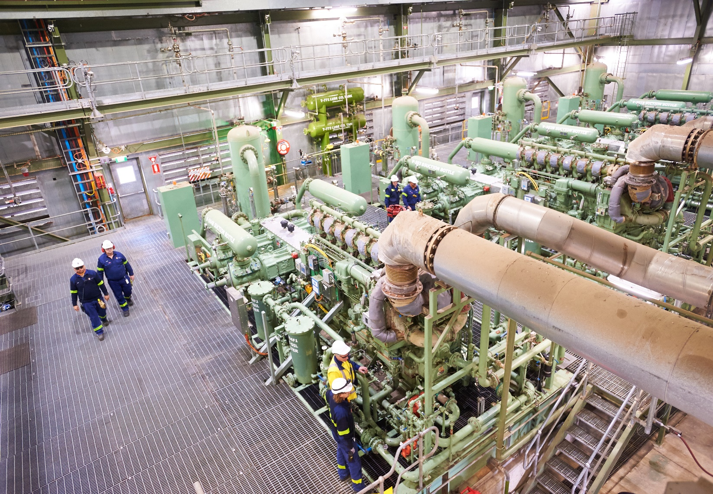
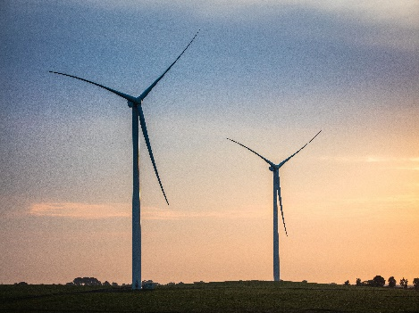
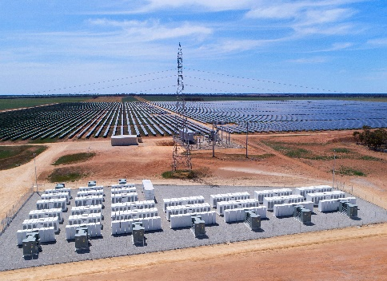
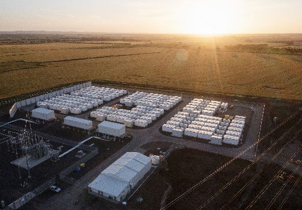
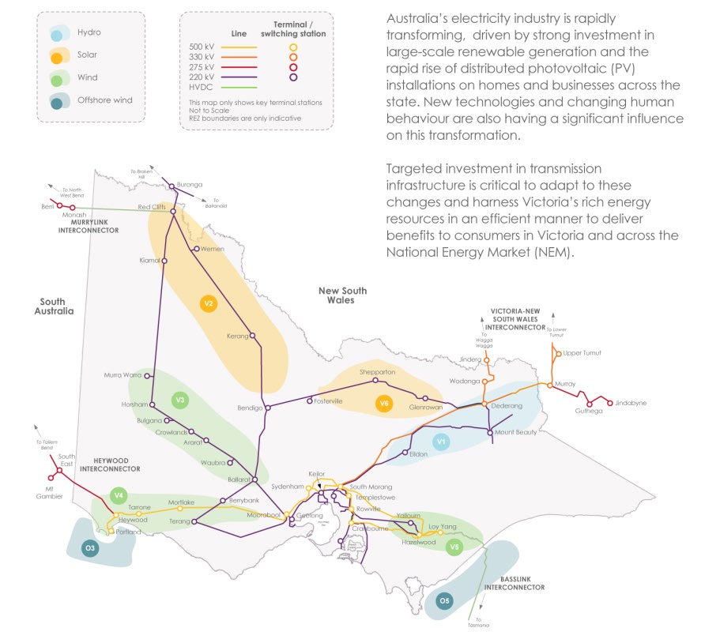
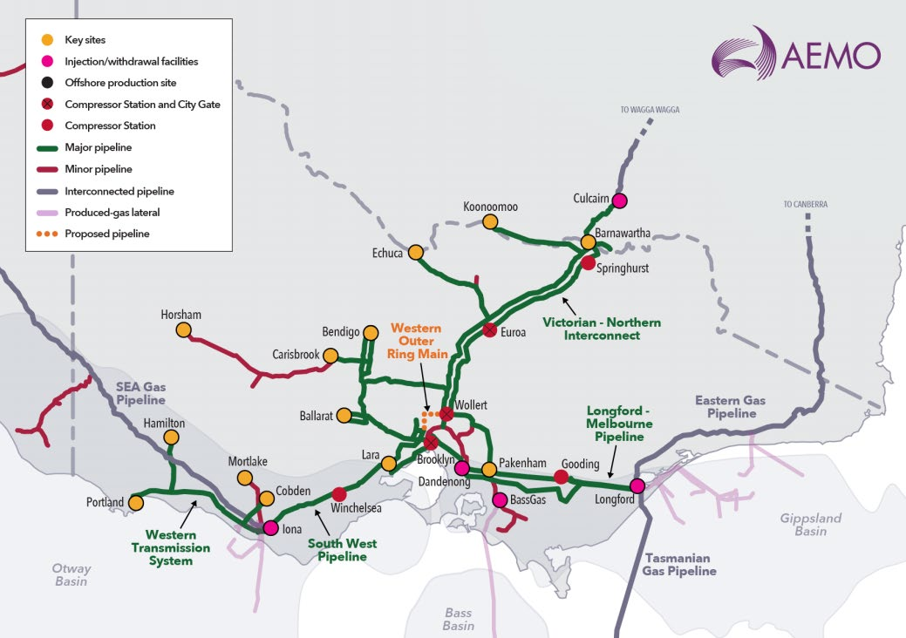
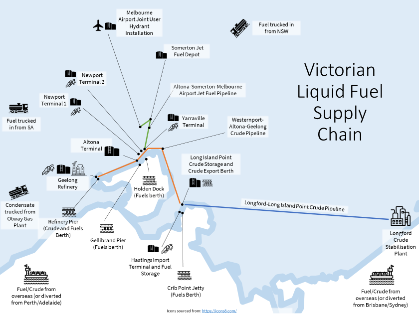
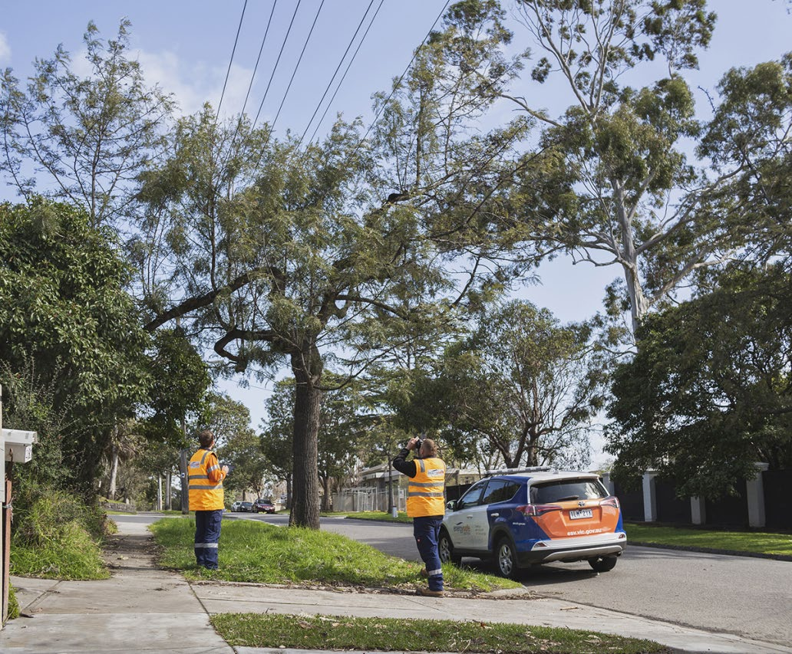
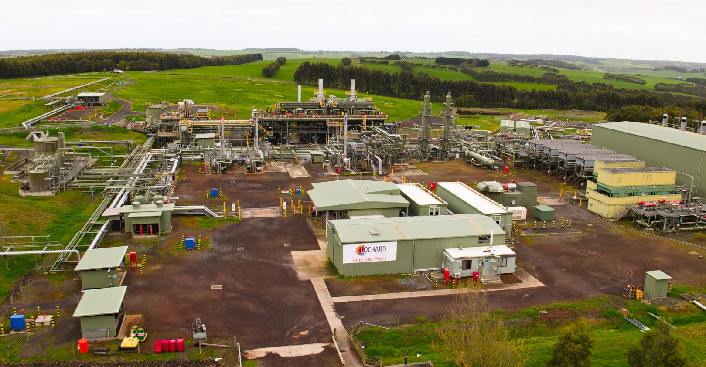
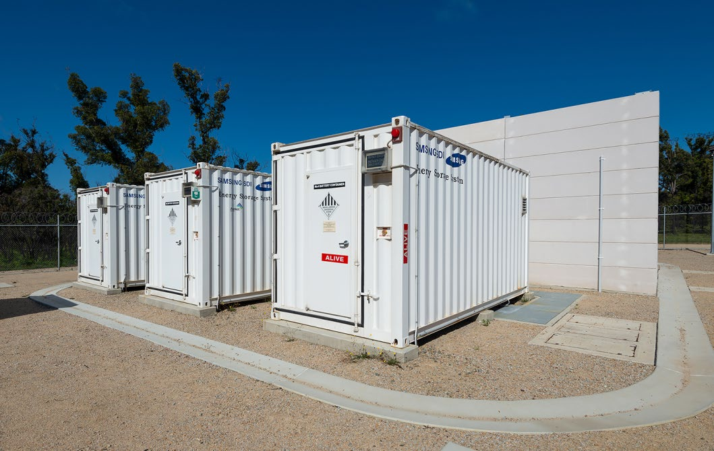

# State Emergency Management Plan — Energy Sub-Plan (2023)

> **Source**: Emergency Management Victoria
> **URL**: https://files.emv.vic.gov.au/2023-06/SEMP%20-%20Energy%20Sub-Plan%20-%202023.pdf
> **Licence**: © State of Victoria; emergency-management practitioner reference
> **Retrieved**: 2026-05-07T23:44:22Z
> **SHA-256**: `c21035350d7cdbf6e5607155afd310736b979e66ab2bcee6a768e1cb2d915561`
> *Converted from PDF to Markdown format.*

---
## Page 1

 
OFFICIAL 
State Emergency Management Plan 
Energy Sub-Plan 2023

---
## Page 2

 
 
OFFICIAL 
OFFICIAL 
 
 
 
 
Photo credit 
Iona Gas Underground Storage Facility with Permission from Lochard Energy 
Acknowledgment 
We acknowledge and respect Victorian Traditional Owners as the 
original custodians of Victoria's land and waters, their unique ability to 
care for Country and deep spiritual connection to it. We honour Elders 
past and present whose knowledge and wisdom has ensured the 
continuation of culture and traditional practices.  
We are committed to genuinely partner, and meaningfully engage, with 
Victoria's Traditional Owners and Aboriginal communities to support the 
protection of Country, the maintenance of spiritual and cultural practices and 
their broader aspirations in the 21st century and beyond. 
© The State of Victoria Department of Energy, Environment and Climate Action 2023 
This work is licensed under a Creative Commons Attribution 4.0 International licence. You are free to re-use the work 
under that licence, on the condition that you credit the State of Victoria as author. The licence does not apply to any 
images, photographs or branding, including the Victorian Coat of Arms, the Victorian Government logo and the 
Department of Energy, Environment and Climate Change (DEECA) logo. To view a copy of this licence, visit 
http://creativecommons.org/licenses/by/4.0/  
Disclaimer 
This publication may be of assistance to you but the State of Victoria and its employees do not guarantee that the publication is without 
flaw of any kind or is wholly appropriate for your particular purposes and therefore disclaims all liability for any error, loss or other 
consequence which may arise from you relying on any information in this publication. 
Accessibility 
If you would like to receive this publication in an alternative format, please telephone the DEECA Customer Service Centre on 136186, 
email customer.service@delwp.vic.gov.au or via the National Relay Service on 133 677 www.relayservice.com.au. This document is 
also available on the internet at www.delwp.vic.gov.au.www.deeca.vic.gov.au

---
## Page 3

 
 
State Emergency Management Plan – Energy Sub-Plan 
1 
 
OFFICIAL 
OFFICIAL 
1. 
Introduction ........................................................................................................ 5 
1.1. 
Purpose .......................................................................................................................................... 5 
1.2. 
Value ............................................................................................................................................... 5 
1.3. 
Audience ......................................................................................................................................... 5 
1.4. 
Scope .............................................................................................................................................. 5 
1.5. 
Implementation .............................................................................................................................. 5 
1.6. 
Authorising Environment ............................................................................................................. 5 
1.7. 
Review ............................................................................................................................................ 5 
1.8. 
Recognition of Traditional Owners .............................................................................................. 6 
1.9. 
Linkages and hyperlinks ............................................................................................................... 6 
Document ......................................................................................................................................................... 6 
Description ....................................................................................................................................................... 6 
Joint national and industry plans .................................................................................................................. 6 
Related legislations ......................................................................................................................................... 6 
Emergency Management Plans ...................................................................................................................... 6 
2. 
Victorian Energy Sector .................................................................................... 7 
2.1. 
Electricity ........................................................................................................................................ 8 
2.2. 
Gas .................................................................................................................................................. 9 
2.3. 
Liquid Fuels.................................................................................................................................... 9 
3. 
Energy Risks and Dependencies .................................................................... 11 
3.1. 
Government assessment and monitoring of risks................................................................... 11 
3.2. 
Electricity ...................................................................................................................................... 11 
3.3. 
Gas ................................................................................................................................................ 14 
3.4. 
Liquid Fuels.................................................................................................................................. 15 
4. 
Energy Emergencies ....................................................................................... 18 
4.1. 
Major Emergencies ...................................................................................................................... 18 
4.2. 
Levels of energy emergencies ................................................................................................... 18 
5. 
Emergency Management Planning ................................................................. 20 
State Emergency Management Planning .................................................................................................. 20 
Regional Emergency Management Planning ........................................................................................... 20 
Municipal Emergency Management Planning .......................................................................................... 20 
Critical Infrastructure Planning ................................................................................................................. 20 
Sector Resilience Plans .............................................................................................................................. 21 
Statement of Opportunities ........................................................................................................................ 21 
Community Emergency Planning .............................................................................................................. 21 
Contents

---
## Page 4

 
2  State Emergency Management Plan – Energy Sub-Plan 
OFFICIAL 
6. 
Mitigation .......................................................................................................... 22 
6.1. 
Roles and Responsibilities ......................................................................................................... 22 
7. 
Preparedness ................................................................................................... 24 
7.1. 
National Energy Objectives ........................................................................................................ 24 
7.2. 
Guaranteed Service Levels ......................................................................................................... 24 
7.3. 
Electricity and Gas Safety .......................................................................................................... 24 
7.4. 
Major Hazard Facilities ................................................................................................................ 25 
7.5. 
Preparedness for weather conditions and natural hazard events ......................................... 25 
8. 
Readiness ......................................................................................................... 27 
8.1. 
Roles and Responsibilities ......................................................................................................... 27 
8.1.1 
Electricity ...................................................................................................................................... 27 
8.1.2 
Gas ................................................................................................................................................ 27 
8.1.3 
Liquid Fuels.................................................................................................................................. 27 
8.2. 
Readiness for weather conditions and natural hazard events ............................................... 28 
9. 
Response (including Relief) ............................................................................ 30 
9.1. 
Control arrangements ................................................................................................................. 30 
State Controller – Energy ........................................................................................................................... 30 
9.2. 
Application of State Emergency Management Priorities ........................................................ 30 
9.3. 
Roles and Responsibilities Energy ........................................................................................... 32 
9.4. 
State Control Centre – Energy Unit ........................................................................................... 33 
9.5. 
Concurrent emergencies ............................................................................................................ 34 
9.6. 
Operation of multi-jurisdictional and state-level joint government-industry 
arrangements ................................................................................................................................................. 34 
9.7. 
Market Interventions and Legislative Powers .......................................................................... 35 
9.8. 
Critical Infrastructure, community assets and essential services ......................................... 35 
9.9. 
Response to electricity major emergencies ............................................................................. 36 
Electricity Thresholds and Triggers for Major Emergencies .................................................................. 37 
9.10. 
Mutual Aid Arrangements ........................................................................................................... 39 
9.11. 
Response to gas major emergencies ........................................................................................ 39 
Gas Thresholds and Triggers for Major Emergencies ............................................................................ 40 
9.12. 
Life Support Customers (Electricity and Gas) .......................................................................... 42 
Electricity ..................................................................................................................................................... 42 
Gas ................................................................................................................................................................ 42 
9.13. 
Response to liquid fuel major emergencies ............................................................................. 42 
9.14. 
Consequence Management ........................................................................................................ 45 
9.15. 
Public Information and Warnings .............................................................................................. 45 
Energy Emergency Advice and Messaging.............................................................................................. 45

---
## Page 5

 
 
State Emergency Management Plan – Energy Sub-Plan 
3 
 
OFFICIAL 
OFFICIAL 
Energy Industry Communications ............................................................................................................ 46 
9.16. 
Relief ............................................................................................................................................. 46 
Transition to Recovery ............................................................................................................................... 47 
10. 
Recovery ........................................................................................................... 48 
Appendix A:  Multi-jurisdictional and State-level joint government-industry 
arrangements .................................................................................................................. 50 
Electricity ........................................................................................................................................................ 50 
Gas .................................................................................................................................................................. 51 
Liquid Fuels .................................................................................................................................................... 51 
Appendix B: Related plans and arrangements ............................................................ 54 
Appendix C: Acronyms .................................................................................................. 56 
 
List of Tables 
TABLE 1:  Summary of related plans and arrangements .................................................................................. 6 
TABLE 2:  Electricity Risk Ratings ................................................................................................................... 12 
TABLE 3:  Gas Risk Ratings ........................................................................................................................... 14 
TABLE 4:  Liquid Fuels Risk Ratings ............................................................................................................... 16 
TABLE 5:  Summary of triggers, actions, and control status ........................................................................... 19 
TABLE 6:  Resources for Households to Plan for Emergencies ..................................................................... 21 
TABLE 7:  Mitigation measures to risks ........................................................................................................... 22 
TABLE 8:  Preparedness Arrangements ......................................................................................................... 26 
TABLE 9: Readiness Arrangements ................................................................................................................ 28 
TABLE 10:  State Emergency Management Priorities – Energy ..................................................................... 31 
TABLE 11:  Control arrangements .................................................................................................................. 32 
TABLE 12:  Lack of Reserve Levels ................................................................................................................ 36 
TABLE 13:  Electricity Thresholds and Triggers Major Emergency ................................................................ 38 
TABLE 14:  Gas Major Emergency Thresholds and Triggers ......................................................................... 41 
TABLE 15:  Liquid Fuels Emergency Thresholds and Triggers ...................................................................... 44 
TABLE 15:  Electricity multi-jurisdictional and state-level joint government-industry arrangements............... 51 
TABLE 16:  Gas multi-jurisdictional and state-level joint government-industry arrangements ....................... 51 
TABLE 17:  Liquid Fuels multi-jurisdictional and state-level joint government-industry arrangements........... 53 
 
List of Figures 
FIGURE 1:  Victorian Transmission Lines ......................................................................................................... 8 
FIGURE 2:  Victorian Declared Gas Transmission System and Gas Pipelines ................................................ 9 
FIGURE 3:  Liquid Fuel Supply Chain ............................................................................................................. 10 
FIGURE 4:  Example Control structure for concurrent emergencies .............................................................. 34 
FIGURE 5:  Example government-industry control structure .......................................................................... 35 
 
List of Case Studies

---
## Page 6

 
4  State Emergency Management Plan – Energy Sub-Plan 
OFFICIAL 
BOX 1:  IONA Underground Storage Case Study ........................................................................................... 29 
BOX 2:  Mallacoota Community Battery Case Study ...................................................................................... 48

---
## Page 7

 
 
State Emergency Management Plan – Energy Sub-Plan 
5 
OFFICIAL 
OFFICIAL 
1. Introduction  
1.1. Purpose  
This Energy Sub-Plan (2023) (sub-plan) is a sub-plan of the State Emergency Management Plan 
(SEMP) outlining the Victorian arrangements, where applicable, to deliver a coordinated response to 
energy emergencies. 
1.2. Value  
This sub-plan provides information about energy supply chains and infrastructure, risks and 
consequences of disruption, and the arrangements for energy emergency mitigation, preparedness, 
response and recovery.  
This clarity about context, roles and collaboration between agencies enables an integrated and 
collaborative response to energy emergencies, minimises the likelihood and consequence of these 
emergencies, and supports community resilience. 
1.3. Audience  
The audience for this sub-plan is the Victorian Government, agencies, energy industry and other 
organisations within the Victorian emergency management arrangements that have an interest in the 
management of energy emergencies.  The audience also includes Commonwealth, state and territory 
governments, and industry stakeholders that have a role in managing energy emergencies. 
1.4. Scope  
This sub-plan provides strategic information about Victorian preparedness, mitigation, response and 
recovery arrangements for energy emergencies, with a focus on major emergencies that disrupt 
electricity, gas or liquid fuel supply. 
This sub-plan does not include detail about the operational activities of individual agencies.  
This plan does not describe or duplicate arrangements for Class 1 emergencies.   
1.5. Implementation  
The arrangements in this sub-plan apply on a continual basis and do not require activation. 
This sub-plan is intended to support existing operational plans.   
1.6. Authorising Environment  
The Emergency Management Act 2013 (EM Act 2013) is the empowering legislation for managing 
emergencies in Victoria.   
The SEMP is prepared under section 60AD of the EM Act 2013. The SEMP outlines the provisions for 
the mitigation of, response to and recovery from emergencies, and specifies the roles and 
responsibilities of agencies in relation to emergency management in Victoria.  
This sub-plan is a subordinate plan of the SEMP and has been approved by the State Crisis and 
Resilience Council (SCRC). 
1.7. Review  
This sub-plan was reviewed and amended following one year of its publication in 2022 in line with s. 
60AN of the EM Act 2013.

---
## Page 8

 
6 
State Emergency Management Plan – Energy Sub-Plan 
OFFICIAL 
OFFICIAL 
This sub-plan was current at the time of publication and remains in effect until modified, superseded 
or withdrawn. 
This sub-plan will be exercised and evaluated every three years from the date of publication.  Where 
any emergency management arrangements are reviewed and changed, the sub-plan will be 
amended, and a revised version issued. 
1.8. Recognition of Traditional Owners 
The Department of Energy, Environment and Climate Action (DEECA) is committed to genuinely 
partnering, and meaningfully engaging with Victoria’s Traditional Owners and Aboriginal communities 
to support the protection of Country, the maintenance of spiritual and cultural practices and their 
broader aspirations. 
1.9. Linkages and hyperlinks  
This plan refers to a range of existing plans, arrangements and resources relating to energy 
emergencies.  This plan does not seek to duplicate the information contained in these resources, and 
instead provides links to where the reader can obtain further information (Appendix B). 
Documents or resources that are referred to frequently throughout this plan, such as the SEMP, are 
not hyperlinked in each instance. 
All hyperlinks were accurate at the time of publication, and the currency of the linked content remains 
the responsibility of the host agency. 
TABLE 1:  Summary of related plans and arrangements 
Document  
Description 
Joint national and 
industry plans 
Joint plans and standard operating procedures and governance arrangements to support state and 
territory government and industry, allowing these agencies to jointly prepare for, monitor and respond 
to energy incidents and energy emergencies. 
These include the following: 
• 
National Electricity Market Memorandum of Understanding on the Use of Emergency Powers 
(National Electricity Market Emergency Protocol) 
• 
National Electricity Market Emergency Management Forum’s Power System Emergency 
Management Plan  
• 
National Gas Emergency Response Advisory Committee’s Interruption to Supply Process 
• 
Gas Emergency Protocol (2022) 
• 
Victorian Electricity Emergency Communication Protocol (2022) 
• 
Single Industry Spokesperson Protocol for Electricity in Victoria (2019) 
• 
Victorian Gas Emergency Communication Protocol (2019) 
• 
Single Industry Spokesperson Protocol for Gas in Victoria (2019) 
• 
National Liquid Fuel Emergency Response Protocol 
• 
Australian Institute of Petroleum (AIP) Communications Protocol (2015). 
Related legislations   
The following legislation is directly relevant to the management of Class 2 energy emergencies: 
• 
Liquid Fuels Emergency Act 1984 (Cth) 
• 
National Electricity Law 
• 
National Gas (Victoria) Act 2008 
• 
Electricity Distribution Code of Practice 2022 
• 
Electricity Industry Act 2000 
• 
Electricity Safety Act 1998 
• 
Gas Industry Act 2001 
• 
Gas Safety Act 1997 
• 
Pipelines Act 2005 
Emergency 
Management Plans 
Emergency management plans are prepared, maintained and exercised by businesses, the community 
and infrastructure owners. These entities will activate their plans in response to an energy emergency 
when pre-determined triggers are met.  Further all tiers of government, the EM Act 2013 requires local 
government and regions to develop and maintain Emergency Management Plans in accordance with 
the Ministerial Guidelines and which underpin the State Emergency Management Plan.

---
## Page 9

 
 
State Emergency Management Plan – Energy Sub-Plan 
7 
OFFICIAL 
OFFICIAL 
2. Victorian Energy Sector  
The Victorian energy sector includes generation, production, transmission, storage and distribution of 
energy across three sub-sectors: electricity, gas and liquid fuels. In Victoria, energy sector supply 
chains and infrastructure are privately owned and operated.   
The energy sectors provide essential services to the Victorian community such as lighting, heating 
and cooling, process heat for manufacturing and transportation of fuel.  
The electricity, gas and liquid fuel sub-sectors are highly interconnected and reliant on services they 
each provide. Each sub-sector also has strong interdependencies with other critical infrastructure 
sectors and supply chains, both domestically and internationally. This is highlighted by increasingly 
inter-linked east coast electricity and gas markets, energy assets reliance on reliable water supply and 
road access, and dependency on international and interstate supplies of natural gas and liquid fuels.   
All energy sectors are vulnerable to supply chain disruption and infrastructure damage which can give 
rise to supply disruption. Risks arise in the context of global and domestic supply chains of products, 
parts and people.  These include interdependent national markets, increasing domestic and 
international attention on decarbonising the energy economy, and intra-dependencies across the 
social, built, economic and natural environments. 
Victoria has committed to reaching net-zero emissions and a climate-resistant Victoria by 2045.  As 
such, the energy sector emissions reduction pledge accelerates Victoria’s transition to a clean and 
efficient energy future.  This transition aims for 50 per cent renewable sources by 2030 within the 
electricity system.  This transition will see: 
• 
large scale solar and wind farms and storage solutions, such as utility-scale batteries 
• 
the retirement of increasingly expensive and unreliable coal-fired power stations as the state 
moves away from fossil fuels 
• 
the pioneering of innovative energy sources, such as renewable hydrogen and offshore wind 
• 
a wave of electrification with a move away from gas in homes to deliver more climate-friendly 
energy efficient homes 
• 
new technologies, such as rooftop solar, neighbourhood and household batteries 
• 
new and upgraded energy infrastructure ensuring clean energy for all. 
 
Wind Farms 
 
Credit:  David McArthur – Parallax Photography 
Solar Farms and Battery 
 
Credit:  Edify Energy 
Victorian Big Battery 
 
Credit:  Neoen 16 
 
Energy distribution, transmission and critical infrastructure owners/operators are an essential part of 
planning to mitigate the risk and consequences from major emergencies.  This planning is essential in 
providing safe and reliable supplies of electricity, gas and liquid fuels to Victoria and, importantly 
maintaining supply to other critical infrastructure sectors reliant on energy to provide essential 
services to the state.

---
## Page 10

 
8 
State Emergency Management Plan – Energy Sub-Plan 
OFFICIAL 
OFFICIAL 
2.1. Electricity  
The Victorian electricity system (Figure 1) is part of the National Electricity Market which also includes 
Queensland, New South Wales, Tasmania, South Australia, and the Australian Capital Territory. The 
National Electricity Market is operated by the Australian Energy Market Operator (AEMO). AEMO is 
responsible for reliability and system security consistent with its obligations under the National 
Electricity Law and the National Electricity Rules. 
The Victorian electricity system includes:  
• 
generators – coal and gas-fired power plants, and solar, wind and hydro generation  
• 
energy storage – large-scale grid-connected batteries  
• 
transformers, switching and protection equipment –voltage network control  
• 
transmission lines – high voltage lines connecting the large generators to demand centres  
• 
interconnectors – the transmission systems linking the Victorian network with the other 
National Electricity Market regions (Tas, SA, NSW)  
• 
distribution networks – low voltage networks that connect supply to customers  
• 
energy resources – behind the meter assets (solar panels, inverters, small capacity batteries) 
 
Figure 1:  Victorian Transmission Lines

---
## Page 11

 
 
State Emergency Management Plan – Energy Sub-Plan 
9 
OFFICIAL 
OFFICIAL 
 
2.2. Gas  
The Victorian gas system, most of which is within the Victorian Declared Wholesale Gas Market, 
forms part of the eastern gas region which is one of two regions in Australia’s domestic gas market. 
The Victorian Declared Wholesale Gas Market enables dynamic trading of gas injections and 
withdrawals from Victoria’s gas transmission system, known as the Declared Transmission System. 
AEMO operates both the Victorian Declared Wholesale Gas Market and the Declared Transmission 
System.  
There are several major gas pipelines that fall outside of the (Figure 2), including the Eastern Gas 
Pipeline from Longford to Sydney, the SEAGas pipeline connecting South Australia to Victoria, the 
Tasmanian Gas Pipeline connecting Victoria and Tasmania and pipelines to some regional Victorian 
centres.  
The broader gas supply system in Victoria consists of three gas basins off the coast (Gippsland, Bass 
and Otway basins), gas processing plants (Longford, Orbost, Port Campbell and Lang Lang), a small 
liquefied natural gas storage facility in Dandenong, the Iona underground natural gas storage facility 
in Port Campbell, and the transmission and distribution pipeline systems that deliver gas to 
customers.  
Figure 2:  Victorian Declared Gas Transmission System, Eastern, SEA and Tasmanian Gas Pipelines  
 
(Image – AEMO) 
2.3. Liquid Fuels 
The liquid fuel sub-sector operates within a global supply chain through which Australia imports more 
than 90 per cent of its liquid fuel needs (both crude oil and refined fuel) from more than 60 countries.  
The Victorian fuel supply chain (Figure 3) incorporates:  
• 
offshore production of crude oil and condensate  
• 
crude and condensate refining capacity

---
## Page 12

 
10 State Emergency Management Plan – Energy Sub-Plan 
OFFICIAL 
OFFICIAL 
• 
import and export infrastructure for crude and refined product (e.g., berthing facilities and 
pipelines)  
• 
transmission pipeline infrastructure including pipelines to Melbourne Airport  
• 
storage and distribution infrastructure at the refinery in Geelong, terminals and regional fuel 
storage depots  
• 
road tankers and logistics services  
• 
a retail service station network. 
 
Figure 3:  Liquid Fuel Supply Chain1 
 
 
 
 
 
1 Icons sourced from: https://icons8.com/

---
## Page 13

 
 
State Emergency Management Plan – Energy Sub-Plan 
11 
OFFICIAL 
OFFICIAL 
3. Energy Risks and Dependencies 
The responsibility for managing emergency risks is shared across government, industry, community 
and risk owners.  Risk owners are any person or entity with the authority to manage a particular risk 
and who is accountable for doing so.  The energy industry is subject to broad risk management 
requirements. Each distribution business identifies and manages corporate and emergency risks for 
their own operations and infrastructure. These are guided by their own risk management frameworks, 
which detail the assessment of risks, identification of existing and proposed controls and treatments 
where applicable.  
Legislation at national and state level imposes obligations upon asset owners and/or operators of the 
energy system to demonstrate risk assessments and mitigate and prepare for emergencies.   
Risk management planning for critical infrastructure includes consideration of physical facilities, 
supply chains, systems, assets, information technologies and communication networks, which if 
destroyed, degraded or rendered unavailable for an extended period, would significantly impact the 
Victorian community.  
3.1. Government assessment and monitoring of risks  
At a state level, Emergency Management Victoria (EMV) is responsible for coordinating a state-wide 
risk assessment that identifies the highest emergency risks and the controls and treatments that 
minimise or manage the risks and consequences.  EMV’s Emergency Risks in Victoria Report (2020) 
identifies electricity supply disruption and gas supply disruption as some of the highest risks in 
Victoria. 
DEECA undertakes an emergency risk assessment every three (3) years and completes an annual 
review in the intervening years in accordance with the EM Act 2013 (Part 7A).  The emergency risk 
assessment informs the development of the annual Energy Sector Resilience Plan and are 
incorporated into this sub-plan.  
The risk assessment is undertaken in accordance with the principles of the National Emergency Risk 
Assessment Guidelines, which are consistent with international standard ISO31000:2018: Risk 
Management – Principles and Guidelines. 
This risk assessment is informed by:  
• 
advice from industry and other stakeholders 
• 
consultation with the Sector Resilience Network - Energy convened by DEECA  
• 
consultation with Energy Sector Group Trusted Information Sharing Network convened by the 
Commonwealth Government’s Department of Home Affairs  
• 
information included in ‘vital’ energy critical infrastructure businesses’ Statements of 
Assurance  
• 
review of the emergency risk environment and energy emergency events nationally and 
globally  
• 
Victorian Government state level risk management priorities and risk assessments. 
In 2022, the three yearly emergency risk assessment, assessed risks for each energy sub-sector 
(electricity, gas and liquid fuels) recognising that not all risks affect each sub-sector.  In addition, 
vulnerabilities and consequences of each identified risk can be unique and discrete for electricity, gas 
and liquid fuels.  As part of the sub-sector assessment, analysis confirmed upstream and downstream 
supply chain dependencies and the cascading affects major emergencies may have on these 
dependencies.  
Risks and vulnerabilities identified in the emergency risk assessment informs this sub-plan and are 
provided in Tables 2-4.   
3.2. Electricity  
Table 2 provides the risks and consequences to electricity from natural hazard events, damage to 
critical electricity infrastructure and/or systems, disruptions to upstream or downstream dependencies,

---
## Page 14

 
12 State Emergency Management Plan – Energy Sub-Plan 
OFFICIAL 
OFFICIAL 
supply chain disruptions, and interruptions to industry workforce.  Extreme risks to electricity were 
identified as fire (bushfire/grassfire), extreme temperatures (heatwave) (3–4-day event), flood and 
major plant failure. 
Electricity is critical for the operation of critical infrastructure across Victoria’s eight (8) sectors and the 
provision of essential services to the State (downstream dependencies).  In turn, electricity is 
dependent on the operation of the water, communications, and transport sectors to maintain supply of 
electricity upstream dependencies.   
TABLE 2:  Electricity Risk Ratings 
Risk Rating 
Risk Statement 
Extreme 
 
Fire (including 
bushfire/grassfire) 
There is the potential for bushfires to damage or destroy electricity infrastructure, or restrict 
electricity service operations within normal parameters, that, in turn, may cause an extended or 
expansive service delivery interruption. 
Extreme temperatures 
(heatwave) (3–4-day 
event) 
There is the potential that extreme temperatures will damage, or exceed the operating limit of, 
electricity infrastructure, that, in turn, may cause an extended or expansive service delivery 
interruption. 
Floods 
There is the potential for flood to damage electricity infrastructure, cause the loss of 
access/control, or restrict electricity service operations within normal parameters that, in turn, 
may cause an extended or expansive service delivery interruption. 
Major plant failure – 
operations (including 
ageing infrastructure, 
maintenance, defects, 
operating outside of 
design) 
There is the potential for a major plant failure (e.g. through asset management failure, design 
flaw, construction defect or out-of-design operation) to compromise electricity infrastructure 
integrity or restrict electricity service operations within normal parameters that, in turn, may 
cause an extended or expansive service delivery interruption. 
High 
 
Severe weather 
(including extreme rain, 
lightning, hail and 
extreme wind) 
There is the potential for a severe weather event to damage electricity infrastructure or restrict 
electricity service operations within normal parameters, that, in turn, may cause an extended or 
expansive service delivery interruption. 
Cyber attack 
There is the potential for a cyber-attack (inadvertent or malicious) to penetrate corporate IT, 
Supervisory control and data acquisition (SCADA) or asset-specific management systems and 
cause a loss of electricity service operational control that, in turn, may cause an extended or 
expansive service delivery interruption. 
Coal Mine failure 
There is potential for coal mine failure to compromise infrastructure integrity or restrict electricity 
service operations within normal parameters that, in turn, may cause an extended or expansive 
service delivery interruption. 
Pandemic 
There is the potential for a pandemic to lead to workforce constraints (e.g. via extended illness or 
isolation/quarantine) or compromise electricity service operational capabilities, that may in turn 
cause an extended or expansive service delivery interruption. 
Grid instability 
There is potential for grid instability to restrict the ability to maintain appropriate grid reliability 
conditions, (e.g. inertia), that, in turn, may cause an extended or expansive service delivery 
interruption. 
Gas supply disruption 
There is the potential for a gas supply disruption (e.g. damage to gas assets and infrastructure) 
or a loss of gas supply, to restrict electricity (gas-powered) generation or electricity service 
operations that, in turn, may cause an extended or expansive service delivery interruption. 
Communications 
disruption 
There is the potential for a communications disruption (e.g. damage to fibre optic, 
ASDL/NBN/cable, SCADA, telemetry) or a loss of a communications service (e.g. 3G/4G/5G) to 
impact electricity service remote operational monitoring and control, that, in turn, may cause an 
extended or expansive service delivery interruption. 
Medium

---
## Page 15

 
 
State Emergency Management Plan – Energy Sub-Plan 
13 
OFFICIAL 
OFFICIAL 
Risk Rating 
Risk Statement 
Earthquake 
There is the potential for an earthquake to damage or destroy electricity infrastructure, or restrict 
electricity service operations within normal parameters, that, in turn, may cause an extended or 
expansive service delivery interruption. 
Fire (structural) 
There is the potential for a structural fire to damage or destroy electricity infrastructure, or restrict 
electricity service operations within normal parameters, that, in turn, may cause an extended or 
expansive service delivery interruption. 
Physical intrusion or 
attack 
There is the potential for a physical intrusion (criminal act by an internal or external person/s) by 
disruption, vandalism, terrorism, hostage situation or personal harm, to cause (or threaten to 
cause) a loss of operational control or restrict electricity service operations within normal 
parameters, that, in turn, may cause an extended or expansive service delivery interruption. 
Unplanned closure of 
coal fired electricity 
generation 
There is potential for an unplanned closure of coal fired power plants to cause a loss (in part or 
otherwise) of baseload energy capacity, that, in turn, may cause an extended or expansive 
service delivery interruption. 
Foreign interference 
There is the potential for foreign interference to compromise electricity service operational 
capabilities or capacity, that, in turn, may cause an extended or expansive service delivery 
interruption. 
Workforce issues 
There is the potential for workforce constraints (e.g. via unavailability due to fatigue/illness, major 
and prolonged industrial action, skills shortages, movement of workers or mass 
resignation/retirement) to impact electricity service operational capabilities and/or capacity, that, 
in turn, may cause an extended or expansive service delivery interruption. 
Water supply 
disruption 
There is the potential for a water supply disruption (e.g. damage to water assets and 
infrastructure) or a loss of water supply, to restrict electricity generation or service operations 
that, in turn, may cause an extended or expansive service delivery interruption. 
Critical parts/spares 
disruption 
There is the potential for a critical parts/spares disruption to compromise infrastructure integrity 
or restrict electricity service operations within normal parameters that, in turn, may cause an 
extended or expansive service delivery interruption. 
Low 
 
Unexpected load / 
demand increase 
There is the potential for an unexpected increase in load or demand to restrict the ability to 
maintain appropriate grid reliability conditions (e.g. inertia), that, in turn, may cause an extended 
service delivery interruption. 
Liquid fuel disruption 
There is the potential for a fuel shortage to result in reduced availability to gas-powered 
generators if compounded with a gas shortage or supply disruption that, in turn, may cause a 
supply demand imbalance during peak demand. 
Transport network 
disruption 
There is the potential for a transport network disruption to compromise supply chain/s and/or 
electricity service operation and maintenance access, that, in turn, may cause an extended 
service delivery interruption. 
Solar flare 
There is the potential for a solar flare/storm to damage or destroy electricity infrastructure, or 
restrict electricity service operations within normal parameters that, in turn, may cause an 
extended service delivery interruption. 
Very Low 
 
Dam failure 
(hydroelectric power 
generation) 
There is potential for dam failure to compromise infrastructure integrity or restrict electricity 
service operations within normal parameters that, in turn, may cause an extended or expansive 
service delivery interruption.

---
## Page 16

 
14 State Emergency Management Plan – Energy Sub-Plan 
OFFICIAL 
OFFICIAL 
3.3. Gas  
Gas in Victoria is primarily used for residential and commercial space heating and hot water, cooking 
and industrial process heating.  If a gas supply disruption occurred in the summer, it could impact 
electricity peak demand for gas-powered electricity generation.  Throughout the year, there is a 
potential impact to the wellbeing of people and all critical infrastructure sectors who rely on gas to 
heat homes and commercial premises.  
The risks to gas availability (Table 3) are influenced by reporting undertaken by AEMO on supply and 
demand balances.  In addition, risks are heightened from declining resilience in gas infrastructure 
from multiple factors, including aging infrastructure, existing pipeline constraints, reduced redundancy 
at the Longford gas plant, a decline in overall production of legacy fields and low levels of gas stored 
at Dandenong. 
Major plant failure therefore was assessed as an extreme risk which is driven by an increase in the 
likelihood of failure under unlikely and likely scenarios from aging infrastructure and challenges with 
energy transition. 
Gas is a vital upstream dependency for gas-powered generation and the start-up of thermal 
generators. Unplanned generator outages can significantly increase the demand for gas generation. 
Significant disruption to natural gas supply may require AEMO to direct gas-powered generation to 
shift to diesel generation or curtail gas-powered generation, increasing the risk of disruptions to the 
electricity supply. 
TABLE 3:  Gas Risk Ratings 
Risk Rating 
Risk Statement 
Extreme 
 
Major plant failure - 
operations 
There is the potential for a major plant failure (e.g. through asset management failure, design 
flaw, construction defect or out-of-design operation) to compromise gas infrastructure integrity or 
restrict gas service operations within normal parameters that, in turn, may cause an extended 
service delivery interruption. 
High 
 
Fire (including bushfire, 
grassfire) 
There is the potential for bushfires to damage or destroy gas infrastructure, or restrict gas 
service operations within normal parameters, that, in turn, may cause an extended or expansive 
service delivery interruption. 
Extreme temperatures 
(cold) (3-4 day event) 
There is the potential for extremely cold temperatures to increase gas demand over available 
supply capacity, and/or exceed the operating limit of gas infrastructure, that, in turn, may cause 
an extended or expansive service delivery interruption. 
Cyber-attack 
There is the potential for a cyber-attack (inadvertent or malicious) to penetrate corporate IT, 
SCADA or asset-specific management systems, cause a loss of gas service operational control 
that, in turn, may cause an extended or expansive service delivery interruption. 
Fire (structural) 
There is the potential for a structural fire to damage or destroy gas infrastructure, or restrict gas 
service operations within normal parameters, that, in turn, may cause an extended or expansive 
service delivery interruption. 
Pandemic 
There is the potential for a pandemic to lead to workforce constraints (e.g. via extended illness or 
isolation/quarantine) or compromise gas service operational capabilities and/or capacity, that, in 
turn, may cause an extended or expansive service delivery interruption. 
Global conflict 
There is potential for global conflict to reduce or restrict CAPEX or OPEX investment in gas 
infrastructure, that, in turn, may cause an extended or expansive service delivery interruption. 
Medium 
 
Earthquake 
There is the potential for an earthquake to damage or destroy gas infrastructure, or restrict gas 
service operations within normal parameters, that, in turn, may cause an extended or expansive 
service delivery interruption.

---
## Page 17

 
 
State Emergency Management Plan – Energy Sub-Plan 
15 
OFFICIAL 
OFFICIAL 
Risk Rating 
Risk Statement 
Extreme temperatures 
(heatwave) (3–4-day 
event) 
There is the potential that extreme temperatures will damage, or exceed the operating limit of, 
gas infrastructure, that, in turn, may cause an extended or expansive service delivery 
interruption. 
Severe weather 
(including extreme rain, 
lightning, hail, and 
extreme wind) 
There is the potential for a severe weather event to damage gas infrastructure or restrict gas 
service operations within normal parameters, that, in turn, may cause an extended or expansive 
service delivery interruption. 
Physical intrusion or 
attack 
There is the potential for a physical intrusion (criminal act by an internal or external person/s) by 
disruption, vandalism, terrorism, hostage situation or personal harm, to cause (or threaten to 
cause) a loss of operational control or restrict gas service operations within normal parameters, 
that, in turn, may cause an extended service delivery interruption. 
Workforce issues 
There is the potential for workforce constraints (e.g. via unavailability due to fatigue/illness, major 
and prolonged industrial action, skills shortages, movement of workers or mass 
resignation/retirement) to impact gas service operational capabilities and/or capacity, that, in 
turn, may cause an extended or expansive service delivery interruption. 
Electricity disruption 
There is the potential for an electricity disruption (e.g. damage to electricity assets and 
infrastructure) or a loss of electricity supply to restrict gas service operations that, in turn, may 
cause an extended or expansive service delivery interruption. 
Communications 
disruption 
There is the potential for a communications disruption (e.g. damage to fibre optic, 
ASDL/NBN/cable, SCADA, telemetry) or a loss of a communications service (e.g. 3G/4G/5G) to 
impact gas service remote operational monitoring and control, that, in turn, may cause an 
extended or expansive service delivery interruption. 
Critical parts/spares 
disruption 
There is the potential for a critical parts/spares disruption to compromise infrastructure integrity 
or restrict gas service operations within normal parameters that, in turn, may cause an extended 
or expansive service delivery interruption. 
Low 
 
Floods 
There is the potential for flood to damage gas infrastructure, cause the loss of access/control, or 
restrict gas service operations within normal parameters that, in turn, may cause an extended or 
expansive service delivery interruption. 
Liquid fuel disruption 
There is the potential for a liquid fuel disruption to restrict personnel mobility and cause a loss of 
operational control of gas service infrastructure (during an electrical outage), that, in turn, may 
cause an extended service delivery interruption. 
Transport network 
disruption 
There is the potential for a transport network disruption to compromise supply chain/s and/or gas 
service operation and maintenance access, that, in turn, may cause an extended service delivery 
interruption. 
3.4. Liquid Fuels 
The overall risk to liquid fuel supplies in Victoria (Table 4) are not considered as significant as the 
risks to electricity and gas supply, because it is unlikely an event would lead to major disruption to 
service continuity.  Despite this, the risk profile in the sector remains dynamic and subject to change 
over time. The risks to liquid fuel supply that have been assessed as high included cyber-attack, 
pandemic, and transport network disruption, all of which could impact service continuity if 
materialised. 
Liquid fuel supplies are critical for electricity and gas generators, including back up for gas-powered 
generation and for elements of coal-mining operations, which coal-fired power stations depend on. 
This is particularly the case in the event of a gas shortage where some gas-powered generation may 
switch to diesel in response to market conditions.   
The transport, agriculture and mining sectors more broadly are also highly dependent on liquid fuel for 
operations, maintenance, repairs and supply by road, rail and sea.  Any major disruptions to liquid fuel 
supply are likely to have cascading impacts across multiple critical infrastructure sectors.

---
## Page 18

 
16 State Emergency Management Plan – Energy Sub-Plan 
OFFICIAL 
OFFICIAL 
TABLE 4:  Liquid Fuels Risk Ratings 
Risk Rating 
Risk Statement 
Extreme 
 
Nil 
 
High 
 
Cyber attack 
There is the potential for a cyber attack (inadvertent or malicious) to penetrate 
corporate IT, SCADA or asset-specific management systems, cause a loss of liquid 
fuel service operational control that, in turn, may cause an extended or expansive 
service delivery interruption. 
Pandemic 
There is the potential for a pandemic to lead to workforce constraints (e.g. via 
extended illness or isolation/quarantine) or compromise liquid fuel service operational 
capabilities and/or capacity, that, in turn, may cause an extended or expansive service 
delivery interruption. 
Transport network disruption 
(ports maritime routes / road 
network) 
There is the potential for a transport network disruption to compromise supply chain/s 
and/or liquid fuel service operation and maintenance access, that, in turn, may cause 
an extended service delivery interruption. 
Medium 
 
Fire (including bushfire/grassfire) 
There is the potential for bushfires to damage or destroy liquid fuel infrastructure, or 
restrict liquid fuel service operations within normal parameters, that, in turn, may 
cause an extended or expansive service delivery interruption. 
Fire (structural) 
There is the potential for a structural fire to damage or destroy liquid fuel 
infrastructure, or restrict liquid fuel service operations within normal parameters, that, 
in turn, may cause an extended or expansive service delivery interruption. 
Physical intrusion or attack 
There is the potential for a physical intrusion (criminal act by an internal or external 
person/s) by disruption, vandalism, terrorism, hostage situation or personal harm, to 
cause (or threaten to cause) a loss of operational control or restrict liquid fuel service 
operations within normal parameters, that, in turn, may cause an extended service 
delivery interruption. 
Major plant failure – operations 
There is the potential for a major plant failure (e.g. through asset management failure, 
design flaw, construction defect or out-of-design operation) to compromise liquid fuel 
infrastructure integrity or restrict liquid fuel service operations within normal 
parameters that, in turn, may cause an extended service delivery interruption. 
Workforce issues 
There is the potential for workforce constraints (e.g. via unavailability due to 
fatigue/illness, major and prolonged industrial action, skills shortages, movement of 
workers or mass resignation/retirement) to impact liquid fuel service operational 
capabilities and/or capacity, that, in turn, may cause an extended or expansive service 
delivery interruption. 
Electricity supply disruption 
There is the potential for an electricity disruption (e.g. damage to electricity assets and 
infrastructure) or a loss of electricity supply to restrict liquid fuel service operations 
that, in turn, may cause an extended or expansive service delivery interruption. 
Communications disruption 
There is the potential for a communications disruption (e.g. damage to fibre optic, 
ASDL/NBN/cable, SCADA, telemetry) or a loss of a communications service (e.g. 
3G/4G/5G) to impact liquid fuel service remote operational monitoring and control, 
that, in turn, may cause an extended or expansive service delivery interruption. 
Global conflict 
There is potential for global conflict to reduce or restrict CAPEX or OPEX investment 
in liquid fuel infrastructure, that, in turn, may cause an extended or expansive service 
delivery interruption.   
Critical parts/spares disruption 
There is the potential for a critical parts/spares disruption to compromise infrastructure 
integrity or restrict liquid fuel service operations within normal parameters that, in turn, 
may cause an extended or expansive service delivery interruption.

---
## Page 19

 
 
State Emergency Management Plan – Energy Sub-Plan 
17 
OFFICIAL 
OFFICIAL 
 
 
Risk Rating 
Risk Statement 
Low 
 
Extreme temperatures 
(heatwave) (3-4 days) 
There is the potential that extreme temperatures will damage, or exceed the operating 
limit of, liquid fuel infrastructure, that, in turn, may cause a service delivery 
interruption. 
Floods 
There is the potential for flood to damage liquid fuel infrastructure, cause the loss of 
access/control, or restrict liquid fuel service operations within normal parameters that, 
in turn, may cause an extended or expansive service delivery interruption. 
Severe weather (including 
extreme rain, lightning, hail, and 
extreme wind) 
There is the potential for a severe weather event to damage liquid fuel infrastructure 
or restrict liquid fuel service operations within normal parameters, that, in turn, may 
cause an extended or expansive service delivery interruption. 
Earthquake 
There is the potential for an earthquake to damage or destroy liquid fuel infrastructure, 
or restrict liquid fuel service operations within normal parameters, that, in turn, may 
cause an extended or expansive service delivery interruption. 
Gas supply disruption 
There is the potential for a gas supply disruption (e.g. damage to gas assets and 
infrastructure) or a loss of gas supply, to restrict liquid fuel service operations that, in 
turn, may cause a service delivery interruption. 
Water supply disruption 
There is the potential for a water supply disruption (e.g. damage to water assets and 
infrastructure) or a loss of water supply, to restrict liquid fuel production or service 
operations that, in turn, may cause an extended or expansive service delivery 
interruption.

---
## Page 20

 
18 State Emergency Management Plan – Energy Sub-Plan 
OFFICIAL 
OFFICIAL 
4. Energy Emergencies 
An energy emergency is any disruption of electricity, gas or liquid fuel supply that has an impact on 
the community, health system, economy, and/or the environment. 
Disruptions can occur at any point in the energy supply chain. Localised and limited incidents 
impacting energy infrastructure and/or supplies are managed by industry and relevant response 
agencies as part of business-as-usual operations.  
4.1. Major Emergencies  
An emergency, as defined in the EM Act 2013 (s. 3), means an actual or imminent occurrence of an 
event which in any way endangers or threatens to endanger the safety or health of any person in 
Victoria or which destroys or damages, or threatens to destroy or damage, any property, the 
environment.   
A ‘major emergency’ is a large or complex emergency, with the potential to: 
• 
cause loss of life, or extensive damage to property, infrastructure, or the environment; or 
• 
have or is having significant adverse consequences for the Victorian community, or part of the 
Victorian community; or  
• 
an emergency that involves two or more agencies to respond. 
A ‘Class 2’ emergency means an emergency which is not a Class 1 or Class 3 emergency.  Major 
energy emergency is the disruption to electricity, gas or liquid fuel supply and which meets the criteria 
of a ‘major emergency’ as defined by the EM Act 2013 (above).  A proclamation or declaration does 
not need to be made for an emergency to be a Class 2 major emergency.  
A major energy emergency may include one or more of the following: 
• 
a large and complex incident that has the potential to have or is having significant adverse 
consequences to the safety and wellbeing of the Victorian community or a part of the 
community 
• 
immediate threat to significant critical infrastructure or facilities, including hospitals, major 
industry and/or other utilities 
• 
generation, transmission or distribution equipment failure or disruption of energy supplies to 
Victoria 
• 
demand for electricity or gas significantly exceeds supply and requires market intervention by 
AEMO 
• 
an event has occurred which may endanger an undertaking of a distribution business, a 
transmission business or a generation business or person or a person who supplies 
electricity, gas or liquid fuel 
• 
substantial imbalances in the markets affecting primary grade fuel(s), such as diesel, 
unleaded petrol and/or jet fuel, requiring prioritisation for essential fuel users 
• 
disruptions to supply chains that impact upon energy supplies in Victoria 
4.2. Levels of energy emergencies 
For localised2 and limited3 incidents, the relevant owner/operator is responsible for the management 
of the incident. This can include minor infrastructure damage or localised retail impact. DEECA 
monitors and provides subject matter expertise to emergency management agencies where required.  
 
2 Localised (Level 1) is defined as those incidents, likely or actual, that impact at a local level, are of short duration that can be resolved by 
local/initial response resources and does not impact upon significant critical infrastructure or facilities, including hospitals, major industry and 
other utilities 
3 Limited (Level 2) is defined as those incidents, likely or actual, that impact beyond a local area, that may include more than one distribution 
business or region and has the potential to affect significant infrastructure or facilities requiring incident management functions to be 
established

---
## Page 21

 
 
State Emergency Management Plan – Energy Sub-Plan 
19 
OFFICIAL 
OFFICIAL 
Table 5 summarises triggers and actions for control of localised, limited, and major impact energy 
emergencies that may apply to electricity, gas or liquid fuel incidents.  Escalation of incidents from 
localised and limited levels to a major energy emergency is determined by forecasts4 and how an 
incident5 has or may have an impact upon critical infrastructure and provision of electricity, gas or 
liquid fuel supplies. 
TABLE 5:  Summary of triggers, actions, and control status 
 
 
Trigger 
Action 
Control 
LOCALISED 
Forecast 
Weather forecast, market 
conditions or other risk 
assessment suggests 
likelihood of a localised event 
occurring 
AEMO; relevant 
industry owners or 
operators monitor risk 
according to relevant 
plans   
DEECA monitors; 
provides subject matter 
expertise as required. 
Industry incident 
operations 
Actual 
Disruption is localised, small 
scale and/or very short 
duration. 
AEMO, relevant 
industry owner or 
operator manages, 
responds 
DEECA monitors; 
provides subject matter 
expertise as required 
Industry incident 
operations 
LIMITED 
Forecast 
Weather forecast, market 
conditions or other risk 
assessment suggests 
likelihood of a limited impact 
emergency occurring 
AEMO; relevant 
industry owners or 
operators monitor risk 
according to relevant 
plans 
DEECA monitors; 
provides subject matter 
expertise as required 
Industry incident 
operations 
Actual 
Disruption has a limited 
geographic, economic, 
environmental or population 
impact and/or short duration. 
AEMO and industry 
owners or operators 
manage response 
and may activate an 
IMT and provide 
intelligence to 
DEECA 
DEECA monitors; 
provides subject matter 
expertise as required; 
resources available if 
event escalates 
Industry incident 
operations 
MAJOR 
Forecast 
Weather forecast, market 
conditions or other risk 
assessment suggests a 
likelihood of a major 
emergency event occurring 
AEMO and industry 
owners/operators 
monitor  
Industry embed 
support at state, 
regional and/or 
incident tier. 
SCC-Energy Intelligence 
Unit activated 
(readiness) 
DEECA is control 
agency; State 
Controller – 
Energy may be 
appointed 
Actual 
An incident has occurred that 
is widespread or complex 
with the potential to cause 
loss of life, or extensive 
damage to property, 
infrastructure, or the 
environment, or have 
significant adverse impact on 
the community, or part of the 
community; or require the 
involvement of two or more 
agencies to manage the 
emergency. 
AEMO and industry 
owners/operators 
manage, respond.  
Industry embed 
support at state, 
regional and/or 
incident tier. 
SCC-Energy Intelligence 
Unit activated (response 
and relief) 
DEECA is control 
agency; State 
Controller – 
Energy may be 
appointed 
 
4 Forecast conditions combine weather forecasting and supply and demand predictions to determine if conditions will lead to lack of reserve for 
electricity and gas shortfall prompting AEMO to issue notices to the market to increase supply 
5 Incidents are conditions that are or likely to occur and triggers a response from AEMO, owners/operators and/or DEECA to respond to 
conditions that have or will result in a major energy emergency

---
## Page 22

 
20 State Emergency Management Plan – Energy Sub-Plan 
OFFICIAL 
OFFICIAL 
5. Emergency Management Planning 
The EM Act 2013 provides the context and planning footprint to all tiers of government with specific 
considerations that apply to each tier.  The EM Act 2013 stipulates the following objectives to be built 
into emergency management planning: 
• 
Foster a sustainable and efficient emergency management system that minimises the 
likelihood, effect and consequences of emergencies; and 
• 
Establish efficient governance arrangements that – 
o 
Clarify the roles and responsibilities of agencies; and 
o 
Facilitate cooperation between agencies; and 
o 
Ensure the coordination of emergency management reform within the emergency 
management sector; and 
• 
Implement an ‘all communities-all emergencies” approach to emergency management; and 
• 
Promote community resilience; and 
• 
Establish integrated arrangements for emergency management planning in Victoria. 
Further, the EM Act 2013 provides clauses of what emergency management plans must include. 
State Emergency Management Planning  
The Emergency Management Commissioner is responsible for the preparation of the SEMP. 
This sub-plan forms part of the comprehensive arrangements for emergency management in Victoria 
and is a sub-plan to the SEMP. 
Regional Emergency Management Planning  
Regional Emergency Management Planning Committees are responsible for preparing the regional 
emergency management plan.   
It is good practice that Regional Emergency Management Planning Committees invite subject matter 
experts, such as energy businesses, AEMO, DEECA, and Energy Safe Victoria to inform regional 
level planning. AEMO communicates with DEECA and industry, with information flow to regional 
centres via DEECA or participation in the Regional Emergency Management Planning Committees. 
Municipal Emergency Management Planning  
Municipal Emergency Management Planning Committees are responsible for preparing Municipal 
Emergency Management Plans.  It is good practice that Municipal Emergency Management Planning 
Committees invite energy subject matter experts to inform municipal planning. 
Critical Infrastructure Planning  
The EM Act 2013 (Part 7A) states that the Minister for Energy and Resources is responsible for 
assessing the criticality of energy critical infrastructure.  These assessments designate the level of 
criticality as ‘vital’ (highest), ‘major’, ‘significant’ or ‘local’. The owners and operators of designated 
vital critical infrastructure are subject to additional requirements under Part 7A within the Resilience 
Improvement Cycle: emergency risk management planning, exercising, audits and assurance 
reporting. 
Each year, owners/operators of designated vital critical infrastructure are required to undertake a Risk 
Management Plan.  This plan provides those actions and activities each entity will undertake to 
ensure the mitigation of risk, preparedness for, response to and recovery from emergency events 
identified to ensure continued safe operation.

---
## Page 23

 
 
State Emergency Management Plan – Energy Sub-Plan 
21 
OFFICIAL 
OFFICIAL 
Sector Resilience Plans  
Each year, as required under the EM Act 2013 (Part 7A), Sector Resilience Plans are prepared by 
each of the eight Sector Resilience Networks. 
DEECA, as the government lead for the energy sector, works with industry to produce an Energy 
Sector Resilience Plan that includes:  
• 
emergency risks per energy sub-type  
• 
the potential consequences of those risks, and  
• 
identifies resilience improvement initiatives for the following 12 months.  
Sector Resilience Plans for other critical infrastructure sectors (water, food and grocery supply 
logistics, health, transport, communications, banking and finance, and government) consistently 
identify energy disruption as a key risk requiring preparedness and mitigation strategies at the sector-
wide and individual operator levels.  
Statement of Opportunities  
Each year AEMO produces the Electricity Statement of Opportunities and Gas Statement of 
Opportunities. The Electricity Statement of Opportunities and the Gas Statement of Opportunities 
forecasts long-term reliability of electricity and gas supply to inform decisions by market participants, 
investors, and policy makers. By forecasting any potential reliability gaps over a forward outlook 
period, the Electricity Statement of Opportunities and the Gas Statement of Opportunities assist in 
supporting the planning to mitigate future supply risks. 
Community Emergency Planning 
The government and emergency services encourage all individuals and households to become aware 
of and prepare for any emergency that may disrupt supplies of electricity, gas or liquid fuels.  To do 
so, a well-practiced written emergency plan is recommended which is informed by safety awareness 
campaigns, programs led by emergency services and community planning.  Table 6 provides details 
of a range of advice that is available to households and communities to assist in their emergency 
management planning. 
TABLE 6:  Resources for Households to Plan for Emergencies 
Details of Information available 
Links to available resources  
Fire services encourage households to have a 
Bushfire Survival Plan, so residents know what to do 
when they are at risk of fire.  These written plans 
should be well practiced so everyone in the 
household remembers what to do during a crisis.  
Other resources are available to assist households 
on what to do before and after a fire. 
Bushfire Survival Plan 
Local Information and advice 
Resources to understand fire risk and what to do 
before and during a fire 
How to prepare your property 
The Victorian State Emergency Service support 
community preparedness for floods and storms.  
Resources are provided to assist households develop 
a flood and storm plan, so residents know what to do 
before, during and after a flood or storm emergency. 
Flood – Plan and Stay Safe 
Storms – Plan and Stay Safe 
Local Flood Guides 
Community Safety Program for Flood 
The Department of Health provide a suite of 
communication resources to assist individuals and 
the community to be aware of the impact of extreme 
heat on human health 
Extreme Heat – Community Resources 
DEECA and electricity businesses encourage 
households to include measures on what to do during 
power outages, which can be built into your 
emergency plan for fire, flood and storm. 
Power outages

---
## Page 24

 
22 State Emergency Management Plan – Energy Sub-Plan 
OFFICIAL 
OFFICIAL 
6. Mitigation  
Mitigation is the elimination or reduction of the incidence or severity of emergencies and the 
minimisation of their effects, and includes measures undertaken as part of business-as-usual 
functions to mitigate emergencies.   
6.1. Roles and Responsibilities  
Agencies with roles and responsibilities for mitigating disruptions to electricity, gas or liquid fuel 
supplies are set out in the SEMP Roles and Responsibilities. 
The energy industry has a key role to mitigate energy emergencies. AMEO and owners and operators 
of infrastructure and supply chains undertake a range of activities to mitigate the likelihood and 
severity of energy disruption. This includes:  
• Infrastructure design (including redundancy), maintenance, safe operation and physical security  
• Supply and demand management, modelling, planning and strategies, and market mechanisms 
• Industry forums, including regular emergency exercises 
Energy owners and operators undertake their role in mitigation based on a range of legislation, 
regulations, policies and programs with government agencies performing a monitoring and assurance 
role.  
All energy users from households, to business, industry and government departments have a role in 
mitigating the consequences from energy disruptions. 
Government, emergency management agencies and other stakeholders provide advice to Victorians 
through a range of programs, information and tools on how to mitigate the risk of bushfires, storms, 
flood and heatwaves and consequences from disruptions to energy supplies.  
Table 7 provides details of mitigation actions for which government, owners/operators of critical 
infrastructure, and the Victorian community are doing to mitigate the consequences of energy 
emergencies. 
TABLE 7:  Mitigation measures to risks 
Approach 
      Key actions 
Reduce incidents of power 
outages from vegetation 
Education and advertising campaigns (clearing vegetation close to powerlines, 
monitoring height and health of trees near powerlines) 
Coordinated, vegetation clearance (both on individual properties, easements 
and roads) 
Deterrence for non-compliance of vegetation clearance within legislative 
obligations 
Installation, operation, and maintenance of Rapid Earth Fault Current Limiters 
to reduce bushfire risk from powerlines 
Undergrounding of powerlines in high-risk bushfire areas 
Maintenance and/or undergrounding of privately owned overhead powerlines 
Reduce the impact and 
consequences of storm 
damage that have led to 
power outages 
Emergency plan and kit (reducing incidents from storm events on powerlines, 
alternative power supplies, plans for power dependent customers) 
Education and advertising campaigns (limiting use of electricity, alternative 
ways to keep cool, preparing for power outages) 
Prepare for the impacts of 
extreme temperatures 
(heatwave and cold) 
Emergency plan and kit (alternative ways to keep cool, plans to relocate, 
alternative power supplies for power outages, limiting use of electricity) 
Pre-planning for demand and supply from overuse of electricity (Lack of 
Reserve forecasting, load shedding strategies, voluntary gas curtailment)

---
## Page 25

 
 
State Emergency Management Plan – Energy Sub-Plan 
23 
OFFICIAL 
OFFICIAL 
Approach 
      Key actions 
Education and advertising campaigns (e.g. preparing properties for bushfire) 
Prepare for the impacts of 
bushfire 
Emergency plan and kit (plans to relocate, alternative power supplies, limiting 
use of electricity) 
Pre-planning for reducing ignition of bushfires from powerlines (e.g. Total Fire 
Ban Days, Rapid Earth Fault Current Limiters operations) 
Pre-planning for the impacts of bushfire on electricity (prepositioning of large-
scale batteries, preposition of generators to maintain telecommunications, 
water supplies, relief centres, alternative power supplies) 
Vegetation management on public and private land in the vicinity of powerlines 
Reduce the duration of 
power outages 
Access and egress of arterials, roads, tracks and easements for repairs to 
electricity infrastructure 
Education and advertising campaigns (alternative power supplies, plans to 
relocate, plans for vulnerable persons, safety risks of using generators and 
outdoor heaters inside) 
Reduce the health effects of 
prolonged power outages 
and gas disruptions on 
communities 
Emergency plan and kit (plans to relocate, alternative power supplies, limiting 
use of electricity) 
Recovery planning and relationship building pre-prolonged power outages (via 
community groups, scenario events and activities) 
 
 
Credit Energy Safe Victoria

---
## Page 26

 
24 State Emergency Management Plan – Energy Sub-Plan 
OFFICIAL 
OFFICIAL 
7. Preparedness 
Preparedness are those activities that government, the energy industry and community can do to 
prepare for and reduce the effects of emergencies.  Services, businesses (of all sizes) and critical 
infrastructure with a dependency on electricity, gas and liquid fuels (such as manufacturing, hospitals, 
water corporations, transportation and other critical infrastructure) need to ensure they prepare and 
regularly test business continuity plans to reduce the risk of energy disruption. 
7.1. National Energy Objectives 
The Australian Energy Market Commission is an independent statutory body that develops and 
maintains the national energy legislation.  These laws impact upon how energy market participants 
operate in the competitive generation and retail sectors, provide specific protections for consumers, 
and govern economic regulation of electricity transmission and distribution services and gas pipelines.   
The National Electricity Objective promotes efficient investment in, efficient operation and use of, 
electricity services for the long-term interests of consumers of electricity with respect to: 
• 
price, quality, safety, and reliability6 and security of supply of electricity 
• 
the reliability, safety, and security7 of the national electricity system. 
The National Gas Objective promotes efficient investment in, and efficient operation and use of, 
natural gas services for the long-term interests of consumers of natural gas with respect to price, 
quality, safety, reliability and security of supply of natural gas. 
7.2. Guaranteed Service Levels 
The Australian Energy Regulator administers the Service Target Performance Incentive Scheme that 
applies to electricity distribution networks. The Service Target Performance Incentive Scheme 
provides these networks with incentives for maintaining and improving network performance and 
achieve better reliability outcomes for all customers, including those in regional and rural areas.  
In Victoria, the Essential Services Commission administers the Electricity Distribution Code of 
Practice including the Guaranteed Service Level scheme. Under the Guaranteed Service Level, 
customers who experience many or long unplanned power outages during a year may be entitled to 
automatic annual compensation payments.  
7.3. Electricity and Gas Safety  
Energy Safe Victoria (ESV) is the independent safety regulator responsible for electricity, gas and 
pipeline safety in Victoria. ESV’s role is broad and ranges from accepting industry’s safety cases and 
safety management schemes for the design, construction and maintenance of electricity, gas and 
pipeline networks.  ESV performs a regulatory role against standards and administers regulations 
covering gas and electrical appliances and installations.   
ESV regulates the legislative requirements that electricity distribution businesses develop, submits, 
and comply with an Electricity Safety Management Scheme, five yearly Bushfire Mitigation Plans and 
an annual electric line clearance management plan.   
In addition, ESV conducts comprehensive public awareness safety campaigns to mitigate the risks to 
the community from gas and electricity emergencies. 
Gas and liquid fuel pipelines are regulated under the Gas Safety Act 1997 and Pipelines Act 2005. 
ESV and DEECA exercise regulatory powers and oversight under this legislation and associated 
regulations. 
 
6 Reliability is associated with consumer expectations regarding the dependability of their supply. 
7 Security is part of the technical resilience of the system.

---
## Page 27

 
 
State Emergency Management Plan – Energy Sub-Plan 
25 
OFFICIAL 
OFFICIAL 
Under the Safety Case and Safety Management Planning regime, gas companies have an integrated 
governance structure with risk and asset management processes ensuring the integrity, safe 
operations and reliability of natural gas system from hazards and risks.   
 
 
Credit Energy Safe Victoria 
7.4. Major Hazard Facilities  
Owners and/or operators of the refinery, fuel terminals and gas terminals are required to prepare a 
safety case to obtain and maintain a licence to operate a major hazard facility.  A major hazard facility 
is an industrial site that stores, handles or processes large quantities of chemicals and dangerous 
goods that are essential to the state’s infrastructure through the provision of products and services.  
Under Part 5.2 of the Occupational Health and Safety Regulations (2017) major hazard facility 
operators must identify and prevent or control major incidents that could occur, ensuring protection 
for: 
• 
workers at the facility 
• 
the surrounding community 
• 
the infrastructure that the facility needs to keep operating safely. 
In accordance with the Occupational Health and Safety Regulations, major hazard facility operators 
are required to gain a licence which responds to a safety assessment to all hazards identified. 
Under the Environment Protection Act 2017, major hazard facilities must undertake a risk assessment 
of any hazards that are likely to be a risk of harm to human health and the environment from pollution 
or waste.  In accordance with the Environment Protection Act 2017 owners and operators of major 
hazard facilities are required to comply with and meet the General Environmental Duty. 
7.5. Preparedness for weather conditions and natural hazard events 
In addition to the legislative and regulatory requirements outlined above, arrangements are in place 
on how DEECA, AEMO, owners/operators of critical infrastructure prepare for weather conditions or 
potential or actual natural hazard events.  Table 8 provides specific preparedness arrangements for

---
## Page 28

 
26 State Emergency Management Plan – Energy Sub-Plan 
OFFICIAL 
OFFICIAL 
government, emergency services and other stakeholders to apply in the lead up to conditions that 
may result in a major emergency and how these arrangements are implemented by the energy sector.  
TABLE 8:  Preparedness Arrangements 
 
Emergency Management Arrangements 
Application to Energy Sector 
Total Fire Ban 
(TFB) 
• 
Total Fire Ban(s) are declared by the CFA 
Chief Officer under the CFA Act 1958 within 
one or more fire districts 
• 
Determined by forecasted extreme 
temperatures, humidity and wind 
direction/speed 
• 
Increases the likelihood of fires occurring 
with increased risk and consequences 
• 
Declaration imposes restrictions prohibiting 
fires to be lit in the open air  
• 
AEMO monitors electricity supply and 
demand to mitigate the risk of lack of reserve  
• 
Electricity planned maintenance re-scheduled  
• 
Defective privately owned power lines 
deenergised 
• 
Increase in sensitive of Rapid Earth Fault 
Current Limiters to prevent fire ignition from 
powerlines 
Catastrophic 
Day(s)8 
• 
Determined by the interaction of fuel, 
weather and topography determining 
bushfire behaviour 
• 
The BOM uses weather variables to 
calculate indices for both grassland and 
forest fuels to estimate fire behaviour  
• 
Restrictions imposed on Total Fire Ban(s) 
apply on Catastrophic Days 
• 
May be declared for one or more fire 
districts  
• 
A Catastrophic Days may be declared within 
a district from a point in time if conditions 
change 
• 
DEECA liaises with AEMO, ESV and the 
energy sector in the lead up to and during a 
Catastrophic Day 
• 
Transmission and distribution businesses 
across the electricity, gas and liquid fuel 
sectors enact Catastrophic Day 
arrangements 
• 
DEECA plans to activate the Victorian 
Electricity Emergency Communications 
Protocol in readiness for a Catastrophic Days  
• 
An energy industry liaison may be deployed 
to the SCC upon request of DEECA 
Extreme 
Temperature 
(Heatwaves) 
• 
Extreme heat is a sustained period of high 
temperature (heatwave) or a single day of 
higher than average temperature for that 
time of the year 
• 
Heatwaves are three days or more of high 
maximum and minimum temperatures that 
are unusual for a given location 
• 
The effect of heat is cumulative on the 
community, infrastructure, and services 
• 
The Bureau of Meteorology issue Heatwave 
Warnings, while Department of Health may 
issue a Heat Health Alert based on 
temperature thresholds 
• 
DEECA liaises with AEMO, ESV and the 
energy sector in the lead up to and during a 
heatwave 
• 
Transmission and distribution businesses 
enact Heatwave/Total Fire Bang 
arrangements 
• 
An energy industry liaison may be on standby 
in readiness for deployment to the State 
Control Centre upon request of DEECA 
 
Fire, Storm, & 
Flood 
• 
May coincide or follow extreme weather 
conditions 
• 
Direct impact may result on critical 
infrastructure assets, disruptions to supply  
• 
DEECA liaises with AEMO and the energy 
sector in the lead up to and during forecasted 
severe weather events 
• 
An energy industry liaison may be on standby 
in readiness for deployment to the State 
Control Centre upon request of DEECA 
• 
Mutual Aid Plans for electricity distribution 
businesses may be enacted to increase 
capacity to respond to power outages 
 
8 A catastrophic fire danger rating means conditions are the most dangerous for fire and advises the public to leave bushfire risk areas

---
## Page 29

 
 
State Emergency Management Plan – Energy Sub-Plan 
27 
OFFICIAL 
OFFICIAL 
8. Readiness  
Readiness increases the ability for timely response with activities immediately before and in 
anticipation of a potential or actual emergency.  Command, control, and coordination arrangements 
must be in place to ensure readiness: 
• 
for major emergencies irrespective of whether a specific emergency is anticipated, occurring, 
or has occurred 
• 
if a major emergency is anticipated, such as forecasts that indicate the possibility of a class 1 
hazard or class 2 energy emergency 
• 
if a limited and localised incidents that could potentially escalate into a major emergency. 
8.1. Roles and Responsibilities 
There are well established National and State emergency management arrangements and protocols 
in place in the energy sector.  These arrangements link DEECA, AEMO, and energy owners/operators 
for the monitoring of risks of energy disruption through a range of mechanisms. Activation of DEECA’s 
readiness arrangements is based on: 
• 
forecasting of supply and demand conditions for the seven (7) day outlook 
• 
monitoring of weather forecasts for heatwave, high fire danger, damaging winds and storm 
activity 
• 
monitoring of any major emergency that has or is likely to have consequences on energy 
infrastructure, systems, or supplies 
8.1.1 Electricity  
AEMO produces forecasts for the day-to-day operations of the National Electricity Market covering 
forecasts for eight days ahead. These include forecasts for intermittent renewable generation for wind 
and solar, as well as electricity demand forecasts. Operational forecasts are critical inputs into the 
projected assessment of system adequacy and essential for maintaining power system security.  
AEMO undertakes year-round, 24-hour operations to manage the National Electricity Market and are 
constantly monitoring the system to ensure security of supply and system strength.  In addition, 
electricity distribution businesses are constantly monitoring their assets to ensure safe and effective 
operations. 
8.1.2 Gas  
AEMO provides planning and forecasting information to support efficient decision-making and long-
term investment in Australia's gas markets and infrastructure services. AEMO publish Victorian Gas 
Planning Report which informs market participants and government about gas transmission capacity 
changes that impact security and reliability in the Victorian Gas Declared Transmission System.  
AEMO undertakes year-round, 24-hour operations of the Declared Transmission System to ensure its 
safe and effective operation, and schedules the Victorian Declared Wholesale Gas Market.  Gas 
pipeline operators, storage facilities, distributors, and producers are constantly monitoring equipment 
and systems to ensure safe and effective operations. 
8.1.3 Liquid Fuels 
Stocks and usage of liquid fuels are monitored by liquid fuel companies who report regularly to the 
Commonwealth Government in line with mandatory reporting requirements. The Commonwealth 
Government collates and publishes these statistics monthly, which can be useful for identifying long-
term trends and emerging risks related to stock levels. Liquid fuel asset owners and operators also 
monitor their systems as part of ongoing operations and safety protocols.

---
## Page 30

 
28 State Emergency Management Plan – Energy Sub-Plan 
OFFICIAL 
OFFICIAL 
The Commonwealth Government has also introduced a Minimum Stockholding Obligation, to 
commence on 1 July 2023, requiring major fuel importers and refineries to hold baseline stocks of 
petrol, diesel and jet fuel.  
Further owners and operators of vital critical liquid fuel infrastructure in Victoria must comply with Part 
7A of the EM Act 2013, including but not limited to maintaining an emergency risk management plan 
and conducting annual emergency exercises. 
8.2. Readiness for weather conditions and natural hazard events 
Readiness arrangements for the energy industry may be activated as a singular energy emergency or 
in response to forecast conditions or may coincide with a class 1 major emergency that has cascading 
effects on the safe and reliable supply of electricity, gas or liquid fuels.  Therefore, in addition a range 
of measures are implemented in readiness for a Class 1 emergency that may have an impact on 
energy supplies or critical infrastructure.  
 
Table 9 details those arrangements of government, emergency services and other stakeholders to 
apply in readiness for a potential or actual major emergency (Class 1) and what arrangements are 
implemented by DEECA, AEMO, and energy owners/operators.  
TABLE 9: Readiness Arrangements 
 
Emergency Management 
Arrangements 
Application to Energy Sector 
Fire in the 
landscape  
Severe 
weather  
Flood  
Heatwave 
Earthquake 
• 
VICSES, CFA, FRV or FFMVic Controller 
• 
State Control Centre activated at Tier 2 or 
3 
• 
Incident Control Centre or Regional 
Control Centre may request Energy-
Emergency Management Liaison Officer 
• 
DEECA State Agency Commander 
activates State Control Centre -Energy 
Unit based on potential or actual 
emergency triggers being met or at the 
request of State Response Controller 
• 
State Response Controller may appoint a 
Deputy Controller - Energy 
• 
State Control Centre -Energy Unit activated 
• 
State Control Centre -Energy Unit liaise with Fire 
Behavioural Analyst or Flood Analyst to monitor 
risks to critical energy infrastructure 
• 
State Control Centre -Energy Unit monitor 
weather forecasts for further risks 
• 
Critical infrastructure sectors request priority site 
restoration of electricity 
• 
DEECA Secretary as Control Agency Officer in 
Charge may appoint State Controller – Energy 
• 
State Control Centre -Energy Unit liaise with 
AEMO, distribution and transmission businesses 
on risks and potential consequences 
Image Iona Gas Storage Facility.  Credit Lochard Energy

---
## Page 31

 
 
State Emergency Management Plan – Energy Sub-Plan 
29 
OFFICIAL 
OFFICIAL 
Box 1 demonstrates an example of ongoing risk management and readiness in respect to Victoria’s 
gas storage reserves and contingencies implemented to ensure there are no shortfalls of gas and 
what conditions contribute to a major gas emergency. 
Box 1:  IONA Underground Storage Case Study 
The Iona Underground Gas Storage (Iona) facility provides critical support in meeting peak winter gas 
demand in Victoria. 
During winter 2022, there were multiple coal power station outages and low wind power generation 
across Queensland, NSW and Victoria. At the same time, Victoria experienced periods of cold weather. 
Gas demand from gas powered electricity generation increased and the Iona storage experienced above 
average withdrawals. 
Above average withdrawals in May depleted Iona storage from a maximum storage of 23,599 TJ on 18 
April 2022 to 9,493 TJ on 20 July 2022, or 40 per cent of total capacity. These levels were lower than at 
any point the previous year and approaching a previous record low storage of 8,565 TJ on 7 September 
2018. 
As the storage level decreases, factors relating to physical characteristics of the storage facility result in 
a reduction of the quantity of gas that can be injected into the Declared Wholesale Gas Market (DWGM). 
Under normal operating conditions Iona can inject up to 530 TJ/day into the DWGM but when the gas 
stored reduces to below around 6,000 TJ (25%) this injection rate is expected to reduce substantially. 
This is likely to result in gas shortfalls on moderate/high demand days during winter. These gas shortfalls 
could result in the use of voluntary or mandatory restrictions in gas use through the activation of the Gas 
Curtailment Guidelines and could have flow on impacts to the electricity supply system through 
curtailment of gas power generation.

---
## Page 32

 
30 State Emergency Management Plan – Energy Sub-Plan 
OFFICIAL 
OFFICIAL 
9. Response (including Relief)  
Response is the action taken immediately before, during and in the first period after an emergency to 
reduce the effects and consequences of the emergency on people, their livelihoods, wellbeing and 
property, on the environment and to meet basic human needs. 
9.1. Control arrangements  
The Secretary of DEECA is the Control Agency Officer in Charge9 for a major energy emergency 
(refer page 52 of SEMP for CAOiC role statement). The Secretary (or State Controller – Energy (SC-
E) if appointed) directs the response to a major energy emergency, including coordinating with other 
government agencies. 
The Secretary (or SC-E, if appointed) may transfer control to any other officer from another agency, 
with consent of the officer in charge of that agency. 
State Controller – Energy  
The State Controller – Energy (SC-E) reports directly to the Secretary and is responsible for 
establishing and monitoring a management structure, as appropriate, to ensure effective control 
arrangements.  
The role of a SC-E is defined in the SEMP Class 2 Controller role statement (refer page 75 – 76 of 
SEMP).  In summary, the SC-E: 
• 
develops and coordinates implementation of strategic plans in response to major emergencies  
• 
works with the Emergency Management Commissioner to establish and chair the State Control 
Team or works alongside other state-tier controllers, if appointed  
• 
participates in the State Emergency Management Team    
• 
gives directions to Regional Controllers and/or Incident Controllers as necessary  
• 
with the support of the State Control Centre Room Manager, oversees the operational 
functioning of the State Control Centre  
• 
identifies current and emerging risks, or threats and implements proactive response strategies  
• 
ensures the timely flow of relevant information between government and industry to inform 
planning by State Control Team, State Emergency Management Team and State Relief and 
Recovery Team 
• 
facilitates transition to recovery at the state level, supported by the State Emergency Relief 
Coordinator and State Recovery Coordinator, and provide support at regional and local levels  
• 
public information, community warnings and advice 
The SC-E must keep the Emergency Management Commissioner informed about:  
• 
the effectiveness of the control arrangements for the major energy emergency  
• 
consequence management planning, implementation, and outcomes, in consultation with the 
State Consequence Manager  
• 
the integration of recovery into the response arrangements, in consultation with the State 
Recovery Coordinator.  
9.2. Application of State Emergency Management Priorities 
Response decisions by the SC-E must consider and apply the State Emergency Management 
Priorities to guide all decisions during a response to any emergency.  These priorities are defined 
within the SEMP (refer page 7 of SEMP).  Table 10 outlines how the state priorities are applied for 
major emergencies where there is a risk to or actual impact to electricity, gas or liquid fuel supplies. 
 
 
 
9 Throughout this sub-plan the use of the Secretary will be used in lieu of Control Agency Officer in Charge

---
## Page 33

 
 
State Emergency Management Plan – Energy Sub-Plan 
31 
OFFICIAL 
OFFICIAL 
TABLE 10:  State Emergency Management Priorities – Energy 
State Emergency Management 
Priorities   
Application for Class 2 emergency (energy)  
Protection and preservation of life and relief 
of suffering is paramount.  Including the 
safety of emergency response personnel, 
and of community members including 
vulnerable community members and 
visitors/tourists 
The protection of life always takes primacy during electricity or gas supply or 
liquid fuels disruption.  Energy emergencies may pose a significant risk to 
safety, health and wellbeing of emergency response personnel and the 
community during and after an emergency.  
Safety information for emergency response personnel and the community 
about dangers, including the risk of electrocution from fallen power lines, 
hazardous smoke and gas leaks is a key priority. 
Coordination and dissemination of accurate, timely and fit-for-purpose 
impact data informs planning and delivery of health and wellbeing support, 
noting some people are particularly vulnerable to energy supply disruptions. 
Prolonged power outages are a significant risk to the health, safety, and 
wellbeing of life support customers whose life support equipment relies on 
electricity or gas to operate.  Electricity distribution businesses have a 
legislative role in ensuring life support customers are informed of prolonged 
power outages and Department of Health legislative role to check on life 
support customers affected by prolonged power outages. 
Issuing of community information and 
community warnings detailing incident 
information that is timely, relevant and 
tailored to assist community members make 
informed decisions about their safety.   
DEECA will coordinate with AEMO, electricity/gas distribution businesses, 
ESV and owners/operators of infrastructure, transmission, and distribution 
assets to prepare and deliver information and community warnings. 
Community messaging will vary based on the location, type, and duration of 
the emergency.  
Protection of critical infrastructure and 
community assets that support community 
resilience.  
Disruptions of energy critical infrastructure and other assets that support 
individual livelihoods can compound the health and safety of communities, 
business, and industry. Agencies with a role in 
protecting critical infrastructure must prepare, test, and update their 
business continuity plans (as required under the EM Act 2013) to reduce the 
disruption caused by an energy emergency.  
Identification and management of energy disruption on critical infrastructure 
and community assets is a key focus of responding to an energy 
emergency. 
Timely and effective two-way information sharing supports critical 
infrastructure sectors and community owned/operated assets that support 
community resilience by:  
• identifying impact to inform prioritisation of restoration efforts by 
transmission and distribution businesses 
• providing accurate and reliable information about energy supply 
disruption, there duration and location enabling planning of business 
continuity arrangements and targeted relief activities. 
AEMO are critical in ensuring protection of electricity and gas supplies and 
implementing measures to maintain reliable supplies to Victoria 
Owners/operators of critical energy infrastructure are required under the 
EM Act 2013 to develop and implement a risk management plan and 
undertake works to ensure the protection of assets, including vegetation 
clearance to prevent ignition from powerlines. 
Protection of residential property as a place 
of primary residence.  
All Victorians including the emergency management sector, households, 
business, government, and industry have a shared responsibility to prepare 
for a disruption to electricity, gas, or liquid fuel supplies to reduce the 
likelihood of impacts from these emergencies. 
Protection of assets supporting individual 
livelihoods and economic production that 
supports individual and community financial 
sustainability.  
Services, business, and industry that depend upon power, gas and liquid 
fuel must ensure they prepare, test and update their business continuity 
plans to reduce the disruption that may be caused by an energy 
emergency.  
Timely and effective two-way information sharing supports the ongoing 
operation of businesses and assets that support livelihoods:

---
## Page 34

 
32 State Emergency Management Plan – Energy Sub-Plan 
OFFICIAL 
OFFICIAL 
State Emergency Management 
Priorities   
Application for Class 2 emergency (energy)  
• identifying business impact informs prioritisation of restoration efforts by 
energy industry 
• providing accurate and reliable information about energy supply 
disruption duration and location enables planning around business 
continuity plan implementation, and targeted relief activities. 
Protection of environmental and 
conservation assets that considers the 
cultural, biodiversity, and social values of the 
environment.  
Energy emergencies may influence and impact the natural environment. 
Use of hazardous materials effect cultural, biodiversity and social values of 
the environment.  
9.3. Roles and Responsibilities Energy  
Under the SEMP, DEECA is the control agency for major emergencies involving electricity, gas or 
liquid fuel emergencies.  Activation of DEECA energy response arrangements occurs when one or 
more of the triggers in Tables 12, 13, 14 are met or exceeded.  
As the operator of the electricity and gas systems and markets in Victoria, AEMO has a range of 
powers to intervene in energy markets to respond to risks to the security of energy supply and may 
utilise load shedding and gas curtailment. During an energy emergency, AEMO provides expert 
advice to DEECA about electricity and gas supply disruption; and coordinates and directs the gas 
and/or electricity industries to respond.  
As the safety regulator of electricity, gas and pipelines, ESV provides safety and technical advice, 
including technical specialists to lead investigations, and to exercise emergency powers to make safe 
an emergency. 
Services, businesses and industry that depend upon power, gas and liquid fuel are responsible for 
enacting their business continuity plans. Under the SEMP, other government departments 
(Department of Government Services, Department of Health, Department of Families, Fairness and 
Housing, Department of Jobs, Skills, Industry and Regions, and Department of Transport and 
Planning) have key roles to support critical infrastructure owners and operators for potential or actual 
major energy emergencies and the upstream or downstream dependencies disrupted.  These 
government departments provide information on sector impacts to DEECA who coordinates 
restoration to inform planning for and delivery of sector-specific support and relief. 
As the owners and operators of energy infrastructure and supply chains, the energy industry has the 
primary responsibility to respond to energy supply disruption and deliver repairs, restoration and 
reconnection to Victoria. The energy industry also provides subject matter experts to advise and 
support DEECA during major emergencies through the Energy - Emergency Management Liaison 
Officer. 
Table 11 outlines what impacts are likely to occur from other major emergencies and which DEECA 
would support the response to risk and consequences to energy infrastructure, systems and/or 
supplies. 
TABLE 11:  Control arrangements  
Hazard 
Energy Supply Disruption 
Control Agency 
Cyber attack 
Potential to interrupt services and cause physical 
damage to assets and systems 
Department of Government Services 
(DGS) 
Earthquakes 
Potential to damage gas and liquid fuels pipelines, 
or electricity infrastructure causing supply shortfall 
and/or localised disruptions of energy supply. 
Victoria State Emergency Service 
(VicSES) 
Fires 
Structure fires, bushfires and other fires can 
damage assets and infrastructure and disrupt 
Country Fire Authority (CFA) 
Fire Rescue Victoria (FRV)

---
## Page 35

 
 
State Emergency Management Plan – Energy Sub-Plan 
33 
OFFICIAL 
OFFICIAL 
Hazard 
Energy Supply Disruption 
Control Agency 
supply chains across gas, electricity and liquid fuels 
(including retail) 
Forest Fire Management Victoria (FFMVic) 
Flooding 
Potential to disrupt mining activities that may result 
in loss of power generation; can cause asset 
damage and disrupt access, road freight and supply 
chains 
Victoria State Emergency Service 
(VicSES) 
Hazardous materials 
Incidents impacting energy infrastructure can 
include gas leakage and other hazardous materials. 
Country Fire Authority (CFA) 
Fire Rescue Victoria (FRV)  
Heatwave 
A sustained period of high temperatures (heatwave) 
or a single day of higher-than-average temperature 
can increase electricity demand and reduce efficient 
generation and can disrupt gas production and 
transmission. 
Emergency Management Victoria (EMV) 
Landslide 
Potential to cause damage to gas, electricity or 
liquid fuels infrastructure with localised or 
widespread impact 
Victoria State Emergency Service 
(VicSES) 
Pandemic 
Potential to impact critical workforce availability 
across supply chains 
Department of Health (DH) 
Severe storms 
Potential to cause extensive asset damage to 
electricity distribution or transmission network 
infrastructure, resulting in widespread power 
outages. 
Victoria State Emergency Service 
(VicSES) 
Warlike act or act of 
terrorism, hijack, 
siege or riot 
Potential to cause infrastructure damage, supply 
chain disruption and/or harm to employees, with 
localised or widespread impact 
Victoria Police (VicPol) 
Maritime 
Potential to disrupt the transportation of energy 
supplies delivered through Victorian ports. 
Department of Transport and Planning 
(DTP) 
9.4. State Control Centre – Energy Unit  
DEECA is integrated within the State Control Centre as the Energy Unit (SCC-E Unit) and performs a 
range of roles within the Australasian Inter-Service Incident Management Systems at State, Region 
and Incident levels, where required.  The linkages within the Australasian Inter-Service Incident 
Management System functions and the SCC-E Unit are dependent on the type of major emergency 
and whether a major energy emergency is proclaimed and/or if the Secretary appoints a SC-E.  The 
SCC-E Unit integrates with AIIMS functions through: 
• 
developing and delivering operational interventions such as Ministerial directions where required 
to augment other response measures being implemented by AEMO and industry 
• 
ensuring coordination across multiple government and industry operations 
• 
developing specialist communication packages for the Public Information Unit to inform advice, 
warning messaging and media products 
• 
providing tailored intelligence and subject matter expert support on electricity, gas or liquid fuels 
to the State Controller, State Response Controller, State Control Team, State Intelligence Unit, 
State Planning Unit, State Consequence Unit, State Relief and Recovery Unit and other agencies 
command and Emergency Management Liaison Officers.

---
## Page 36

 
34 State Emergency Management Plan – Energy Sub-Plan 
OFFICIAL 
OFFICIAL 
9.5. Concurrent emergencies  
An energy emergency can occur concurrently with, or consequentially from, another major emergency 
(class 1, class 2 or class 3). 
When an energy major emergency is concurrent with another emergency, the Secretary (or SC-E, if 
appointed) consults with the Emergency Management Commissioner and any other relevant control 
agency to agree and document effective and appropriate control arrangements.  This can include 
coordinated but separate control arrangements, with multiple state tier controllers responsible for each 
emergency. 
Where regional and incident tiers of control are established for another major emergency, energy 
subject matter experts can be embedded into those tiers, for example through: 
• a deputy regional controller or deputy incident controller 
• an Energy – Emergency Management Liaison Officer, industry representative or personnel from 
DEECA. 
In the event of a localised or limited impact energy disruption concurrent with a major emergency, 
DEECA supports the relevant control agency through subject matter expertise, intelligence and 
reporting, and energy sector engagement and coordination (Figure 4). Examples of a localised or 
limited impact energy disruption (or risk) concurrent with a major emergency may include: 
• localised power outages affecting a relief centre established in relation to a major emergency 
• closure or stock-out at local liquid fuel retailer due to reduced freight access as a result of fire, 
flood or storm, or workforce shortage due to pandemic 
• risk to a gas pipeline or electricity transmission line from fire, flood or other natural hazards. 
 
FIGURE 4:  Example Control structure for concurrent emergencies 
 
 
 
 
 
 
 
 
 
 
 
 
 
 
9.6. Operation of multi-jurisdictional and state-level joint government-industry 
arrangements  
Energy emergencies are managed in accordance with established multi-jurisdictional and joint 
government-industry emergency management arrangements (Figure 5) as required.  
Multi-jurisdictional and state-level joint government-industry arrangements are underpinned by 
agreements between Australian state and territory governments and industry about the management 
and response to energy disruptions.  
State Controller – 
Class 2 Energy  
(SC-E) 
State Response 
Controller – Class 1  
State Control Team  
State Emergency 
Management Team 
(SEMT)  
Multi-jurisdictional and 
state-level joint 
government – industry 
arrangements 
E-EMLO 
Regional Controller 
Regional 
Emergency 
Management Team 
(REMT)  
Deputy RC/SME 
E-EMLO  
Incident Controller 
Incident Emergency 
Management Team 
(IEMT)  
Deputy IC/SME 
AEMO 
E-EMLO  
Energy Industry 
Energy Incident 
Management 
(Owners/Operators)

---
## Page 37

 
 
State Emergency Management Plan – Energy Sub-Plan 
35 
OFFICIAL 
OFFICIAL 
These arrangements are delivered by governance bodies who oversee planning, preparedness and 
response for each sector (electricity, gas and liquid fuels). 
Multi-jurisdictional and state-level arrangements are independent of each other and can be activated 
concurrently. Mechanisms provide for information sharing and coordination between the two sets of 
arrangement for each energy sector.  
These arrangements support timely and consistent intelligence gathering, risk assessment and 
information sharing, and enable more effective coordination of response, relief and recovery. 
These arrangements complement the roles and responsibilities as defined in the EM Act 2013, the 
SEMP and this sub-plan. 
See Appendix A for a summary of multi-jurisdictional and joint government-industry emergency 
management arrangements. 
FIGURE 5:  Example government-industry control structure 
 
 
 
 
 
 
 
 
 
 
 
 
 
 
 
 
9.7. Market Interventions and Legislative Powers  
There are a range of interventions and powers that can be exercised in response to an incident 
involving energy infrastructure or supply security. The powers can be enacted by the Minister for 
Energy and Resources (State), ESV, DEECA, AEMO and the Minister for Climate Change and 
Energy (Cth). 
These powers generally allow for market interventions, preparedness arrangements and, voluntary or 
mandatory measures and directions to ensure the safe and reliable supply of energy.  Consideration 
and implementation of these interventions occurs within the established multi-jurisdictional and joint 
government-industry emergency management arrangements. 
9.8. Critical Infrastructure, community assets and essential services  
All critical infrastructure, community assets and essential services rely on energy supply for ongoing 
delivery of their services to community. Interruption to energy supply can cause cascading effects, 
across multiple sectors simultaneously. These interdependencies between essential service sectors 
are a risk multiplier. 
Multi-jurisdictional and state-level 
joint government-industry 
arrangements and roles 
Liquid Fuel  
Working Group 
Gas Emergency 
Management Consultative 
Forum 
Consequence 
Planning 
State Controller – 
Energy 
State Controller 
Centre 
Energy Services 
Specialist 
Relief 
Victorian Electricity 
Emergency Committee 
Technical Specialist 
Energy Safety 
Recovery 
Subject Matter 
Experts  
Public Information 
Australian Energy 
Market Operator  
National Oil Supplies 
Emergency Committee 
Intelligence 
National Gas Emergency 
Response Advisory 
Committee 
National Electricity 
Market Emergency 
Management Forum 
Operations  
Logistics 
Roles defined in 
Appendix A 
Communications 
Finance 
Energy-Emergency 
Management 
Liaison Officer or 
Energy Industry  
Energy Industry

---
## Page 38

 
36 State Emergency Management Plan – Energy Sub-Plan 
OFFICIAL 
OFFICIAL 
In the event of an energy disruption, the owners/operators of critical infrastructure, community assets 
and essential services implement their continuity and contingency plans. These sectors rely on timely 
and reliable information about the extent and expected duration of energy disruption to inform 
implementation of these plans.  
During a major energy emergency: 
• relevant support agencies (as defined in the SEMP Roles and Responsibilities) will liaise between 
the owners/operators of critical infrastructure, community assets and essential services and 
DEECA, as the Control Agency 
• DEECA regularly seeks advice from relevant support agencies on the impact on critical 
infrastructure, community assets and essential services. DEECA shares this information with 
relevant energy sector entities, and provides advice to the energy sector about the application of 
the State Emergency Management Priorities to inform prioritisation of restoration of supply, within 
network, market, or system constraints, and 
• DEECA works with the energy sector to share intelligence with relevant support agencies for 
response the about disruption risks, estimated time to restore, geographic impact, critical 
infrastructure impact, and restoration prioritisation. 
9.9. Response to electricity major emergencies 
Where an energy emergency is likely to result in demand exceeding supply (electricity), DEECA 
provides support to make public appeals for voluntary demand reduction based on advice from 
AEMO.  
AEMO has a range of powers to intervene in the electricity market including market notices, use of the 
Reliability and Emergency Reserve Trader, and load shedding. AEMO may also suspend the energy 
market in a region under clause 3.14.3 of the National Electricity Rules. 
To mitigate the risks of major electricity emergencies due to supply demand imbalance, AEMO 
forecasts demand and supply and signals to the market, through Lack of Reserve notices (Table 12), 
when a response is required to increase generation capacity or demand response is required. 
TABLE 12:  Lack of Reserve Levels 
Lack of Reserve 
Level (LOR) 
Definition 
Example 
LOR1 
Victoria has enough supply to meet forecast 
demand, but reserves are forecast to fall 
below the LOR1 Trigger. As such, AEMO 
seeks additional reserves. 
There is a risk that supply will not meet forecast 
demand if either: (i) the two largest generating units 
are lost (e.g., two of Loy Yang A’s four units at 560 
MW each); or (ii) both the largest generating unit and 
Basslink are lost (e.g., a Loy Yang A unit at 560 MW 
plus Basslink at 594 MW). 
LOR2 
Victoria has enough supply to meet forecast 
demand, but reserves are forecast to fall 
below the LOR 2 Trigger. As such AEMO 
seeks additional reserves. 
There is a risk that supply will not meet forecast 
demand if either: (i) the largest generating unit is lost 
(e.g., a Loy Yang A unit at 560 MW); or (ii) Basslink is 
lost at 594 MW. 
LOR3 
Victoria is forecast to not have enough 
supply to meet demand. As such AEMO 
seeks additional reserves. An update will be 
provided, if additional reserves are not 
available, load shedding is expected. 
Supply does not meet demand. Load shedding occurs 
(either manual or selective depending on available 
time). 
An appeal for voluntary load reduction can be made by the Minister for Energy and Resources, or a 
government spokesperson on their behalf. Reducing electricity consumption during peak demand 
periods can potentially help to mitigate the need for ‘load shedding’10.  
Load shedding is an action that AEMO can use as a last resort to maintain system security across the 
network and therefore prevent power blackouts or damage to infrastructure. This is a measure only 
 
10 Load shedding is where network businesses remove electricity demand by switching off areas of demand

---
## Page 39

 
 
State Emergency Management Plan – Energy Sub-Plan 
37 
OFFICIAL 
OFFICIAL 
used when all remaining reserves are exhausted, and it would typically occur during extreme weather 
events or when generation capacity is lost due to unforeseen circumstances.  
AEMO works with the electricity network companies to rotate the outages across the network based 
on load shedding schedules developed by the Victorian Jurisdictional System Security Coordinator to 
minimise impact. Where possible, outages are rotated to ensure the same area is not impacted more 
than once. 
The Electricity Industry Act 2010 and the Electricity Safety Act 1998 provide general powers of 
enforcement to ESV in relation to safety and other related obligations. Under the Electricity Safety Act 
1998 the Chairperson of ESV may do or give any direction they consider necessary to make an 
electricity emergency safe.   
Under the Electricity Industry Act 2010, the Governor in Council may proclaim an electricity supply 
emergency if:  
a) an event has occurred, or is about to occur, which may endanger an undertaking of a 
distribution company, a transmission company or a generation company or a person who 
supplies electricity to another person or materially affects the safe, economical or effective 
supply of electricity; or  
b) the available supply of electricity is, or is likely to become, less than is sufficient for the 
reasonable requirements of the community.  
The proclamation must be published in the Government Gazette and takes effect on the date of its 
publication; the Governor in Council may at any time revoke a proclamation. 
Once this proclamation is made, the Minister for Energy and Resources may issue directions in 
accordance with the Electricity Industry Act 2010 necessary to: 
a) protect any undertaking of a distribution company, a transmission company or a generation 
company or a person who supplies electricity to another person; or  
b) ensure the safe, economical or effective supply of electricity; or  
c) ensure that the available electricity is fairly distributed to the community; or  
d) increase the available supply of electricity; or  
e) regulate the use of the available supply of electricity, having regard to the needs of the 
community 
Electricity Thresholds and Triggers for Major Emergencies 
The management of a potential or actual major electricity emergency is guided by forecasts, 
thresholds and triggers that determine the level of response and actions required to manage these 
conditions (Table 13).  DEECA will liaise with the AEMO, energy industry owners/operators, State 
Control Centre and other agencies to determine when a threshold has been met and will determine 
when arrangements escalate from readiness to response.

---
## Page 40

 
38 State Emergency Management Plan – Energy Sub-Plan 
OFFICIAL 
OFFICIAL 
TABLE 13:  Electricity Thresholds and Triggers Major Emergency 
MAJOR EMERGENCY 
FORECAST 
EVENT 
Weather 
Reserves, Supply and 
Demand 
Other Conditions 
Power Outages 
Lack of Reserve 
Other Conditions 
“Severe” heatwave warning issued by the BOM that 
affects major population centres11 outside 
metropolitan Melbourne: 
• 
three or more major population centres; and/or 
• 
metropolitan Melbourne. 
“Extreme” heatwave warning issued by the BOM that 
affects the major population centres outside the 
metropolitan Melbourne: 
• 
two or more major population centres; and/or 
• 
metropolitan Melbourne. 
A ’Health Alert: Heat Health Warning’ is issued by the 
Chief Health Officer that affects major population 
centres outside metropolitan Melbourne: 
• 
three or more major population centres; and/or 
• 
metropolitan Melbourne. 
Forecast of Fire Behaviour Index of 75 plus in the 
Australian Fire Danger Rating System (high end of 
Extreme or Catastrophic) 
Forecast wind gusts over 110km/h in non-alpine, and 
130km/h in Alpine areas 
Two days with maximum forecast temperatures more 
than 45o c in any weather district 
Two days with maximum forecast temperatures more 
than 38o c in the central weather district 
AEMO issues a forecast Lack of 
Reserve 3 market notice 
AEMO notifies DEECA of 
potential for load shedding 
following assessment of reserve 
conditions 
An event is about to occur which 
may endanger an undertaking of 
a distribution business, a 
transmission business or a 
generation business or a person 
who supplies electricity to 
another person or materially 
affects the safe, economical or 
effective supply of electricity 
A gas supply shortage 
threatens the operation of 
gas-fired power stations 
High profile event, threat or 
natural disaster 
Any incident with impact for 
Victoria that is classified as a 
Level 4 or Level 5 incident 
under the PSEMP 
Any incident considered 
likely to escalate to a major 
energy emergency 
Generation, transmission or 
distribution equipment failure or 
disruption (including supply 
chain disruption) causing 
outages for: 
• actual unplanned off supply 
more than 20,000 customers, 
in a single distribution 
business’ distribution zone for 
greater than 30 minutes in a 
single distribution zone 
• unplanned transmission or 
distribution equipment failure 
resulting in a single credible 
contingency event which 
reduces redundancy for more 
than 20,000 customers for 
more than 12 hours 
• more than 10,000 customers 
with a return to service 
estimated to be more than 72 
hours 
• critical infrastructure 
• industry resulting in, or likely 
to result in, significant 
commercial or industrial 
impact 
AEMO issues a market notice 
for actual Lack of Reserve 3 
conditions 
The available supply of 
electricity is, or is likely to 
become, less than is sufficient 
for the reasonable 
requirements of the 
community 
 
Any incident attracting or likely 
to attract significant media or 
public interest with a risk of 
reputational damage to the 
State 
A large and complex incident 
that has the potential to have 
or is having significant adverse 
consequences to the safety 
and wellbeing of the Victorian 
community or a part of the 
Victorian community 
An event has occurred which 
may endanger an undertaking 
of a distribution business, a 
transmission business or a 
generation business or a 
person who supplies electricity 
to another person or 
materially affect the safe, 
economical or effective supply 
of electricity 
Proclamation of an electricity 
supply emergency under the 
Electricity Industry Act 2000 
 
 
 
 
11 Bendigo, Mildura, Shepparton, Albury-Wodonga, Warrnambool, Traralgon

---
## Page 41

 
 
State Emergency Management Plan – Energy Sub-Plan 
39 
OFFICIAL 
OFFICIAL 
 
9.10. Mutual Aid Arrangements  
There is an agreed process between Victorian electricity distribution businesses to obtain, where 
possible, short-term assistance in the form of personnel, equipment, materials, and other related 
services outside the area that a distribution business operates.  
The primary objective of this arrangement is to facilitate rapid, short-term deployment of assistance 
following an event. Mutual aid may be requested when an incident occurs, and the distribution 
business has exhausted or is nearing exhaustion of all its available resources. 
Industry can request government support where a distribution business has exhausted or is nearing 
exhaustion of all its available resources including mutual aid. During widespread natural disasters, 
this may include specialist support for example logistics support from emergency agencies to enable 
access to energy infrastructure and assets. 
9.11. Response to gas major emergencies 
AEMO has a range of powers to intervene in the gas market. This includes emergency provisions 
under the National Gas Rules, and the use of market notices. 
AEMO must ensure that flows of gas from the transmission network into distribution networks and 
interconnecting pipelines are adequate to meet demand and maintain minimum pressures in the 
Declared Transmission System. Where there is a threat to or breach of system security, AEMO may 
give directions to ‘curtail’12 gas load.  
AEMO provides planning and forecasting information to support efficient decision-making and long-
term investment in Australia’s gas markets and infrastructure services. AEMO publish the Victorian 
Gas Planning Report which informs market participants and government about gas transmission 
capacity changes that impact security and reliability in the Declared Transmission System.  
AEMO runs year-round, 24-hour operations of the Declared Transmission System to ensure its safe 
and effective operation and schedules the Declared Wholesale Gas Market. 
Gas pipeline operators, storage, distributors, and producers operate and constantly monitor 
equipment and systems to ensure safe and effective operations. 
When a supply shortfall is identified by AEMO, they will issue a range of measures to limit gas usage 
may include: 
• 
market notices and ad hoc market schedules  
• 
directions for injection or restriction on withdrawals 
• 
public appeal by the Minister for Energy and Resources for a voluntary reduction in gas 
consumption  
• 
Governor in Council may invoke the emergency provisions of the Gas Industry Act 2001allowing 
the Minister for Energy and Resources to issue directions to restrict consumption 
• 
AEMO will recommend to DEECA that the Minister for Energy and Resources issue directions for 
mandatory load curtailment to market participants, market customers and gas retailers, who will 
then be directed to instruct their customers to limit gas usage.  
Curtailment directions are only issued as a last resort after due consideration of alternative sources of 
gas supply and are limited to the extent required to maintain or restore system security. 
The Gas Industry Act 2001, Gas Safety Act 1997 and Pipelines Act 2005 provide powers to ESV and 
the Minister for Energy and Resources (or delegate) in relation to emergencies, safety and other 
regulatory obligations. 
 
12 Consumers are asked or directed to reduce their gas consumption or demand through voluntary or mandatory measures as 
per the Gas Curtailment List.

---
## Page 42

 
40 State Emergency Management Plan – Energy Sub-Plan 
OFFICIAL 
OFFICIAL 
Under the Gas Industry Act 2001, the Governor in Council may, on the advice of the Minister for 
Energy and Resources, proclaim a gas supply emergency where supply of gas is or is likely to be 
insufficient for the reasonable requirements of the community.  Under the Gas Industry Act 2001, and 
while a proclamation is in force, the Minister may give any directions necessary to: 
(a) ensure the safe and secure supply of gas; or 
(b) to regulate the use of the available supply of gas. 
Decisions about which intervention, direction, or powers are best utilised for the management of a gas 
emergency will be supported by the Gas Emergency Management Group (Appendix A). 
Gas Thresholds and Triggers for Major Emergencies 
Arrangements for a major gas emergency are determined through a range of forecast and actual 
thresholds and triggers (Table 14) that inform levels of response and actions required to manage 
these conditions.   
Advice from AEMO and gas owners/operators on when actual thresholds are likely to or have been 
exceeded is provided to DEECA who activates readiness or response arrangements.   
Activation of response arrangements may include appointment of a SC-E by the Secretary.

---
## Page 43

 
 
State Emergency Management Plan – Energy Sub-Plan 
41 
OFFICIAL 
OFFICIAL 
TABLE 14:  Gas Major Emergency Thresholds and Triggers 
MAJOR EMERGENCY 
FORECAST 
EVENT 
Weather 
Reserves, Supply and 
Demand 
Other Conditions 
Gas Outages 
Gas Supply Disruption 
Other Conditions 
Two days with maximum 
forecast temperatures of less 
than 12o c for the Melbourne 
metropolitan area 
One day with a maximum 
forecast temperature of less 
than 10o c for the Melbourne 
metropolitan area 
 
AEMO issues a forecast a 
market notice warning of 
insufficient gas supply to 
meet demand (e.g threat to 
system security notice) 
AEMO notifies DEECA of 
potential for gas curtailment 
following AEMO’s 
assessment of the forecast 
gas supply and demand 
conditions 
An event or outage is about 
to occur, such as urgent 
outage at a major gas supply 
facility or on the DTS or a 
pipeline strike that may 
endanger facility employees 
and/or the public resulting in 
a shutdown or capacity 
reduction that will result in a 
supply shortfall 
An electricity supply 
outage threatens the 
operation of gas supply 
infrastructure, that may 
require the prioritisation of 
diesel for onsite power 
generation to prevent a 
major reduction in gas 
supply 
High profile event, threat 
or natural disaster 
Any incident that results in 
an activation of the 
NGERAC Interruption to 
Supply process 
Any incident considered 
likely to escalate to a major 
energy emergency 
More than 1,000 customers 
are impacted by loss of gas 
supply 
Substantial risk of serious 
injury or death 
Significant commercial or 
industrial impact 
Immediate threat to significant 
critical infrastructure or 
facilities including hospitals, 
major industry and/or other 
utilities 
Loss of supply form a major 
injection point or unplanned 
isolation of a significant 
transmission pipeline 
jeopardising the integrity of 
the principal network. 
Any incident leading to gas 
supply curtailment. 
Proclamation of a gas supply 
emergency under the Gas 
Industry Act 2001 
 
Any incident attracting or likely 
to attract significant media or 
public interest, with a risk of 
reputational damage to the 
State. 
A large and complex incident that 
has the potential to have or is 
having significant adverse 
consequences for the safety and 
wellbeing of the Victorian 
community or a part of the 
Victorian community. 
Degree of complexity requires 
more substantial organisational 
structure.

---
## Page 44

 
42 State Emergency Management Plan – Energy Sub-Plan 
OFFICIAL 
OFFICIAL 
9.12. Life Support Customers (Electricity and Gas)  
Response to major emergency is underpinned by the State Emergency Management Priorities (Table 
11) which guide decisions during a response to any emergency.  These priorities include the 
protection and preservation of life and relief of suffering, including the safety of vulnerable persons 
who are dependent on electricity or gas for medical reasons. 
Electricity 
Section 2.1 of the Electricity Distribution Code of Practice defines the term ‘life support customer’, also 
referred to as ‘power dependent customer’ as those customers who are registered as dependent on 
electricity for medical reasons.  Distribution businesses are responsible for providing all customers 
with an emergency contact number and regular updates on the status of a power outage on their 
website. 
The ‘Power Outage Notification Protocol’ (the Protocol) is an agreement between the Department of 
Health and Victorian electricity distribution businesses.  The Protocol sets out the forecast conditions 
in which preparedness for joint activation by Department of Health and Department of Families, 
Fairness and Housing will occur, triggers for activation and the manner and format of information 
required to be supplied to Department of Health and Department of Families, Fairness and Housing. 
Activation of the Protocol is triggered when a widespread supply event occurs when distribution 
businesses form the view that both: 
• 
More than 20,000 customers from a single distributor are without power, 
• 
and those customers are expected to remain without power for more than 24 hours. 
An initial list of life support customer is sent by the distribution businesses to Department of Health 
and Department of Families, Fairness and Housing as soon as the Protocol is activated after which 
they are required to provide a list of life support customers every 12 hours until power is restored to all 
customers.  The Protocol provides the format and details of what information is to be provided to 
Department of Health and Department of Families, Fairness and Housing to ensure prioritisation of 
customers for welfare checks. It is the responsibility of life support customers to develop an 
emergency plan, in collaboration with their general practitioner and/or carer on the arrangements 
required in response to a power outage. 
Activation may occur outside of these triggers at the discretion of either Department of Health and 
Department of Families, Fairness and Housing where there are potential or actual conditions that are 
likely to result in significant power disruption.  When triggers for a major emergency are met, 
information is requested to lessen or prevent a serious threat to the life, health, or safety of any 
individual, or to public health or safety. 
Deactivation of the Protocol occurs once distribution businesses advise Department of Health and 
Department of Families, Fairness and Housing that all life support customers impacted by the incident 
have had electricity restored. 
Gas  
Section 4A of the Gas Distribution System Code of Practice defines a Life Support Customer where 
the customer requires supply of gas at the premises for the purposes of operating the life support 
equipment for medical reasons. 
Customers that have a medical requirement to consume gas that are registered on the gas Life 
Support Register, through their distribution business, are prioritised above all other residential gas 
customers but below essential health services for mandatory gas curtailment. 
These customers will be managed in accordance with the State Emergency Management Priorities 
(Table 11) and the implementation of AEMO’s emergency gas procedures. 
9.13. Response to liquid fuel major emergencies 
A range of government and industry response mechanisms to manage liquid fuel disruptions are 
available, depending on the duration and extent of the disruption. In the absence of a major

---
## Page 45

 
 
State Emergency Management Plan – Energy Sub-Plan 
43 
OFFICIAL 
OFFICIAL 
emergency, the policy of the Victorian Government is to allow the liquid fuel industry, customers and 
consumers to manage the fuel supply and demand balance without government intervention. 
Industry uses a variety of production, supply chain management and pricing mechanisms to manage 
supply and demand and respond to potential and actual fuel supply issues. 
More direct response measures include voluntary demand reduction communications or the 
implementation of a retail rationing scheme using either Commonwealth or Victorian legislation. Use 
of emergency legislative powers is considered a process of last resort. 
The Fuel Emergency Act 1977 (Vic) provides for a proclamation that a state of emergency (Table 15) 
exists when the Governor in Council is satisfied that an event has occurred or is imminent “whereby 
any kind of fuel is or is likely to become unavailable to meet the reasonable requirements of the 
community”. During a period of emergency, the Minister for Energy and Resources can “regulate and 
direct any service” relating to the production, supply, distribution, sale, use or consumption of fuel. 
Under the Liquid Fuel Emergency Act 1984 (Cth), the Governor General may declare a national liquid 
fuel emergency in the event of an actual or likely national fuel shortage. Victoria must be consulted 
alongside all the other states and territories before a declaration is made. The Liquid Fuel Emergency 
Act 1984 gives the Minister for the Industry, Energy and Emissions Reduction (Cth) powers in an 
emergency to control industry held stocks of crude oil and liquid fuels produced by Australian 
refineries, and fuel sales across Australia. 
During a national liquid fuel emergency, Victoria aligns its approach, including for prioritising essential 
users, with the national approach.  Essential users are defined in the Liquid Fuel Emergency Act 1984 
and the Commonwealth’s Essential Users Determination 2019.  
Prioritisation of essential users does not mean that there will be no fuel available for other users. 
Essential users typically represent only a relatively small portion of overall fuel demand. It is 
anticipated that under most scenarios, other users will still be able to access some fuel, albeit at 
reduced quantities. Business continuity planning by entities not included under the determination 
should take this into account.

---
## Page 46

 
44 State Emergency Management Plan – Energy Sub-Plan 
OFFICIAL 
OFFICIAL 
TABLE 15:  Liquid Fuels Emergency Thresholds and Triggers 
MAJOR EMERGENCY 
FORECAST 
ACTUAL 
Liquid Fuel Supply Disruption 
Other Conditions 
Liquid Fuel Supply Disruption 
Other Conditions 
Imminent threat to supply for ‘essential 
fuel users’ and the broader community 
Increased risk or perceived risk of 
significant supply disruption  
Short-duration supply disruption with 
small-moderate impact on fuel users, 
with potential to escalate level of impact 
or duration. 
Incident or situation with likely risk to 
domestic supply chain, including retail 
network, with significant adverse impact 
on the Victorian community, or part of 
the Victorian community. 
NOSEC or LFWG convened in response 
to conditions or incident. 
A prolonged electricity or gas supply 
outage likely to affect the operation of a 
major refinery or fuel terminal.  
A global market, supply chain or geo-
political event likely to materially impact 
either refinery operations or the volumes 
of crude oil or refined fuel that can be 
imported into Victoria. 
Any ‘limited’ level liquid fuel event with 
potential to escalate into a major 
emergency. 
Material, widespread and/or prolonged 
reductions in available supply for 
‘essential fuel users’13 and the broader 
community. 
A moderate supply disruption with 
prolonged duration 
Issuing of a NOC Red Traffic light that is 
likely to be escalated, or a Black Traffic 
Light for Melbourne Airport. 
Substantial imbalances in the markets 
affecting primary grade fuel(s), such as 
diesel, petroleum and/or jet fuel 
A catastrophic plant failure of a vital 
liquid fuel critical infrastructure asset in 
Victoria 
Incident or situation has or is likely have 
impact to global or domestic supply 
chain and/or critical infrastructure 
assets, including retail network, with 
significant impact on the Victorian 
community, or part of the Victorian 
community. 
Multi-jurisdictional impacts, including 
activation of the National Liquid Fuel 
Emergency Response Plan. 
Incident response requires utilising 
provisions of the Fuel Emergency Act 
1977. 
A large and complex liquid fuel incident 
with potential or actual significant 
adverse consequences for the safety 
and wellbeing of the Victorian 
community or a part of the Victorian 
community. 
Degree of complexity requires more 
substantial response structure. 
Any incident attracting or likely to attract 
significant media or public interest, with 
a risk of reputational damage to the 
State. 
 
 
13 ‘Essential fuel users’ are defined in the Liquid Fuel Emergency (Activities—Essential Users) Determination 2019.

---
## Page 47

 
 
State Emergency Management Plan – Energy Sub-Plan 
45 
OFFICIAL 
OFFICIAL 
9.14. Consequence Management  
Consequence management is the coordination of agencies responsible for managing or regulating 
services or infrastructure which are or may be affected by a major emergency.  Consequence 
management supports strategic decision-making before, during and after a major emergency.  The 
importance of supporting long-term decision-making following a major emergency, including recovery 
activities, should be a priority. 
The Emergency Management Commissioner is responsible for the management of consequences 
from major emergencies.  The Emergency Management Commissioner fulfils this role through the 
appointment of the State Consequence Manager. This role is responsible for providing strategic and 
management advice about actual, emerging and cascading consequences before, during and after a 
major emergency and working with the State Emergency Management Team and Regional 
Emergency Management Teams, if activated to ensure a whole-of-government approach to the 
management of these consequences. 
Any major emergency has a risk upon energy infrastructure, assets or systems, these consequences 
my result in impacts to the safe and reliable supply of energy to the state, however, will be dependent 
on duration and the extent of consequences.  Each critical infrastructure sector will have its own 
consequences as a downstream dependency on electricity, gas or liquid fuels.   
The Secretary (or a SC-E is appointed), the SCC-E Unit will support the State Consequence Manager 
in managing consequences of potential or actual impacts to energy.  
To achieve this, DEECA works with industry and support agencies to: 
• coordinate identification of consequence, including on critical infrastructure sectors 
• support the State Consequence Manager on state consequence management planning  
• coordinate communications to affected communities and stakeholders  
• work with other critical infrastructure sectors on the priority site restoration based on assessment 
of consequences to the provision of essential services. 
9.15. Public Information and Warnings 
Public information and warnings ensure that the community has the information it needs to make 
informed choices about their safety and to take responsibility for their own recovery.  
Under the SEMP, the Emergency Management Commissioner or the State Response Controller must 
ensure that warnings are issued. Victoria has an integrated warning system which provides 
information and warnings to community through a range of channels.   
The Emergency Management Commissioner works with SCC-Energy Unit to develop appropriate 
communication and engagement plans in relation to major energy emergencies.  
The Secretary (or SC-E if appointed), may seek support from the Emergency Management Joint 
Public Information Committee to ensure state level messages from all agencies involved in the 
management of emergency response, relief and recovery are included in the key messages to the 
public. 
Energy Emergency Advice and Messaging 
DEECA uses a suite of pre-prepared communication materials in response to forecasts and events 
with a risk of energy supply disruption, for example bushfires, heatwave and storms.  The aim of this 
communication is to support industry to reduce electricity and gas consumption prior to supply 
shortfalls and advise the community about temporary changes to supply during incidents.   
DEECA also delivers a broad public information campaign to educate Victorians prior to summer 
about how severe weather events can lead to unplanned outages and the importance of reducing 
electricity consumption during instances when power infrastructure may be under extreme pressure, 
and to mitigate the risk of load shedding events.

---
## Page 48

 
46 State Emergency Management Plan – Energy Sub-Plan 
OFFICIAL 
OFFICIAL 
The goal of these education campaigns is that Victorians proactively reduce energy consumption on 
hot days or in heatwave events and that vulnerable Victorians proactively seek support or are 
supported during load shedding events and power outages. 
ESV in addition to providing advice on reducing energy consumption also disseminate energy safety 
messaging in response to major emergencies. 
Energy Industry Communications 
Under the Electricity Distribution Code of Practice, distribution businesses are required to issue 
information to customers about power outages and expected restoration times across their area, 
within a set time frame, particularly power dependent customers.  
The Single Industry Spokesperson Protocol for Electricity (2019) is designed to ensure media, 
customers and the public receive coordinated and timely communication on agreed key messages 
that give clear advice about the status of a widespread electricity emergency. 
The Single Industry Spokesperson Protocol for Gas (2019) is an agreement made between 
government and industry. Under this agreement, AEMO will speak on behalf of the Victorian gas 
supply industry during widespread and prolonged gas shortages.  The Single Industry Spokesperson 
Protocol only activates for major gas emergencies of Level 4 and above. 
The Australian Institute of Petroleum Communications Protocol (2021) on major fuel supply situations 
or disruptions is a framework for notifications, reporting and coordination of emergency response 
between and industry and the Victorian Government. The protocol is activated via the Victorian Liquid 
Fuels Working Group, as soon as practicable, if a known fuel supply situation is or will likely have 
visible implications for fuel users in Victoria. 
9.16. Relief  
Relief is the provision of assistance to meet the essential needs of individuals, families and 
communities during and in the immediate aftermath of an emergency.  
The delivery of relief will be considered and guided by the principles of relief coordination as outlined 
in the SEMP: 
• 
emergency-affected communities receive essential support to meet their basic and immediate 
needs, including support payments for households, allocation of back up generation and relief 
centres 
• 
relief assistance is delivered in a timely manner, in response to emergencies and where there is 
a forecast of prolonged energy disruption  
• 
agencies communicate clear, relevant, timely and tailored information and advice to communities 
about relief services through multiple, appropriate channels 
• 
relief promotes community safety and minimises further physical or psychological harm  
• 
relief services recognise community diversity 
• 
relief is adaptive, based on continuing assessment of needs, including ongoing assessments 
where it is likely that prolonged energy disruptions  
• 
relief supports community responsibility and resilience, including advice on how to prepare for 
prolonged power or gas outages 
• 
relief is well-coordinated, with clearly defined roles and responsibilities 
• 
relief services are integrated into emergency management coordination efforts 
• 
relief is coordinated and delivered as close to the community as possible, supported by regional 
and state-based activities as required. 
Specific roles and responsibilities for delivery of relief services and coordination are set out in SEMP 
Relief Roles and Responsibilities. Tiers of relief co-ordination are assigned as follows:

---
## Page 49

 
 
State Emergency Management Plan – Energy Sub-Plan 
47 
OFFICIAL 
OFFICIAL 
• Emergency Recovery Victoria performs the role of state relief coordinator and is supported by a 
range of organisations 
• Department of Families, Fairness and Housing are responsible for regional relief coordination 
• Municipal Councils coordinate relief at local government level and establish relief centres or 
community hubs at the request of the Incident Controller  
The Emergency Management Commissioner may appoint a State Emergency Relief Coordinator who, 
in consultation with the State Relief and Recovery Team, is responsible for coordinating state-tier 
provision of essential and urgent assistance to individuals, families and communities affected by a 
major energy emergency.  
While responsibilities for activation of relief rest with the Incident Controller, Regional Controller or 
State Response Controller, as the control agency for major energy emergencies the SCC – Energy 
Unit performs an overarching role for relief where the Secretary (or SC-E, if appointed) may determine 
it is necessary to deliver relief activities for those residential and business customers affected by 
prolonged power outages. This may include the SCC-Energy Unit liaising with energy distribution 
businesses to monitor industry-led relief activities, and coordinate priority restoration that best meets 
the essential needs of the community.   
Early relief for households affected by prolonged electricity or gas disruptions are coordinated 
between DECCA, State Emergency Relief Coordinator, State Relief and Recovery Team, energy 
distribution businesses and where appropriate Municipal Relief and Recovery Coordinator’s.   
Transition to Recovery 
As response to an emergency decrease, agencies make decisions regarding recovery priorities by 
working cooperatively to share information, jointly plan and execute recovery activities.  
The SEMP outlines the process and roles and responsibilities for transition from relief to recovery, 
including short-term recovery activities that should be considered in the transition plan.  
The Secretary (or the SC-E, if appointed) will work with the State Recovery Coordinator to develop 
transition plans for recovery. Transition will be to the relevant Recovery Lead Agency, with support from 
Recovery Support Agencies.  
Key considerations in determining when and how response will transition to recovery include: 
• 
the extent to which concurrent emergencies (e.g., storm events) are impacting communities 
• 
the extent of impact on communities, which may determine whether a prolonged transition period 
needs to be implemented 
• 
the extent and known level of loss and damage associated with the emergency 
• 
the extent of emergency relief required by affected communities.  
During a prolonged energy supply disruption, the Secretary (or SC-E if appointed) will ensure that the 
transition to recovery considers the requirements of affected communities, including any temporary 
support that has been put in place to assist with essential needs.  
During prolonged energy disruptions, transition to recovery will be phased, with the transition to 
recovery planning accounting for ongoing response in some regions or areas, and recovery in others. 
Controllers and Recovery Coordinators at relevant incident, regional and State tiers will agree on the 
timing and phasing of transition and who will be responsible for recovery activities.

---
## Page 50

 
48 State Emergency Management Plan – Energy Sub-Plan 
OFFICIAL 
OFFICIAL 
10. Recovery 
Recovery means the assistance of persons and communities affected by emergencies to achieve a 
proper and effective level of functioning. Emergency relief and recovery activities integrate with 
emergency response activities and commence as soon as the impact and consequences of the 
emergency are anticipated.  
Specific roles and responsibilities for delivery of recovery coordination and recovery activities are set 
out in SEMP Recovery Roles and Responsibilities.  These arrangements align with the following 
recovery principles that can be adapted to meet the needs of people and communities affected: 
• 
Understanding the context within specific affected communities and how recovery activities can be 
tailored to a community’s history, values and dynamics 
• 
Recognising that recovery is complex, and dynamic based on the nature of the emergency and the 
context of the community affected 
• 
Use a community-led approach placing community at the centre and allowing them to be 
responsive and flexible, are engaged and supported to move forward 
• 
Coordinate activities through planning, coordinate and using an adaptive approach between 
community and partner agencies based on evolving assessment of impacts and needs 
• 
Recognise and build capacity and resilience for individuals, communities, and organisations 
Under the SEMP, DEECA is the recovery lead agency for built environment (energy services). DEECA 
liaises with industry planning for reinstatement and return to reliable supply, while considering the 
circumstances of each community and how energy can become more resilient.  A range of mechanisms 
can be used to tailor recovery to the context of community resilience including: 
• 
Micro-grids and community batteries that provide electricity to isolated communities when the main 
distribution network has been impacted 
• 
Solar panels and batteries allow properties to have an additional power supply during outages to 
the main electricity network 
• 
Underground powerlines to prevent fire ignition and mitigate the impact from storms 
Box 2 provides a case study of the small town of Mallacoota in far East Gippsland who were 
devastated and isolated when the 2019/2020 bushfires impacted the town and how the community 
spirit drove recovery towards building resilience through an alternative power supply.   
 
Box 2:  Mallacoota Community Battery Case Study 
In 2019/2020 the Black Summer bushfires impacted the small coastal town of Mallacoota in far East 
Gippsland.  Not only were there significant impacts to homes, businesses and community facilities the 
town was left isolated when they were unable to access the one road in and out of the town.  In addition, 
with many powerlines surrounding Mallacoota damaged the township were left without electricity, 
telecommunication, fuel and other essential services. 
Electricity to Mallacoota is connected to the electricity network by a single powerline running hundreds of 
kilometres through dense bushland and national park.  Historically, Mallacoota has been impacted by 
power outages caused by tree or animals disrupting supply. 
As part of the town’s recovery, the town worked with recovery agencies and AusNet Services to build a 
large battery storage system that provides electricity in response to an electricity disruption and has the 
capacity to provide electricity for up to three days.

---
## Page 51

 
 
State Emergency Management Plan – Energy Sub-Plan 
49 
OFFICIAL 
OFFICIAL 
Mallacoota Community Battery 
 
Credit AusNet Services

---
## Page 52

 
50 State Emergency Management Plan – Energy Sub-Plan 
OFFICIAL 
OFFICIAL 
Appendix A:  Multi-jurisdictional and State-
level joint government-industry arrangements 
Electricity  
Electricity 
Arrangement 
Description 
State-Level 
Victorian Electricity Emergency 
Committee 
Victorian Electricity Emergency Committee participants include 
electricity distribution, transmission and generation businesses, DEECA 
(Chair), ESV, Victorian emergency services, Victoria Police, AEMO, 
Emergency Management Victoria, Department of Families, Fairness and 
Housing, Department of Health and other government agencies.  
The Committee can be convened concurrently with National Electricity 
Market Emergency Management Forum to manage any Victorian 
specific elements of an electricity emergency. This committee is not 
convened in emergencies but meets twice a year. 
Victorian Electricity Emergency 
Communication Protocol  
  
The Victorian Electricity Emergency Communications Protocol 
ensures timely sharing of information between Victorian Electricity 
Emergency Committee members when responding to an actual or likely 
energy emergency event. Triggers for activation of the protocol include 
actual or forecast events that threaten the power system.  
Single Industry Spokesperson 
Protocol for Electricity in Victoria 
(SISP)  
The Single Industry Spokesperson Protocol participants include: AEMO, 
CitiPower and Powercor, AusNet Services, Jemena, United Energy, ESV 
and DEECA (usually represented by the Communications Specialist).  
The Protocol ensures coordinated and timely agreed key messages and 
give clear advice about the status of a widespread electricity emergency 
and contains relevant triggers, procedures, policies, roles, 
responsibilities, contact details and draft media materials 
Multi-
Jurisdictional 
National Electricity Market 
Emergency Management Forum  
The National Electricity Market Emergency Management Forum is 
chaired by AEMO and consists of representatives from industry and 
state and federal governments. It is charged with reviewing and 
improving the emergency plans and procedures that apply during power 
system emergencies, including the Power System Emergency 
Management Plan. For a dual energy multi-jurisdictional event impacting 
both electricity and gas supply, the National Electricity Market 
Emergency Management Forum will coordinate with the National Gas 
Emergency Response Advisory Committee. 
Memorandum of Understanding 
on the Use of Emergency 
Powers and National Electricity 
Market Emergency Protocol   
The Memorandum of Understanding (MOU) and the National 
Electricity Market Emergency Protocol were developed by the 
Jurisdictions, that is, South Australia, Victoria, New South Wales, 
Queensland, Tasmania, and AEMO, to co-ordinate actions between 
individual state legislation to manage power system security 
emergencies. 
Power System Emergency 
Management Plan (PSEMP)  
Developed by AEMO in consultation with National Electricity Market, 
state and territory government and industry. The Power System 
Emergency Management Plan facilitates a coordinated approach to 
National electricity market power system incidents.  The Plan is the 
single point of reference for the electricity industry, government and 
stakeholders and provides the emergency management arrangements 
for the power system. 
Defined Roles 
Jurisdictional Responsible 
Officer (JRO)  
The Jurisdictional Responsible Officer advises the Victorian government 
of electricity emergency risks and events and participates in the Victorian 
Electricity Emergency Committee and the National Energy Market 
Emergency Management Forum. 
Jurisdictional System Security 
Coordinator (JSSC)  
The Jurisdictional System Security Coordinator advises government on 
the use of electricity emergency powers and develops the manual load 
shedding table with advice from the Victorian Electricity Emergency 
Committee Technical Working Group and participates in the National 
Energy Market Emergency Management Forum.

---
## Page 53

 
 
State Emergency Management Plan – Energy Sub-Plan 
51 
OFFICIAL 
OFFICIAL 
Electricity 
Arrangement 
Description 
Jurisdictional Designated Officer 
(JDO)  
The Jurisdictional Designated Officer represents Victoria on the National 
Electricity Market Emergency Management Forum. 
TABLE 15:  Electricity multi-jurisdictional and state-level joint government-industry arrangements 
Gas 
Gas 
Arrangement 
Description 
State-Level 
Gas Emergency Protocol 
Developed by AEMO in consultation with the Victorian Government and 
the gas industry, the Gas Emergency Protocol consists of a set of 
procedures regarding response, responsibilities, and communication 
requirements in the event of a Victorian gas emergency.  The Protocol 
also includes the Gas Load Curtailment, Gas Rationing and Recovery 
Guidelines that provide detail of the priorities, principles, considerations, 
measures and processes that AEMO will apply when curtailment is 
required, and for the rationing and recovery of gas supplies.  
The Protocol can be convened concurrently with the National Gas 
Emergency Response Advisory Committee to manage any Victorian 
specific elements of a gas emergency.  
Gas Emergency Management 
Consultative Forum 
The Gas Emergency Management Consultative Forum is a planning 
and coordination forum of industry representatives to consider issues 
relating to the effective management of emergencies related to the 
Victorian gas system. Jointly convened by ESVV and AEMO. The 
Committee meets twice annually and holds an exercise every year. 
Victorian Gas Emergency 
Communications Protocol  
  
The Victorian Gas Emergency Communications Protocol (2020) has 
been developed by AEMO, government agencies, industry, and 
emergency services.  The Protocol outlines the process for information 
sharing between Victorian Gas Emergency Consultative Forum 
members in preparation for and response to gas emergencies impacting 
the state of Victoria.    
Single Industry Spokesperson 
Protocol for Gas in Victoria  
Gas Emergency Management 
Group 
The Single Industry Spokesperson Protocol participants ensures 
coordinated and timely agreed key messages and give clear advice 
about the status of a widespread gas emergency.  
The Protocol contains relevant trigger, procedures, policies, roles, 
responsibilities, contact details and draft media materials. 
Multi-
Jurisdictional 
National Gas Emergency 
Response Advisory Committee 
The National Gas Emergency Response Advisory Committee is a 
planning and coordinating forum made up of industry, federal and state 
government representatives. The Committee facilitates efficient and 
effective communication across industry and government during major 
natural gas supply shortages with the intent of minimising significant 
consequences for the community. The Committee meets twice a year.  
For a dual energy multi-jurisdictional event impacting both electricity and 
gas supply, the National Energy Market Emergency Management Forum 
may coordinate with the National Gas Emergency Response Advisory 
Committee. 
Defined Roles 
Jurisdictional Contact Officer  
The Jurisdictional Contact Officer represents Victoria on the National 
Gas Emergency Response Advisory Committee.  
TABLE 16:  Gas multi-jurisdictional and state-level joint government-industry arrangements 
Liquid Fuels 
Liquid Fuels 
Arrangement 
Description 
State-Level 
Liquid Fuels Working Group  
The Victorian Liquid Fuels Working Group comprises DEECA, the 
Australian Institute of Petroleum, Viva Energy, ExxonMobil, Ampol and 
BP.  
 
Per the Australian Institute of Petroleum Communications Protocol 
(2021), DEECA may convene the Liquid Fuel Working Group where 
there is a significant disruption to supply for fuel users. 
 
This forum provides an ongoing two-way exchange of information and 
advice between government and industry on the expected extent of the

---
## Page 54

 
52 State Emergency Management Plan – Energy Sub-Plan 
OFFICIAL 
OFFICIAL 
Liquid Fuels 
Arrangement 
Description 
disruption, impacts and consequences, and what the most effective 
response mechanisms would be. 
 
The Liquid Fuel Working Group can be convened concurrently with the 
National Oil Supply Emergency Committee to manage any Victorian 
specific elements of a national liquid fuel emergency. 
 
Australian Institute of Petroleum 
Communications Protocol 
(2021) 
The Australian Institute of Petroleum Communications Protocol 
(2021) on major fuel supply situations or disruptions is a framework for 
notifications, reporting and coordination of emergency response between 
industry and the Victorian Government.   
 
The Protocol is activated via the Liquid Fuel Working Group, as soon as 
practicable, if a known fuel supply situation is or will likely have visible 
implications for fuel users in a jurisdiction(s). 
Multi-
Jurisdictional 
National Oil Supplies 
Emergency Committee  
The National Oil Supply Emergency Committee consists of 
Commonwealth, State and Territory government representatives who in 
cooperation with the liquid fuel industry respond to widespread national 
fuel shortages or emergencies. The Committee provides relevant advice 
and information on issues confronting national supply of crude oil and 
petroleum products and reports annually or as required to the Senior 
Committee of Officials on operations and the state of readiness.  
 
National Operating Committee 
for Jet Fuel Assurance 
The National Operating Committee for Jet Fuel Assurance is a 
voluntary industry-led body established to minimise the risks of jet fuel 
supply disruption at eight major Australian airports and three regional 
international airports.  
The Committee comprises of all the major Australian jet fuel suppliers, 
and its key purposes is to communicate the status of current and future 
jet fuel supply availability at Australian and New Zealand major airports.   
It communicates through regular reporting to nominated members of 
government and industry. 
 
Intergovernmental Agreement 
States and territories must be consulted prior to the declaration of a 
national emergency. An Intergovernmental Agreement (2006) sets out 
parameters for a co-operative response, and the National Liquid Fuel 
Emergency Response Plan and supporting documents describe these 
arrangements. 
 
National Liquid Fuel Emergency 
Response Plan 
The National Liquid Fuel Emergency Response Plan reinforces 
established industry and market strategies for returning Australia to 
normal fuel supply levels. It includes a communication plan designed to 
support the successful management of any liquid fuel emergency. It can 
be used to bring powers under the Liquid Fuel Emergency Act 1984 into 
operation if a national supply disruption is severe or may last for a long 
time.  The Plan aims to ensure fuel is allocated in the most efficient and 
fair way, and that the impact of any shortage on fuel users is minimised.  
 
Liquid Fuel Emergency 
Guidelines 2019 
The Liquid Fuel Emergency Guidelines are subordinate instrument 
under the Liquid Fuel Emergency Act 1984, which aims to ensure that 
both essential and non-essential users in the Australian market receive 
fuel in an equitable and transparent manner during an emergency, 
based on available supplies. 
 
Liquid Fuel Emergency 
(Activities - Essential Users) 
Determination 2019  
The Liquid Fuel Emergency Determination is a subordinate 
instrument under the Liquid Fuel Emergency Act 1984 which provides a 
predetermined list of essential user activities. This allows for greater 
planning and preparation, so that if a liquid fuel emergency does occur, 
there will be an existing strategy to prioritise the needs of these Essential 
Users.  
 
National Oil Supply Emergency 
Committee Guidance Note on 
Essential Users 
The Guidance Note on Essential Users sets out the current policy with 
respect to Essential Users in a national liquid fuel emergency, and the 
rationale that informs that policy.  The Guidance Note also sets out some 
actions that fuel users can take to manage the impacts of a reduction of 
fuel supply. 
 
The prevailing policy is that Essential Users have been identified and the 
Federal Minister will be advised not to extend Essential User Status. 
 
National Oil Supply Emergency 
Committee Guidance Note on 
Retail Rationing  
The Retail Rationing Framework is part of the NLFERP and governs 
the way liquid fuel is rationed in Australia.  The current rationing 
approach would involve limiting the volume of fuel a motorist can 
purchase up to a pre-defined daily dollar-value.  
 
A National Oil Supply Emergency Committee Guidance Note on 
Retail Rationing was agreed in 2016 to help retailers and members of

---
## Page 55

 
 
State Emergency Management Plan – Energy Sub-Plan 
53 
OFFICIAL 
OFFICIAL 
Liquid Fuels 
Arrangement 
Description 
the public plan for the unlikely event that retail rationing is required. All 
essential users are prioritised under a retail rationing framework. 
 
National Oil Supply Emergency 
Committee Guidance Note on 
Jet Fuel Supply Emergencies 
The Guidance Note on Jet Fuel Supply Emergencies was established 
in 2017 and describes how information on significant jet fuel supply 
disruptions (BLACK Traffic Light events) at National Oil Committee 
airports will be provided to relevant National Oil Supply Emergency 
Committee representatives and the National Oil Committee Chair.  
 
The Guidance Note supports the National Oil Committee Stakeholder 
Communication Protocol (2008) maintained by the National Oil 
Committee Chair. 
TABLE 17:  Liquid Fuels multi-jurisdictional and state-level joint government-industry arrangements

---
## Page 56

 
54 State Emergency Management Plan – Energy Sub-Plan 
OFFICIAL 
OFFICIAL 
Appendix B: Related plans and arrangements 
Document 
Link 
Assistance for power dependent people during 
power outage emergencies JSOP  
Department of Health / Department of Families, Fairness 
and Housing 
Critical Infrastructure All Sectors Resilience Annual 
Report (2020)  
Critical Infrastructure Resilience | Emergency 
Management Victoria (emv.vic.gov.au)  
Electricity Distribution Code 2021  
Electricity Distribution Code | Essential Services 
Commission  
Electricity Safety (Bushfire Mitigation) Regulations 
2013  
Electricity Safety (Bushfire Mitigation) Regulations 2013 
(legislation.vic.gov.au)  
Electricity Safety (Electric Line Clearance) 
Regulations 2020  
Electricity Safety (Electric Line Clearance) Regulations 
2020 (legislation.vic.gov.au)  
Electricity Safety Act 1998  
Electricity Safety Act 1998 (legislation.vic.gov.au)  
Electricity Statement of Opportunities  
AEMO | NEM Electricity Statement of Opportunities 
(ESOO)  
Emergency Management Act 2013  
Emergency Management Act 2013  
Environment Protection Act 2017  
Environment Protection Act 2017 
(legislation.vic.gov.au)  
Fuel Emergency Act 1977  
Fuel Emergency Act 1977 (legislation.vic.gov.au)  
Gas Industry Act 2001  
Gas Industry Act 2001 (legislation.vic.gov.au)  
Gas Safety Act 1997  
Gas Safety Act 1997 (legislation.vic.gov.au)  
Liquid Fuel Emergency (Activities—Essential 
Users) Determination 2019  
Liquid Fuel Emergency (Activities—Essential Users) 
Determination 2019   
Liquid Fuel Emergency Act 1984 (Cth)  
Liquid Fuel Emergency Act 1984 (legislation.gov.au)  
National Electricity Law  
South Australian Legislation  
National Electricity Rules  
National Electricity Rules | AEMC  
National Liquid Fuel Emergency Response 
Protocol  
National Oil Supplies Emergency Committee (NOSEC) | 
Australian Institute of Petroleum (aip.com.au)  
NOSEC Guidance Note Essential Users under the 
Liquid Fuel Emergency Act 1984  
Guide Note on Essential Users (environment.gov.au)  
Occupational Health and Safety Regulations 2017 
- Part 5.2 Major Hazard Facilities  
Occupational Health and Safety Regulations 2017 
(legislation.vic.gov.au)  
Pipelines Act 2005  
Pipelines Act 2005 (legislation.vic.gov.au)  
Power System Emergency Management Plan   
AEMO | National role  
Powerline Replacement Fund  
Powerline replacement (energy.vic.gov.au)  
Single Industry Spokesperson Protocol for 
Electricity in Victoria (2019)  
AEMO-Single-Industry-Spokesperson-Protocol-VIC-
Electricity.pdf

---
## Page 57

 
 
State Emergency Management Plan – Energy Sub-Plan 
55 
OFFICIAL 
OFFICIAL 
Single Industry Spokesperson Protocol for Gas in 
Victoria (2019)  
2D58AADB8B04406CA2E3A10D2C89C744.ashx 
(aemo.com.au)  
State Emergency Management Plan  
State Emergency Management Plan (SEMP) | 
Emergency Management Victoria (emv.vic.gov.au)  
Victorian Critical Infrastructure Resilience Strategy  
Critical Infrastructure Resilience | Emergency 
Management Victoria (emv.vic.gov.au)

---
## Page 58

 
56 State Emergency Management Plan – Energy Sub-Plan 
OFFICIAL 
OFFICIAL 
Appendix C: Acronyms 
Acronym 
Definition 
AEMO 
Australian Energy Market Operator 
CAOiC 
Control Agency Officer in Charge (Secretary-DEECA) 
CFA 
Country Fire Authority 
DEECA 
Department of Energy, Environment and Climate Action 
ESV 
Energy Safe Victoria 
FRV 
Fire Rescue Victoria 
LOR 
Lack of Reserve 
SCC 
State Control Centre 
SCC-Energy Unit 
State Control Centre – Energy Intelligence Unit 
SC-E  
Class 2 State Controller – Energy

---
## Page 59

 
 
State Emergency Management Plan – Energy Sub-Plan 
57 
OFFICIAL 
OFFICIAL 
 
deeca.vic.gov.au

