# State Emergency Management Plan — Maritime Emergencies Sub-Plan (Edition 3 (October 2024))

> **Source**: Emergency Management Victoria
> **URL**: https://files.emv.vic.gov.au/2024-10/SEMP_Maritime_Emergencies_Sub-plan_Edition-3_October%202024.pdf
> **Licence**: © State of Victoria; emergency-management practitioner reference
> **Retrieved**: 2026-05-07T23:44:24Z
> **SHA-256**: `ec578b0296a994fa84f6cc1c53e5eb2dcf2bc655bc65f79d772ccd70399e525c`
> *Converted from PDF to Markdown format.*

---
## Page 1

 
 
 
 
 
State Maritime Emergencies (Non-search 
and Rescue) Sub-Plan Edition 3

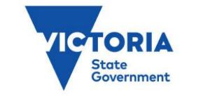

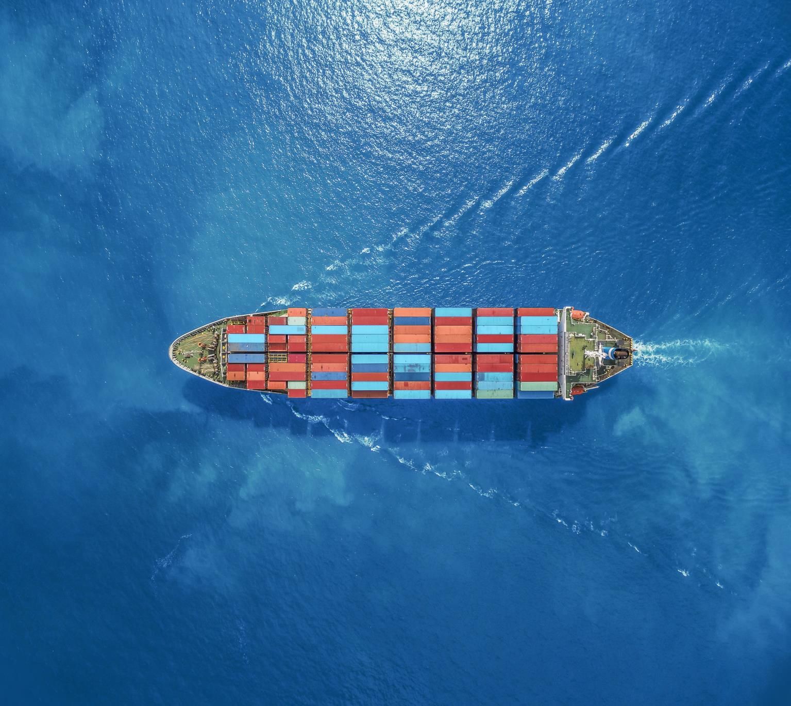

---
## Page 2

  
Page 1 
 
 
 
 
 
 
 
 
 
 
Approved by the State Crisis and Resilience Council 10 October 2024 
Authorised and published by the Victorian Government Melbourne 
October 2024 
© State of Victoria 2024 
You are free to re-use this work under a Creative Commons Attribution 4.0 licence, provided you 
credit the State of Victoria (Department of Transport and Planning) as author, indicate if changes 
were made and comply with the other licence terms. The licence does not apply to any images, 
photographs or branding, including Government logos.  
An electronic version of the Sub-Plan can be obtained at www.emv.vic.gov.au  
ISBN 978-0-7311-9342-4 (pdf/online/MS word) 
 
Acknowledgement of Country 
The Victorian Government acknowledges Aboriginal and Torres Strait Islander people as the 
Traditional Owners and custodians of the land and acknowledge that the land and sea is of spiritual, 
cultural and economic importance to Aboriginal people.

---
## Page 3

  
Page 2 
Contents 
Introduction ______________________________________________________________________ 3 
1.1 
Purpose _______________________________________________________________________4 
1.2 
Scope _________________________________________________________________________4 
1.3 
Objective ______________________________________________________________________5 
1.4 
Authorising environment __________________________________________________________5 
1.5 
Activation of the Sub-Plan ________________________________________________________5 
1.6 
Audience ______________________________________________________________________5 
1.7 
Linkages _______________________________________________________________________5 
1.8 
Review ________________________________________________________________________6 
The emergency context ____________________________________________________________ 7 
2.1 
What is a maritime emergency?____________________________________________________7 
2.2 
Risk profiles ____________________________________________________________________7 
2.3 
Risk mitigation ________________________________________________________________ 15 
Management of maritime  emergencies (NSR) _________________________________________ 20 
3.1 
Victorian governance arrangements ______________________________________________ 20 
3.2 
Key state and national control and coordination roles________________________________ 21 
3.3 
Response and recovery ________________________________________________________ 24 
3.4 
Control ______________________________________________________________________ 32 
3.5 
Communications ______________________________________________________________ 41 
Capability and resource management ________________________________________________ 44 
4.1 
Responsibilities of maritime-sourced oil pollution control agencies _____________________ 44 
4.2 
Capability development ________________________________________________________ 45 
Appendices _____________________________________________________________________ 48 
5.1 
Appendix 1 - Authorising legislation ______________________________________________ 49 
5.2 
Appendix 2 - Victoria’s commercial trading ports ___________________________________ 53 
5.3 
Appendix 3 - Victoria’s local ports ________________________________________________ 54 
5.4 
Appendix 4 - Jurisdictional boundaries and maps ___________________________________ 55 
5.5 
Appendix 5 - Glossary__________________________________________________________ 57 
5.6 
Appendix 6 - Acronyms ________________________________________________________ 63

---
## Page 4

  
Page 3 
 
 
Introduction  
 
 
Complex maritime emergencies (non-search and rescue) are a significant threat to the  
state’s marine environment. The impacts of a major maritime incident could have catastrophic 
consequences to life (including aquatic life), maritime operations, infrastructure, the economy and 
the environment.  
The emergency management arrangements outlined in this plan are crucial to ensure that 
government, industry and community confidence is maintained. Understanding the state’s 
capability is essential for preparedness, planning, response and recovery for a maritime 
emergency.  
 
No single agency has the capacity or resources (including skilled staff) to respond to and manage a 
complex maritime emergency; this will require resource allocation from multiple agencies. 
This subplan exists to ensure collaboration, co-operation and resource sharing is captured and 
agreed to by the stakeholders, and that a response to a complex maritime emergency will be a 
shared responsibility between the agencies. 
 
The Maritime Emergencies (Non-Search and Rescue (NSR)) Sub-Plan of the State Emergency 
Management Plan (SEMP) is developed in accordance with the Emergency Management Act 2013. 
The Sub-Plan also serves the purposes of being the Victorian Marine Pollution Contingency Plan in 
accordance with the Marine (Drug, Alcohol and Pollution Control) Act 1988 (the Act).  
This document is in two parts. 
• Part A is the Maritime Emergencies (NSR) Sub-Plan, which:  
o provides an overview of the high-level arrangements in place for managing maritime 
emergencies in Victoria  
o describes the integrated approach and shared responsibility between state and 
Commonwealth governments (and their departments), agencies, businesses and 
communities 
o refers to national agreements, plans and documents, including the National Plan for Maritime 
Environmental Emergencies (National Plan). 
• Part B is the Maritime Emergencies (NSR) Operational Plan and contains the operational details 
for preparing and planning for, responding to, and recovering from maritime emergencies (Part 
B is not a publicly available document). 
The Sub-Plan applies to maritime emergencies (NSR) including maritime-sourced marine pollution 
which results or may result in a prohibited discharge of oil, oily mixtures, undesirable or hazardous 
and noxious substances (HNS)1 into state waters. 
 
1 Hazardous and noxious substances (HNS) refers to substances defined under the International Protocol on Preparedness, Response and Co-
operation to Pollution Incidents by Hazardous and Noxious Substances, 2000. It includes but is not limited to hazardous materials as defined in the 
State Emergency Management Plan.

---
## Page 5

  
Page 4 
This edition of the Victorian Marine Pollution Contingency Plan (Sub-Plan Part A) is developed, 
coordinated and administered by the Secretary, Department of Transport and Planning (DTP) in 
accordance with Section 71A of the Act.  
This edition has been prepared by DTP, in collaboration with control agencies and stakeholders 
that have Maritime Emergency (NSR) responsibilities.  
1.1 Purpose  
The purpose of this Sub-Plan is to: 
• provide the Victorian Marine Pollution Contingency Plan in accordance with section 71B of the 
Marine (Drug, Alcohol and Pollution Control) Act 1988 to ensure there is adequate planning and 
preparation for maritime-sourced oil pollution incidents (including by providing equipment and 
training personnel) 
• give effect to Victoria’s obligations under the National Plan for Maritime Environmental 
Emergencies and Intergovernmental Agreements 
• provide the State Emergency Management Plan Maritime Emergencies (NSR) Sub-Plan in 
accordance with the Emergency Management Act 2013 
• provide strategic guidance for the effective management of maritime emergencies specifically 
addressing maritime-sourced oil pollution (including oil and hazardous substances) and/or 
maritime casualty (NSR).  
1.2 Scope 
The scope of this Sub-Plan is maritime emergencies that are: 
• maritime-sourced non-hazardous marine pollution by oil, oily mixtures, and undesirable 
substances 
• maritime-sourced marine pollution by hazardous substances 
• maritime casualties (vessels – non search and rescue) 
• wildlife affected by maritime-sourced oil pollution. 
Geographically, this Sub-Plan applies to maritime emergencies (NSR) in Victoria’s embayment’s 
(enclosed waters) and state coastal waters up to 3 nautical miles (NM). It does not include inland 
waters. 
This sub-plan does not cover the following hazards [Indicates responsible agency]: 
• pollution in Commonwealth waters from petroleum titleholders or offshore petroleum facilities 
[National Offshore Petroleum Safety and Environmental Management Authority (NOPSEMA)] 
• cetacean entanglements, strandings or vessel strikes [Department of Energy, Environment and 
Climate Action (DEECA)] 
• blue-green algae [DEECA]2 
• non-hazardous pollution of inland waters [DEECA]3 
• maritime search and rescue and evacuation [Victoria Police (VICPOL)] 
• ship-board fires [Country Fire Authority (CFA) or Fire Rescue Victoria (FRV)] 
• public health [Department of Health (DH)] 
• radioactive materials, biological releases [DH] 
• military ships/vessels [Australian Defence Force (ADF)]. 
 
2 Excluding marine algal blooms (SEMP Critical Task Table 3.1) 
3 In the event that pollution from an inland waterway enters the marine environment, DTP may provide support to the control agency.

---
## Page 6

  
Page 5 
The direct management of these hazards is not within scope of this Sub-Plan, however the control 
and coordination principles may be applied, if the hazard were to occur concurrently, with hazards 
that are under the scope of this Sub-Plan. 
 
1.3 Objective 
The objectives of the subplan are to: 
• ensure an integrated and coordinated approach to Victoria’s management of maritime emergencies 
(NSR) 
• reduce the impact and consequences of maritime emergencies (NSR) on communities, 
infrastructure and services, and the environment. 
1.4 Authorising environment  
This Sub-Plan has been prepared by DTP, on behalf of the Emergency Management Commissioner 
(EMC), and in accordance with: 
• Marine (Drug, Alcohol and Pollution Control) Act 1988 (VIC) 
• Marine Safety Act 2010 (VIC) 
• Part 6A of the Emergency Management Act 2013 (VIC) 
• State Emergency Management Plan (VIC) 
• National Plan for Maritime Environmental Emergencies 2020 Edition (Australian Maritime Safety 
Authority (AMSA)) 
• Intergovernmental Agreement on the National Plan to Combat Pollution of the Sea by Oil and other 
Noxious and Hazardous Substances (2002) (AMSA) 
• Intergovernmental Agreement on the National Maritime Emergency Response Arrangement (2008) 
(AMSA) 
1.5 Activation of the Sub-Plan 
The arrangements in this plan apply on a continuing basis and do not require activation.  
1.6 Audience 
The audience for this Sub-Plan is Victorian Government departments, port management bodies and 
agencies within the emergency management sector who have responsibilities under the Sub-Plan, as 
well as Commonwealth government agencies, supporting businesses, contractors, local government 
authorities and the maritime industry. 
1.7 Linkages  
This Sub-Plan reflects legislation, the arrangements in the SEMP, the strategic direction for emergency 
management in Victoria, accepted state practice for managing emergencies, and the related national 
and international protocols, conventions and arrangements as listed in Appendix 1. 
This subplan should be read in conjunction with: 
• the National Plan for Maritime Environmental Emergencies for incidents involving marine pollution 
including hazardous and noxious substances and maritime casualties 
• the Victorian Marine Search and Rescue Arrangements 
• the Operational Plan (PART B)

---
## Page 7

  
Page 6 
1.8 Review 
The original Edition of the Sub-Plan was authorised and published in 2016 by the former Department of 
Economic Development, Jobs, Transport and Resources (DEDJTR).  
Edition 2 and 3 (this edition) was reviewed and updated by DTP (under Part 6A of the Emergency 
Management Act 2013) and in consultation with maritime emergencies stakeholders and control 
agencies. 
Edition 3 is current at the time of publication and remains in effect until modified, superseded or 
withdrawn by the Secretary, DTP. The Sub-Plan will be reviewed every three years or as agreed by the 
Secretary, DTP.

---
## Page 8

  
Page 7 
The emergency context 
 
2.1 What is a maritime emergency? 
To delineate the roles and responsibilities under this Sub-Plan, maritime emergencies  
are divided into four categories:  
• maritime casualty  
• non-hazardous oil spills from maritime sources (vessels, platforms and offshore facilities) 
• hazardous material spills4 
• wildlife affected by maritime-sourced oil pollution events.  
The possibility of a maritime emergency affecting Victoria arises from oil and gas production, 
commercial shipping, domestic and recreational vessel activity, and naturally occurring events.  
The consequences of major maritime emergencies can include loss of marine habitats and wildlife, 
economic losses due to impacts on commercial shipping, fisheries, aquaculture and tourism, and 
social impacts due to the loss of amenity or access to coastal areas.  
 
2.2 Risk profiles 
2.2.1  Oil and gas industry  
Offshore petroleum production occurs in Commonwealth waters off Victoria in two major 
sedimentary basins: the Gippsland and Otway basins. 
The Gippsland Basin covers an area of 46,000 km2 and has both onshore and offshore 
components (over 60 per cent is located offshore). For more than thirty years, the Gippsland Basin 
has produced natural gas, crude oil and condensate and is a mature petroleum province.   
The Otway Basin also has both onshore and offshore components and produces natural gas and 
condensate. It covers approximately 155,000 km2, with around 80 per cent of the basin being 
located offshore.  
The National Offshore Petroleum Safety and Environmental Management Authority (NOPSEMA) is 
the regulator for health and safety, structural (well) integrity and environmental management for all 
offshore energy operations and greenhouse gas storage activities in Commonwealth waters.  
NOPSEMA also regulates the health and safety and structural integrity of petroleum and 
greenhouse gas storage activities in the coastal waters of Victoria following conferral of state 
powers and functions to NOPSEMA. 
The Department of Energy, Environment and Climate Action (DEECA) is the regulator for 
environmental management for offshore energy operations in Victorian coastal waters. 
Natural gas, crude oil and other production fluids are moved by pipeline, vessel and road transport 
for further processing and/or to service consumers’ needs both locally in Victoria and nationally 
across Australia.  
 
4 The definition of hazardous spills relating to this subplan, are spills of any contaminants or materials that are harmful to human health as outlined in 
the SEMP. Hazardous and Noxious Substance spills (HNS) as defined by the National Plan included ‘hazardous material spills’ and ‘non-hazardous’ 
spills in this Sub-Plan.

---
## Page 9

  
Page 8 
There are a significant number of manned and unmanned platforms and installations in 
Commonwealth waters in Bass Strait, as well as an extensive network of underwater pipelines, 
transporting natural gas, crude oil and other production fluids ashore.  
There is also a substantial amount of infrastructure and wells in Bass Strait that require 
decommissioning. Decommissioning involves the removal of, or satisfactorily dealing with, 
infrastructure from the offshore area that was previously used to support oil and gas operations. 
The figure below shows the scale of decommissioning that is required in Victoria. The 
decommissioning of wells adds another layer of risk of oil spills occurring if the capping of wells 
should fail. 
Figure 1: The scale of today's decommissioning challenge5 
 
 
 
 
 
 
 
 
 
 
 
 
 
2.2.2 Risk of maritime casualty 
Maritime casualty risks arise when a vessel is unable to: 
• independently maintain a safe distance from surrounding navigational hazards (i.e.  coastline, 
outlying islands and reefs, other vessels, offshore structures and channel boundaries) 
• effectively maintain the integrity of its cargo (through fire, explosion or water ingress) and to 
effectively contain its cargo (including any fuel or oil) carried on board. 
Casualty risk may be categorised as: 
• breakdown – failure of equipment essential to the independent navigation of the vessel or the 
maintenance of integrity of its cargo, rendering it in need of external assistance 
• fire or explosion – damage to equipment essential to the independent navigation of the vessel or 
the maintenance of integrity of its cargo, rendering it in need of external assistance 
• collision – two vessels coming together inadvertently causing significant damage to either or 
both 
• stranding/grounding – a vessel inadvertently contacting the seabed and being unable to 
independently free itself 
• allision – a vessel striking a fixed object 
 
5 Decommissioning | NOPSEMA

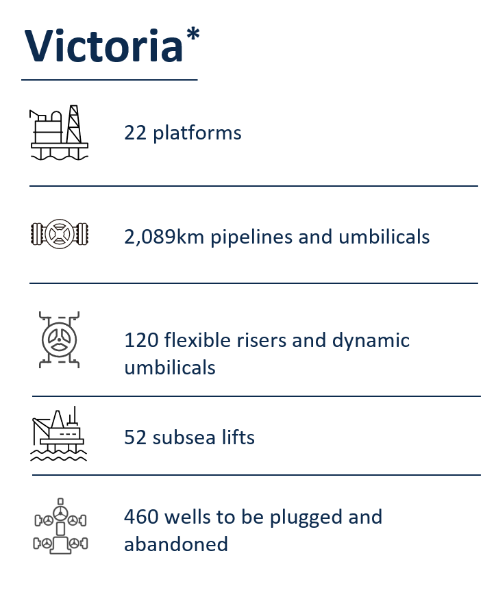

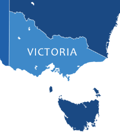

---
## Page 10

  
Page 9 
• loss of stability of vessel - a vessel floundering due to angle of loll 
• cyber-attack – shipping-related operational, safety or security failure as a consequence of 
information or systems being corrupted, lost or compromised, leading to a maritime casualty. 
The risk of maritime casualty is greatest due to vessel disablement, groundings and collisions. The 
consequences of a ship maritime casualty may include loss of life, the ship, its cargo or fuel, and 
may potentially cause marine pollution.  
 
Shipping activity 
Australia relies heavily on commercial shipping activities, both nationally and internationally for the 
importing and exporting of goods. Victoria’s port infrastructure plays a vital role in national, state 
and local supply chains of critical goods and services to all sectors. 
In 2020–21, the value of Australia’s maritime exports was $354.8 billion, with 516.1 million tonnes 
of goods being exported from Australia by sea. Australia also imported 97.1 million tonnes of 
goods, worth $246.6 billion by sea, in the same period. Victoria receives on average 4,000 port 
calls from cargo ships each year, loading and discharging more than 56 million tonnes of freight6.  
The density (and therefore risk) of ship traffic in Victoria is greatest at the commercial ports (profiled 
in Appendix 2). Other areas of concentrated vessel activity include the approaches to Port Phillip 
and the waters off Wilsons Promontory. Table 1 is a summary of notable maritime incidents in 
Victoria over recent years. 
 
Table 1. Notable maritime incidents in Victoria7 
Year 
Vessel 
Incident 
Type 
Incident details 
Location 
Outcome 
2017 
Norwegian 
Star 
Casualty 
Loss of propulsion on passenger 
cruise ship Norwegian Star 
Bass Strait, 22 
NM SW of 
Cape Liptrap 
Tugs were deployed and 
towed the ship back to 
Melbourne 
2018 
MV Tomar 
/MV CPO 
Jacksonville 
Near miss 
(collision) 
Navigational occurrence 
South Channel, 
Port Phillip 
The ships passed each 
other about 130 m apart 
2020 
MV Florida 
Highway 
Breakaway 
from berth 
Several lines parted from wharf in 
wind, ship rotated from berth 
Webb Dock 
Anchors dropped, tug 
assistance to re-berth 
Jan 
2023 
Lady Cutler 
Collision 
Passenger vessels bow came 
into heavy contact with wharf  
Yanonung 
Quay, 
Docklands 
19 Passengers minor 
injuries, damage to 
vessel bow and wharf 
Sept 
2023 
Kariyushi 
Leader 
Casualty 
Loss of steering. Two Emergency 
Towage Vessels (ETV) 
unsuccessful providing assist. 
Bass Strait, 
drifting towards 
Wilsons Prom  
Helicopter of parts to 
vessel 
Oct 
2023 
PV Corsair 
Collision 
Search and Rescue (SAR), 
vessel broke up after collision 
with rocks 
Point Lonsdale 
Multi agency water and 
shoreline clean-up 
response 
2024 
Bougainville 
Casualty 
Loss of propellor 
off Seal Rocks 
Phillip Island 
Tug to safe anchorage 
 
The Australian Maritime Safety Authority (AMSA) has a national incident reporting system for 
marine incidents. Since 2018 there has been an increasing annual trend of incident reporting to 
 
6 Australian sea freight 2020–21, BITRE 2023 
7 Chief Investigator Transport Safety – Marine incident reports

---
## Page 11

  
Page 10 
AMSA. However, there still appears to be an under reporting of incidents of particular vessel types, 
namely Domestic Commercial Vessel (DCV) fishing vessels and DCV hire & drive vessels. 
 
Domestic Commercial Vessel marine incidents 
There are approximately 22,000 active DCVs operating in Australia. Around 8.6 per cent of the 
vessels are located and operate from Victoria. 
In 2022 AMSA received a total of 1,054 reports of marine incidents involving DCVs nationally, 
which is an increase of 11.5 per cent from 2021 and represents a 41.5 per cent increase in the 
annual number of incident reports from DCVs since 2019. Around 63 of the reported incidents 
occurred in Victoria8. 
 
Regulated Australian Vessels and Foreign Flagged vessel marine incidents 
In 2022 AMSA received a total of 4,105 reports of marine incidents from Regulated Australian 
Vessels (RAV) and Foreign Flagged (FF) vessels. FF bulk carrier ships are highly represented in 
marine incident reports, see Figure 2. 
 
The statistics provided in figure 2 show an increase in incidents involving FF and RAVs. Data shows 
an overall increasing frequency of failure of ship systems and equipment since 2020, which is 
reflected in the number of near miss incidents in Victoria, and anecdotal information from 
stakeholders. The reasons for the increase in mechanical failures is unclear. 
 
Figure 2. Reported marine incidents, all vessels, by year (2018 – 2022)9 
 
 
 
Recreational vessel activity  
Victoria now has over 200,000 registered recreational vessels. The majority of vessels are highly 
mobile (trailable) and 96 per cent are vessels less than eight metres.  
 
8 https://www.amsa.gov.au/marine-incident-annual-report-2022/domestic-commercial-vessels 
9 Summary of marine incidents in 2022 | Australian Maritime Safety Authority (amsa.gov.au)

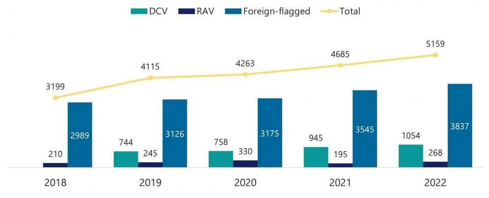

---
## Page 12

  
Page 11 
Recreational vessels also pose a risk of maritime casualty. Although the consequences may not be 
as severe as a ship casualty, they occur more frequently and can have similar consequences of 
loss of life, the vessel and impacts of a fuel spill on a local scale.  
Victoria has 14 local ports with eight local port managers (Appendix 3). Local ports provide 
services to the oil and gas industry, commercial fishing industry, charter boats, and recreational 
fishing and boating interests. The ports are key recreational and tourist assets and contribute 
significantly to local and state economies. Recreational boating is supported by Safe Transport 
Victoria and Better Boating Victoria. 
The number of reported recreational vessel incidents has been relatively constant over the past 
decade. The number of incidents for the 2022/23 financial year was 1,17110. 
 
2.2.3 Risk of marine oil pollution 
Marine oil pollution spills may occur as consequence of a maritime casualty, bunkering operations, 
oil and gas production activities (including well decommissioning), ship to ship transfers, and illegal 
dumping from ships. Natural hydrocarbon seepage from offshore basins is possible but is 
considered rare in Australia. 
A comprehensive marine pollution risk assessment conducted in 2011 found the highest risk in the 
areas of Port Phillip and Western Port bays due to the amount of shipping activity and the proximity 
of sensitive marine environments (Figure 3).  
Figure 3. Distribution of marine pollution risk on the Victorian coastline from a 2011 assessment is still relevant today. 
 
 
The Port of Melbourne: Historical Trade Trends Report 202211 shows that total imports and exports 
from the port have steadily increased over the past decade and indicates that Port Phillip and 
Western Port bays remain the highest risk areas for marine pollution incidents (illustrated in Figure 
4).  
 
 
10 ST Vic Annual Report 2022-23 
11 https://www.portofmelbourne.com/about-us/trade-statistics/historical-trade-data/

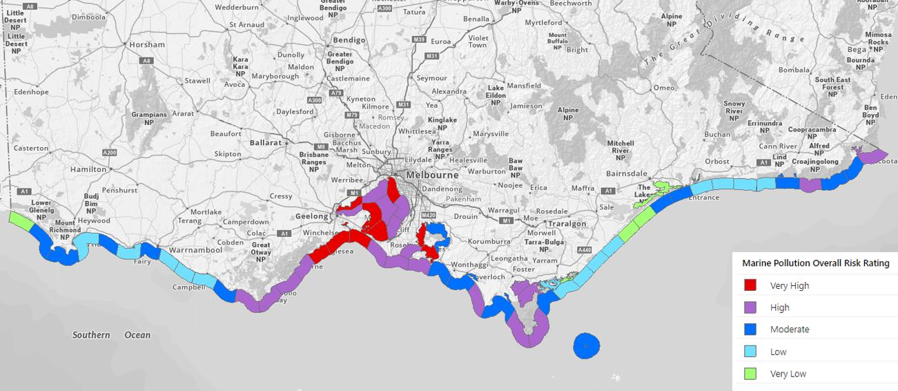

---
## Page 13

  
Page 12 
Figure 4. Vessel traffic density map for the Victorian coast and offshore 2022 
Lowest density purple, grading to highest density in red - 2022. (Source: Marine Traffic www.marinetraffic.com) 
 
There has also been an increase in the size of ships and the volumes and type of cargo and fuel 
that they carry.  
Table 2 shows the history of significant oil spills in Australia causing environmental or economic 
losses over the last 50 years. 
The consequences of a major marine pollution event include devastating impacts on marine and 
shore habitats, amenities, cultural heritage areas, vulnerable and threatened species. 
Consequences would be compounded by the potential significant economic impact that would be 
caused by disruptions to shipping to and from the commercial ports of Melbourne and Geelong12, 
along with disruptions to state and national supply chains.  
 
 
 
 
 
 
 
 
 
 
 
 
 
12 EMV – VERA report

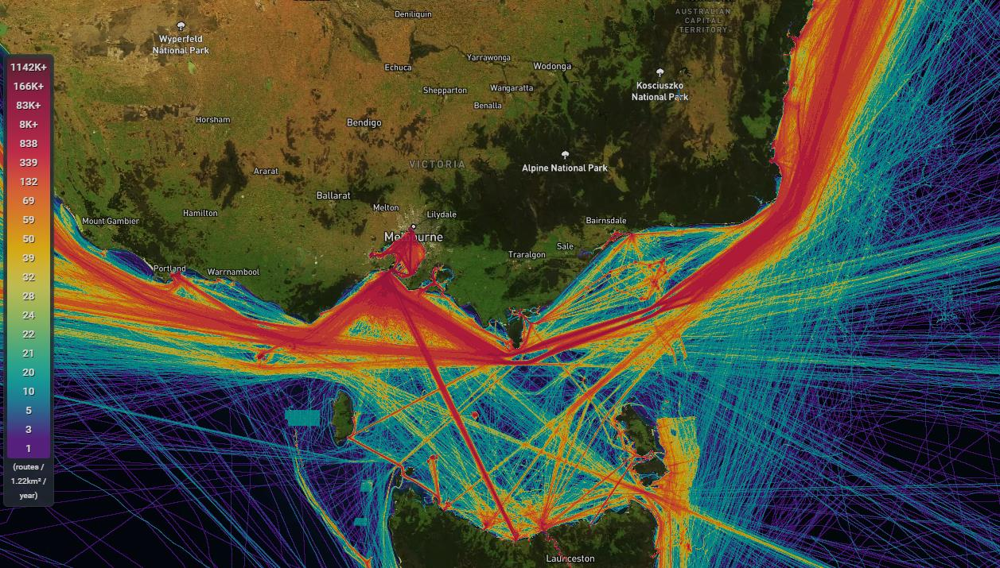

---
## Page 14

  
Page 13 
Table 2. History of significant or major oil spills in or near Australian waters13 
Date 
Vessel 
Location 
Oil amount 
03 March 1970 
Oceanic Grandeur 
Torres Strait, QLD 
1,100 tonnes 
26 May 1974 
Sygna 
Newcastle, NSW 
700 tonnes 
14 July 1975 
Princess Anne Marie 
Offshore, WA 
14,800 tonnes 
10 September 1979 
World Encouragement 
Botany Bay, NSW 
95 tonnes 
29 October 1981 
Anro Asia 
Bribie Island, QLD 
100 tonnes 
22 January 1982 
Esso Gippsland 
Port Stanvac, SA 
unknown 
03 December 1987 
Nella Dan  
Macquarie Island 
125 tonnes 
06 February 1988 
Sir Alexander Glen 
Port Walcott, WA 
450 tonnes 
20 May 1988 
Korean Star 
Cape Cuvier, WA 
600 tonnes 
28 July 1988 
Al Qurain 
Portland, VIC 
184 tonnes 
21 May 1990 
Arthur Phillip 
Cape Otway, VIC 
unknown 
14 February 1991 
Sanko Harvest 
Esperance, WA 
700 tonnes 
21 July 1991 
Kirki 
WA 
17,280 tonnes 
30 August 1992 
Era 
Port Bonython, SA 
300 tonnes 
10 July 1995 
Iron Baron 
Hebe Reef, TAS 
325 tonnes 
28 June 1999 
Mobil Refinery 
Port Stanvac, SA 
230 tonnes 
26 July 1999 
MV Torungen 
Varanus Island, WA 
25 tonnes 
03 August 1999   
Laura D’Amato 
Sydney, NSW 
250 tonnes 
18 December 1999 
Sylvan Arrow 
Wilson's Promontory, VIC 
less than 2 tonnes 
02 September 2001 
Pax Phoenix 
Holbourne Island, QLD 
less than 1000 litres 
25 December 2002 
Pacific Quest 
Border Island, QLD 
greater than 70 km slick 
24 January 2006 
Global Peace 
Gladstone, QLD 
25 tonnes 
11 March 2009 
Pacific Adventurer 
Cape Moreton, QLD 
270 tonnes 
21 August 2009 
Montara Wellhead oil platform 
NW Australian coast 
Approx 4,750 tonnes 
03 April 2010 
Shen Neng 1 
Great Keppel Island, QLD 
4 tonnes 
09 January 2012 
MV Tycoon 
Christmas Island 
102 tonnes 
March 2014 
Unknown source 
Golden Beach, VIC 
unknown 
 
2.2.4 Risk of hazardous materials spills 
Hazardous materials spills may occur as the result of a maritime casualty, accidents occurring 
during loading or unloading, or as illegal discharges at sea. Sections 2.2.2-3 ‘Risk of maritime 
casualty and marine oil pollution’ are also relevant to the risk of hazardous material spills occurring. 
Packaged hazardous materials are carried on container ships in special storage tanks, housed 
within a 20-foot ISO container-sized frame, or stored in drums and loaded into standard shipping 
containers. If these containers become dislodged during transit, they may break open and leak, or 
entire containers may be lost overboard. Containers, drums or other packages containing 
chemicals occasionally wash up on shore, posing a potential risk to the public and environment. 
When highly reactive chemicals are allowed to mix with water, air or other chemicals, there is the 
potential for violent reactions, explosions, fires or release of toxic vapours to occur. The 
consequences to the safety of the ship, its personnel and the public may be severe, even though 
there may be little risk to the environment from such a spill. 
 
13 AMSA – Major historical incidents data

---
## Page 15

  
Page 14 
International safety standards govern the stowage and segregation of hazardous materials to 
reduce the risk of chemicals interacting while stored on board vessels. Accredited training is also 
available to crew and shoreline personnel in the handling of hazardous materials. 
Part B provides further details on the control and response to hazardous materials incidents. 
 
2.2.5 Changing Fuel Types 
In response to climate change and the requirement to reduce global Greenhouse Gas (GHG) 
emissions, the shipping industry is moving to reduce emissions across international shipping by at 
least 40 per cent (compared to 2008 levels) by 2030 and net-zero emissions by, or around 205014.   
On 1 January 2020, all ships and vessels operating anywhere in the world were required reduce 
their emissions of sulphur oxide (SOx) by either using fuel oil with a maximum sulphur content of 0.5 
per cent m/m or installing an approved exhaust gas cleaning system.  
Alternative fuel technology uptake in the maritime industry is increasing (Figure 5), with half the 
ordered tonnage capable of using Liquefied Petroleum Gas (LPG), Unleaded Petroleum (ULP), or 
methanol in dual-fuel engines, compared to one third of the tonnage on order in 2022.15 Alternative 
fuels will require significantly different response capabilities and recovery strategies, compared to 
those used for oil fuels. 
Figure 5. Alternative fuel uptake in the world fleet by gross tonnage. 
 
 
 
 
 
 
 
 
 
2.2.6 Wildlife affected by oil and hazardous materials 
DEECA is the lead agency for responding to wildlife impacted by marine and freshwater pollution.  
In the event of an oil or hazardous materials marine pollution emergency, large numbers of wildlife, 
particularly seabirds and marine mammals may be affected. Threatened species and marine 
ecosystems could also be impacted.  
Risks are greatest at breeding and feeding locations such as coastal wetlands, mudflats and 
offshore islands (some examples include the Ramsar listed areas of Port Phillip, Gippsland Lakes, 
Western Port and Corner Inlet, Phillip Island, Lady Julia Percy Island, Gabo Island and Logans 
Beach whale nursery). 
 
14 2023 International Maritime Organisation GHG Strategy 
15 https://www.dnv.com/maritime/publications/maritime-forecast-2023/download-the-report/

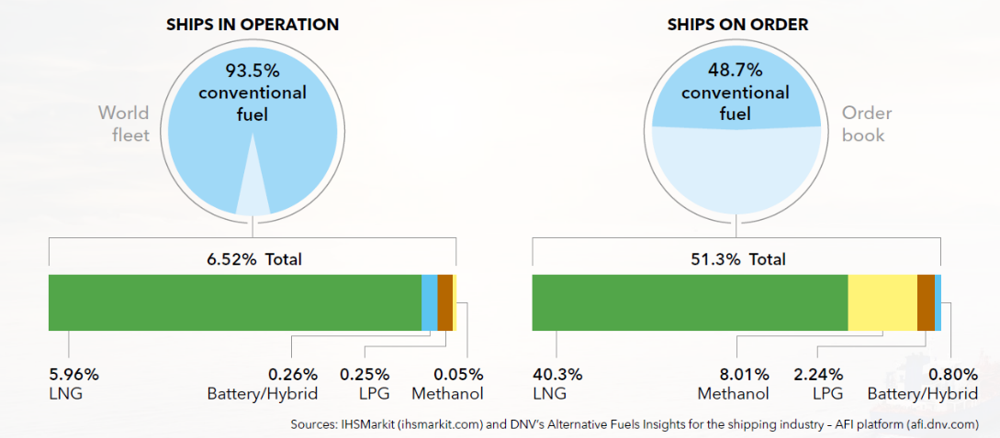

---
## Page 16

  
Page 15 
DEECA, with support from partner agencies (such as Parks Victoria and Phillip Island Nature Park), 
will assess the welfare needs of wildlife during an emergency and determine and lead wildlife 
response activities.   
2.3 Risk mitigation 
Maritime emergencies are classified as a Class 2 Emergency under the Emergency Management 
Act 2013.  
The relevant control agency works with the EMC, Emergency Management Victoria (EMV), other 
government agencies, industry, and the community to reduce and mitigate the consequences of a 
maritime emergency on the community. 
Mitigation of maritime emergency risk is largely achieved through industry construction standards, 
legislation and regulation. The Marine Safety Act 2010 provides for safe navigation rules, port 
operations procedures and maritime qualification requirements, such as local knowledge 
certificates and recreational vessel licensing. These involve state, national, and international rules, 
agreements and arrangements (Appendix 1). The application of agreements and arrangements to 
mitigate maritime emergency risk, is largely beyond the scope of this Sub-Plan.  
 
 
 
 
 
 
 
 
 
 
 
 
 
 
 
 
 
 
2.3.1 Industry Standards 
A range of international conventions exist to provide standards and measures which help prevent 
maritime emergencies. Australia is signatory to the International Maritime Organisation’s (IMO) 
International Convention for the Prevention of Pollution from Ships 1973 and International 
Convention on Oil Pollution Preparedness, Response and Cooperation. Further information on 
international conventions can be found in Appendix 1. 
PV Corsair – October 2023 
Maritime Casualty/Shoreline response – Point Lonsdale 
The vessel broke up after colliding with rocks, causing 
minor disruption to shipping activity and complete loss 
of vessel. A multi-agency shoreline clean-up was 
initiated to remove vessel debris from shorelines and 
prevent redistribution to more sensitive areas.

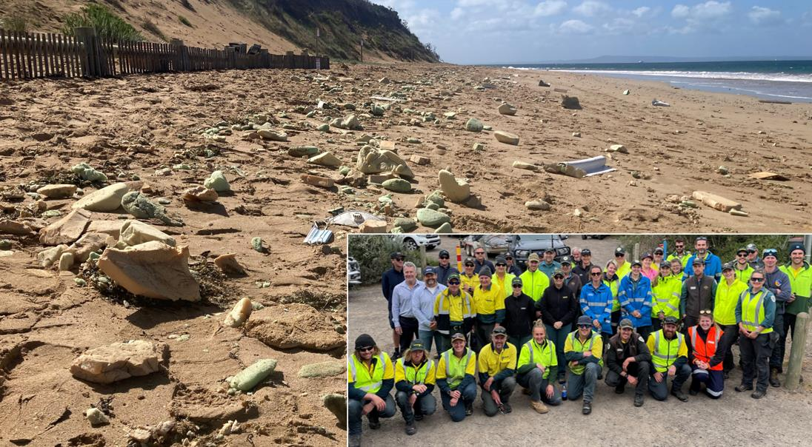

---
## Page 17

  
Page 16 
The AMSA National System for Domestic Commercial Vessel Safety provides a consistent 
approach to safety for owners, operators, and crew of commercial vessels working in Australia and 
has been designed to improve marine safety and make it easier for seafarers and their vessels to 
work around Australia. The national system ensures commercial vessels working in Australia have a 
certificate of survey and a certificate of operation. Crew working on commercial vessels should also 
have a certificate of competency and a local knowledge certificate in certain waterways. 
 
2.3.2 Safe navigation  
Vessel traffic services 
In accordance with international conventions, AMSA issues Vessel Traffic Services (VTS) 
‘Instruments of Authority’ to approved providers to manage, operate and coordinate vessel 
movements.  
VTS services contribute to safety of life at sea, the safety and efficiency of vessel navigation, and 
the protection of the marine environment, the adjacent shore area and worksites from possible 
adverse effects of maritime traffic. 
 
Harbour Masters 
Harbour Masters are appointed within commercial or local ports and control all shipping 
movements within their port waters. Under the Marine Safety Act 2010 the Harbour Master’s main 
functions are to control and direct:  
• vessels entering and leaving the waters for which they have been engaged 
• the navigation and other movement of vessels in those waters 
• the position where and the manner in which any vessel may anchor or be secured in those waters 
• the time and manner of the taking in or discharging from any vessel of cargo, stores, fuel, fresh 
water and water ballast in those waters 
• the securing or removal of any vessel in those waters in, from or to any position the harbour master 
thinks fit 
• any other thing for or with respect to the management of the operation of vessels in the waters for 
which the harbour master has been engaged. 
Where Harbour Masters are appointed in commercial or local ports, they have the powers to 
prohibit the entry to (or require removal of a vessel from) waters under their control if they believe it 
is:  
• is unseaworthy, or 
• in imminent danger of sinking and causing an obstruction to navigation, or 
• in imminent danger of causing serious damage to the marine environment or property in those 
waters. 
 
Pilotage 
The Marine Safety Act 2010 sets out pilotage requirements for vessels over 35m LOA (length 
overall). It also allows Safe Transport Victoria to specify areas where the master of a vessel requires 
a local knowledge certificate. This applies to locations where it is considered local conditions 
provide a sufficient risk to vessel operations.

---
## Page 18

  
Page 17 
Navigation channel maintenance 
Hydrographic surveys can be undertaken periodically to monitor channel cross sections, including 
the depth in existing ports and harbours, and any navigational hazards. These surveys inform 
periodical maintenance, issuing of Notices to Mariners and allows for the safe navigation of vessels. 
 
2.3.3 Planning and regulation 
Workplace safety 
Workplace safety in and around ships is primarily regulated by the Victorian Workcover Authority 
(WorkSafe Victoria), Safe Transport Victoria and AMSA. The Marine Safety Act 2010 promotes safe 
marine operations in Victoria by introducing marine safety duties, creating a ‘chain of responsibility’ 
for all parties who have a role in ensuring safety, and providing a framework to ensure vessels are 
fit for purpose and those who operate them have the skills to do so safely. 
 
Environmental duty 
The general environmental duty (GED) is at the centre of the Environment Protection Act 2017, and it 
applies to all Victorians, and all businesses located in Victoria. The GED makes it clear that businesses 
have a responsibility to reduce risk to human health and the environment. The Act focuses on 
preventing waste and pollution, rather than managing impacts after they occur. The GED is criminally 
enforceable. 
 
Port Safety and Environment Management Plans  
The Port Management Act 1995 requires all local and commercial ports to prepare a Port Safety 
and Environment Management Plan (PortSEMP). PortSEMPs facilitate a whole-of-port approach to 
hazard and risk management, particularly for the interface between land and water in ports. 
 
 
Port Emergency Management Plans 
Certain ports, particularly commercial ports, prepare Port Emergency Management Plans which 
detail arrangements to achieve preparedness for, response to, and recovery from emergencies that 
could occur within the port. The plans are integrated with national, state and local (municipal) 
emergency management arrangements. 
 
2.3.4 Assets and capability 
Equipment 
Victoria maintains marine pollution response equipment stockpiles in strategic locations around the 
state, in accordance with response type and needs, with a focus on areas identified as high risk. 
Further details on stockpile locations are in the Operational Plan (Part B). 
Victoria’s commercial port operators have emergency maritime-sourced oil pollution response 
equipment on standby. Further state-owned equipment stockpiles are located along the Victorian 
coast. Additional equipment is available through the National Plan arrangements.  
Under National Plan arrangements there is one contracted Emergency Towage Vessel (ETV) based 
in Geelong. Additional harbour tugs and vessels of opportunity may be made available to assist with

---
## Page 19

  
Page 18 
maritime casualty (NSR) response. ETV capability is privately owned and operated. It is usually 
activated through commercial arrangements between the vessel owner and the ETV operator. 
 
The ability to respond to a maritime casualty in open waters is reliant on the availability and 
capability of an ETV to handle the larger and heavier ships being used, and the often severe sea 
conditions they are required to work in.  
 
Personnel 
The Emergency Management Act 2013 requires control agencies to maintain a trained, ready and 
capable emergency management surge workforce that is available to respond to an emergency 
event. This is supported by resources available through intergovernmental agreements and support 
arrangements as outlined in the SEMP (see section 4 for further information). 
 
2.3.5 Shared responsibility for action 
Each member of the community has a role to play in the maritime emergency continuum (before, 
during and after an incident).  
An example of an individual’s responsibilities within the maritime emergencies’ context, includes 
owners and masters of vessels taking responsibility for their vessel: 
• ensuring it is seaworthy  
• having appropriate safety systems in place  
• having an emergency plan 
• adhering to maritime laws, guidelines and protocols.  
 
For government agencies, businesses and industry, shared responsibility includes: 
• marine safety awareness programs 
• applying risk-based regulation 
• creating partnerships with industry to build capability and capacity 
• ensuring an effective, well-coordinated response to emergencies 
• helping communities affected by maritime emergencies to recover and build resilience for future 
events. 
The principles of shared responsibly are listed in the Marine Safety Act 2010 which outlines that marine 
safety is the shared responsibility of:  
a. owners of vessels; and 
b. marine safety workers; and 
c. persons involved in recreational boating activities; and 
d. pilots and pilotage services providers; and 
e. port management bodies, the port of Melbourne operator, local port managers and waterway 
managers; and 
f. 
other persons who:  
 
i. design, commission, construct, manufacture, supply, install, maintain, repair or modify marine 
safety infrastructure, vessels or marine safety equipment; and 
 
ii. supply marine safety infrastructure operations to port management bodies; and 
g.  Safe Transport Victoria; and 
h.  the public.

---
## Page 20

  
Page 19 
The level and nature of responsibility that ‘a person’ referred to above has for marine safety is 
dependent on the nature of the risk to marine safety that the person creates from the carrying out 
of an activity (or the making of a decision) and the capacity that person has to control, eliminate or 
mitigate that risk. 
General information on safe recreational boating can be found on the Safe Transport Victoria's 
Website. 
The concept of ‘shared responsibility’ also recognises that some people and communities may be 
disproportionally affected and/or at greater risk in emergencies, based on factors like: 
• the type and extent of the emergency 
• the situational and consequential factors 
• other changing and variable circumstances. 
The Victorian Emergency Management Planning Toolkit for People Most at Risk is a resource for all 
emergency management practitioners to use in considering and planning for the needs of groups of 
people and communities most at risk in emergencies. 
 
Shared responsibility for managing and protecting Aboriginal cultural heritage  
The Victorian Government, and the agencies/organisations named in this Sub-Plan, acknowledge 
Aboriginal people as Australia’s first people, and as the Traditional Owners and custodians of the 
land.  
Aboriginal and Torres Strait Islander people have a deeply spiritual, cultural and economic 
connection to the land and sea, which is reflected the Marine and Coastal Policy March 2020. 
Aboriginal cultural heritage can be vulnerable to maritime emergencies, and it is important to that 
the planning and preparing phases for maritime emergencies considers the impact on Aboriginal 
heritage places. Emergency response activities should work to protect, preserve and minimise 
disruption to Aboriginal cultural heritage.  
It is recommended that relevant Traditional Owners be included in all phases of emergency 
management, including through direct participation in incident management teams (IMT) and that 
regional/local response plans should have pre-identified relevant Traditional Owner contacts and 
relationships well established, prior to an emergency incident occurring. Registered Aboriginal 
Parties can be found via https://www.aboriginalheritagecouncil.vic.gov.au/victorias-current-
registered-aboriginal-parties  
Where a Registered Aboriginal Party has not been appointed, advice on relevant Traditional Owner 
contacts can be provided by First Peoples State Relations.

---
## Page 21

  
Page 20 
Management of maritime  
emergencies (NSR)  
 
3.1 Victorian governance arrangements 
Victoria has an extensive set of legislation and plans that govern national, state and local responses 
to maritime emergencies, these are summarised in Appendix 1. The implementation of the 
legislation is supported by port directions, memoranda of understanding and emergency 
management standards and systems that operate across the Victorian emergency management 
sector.  
The State Crisis and Resilience Council (SCRC) is responsible for approving Part A of this Sub-Plan 
as the SEMP Maritime Emergencies (NSR) Sub-Plan. 
There are a number of working and consultative groups that provide oversight and expert advice 
regarding maritime emergencies in Victoria.  
 
3.1.1 State Maritime Emergencies Working Group (SMEWG) 
The State Maritime Emergencies Working Group (SMEWG) is a working group that focuses on 
stakeholder collaboration and strategic planning and preparedness for maritime emergencies.  
The SMEWG is the primary forum for coordinated development and implementation of 
preparedness and response activities in Victoria. 
 
3.1.2 Environmental, Scientific and Technical Reference Group  
The Environmental, Scientific and Technical Reference Group (ESTRG) supports the SMEWG by 
providing specialist environmental, scientific and technical advice relating to the implementation of 
the Maritime Emergencies (NSR) Sub-Plan. The ESTRG is supported by a secretariat provided by 
DTP. 
Matters can be referred to the reference group by any of the Regional Reference Groups or the 
SMEWG. 
 
3.1.3 Regional Maritime Emergency Reference Groups (RMERG) 
To support the arrangements specified in this Sub-Plan, the control agency for each jurisdictional 
area for maritime emergencies (refer Appendix 4) is required to coordinate and oversee the 
administration and management of a RMERG. 
Each RMERG will ensure linkages are in place with Municipal or Regional Emergency Management 
Planning Committees (REMPC) to share information and to contribute to the Community 
Emergency Risk Assessment (CERA) process. 
The Chairs of each of the RMERGs are standing members of the working group of the SMEWG.  
Each RMERG is responsible for providing advice and regular updates to SMEWG relating to their 
capability and capacity and regional risk. They will also ensure their procedures related to this Sub-
Plan include, but are not limited to, points of access, egress, equipment locations and 
communications arrangements.

---
## Page 22

  
Page 21 
 
3.1.4 Port Management Consultative Groups 
Ports often have consultative groups which come together to collaborate on and share port wide 
improvement opportunities in health, safety, emergency, environment and sustainability matters. 
Consultative groups can be made of representatives from emergency service agencies, users of 
the port, local government or other agencies with linkages to the use of Ports. 
These groups can play an advisory role to the SMEWG and can also escalate issues or risks to a 
state level via the SMEWG.  
Where agreed with DTP, a port management consultative group may substitute as an RMERG 
regarding the governance arrangements in this Sub-Plan. 
 
3.2 Key state and national control and coordination roles 
 
3.2.1 Role of the Emergency Management Commissioner  
Maritime emergencies can be particularly complex and require coordination across several control 
agencies before, during and after the event. 
The EMC is responsible for ensuring effective control arrangements are in place, before, during and 
after maritime emergencies (see SEMP for full description of the EMCs role). 
 
3.2.2 State Controller Maritime Emergencies  
The National Plan requires Victoria to appoint a single point of contact for this Sub-Plan, for the 
purposes of being the Victorian Marine Pollution Contingency Plan. This Sub-Plan provides for the 
single point of contact to be undertaken by the State Controller Maritime Emergencies (SCME).  
The Secretary, DTP has delegated the powers and functions under the Marine (Drug, Alcohol and 
Pollution Control) Act (sections 38, 39, 71A and 71B) to DTP officers to perform the role of the 
SCME, and the Victorian delegate on the relevant National Plan advisory committee. The SCME is 
also responsible for authorising the activation of the National Plan resources through AMSA, 
including trained personnel, specialist equipment, trajectory modelling and the fixed wing aerial 
dispersant capability (see Section 4.1.2).  
 
3.2.3 Class 2 Emergency - State Controller  
The State Controller (SC) leads the operational response to a Class 2 emergency and establishes an 
appropriate management structure for the emergency (see the SEMP for full description of the SC 
Class 2 emergencies role). In the event of a large or complex emergency, the Secretary, DTP may 
appoint other officer(s) to have the responsibility for the functions of the SC.  
 
Appropriately qualified senior officers within other agencies such as FRV, CFA, DEECA or Parks 
Victoria may also be appointed to perform the role of SC by the Secretary, DTP.

---
## Page 23

  
Page 22 
3.2.4 Role of the Maritime Emergency Response Commander  
The Maritime Emergency Response Commander (MERCOM) is appointed by AMSA and is 
supported by statutory powers under the Protection of the Sea (Powers of Intervention) Act 1981. 
The MERCOM has powers to intervene and exercise final decision making, on behalf of the 
Australian Government, when the MERCOM assesses that a maritime casualty poses a significant 
threat of pollution.  
During any emergency, the SCME or EMC may request assistance from AMSA or that AMSA 
manage the incident on their behalf.  
In doing so, the MERCOM will consider the views of the SCME and the EMC. This includes 
community views about economic, environmental, community and social interests that could be 
impacted by the MERCOM’s decisions. For example, in determining a place of refuge for a maritime 
casualty consideration would be given to the risks to the local coastal environment and/or 
economy. 
The MERCOM’s decisions will be expeditiously communicated to all relevant stakeholder groups 
and fully documented. 
The MERCOM will not respond to maritime casualties within ports or involving vessels under Safety 
of Life at Sea (SOLAS) limits, except where an assessment is made that there is a significant threat 
of marine pollution and that adequate measures are not being taken. 
The key powers of the MERCOM to intervene and direct include: 
• taking of action in relation to the casualty vessel in accordance with paragraphs 8(2)(a), 9(2)(a) or 
10(2)(a) of the Protection of the Sea (Powers of Intervention) Act 1981 depending on the nature of 
the incident and geographical location of the incident (e.g. moving the ship or cargo, salvage the 
ship or cargo, take control of the ship, etc.) 
• issuing directions of the kind authorised by section 11 of the Protection of the Sea (Powers of 
Intervention) Act 1981 in accordance with paragraphs 8(2)(b), 9(2)(b) or 10(2)(b) of the Act 
depending on the nature of the incident and geographical location of the incident (e.g. directing the 
owner, master, salvor or any other third party, etc.) 
• having the authority to take any action deemed necessary with regard to assessing and granting 
Place of Refuge requests in internal or coastal waters. 
 
3.2.5 Role of coordination 
The EMC is responsible for the coordination of activities of agencies and is supported to undertake 
this role by Victoria Police (as outlined in the SEMP). In the event of a maritime emergency, the 
incident or state controller will liaise with Regional Emergency Response Coordinator (RERC) 
regarding the emergency. 
The RERC will then contact the IC/SCME to assure themself that: 
• appropriate resources are at the disposal of the IC/SCME and  
• appropriate agencies are notified and engaged in the response.  
A part of the RERC role is to provide an assurance function through the Senior Police Liaison 
Officer (SPLO), who provides information to the EMC as to whether control is being exercised 
effectively and that all appropriate agencies are engaged.  
If during an incident, a control agency is not identified, the RERC will nominate an agency with 
suitable capabilities to assume control until determined otherwise by the SCME.

---
## Page 24

  
Page 23 
In the case of a major or complex emergency (Level 2 or 3) involving several control agencies, it is 
the responsibility of the Incident Controller (IC)/SC, in consultation with the RERC/SCME to 
establish the Incident Management Team (IMT) and a maritime Emergency Management Team 
(EMT). The composition of the EMT should consider the type of emergency, location, potential 
consequences and the support/specialist advice required to resolve it. Further information on 
specialist support and advice is outlined in Part B of the Sub-Plan. 
For all Level 2 and 3 Incidents the RERC will be involved in the EMT to provide the coordination 
function. 
The process for the appointment of ICs is addressed in section 3.4.7 of the subplan. 
 
 
 
 
 
 
 
 
 
 
 
 
 
 
 
 
 
 
 
 
 
 
 
 
 
 
 
 
 
Kariyushi Leader – 6 September 2023 
Maritime Casualty - Bass Strait Victoria 
Vessel lost all steering and drifted for approx. 72 
hours. Two emergency towage vessels  were 
unsuccessful in providing assistance in severe 
weather and >6m swells. Vessel was 7 hours from 
a possible grounding near Wilsons Promontory 
when one steering motor was repaired.

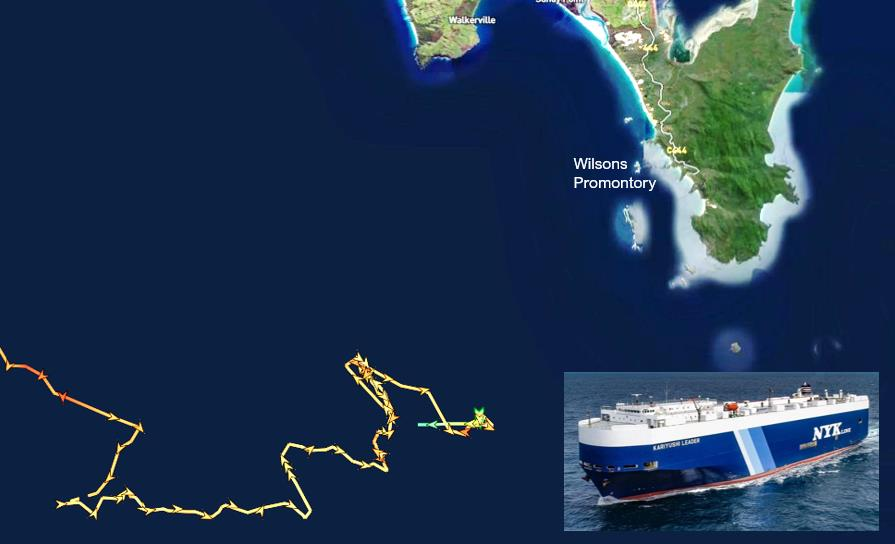

---
## Page 25

  
Page 24 
3.3 Response and recovery 
3.3.1 State emergency management priorities 
The State Emergency Management Priorities underpin and guide all decisions during a response to 
any emergency. (Table 3).  
 
Table 3. State emergency management priorities for managing emergencies. 
State Emergency Management Priorities 
How this applies to Maritime Emergencies 
Protection and preservation of life and relief 
of suffering is paramount. 
This includes: 
- safety of emergency response personnel 
and 
- safety of community members including 
those most at risk in emergencies, residents 
and visitors/tourists. 
Risk assessment principles will be undertaken to ensure that 
appropriate Work Health and Safety (WHS) systems are in place to 
protect emergency responders, as well as offshore and maritime 
workers during an incident. WHS procedures for maritime 
emergencies should be followed.  
The search for and rescue of any vessel occupants and their safety 
during an incident is paramount to all other maritime operations.  
Members of the community need to be appropriately informed and 
exclusion zones should be established and maintained around 
hazardous areas. 
Issuing of community information and 
community warnings detailing incident 
information that is timely, relevant, accessible 
and tailored to assist community members 
make informed decisions about their safety. 
Appropriate and accessible information and warnings should be 
issued as soon as possible and should include tailored, timely and 
relevant information to assist community members to make 
informed decisions about their safety. If an Emergency Alert is 
required, it should be issued immediately. 
Protection of critical infrastructure and 
community assets that support community 
resilience. 
Response and recovery strategies should protect and minimise 
disruptions to critical built public infrastructure (economic and 
social) such as power, water, gas and transport system assets 
(including port facilities, shipping channels, roads and recreational 
boating facilities) that are located on the Victorian coast.  
Protection of residential property as a place 
of primary residence. 
In general, residential property would rarely be directly impacted 
by a maritime emergency. 
Protection of assets supporting individual 
livelihoods and economic production that 
supports individual and community financial 
sustainability. 
Response and recovery activities should focus on protecting and 
restoring natural assets including waterways, beaches, habitats 
that support economic activity such as shipping, tourism and 
fisheries (aquaculture). 
Protection of environmental and conservation 
assets that considers the cultural, 
biodiversity, and social values of the 
environment. 
Planning and response strategies should be designed to minimise 
the overall environmental impact on the cultural, biodiversity and 
social values of the environment. Strategies should consider the 
protection and management of Aboriginal cultural heritage during 
response and recovery activities.

---
## Page 26

  
Page 25 
3.3.2 Command 
AIIMS structure and maritime emergencies 
Responses to maritime emergency incidents will be managed in accordance with the principles of 
the Australasian Inter-service Incident Management System (AIIMS) and in line with the command 
and control arrangements outlined in the SEMP.  
The following doctrine, relating to Incident Management in Victoria, should be read in conjunction 
with this Sub-Plan: 
• State Emergency Management Plan 
• Victorian Emergency Operations Handbook  
• Emergency Management Team Arrangements  
• Joint Standard Operating Procedures 
 
Part B of this Sub-Plan outlines the operational strategies and tactics for each of the maritime 
emergency hazards.  
In an emergency context, command operates vertically within an agency and refers to the direction 
of personnel and resources within individual agencies in carrying out the agency’s role and tasks 
when responding to an emergency. Authority to command is established in the SEMP.  
Where there are agreed arrangements, a functional commander can direct members and 
resources of more than one agency in accordance with those arrangements. 
A support agency is an agency that provides essential services, personnel or material to support or 
assist a control agency in responding to an emergency. Any agency may be a support agency in a 
major emergency if it has skills, expertise or resources that may contribute to the management of 
the emergency. 
 
3.3.3 Functional area overview for maritime emergencies 
All the functional areas of AIIMS are utilised during a maritime emergency, although some extra 
functions, specific to maritime response, may be included in the structure. 
Control – The IC is responsible for controlling the incident and ensuring that all incident 
management functions are undertaken. 
Planning – The planning function is responsible for development of objectives, plans and strategies, 
maintaining a resource management system, and assembling, maintaining and providing incident 
information. The planning unit is responsible for maintenance of the Common Operating Picture 
(COP) in the absence of a specified intelligence unit. 
For maritime emergencies the planning unit will be responsible for leading and developing the Spill 
Impact Mitigation Assessment (SIMA), also known as Net Environmental Benefit Analysis (NEBA). 
The planning unit may also include representatives from AMSA – such as a Maritime Casualty 
Officer (MCO). 
Public Information – The public information function is responsible for the preparation, coordination 
and dissemination of incident warnings and advice to potentially affected communities, the public, 
media, other agencies and incident personnel.

---
## Page 27

  
Page 26 
Operations – The operations function is responsible for the tasking and application of resources to 
resolve an incident. For marine oil pollution emergencies, the operation unit may include wildlife, 
waste, marine, aviation, and shoreline sections.  
In the case of maritime casualty, consistent with the National Plan, a specific Maritime Casualty 
Control Unit (MCCU) may be established under operations to: 
• oversee and monitor actions taken in response to a maritime casualty 
• view salvage and other relevant response plans 
• provide a platform for key stakeholders to discuss and maintain situational information. 
The process for implementation and operation of the MCCU is detailed within the AMSA Maritime 
Casualty Management Guideline. The MCCU should include: 
• maritime casualty officer 
• marine pollution advisor 
• environmental advisor 
• salvage/emergency towage representatives 
• vessel owner’s representative 
• Harbour Master. 
 
Logistics – The logistics function is responsible for the acquisition and provision of human and 
physical resources, facilities and materials necessary to support the resolution of the incident. 
Intelligence – The intelligence function is responsible for obtaining modelling, observations and 
predictions, analysing and interpreting them in order to provide information to inform development 
and/or review of an incident action plan.  
In smaller incidents, the intelligence function may reside within the planning unit. In larger scale 
incidents this function is a separate unit reporting directly to the incident or state controller. 
For maritime emergencies the intelligence unit will be responsible for: 
•  establishing and maintaining the COP 
• requesting and analysing trajectory modelling 
• undertaking the scientific environmental modelling and analysis required for the SIMA 
• maintaining regular contact with the Bureau of Meteorology as a key source of predictive 
information. 
 
The intelligence unit may also include representatives from: 
• Australian Maritime Safety Authority (AMSA) 
• Environment agencies (DEECA, Environment Protection Authority (EPA))  
• Industry bodies  
 
Investigations – To support cost recovery an investigation will need to be undertaken to definitively 
identify the polluter. The EPA undertakes investigations into marine pollution incidents in 
accordance with legislation.  
The EPA and/or NOPSEMA will act as the primary support agency for investigations. Depending on 
the nature of the incident other agencies may be involved in investigations including (but not limited 
to) Safe Transport Victoria, Victoria Police, AMSA or fire services. 
Part B of the Maritime Emergency (NSR) Sub-Plan outlines the process for activating the EPA. 
Samples collected for investigation purposes are required to be taken by an EPA authorised officer 
in accordance with relevant sampling and chain of custody procedures.

---
## Page 28

  
Page 27 
NOPSEMA undertakes inspections, investigations, and enforcement actions of offshore petroleum 
titleholders to ensure compliance with their accepted risk management plans and the broader 
legislative framework. NOPSEMA will commence an investigation if a marine pollution incident 
involves offshore petroleum titleholders. 
Finance – The finance function is responsible for managing accounts for purchases of supplies and 
hire of equipment and services; insurance and compensation for personnel, property and vehicles; 
and the collection of cost data and provision of cost-effective analyses and providing cost estimates 
for the incident. 
Investigation and finance activities will often be undertaken by the operations and logistics units 
respectively. These functions should be established as units where the IC believes it is necessary 
and appropriate for the effective management of the incident. The standing up of these functions is 
not aligned to an incident level. 
 
Figure 6 shows an example expanded AIIMS structure for a Level 1 local emergency (centre white 
rectangle), scaling up to a structure for a major Level 3 national emergency (outer dark grey 
rectangle).  
 
Figure 6. Example of command structures for different levels of Class 2 maritime emergencies (incorporating AIIMS 
principles of Command, Control and Coordination)

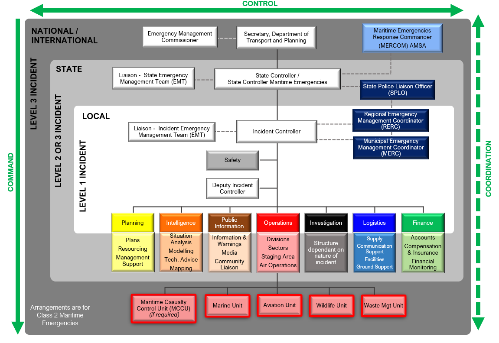

---
## Page 29

  
Page 28 
The key principles of the structures shown in figure 6 are: 
• there is a single IC, and the IC remains in overall control and sets the objectives of the incident, 
however, as the size and/or complexity of each of the hazards involved increases, the IC may 
delegate certain duties (including independent decision making) to a Deputy IC, to ensure focused 
oversight of the management strategies and tactics associated with that hazard 
• as the size and/or complexity of each of the hazards involved in the maritime emergency increases, 
the operations function may be separated out into focused units by hazards or sub-functions such 
as wildlife and waste management 
• the functions of logistics, planning, intelligence, public information and finance remain as shared 
functions to minimise duplication and to ensure response efforts are effectively coordinated (for 
example: one source, one message for public information and warnings). 
NB: The vessel master of any vessel/s involved in an incident, remains in command of the vessel and its 
crew. 
 
3.3.4 Incident levels 
The incident level of a maritime emergency will be determined by the actual or possible 
consequences, the number or nature of the resources required, duration and complexity of 
response (cargo types and nature of the recovery operations required).  
In accordance with AIIMS, and under the National Plan, there are three incident levels for maritime 
emergencies (NSR). This subplan will utilise the same criteria as the National Plan for categorising 
incidents as follows: 
• Level 1 Incidents are generally able to be resolved through the application of local or initial 
resources only (e.g. first-strike capacity) 
• Level 2 Incidents are more complex in size, duration, resource management and risk, and may 
require deployment of jurisdiction resources beyond the initial response, requiring state 
involvement 
• Level 3 Incidents are generally characterised by a degree of complexity that requires the IC to 
delegate all incident management functions to focus on strategic leadership and response 
coordination and may be supported by national and international resources (Refer to section 
4.1.2 for more information). 
 
In the event a Level 1 incident escalates beyond first strike capability, the SCME will determine the 
incident level. 
 
Incident classification by the likely consequences, rather than a set criterion, recognises for 
example, that the spilling of a set amount of oil in offshore waters, as opposed to the same volume 
spilling in port waters or near the shoreline will have very different consequences and levels of 
response required. 
 
3.3.5 Deeming of a major emergency 
Level 2 and Level 3 maritime emergencies are likely to involve state or national response efforts, 
these emergencies are likely to meet the definition of a major emergency under the EM Act 2013, 
requiring notification to the EMC.

---
## Page 30

  
Page 29 
A major emergency is a large or complex emergency which: 
• has the potential to cause or is causing loss of life and extensive damage to property, infrastructure 
or the environment; or 
• has the potential to have or is having significant adverse consequences for the Victorian community 
or a part of the Victorian community; or 
• requires the involvement of two or more agencies to respond to the emergency. 
 
The SCME is responsible for notifying the EMC should the incident be considered a major 
emergency. 
 
 
3.3.6 Consequence management 
Under the Emergency Management Act 2013, the EMC is responsible for consequence 
management during a major emergency, which is defined as is the coordination of agencies to 
minimise the adverse effects of emergencies on people, communities, infrastructure and the 
environment. The State Emergency Management Team (SEMT), comprised of senior officials from 
departments and agencies, manages immediate and medium/long-term high-level impacts of an 
incident. 
Consequences, including the capability and capacity of the control and support agencies to 
manage them, should be considered in all aspects of maritime emergency planning and 
preparation.  
Maritime emergency consequence planning should take into consideration the following potential 
impacts: 
• 
social and Aboriginal cultural heritage impacts 
• 
species and habitat loss 
• 
environmental damage 
• 
tourism impacts 
• 
disruption to marine aquaculture, recreational and commercial fishing operations 
• 
disruption to freight shipping movements and potential supply chain impacts 
• 
disruption to business or infrastructure 
• 
economic loss at local, regional or state levels 
• 
health impacts due to contact with pollutants, ingestion of contaminated seafood or impacts on 
mental health due to impacts on livelihood, income or loss of cultural values. 
 
3.3.7 Relief 
Emergency relief involves the provision of essential needs to individuals, families, and communities 
during and in the immediate aftermath of an emergency. The relief needs of individuals, families, and 
communities will be complex and specific to each incident. Relief planning and coordination is a 
function of the Controller from the onset of the emergency. However, there are several overarching 
relief priorities for maritime emergencies which are:  
• 
provision of need-based assistance for the immediate health and wellbeing of individuals and 
communities 
• 
animal welfare for any impacted wildlife 
• 
debris and pollution clean-up and removal 
• 
planned and timely access to restore critical infrastructure (including ports)

---
## Page 31

  
Page 30 
• 
provision of timely, relevant, tailored, and accessible relief information to assist community members 
to make informed decisions   
• 
effective and efficient state, region/incident and local relief coordination arrangements.  
Refer to the SEMP for the relief responsibilities of the IC, RC and the SMEC.  
 
3.3.8 Recovery  
Under the EM Act 2013, the EMC has overall responsibility for coordination before, during and after 
major emergencies. The SEMP further outlines relief and recovery coordination responsibilities, as 
well as the lead and support agencies involved in the delivery of relief and recovery activities and 
services. 
Recovery activities will commence during the response phase. As such, high levels of understanding 
and cooperation are required between response and recovery organisations at each operational tier 
(state, regional, municipal) and each recovery environment and activity. Response and recovery 
activities may need to be managed concurrently in some areas impacted by a maritime emergency.   
 
The recovery coordination responsibilities outlined in the ‘Roles and Responsibilities’ section of the 
SEMP, include: 
• for state recovery coordination: Emergency Recovery Victoria (ERV) 
• for regional recovery coordination: ERV 
• for municipal recovery coordination: local government. 
 
There are specific state-level governance arrangements in place to support recovery following a 
major emergency, particularly the State Recovery Coordination Committee and its working groups. 
 
Transition to recovery  
 
Large or complex maritime emergencies have the potential to impact all of the recovery 
environments. During any level of maritime incident, planning for recovery should begin as soon as 
the potential impact of the emergency becomes understood, and should include having dedicated 
recovery officers as part of IMT and EMT structures.  
 
The SEMP specifies the arrangements for the coordinated planning and management of transition from 
response to recovery in Victoria.  
 
Transition plans should be developed collaboratively between ICs and RCs, as well as ERV Recovery 
Coordinators and local government at the relevant tiers with appropriate and agreed resources, both 
prior to and post transition.  
 
An important component is a seamless transition of communications, where recovery messaging 
should be integrated with response information as early as possible to facilitate a smooth transition to 
recovery, alongside other components required for effective transition to recovery. 
 
Transition from response to recovery is not always a clearly defined step. There may be a legitimate 
need to instigate recovery in some areas while the response phase is still in operation. This is a phased 
transition to recovery. The teams at the relevant incident, regional and state tiers should agree on the 
timing and phasing of the transition, the activities required and who is responsible.

---
## Page 32

  
Page 31 
The recovery process after an emergency is often complex and for small incidents may be short 
(weeks/months), however for large emergencies, recovery can often take many years. 
Transition to recovery arrangements are covered in more detail in the Operational Plan (Part B). 
 
Recovery Outcomes 
The Victorian Recovery Outcomes Framework establishes the following systemic outcomes relevant to 
a maritime emergency: 
• people get the recovery supports they need in a timely, safe, and readily accessible way 
• communities are actively involved in decisions affecting their recovery 
• Aboriginal people are the authorisers and central to decision making for their recovery 
• recovery delivery is efficient, coordinated, and evidence informed 
• recovery responses strengthen community capability to manage their own recovery and 
resilience to future disasters 
• the recovery workforce has the capabilities and support needed to respond to community 
needs. 
 
Where a maritime emergency has significant effect on the natural environment, the recovery should 
seek to, where viable, restore environmental values lost or damaged through the emergency event and 
response activities[1]. 
 
Agency roles and responsibilities across the lines of recovery  
The recovery process, much like preparing for emergencies, is a shared responsibility between, 
governments, agencies, non-government organisations and communities. Victoria has a ‘Resilient 
Recovery Strategy’ which identifies four strategic actions to promote a shared responsibility approach 
to recovery planning and delivery.  The SEMP identifies four recovery environments:  
• 
social  
• 
economic  
• 
built, and  
• 
natural.  
 
ERV’s ‘Recovery Framework’ builds on the SEMP, identifying five ‘lines of recovery’ that both align to the 
SEMP recovery environments and include a separate line of recovery for Aboriginal Culture and 
Healing:  
• 
People and Wellbeing 
• 
Aboriginal Culture and Healing 
• 
Environment and Biodiversity 
• 
Business and Economy 
• 
Building and Infrastructure  
 
Each of these lines of recovery have assigned responsibilities for Recovery Coordinating Agencies 
(RecCA), Recovery Lead Agencies RecLA) and Recovery Support Agencies (RecSA).  These 
responsibilities are outlined in the SEMP. Each recovery lead or support agency should have the 
processes in place to scale up in order to implement appropriate recovery activities within their 
responsibilities outlined in the SEMP, whether through shared resource arrangements or use of trained 
volunteers for example.

---
## Page 33

  
Page 32 
 
People and Wellbeing  
Department of Health (DH) is the recovery coordinating agency for health and medical assistance 
and is the lead agency for psychosocial support, including coordinating the provision of mental 
health services and information. Department of Families, Fairness and Housing (DFFH) is the 
recovery coordinating agency for psychosocial support. 
 
Aboriginal Culture and Healing 
ERV is the recovery lead agency for Aboriginal culture and healing, ensuring coordination efforts 
align with the State Government’s commitment to advancing Aboriginal self-determination. Activities 
in this line of recovery support the recognition of culture and knowledge, physical and mental health and 
wellbeing, engagement with education, respect for land practices, connection to land, water and 
wildlife, and strengthened representation in workforce. Recovery activities to meet these commitments 
span across all lines of recovery but are unified through this line of recovery and its outcomes. 
 
Environment and Biodiversity 
DEECA leads coordination of recovery activities for natural environment, public land and waterways, 
threatened ecosystems and species and wildlife welfare. As with all lines of recovery, the community 
plays a key role in supporting the delivery of these activities.  
 
Business and Economy 
Department of Jobs, Skills, Industry and Regions (DJSIR) is the coordinating agency for recovery 
activities relating to businesses and local economies. DGS/Local Government Victoria works closely 
with municipal councils to implement appropriate actions and initiatives that encourage and bring 
forward the resumption of local economic activity. 
 
Buildings and Infrastructure 
DTP is the lead coordinating agency for recovery activities relating to transport. DEECA is the lead 
coordinating agency for recovery activities relating to energy services, public land assets and water and 
wastewater services.  
 
3.4 Control 
Control is the overall direction of emergency management activities during an emergency across all 
agencies. Agencies is defined in the Emergency Management Act 2013 to include all government 
and non-government agencies.  
The ‘line of control’ refers to the line of supervision for those appointed to perform the control 
function.  
Whilst many emergencies utilise incident, regional and state tiers for the management of incidents, 
due to the complex nature of maritime emergencies, unlike some Class 1 emergencies, the regional 
tier is unlikely to be activated unless there are significant consequences widespread across a 
region(s) that need to be managed.  
The line of control for maritime emergencies in Victoria is from the IC directly to the SCME. This is 
important given: 
• span of control for maritime emergencies does not see multiple ICs requiring a regional tier 
• the IC needs to be able to directly seek advice and access to intervention powers from the state or 
national level through the SCME or the MERCOM that have the powers of intervention and direction

---
## Page 34

  
Page 33 
• there are limited specialists available, and a regional tier may not be able to be resourced 
appropriately. 
The IC has responsibility for setting the incident objectives and overseeing the strategies and 
tactics at the incident level. The SCME has responsibility for oversighting incident control and 
ensuring appropriate resources are available to the IC, that the risk and consequence to the state 
are being appropriately managed. 
The IC may be supported by Deputy ICs and qualified personnel in the operations unit from relevant 
agencies with a functional expertise (e.g. wildlife, oil pollution). See figure 6. 
 
3.4.1 Agency roles and responsibilities 
Maritime emergencies may involve multiple, concurrent hazards, involving multiple agencies and 
requiring several control agencies to operate together. That is, an incident could be one or more of 
maritime-sourced oil pollution, maritime casualty, hazardous materials and/or wildlife affected by 
maritime-sourced oil pollution.  
Maritime emergencies are categorised by levels, and control agencies may be determined based 
on this level (refer to section 3.3.4 Incident Levels).  
Consistent with the SEMP and for the purposes of understanding the operation of this Sub-Plan, the 
control agencies for different types of maritime emergencies are outlined in Table 4. The control 
agency may vary depending on the location (e.g. waterway) of the incident and/or the most 
significant hazard. 
 
Table 4. Control agencies for different types of maritime emergencies. 
Emergency Type 
Level 1 Incident  
Level 2 or 3 
Incidents 
Class 
Marine Search and Rescue (SAR) 
Victoria Police 
Victoria Police 
Class 2 
Hazardous materials16 
CFA/FRV  
CFA/FRV  
Class 1 
Maritime-sourced oil pollution spills in Victorian 
coastal waters up to three nautical miles 
Ports Victoria, Port of Portland 
Pty Ltd, Port of Hastings 
Corporation and  
Gippsland Ports Committee of 
Management Inc17  
DTP 
Class 2 
Maritime Casualty (non-SAR) – Port Waters 
Port Management Bodies /  
Local Port Managers 
DTP 
Class 2 
Maritime Casualty (non-SAR) – Coastal Waters 
Safe Transport Victoria  
DTP  
Class 2 
Wildlife affected by maritime-sourced oil 
pollution 
DEECA 
DEECA 
Class 2 
3.4.2 Control agency jurisdictions for maritime-sourced oil pollution incidents 
Ports Victoria, the Port of Portland, Port of Hastings Corporation and the Gippsland Ports 
Committee of Management Inc have each been issued a Direction under section 71B of the Marine 
(Drug, Alcohol and Pollution Control) Act 1988 to assume control and provide an initial (first strike 
response) for all Level 1 maritime-sourced pollution incidents within state waters.  
 
16 As per definition in SEMP. 
17 See section 3.4.2 and Appendix 4 for details.

---
## Page 35

  
Page 34 
Appendix 4 illustrates the boundaries for establishing control agencies and initial response (first 
strike) for Level 1 maritime-sourced oil pollution incidents. 
DTP will assume control for all Level 2 and 3 maritime-sourced pollution incidents with the support 
of the other Level 1 control agencies. 
 
3.4.3 Control agency jurisdictions for maritime casualty incidents 
It is the responsibility of vessel owners/operators to manage a vessel casualty. Control agencies will 
oversee the management of the casualty and may intervene if the owner or operator is not taking 
appropriate or timely action to prevent or mitigate the risk of the emergency. Intervention may 
include issuing of directions, under the control agency’s legal authority, to the owner to take certain 
actions.  
To manage the potential consequences and oversight of vessel casualties, Port management 
bodies and local port managers are the control agency for maritime Level 1 casualty incidents 
within their port waters and are responsible for the initial response. Outside port waters, Safe 
Transport Victoria has control agency responsibilities for Level 1 casualties. Safe Transport Victoria 
is responsible for the first response outside port waters and may seek support from port 
management bodies and local port managers with the capabilities to manage the incident. If the 
casualty is beyond the capabilities of a Level 1 response agency then it should be escalated to the 
next level control agency. 
If there is casualty incident of a size and nature that is beyond the capabilities of the designated 
control agency, DTP, in consultation with the IC in charge of the initial response, may appoint an IC. 
The appointed IC may be from another agency or port manager with appropriate capabilities. The 
AMSA MERCOM (as outlined in section 3.2.4) may also be activated to assist in casualty events. 
Maritime casualty incidents have the potential to result in or involve maritime-sourced oil pollution 
and where it is initially unclear which body of water the vessel is in, or where there is uncertainty as 
to the jurisdiction, or where the casualty is within multiple jurisdictions, the maritime-sourced oil 
pollution control agency will assume control and undertake the initial response, until determined 
otherwise by the SCME.  
 
3.4.4 Control agency jurisdictions for maritime hazardous materials incidents 
In Victoria, release of hazardous materials, high consequence dangerous goods or dangerous goods 
(including leaks and spills) are a Class 1 emergency for which the control agency is either Fire Rescue 
Victoria (FRV) or Country Fire Authority (CFA), depending on the region18. 
Maritime incidents involving potentially hazardous material spills, either into state waters or occurring as 
part of a maritime casualty, will therefore be treated as a Class 1 emergency in the first instance.  
 
Only when it is determined by the control agency (FRV/CFA) that the spilled substance is not hazardous 
and poses no threat to human health, control may transition to the appropriate Class 2 agency to 
undertake any further necessary response, clean up, or recovery activities. 
 
Control for maritime emergencies involving hazardous materials, or incidents involving vessel fires 
(Table 5), is defined under the Country Fire Authority Act 1958 and the Fire Rescue Victoria Act 
1958.  
 
18 SEMP– Roles and Responsibilities

---
## Page 36

  
Page 35 
 
Table 5. Control agency areas of responsibility for Level 1, 2 and 3 hazardous materials incidents. 
Control Agency  
Area of responsibility 
Country Fire Authority (CFA) 
All country areas as per the CFA Act outside the metropolitan 
area but not including forest, national parks, or Protected Public 
Land. 
Fire Rescue Victoria (FRV) 
All areas in the Fire Rescue Victoria Fire District as defined in the 
FRV Act. 
 
 
3.4.5 Control agency jurisdictions for maritime-sourced oil pollution associated with 
facilities and Commonwealth waters 
The relevant titleholder is the control agency for marine pollution incidents in Commonwealth 
waters originating from an offshore petroleum activity. If the incident has the potential to, or enters 
state waters, then the relevant state control agency for maritime-sourced oil pollution will assume 
control for response activities occurring in Victorian state waters only. To facilitate effective 
coordination between the titleholder and state control agencies and their respective IMTs, a Joint 
Strategic Coordination Committee (JSCC) may be established. 
Where NOPSEMA considers it necessary to intervene during an oil pollution incident to protect the 
safety of people or the environment, NOPSEMA may direct a petroleum titleholder to take or cease 
to take certain actions in response to an oil pollution incident under Part 6.2 of the Offshore 
Petroleum and Greenhouse Gas Storage Act 2006 (OPGGS Act). In some circumstances, 
including where actions in response to an oil pollution incident are required to be undertaken on, in 
or above the land or waters of a state or territory, NOPSEMA’s CEO may declare an ‘Oil Pollution 
Emergency’ after consultation with the Secretary, DTP and in accordance with section 576B, 
Division 2A of the OPGGS Act. For significant incidents originating the Commonwealth waters, the 
Commonwealth may convene the Offshore Petroleum Incident Coordination Committee (OPICC) to 
guide strategic Commonwealth Government leadership. 
If the pollution incident enters state waters DTP will assume control of response activities in state 
waters if the incident is predicted to escalate in size, complexity or to a Level 2 or 3 response. DTP 
will maintain continual engagement with the facility operator.  
Regardless of who is controlling the incident, in all instances the facility owner/operator or titleholder 
continues to be responsible for clean-up financially (as part of the response and providing 
resources to the response) as per their oil pollution environment plan and under relevant legislation 
and polluter pays principles.  
Control arrangements for maritime-sourced oil pollution originating from facilities or vessels are 
summarised in Table 6.

---
## Page 37

  
Page 36 
Table 6. Facility and vessel control agency arrangements. 
Emergency location 
Control Agency and Jurisdiction  
Vessels outside state 
waters 
AMSA  
Vessels outside state waters. This includes Commonwealth waters at Point 
Wilson, Western Port (HMAS Cerberus) and any ‘activated’ naval waters. 
Under the National Plan arrangements, AMSA may request that the state 
take control if: 
• 
the spill is likely to impact on the Victorian shoreline  
• 
AMSA personnel are in-transit to the location of the incident and/or 
• 
it is more practical to have the state respond on behalf of AMSA. 
Maritime facility* within or 
adjoining state waters 
Facility operator 
DTP may assume control if the response is escalated. 
Offshore petroleum 
facility** beyond 3 nm  
 
Facility operator 
DTP may provide a liaison officer within the Incident Management Team 
(IMT). The relevant state control agency will assume incident control for any 
portion of the spill that enters state waters, with ongoing support from the 
operator. 
 
*Maritime facility includes but is not limited to a wharf or mooring at which a vessel can be tied up during the process of loading or 
unloading a cargo (or passengers).  
**Offshore petroleum facility means a facility operating in accordance with the provisions of the Offshore Petroleum and Greenhouse 
Gas Storage Act 2006 or any relevant state legislation. Industry contingency plans should include arrangements for transfer of 
control to DTP or appropriate State control agency and include provision of ongoing support under such circumstances. 
 
 
 
 
 
 
 
 
 
 
 
 
 
 
 
 
 
 
 
 
Montara wellhead platform – 21 August 2009 
Timor Sea off the northern coast of Western 
Australia 
Estimated oil loss approximately 64 tonnes of 
crude oil per day for 74 days.

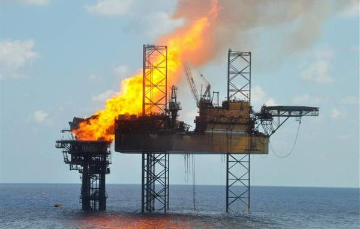

---
## Page 38

  
Page 37 
3.4.6 Emergency Management Team 
To ensure emergency management arrangements are scalable, Victoria has three operational tiers. 
Each tier has a controller who is supported by an EMT. Refer to the SEMP and the Emergency 
Management Team Arrangements (Dec) 2014 for detailed descriptions of the functions and 
membership at each EMT tier.  
If an emergency requires a response by more than one agency, the controller at each tier is 
responsible for convening an appropriate EMT as soon as practical. An EMT can be virtual (e.g. 
teleconference) or at a location designated by the controller.  
Tables 7 and 8 show examples of suggested EMT agency membership for different types of 
maritime emergencies. 
 
Table 7. Example EMT agency memberships for maritime casualty incidents  
Level 1 – Vessel casualty  
(with minimal risk of oil pollution occurring) 
Level 2 / 3 – Vessel casualty  
(with high potential risk of oil pollution occurring) 
Deployed to site or ICC: 
Deployed to site or ICC: 
• 
Port Management Body / Local Port Manager 
• 
Safe Transport Victoria 
• 
Victoria Police Water Police Squad (WPS)1 
• 
Safe Transport Victoria 
• 
Port Management Body / Local Port Manager 
• 
EPA 
• 
DTP 
• 
Fire Services  
• 
Traditional Owner Representation 
• 
Victoria Police Water Police Squad (WPS)1 
Notified with potential to deploy to site/ICC: 
Notified with potential to deploy to site/ICC: 
• 
DTP 
• 
EPA 
• 
RERC/MERC (Victoria Police) 
• 
AMSA 
• 
Fire Services 
• 
Traditional Owner Representation 
• 
Incident Health Commander (AV) 
• 
RERC/MERC (Victoria Police) 
• 
AMSA Casualty Officer 
• 
DEECA (Wildlife) 
• 
Local Government 
• 
Incident Health Commander (AV) 
 
1 If the vessel casualty incident involves a search and rescue component, the WPS will likely be on scene and 
coordinating in the first instance.  
  
Table 8. Example EMT agency memberships for maritime-sourced oil pollution or hazardous materials incidents 
Level 1 – Oil Pollution/hazardous materials 
on water/land 
Level 2 / 3 – Oil Pollution/hazardous materials 
on water/land 
Deployed to site or ICC: 
Deployed to site or ICC: 
• 
Control Agency  
• 
Port Management Body / Local Port Manager 
• 
EPA 
• 
Land management agency 
• 
Traditional Owner Representation 
 
• 
Control Agency (DTP) 
• 
Port Management Body / Local Port Manager 
• 
EPA 
• 
Land management agency 
• 
DEECA (Wildlife) 
• 
Traditional Owner Representation 
Notified with potential to deploy to site/ICC: 
Notified with potential to deploy to site/ICC: 
• 
DTP 
• 
AMSA 
• 
FIRE Service 
• 
RERC/MERC (Victoria Police) 
• 
DEECA (Wildlife) 
• 
Incident Health Commander (AV) 
• 
Australian Marine Oil Spill Centre (AMOSC) 
• 
AMSA 
• 
Fire Services  
• 
RERC/MERC (Victoria Police) 
• 
Local Government  
• 
Incident Health Commander (AV) 
• 
AMOSC

---
## Page 39

  
Page 38 
 
State Control Team  
The SCT for this subplan will be activated by the SCME, in consultation with the EMC, in the event 
of a possible or actual Level 2 or Level 3 incident. 
Table 9 outlines the standing membership of the SCT. Meetings of the SCT may be held in person 
or virtually. 
Table 9. SCT Membership 
Incident 
level 
Standing SCT 
Other leads as determined by the 
SCME or EMC – include:  
Level 2 
• 
SCME (Chair) 
• 
EMC 
• 
SPLO 
• 
State Consequence Coordinator 
• 
State Emergency Relief Coordinator 
• 
DEECA State Agency Commander 
• 
EPA – Chief Environmental Scientist  
• 
Safe Transport Victoria 
• 
DTP Executive Director Resilience 
and Emergency Coordination 
• 
Fire Agency Chief Officer or 
Commissioner (if hazardous materials 
or fire involved) 
• 
DEECA Chief Fire Officer (if wildlife 
involved) 
• 
State Health Commander (AV) 
 
Level 3 
All members of Level 2 plus; 
• 
MERCOM (AMSA) 
• 
DTP Executive Director Resilience and 
Emergency Coordination 
• 
Fire Agency Chief Officer 
• 
DEECA Chief Officer (or delegate: 
State Agency Commander) 
 
• 
Support agencies - State Agency 
Commander (SAC) 
 
Incident Management Team 
Maritime emergencies involve many control agencies, particularly when they are large, complex or 
involve a range of hazards. 
Where there are concurrent hazards within the one incident, guidance in Part B should be used to 
establish who should lead the IMT based on the highest order of hazard risk and consequence.  
It is important for the AIIMS principle of unity of command to operate in terms of the IC forming the 
lead with the support of other agencies who will perform a support (command) function.  
In the event of uncertainty or a conflict as to who should lead a Level 1 response, the SCME may 
determine this based on the hierarchy of risk and consequence and capabilities required of the IC. 
In the event of a Level 2 or 3 Incident, the SCME will appoint the IC. 
Depending on the complexity, Deputy ICs may be appointed where the risk and/or span of control 
necessitates. 
It is the responsibility of the IC to determine the most appropriate IMT structure to put in place, and 
to form an incident EMT if required. 
For Level 1 incidents, beyond the initial assessment phase, if it is determined that deployment of 
personnel and/or resources is required, the IC should consider delegating the operations and public 
information functions. 
For Level 2 and 3 incidents the IC will delegate each of the IMT functions and agency commanders 
form part of the IMT at the incident tier.

---
## Page 40

  
Page 39 
For a large or protracted maritime casualty or pollution response, the operations unit typically 
includes the following specialist operational functions: aviation, marine, shoreline, wildlife, waste 
and workplace health and safety. Maritime-sourced oil pollution response may also include a 
dedicated environment function within the intelligence unit and employs specialist environment, 
scientific and technical advisers at all levels of the IMT. 
 
3.4.7 Appointment of Incident Controllers 
The role of the IC is to provide leadership and management to resolve the emergency and operates 
in close proximity to the incident. 
The IC has responsibility for the overall direction of tactical response and support activities at the 
incident level. For maritime emergencies, the responsibilities of the IC are consistent with those 
outlined in the SEMP. 
A Deputy IC is an individual appointed under the same provisions as an IC, usually for Level 2 or 3 
incidents. The Deputy IC supports the IC in the management of the incident. 
 
For Level 1 incidents, the relevant control agency is responsible for: 
• providing qualified personnel to undertake the role of IC 
• appointing an appropriately trained IC for a given incident. 
 
For Level 2 and 3 incidents, the SCME will: 
• ensure they appoint qualified personnel to undertake the IC role for Level 2 and 3 incidents, in 
accordance with the EMV (Class 1) or AMSA (Class 2) frameworks 
• appoint the IC and the Deputy ICs, which may initially be confirmed verbally and then confirmed by 
a written instrument of appointment. 
 
3.4.8 Incident Control Point (ICP) and Incident Control Centre (ICC) 
For Level 1 incidents, the IC is responsible for establishing an Incident Control Point (ICP). The ICP 
could be established on site or in a port office. However, if the level of the response escalates then 
a designated ICC, which can sustain a fully staffed IMT, should be established in proximity to the 
incident. 
Level 2 and 3 Incidents are to be managed through an ICC or Regional Control Centre (RCC) 
approved by the SCME. 
The location of the ICP or ICC in use should be clearly identified and communicated to all agencies. 
 
3.4.9 Specialised support services 
Any agency that has the skills, expertise or resources that may contribute to the management of a 
maritime emergency may be requested to assist in emergency response. Table 10 details some 
specialised support services that are available to assist an IMT with maritime emergencies.

---
## Page 41

  
Page 40 
Table 10. Specialist support services 
Support Service 
Primary Agency 
Secondary Agency 
Detection of emergency locator 
transmitters 
AMSA 
AIRSERVICES AUSTRALIA 
Oil spill trajectory modelling 
AMSA 
 
Mapping services/information including: 
• 
digital and hardcopy maps 
• 
aerial photography acquisition 
• 
GPS positioning and location 
DTP 
DEECA 
GEOSCIENCE AUSTRALIA 
Investigation of pollution 
EPA 
 
 
 
3.4.10 Related emergencies – agencies roles and responsibilities 
Maritime emergencies (NSR) may be a result of a land-based emergency or result in the 
requirement for an on-land response that needs to be managed.  
A range of agencies have defined control agency responsibilities (see Table 11) and depending on 
the emergency, a transfer of control to or from a maritime emergency (NSR) may be required. For 
example, pollution from land that enters state marine waters may require a joined-up approach.  
 
Table 11. Control agencies for related incidents. 
Emergency Type* 
Control Agency  
(May vary by location) 
Fire and explosion 
CFA/FRV 
Hazardous materials  
CFA/FRV 
Non-hazardous pollution of inland waters 
DEECA 
Public transport disruption (water taxis, ferries, etc.)  
DTP 
Tsunami, storm surge and other related natural events 
VICSES 
                  
                 *This list is not exhaustive, refer to SEMP for details on specific control agencies for emergency types 
 
3.4.11 Control of incidents that cross control agency boundaries  
Victorian agency control boundaries 
If a maritime emergency has the potential to cross the boundaries of two control agency areas DTP 
should be notified so they can inform and liaise with neighbouring jurisdictions. A single IMT should 
be established by the control agency of the jurisdiction in which the incident first occurred. As 
outlined in 3.2.5 Role of Coordination if control agency jurisdiction is not clear, the Victoria Police 
RERC has the authority to appoint the control agency on behalf of the EMC. 
If the incident is escalated beyond a Level 1 incident and control is transferred to DTP, both 
affected agencies will continue to provide support and local knowledge throughout the response.

---
## Page 42

  
Page 41 
State borders 
For incidents which cross state borders, the SCMEs of impacted states will liaise and determine 
whether there is a need for separate ICC to be established in each state, based on risk 
assessments of the situation. The primary ICC may be established in the state where the impact is 
likely to be greatest, with all media communications originating from that centre in consultation with 
the neighbouring state. 
The SCME and the IC, in consultation with the respective states, will determine if an interstate ICC 
needs to be established. The SCME will notify the EMC of any potential or actual cross-state 
activity. 
 
 
 
 
 
 
 
 
 
 
 
 
 
 
 
 
 
 
 
3.5 Communications 
3.5.1 Notifications  
Control agencies are required to maintain 24 hours a day, 365 days a year capability to receive 
third party reports of suspected maritime emergency incidents and be able to initiate a response 
without delay to reported incidents (e.g. first strike response capacity). Agencies should ensure 
they have capability to conduct an initial assessment in accordance with processes outlined in the 
Operational Plan (Part B).  
If a maritime emergency is considered a major emergency under the EM Act 2013, or an incident is 
considered significant (e.g. high media interest, sensitive environmental issues) the SCME (or their 
representative) is responsible for notifying the EMC as outlined in Joint Standard Operating 
Procedure (JSOP) 3.16 Significant Event Notification.  
Bougainville – 21 January 2024 
Maritime Casualty – Western Port Victoria 
Vessel lost its entire propeller shaft and was 
drifting approx. 2NM from seal rocks, off Phillip 
Island. 
Harbour tugs were tasked to aid in stabilising the 
vessel until more suitable towage was sourced.

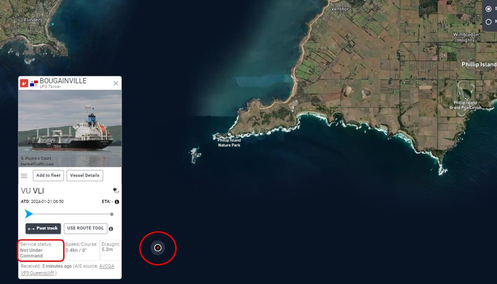

---
## Page 43

  
Page 42 
In the event of a Level 2/3 incident, additional notifications may be required by the SCME (Figure 7), to 
the State Control Centre (SCC) and other agencies who may be assisting with the response including 
neighbouring jurisdictions if the emergency is likely to cross shared borders. 
 
Figure 7. Information flow and notification process for maritime casualty and maritime-sourced oil pollution incidents  
 
NB: This figure is an example of the notification process and may not be exhaustive of all agencies in the process.  
 
3.5.2   Critical information flow during an escalating or major emergency 
The rapid, accurate information flow from the incident area upwards plays a critical role in enabling 
the appropriate resources to be made available. In addition to providing the critical data for 
strategic decisions being made regarding resources and incident management, information coming 
from the incident ground (especially the first arriving resources) is required to determine what 
advice or warnings need to be communicated to the community. 
 
3.5.3 Emergency information and warnings 
The IC is responsible for ensuring timely, tailored information is provided to the community.  
When a maritime emergency occurs, the IC of the relevant control agency will ensure that public 
information and warnings (as necessary) are published to the Vic Emergency Website 
www.emergency.vic.gov.au and appropriate social media channels along with sending warnings to 
relevant emergency broadcasters.  
The Vic Emergency website reports maritime emergencies under four categories depicted by the 
following icons: 
 
 
 
Marine incident                     Oiled Wildlife                    Water Pollution  
  Port Closed                                              
                                      
Where multiple hazards are presented, but it remains as one incident, the primary hazard will drive 
the warning type and icon that will be used.

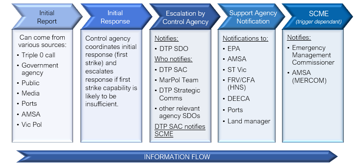

---
## Page 44

  
Page 43 
During a major emergency (Level 2 or 3 incident) or where the SCME is activated, they will 
coordinate whole of government state-level messaging with the respective control agency (FRV, 
CFA, DTP, DEECA), and in collaboration with the Emergency Management Joint Public Information 
Committee (EMJPIC). 
Emergency information and warnings should be: 
• tailored to include specific details about the emergency and any likely or actual impacts on the 
community 
• updated regularly or as the situation changes 
• contain advice on protective or specific actions the community should undertake to remain safe 
• provided through multiple channels including social media, news, radio, community meetings, 
newsletter, industry networks or other avenues as required 
Where there are risks to public health from pollution, community information may be issued by or in 
consultation with the EPA and/or the Department of Health. 
 
3.5.4 Common Operating Picture  
The purpose of the COP is to build and maintain a common situational awareness among all 
agencies and personnel involved in the response to and resolution of an incident, and to support 
decision making and planning at all levels. 
The COP is built and maintained by the intelligence unit through a collaboration process with all 
members of the IMT, EMT and other external sources. Where the intelligence unit is not 
established, the planning unit is responsible for maintenance of the COP. 
The tools to be used for establishing a Common Operating Picture may include: 
• Emergency Management - Common Operating Picture (EM-COP) 
• National Emergency Maritime Operations (NEMO) system 
• Situation Reporting (SITREP) 
The use and application of these systems is described in the Operational Plan (Part B).

---
## Page 45

  
Page 44 
Capability and resource 
management 
4.1 Responsibilities of maritime-sourced oil pollution control agencies 
Each maritime-sourced oil pollution control agency should: 
• ensure a sufficient number of personnel are available, 24 hours a day, 365 days of the year to 
initiate a response without delay to any report of an actual or suspected Level 1 maritime-sourced 
oil pollution or maritime casualty incident in their prescribed region (refer Appendix 2 and 3) in 
accordance with this subplan 
• provide a trained IC for Level 1 incidents to take control of the incident and to: 
o establish an appropriate incident management and emergency management teams 
o ensure public safety including the issuing of relevant warnings and public information  
o manage response operations in accordance with the systems prescribed in this subplan 
• work in collaboration with DTP regarding appropriate storage and access of specialist response 
equipment owned by the State for response to maritime emergencies, in accordance with 
arrangements detailed in Part B of this Plan. 
• undertake regular readiness checks of specialist equipment and vessels owned and operated by 
control agencies.  
• for maritime-sourced oil pollution control agencies, maintain an up to date register as prescribed by 
DTP, of all material vessels (including vessels of opportunity), property and equipment and other 
assets in its possession or control, which are capable of being used to support an emergency 
response.  
 
4.1.1 State Response Team (SRT) 
The SRT is comprised of personnel specially trained in various aspects of maritime emergency 
response. Personnel come from a range of emergency management agencies, local government 
authorities, and other government departments. DTP coordinates the training of SRT personnel 
through AMSA, under National Plan arrangements (see section 4.2 Capability development for 
more information on the SRT). 
 
4.1.2 National Response Team and Specialist Equipment Caches 
Requesting National Plan resources 
On activation of the National Plan, the IC or the SCME may submit a request to AMSA for 
personnel from other states or the Northern Territory and the Australian Marine Oil Spill Centre 
(AMOSC) Core Group to assist with the incident response, in IMT/EMT or field roles. Suitable 
personnel will be selected by AMSA from the National Response Team (NRT), National Response 
Support Team (NRST) and AMOSC Core Group unless special circumstances exist. AMSA 
manages nine stockpiles of specialist response equipment and dispersants, including one in 
Melbourne. AMOSC has four stockpiles, with one in Geelong that also includes wildlife treatment 
equipment. 
The SCME may request national resources through AMSA if:

---
## Page 46

  
Page 45 
• the incident has exceeded the state’s capacity to respond 
• the incident requires a resource that can only be obtained nationally and/or 
• the incident is a Level 3 spill requiring immediate escalation. 
If national assistance is requested, the EMC is to be notified and the control agency is responsible 
for ensuring that there are appropriate arrangements in place to enable support agencies to be 
reimbursed for the costs incurred in responding to an incident, consistent with the National Plan. 
Requests for NRT activation or for specialist equipment should initially be made through the AMSA 
Joint Rescue Coordination Centre (JRCC) in accordance with the Operational Plan (Part B). 
AMSA and individual states and the Northern Territory, can also request resources and equipment 
from AMOSC and other industry and international resources if required.  
Providing assistance to other jurisdictions 
Under the National Plan, AMSA can request Victoria’s assistance for maritime casualties and 
pollution outside Victorian state waters through the SCME. The SCME will consult with the EMC 
before deploying any Victorian personnel or assets to another jurisdiction. 
AMSA may also request that Victoria assumes control of an incident originating from a vessel in 
Commonwealth waters, if: 
• the spill is likely to impact the Victorian shoreline  
• AMSA personnel are in transit to the location of the incident or 
• it is more practical to have the state respond on behalf of AMSA.  
Victoria may receive a request for assistance directly or via AMSA from an offshore facility operator 
located in Commonwealth waters: 
• when a spill is likely to enter state waters 
• when an incident has exceeded the operator’s capacity to respond 
• as per agreed arrangements set out in the operator’s Oil Pollution Emergency Plan 
AMSA’s Coordination of cross-border incidents guidance (NP-GUI-023) provides further details.  
 
4.1.3 International Assistance  
AMSA can make arrangements with other countries such as New Zealand and Singapore that have 
specialist resources and personnel that could support major or complex maritime emergencies.  
 
4.2 Capability development 
4.2.1 Training standards 
Effectively managing a response to a maritime emergency incident requires technical proficiency 
acquired through training and experience. 
SRT members attend training and exercises in accordance with the SRT training schedule to 
maintain their skills in maritime pollution response. Further information is available in the 
Operational Plan (Part B). 
The training schedule includes accredited courses for Level 1 incidents, including equipment 
operation, shoreline response, and functional roles within the AIIMS structure. Control agencies and

---
## Page 47

  
Page 46 
other partner agencies provide training for specialised roles such as hazardous materials, wildlife 
response, waste management and aerial observation.  
Training for Level 2 and 3 incidents is provided by AMSA’s national training program, in accordance 
with the Australian Qualifications Framework. This includes specialised training for: 
• Incident Management Teams  
• Logistics Officer 
• Operations Officer 
• Planning Officer (including Mapping) 
• Incident Controller  
• Basic Equipment Operator  
• Advanced Equipment Operator  
• Shoreline Team Leadership 
AMSA also delivers an annual specialist workshop for ESTRG advisors. 
As part of the National Plan arrangements, AMOSC provides oil spill response training for the 
petroleum industry and is accredited to conduct IMO equivalent level I, II and III, Oil Pollution 
Preparedness, Response and Co-operation (OPRC) training.  
DTP maintains a training database of SRT members from all control and support agencies who 
undertake courses to ensure that Victoria has access to appropriately trained staff to respond to 
maritime emergencies and that their accreditations are current. 
 
4.2.2 Exercising and evaluation 
Victoria’s maritime emergency response plans are exercised regularly to:  
• continually assess the efficacy of the arrangements  
• identify opportunities to improve incident response arrangements  
• establish and strengthen relationships across relevant response agencies  
• ensure stakeholders have a thorough and common understanding of:  
o command, control, and coordination arrangements  
o roles and responsibilities of stakeholder agencies 
o maritime-sourced oil pollution response procedures, issues, and considerations.  
When the state arrangements are exercised, the exercises will be evaluated and where 
improvements to the emergency management arrangements in this Sub-Plan are identified, the 
Sub-Plan will be reviewed, and a revised version issued. Exercises will be conducted in accordance 
with the Framework for Managing Exercises in Victoria (available on EM-COP) and the National 
exercising standard (the Australian Emergency Management Handbook 3 - Managing Exercises 
2023, prepared by the Australian Institute for Disaster Resilience). 
Each control agency is requested to provide one or more participants that can engage at a state 
strategic level for an annual state exercise. 
 
National exercises 
NRT and SRT members will have the opportunity to participate in national exercises coordinated by 
AMSA and AMOSC on an annual basis.

---
## Page 48

  
Page 47 
Control agency exercises 
To support the arrangements in this Sub-Plan, it is recommended that each control agency: 
• conduct an internal agency exercise annually, to test their capability related to their area of control 
• provide trained incident management capability to manage responses to Level 1 incidents within 
their region and provide support for Level 2 and 3 incidents 
• participate in state or national exercise opportunities 
• maritime-sourced oil pollution control agencies are required to plan and conduct an annual exercise 
to test their first‑strike response capability 
o DTP will support the planning, conducting, observing and evaluation of first strike capability 
and regional exercises 
o exercises should include participation of key support agencies and regional stakeholders. 
 
4.2.3 Operational debriefing 
Incident debriefing and After-Action Reviews (AAR) form part of the continuous improvement cycle 
of emergency operations. DTP as the state control agency will organise operational debriefs or 
AARs with participating agencies (including recovery agencies) as soon as practicable after 
cessation of any response activities that apply to this subplan. Debriefing provides an opportunity to 
evaluate the adequacy of the response and to recommend changes to plans and procedures to 
improve future operational response activities.

---
## Page 49

  
Page 48 
Appendices  
 
 
 
5.1 
Appendix 1 - Authorising legislation 
 
5.2 
Appendix 2 - Victoria’s commercial trading ports  
5.3 
Appendix 3 - Victoria’s local ports  
5.4 
Appendix 4 - Jurisdictional boundaries and maps  
5.5 
Appendix 5 - Glossary 
 
5.6 
Appendix 6 - Acronyms

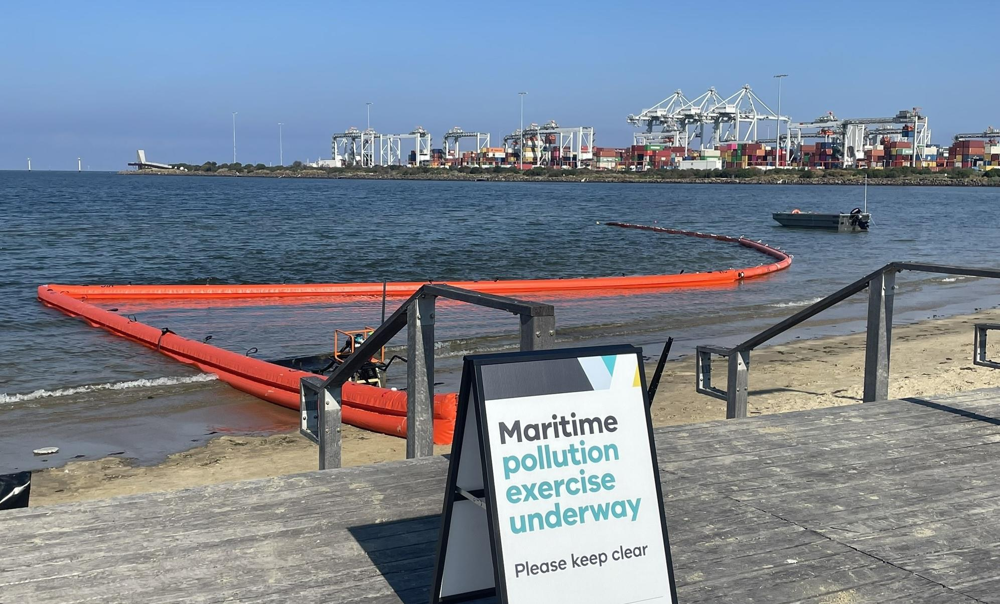

---
## Page 50

  
Page 49 
5.1 Appendix 1 - Authorising legislation 
International conventions 
Australia is a signatory to two international conventions for preventing and responding to ship-
sourced pollution: 
• The International Convention on Oil Pollution Preparedness, Response and Cooperation (OPRC) 
commonly known as OPRC 90), and its associated Hazardous and Noxious Substances Protocol, is 
the primary international convention for response to ship-sourced marine oil pollution.  
• The International Convention for the Prevention of Pollution from Ships 1973 (MARPOL) (as 
modified by the Protocol of 1978) is designed to minimise pollution of the seas by oil and other 
harmful substances from ships and preserve the marine environment.  
 
Relevant national and international protocols, conventions, and arrangements  
International Convention 
Scope 
International Convention on Pollution 
Preparedness, Response and 
Cooperation (OPRC) 1990 (IMO) 
Related Protocol: Protocol on 
Preparedness, Response and 
Cooperation to Pollution Incidents by 
Hazardous and Noxious Substances 
2000, (OPRC-HNS Protocol) 
Provides the basis for Maritime Emergency response (NSR) by setting the 
context for: 
• 
developing a state system for pollution response 
• 
maintaining adequate capacity and resources to address oil and HNS 
incidents. 
• 
facilitating cooperation across all jurisdictions 
• 
immediate notification of all neighbouring jurisdictions likely to be 
impacted. 
International Convention for the 
Prevention of Pollution from Ships 
(MARPOL) 1973 (IMO) 
 
• 
Provides ships’ construction and operational requirements to prevent 
pollution from ships. 
• 
Requires ships greater than 400 tonnes gross to have pollution 
emergency plans. 
• 
Requires mandatory reporting of oil spills. 
• 
Provides for exemptions from discharge restrictions where: 
o 
a discharge is necessary to secure the safety of a ship or to 
save a life at sea 
o 
it is necessary during a spill response to minimise the overall 
damage from pollution and is approved by the relevant 
government. This includes dispersants. 
United Nations Convention on the Law 
of the Sea 1982 
Article 211 provides general powers for parties to take and enforce measures 
beyond territorial sea to protect their coastline or related interests from 
pollution or threat of pollution following a maritime casualty or acts relating to 
such a casualty that may reasonably result in major harmful consequences. 
Article 198 provides that ‘when a State becomes aware of cases in which the 
marine environment is in imminent danger of being damaged…by pollution, it 
shall immediately notify other (neighbouring) States it deems likely to be 
affected by such damage.’ 
IMO. International Convention Relating 
to Intervention on the High Seas in 
Cases of Oil Pollution Casualties 1969 
Related Protocol: IFRC Protocol 
Relating to Intervention on the High 
Seas in Cases of Pollution by 
Substances Other than Oil 1973 
This convention provides general powers for parties to take measures on the 
high seas as may be necessary to prevent, mitigate or eliminate grave and 
imminent danger to their coastline or related interests from the threat of 
pollution by oil or hazardous and noxious substances following a maritime 
casualty or acts related to such a casualty that may reasonably be expected 
to result in major harmful consequences. 
International Convention on Civil 
Liability for Oil Pollution Damage 1992 
Provides for the recovery of pollution costs and payment of compensation 
from owners/operators of oil tankers.

---
## Page 51

  
Page 50 
International Convention on the 
Establishment of an International Fund 
for Compensation for Oil Pollution 
Damage 1992 
 
Provides for additional compensation and costs where the tanker 
owner/operators’ liability limits are exceeded, using funds provided by the oil 
industry. 
Related Protocol: IMO. Protocol of 2003 to the International Convention on 
the Establishment of an International Fund for Compensation for Oil Pollution 
Damage, 1992 
International Convention on Civil 
Liability for Bunker Oil Pollution 
Damage 2001 
Provides for the recovery of pollution costs and payment of compensation 
from owner/operators of all vessels using oil as bunker fuel. 
Guidelines on International Offers of 
Assistance (IOA) in response to a 
marine oil pollution incident 
 
Provides guidance on requesting and accepting offers of assistance from 
other nation states. While these guidelines can play an important role in the 
implementation of the OPRC 1990 Convention, they are not prescriptive or 
legally binding, and are meant as a tool to assist as needed. 
Resolution A.949 (23) Guidelines on 
Places of Refuge for Ships in Need of 
Assistance 2003 and A.950(23) 
Maritime Assistance Services 2003 
These Resolutions provide guidance on places of refuge for ships and on the 
provision of a Maritime Assistance Service (MAS) to ships that may need 
assistance, where the safety of life or rescue of persons is not involved. 
 
 
Relevant Commonwealth legislation 
Commonwealth Legislation 
Scope 
Australian Maritime Safety 
Authority Act 1990 
Provides that a function of AMSA is to combat pollution in the marine environment, 
including provision of services to the states and territories. 
Protection of the Sea (Prevention 
of Pollution from Ships) Act 1983  
Provides exemptions for the discharge of materials in response to marine pollution 
incidents. This includes the application of dispersants. 
Requires ships greater than 400 tonnes gross to have pollution emergency plans. 
Provides for emergency discharges from ships. 
Offshore Petroleum and 
Greenhouse Gas Storage Act 
2006 
Sets out the requirements for the offshore petroleum exploration and production 
sector. 
Part 6.2 provides for the National Offshore Petroleum Safety and Environmental 
Management Authority (NOPSEMA) or the Commonwealth Minister to direct the 
polluter to take actions in response to an incident and to clean up, monitor impacts 
and reimburse NOPSEMA or the Commonwealth. 
Environment Protection and 
Biodiversity Act 1999 
Regulates activities impacting on defined “matters of national environmental 
significance”, Commonwealth marine reserves, and species listed under the Act.  
Provides for the making of exemptions if in the national interest. An exemption has 
been issued for activities done pursuant to the National Plan. 
Protection of the Sea (Civil 
Liability for Bunker Oil Pollution 
Damage) Act 2008 
Places liability on the shipowner(s) for pollution damage caused by loss of bunker 
fuel. 
Provides immunity from legal action for response personnel. 
Protection of the Sea (Civil 
Liability) Act 1981 
Places liability on the shipowner(s) for pollution damage caused by loss of persistent 
oil from an oil tanker. 
Protection of the Sea (Oil 
Compensation Fund) Act 1993 
Provides additional compensation for pollution damage caused by loss of persistent 
oil from an oil tanker. 
Protection of the Sea (Powers of 
Intervention) Act 1981 
Provides for intervention powers being exercised in Australia’s EEZ, Territorial Sea and 
internal waters. 
Fisheries Management Act 1991 
Provides regulatory and other mechanisms to support any necessary fisheries management 
decisions during a response in Commonwealth waters.

---
## Page 52

  
Page 51 
 
National arrangements 
Maritime emergency (NSR) arrangements are supported by intergovernmental agreements and set 
out in the National Plan. 
Through intergovernmental agreements, all jurisdictions have undertaken to provide a response 
capability within their own jurisdiction and share resources with other jurisdictions. The 
Commonwealth, through the AMSA coordinates National Plan arrangements. 
The National Plan provides a single comprehensive and integrated response arrangement to 
minimise environmental impacts arising from maritime environmental emergencies.  
The national arrangements do not override state legislation, except for specific provisions relating to 
a maritime casualty that poses a threat of significant pollution.  
 
Victorian legislation  
Victorian Legislation 
Scope 
Emergency Management 
Act 2013 
Defines key elements of Victoria’s emergency management structure, assigns 
significant roles and responsibilities, and provides clear accountability regarding the 
management of major emergencies. 
Provides the integrated arrangements for emergency management planning, including 
mitigation, response, relief and recovery planning, involving preparedness, operational 
co-ordination, and community participation, in relation to all hazards. 
Emergency Management 
Act 1986 
Operates concurrently with the Emergency Management Act 2013 with the intention 
that the 1986 Act will ultimately be repealed. Currently, the 1986 Act and 2013 Act are 
to be read and construed as one Act. 
Marine (Drug, Alcohol and 
Pollution Control) Act 1988 
(Marine Act) 
Defines prohibited discharges. 
Defines the powers of DTP regarding oil pollution response and preparedness. 
Allocates roles and responsibilities to ensure there is a capacity and obligation to 
respond to marine incidents that have the potential to result in pollution. 
Section 71A sets out functions to ensure adequate means exist to respond to marine 
pollution in Port and State waters. 
Marine Safety Act 2010 
Provides for safe marine operations within Victoria by setting licensing and operational 
requirements. 
Provides powers to police to enforce the safety of vessel operators and to Office of the 
Director Transport Safety staff to enforce vessel safety. 
Also gives police powers to check vessel owners/operators. 
Environment Protection Act 
2017 
Provides the foundation for a transformation of Victoria’s environment protection laws 
and Environment Protection Authority Victoria (EPA). 
The general environmental duty (GED) is at the centre of the Environment Protection 
Act 2017, and it applies to all Victorians, and all businesses located in Victoria.  
The Act focuses on preventing waste and pollution, rather than managing impacts after 
they occur. The GED is criminally enforceable. 
Pollution of Waters by Oil 
and Noxious Substances 
Act (POWBONS) 1986 
POWBONS and POWBONS Regulations 2012 make provisions for the protection of the 
sea and certain waters from pollution by oil and other noxious substances and 
implement the International Convention for the Prevention of Pollution from Ships 
(1973). 
Prohibits discharge of oil, oily mixtures, and other materials. 
Implements Annex 1 of the MARPOL Convention. 
Requires mandatory reporting of marine pollution incidents.

---
## Page 53

  
Page 52 
Offshore Petroleum and 
Greenhouse Gas Storage 
Act 2010 
Sets out the requirements for the offshore petroleum exploration and production sector 
in Victorian offshore waters. 
Flora and Fauna Guarantee 
Act 1988 
Provides for the conservation and biodiversity of Victoria’s native flora and fauna, 
including the management of potentially threatening processes. 
Wildlife Act 1975 
Provides for the protection and conservation of wildlife. 
Fisheries Act 1995 
Provides for the regulation, management and conservation of Victorian fisheries (both 
commercial and recreational), including aquatic habitats. 
Wildlife (Marine Mammals) 
Regulations 2009 
Provides for the long-term protection of marine mammals. 
Local Government Act 1989 
Provides a framework for the operation of local councils. 
Provision in local plans for prevention, preparation for, response to and recovery from 
emergency incidents, including: 
• 
management of local infrastructure and community assets 
• 
liaison with local communities and business networks 
• 
enforcement of relevant local laws, such as access control, parking, safety, pets. 
Local Government Act 2020 
The Local Government Act 2020 is a principles-based Act, removing unnecessary 
regulatory and legislative prescriptions outlined in the previous 1989 Act. The Act 
provides under section 87 for the Minister for Local Government to issue Ministerial 
Good Practice Guidelines (MGPGs). 
Port Management Act 1995 
Provides for the establishment, management and operation of commercial trading ports 
and local ports in Victoria and the preparation of Safety Management Plans and an 
Environment Management Plans (together known as Port Safety & Environmental 
Management Plans (PortSEMPs) and 
Part 5B refers to hazardous or polluting activities. 
Aboriginal Heritage Act 
2006 
Provides for the protection of Aboriginal cultural heritage in Victoria. 
Heritage Act 1995 
Provides for the protection and conservation of places and objects of heritage 
significance.  
Marine and Coastal Act 
2018 
The Marine and Coastal Act 2018 provides a simpler, more integrated and coordinated 
approach to planning and managing the marine and coastal environment by enabling 
protection of the coastline and the ability to address the long-term challenges of climate 
change, population growth and ageing coastal structures.

---
## Page 54

  
Page 53 
5.2 Appendix 2 - Victoria’s commercial trading ports 
 
Ports Victoria, established on 1 July 2021 have overarching responsibility for the channels and port 
waters of Victoria’s commercial ports. The Victorian Commercial Ports Strategy is a key response 
to the Independent Review of the Victorian Ports System, actioning the industry desire for a State-
wide vision for the sector. 
 
Victoria’s four commercial trading ports are profiled below: 
 
• Port of Melbourne is Australasia’s largest maritime hub for containerised, automotive and general 
cargo. It is a key economic asset for businesses and people across Victoria and south-eastern 
Australia. The Port of Melbourne welcomes over 7,500 vessel movements annually and comprises 
of 100,000 hectares of port waters, 21 kilometres of waterfront and 36 commercial berths.  
 
• Port of Geelong is Victoria’s second largest port, handling over $7 billion of trade and more than 
1,000 vessel visits each year. The Port’s exports consist mainly of raw materials, including 
petroleum products, bulk and bagged grain and woodchips, while the majority of imports are crude 
oil, petroleum products and fertiliser raw material. While Geelong Port manages wharf and land-side 
infrastructure, Ports Victoria is responsible for channel management and commercial navigation of 
commercial waters in and around Geelong. 
 
• Port of Hastings is a commercial port, handling approximately 2 million tonnes of trade each year, 
and servicing major international and domestic shipping movements that include import and export 
of oil, LPG, ULP, steel, general and project cargo. The Port of Hastings Corporation (PoHC), as Port 
Operator is responsible for managing the operations at the Port of Hastings, including maintaining 
the associated port infrastructure (except for the BlueScope owned steel wharves).  The channels 
are managed by Ports Victoria. 
 
• Port of Portland is a deep-water port servicing the forest production area of Victoria and South 
Australia known as the Green Triangle Region.  The Green Triangle is centered on Portland, Mt 
Gambier and beyond. The Port has six commercial berths and handles over 7 million tonnes of 
trade and welcomes more than 300 vessel visits annually. Its main commodities are grain, forestry 
products including woodchips, aluminum, alumina, liquid pitch, fertiliser and mineral sands.

---
## Page 55

  
Page 54 
5.3 Appendix 3 - Victoria’s local ports 
 
Location of local ports (correlating table numbers show management responsibility)

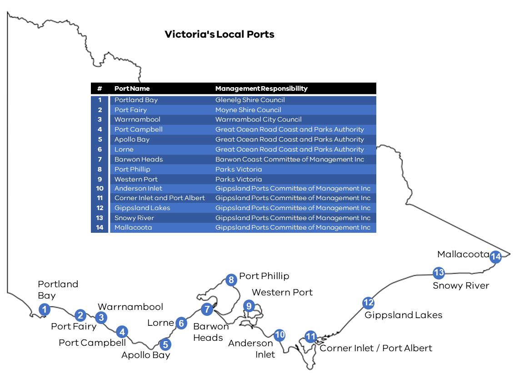

---
## Page 56

  
Page 55 
5.4 Appendix 4 - Jurisdictional boundaries and maps 
Victoria’s Control Agency boundaries for first response/Level 1 maritime-sourced oil pollution 
incidents are outlined in the table below and visually represented in the following map. 
 
Victoria’s control agency boundaries for first response/Level 1 maritime-sourced oil pollution incidents. 
Region 
West Boundary 
East Boundary 
Includes 
Regional Control 
Agency (RCA) 
Portland 
SA Border 
Cape Otway 
Enclosed waters. 
Port of Portland 
Ltd 
Port Phillip 
Cape Otway 
Cape Schanck 
Port Phillip, enclosed waters and 
upstream, where pollution is sourced 
from port waters. For Yarra and 
Maribyrnong Rivers, includes waters 
downstream of the Bolte and 
Shepherd Bridge.  
Ports Victoria 
Docklands 
Charles Grimes 
Bridge 
Bolte Bridge 
Docklands includes waters upstream 
of the Bolte Bridge and downstream of 
the Charles Grimes Bridge. 
DTP 
Western 
Port 
Cape Schanck 
South-east 
point of 
Wilson’s 
Promontory 
Western Port and enclosed waters. 
Port of Hastings 
Corporation 
Gippsland 
South-east 
point of 
Wilson’s 
Promontory 
NSW Border 
Corner Inlet and enclosed waters. 
Gippsland Ports 
Committee of 
Management Inc

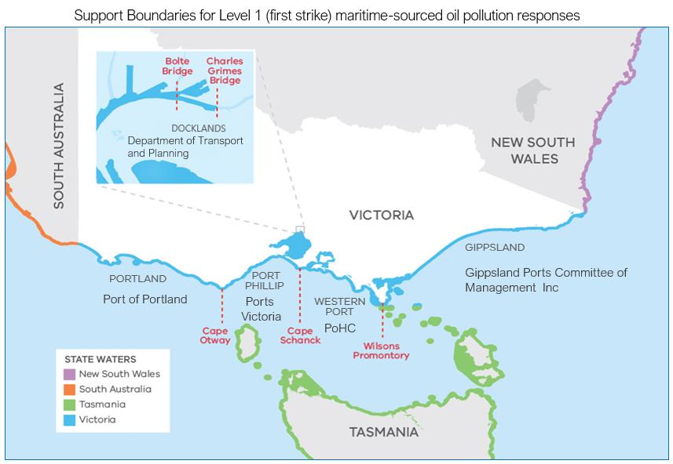

---
## Page 57

  
Page 56 
 
FRV/CFA Hazardous materials incidents marine jurisdictions 
 
FRV and CFA have different jurisdictional boundaries for hazardous materials response which are 
shown below.

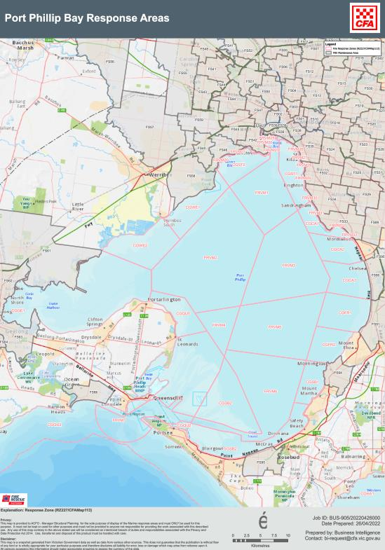

---
## Page 58

  
Page 57 
 
5.5 Appendix 5 - Glossary  
TERM 
DESCRIPTION 
Aboriginal cultural 
heritage 
As per the Aboriginal Heritage Act 2006 
Aboriginal places, Aboriginal objects and Aboriginal ancestral remains 
Agency 
A government agency or a non-government agency 
AMOS Plan 
As per the National Plan 
A plan managed by Australian Marine Oil Spill Centre (AMOSC) and outlines the cooperative 
arrangements for response to oil spills by Australian oil and associated industries. 
Bunker 
As per the National Plan 
a heavy fuel oil, intermediate fuel oil, blended distillate or diesel used as a vessel’s fuel. 
Bunkering 
operations 
Means the transfer between a vessel and a barge, other vessel or road tanker, including all activities 
preparatory and incidental to the transfer, of the following:  
• 
flammable and combustible fuel for main propulsion and auxiliary operations  
• 
lubricating and hydraulic oil for machinery  
• 
waste oils, sludge and residues  
• 
slops and tank washings  
• 
grey water and sewage. 
Class 1  
Emergency 
As per Emergency Management Act 2013 section 3 
(a) 
a major fire; or 
(b) 
any other major emergency for which Fire Rescue Victoria, the Country Fire Authority or the 
Victoria State Emergency Service Authority is the control agency under the State Emergency 
Response plan.  
Class 2 
Emergency 
As per Emergency Management Act 2013 section 3 
A major emergency which is not – 
(a) 
A Class 1 emergency; or 
(b) 
A warlike act or act of terrorism, whether directed at Victoria or a part of Victoria or at any   other 
State or territory of the Commonwealth: or 
(c) 
A hi-jack, siege, or riot 
(relates to major emergency of pollution/maritime casualty and H&NS) 
Class 3 Emergency 
As per the SEMP 
A warlike act or act of Terorism, whether directed at Victoria or part of Victoria or at any other State or 
Territory of the Commonwealth, or a hijack, siege, or riot. 
Chemical terminal 
As per the National Plan 
a chemical refinery and/or chemical storage/distribution facilities with access to a maritime facility, but 
not including the maritime facility. 
Command 
As per the National Plan 
the internal direction of the members and resources of an agency in performance of the organisation’s 
roles and tasks. Command operates vertically within an organisation. 
Commonwealth 
waters 
all waters in the territorial sea and EEZ seaward of 3 nautical miles from Australia’s baselines. 
Community 
As per the National Plan

---
## Page 59

  
Page 58 
a group with a commonality of association and generally defined by location, shared experience or 
function 
 
As per the Emergency Management Act 2013 
the coordination of agencies, including agencies who engage the skills and services of non-government 
organisations, which are responsible for managing or regulating services or infrastructure which is, or 
may be, affected by a major emergency. 
Control 
As per the National Plan 
the overall direction of emergency management activities during an emergency event. Authority for 
control is established in legislation or administratively and carries with it the responsibility for tasking 
organisations in accordance with the needs of the situation. 
Control Agency 
the agency or company assigned by legislation (Emergency Management Act 2013), administrative 
arrangements or within the relevant contingency plan, to control response activities for a maritime 
environmental emergency. The Control Agency will have responsibility for appointing one or more 
Controllers for maritime emergencies. This is the equivalent of Responsible Agency or Control Authority 
under AIIMS. 
Coordination 
 
As per the National Plan 
means the bringing together of organisations and other resources to support an emergency 
management response. 
Emergency 
 
As per Emergency Management Act section 2 
an event, actual or imminent, which endangers or threatens to endanger life, property or the 
environment, and which requires a significant and coordinated response. The term emergency and 
disaster are used interchangeably within the Australian Emergency Management Arrangements. 
Environment 
As per the National Plan 
the complex of physical, chemical and biological agents and factors which may impact on a person or a 
community, and may also include social, physical and built elements, which surround and interact with a 
community. 
First Strike 
 
As per the National Plan 
a prompt initial response to protect the environment that is intended to limit the effect of an incident until 
such time as other resources can be deployed in support. This capability may vary from location to 
location. 
Habitat 
As per the National Plan 
the natural home or environment of an animal, plant or other organism. 
Harbour Master 
As per the Marine Safety Act 2010 section 3 
(a) a licensed harbour master; or 
(b) any person authorised under section 229 to exercise any of the functions of the harbour master, if 
the person so authorised is acting in accordance with the authorisation. 
Hazardous and 
noxious substance 
(HNS) 
As per the National Plan 
any substance which, if introduced into the marine environment, is likely to create hazards to human 
health, to harm living resources and marine life, to damage amenities or to interfere with other legitimate 
uses of the sea. 
Hazardous materials 
As per the SEMP 
For the purposes of the SEMP, ‘hazardous’ is defined as any contaminants or materials that are harmful 
to human health (including substances that are dangerous goods as defined by Dangerous Goods Act 
1985), and ‘non-hazardous’ is defined as any contaminants or materials (not identified as ‘hazardous’) 
that are not harmful to human health (noting these may be harmful to the environment and/or 
biodiversity (including plants and animals)). Where there is any doubt, contaminants or materials are to 
be deemed hazardous until such time as the Control Agency or support agency confirm they are non-
hazardous

---
## Page 60

  
Page 59 
Incident 
As per the National Plan 
An event, occurrence or set of circumstances that: 
• 
Has a definite spatial extent. 
• 
Has a definite duration. 
• 
Calls for human intervention. 
• 
Has a set of concluding conditions that can be defined. 
• 
Is or will be under the control of an IC appointed to make decisions to control and coordinate the 
approach, means and actions taken to resolve the incident. 
Incident Controller 
As per the National Plan 
the individual responsible for the management of all incident control activities across an incident. 
Incident 
Management Team 
As per the National Plan 
The group of incident management personnel comprised of the Incident Controller and personnel 
appointed by the Incident Controller to be responsible for the overall control of the response to an 
incident. 
Industry 
 
As per the National Plan 
Unless already specified or defined in a particular context, means a business or commercial group or 
sector, or other socially valuable activity, such as fisheries, tourism, infrastructure, transport etc. and 
their representative groups. 
Incident Reports 
Situation reports, Pollution reports and Agency reports required under the Operational Plan (Part B). 
Internal waters 
As per the National Plan 
those waters that fall within the constitutional boundaries of the State. The waters which are capable of 
falling within these limits are described in s.14 of the Seas and Submerged Lands Act 1973 as ‘bays, 
gulfs, estuaries, rivers, creeks, inlets, ports or harbours which were, on 1 January 1901, within the limits 
of the States and remain within the limits of the States’. 
Local port 
means a port declared to be a local port by Order in Council under section 6 of the Port Management 
Act 1995. 
Local port manager 
For the purposes of this subplan ‘local port manager’ refers to the organisations with local port 
management responsibility outlined in Appendix 3. 
Marine pollution 
 
As per the National Plan 
Refers to any occurrence or series of events with the same origin, including fire and explosion, which 
results or may result in discharge, release or emission of oil or a hazardous and noxious substance, 
which poses or may pose a threat to the marine environment, the coastline, animals or other resource, 
and which requires an emergency action or immediate response.  
Under this plan, marine pollution refers primarily to situations that may arise from shore-based oil and 
chemical transfer facilities, shipping operations and/or the operation of an offshore petroleum facility. 
Maritime casualty 
As per the National Plan 
a collision of vessels, stranding or other incident of navigation, or other occurrence on board a vessel or 
external to it resulting in material damage or imminent threat of material damage to a vessel or cargo. 
Maritime emergency 
Potential and actual pollution of the sea or harm to the marine environment by oil or hazardous and 
noxious substance, originating from: 
• 
Maritime casualties requiring salvage and intervention, emergency towage and requests for a place of 
refuge. 
• 
Oil pollution or hazardous and noxious substance pollution incidents from vessels, oil or chemical 
terminals and offshore petroleum activities. 
• 
Marine pollution from floating or sunken containers of hazardous materials, or from unknown sources. 
• 
Debris originating from a maritime casualty, or physical damage caused by vessels. 
Maritime facility 
As per the National Plan 
a wharf or mooring at which a vessel can be tied up during the process of loading or unloading a cargo 
(or passengers). A maritime berth may be a sole user berth (such as a dedicated berth for an oil 
refinery) or may be a multiuser berth, such as a berth that handles general cargo, or one that handles 
bulk liquids such as petroleum for more than one user of the berth (sometimes known as a common-
user berth).

---
## Page 61

  
Page 60 
Maritime-sourced oil 
pollution 
Oil pollution that is spilled from a maritime based source eg. vessel, platform 
Offshore petroleum 
facility 
As per the National Plan 
a facility operating in accordance with the provisions of the Offshore Petroleum and Greenhouse Gas 
Storage Act 2006, or any relevant State/Northern Territory legislation. 
Offshore Petroleum 
Incident 
Coordination 
Framework 
Outlines the governance arrangements for the Offshore Petroleum Incident Coordination Committee 
(OPICC), including its purpose, membership and key protocols for member agencies. The OPICC is 
convened and chaired by the Department of Industry, Science and Resources. The purpose of the OPICC is 
to draw together expertise and capability from across government to guide strategic Commonwealth 
Government leadership in responding to a significant offshore petroleum incident originating in 
Commonwealth waters. 
Oil 
As per the Pollution of Waters by Oils and Noxious Substances Act, oil and oily mixture have the same 
meanings as in Annex I to the Convention 
As per the National Plan 
hydrocarbons in any liquid form including crude oil, fuel oil, sludge, oil refuse, refined products and 
condensates. 
Oil terminal 
 
As per the National Plan 
a petroleum refinery and/or petroleum storage/distribution facility with access to a maritime facility, but 
not including the maritime facility. 
Petroleum 
As per the National Plan 
includes oil and other substances extracted in the recovery of such substances, including LNG and 
LPG. 
Pilot 
As per Marine Safety Act 2010 
a person who does not belong to, but has the conduct of, a vessel. 
Place of refuge 
 
As per the National Plan 
a place where a ship in need of assistance can take action to enable it to stabilise its condition and 
reduce hazards to navigation, and to protect human life and the environment. 
Port  
 
As per Marine (Drug, Alcohol and Pollution Control) Act 1988 Part 1, includes any of the following 
waters, or any part of those waters: 
(a) any harbour or haven, whether natural or artificial; 
(b) any estuary, channel, river, creek or roadstead; 
(c) any navigable water in which vessels may lie for shelter or for the transfer of  
cargo or passengers; 
Ports Victoria 
Government organisation focused on navigational safety and leading the strategic development and 
operation of Victoria’s commercial ports and waterways. Also a Level 1 response control agency for 
maritime-sourced oil pollution. 
Port Management 
Body 
As per Marine Safety Act 2010, port management body means - 
(a) in relation to the port of Melbourne, Ports Victoria when it is performing functions and exercising 
powers in the port of Melbourne;  
(b) in relation to—  
(i) the waters declared under section 5 of the Port Management Act 1995 to be the port of Geelong, 
Ports Victoria, or, if there is an agreement with a channel operator in relation to those waters, that 
channel operator;  
(ii) the waters declared under section 5 of the Port Management Act 1995 to be the port of Portland, 
Ports Victoria, or, if there is an agreement with a channel operator in relation to those waters, that 
channel operator;  
(iii) port of Hastings waters, Ports Victoria, or, if there is an agreement with a channel operator in 
relation to those waters, that channel operator; 
Protection of the Sea 
Levy 
As per the National Plan

---
## Page 62

  
Page 61 
Is a statutory charge against ships, based on the ‘potential polluter pays’ principle and is used to fund 
the National Plan for Maritime Environmental Emergencies. Funds are also used to meet clean-up costs, 
which cannot be attributed to a known polluter. 
Prohibited Discharge 
As per Marine (Drug, Alcohol and Pollution Control) Act 1988 Section 34 
a discharge into State waters of— 
(a) 
oil; or 
(b) 
an oily mixture; or 
(c) 
an undesirable substance; 
Recovery 
As per the Emergency Management Act section 3 
The assisting of persons and communities affected by emergencies to achieve a proper and effective 
level of functioning. 
Responsible Agency 
As per the National Plan 
See Control Agency 
Responsible Party 
As per the National Plan 
Means the entity that has been identified as owning or having the legal responsibility for the vessel or 
facility that caused the incident. 
Response Agency 
Any agency with a role or responsibilities during an emergency response as defined in the State 
Emergency Management Plan (SEMP), whether the control agency or a support agency. 
Section 
As per the National Plan 
means the organisational level having responsibility for the key top-level functions of incident 
management: planning, public information, logistics and operations. 
SOLAS 
As per the National Plan 
Safety of Life at Sea – derived from the international convention for the Safety of Life at Sea. 
State 
As per the National Plan 
means, depending on context, one or more of the states or territories of Australia. 
State Response 
Controller/ 
State Controller 
As per definitions in the Emergency Management Act 2013 section 37 
State waters 
As per Marine (Drug, Alcohol and Pollution Control) Act 1988 section 2 
• 
the territorial sea adjacent to the State; and 
• 
the sea on the landward side of the territorial sea adjacent to the State that is not within the limits of the 
State; and 
• 
waters within the limits of the State. 
Support Agency 
As per the National Plan 
Means an agency or company that provides essential services, personnel, material or advice in support 
of the Control Agency during the response to a maritime environmental emergency. 
Terminal 
As per the National Plan 
(see also oil terminal and chemical terminal). 
Unit 
As per the National Plan 
means a small cell of people working within one of the sections undertaking a designated set of 
activities. 
Undesirable 
Substances 
As per the Pollution of Waters by Oils and Noxious Substances Act 1986 Part 2 
(a) any solid ballast, rubbish, gravel, earth, stone or wreck; or  
(b) any dangerous, flammable, corrosive or offensive substance, whether solid, liquid or gaseous; or

---
## Page 63

  
Page 62 
(c) any article or thing or any substance (whether solid, liquid or gaseous) which is capable of 
constituting a hazard to navigation or of preventing or hindering the proper use of State waters — but 
does not include oil or an oily mixture. 
Vessel (and /or ship) 
• As per the Marine Safety Act 2010 section 3 -  
any kind of vessel that is used, or capable of being used, in navigation by water, however propelled or 
moved, and includes— 
(a)  a barge, lighter, floating restaurant or other floating vessel; and 
(b)  an air-cushion vehicle, or other similar craft, that is used in navigation by water; and 
(c)  any aeroplane that is designed for and capable of being waterborne, for so long as that aeroplane is 
waterborne; and 
(d)  a lifeboat; and 
(e)  a thing being towed by a vessel; and 
(f)  an off-shore industry mobile unit within the meaning of the Commonwealth Navigation Act 2012—but 
does not include an off-shore industry mobile unit that is not self-propelled. 
• has several meanings within Australian legislation and international conventions, but for the purpose of this 
Plan means a vessel of any type whatsoever operating in the maritime environment, and includes hydrofoil 
boats, air cushion vehicles, submersibles and floating craft of any type.  
• Throughout this document the term vessel is preferred. Ship, ship-owner and shipping are used where 
these make sense in context or arise from an official or formal source.

---
## Page 64

  
Page 63 
5.6 Appendix 6 - Acronyms  
AIIMS 
Australasian Inter-service Incident Management System 
AMOSC 
Australian Marine Oil Spill Centre 
AMSA 
Australian Maritime Safety Authority  
AtoN 
Aids to Navigation 
CERA 
Community Emergency Risk Assessment 
CFA 
Country Fire Authority (Victoria) 
DEECA 
Department Energy, Environment and Climate Action (Victoria) 
DH 
Department of Health (Victoria) 
DTP 
Department of Transport and Planning (Victoria) 
EMC 
Emergency Management Commissioner 
EMCOP 
Emergency Management Common Operation Picture 
EMJPIC 
Emergency Management Joint Public Information Committee  
EMT  
Emergency Management Team 
EPA 
Environment Protection Authority Victoria 
ERR 
Earth Resources Regulation 
ERV 
Emergency Recovery Victoria 
ES&T 
Environmental, Scientific and Technical 
FRV 
Fire Rescue Victoria 
GED 
General Environmental Duty 
HNS 
Hazardous and Noxious Substance 
IC 
Incident Controller 
ICC 
Incident Control Centre 
IGA 
Intergovernmental Agreement  
IEMT 
Incident Emergency Management Team 
IMO 
International Maritime Organisation 
IMT 
Incident Management Team 
ISO container 
International Standard Organisation container generally for storing liquids 
JSOP 
Joint Standard Operating Procedure 
MCCU 
Maritime Casualty Control Unit 
MCO 
Maritime Casualty Officer 
MENSAR 
The Maritime Emergencies (Non-Search and Rescue) Plan 
MERC 
Municipal Emergency Response Coordinator 
MERCOM 
Maritime Emergency Response Commander 
MSV 
Maritime Safety Victoria 
National Plan 
the National Plan for Maritime Environmental Emergencies, and all policy, guidance and 
advisory documents produced and published in support. 
NEBA 
Net Environmental Benefit Analysis (replaced by SIMA) 
NEMO 
National Emergency Maritime Operations 
NOPSEMA 
National Offshore Petroleum Safety and Environmental Management Authority 
Non-SAR 
Non-Search and Rescue 
NSR 
Non-Search and Rescue 
NRST 
National Response Support Team

---
## Page 65

  
Page 64 
NRT 
National Response Team 
OSCA 
Oil Spill Control Agents 
OPEP 
Oil Pollution Emergency Plan 
POLREP 
Pollution notification Report 
PortSEMP 
Port Safety and Environment Management Plan 
PV 
Parks Victoria 
RCT 
Regional Control Team 
REMT 
Regional Emergency Management Team 
REMPC 
Regional Emergency Management Planning Committee 
RERC 
Regional Emergency Response Coordinator (VicPol) 
RMERG 
Regional Maritime Emergency Reference Group 
RSA 
Response Support Agency 
SCC 
State Control Centre 
SCME 
State Controller Maritime Emergencies 
SCRC 
State Crisis and Resilience Council 
SCT  
State Control Team 
SDO 
State Duty Officer 
SEMT 
State Emergency Management Team 
SEMP 
State Emergency Management Plan 
SIMA 
Spill Impact Mitigation Assessment   
SITREP 
Situation Report 
SMEWG 
State Maritime Emergencies (Non-Search and Rescue) Working Group 
SPLO 
Senior Police Liaison Officer 
SRT 
State Response Team 
ST Vic 
Safe Transport Victoria (formerly Transport Safety Victoria) 
VTS 
Vessel Traffic Service 
WPS 
Water Police Squad

