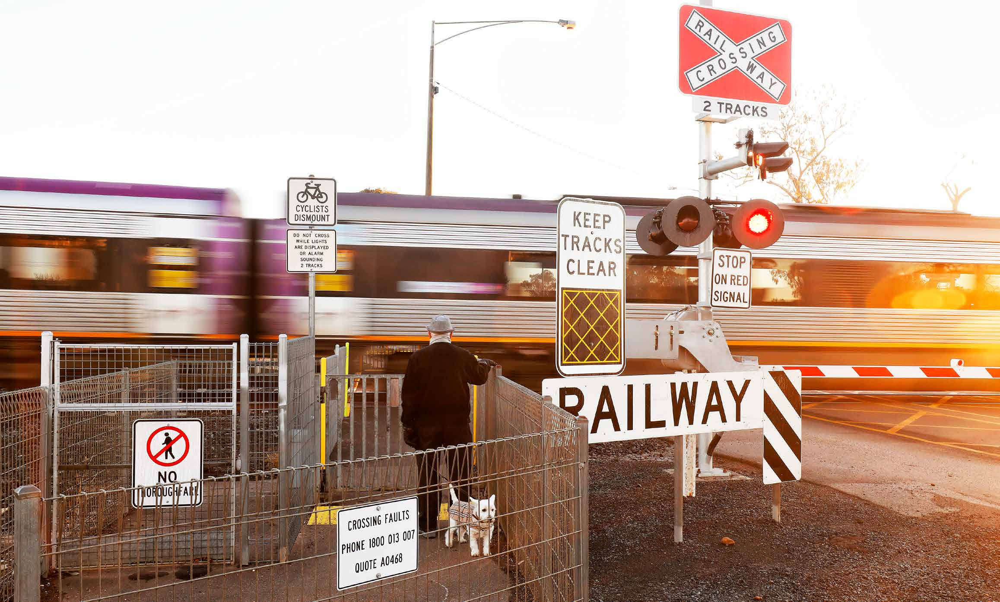
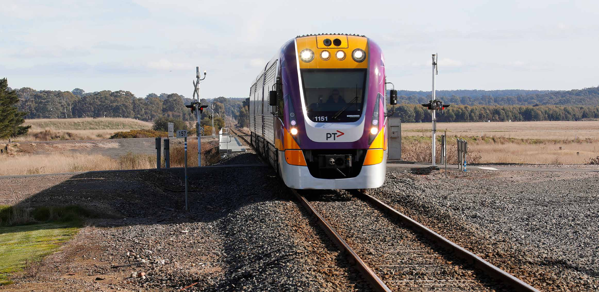
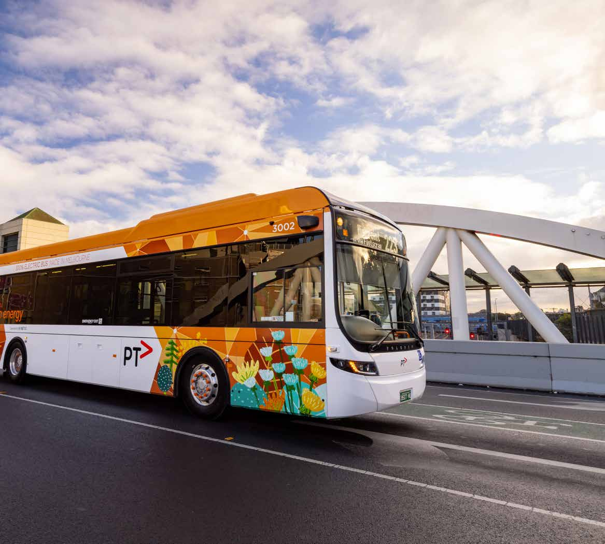
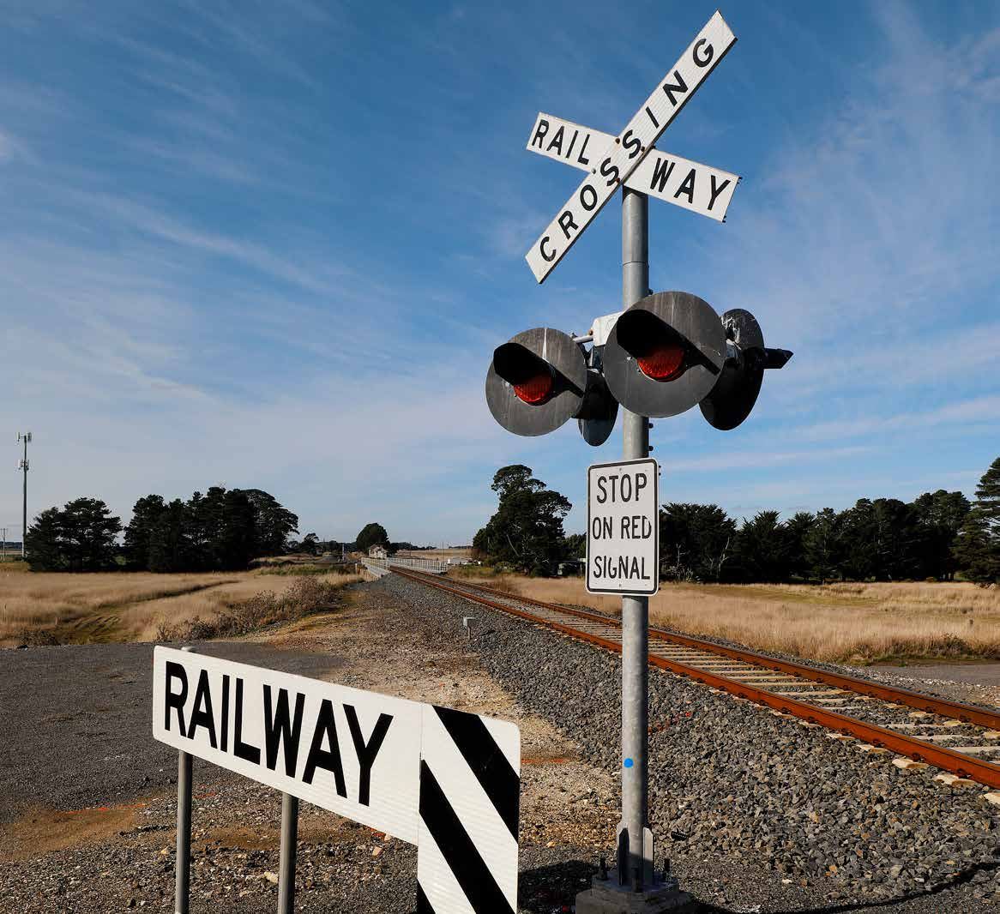
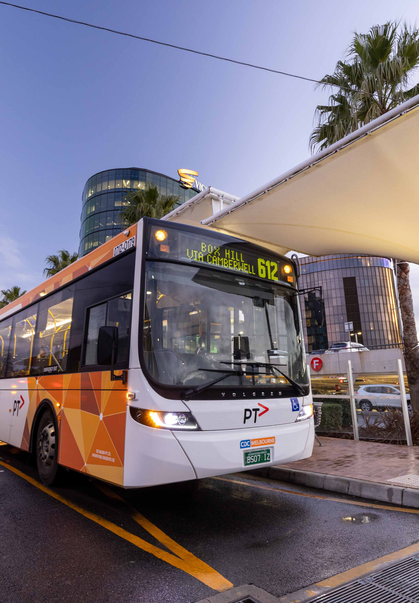
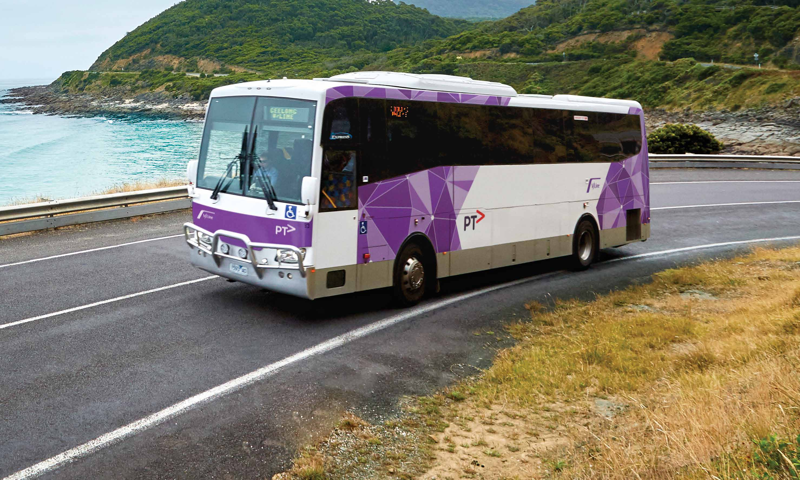
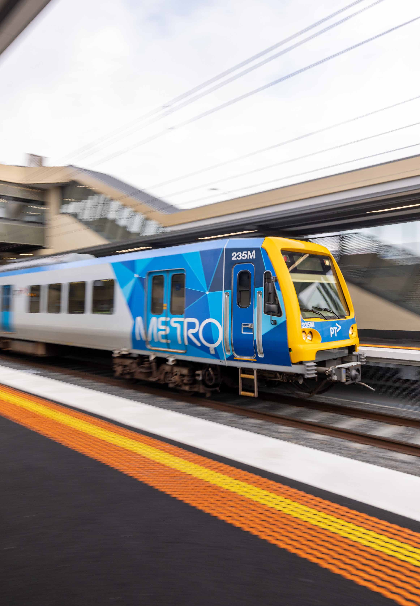
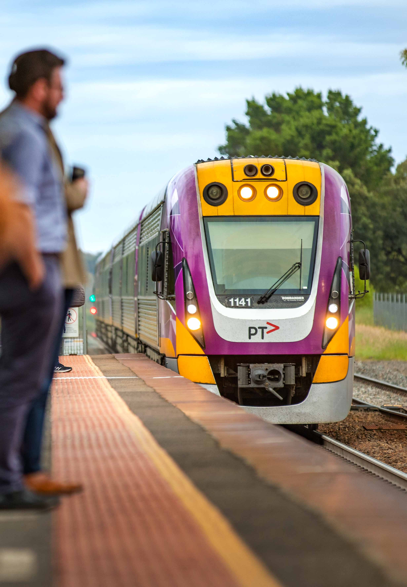

# State Emergency Management Plan — Public Transport Disruption Sub-Plan (November 2024)

> **Source**: Emergency Management Victoria
> **URL**: https://files.emv.vic.gov.au/2024-11/DTP%20SEMP_Public_Transport_Disruption_Sub-plan%20%28accessible%20document%29.pdf
> **Licence**: © State of Victoria; emergency-management practitioner reference
> **Retrieved**: 2026-05-07T23:44:26Z
> **SHA-256**: `9a69d2f03889facf6a01d5124688e77d5356b95a1fcd7db199867deee61b5249`
> *Converted from PDF to Markdown format.*

---
## Page 1

SEMP Public Transport 
Disruption Sub-Plan 
     Edition 3 – October 2024

---
## Page 2

 
Description of artwork 
Aaron (Gunaikurnai) ‘Movements Between the Five 
Clans’ 2019, acrylic on canvas. 
‘The tracks are going between the five clans of the 
Gunaikurnai and the hands are the symbols of my 
spirit travelling around the campsites.’ 
This artwork was created through programs provided 
by the Torch. The Torch provides art, cultural and 
arts industry support to Indigenous offenders and 
ex-offenders in Victoria. The Torch aims to reduce the 
rate of re-offending by encouraging the exploration 
of identity and culture through art programs to 
define new pathways upon release. 
ACKNOWLEDGEMENTS 
We proudly acknowledge Victoria’s First Nations 
people and their ongoing strength in practising 
the world’s oldest living culture. We acknowledge 
the Traditional Owners of the lands and waters 
on which we live and work and pay our respects 
to their Elders past and present. 
Authority 
This plan has been endorsed by the State Crisis and 
Resilience Council (SCRC) as a Sub-Plan to the State 
Emergency Management Plan on 10 October 2024. 
Authorised and published by 
Authorised and published by the Department of 
Transport and Planning, Melbourne October 2024. 
© The State of Victoria, Department of Transport 
and Planning 2024. 
This work is licensed under a Creative Commons 
Attribution 4.0 International licence. You are free to 
re-use the work under that licence, on the condition 
that images, photographs or branding, including the 
Victorian Coat of Arms, the Victorian Government 
logo and the Department of Transport and Planning 
(DTP) logo. To view a copy of this licence, visit 
creativecommons.org/licenses/by/4.0/. 
Disclaimer 
This publication may be of assistance to you, but the 
State of Victoria and its employees do not guarantee 
that the publication is without flaw of any kind or is 
wholly appropriate for your particular purposes and 
therefore disclaims all liability for any error, loss or 
other consequence which may arise from you relying 
on any information in this publication. 
Accessibility 
This document is in accessible format in PDF. The 
online version can be accessed at emv.vic.gov.au/ 
responsibilities/state-emergency-management-
plan-sub-plans. 
Document information 
Date of approval October 2024 
ISBN 978-0-7311-9341-7 (pdf/online/MS word) 
Version 
This is the third version of a state-level plan 
addressing public transport disruption 
arrangements. The first two versions were developed 
by the Department of Transport and Planning’s 
preceding departments – the Department of 
Economic Development, Jobs, Transport and 
Resources in 2016, and Department of Transport in 
2020, for public transport disruption emergencies. 
2

---
## Page 3

CONTENTS 
1. 
INTRODUCTION ................................................................... 5 
1.1 
Purpose..................................................................................................................... 5 
1.2 
Aim ................................................................................................................................ 5 
1.3 Preparation, approval and publication....................................... 5 
1.4 Audience.................................................................................................................. 5 
1.5 Definitions ..............................................................................................................6 
1.6 Legislation..............................................................................................................6 
1.7 
Contractual Arrangements ...................................................................6 
1.8 Linked plans .........................................................................................................6 
2. VICTORIA’S TRANSPORT SECTOR .......................7 
2.1 
The transport system................................................................................... 7 
2.2 Department of Transport and Planning..................................... 7 
2.3 VicTrack.................................................................................................................... 7 
2.4 Public transport operators......................................................................8 
2.5 Public transport disruptions.................................................................. 8 
3. MITIGATION .............................................................................. 9 
3.1 
Control agency planning and preparedness.........................9 
3.2 Response support agency planning  
and preparedness ........................................................................................10 
3.3 Public transport operator planning  
and preparedness ........................................................................................10 
3.4 Major infrastructure projects .............................................................. 11 
4. TRANSPORT COORDINATION GROUP.......... 13 
4.1 Purpose ................................................................................................................. 13 
4.2 Outputs ................................................................................................................... 13 
5. RESPONSE: DTP CONTROL 
ARRANGEMENTS .............................................................. 14 
5.1 
DTP’s control agency scenarios .......................................................14 
5.2 DTP’s control levels.......................................................................................14 
5.3 Appointment of controllers...................................................................14 
5.4 Level 1 – single operator response................................................. 15 
5.5 Level 2 – Department area of operation  
or regional tier activated .........................................................................17 
5.6 Level 3 – State tier activated ..............................................................19 
6. RESPONSE: DTP SUPPORT 
ARRANGEMENTS ............................................................. 23 
6.1 Role of public transport operators  
when DTP is a support agency ........................................................ 23 
6.2 State support levels ................................................................................... 24 
7. 
RECOVERY ............................................................................. 26 
7.1 
Transition to recovery ............................................................................. 26 
7.2 Recovery outcomes .....................................................................................27 
7.3 Agency roles and responsibilities across  
the lines of recovery ....................................................................................27 
8. PLAN PREPARATION AND APPROVAL .......... 29 
8.1 
Consultation and engagement ....................................................... 29 
8.2 Statement of assurance ........................................................................ 29 
8.3 Review and urgent updates................................................................ 29 
APPENDIX A – ACRONYMS...............................................30 
APPENDIX B – DEFINITIONS ............................................ 31 
APPENDIX C – RESPONSE LEVELS  
AND TRIGGER POINTS .........................................................34 
3 
Public Transport Disruption Sub-Plan / Edition 3 – October 2024

---
## Page 4

  
4

---
## Page 5

1.1 Purpose 
This State Emergency Management Plan (SEMP) 
Sub-Plan is for significant and protracted public 
transport disruptions, caused by a transport 
infrastructure or signalling failure that is not  
a result of another emergency. The Public Transport 
Disruption Sub-Plan applies to emergencies only 
and does not relate to planned disruptions or 
operational incidents. 
This Sub-Plan complements the SEMP by providing 
detail of specific arrangements for public transport 
disruptions, where DTP is either the control agency 
or a support agency. 
For the purposes of the Emergency Management  
Act 2013 (Vic) (EM Act 2013) and Ministerial Guidelines, 
statewide response arrangements for a public 
transport disruption are implemented at Level 3  
of this Sub-Plan. Operational and regionally based 
events are managed in accordance with Level 1 
(operator) and Level 2 (departmental) response. 
These are included in the Sub-Plan for completeness 
and for support agency functions, noting the majority 
of public transport disruptions in Victoria are a 
consequence of other emergencies. Where control  
for an event is vested in another agency under the 
SEMP (or alternative Sub-Plan) this plan will be used 
as a guide and will not be formally enacted. 
This Sub-Plan does not duplicate the content of the 
SEMP or other plans referenced. 
The Department of Transport and Planning (DTP) 
has developed this Public Transport Disruption 
Sub-Plan in consultation with the transport sector 
and other stakeholders. This Plan is written in 
accordance with the EM Act 2013 and the Ministerial 
Guidelines for Preparing State, Regional and 
Municipal Emergency Management Plans. 
For the purposes of this Sub-Plan, public transport 
disruptions do not include maritime, marine 
passenger transport or aviation transport modes. 
Emergencies impacting marine passenger transport 
and ferry services are covered by the SEMP (for 
search and rescue arrangements), and the SEMP 
Maritime Emergencies (Non-Search and Rescue) 
Sub-Plan for vessel casualties. 
1.2 Aim 
In keeping with all emergency management plans  
in Victoria, this Sub-Plan aims to: 
– foster a sustainable and efficient emergency 
management system that minimises the 
likelihood, effect and consequences of a public 
transport disruption, and 
– establish governance arrangements for public 
transport disruptions which occur as a result of 
emergencies that: 
– clarify the roles and responsibilities  
of agencies, including public transport 
operators, 
– facilitate cooperation between agencies, 
including public transport operators, 
– provide for the coordination of emergency 
management arrangements with the public 
transport sector. 
1.3 Preparation, approval  
and publication 
The State Crisis and Resilience Council (SCRC) 
approved this sub-plan to take effect on 10 
October 2024 and it is available on the Emergency 
Management Victoria (EMV) website. This Plan will 
be reviewed no later than October 2027. 
EMV will provide a copy of the published plan to the 
State Library of Victoria within two months of the 
date of publication, in accordance with the legal 
deposit requirements in section 49 of the Libraries 
Act 1988 (Vic). 
1.4 Audience 
The primary audience for this Sub-Plan is anyone 
involved in the management and governance of 
Victorian public transport disruptions including 
employees of DTP, public transport operators, 
government departments and emergency service 
agencies. 
1. INTRODUCTION 
5 
Public Transport Disruption Sub-Plan / Edition 3 – October 2024

---
## Page 6

1.5 Definitions 
This plan refers to: 
– ‘Transport sector’, when collectively referring to 
the organisations providing transport services 
in Victoria. This is broader than the scope of this 
plan and includes road transport and freight. 
– ‘Public transport operator’ when referring to 
the individual organisations responsible for 
specific aspects of the transport network which 
carry passengers, including the train network 
(metropolitan and regional), tram network and 
bus network. 
– ‘Public transport disruption’, when referring to a 
situation where the public transport operator’s 
ability to operate its contracted scheduled 
services is impeded, due to an emergency. 
Acronyms and further definitions used in this Sub-
Plan are listed in Appendix A – Acronyms, 
and Appendix B – Definitions. 
1.6 Legislation 
The following key legislation applies to the 
management of public transport disruption 
emergencies: 
– Emergency Management Act 2013 (Vic) 
– Rail Safety National Law Application Act 2013 (Vic) 
– Transport Integration Act 2010 (Vic). 
Other legislation may relate to safety or specific 
aspects of the transport operations. 
1.7 Contractual 
Arrangements 
Public transport services in Victoria are managed 
via franchise or service level agreements. While 
the arrangements in this Sub-Plan are consistent 
to the greatest extent possible, should operational 
discrepancies arise, the EM Act 2013 (s. 60AK) notes 
that contractual arrangements will take precedence. 
1.8 Linked plans 
Other plans and procedures exist which set out 
coordination arrangements during emergencies. 
To avoid duplication, the detail of the following 
linked plans and procedures is not repeated within 
this Sub-Plan. 
State Emergency Management Plan (SEMP) 
The SEMP outlines the emergency management 
arrangements in Victoria to inform planning at 
state, regional and municipal levels. It provides 
a coordinated and comprehensive approach 
to emergency management at the state level 
for mitigation of, response to and recovery 
from emergencies and specifies the roles and 
responsibilities of agencies. 
DTP Emergency Management Plan 
DTP has an Emergency Management Plan that 
outlines its role and internal governance structures 
for managing emergencies. 
Public transport operator emergency 
and crisis management plan 
Each public transport operator is required to plan, 
maintain and exercise an emergency and crisis 
management plan in accordance with its Franchise 
or Service Level Agreement with DTP and regulatory 
requirements. 
Public transport operator procedures 
Each public transport operator has operational 
procedures/plans to prepare for and respond to a 
transport service disruption – including restoration 
of services. 
Regional and Municipal Emergency 
Management Plans 
Regional and municipal emergency management 
planning committees must produce regional and 
municipal emergency management plans (REMPs 
and MEMPs). 
REMPs and MEMPs include regional and municipal 
agency arrangements for the response to transport 
service disruption, where appropriate. 
6

---
## Page 7

2.1 The transport system 
Victoria’s transport system is a geographically 
spread and complex network of public transport and 
freight rail infrastructure that underpins much of the 
state’s economic and social functioning. Victoria’s 
public transport system comprises heavy rail (train), 
light rail (tram), and buses, and may rely on parts of 
the road network. 
There are key nodes which are critical to the 
operation of the system. These include bridges, 
intermodal hubs and depots. Loss of these nodes 
could significantly impact the community and the 
Victorian economy. 
To maintain safe, effective and reliable operations, 
the tram and train networks rely on a range 
of physical, electromechanical and electronic 
infrastructure elements, including extensive 
communications infrastructure. 
Loss of Victoria’s transport system would have a 
downstream impact on many critical services that 
rely on the transport sector for the movement of 
goods and transport of essential workers. At the 
same time, the transport sector has significant 
dependencies on the energy sector for electricity 
and liquid fuels as an input to all transport modes. 
2.2 Department of Transport 
and Planning 
DTP is responsible for planning, building and 
operating an integrated, sustainable and safe public 
transport system for Victoria. 
The Head, Transport for Victoria (Head, TfV) is the 
legal entity responsible for coordinating, providing, 
operating and maintaining the public transport 
system and the road networks in Victoria. The 
Head, TfV is a statutory authority (rather than a 
person) established by the Transport Integration 
Act 2010 (Vic) section 64A and incorporates the 
road management responsibilities of the Roads 
Corporation (VicRoads). The Secretary DTP is 
accountable for the functions of the Head, TfV. 
As stated in the SEMP, the Head, TfV provides 
oversight of public transport operations, control 
centres and communication networks to ensure they 
are functioning effectively. These include the: 
– Melbourne metropolitan rail network (maintained 
via franchise agreement) 
– Melbourne tram network (maintained via 
franchise agreement) 
– Melbourne metropolitan, regional and 
Department of Education school bus networks 
– Intrastate rail network (maintained and operated 
by V/Line) 
– Interstate rail lines (maintained and operated by 
the Australian Rail Track Corporation). 
Section 3.1 of this Sub-Plan describes how DTP 
delivers its control agency function. 
The Secretary DTP is the officer-in-charge (DTP OIC) 
for the purposes of the EM Act 2013 and the SEMP, 
and is a member of the State Crisis and Resilience 
Council (SCRC). 
2.3 VicTrack 
VicTrack provides a telecommunications network to 
support Victoria’s train and tram networks. 
VicTrack owns Victoria’s rail transport land, 
assets and infrastructure. VicTrack leases 
land, infrastructure and assets to DTP for tram, 
metropolitan and regional train services. In turn, 
DTP operates public transport services via franchise 
or service level agreements. The respective public 
transport operator is responsible for managing and 
maintaining the assets. 
2. VICTORIA’S TRANSPORT SECTOR 
7 
Public Transport Disruption Sub-Plan / Edition 3 – October 2024

---
## Page 8

2.4 Public transport 
operators 
Public transport operators are responsible for 
delivering, or facilitating the delivery of, public 
transport services across the passenger transport 
modes of rail (both metropolitan and regional), tram, 
road (metropolitan and regional buses) and ferries. 
They provide these services in accordance with a 
relevant franchise or service level agreement with 
DTP and include providing communication and 
advice on disruptions or service alterations 
to passengers during an emergency event. 
Under these agreements and relating to the 
services they operate, each public transport 
operator is responsible for the mitigation of, 
preparedness for, and the on-ground response 
to service disruptions, and for the restoration 
and recovery of these services. A public transport 
operator may provide support to other public 
transport operators facing service disruption and 
can be directed (at Departmental cost) to provide 
additional services or support where it has capacity 
to do so. 
Each public transport operator outlines its 
arrangements for undertaking these responsibilities 
in its emergency and crisis management plan, 
required under the agreement. 
2.5 Public transport 
disruptions 
Public transport disruptions can be planned or 
unplanned. Public transport operators must notify 
passengers of planned and unplanned disruptions 
and provide them with alternate travel details and 
advice as soon as reasonably practicable (see s 3.3.1 
below). While the causes of unplanned disruptions 
can be emergency or non-emergency situations, 
this plan applies to emergencies only, including 
severe weather events (where DTP would be a 
support agency), or significant public transport 
asset faults/ failures. 
Planned disruptions due to scheduled asset 
maintenance by public transport operators or the 
occupation of parts of the rail and road network for 
major transport infrastructure projects are outside 
the scope of this plan. 
2.5.1 Potential consequences of a public 
transport disruption 
Most significant public transport disruptions are 
likely to be caused by other emergencies (see 3.2). 
However, the potential consequences of a transport 
service disruption (however caused) may include: 
– people consequences 
– injury/death 
– crowding and congestion – particularly where 
a shift to other modes is needed 
– impact on community members who rely on 
public transport, including those at greater 
risk in emergencies 
– passenger health and safety risks (including 
from heatwave/ weather impacts) 
– security risks 
– economic consequences 
– impact on the movement of essential workers 
– impact on the movement of goods 
– impact on supply chains 
– environmental consequences 
– damage to roads, bridges, tunnels and 
facilities 
– damage to railway and tram lines, network 
infrastructure, signalling, communications, 
facilities and assets 
– damage to other public transport 
infrastructure 
– public administration consequences 
– loss of staff and contractors 
– reduction in services and ability of public 
transport operators to meet service 
performance targets 
– absenteeism 
– social consequences 
– impact on transport routes and the movement 
of people for school, work, shopping, 
healthcare and medical appointments, family 
or social interaction etc 
– restricted access to essential goods/freight. 
8

---
## Page 9

3.1 Control agency planning 
and preparedness 
The SEMP lists control agencies for each form  
of emergency. 
The EM Act 2013 defines the Control Agency as the 
agency with primary responsibility for responding 
to a specific form of emergency. The SEMP adds 
that the control agency is also responsible for 
establishing the management arrangements for  
an integrated response to the emergency. 
The SEMP prescribes that DTP is the control agency 
for essential service disruption to public transport, 
major arterial roads, bridges, tunnels and rail networks. 
Whilst DTP is responsible for management and 
coordination of the event, it is important to note 
that most public transport disruptions are a 
consequence of emergencies where there is another 
control agency. Circumstances where DTP is the 
control agency generally include infrastructure 
failures or protracted and widespread loss of critical 
train/tram controlling or signalling systems. 
DTP undertakes its responsibility by: 
– coordinating an effective response by the public 
transport operators and providing assurance to 
the Secretary DTP that effective control has been 
established (refer to Appendix B – Definitions for 
a definition of ‘effective control’), 
– making sure that the public transport operator 
response is timely and properly coordinated, in 
liaison with Departmental emergency portfolio 
leads and emergency services, as necessary, and 
– providing Whole of Victorian Government (WoVG) 
guidance and assistance to public transport 
operators or other agencies, where required, to 
bring events to a satisfactory conclusion for the 
Victorian community. 
The SEMP identifies that DTP will respond by: 
– providing immediate assistance or support in co-
ordination of private rail, tram, bus, contracted 
ferry organisations, road contractor and other 
organisations related to emergencies involving 
loss of life, injury to persons, fire, hazardous 
chemical accidents, general policing incidents 
and other major emergencies, 
– providing and facilitating professional and 
skilled engineering and technical emergency 
teams/experts, equipment and material to other 
emergencies from either DTP, public transport 
operators or contractors as appropriate, 
– providing relevant support to other agencies  
in the management of emergencies including  
but not limited to information, expertise, 
specialist equipment, and facilitating access  
to networks, and 
– liaising with relevant industry sectors to facilitate 
response to a disruption to essential services, 
except for a disruption to roads. 
This Sub-Plan has been developed to address  
DTP’s responsibility as control agency to develop  
a hazard-specific response plan for transport 
service disruptions. 
Additionally, in preparedness for emergencies,  
DTP will: 
– prepare, maintain and exercise emergency 
management plans, 
– provide leadership to the sector in the 
development, implementation and evaluation 
of multi-agency exercises, including annual 
public transport operator critical infrastructure 
exercises, according to Part 7A of the EM Act 2013, 
– chair and participate in public and private sector 
emergency committees, 
– participate in state, regional and national (where 
required) emergency management meetings, 
forums, and/or exercises to provide advice  
on behalf of the public transport sector, 
– maintain readiness to coordinate the emergency 
response by public transport operators, 
– plan, with other agencies, to manage incidents  
on major arterial roads, including planning 
diversion routes for different classes of vehicles, 
– assist public transport operators to enact  
their emergency and crisis management plans 
when required, 
3. MITIGATION 
9 
Public Transport Disruption Sub-Plan / Edition 3 – October 2024

---
## Page 10

– lead and participate in sector specific 
preparedness briefings including: 
– summer season preparedness briefings 
– briefings on whole-of-government emergency 
preparedness 
– regional and state tier emergency 
management information updates 
– briefing transport minister/s in relation to 
emergency preparedness and mitigation. 
Public transport operator preparedness is outlined 
in section 3.3. 
3.2 Response support 
agency planning 
and preparedness 
Many public transport disruptions occur as a 
consequence of other emergencies, controlled by 
other agencies. These other emergencies include: 
– an earthquake, flood, windstorm, heatwave 
or another natural event 
– a fire 
– an explosion 
– a road accident or any other accident 
– a plague, pandemic, epidemic or contamination 
(including radiological/biological) 
– a warlike act or act of terrorism 
– a hi-jack, siege or riot 
– a cyber-security attack 
– failure of infrastructure 
– an electricity outage. 
In these emergencies DTP is a response support 
agency, in consultation with public transport 
operators. The role of response support agencies is 
listed in the SEMP. 
Response support agencies are required to 
plan to act in line with the agency’s legislative 
and administrative responsibilities and SEMP 
arrangements. 
3.3 Public transport 
operator planning 
and preparedness 
3.3.1 Public transport operator 
agreements with DTP 
DTP has an agreement with each public transport 
operator for the provision of services and these 
include the requirement for each operator to 
plan, maintain and exercise emergency and 
crisis management plans in accordance with its 
regulatory requirements, as well as a business 
continuity plan. The public transport operator 
is accountable for ensuring the adequacy of its 
plans, including conducting an annual review. 
In addition to agreements with the public 
transport operators, the Government also has 
a services and development agreement with 
Southern Cross Station. 
Further, in preparedness for emergencies, public 
transport operators and stakeholders will: 
– participate in multi-agency exercises, 
– participate in public and private sector 
emergency management committees, 
– participate in state, regional and national (where 
required) emergency management meetings, 
forums, and/or exercises to provide advice 
on behalf of the public transport sector, 
– undertake seasonal risk mitigation activities 
and maintain readiness to respond, 
– participate in preparedness briefings where 
held, including: 
– summer season preparedness briefings 
– briefings on whole-of-government 
emergency preparedness 
– regional and state tier emergency 
management information updates 
– input to briefing transport minister/s in relation 
to emergency preparedness and mitigation. 
10

---
## Page 11

Each public transport operator is also required to 
notify public transport disruptions to DTP, in line with 
existing processes and procedures. The following 
updates are coordinated by DTP and public transport 
operators to the community during an emergency: 
– notification of network disruptions, 
– provision of advice on alternate travel options, 
– provision of safe alternate travel services. 
3.3.2 Maintenance schedules  
and routine inspections 
Each public transport operator maintains regular 
maintenance schedules and routine inspections 
relating to infrastructure they own or manage. 
A well-maintained system will increase passenger 
comfort and improve reliability by reducing the risk 
of potential power outages and signal failures so 
far as reasonably practicable, thus reducing the 
number of delayed trains providing a safer and 
more punctual service network. Asset renewal and 
upgrades include: 
– modernised signalling systems, 
– bridge replacement works, 
– rail grinding on the regional network, 
– auditing of rail easement fire mitigation 
programs, and 
– adverse weather delay protection including 
lightning strike and track buckling in hot weather. 
3.4 Major infrastructure 
projects 
Before this Sub-Plan’s next regular review,  
Victoria is delivering over 201 major road and  
rail projects, including: 
– the Metro Tunnel, a second underground  
railway for Melbourne, with 5 new stations 
– removal of 110 level crossings across Melbourne 
– the West Gate Tunnel, an alternative to the  
West Gate Bridge 
– the North East Link, linking Melbourne’s  
freeway network 
– major road upgrades around Victoria, including 
new roads, road widenings, new bridges and 
major freeway upgrades 
– major rail upgrades across the network 
These projects and potential future projects may 
result in, or be affected by, emergencies during their 
construction phase. The Victorian Infrastructure 
Delivery Authority (VIDA) will implement relevant 
emergency and crisis management plans, where 
applicable, in the event of an emergency affecting key 
projects. VIDA’s role will be responsible for overseeing 
the safe delivery of the transport infrastructure 
program through its project delivery partners. 
VIDA’s own crisis management plan outlines how it will 
undertake reporting processes to DTP, government 
and other emergency services for either an external 
emergency event or a VIDA crisis event. Where 
relevant, a VIDA representative would be embedded 
in DTP’s emergency management structures. 
The delivery of or significant changes to these 
projects may trigger an out-of-cycle review or 
update of this Sub-Plan. 
11 
Public Transport Disruption Sub-Plan / Edition 3 – October 2024

---
## Page 12

 
12

---
## Page 13

Where multiple public transport operators are affected by an emergency,  
a transport coordination group (TCG) – or a consultative group which  
includes a subset of public transport operators depending on the nature  
of the disruption – may be activated to coordinate actions across the sector. 
1. 
The process for appointing the DTP SAC and the DTP RAC, where required, is contained within the DTP Emergency 
Management Plan. 
DTP will convene a TCG if formally acting as a 
support agency for another statewide emergency, 
unless other standing arrangements are in place  
via the SEMP or another specific Sub-Plan. 
4.1 Purpose 
A TCG may be convened to coordinate the 
preparedness, readiness, response or recovery plans 
for activities impacting the transport network during 
support or control emergency arrangements. The 
TCG is a transport-specific sub-group at incident 
level, however can feed into the broader Emergency 
Management Team (EMT) as required. 
During an emergency, or in readiness for  
an emergency: 
– DTP provides information on the state situation, 
the State (or Regional or Area of Control) 
Controller’s intent and the incident objectives 
– public transport operators provide information 
on the activities they intend to undertake to 
address the disruption, reinstate infrastructure  
or otherwise support the relevant controller. 
TCG information contributes to situation awareness 
and intelligence gathering, identifying the actions 
of the sector in response to and to manage the 
emergency or threat. This includes identification  
and management of risks across the sector in 
alignment with government priorities. 
The individual public transport operator 
and member organisation is responsible for 
implementing actions arising from a TCG and will 
report through their internal command structures. 
4.2 Outputs 
The outputs of any TCG meeting may be  
presented to: 
– DTP’s executive emergency management 
oversight and governance group, and the 
Executive or internal governance of any operator 
or agency involved, 
– the State EMT (SEMT) by the DTP State Agency 
Commander (SAC)1 or delegate, 
– the relevant Regional EMT (REMT) by DTP 
Regional Agency Commander (RAC) or delegate, 
– the relevant public transport emergency 
management officer or delegate. 
4. TRANSPORT COORDINATION GROUP 
13 
Public Transport Disruption Sub-Plan / Edition 3 – October 2024

---
## Page 14

This section outlines the arrangements for control, command, 
coordination, consequence management, communications 
and relief for emergencies where DTP is the control agency. 
Relief is defined in the SEMP as the provision 
of assistance to meet the essential needs of 
individuals, families and communities during and 
in the immediate aftermath of an emergency. The 
SEMP sets out relief responsibilities for government 
departments and agencies, the principles for the 
coordination and delivery of relief, and contains 
information on broadscale relief considerations 
that may be required during a public transport 
disruption emergency. 
Relief is a component of response per the SEMP. 
The extent and nature of the consequences 
of an emergency event will dictate the relief 
support required as described in the SEMP. 
5.1 DTP’s control 
agency scenarios 
Public transport disruption situations where DTP 
 is the control agency include: 
– infrastructure failure, (not associated with 
severe weather or other emergencies where 
there is another control agency), including 
communication failure and power outages 
at major transport hubs, 
– network delays and service outages caused 
by infrastructure faults, operator issues/ 
industrial action, 
– telecommunications disruptions – loss of critical 
train/tram controlling or signaling systems. 
Public transport disruptions which occur as a 
consequence of another emergency are managed 
through control arrangements under the SEMP, or 
the relevant Sub-Plan. In this instance, DTP and 
operators will act as a support agency. Section 6 of 
this Sub-Plan provides further information. 
5.2 DTP’s control levels 
In line with the SEMP, Victoria has three operational 
tiers (incident, regional and state) with the option of 
an ‘area of operations’ being declared to manage 
a complex emergency that may be geographically 
located over several municipalities or several regions. 
These tiers are usually activated in line with the 
following levels to emergencies controlled by DTP: 
– Level 1 – Single operator response, 
– Level 2 – Regional response or Area-of-
Operations (AoO) response, 
– Level 3 – State tier response. 
5.3 Appointment 
of controllers 
Persons to perform the role of State Controller, 
Regional Controller or AoO Controller if required 
are to work on behalf of the Secretary DTP (as the 
representative of the Victorian State Government), 
rather than on behalf of their agency. 
The Secretary DTP is to ensure there is an 
appropriate trained, accredited and experienced 
State Controller appointed where required and is to 
provide the Emergency Management Commissioner 
(EMC) with their details. 
The State Controller has all the powers of the control 
agency officer in charge (OIC). The State Controller 
appoints Regional Controllers as required. The 
Regional Controller has all the powers of the control 
agency OIC. The State Controller in consultation 
with the Secretary DTP may appoint a Deputy State 
Controller/s as Subject Matter Experts to support the 
Controller and response. 
5. RESPONSE: DTP CONTROL 
ARRANGEMENTS 
14

---
## Page 15

AoO Controllers, if required, will be appointed  
by the State Controller in consultation with the 
Secretary DTP. They may also be sourced from 
public transport operators. 
These persons may be sourced from across 
the transport sector or broader emergency 
management sector (with their agreement) and 
are to be confirmed by the Secretary DTP. The 
person to whom control is transferred must agree 
to the transfer and it must be enacted through an 
instrument of appointment. 
The person to whom control is transferred then 
acquires the powers and responsibilities as specified 
in the instrument of appointment. Where control 
is transferred to person or persons from another 
agency, DTP must supply an experienced Subject 
Matter Expert (SME) as Deputy Controller. 
All persons must be suitably trained, qualified 
and experienced to perform the role and remain 
current with the Victorian emergency management 
arrangements. 
The Secretary DTP must notify the EMC of the 
appointment of a State Controller. 
5.4 Level 1 – single  
operator response 
Typical Level 1 scenarios are operational incidents. 
State level control arrangements under this  
Sub-Plan are not activated for Level 1 scenarios. 
These scenarios may include: 
– cancellation of services 
– rolling stock or network infrastructure faults  
or emergencies 
– minor infrastructure and resource planning 
issues. 
A Level 1 response involves: 
– response by a single public transport operator. 
This may include limited support from other 
agencies, such as assistance with alternative 
transport options 
– little or no community consequences 
– normal resolution of services within  
a 4-hour period. 
At Level 1, a public transport disruption is normally 
managed by the public transport operator as 
part of business-as-usual arrangements, through 
the exercise of its operational or emergency 
management plans in consultation with DTP  
as required. 
Multiple Level 1 responses may occur concurrently.  
A Level 2 response and the activation of a TCG 
should be considered where: 
– the incident response becomes an emergency 
and is anticipated to last for more than 4 hours, 
or 
– multiple public transport operators are using  
the same support resources/services, or 
– there is a risk of consequences or impacts  
of the emergency becoming more serious, or 
– the actions/public communications of  
multiple public transport operators need  
to be coordinated. 
15 
Public Transport Disruption Sub-Plan / Edition 3 – October 2024

---
## Page 16

FUNCTION 
DESCRIPTION  
(LEVEL 1) 
RESPONSIBLE PERSON 
Command 
The operator’s normal supervisory structure applies. 
Site manager – public 
transport operator 
Control 
An Incident Controller is only required where multiple 
agencies are involved, or the impacts or consequences 
may significantly escalate. 
The site manager may concurrently perform 
the command and control functions. 
Incident Controller (public 
transport operator) 
Oversight of 
control 
Oversight of effective control on behalf of DTP 
as the control agency. 
Department Transport 
Operations Centre (TOC) 
supported as required by the 
DTP State Agency Commander 
Coordination 
Generally not required. 
Where required, support resources are sourced from 
the local area. 
Incident Emergency Response 
Coordinator (Victoria Police) 
Communication 
Advice to passengers of network disruptions 
and advice on alternate travel options. 
Public transport operators site 
manager / Incident Controller 
Consequence 
management 
Minimal customer, public or infrastructure impact. 
Public transport operator site 
manager / Incident Controller 
Relief 
Information and support to customers, where required. 
Provision of immediate health, wellbeing, financial or 
essential needs of affected persons. 
Public transport operators 
As outlined in the SEMP 
Support to the 
controller 
Support to the site manager / Incident Controller 
(e.g., assistance with communications, provision 
of relief etc). 
Normal public transport 
operator business support 
functions 
Notification 
Notification to DTP and subsequent updates and 
eventual ALL CLEAR via standard communication tool 
(i.e. SMS or similar). 
Public transport operator site 
manager / Incident Controller 
Recovery 
Restoration of normal services 
Public transport operator site 
manager / Incident Controller 
Each public transport operator is required to provide the following information to the community and DTP: 
– notification of network disruptions 
– provision of advice on alternate travel options 
– provision of safe alternate travel services. 
16

---
## Page 17

5.5 Level 2 – Department 
area of operation or 
regional tier activated 
A Level 2 response to a public transport disruption 
may be required where the emergency: 
– may have (including the risk of) a medium-term 
impact on critical infrastructure 
– requires a limited response by multiple public 
transport operators 
– may have (including the risk of) an impact on the 
community for longer than 4 hours. 
Typical Level 2 response scenarios where DTP may 
be the control agency include: 
– prolonged telecommunication outage possibly 
causing major critical (train/tram controlling) 
network signalling issues 
– disruption caused by capital works 
– a situation where a public transport operator is 
unable to deliver services, and/or the services of 
multiple public transport operators are affected, 
– transport disruption situations anticipated  
to take longer than 4 hours to resolve, or  
through timing will have significant impacts  
on the community. 
A Level 2 transport service disruption is managed 
through activation of Department AoO and/or 
via regional control arrangements – but may be 
managed at the Department level or State tier under 
certain circumstances. Note that this is in addition 
to the response by public transport operators at the 
incident tier. 
A Level 2 response can potentially escalate into 
a Level 3 response. Control of a Level 2 transport 
service disruption must be transferred to the State 
tier (i.e, become a Level 3 incident) as soon as 
possible if: 
– the scenario shows clear potential to become 
a major emergency (refer to Appendix B – 
Definitions) 
– the DTP AoO or Regional Controller needs 
immediate specialist/additional support 
– several similar emergencies are expected within 
the area and are best managed as a single 
control structure. 
5.5.1 Level 2 – Regional tier activated 
The Regional tier (and/or State tier) is activated for 
a Level 2 response where multiple agency support 
within a Victorian government region is needed. 
Activation would be determined by DTP’s State 
Controller in consultation with DTP and the EMC. 
The EMC is responsible for ensuring DTP establishes 
effective control of emergencies. 
A multi-agency regional response is managed by: 
– activation of regional tier arrangements in 
addition to DTP’s incident tier arrangements, 
– a Regional Controller supported by the  
business functions of the affected PT operator. 
The role statement for a Regional Controller  
is in the SEMP, 
– a TCG and Department’s Executive Coordination 
Team (ECT) to provide support as required. 
– DTP’s RAC or senior delegate must attend the 
REMT to provide technical input into regional 
discussions. The Regional Agency Commander 
may be supported by a SME. 
The Regional tier remains activated whilst multiple 
agency support is required to respond to the public 
transport disruption or security event. 
17 
Public Transport Disruption Sub-Plan / Edition 3 – October 2024

---
## Page 18

FUNCTION 
DESCRIPTION  
(LEVEL 2) 
RESPONSIBLE PERSON  
(AND APPOINTMENT) 
Control 
Control is exercised across multiple 
public transport operators within the 
activated Region 
Regional Controller 
(appointed by a Department Executive 
or the State Controller - if appointed) 
Oversight of effective control (on behalf 
of DTP as control agency). 
Department Regional or State Agency 
Commander supported by an IMT (if 
established), a TCG if convened, the 
DTP Emergency ECT and State Agency 
Commander as required 
Command 
Supervision remains within each 
agency (i.e. each responding public 
transport operator). 
Department Regional Agency 
Commander and public transport 
operator commanders 
Coordination 
(support 
agencies) 
Coordination of support agencies 
and chair of the REMT 
Regional Emergency Response 
Coordinator (RERC) 
Coordination 
(public transport 
operators) 
The TCG coordinates the activities 
of multiple public transport operators 
(as support agencies) 
Convener TCG and ECT as required 
Communication 
– Public communications and warnings 
– Government and stakeholder 
communications 
Communications would be through the 
normal transport communication media 
(websites and social media, etc.) 
Regional Controller (supported by DTP) 
Consequence 
management 
Customer, public or infrastructure impact 
managed by each response agency 
Regional Controller/Regional Agency 
Commander supported by TCG and ECT 
Relief 
Provision of immediate health, 
wellbeing, financial or essential needs 
of affected persons. 
As outlined in the SEMP 
Support 
Support to the Regional Controller. 
Public transport operator’s normal 
business functions 
Notification 
As part of the first response, the public 
transport operator must notify the DTP 
Operational Response Duty Officer on 
1800 961 311. 
Regional Controller 
Recovery 
Recovery coordination 
Emergency Recovery Victoria (ERV) 
Overall responsibility for leading the 
recovery of: 
– restoration of major arterial roads, 
bridges and tunnels 
– restoration of tram, bus, rail services. 
DTP 
Overall responsibility for supporting 
the recovery of: 
– restoration of major arterial roads, 
bridges and tunnels 
– restoration of tram, bus, rail services. 
Recovery support agencies: 
– ERV and EMV 
– Public transport operators 
– VicTrack 
– Victorian Managed Insurance Authority 
(VMIA) 
– Road operators 
The SEMP Roles and Responsibilities 
provides detailed information on agency 
roles and responsibilities for recovery 
18

---
## Page 19

 
5.5.2 Level 2 – AoO activated 
The AoO is activated for a Level 2 response where 
multiple Public Transport Operators from the same 
or different Victorian Government regions are 
responding to the emergency, however this response 
is largely confined to a public transport issue and the 
operational support of multiple emergency services 
agencies is not required. 
A typical Level 2 response scenario where an AoO 
and support team may need to be established 
includes where the emergency: 
– spans several regions, such as across  
the Melbourne metropolitan area (this is  
a geographic AoO). 
– affects a single aspect of transport that  
is widespread, such as a rail line or network  
which crosses multiple regional boundaries  
(this is a functional AoO) – note greater or 
extended network impacts may be Level 3. 
– affects multiple operators responding across 
multiple regions. 
If an AoO is established, it will operate as a regional 
tier as described in section 5.2.1. 
5.6 Level 3 – State  
tier activated 
Level 3 response arrangements are typically activated 
where the public transport disruption emergency: 
– has (or potentially has) a significant economic, 
social or environmental impact to the state  
of Victoria, or 
– has (or potentially has) a major impact on 
the routine functioning of the community and 
requires a Whole-of-Victorian-Government 
response. 
Potential scenarios for Level 3 responses controlled 
by DTP include: 
– widespread and protracted telecommunications 
outage potentially causing signalling issues and 
failures to communicate with transport nodes for 
a significant and prolonged period, 
– prolonged and complete suspension of the 
metropolitan or regional train / tram network, 
– significant social or economic impacts, 
– a major infrastructure failure with the risk of loss 
of life and multiple injuries. 
Typically, a Level 3 response requires: 
– a response beyond the capacity of the transport 
sector and/or a regional response requiring  
a multi-agency statewide response, 
– a significant time period for the emergency 
to resolve. 
19
Public Transport Disruption Sub-Plan / Edition 3 – October 2024

---
## Page 20

Activation of the State tier involves the WoVG 
response to manage the impact and consequences 
of the emergency. Figure 1 describes the structures 
and information flows to support this function. 
A Level 3 response is managed through: 
– the appointment of a State Controller Transport 
by the Secretary DTP, 
– the State Controller will establish a control 
structure for the disruption (in accordance with 
AIIMS, and with internal governance oversighted 
by the DTP internal ECT and/or Department 
Executive Emergency Team (DEET). This is likely 
to include: 
– establishment of regional emergency 
management arrangements 
– public transport operators continuing to 
respond at the incident tier, according to their 
emergency management plans, with their 
activities coordinated through a TCG 
– convening the State Control Team, State 
Emergency Management Team, Regional 
Emergency Management Teams and local 
Incident Emergency Management Teams as 
required to coordinate whole-of-government 
actions to manage the wider community 
consequences 
– DTP’s internal ECT and DEET providing support. 
The EMC will monitor the control of the emergency 
and the State Control Centre (SCC) will provide 
support as required. 
Figure 1: DTP coordination, control and advice structures 
LINE OF CONTROL 
TECHNICAL ADVICE
LINE OF COORDINATION 
Relevant Cabinet 
Committee 
Minister 
State Crisis and Resilience 
Council (SCRC) 
Secretary 
State Emergency 
Management Team (SEMT) 
State Controller 
Regional Emergency 
Management Team (REMT) 
Regional Controller 
Incident Emergency 
Management Team (IEMT) 
Incident Controller 
Support agencies 
Support agencies 
DTP Executive 
Emergency Team, 
strategic oversight 
DTP Executive 
Coordination Team 
Transport Coordination 
Group 
20

---
## Page 21

FUNCTION 
DESCRIPTION  
(LEVEL 3) 
RESPONSIBLE PERSON  
(AND APPOINTMENT) 
Control 
State tier control, exercised at the State Control  
Centre (SCC) 
State Controller2 
(appointed by the  
Secretary DTP) 
Regional or AoO control (where required) to manage 
specific areas or functions of the response (e.g., train 
or tram response) 
Regional and/or AoO  
Controller (appointed  
by the State Controller  
or Secretary DTP) 
Oversight of effective control 
Secretary DTP and EMC 
Command 
Supervision remains within each responding public 
transport operator. 
State and Regional Agency 
Commanders and public 
transport operators 
Coordination 
(support 
agencies) 
SEMT (and REMT as required) will convene  
to coordinate the activities of the whole-of-
government to manage the broader consequences  
of the emergency. 
State Controller, EMC and 
Regional Emergency Response 
Coordinators, as required) 
Coordination  
(transport 
operators) 
DTP’s ECT supported by the Transport Coordination 
Group (TCG) coordinates the activities of multiple 
transport operators (as support agencies) 
Chair ECT 
Chair TCG 
Communication 
Emergency Management Joint Public Information 
Committee (EMJPIC) to coordinate: 
– Public communications and warnings 
– Government and stakeholder communications 
State Controller (in 
collaboration with the EMC) 
Public transport operator command communications 
Each transport operator, 
through its chain of command 
Consequence 
management 
Coordinated through SEMT and REMT  
(where required) 
EMC and RERC 
Each public transport operator to manage  
its immediate and operational customer, public  
or infrastructure impacts. 
Alternative transport options and routes during 
prolonged response or recovery periods will  
be coordinated by DTP. 
Public transport operators, 
DTP and DEET 
Relief 
Provision of immediate health, wellbeing,  
financial or essential needs of affected persons 
As outlined in the SEMP 
2. 
The Secretary DTP must notify the EMC when a State Controller is appointed. 
21
Public Transport Disruption Sub-Plan / Edition 3 – October 2024

---
## Page 22

FUNCTION 
DESCRIPTION  
(LEVEL 3) 
RESPONSIBLE PERSON  
(AND APPOINTMENT) 
Support to the 
controller 
Support to the State Controller 
DTP’s ECT with support 
from the SCC 
Support to the Regional or AoO Controller 
Public transport operator 
normal business functions 
Regional Control Centres 
Support to public transport operator response 
Each public transport operator 
Notification 
Notify the EMC for a Class 2 emergency, or 
Notify the EMC and Chief Commissioner of Police 
for a Class 3 emergency, noting transfer of control 
to police would occur for Class 3. 
State Controller 
(or State Agency Commander 
if State Controller not yet 
appointed) 
The Secretary DTP must notify the EMC when a State 
Controller is appointed. 
Secretary DTP 
Recovery 
Recovery coordination 
ERV 
Overall responsibility for leading the recovery of: 
– restoration of major arterial roads, bridges 
and tunnels 
– restoration of tram, bus, rail services. 
DTP 
Overall responsibility for supporting the recovery of: 
– restoration of major arterial roads, bridges 
and tunnels 
– restoration of tram, bus, rail services. 
Recovery support agencies: 
ERV and EMV 
Public transport operators 
VicTrack 
Victorian Managed Insurance 
Authority (VMIA) 
Road operators 
The SEMP Roles and 
Responsibilities provides 
detailed information 
on agency roles and 
responsibilities for recovery 
22

---
## Page 23

This section outlines the arrangements for public transport operators  
and DTP to provide support to the appointed controllers. The arrangements  
apply where DTP is either a control or support agency. 
6.1 Role of public transport 
operators when DTP  
is a support agency 
During an emergency involving a transport service 
disruption, DTP is the response support agency.  
DTP will coordinate with public transport operators 
to undertake this function as required. The role  
of a response support agency is listed in the SEMP. 
The controller at each tier holds overall responsibility 
for the functions of control, consequence 
management, communication, relief (during the 
response phase) and recovery at that tier. They 
implement these functions with the involvement  
and support from response support agencies. 
The emergency response coordinator convenes 
the emergency management team at the following 
activated tiers to coordinate the activities of 
response support agencies: 
– Incident EMT (IEMT) 
– Regional EMT (REMT) 
– State EMT (SEMT) 
– State Control Team 
6.2 State support levels 
DTP coordination, control and advice structures 
(refer to Figure 1) as well as three levels of activation 
to support transport operators: 
– Level 1 relates to an operational response by 
individual public transport operators 
– Level 2 relates to the activation of DTP support  
at the regional tier 
– Level 3 relates to the activation of DTP support  
at the state tier. 
6.2.1 Level 1 – response by single operator 
A Level 1 situation involves single public transport 
operators supporting the incident controller, without 
the need for Departmental coordination. Typical 
scenarios include: 
– Level 1 response situations controlled by the 
Public Transport Operator and/or DTP (refer 
Section 5 - Response: DTP control arrangements), 
– power outages, 
– routine police operations, 
– injuries or deaths caused by medical episodes, 
accidents or suicide, 
– fallen trees or debris from storms (unless severe 
storms or with a widespread impact), 
– flash flooding, 
– small accidents (such as level crossing 
accidents). 
The public transport disruption is expected to be 
resolved within several hours. 
The public transport operators responds as part 
of business-as-usual arrangements, in support of 
the Incident Controller, through the exercise of its 
emergency management plans and procedures. 
Several transport operators may be involved in the 
response. 
Engagement with the Incident Controller is either 
directly, or through participation in the IEMT. 
The DTP Regional Transport Coordination Team 
(RTC) monitors the situation and may dispatch  
an Emergency Management Liaison Officer (EMLO) 
to participate in the IEMT in place of the operator/s. 
6. RESPONSE: DTP SUPPORT 
ARRANGEMENTS 
23 
Public Transport Disruption Sub-Plan / Edition 3 – October 2024

---
## Page 24

 
24

---
## Page 25

6.2.2 Level 2 – DTP regional tier  
support activated 
A Level 2 situation affects (or is anticipated to affect) 
public transport services to moderate extent, such 
that Departmental support is required. One or more 
public transport operators may be involved. 
Typical scenarios may include: 
– Level 2 responses controlled by DTP (refer 
Section 5 – Response: DTP control arrangements), 
– floods or forecast of floods, 
– fires or forecast of fires, 
– forecast of extreme heat, 
– severe weather events with significant quantity  
of or widespread fallen trees or debris, 
– significant accident involving large vehicles, 
multiple vehicles or complex rescue/retrieval 
operations, 
– widespread power outages affecting 
network operations, including signalling and 
communications. 
The public transport disruption resulting from these 
scenarios is anticipated to take longer than 4 hours 
and impact on the community to resolve, but not for 
an extended period. Planned disruptions would not 
trigger a response under this Sub-Plan. 
In these situations, the public transport operator 
continues to manage the service disruption through 
enacting its emergency and crisis management plans. 
DTP will convene the REMT to provide oversight and 
support, with the AoO Controller or RAC. 
Where an IEMT is also operating, the public transport 
operator/s may participate or, alternatively, the REMT 
may dispatch an EMLO to participate on their behalf. 
Where multiple public transport operators respond, 
DTP may convene TCG to coordinate their activities. 
DTP’s ECT (state tier) may monitor the situation and 
provide support where required. 
3. 
Refer to Appendix B for definitions of these classes of emergency. 
6.2.3 Level 3 – DTP state support activated 
A Level 3 situation affects (or is anticipated to affect) 
public transport services to a large extent, requiring 
DTP state tier support. One or more transport 
operators may be involved. 
Typical scenarios may include: 
– Level 3 emergencies controlled by DTP  
(refer Section 5 - Response: DTP control 
arrangements) 
– Class 1 emergencies 
– Class 2 emergencies (e.g. pandemic or  
severe heat) 
– Class 3 emergencies3. 
The public transport disruption resulting from 
these scenarios is anticipated to take an extended 
period to return to normal and there may be serious 
consequences resulting from this disruption. 
At the incident tier, the transport operator continues 
to manage the service disruption through the exercise 
of its Emergency Management / Security Plan. 
DTP will convene the Regional Transport Coordination 
Team to provide oversight and support, with the RAC 
participating in the REMT. Where an IEMT is also 
operating, the transport operator/s may participate 
or, alternatively, the Regional Coordination Team may 
dispatch an EMLO to participate on their behalf. 
The DTP ECT (state tier) is activated to provide 
support. The SAC participates in SEMT. 
DTP will convene TCG to coordinate the activities  
of multiple public transport operators. 
The DEET will monitor the situation. 
25 
Public Transport Disruption Sub-Plan / Edition 3 – October 2024

---
## Page 26

Under the EM Act 2013, the EMC has overall responsibility for coordination before, 
during and after emergencies, including the management of consequences of 
an emergency. Under these powers, the EMC has delegated responsibility for 
coordinating recovery to the Chief Executive, Emergency Recovery Victoria (ERV). 
Recovery activities will be undertaken in 
accordance with the SEMP and will commence 
during the response phase. As such, high levels 
of understanding and cooperation are required 
between response and recovery organisations 
at each operational tier (state, regional, public 
transport operators) and each recovery environment 
and activity. Response and recovery activities may 
need to be managed concurrently in some areas 
impacted by a public transport disruption. 
The recovery coordination responsibilities outlined 
in the ‘Roles and Responsibilities’ section of the 
SEMP, include: 
– for state recovery coordination, being a Level 3 
Public Transport Disruption: ERV, in consultation 
with DTP and Public Transport Operators 
– for regional recovery coordination (including 
an AoO), being a Level 2 Public Transport 
Disruption: ERV in consultation with DTP 
and Public Transport Operators. 
For public transport disruptions the arrangements 
differ from the SEMP and for Level 1 incidents 
recovery coordination is the responsibility of the 
public transport operators, as per franchise and 
contractual arrangements. 
The nature of public transport disruption 
emergencies is that medium to long term 
recovery requirements are uncommon unless 
as a consequence of other emergencies. 
There are specific state-level governance 
arrangements in place to support recovery following 
a major emergency, particularly the State Recovery 
Coordination Committee and its working groups 
7.1 Transition to recovery 
The SEMP specifies the arrangements for the 
coordinated planning and management of 
transition from response to recovery in Victoria. 
The response function will continue at least until 
the impacts to public transport network assets and 
infrastructure are at repair and/or rebuilding phase 
(noting this may mean significant levels of disruption 
may still be present within the community). 
Alternate services should be provided to the public 
during the transition period. 
Transition plans should be developed collaboratively 
between Incident Controllers and Regional 
Controllers, as well as ERV Recovery Coordinators 
and public transport operators at the relevant tiers 
with appropriate and agreed resources, both prior 
to and post transition. 
An important component is a seamless transition 
of communications, where recovery messaging 
should be integrated with response information 
as early as possible to facilitate a smooth transition 
to recovery, alongside other components required 
for effective transition to recovery. 
Transition from response to recovery is not always 
a clearly defined step. For a public transport 
disruption impacting a large portion of the network, 
there may be a legitimate need to instigate recovery 
in some areas of the network while the response 
phase is still in operation. This is a phased transition 
to recovery. The teams at the relevant incident, 
regional and state tiers should agree on the timing 
and phasing of the transition, the activities required 
and who is responsible. 
7. RECOVERY 
26

---
## Page 27

7.2 
Recovery outcomes 
The Victorian Recovery Outcomes Framework 
establishes the following long-term outcomes 
relevant to a public transport disruption: 
– utilities and transport are effective  
and appropriate, 
– public infrastructure is quality and relevant, 
– the built environment is safe and quality, 
– utilities and transport routes are restored  
and strengthened, 
– public infrastructure is resilient and  
supports recovery. 
The recovery outcomes aim to: 
– restore transport networks to at least the state 
they were before the emergency event, 
– assess and monitor the longer-term impact  
of the emergency on transport networks  
and infrastructure. 
7.3 Agency roles and 
responsibilities across  
the lines of recovery 
The recovery process, much like preparing for 
emergencies, is a shared responsibility between, 
governments, agencies, non-government 
organisations and communities. Victoria has a 
‘Resilient Recovery Strategy’ which identifies four 
strategic actions to promote a shared responsibility 
approach to recovery planning and delivery. The 
SEMP identifies four recovery environments: 
– social 
– economic 
– built, and 
– natural. 
ERV’s ‘Recovery Framework’ builds on the SEMP, 
identifying five ‘lines of recovery’ that both align  
to the SEMP recovery environments and include  
a separate line of recovery for Aboriginal Culture 
and Healing: 
– People and Wellbeing 
– Aboriginal Culture and Healing 
– Environment and Biodiversity 
– Business and Economy 
– Building and Infrastructure 
Each of these lines of recovery have assigned 
responsibilities for Recovery Coordination 
Agencies (RecCA), Recovery Lead Agencies RecLA) 
and Recovery Support Agencies (RecSA). These 
responsibilities are outlined in the SEMP Recovery 
Coordination table. 
7.3.1 
People and wellbeing 
The Department of Health (DH) is the RecCA for 
health and medical assistance. The Department  
of Families, Fairness and Housing (DFFH) is the 
RecCA for psychosocial support. 
7.3.2 Aboriginal culture and healing 
ERV is the recovery lead agency for Aboriginal culture 
and healing, ensuring coordination efforts align with 
the State Government’s commitment to advancing 
Aboriginal self-determination. Activities in this line 
of recovery support the recognition of culture and 
knowledge, physical and mental health and wellbeing, 
engagement with education, respect for land 
practices, connection to land, water and wildlife, and 
strengthened representation in workforce. Recovery 
activities to meet these commitments span across  
all lines of recovery but are unified through this line  
of recovery and its outcomes. 
7.3.3 Environment and biodiversity 
The Department of Energy, Environment and 
Climate Action (DEECA) leads coordination of 
recovery activities for natural environment, public 
land and waterways, threatened ecosystems 
and species and wildlife welfare. As with all lines 
of recovery, the community plays a key role in 
supporting the delivery of these activities. 
7.3.4 Business and economy 
The Department of Jobs, Skills, Industry and 
Regions (DJSIR) is the coordinating agency for 
recovery activities relating to businesses and local 
economies. The Department of Government Services 
(DGS)/Local Government Victoria works closely 
with municipal councils to implement appropriate 
actions and initiatives that encourage and bring 
forward the resumption of local economic activity. 
7.3.5 Buildings and infrastructure 
DTP is the lead coordinating agency for recovery 
activities relating to transport. DEECA is the lead 
coordinating agency for recovery activities relating 
to energy services, public land assets and water  
and wastewater services. DGS leads coordination  
of recovery activities for public communications. 
27 
Public Transport Disruption Sub-Plan / Edition 3 – October 2024

---
## Page 28

 
28

---
## Page 29

8.1 Consultation 
and engagement 
Part 6A of the EM Act 2013 requires this plan  
to be prepared in accordance with the Act. 
DTP consulted with the following public transport 
operators during the preparation of this Sub-Plan: 
– Transit Systems Victoria 
– Metro Trains Melbourne 
– Yarra Trams 
– V/Line 
– Southern Cross Station 
– Bus operators 
– VicTrack 
– Transurban (on behalf of CityLink  
and WestGate Tunnel) 
– ARTC. 
DTP also consulted with those which had a role  
in the Sub-Plan and the required agencies under  
the EM Act 2013. 
8.2 Statement of assurance 
DTP confirms: 
– This Sub-Plan was prepared in accordance  
with the planning requirements of the EM Act 
2013 and the Ministerial Guidelines for Preparing 
State, Regional and Municipal Emergency 
Management Plans. 
– this Plan was last reviewed on 16 August 2024  
and complete and accurate records of this  
review have been kept and can be provided  
to the relevant approver if required. 
8.3 Review and  
urgent updates 
DTP will review this Sub-Plan at least every three 
years, or more frequently as required, to ensure it is 
current, integrated, coordinated and comprehensive. 
A review may be required more often where this 
Sub-Plan has been exercised or implemented and 
opportunities to improve the plan are identified. 
In some circumstances, it may be necessary for DTP 
to update this Sub-Plan without complying with the 
consultation and approval requirements of the EM 
Act 2013. In this situation, the provisions for urgent 
updates in the EM Act 2013 apply. 
8. PLAN PREPARATION AND APPROVAL 
29 
Public Transport Disruption Sub-Plan / Edition 3 – October 2024

---
## Page 30

ABBREVIATION 
DEFINITION 
ARTC 
Australian Rail Track Corporation 
AoO 
Area of Operations 
CBD 
Central Business District 
DEECA 
Department of Energy, Environment, and Climate Action 
DEET 
Department Executive Emergency Team 
DFFH 
Department of Families, Fairness and Housing 
DH 
Department of Health 
DGS 
Department of Government Services 
DJCS 
Department of Justice and Community Safety 
DJSIR 
Department of Jobs, Skills, Industry and Regions 
DTP 
Department of Transport and Planning 
ECT 
Executive Coordination Team 
EM Act 2013 
Emergency Management Act 2013 
EMC 
Emergency Management Commissioner 
EMT 
Executive Management Team 
EMJPIC 
Emergency Management Joint Public Information Committee 
EMLO 
Emergency Management Liaison Officer 
EMV 
Emergency Management Victoria 
ERV 
Emergency Recovery Victoria 
IMT 
Incident Management Team 
IEMT 
Incident Emergency Management Team 
IERC 
Incident Emergency Response Coordinator 
MEMP 
Municipal Emergency Management Plan 
RAC 
Regional Agency Commander 
RTC 
Regional Transport Coordination Team 
REMT 
Regional Emergency Management Team 
RERC 
Regional Emergency Response Coordinator 
SAC 
State Agency Commander 
SCRC 
State Crisis and Resilience Council 
SCT 
State Control Team 
SEMT 
State Emergency Management Team 
SEMP 
State Emergency Management Plan 
TCG 
Transport Coordination Group 
VIDA 
Victorian Infrastructure Delivery Authority 
WoVG 
Whole-of-Victorian-Government 
APPENDIX A – ACRONYMS 
30

---
## Page 31

APPENDIX B – DEFINITIONS 
Refer to the SEMP for a detailed list of emergency management terms and definitions used in Victoria. 
TERM 
DEFINITION 
Agency 
Means a government or a non-government agency. 
(Emergency Management Act 1986 section 4) 
Agencies include government and non-government organisations, government 
departments, local government and volunteer organisations with a role in 
emergency management. 
Area-of-Operations 
Controller 
The person appointed as the controller of an area-of-operations. 
Controller 
The person appointed by the control agency to exercise control horizontally across 
responding agencies during an emergency response. 
Control agency 
The control agency is the agency with the primary responsibility for responding  
to a specific form of emergency. 
(Emergency Management Act 2013 section 54) 
Coordination 
Coordination is the bringing together of agencies and resources to support the 
response to and recovery from emergencies. 
Department 
Executive 
Emergency Team 
DEET addresses strategic issues, is chaired by the Secretary, and includes all Deputy 
Secretaries. The DEET does not need to remain in situ but can convene as required 
for updates – either in person or online 
Department 
Victorian government departments, including those with portfolio responsibility  
for agencies with a role in emergency response. 
Duty Officer 
The Operational Response Duty Officer is a monitoring function through DTP’s 
Transport Operations Centre, responsible for reviewing notifications of emergencies 
affecting all modes of public transport for all of Victoria. The DO provides a 
centralised point of contact for operators and agencies notifying DTP of an 
immediate or impending threat or emergency. 
Executive 
Coordination Team 
ECT addresses operational matters and is chaired by the ED Network Operations. 
The ECT also includes relevant Portfolio Leaders and Executive Directors  
as required to provide subject matter expertise. 
Effective Control 
Effective control is where the following conditions are met: 
– a control structure appropriate to the emergency is in place 
– controllers are working to their relevant role statement 
– all response decisions are consistent with the State Emergency  
Management Plan 
Emergency 
Management Sector 
The sector comprising all agencies, bodies, departments and other persons who 
have a responsibility, function or other role in emergency management. (Emergency 
Management Act 2013 section 3) 
Line-of-control 
The line of accountability and responsibility for controllers at the incident,  
regional and state tiers. Issues are escalated and direction provided through  
the line of control. 
Public Transport 
Operator 
The individual organisations responsible for specific aspects of the transport 
network which carry passengers, including the train network (metropolitan  
and regional), tram network, bus network, and contracted ferry. 
31 
Public Transport Disruption Sub-Plan / Edition 3 – October 2024

---
## Page 32

TERM 
DEFINITION 
Recovery 
The assisting of persons and communities affected by emergencies to achieve 
a proper and effective level of functioning. 
(Emergency Management Act 2013 section 3) 
Region 
A region is one of the Victorian government regions. 
Relief 
Provision of assistance to meet essential needs of individuals, families 
and communities during and in the aftermath of an emergency. 
Response 
The combating of emergencies and the provision of rescue services. (Emergency 
Management Act 2013 section 3) 
For the purpose of the SEMP, emergency response is the action taken immediately 
before, during and in the first period after an emergency to reduce the effect and 
consequences of emergencies on people, their livelihoods and wellbeing, property 
and the environment and to meet basic human needs. 
Response Agency 
Any agency with a role or responsibility during an emergency response. Response 
agencies are either the control agency or a support agency. 
State 
Refers to the State Government of Victoria (or its appointments). This is to avoid 
confusion with the geographic ‘state’ of Victoria. 
State Agency 
Commander (SAC) 
A designated or rostered staff member with appropriate emergency management 
training and experience. The SAC ensures situational awareness for emergencies 
where DTP has a command or support role is communicated to our Ministers 
and ECT, in consultation with relevant DTP executives. 
State Controller for 
Class 2 emergencies 
A person appointed as a Class 2 controller at the state tier under the Emergency 
Management Act 2013 section 39. 
(Emergency Management Act 2013 section 39) 
State Emergency 
Management Plan 
The SEMP prepared under the Emergency Management Act 2013. 
Support Agency 
A support agency is an agency that provides services, personnel, or material 
to support the control agency. 
The SEMP – Emergency Management Agency Roles lists the support agencies 
for specific emergencies and support agencies that provide specific services during 
all emergencies. 
32

---
## Page 33

TERM 
DEFINITION 
Transport 
Coordination Group 
A transport sector specific Emergency Management Team (EMT) established  
to provide the operational framework, subject matter expertise and essential 
conduits to the partner organisations necessary for coordinating the public 
transport response. 
DTP is the lead agency and coordinator of the TCG. 
The core membership consists of (but not limited to): 
– DTP 
– Victoria Police 
– Metro Trains Melbourne 
– Yarra Trams 
– V/Line 
– Southern Cross Station (Civic Nexus Pty Ltd) 
– Bus Opxerators 
– Bus Association of Victoria 
– VicTrack 
Transport sector 
Collective reference to the organisations contributing to the provision of transport 
services in Victoria 
Transport operator 
An individual organisation providing services within the transport sector. Transport 
operators include: 
– the operators of train, tram, bus and ferry services for either passenger  
or freight services 
– the custodial owners and operators of Victoria’s transport infrastructure, 
including for rail, road and port operations 
– the operators of key transport nodes, such as bridges, intermodal hubs  
and depots. 
Transport service 
disruption 
A situation where the transport operator’s ability to operate its contracted 
scheduled services is impeded. 
Whole of Victorian 
Government 
For the purpose of the SEMP, the whole of government is a collective term for all 
agencies with a role or responsibility in emergency management in Victoria,  
as listed in SEMP – Emergency Management Agency Roles. 
33 
Public Transport Disruption Sub-Plan / Edition 3 – October 2024

---
## Page 34

LEVEL 1 RESPONSE 
(TRANSPORT OPERATOR 
RESPONSE) 
LEVEL 2 RESPONSE 
(REGIONAL TIER 
ACTIVATED)4 
LEVEL 3 RESPONSE 
(STATE TIER 
ACTIVATED) 
Potential 
impact on 
transport 
services 
Full or partial suspension of 
services for a limited time 
Service disruption for more 
than 4 hours outside planned 
disruptions. 
Extended service 
disruption 
Emergencies 
controlled 
by DTP or 
Operators 
Potential scenarios include: 
– significant cancellation of 
services 
– rolling stock or network 
infrastructure faults or 
emergencies 
– minor infrastructure and 
resource planning issues 
– loss of telecommunication. 
Potential scenarios include: 
– small scale 
telecommunication 
outage possibly causing 
network signalling 
issues and failure to 
communicate with 
multiple transport modes 
– a situation where a 
Infrastructure provider 
was unable to deliver 
services and the services 
of a number of public 
transport operators were 
affected 
– non planned transport 
disruption situations 
anticipated to take longer 
than 4 hours to resolve. 
Potential scenarios 
include: 
– widespread 
and protracted 
telecommunications 
outage potentially 
causing signalling 
issues and failures 
to communicate 
with transport nodes 
(Class 2 emergency) 
– a major 
infrastructure failure 
with the risk of loss 
of life and multiple 
injuries (Class 2 
emergency) 
Emergencies 
controlled by 
other agencies 
– non major power outages 
– routine police operations 
– injuries or deaths caused 
by medical episodes, 
accidents or suicide 
– fallen trees or debris from 
storms 
– flash flooding 
– small accidents (such as 
level crossing accidents). 
– floods 
– fires or forecast of fires 
– forecast of extreme heat 
– significant accident 
involving large vehicles, 
multiple vehicles or 
complex rescue/retrieval 
operations 
– Widespread power 
outages affecting 
network operations, 
including signalling and 
communications. 
Major emergencies or 
emergency with the 
potential to become: 
– Class 1 emergency 
– other Class 2 
emergency 
– Class 3 emergency 
DTP support 
Regional Transport 
Coordination team(RTC) 
monitoring 
RTC activated 
DTP SAC and SDO monitoring 
DTP SAC and 
SDO activated 
ECT Activated 
DEET monitoring 
4 
Note: where an emergency crosses more than two regions, an Area of Operations may be created. If this were to occur 
it will operate as a regional tier. 
APPENDIX C – RESPONSE LEVELS  
AND TRIGGER POINTS 
34

---
## Page 35

---
## Page 36

VIC.GOV.AU/DEPARTMENT-OF-TRANSPORT-AND-PLANNING 
DTP0979/24

