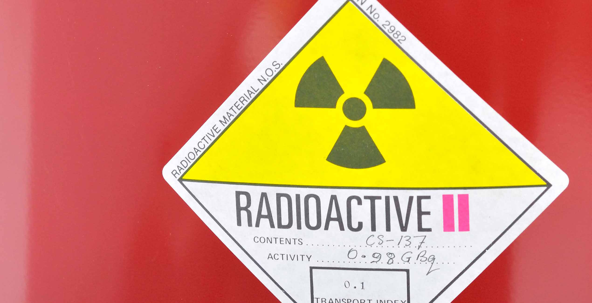
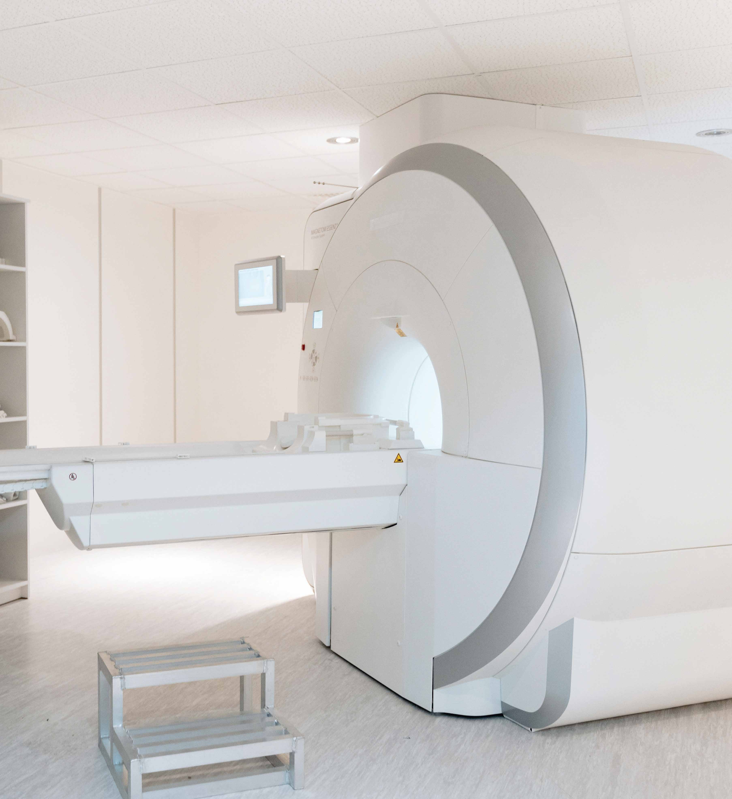
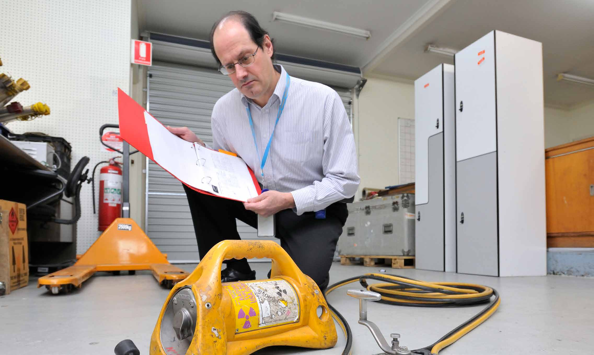
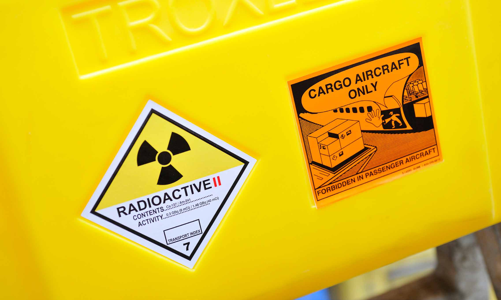
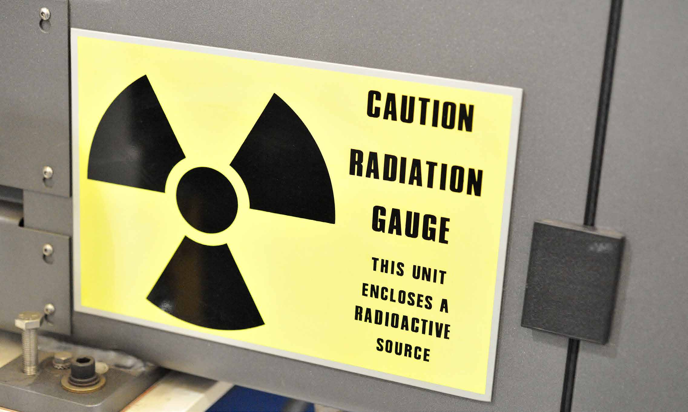

# State Emergency Management Plan — Radiation Sub-Plan (November 2023)

> **Source**: Emergency Management Victoria
> **URL**: https://files.emv.vic.gov.au/2023-11/SEMP%20Radiation%20Sub%20Plan%20-%20final%2020%20Novemeber%202023.pdf
> **Licence**: © State of Victoria; emergency-management practitioner reference
> **Retrieved**: 2026-05-07T23:44:18Z
> **SHA-256**: `a50714eda1cb557d209da67a4e458483ea1c27c82b9d6bcf381ee9b732a0e59b`
> *Converted from PDF to Markdown format.*

---
## Page 1

State Emergency  
Management Plan
Radiation Sub-Plan

---
## Page 2

To receive this document in another format, 
email Emergency Management Policy  
<EM_Policy@health.vic.gov.au>.
Authorised and published by the Victorian 
Government, 1 Treasury Place, Melbourne.
© State of Victoria, Australia, Department 
of Health, November 2023. (2309590)
ISBN 978-1-76131-432-2
Available at the Emergency Management 
Victoria website <www.emv.vic.gov.au>.
2
State Emergency Management Plan: Radiation Sub-Plan

---
## Page 3

Abbreviations	
4
1	
Introduction	
5
1.1	
Purpose	
5
1.2	 Objectives	
5
1.3	 Scope	
6
1.4	  Implementation	
6
1.5	 Authorising environment	
6
1.6	 Audience	
7
1.7	 Assumptions	
8
1.8	 Exercising and evaluation	
8
1.9	 Review	
8
1.10	 Linkages and hyperlinks	
8
2	
Context	
9
2.1	
What is radiation?	
9
2.2	 Radiation emergencies	
9
3	
Mitigation and preparedness	
10
3.1	 Victorian government agencies	
10
3.2	 Planning	
11
3.3	 National support	
12
4	 Public information and  
community engagement	
13
5	
Response	
14
5.1	 Notifications	
14
5.2	 Escalation of arrangements	
14
5.3	 Roles and responsibilities	
16
5.4	 Community protection and information	
21
5.5	 National support	
21
5.6	 Consequence management	
21
5.7	 Relief (as part of response)	
22
5.8	 Transition to recovery	
22
6	
Recovery	
23
Appendix A: Key supporting 
information	
24
Legislation	
24
Plans, arrangements and guidelines	
25
Governance forums	
26
Appendix B: Glossary	
28
Appendix C: Public information  
and community engagement 
arrangements	
30
Governance	
30
Planning	
30
Implementation	
31
Contents
3
State Emergency Management Plan: Radiation Sub-Plan

---
## Page 4

Abbreviation
Description
ACCHO
Aboriginal community-
controlled health organisation
ANSTO
Australian Nuclear Science and 
Technology Organisation
ARPANSA
Australian Radiation Protection 
and Nuclear Safety Agency
AV
Ambulance Victoria
CBRNe
chemical, biological, 
radiological, nuclear and 
high‑yield explosives
CCP
Chief Commissioner of Police
COMDISPLAN
Australian Government disaster 
response plan 2020
CFA
Country Fire Authority
CHO
Chief Health Officer
DFFH
Department of Families, Fairness 
and Housing
DH
Victorian Government 
Department of Health
DTP
Department of Transport 
and Planning
ED
emergency department
EMV
Emergency Management 
Victoria
EMJPIC
Emergency Management Joint 
Public Information Committee
EPA
Environment Protection 
Authority
ERV
Emergency Recovery Victoria 
EMC
Emergency Management 
Commissioner
FAT
Field Assistance Team
FRV
Fire Rescue Victoria
FEMO
Field Emergency Management 
Officer
HAZMAT
hazardous materials
Abbreviation
Description
HESP
Health Emergencies Sub-Plan
IAEA
International Atomic Energy 
Agency
IC
Incident Controller
IMT
Incident Management Team
JSOP
Joint Standard Operating 
Procedure
LPHU
Local Public Health Unit
MEMP
municipal emergency 
management plan
MEMPC
Municipal Emergency 
Management Planning 
Committee 
NEMA
National Emergency 
Management Agency
NGO
non-government organisation
NPW
nuclear-powered warship
PHN
Primary Health Network
PPE
personal protective equipment 
RelLA
Relief Lead Agency 
RelSA
Relief Support Agency
RecLA
Recovery Lead Agency 
RecSA
Recovery Support Agency
REMP
regional emergency 
management plan
REMPC
Regional Emergency 
Management Planning 
Committee
SEMP
State emergency 
management plan
SEMT
State Emergency 
Management Team
SHEMC
State Health Emergency 
Management Coordinator
SHEMT
State Health Emergency 
Management Team
Abbreviations
4
State Emergency Management Plan: Radiation Sub-Plan

---
## Page 5

1.1 Purpose
The State emergency management plan (SEMP) 
Radiation Sub-Plan (the plan) outlines the 
integrated and coordinated whole-of-government 
approach required to respond effectively to 
radiation emergencies in Victoria.
Radiation emergencies are emergencies 
that cause consequences to human life, 
health, property or the environment from 
a radioactive source.
Under the SEMP, the Victorian Department of 
Health (DH) is the control agency for emergencies 
involving radioactive materials (including leaks 
and spills). DH is responsible for the maintenance 
and communication of this plan.
In the event of a radiation emergency occurring 
concurrently with one or more other emergencies, 
the State Controller – Health must consult with 
the Emergency Management Commissioner 
(EMC) and other relevant control agencies to 
determine and document appropriate control 
arrangements. 
This plan incorporates feedback from external 
consultation as required under the Emergency 
Management Act 2013. This includes a 
broad range of Victorian emergency service 
organisations and related agencies.
For information regarding emergency 
management arrangements for other hazards 
with potential health risks, refer to Emergency 
Management Victoria’s (EMV) website for 
corresponding SEMP Sub-Plans <https://www.
emv.vic.gov.au/responsibilities/state-emergency-
management-plan-sub-plans>.
1.2 Objectives
The objectives of this plan are guided by:
•	 the SEMP, which aims to:
–	 provide clarity on roles, responsibilities, 
escalation and communication channels 
to enable an effective and efficient response 
to a radiation emergency
–	 set out arrangements to integrate and 
harmonise multiagency emergency 
responses to such incidents
–	 identifies and applies national and 
international standards, where applicable.
•	 the SEMP Health Emergencies Sub-Plan, 
which aims to:
–	 maximise health outcomes by providing 
treatment in a safe, timely and coordinated 
manner
–	 minimise impacts on the health system
–	 provide timely, tailored and relevant health 
information and warnings to the community, 
to assist community members to make 
informed decisions about their safety
–	 ensure clarity about roles, responsibilities, 
escalation and communication channels 
to enable an effective and efficient health 
emergency response, particularly for the 
health system.
•	 the International Atomic Energy Agency’s (IAEA) 
General safety requirements (GSR) Part 7: 
Preparedness and response for a nuclear or 
radiological emergency, which aims to:
–	 save lives and reduce the risk or mitigate the 
short- and long-term health impacts and 
consequences of a radiation emergency
–	 reduce or mitigate non-radiological 
consequences
–	 protect property and the environment
–	 prepare for the resumption of normal social 
and economic activity and return to normal 
operations to the extent it is possible 
and can be done safely.1 
1	 International Atomic Energy Agency (IAEA) 2015, Preparedness 
and response for a nuclear or radiological emergency, 
<https://www.iaea.org/publications/10905/preparedness-and-
response-for-a-nuclear-or-radiological-emergency>.
1	 Introduction
5
State Emergency Management Plan: Radiation Sub-Plan

---
## Page 6

1.3 Scope
This plan is for radiation emergencies that require 
a multiagency response.
1.3.1 Out of scope
If the situation involves counterterrorism, or a 
warlike act, DH will be a support agency. It will 
work with the Chief Commissioner of Police (CCP). 
Victoria Police will assume State Control as 
advised under the SEMP.
This plan does not include the details about 
operational arrangements or plans that 
are maintained by individual departments 
and agencies.
This plan exists parallel to the Special plan for 
nuclear-powered warships (NPW) to Melbourne 
– Victoria. However, section 5.7: ‘Relief’ and 
section 6: ‘Recovery’ in this plan should be 
enacted for an NPW event.
1.4 Implementation
The arrangements in this plan apply on a 
continuing basis and provides strategic 
information regarding Victoria’s mitigation, 
preparedness, response, and recovery from 
radiation emergencies. 
This plan is intended to interact with other 
SEMP Sub-Plans and is supported by agency 
operational plans. This plan will be applied in 
conjunction with the arrangements set out in 
the SEMP Health Emergencies Sub-Plan (HESP) 
<https://www.emv.vic.gov.au/responsibilities/state-
emergency-management-plan-sub-plans/semp-
health-emergencies-sub-plan>.
1.5 Authorising environment
The Emergency Management Act 1986 and 
2013 provides the legislative basis to manage 
emergencies in Victoria.
The SEMP outlines provisions for mitigation, 
response and recovery arrangements for 
emergencies. It specifies the roles and 
responsibilities of agencies in relation 
to emergency management.
This plan is a subordinate plan to the SEMP 
and has been approved by the State Crisis 
and Resilience Council.
For radiation emergencies, further Victorian 
legislation that applies to specific powers 
and responsibilities includes the following.
Radiation Act 2005
The Radiation Act 2005 provides for the 
regulation of radiation practices and of 
individuals who use radiation sources. 
Radiation practices include possession of 
radiation sources including radioactive material, 
transport of radioactive material and disposal 
of radiation sources. 
Section 93 of the Radiation Act 2005 provides for 
the Secretary, Department of Health to authorise 
the use of emergency powers by Authorised 
Officers appointed under section 69.
Under the instrument of delegation, the power 
to authorise the use of emergency powers is 
delegated to the Chief Health Officer (CHO).
For further information on governance structures, 
legislation, plans and guidelines relating to 
radiation, refer to Appendix A: Key supporting 
information.
6
State Emergency Management Plan: Radiation Sub-Plan

---
## Page 7

Public Health and Wellbeing Act 2008
The Public Health and Wellbeing Act 2008 
provides the legal framework for protecting and 
promoting public health in Victoria. It establishes 
powers and responsibilities for the CHO and the 
Secretary including the delegation of powers.
National and international standards
Peak national and international bodies which 
develop standards, codes and guides that provide 
advice to support radiation protection in Victoria 
include, but are not limited to:
•	 Australian Radiation Protection and Nuclear 
Safety Agency (ARPANSA)
•	 Australian Nuclear Science and Technology 
Organisation (ANSTO)
•	 International Atomic Energy Agency (IAEA).
1.6 Audience
The audience for this plan comprises all relevant 
agencies and healthcare providers. In particular, 
this includes the emergency management 
sector and health sector with a role in the 
preparedness for, response to and recovery 
from a radiation emergency. 
This includes the Victorian Government and 
agencies, local government, emergency services, 
health services, regulated entities and businesses.
Community members may find the contents 
of this plan informative to prepare for, respond 
to and recover from radiation emergencies.
7
State Emergency Management Plan: Radiation Sub-Plan

---
## Page 8

1.7 Assumptions
This plan is based on the following assumptions: 
•	 The reader is familiar with the SEMP, 
which outlines the holistic details of the 
arrangements for an integrated, coordinated, 
and comprehensive approach to emergency 
management in Victoria.
•	 The reader is familiar with the HESP, which 
outlines the coordinated arrangements for 
managing the risks and consequences of 
health emergencies in Victoria, including 
pandemics.
•	 The reader is familiar with the Victorian 
emergency operations handbook <https://
www.emv.vic.gov.au/publications/victorian-
emergency-operations-handbook>, which 
provides a reference guide to the key 
mechanisms (structures, systems, roles and 
functions) required to effectively and safely 
deliver incident management operations 
for major emergencies in Victoria.
•	 Agency plans and supporting documents 
provide the details of relevant activities 
of individual agencies.
1.8 Exercising and evaluation
DH will exercise this plan within one year of the 
published date. The exercise will be evaluated 
and, where improvements are required, the plan 
will be amended and a revised version issued.
Exercises will be conducted in accordance with 
the Australian Institute for Disaster Resilience 
(AIDR) Managing exercises handbook <https://
knowledge.aidr.org.au/resources/handbook-
managing-exercises> and in conjunction with 
the ARPANSA Guide for radiation protection in 
emergency exposure situations (2019) <https://
www.arpansa.gov.au/regulation-and-licensing/
regulatory-publications/radiation-protection-
series/guides-and-recommendations/rpsg-3>.
The department will evaluate the exercise 
through a debrief process after this plan is 
activated and response activities cease. 
All participating agencies, including recovery 
agencies, will be represented to evaluate response 
arrangements and recommend improvement 
opportunities for future events. Evaluations 
should consider the Lessons management 
framework (EM-LEARN) <https://www.emv.vic.
gov.au/how-we-help/reviews-and-lessons-
management/lessons-management-framework-
em-learn> and AIDR Lessons management 
handbook <https://knowledge.aidr.org.au/
resources/lessons-management-handbook/>.
1.9 Review
This plan was current at the time of publication 
and remains in effect until modified, superseded 
or withdrawn.
DH will review and update this plan every three 
years. More frequent reviews may be undertaken 
if required, for example following an event, 
exercising of the plan, or following substantial 
change to relevant legislation or machinery 
of government arrangements.
1.10 Linkages and hyperlinks
This plan does not duplicate information 
provided elsewhere. Instead, it links to resources 
and websites. These are accurate at the time 
of publication.
Resources identified frequently within the 
plan (for example, SEMP and HESP) are not 
hyperlinked in each instance.
Appendix A: Key supporting information has 
links to relevant state, national and international 
governance structures, legislation and plans 
related to this plan.
8
State Emergency Management Plan: Radiation Sub-Plan

---
## Page 9

2	Context
2.1 What is radiation?
Australians are exposed to radiation from natural 
and artificial sources every day.
There are two main types of radiation: 
non‑ionising and ionising. They are categorised 
according to how much damage the energy or 
wavelength of the source can affect our health. 
Non-ionising radiation does not have enough 
energy to damage DNA directly. Examples 
include ultraviolet (UV) light, powerlines 
and electrical equipment.
Ionising radiation is radiation that passes 
through the body and causes damage to DNA. 
Examples are alpha particles, gamma rays, X-rays 
and neutrons.2
The IAEA’s ‘What is radiation’ webpage <https://
www.iaea.org/newscenter/news/what-is-
radiation> has more information about radiation.
2	 International Atomic Energy Agency (IAEA) ‘What is radiation’ 
webpage <https://www.iaea.org/newscenter/news/what-is-
radiation>.
2.2 Radiation emergencies
Although the likelihood of a radiation emergency 
is relatively low, the consequences could be 
extremely high. A radiation emergency would 
cause considerable fear and anxiety within 
the community.
Examples of potential radiation emergencies 
in Victoria include:
•	 public exposure and contamination from 
unknown origins
•	 loss of control of a high-activity radiation source
•	 terrorist threats or acts (note Victoria Police 
is the control agency for this type of event)
•	 transport accidents (including rail, road, water)
•	 an accident involving an irradiation facility 
(such as industrial irradiators)
•	 a significant release of radioactive material 
from a storage facility.
Agencies responding to a radiation 
emergency should:
•	 maintain responders’ awareness of their 
role in managing radiation emergencies
•	 use specific radiation detection equipment 
to evaluate the risk from radiation sources 
(for example, human senses cannot detect 
ionising radiation)
•	 remember that the health effects of 
radiation exposure can take days, weeks 
or years to manifest
•	 use careful risk communication, 
because radiation is widely perceived 
as highly dangerous.
9
State Emergency Management Plan: Radiation Sub-Plan

---
## Page 10

Mitigation and preparedness seek to reduce 
the severity of an emergency and adverse 
consequences to communities.
The government mitigates the potential for 
radiation emergencies by regulating radiation 
practice, licensing users of radiation equipment 
and monitoring compliance.
Diagnostic, therapeutic, industrial and other 
uses of radiation have contributed to the safety 
and quality of life for all Victorians. However, the 
use of radiation does involve hazards if it is used 
inappropriately or unnecessarily.
DH regulates the use of radiation to protect 
people and the environment from its harmful 
effects. It does this by licensing users of radiation 
sources and managers of radiation practices 
under the Radiation Act 2005.
DH ‘Radiation’ webpage <https://www.health.
vic.gov.au/public-health/radiation> has more 
information.
Government agencies, emergency service 
organisations and health care providers 
mitigate risks by developing and exercising 
local arrangements, learning from domestic and 
international events or shared experiences.
Communities and individuals are supported by 
a range of activities which include seamless and 
coordinated public information tools, accessible 
platforms and services and coordinated 
messaging to all Victorians.
3.1 Victorian government 
agencies
Victorian government departments and agencies 
should identify their role in preparing for 
a radiation emergency.
They should ensure their plans:
•	 define their operational arrangements 
including radiation response capabilities and 
capacity, education and training
•	 outline any responsibilities for providing 
specialist resources and monitoring equipment 
(such as HAZMAT technicians, scientific 
analysis and interpretation, radiation detection 
and expertise) where applicable
•	 describe Occupational Health and Safety 
arrangements including supply and use of 
personal protective equipment (PPE).
See Table 8 of the SEMP <https://www.emv.
vic.gov.au/responsibilities/semp/roles-and-
responsibilities/mitigation> for a list of mitigation 
activity undertaken by agencies based 
on significant risks by emergency.
For resources regarding risks to public health 
and the health system in Victoria, refer to HESP 
section 4: ‘Mitigation and preparedness’.
As control agency for preparing for a radiation 
emergency, DH is responsible for:
•	 exercising this plan
•	 engaging with community, state and local 
government and key partners in the health 
sector to prepare for radiation emergencies
•	 developing and implementing public health 
plans, guidelines and advice that raise 
awareness about health risks and how to 
mitigate the risk.
Additional responsibilities for DH as control 
agency refer to HESP chapter 3.1 ‘Department 
of Health as the control agency’.
3	Mitigation and preparedness
10
State Emergency Management Plan: Radiation Sub-Plan

---
## Page 11

3.2 Planning
There is a shared responsibility for all Victorians 
to plan for emergencies. Planning activities form 
part of mitigation and preparedness. They include 
developing, exercising and reviewing plans.
All emergency management plans should support 
the needs and concerns of people most at risk.
These plans should also contain provisions for 
engagement with Aboriginal community-controlled 
health organisations and Traditional Owners.
3.2.1 State planning
The SEMP provides for an integrated, coordinated 
and comprehensive approach to plan for, respond 
to and recover from all emergencies. The EMC is 
responsible for the preparation of the SEMP.
DH, as the control agency for emergencies 
involving radioactive materials (including leaks 
and spills), is responsible for the maintenance 
and communication of this plan.
3.2.2 Regional planning 
At the regional tier, Regional Emergency 
Management Planning Committees (REMPCs) are 
responsible for regional emergency management 
planning, including the development of regional 
emergency management plans (REMPs). 
REMPs should identify how the region will prepare 
for, respond to, and recover from all hazards. 
REMPs should align with state planning to ensure 
activities and arrangements are coordinated 
and integrated; leveraging local resources 
and community networks. 
3.2.3 Municipal planning
Under the Emergency Management Act 2013, 
local governments chair multiagency municipal 
emergency management planning committees 
(MEMPCs). 
MEMPCs assess municipal-level risks and 
plan accordingly. They are responsible for 
preparing municipal emergency management 
plans (MEMPs).
MEMPs outline the agreed municipal-level 
emergency management arrangements by all 
participating emergency services, government 
and non-government organisations (NGOs) 
in the municipal footprint.
The role of local government and other local 
agencies documented in MEMPs or MEMP 
subplans for radiation emergencies must be 
consistent with state plans, including the SEMP 
and this plan.
11
State Emergency Management Plan: Radiation Sub-Plan

---
## Page 12

3.3 National support
The Australian Government establishes support 
arrangements to assist with national health 
emergencies that impact Victoria.
For more information on the role of the Australian 
Government for health emergencies, refer to 
the HESP, section 4.2 ‘Australian Government’.
The following sections set out support 
arrangements from the Australian Government 
specific to radiation emergencies.
3.3.1 Non-financial disaster support
The Victorian Government can request 
additional resources to assist disaster 
response and recovery from the Australian 
Government. These arrangements set out in the 
Australian Government disaster response plan 
(COMDISPLAN) <https://www.homeaffairs.gov.au/
emergency/files/plan-disaster-response.pdf>. 
The EMC or CCP, as the Victorian nominated 
officials, will make a request for non-financial 
assistance to the National Emergency 
Management Agency (NEMA) for consideration 
by the Deputy Coordinator General Emergency 
Management and Response.
COMDISPLAN requests for physical assistance 
may include:
•	 specialist technical advice and expertise
•	 additional resources
•	 specialist capabilities.
Refer to ‘Appendix A: Key supporting 
information’ for further information 
on Commonwealth agencies.
3.3.2 National Medical Stockpile
The Australian Department of Health and 
Aged Care maintains a stockpile of treatments 
to be mobilised to aid in the management 
of radiological events.
The CHO or Deputy Chief Health Officers 
will approve the request to be submitted 
to the National Medical Stockpile in the 
event of a radiation emergency requiring 
additional resources.
12
State Emergency Management Plan: Radiation Sub-Plan

---
## Page 13

An emergency involving radiation is likely to 
cause fear and anxiety within the community. 
Communications should be accurate, accessible, 
timely, tailored and clearly explain how people 
can stay safe.
Messaging will need to consider: 
•	 those who may have been exposed 
to radioactive materials and need to 
be decontaminated
•	 those who may need to shelter in place
•	 those who may need to evacuate.
Comprehensive, far-reaching, and ongoing 
communications and engagement approaches, 
methods and channels may be required to 
support affected individuals and communities.
It is essential that Victorian Government 
departments and agencies provide seamless and 
coordinated public information and community 
engagement at every stage of managing 
a radiation emergency.
Refer to ‘Appendix C: Public information and 
community engagement’ for more information.
4	Public information and  
community engagement
13
State Emergency Management Plan: Radiation Sub-Plan

---
## Page 14

This plan is supported by agency operational 
response plans, protocols and guidelines 
that provide additional detail to meet their 
responsibilities during a radiation emergency.
Together, the doctrine facilitates both a 
collaborative and scalable approach to 
emergency response, and continual assessment 
to best meet response needs. 
The level of human resourcing, including the 
number of people and types of skills and expertise 
required, depends on the type of emergency, 
the complexity and the impact of the event or 
incident.
Guides, protocols and further information about 
Victoria’s state health emergency response 
arrangements can be found on DH’s website 
<https://www.health.vic.gov.au/emergencies/state-
health-emergency-response-arrangements>.
Actions required for radiation emergencies include:
•	 communication of timely, relevant and tailored 
warnings and information to the community
•	 consideration of evacuation or shelter in place 
or indoors
•	 management of the immediate needs of 
affected people and the impacts upon the 
community
•	 integration of relief activities with response 
activities
•	 ongoing assessment and management of the 
impact and consequences of the emergency
•	 ensuring that control measures are in place 
at appropriate levels and an effective incident 
control structure is in place to achieve 
protection of life and property
•	 effectively led, managed and engaged 
Emergency Management Teams at state, 
region and incident levels
•	 longer-term actions, such as the monitoring 
and control of foodstuffs and relocation and 
resettlement of affected people.
Radiological emergencies can have wide 
consequences. Although the initial priority is to 
protect public health from exposure to radiation, 
other consequences also need to be addressed 
in a timely manner. For example, radiological 
emergencies can have adverse non-radiological 
consequences such as economic, social 
and psychological impacts that also require 
management to ensure they are minimised.3 
5.1 Notifications
5.1.1 Notification to DH
The initial notification of a radiation emergency 
can come from several sources. These may 
include emergency response agencies, 
government agencies, health services, 
laboratories and the public.
All agencies alerted of a radiation incident should 
immediately notify DH through 24/7 Telephone 
Messaging Centre on 1300 790 733.
5.1.2 Notification from DH
Key stakeholders will be notified of radiation 
emergencies via state emergency management 
arrangements.
5.2 Escalation of arrangements
In line with the SEMP, Victoria has three 
operational tiers (incident, region and state) 
<https://www.emv.vic.gov.au/responsibilities/
state-emergency-management-plan-semp>. 
There is the option for an ‘area of operation’ to 
be declared to manage a complex emergency 
that may be geographically located over several 
municipalities or several regions.
It is highly likely that a radiation emergency will 
be initially managed at the state tier, noting 
there will be local incident management required 
at the scene.
3	 IAEA 2020, Considerations in the development of a protection 
strategy for a nuclear or radiological emergency, <https://
www-pub.iaea.org/MTCD/Publications/PDF/EPR-Protection_
Strategy_web.pdf>.
5	Response
14
State Emergency Management Plan: Radiation Sub-Plan

---
## Page 15

5.2.1 Incident tier (management 
at the scene)
Incident control arrangements 
For most incidents it is likely that an emergency 
response agency such as Fire Rescue Victoria 
(FRV), CFA or Victoria Police will be first on scene 
and assume the role of Incident Controller (IC).
If radioactive material is suspected to be involved, 
DH on-call Radiation Officer (1300 790 733) 
must be immediately contacted to undertake 
a radiation assessment. 
Transfer of incident control may occur when:
•	 A DH Radiation Field Assistance Team (FAT) 
undertakes an assessment and determines there 
is a radiation emergency. Assessments may be 
conducted virtually or require on-site visit
•	 it is agreed by the on-site response agency 
IC and the DH State Agency Commander that 
transition of control is required
•	 The DH State Agency Commander will initiate 
the process for formal appointment of a State 
Controller – Health and DH IC.
•	 DH State Agency Commander will undertake 
the activities of IC until formal appointment 
can be made. 
Contain site and scene safety
The first responding agency IC will conduct an 
assessment to identify risk as prescribed in 
agency standard operating procedures.
Based on the initial assessment, and in 
consultation with the DH Radiation FAT the 
following should be established:
•	 safety for first responders
•	 a safety perimeter, which is the boundary of 
the inner cordoned area (around a dangerous 
radioactive source)
•	 a security perimeter, which is the boundary 
of the outer cordoned area
•	 monitoring requirements, noting not all 
agencies are equipped with radiation 
monitoring equipment.
Evacuation or shelter in place and/or indoors
The scale of evacuation and/or shelter in place 
and/or indoors will be recommended by the 
IC with advice from the DH Radiation FAT. 
If it is determined evacuation is required, Victoria 
Police will provide assistance with cordon and 
containment and road authorities will assist 
with traffic management.  
All evacuation and shelter in place 
arrangements should be undertaken in line 
with appropriate JSOPs.
Traffic management
The IC will consult with Victoria Police to establish 
arrangements for control of the movement of 
traffic through an incident area.
Traffic management should, where applicable, 
include management of public transport, freight 
and potentially ports dependent on location. 
Traffic management arrangements should be 
undertaken in line with appropriate JSOPs.
5.2.2 Regional tier
It is highly likely a radiation emergency will be 
initially managed at the state and incident tiers. 
However, regional emergency management and 
healthcare providers should still identify how 
they will prepare for, respond to and recover from 
a radiation emergency. 
Regional arrangements should align with state 
planning to ensure activities and arrangements 
are coordinated and integrated, leveraging local 
resources and community networks.
A region, if established, may be an emergency 
management region as identified in the SEMP, 
a health region or a region determined at the 
time based on the geographic area affected 
by the health emergency.
15
State Emergency Management Plan: Radiation Sub-Plan

---
## Page 16

The regional tier, if established, will provide the 
first level of assurance and control, coordination 
of response, recovery, consequence management, 
communications, and resourcing. The Regional 
Controller will report to the State Controller – Health. 
A Health Emergency Management Liaison Officer 
will be appointed and work within the Regional 
Incident Control Centre. 
When a response at the regional tier is required 
and appropriate for the effective coordination of 
an incident, the Regional Health Coordinator will 
coordinate emergency response activities across 
supporting agencies and departments and the 
health system (including hospitals, primary health 
and other acute services). 
The Regional Health Coordinator, where 
appointed, will report to the State Health 
Coordinator, who ultimately reports to the State 
Health Emergency Management Coordinator.
5.2.3 State tier
In addition to arrangements outlined as per SEMP 
and HESP, a dedicated Public Health Advice Cell 
will be formed to provide radiation subject matter 
expertise into the Intelligence section of the State 
Control Team.
5.3 Roles and responsibilities
The SEMP provides agency roles and 
responsibilities for responding to emergencies 
in Table 9 (control agencies for response) and 
Table 10 (support agencies for response) <https://
www.emv.vic.gov.au/responsibilities/semp/roles-
and-responsibilities/response>. For State Control 
arrangements, refer to SEMP and HESP.
The roles and responsibilities identified in this 
plan are not exhaustive and should be considered 
in conjunction with relevant legislation, plans, 
frameworks and guidelines.
16
State Emergency Management Plan: Radiation Sub-Plan

---
## Page 17

5.3.1 Department of Health
DH is responsible for:
•	 discharging its responsibilities under the 
arrangements in the SEMP as Control Agency 
for radioactive materials accidents (including 
leaks and spills)
•	 providing a State Controller to oversee 
the control arrangements, consequence 
management planning and integration of 
recovery with the response arrangements
•	 providing an IC to oversee cross-agency 
operations during a radiation emergency
•	 ensuring public information and messaging 
is coordinated and provides timely, accurate 
public information
•	 providing radiation expertise such as a Senior 
Radiation Officer to support operational 
responses including mobile monitoring 
and decontamination as required
•	 ensuring arrangements are in place for the 
health sector to effectively prevent, prepare 
for, respond to, and recover from radiation 
emergencies and mitigate adverse health 
consequences for the community
•	 leading and establishing integrated 
arrangements with government departments, 
agencies and sectors to support 
emergency arrangements
•	 monitoring, detecting and investigating 
radiation emergencies as soon as practicable
•	 restoring radiation safety and minimising 
radiation exposure as far as practicable
•	 identifying and containing the radiation source
•	 assisting FRV and the Country Fire Authority 
(CFA) with decontamination procedures
•	 providing assistance and advice for site 
clean‑up and coordination of safe waste 
disposal methods and pathways
•	 sourcing additional capability, such 
as specialist radiation expertise
•	 managing health consequences of the 
radiation emergency to support an effective 
response and recovery, including:
–	 reducing the risk of severe deterministic 
health effects in workers and the public 
(high doses leading to skin burns, tissue 
damage or death)
–	 reducing the risk of stochastic health effects 
in the population (low doses over long 
periods leads to increased cancer risk)
•	 ensuring the health system can effectively 
respond and mitigate the adverse 
consequences for communities
•	 advising the Radiation Emergency 
Coordination Centre at ARPANSA of 
a radiation emergency.
For DH Role Statement under the SEMP, see EMV’s 
webpage Department of Health – Role statement 
<https://www.emv.vic.gov.au/responsibilities/state-
emergency-management-plan-semp/roles-and-
responsibilities/role-statements/department-of-
health-role-statement>.
5.3.2 Key support agencies
Any government or non-government agency 
may be requested to assist DH in a radiation 
emergency response, including relief.
Support agencies should have arrangements 
in place to fulfil their responsibilities as 
outlined in SEMP role statements and consider 
what may be required of them to support 
emergency management arrangements 
for radiation emergencies. 
This includes responding agencies providing 
their own responders with appropriate PPE 
in keeping with occupational workplace 
and safety obligations.
17
State Emergency Management Plan: Radiation Sub-Plan

---
## Page 18

The safety and the protection of human life, 
including emergency services personnel and 
community members, takes priority above all 
other considerations for managing radiation 
emergencies. This is in line with the ‘State 
emergency management priorities’ <https://www.
emv.vic.gov.au/responsibilities/state-emergency-
management-priorities>.
Ambulance Victoria
Time-critical patients may be transported prior 
to decontamination where they are at greater 
clinical risk.
Ambulance Victoria will:
•	 triage patients and determine treatment priority
•	 provide pre-hospital clinical care 
•	 transport and distribute patients to 
appropriate medical care
•	 provide health support to patients undergoing 
decontamination, where possible
•	 provide health support to other agencies, 
where appropriate
•	 deploy a Health Commander to direct the 
operational health response and assemble and 
lead the Health Incident Management Team
•	 represent Health (pre-hospital) as a member 
of the State Health Emergency Management 
Team (SHEMT)
•	 activate other key position holders or mobile 
specialist teams, including activation of the 
Field Emergency Medical Officer Program, 
Victorian Medical Assistance Teams and first 
aid agencies, if required
•	 initially notify the hospitals receiving patients
•	 work with DH to provide relevant health 
information and advice to support broader 
community health inquires and availability 
of alternative service providers based 
on case definition.
The HESP provides general principles for 
managing mass casualties and subordinate 
State Health Emergency Arrangements, including 
Mass casualty and pre-hospital operational 
response plan (incident tier) <https://www.health.
vic.gov.au/publications/mass-casualty-and-pre-
hospital-operational-response-plan-incident-
tier>.
Fire Rescue Victoria 
Fire Rescue Victoria will:
•	 ensure DH is notified
•	 perform an incident size up
•	 obtain information on the incident, casualties 
and circumstance(s)
•	 deploy radiation detection equipment.
•	 set-up decontamination with advice from 
radiation specialist(s)
•	 perform rescue under advice from radiation 
specialist(s)
•	 ensure appropriate PPE will be deployed 
to manage decontamination operations/
procedures.
Country Fire Authority
Country Fire Authority will:
•	 ensure DH is notified
•	 provide decontamination and equipment 
at scene.
•	 implement decontamination procedures for 
contaminated and exposed or potentially 
exposed persons, under DH direction.
•	 ensure appropriate PPE will be deployed 
to manage decontamination operations/
procedures.
Victoria Police
Victoria Police will:
•	 ensure all routine and emergency 
communications and operational requirements 
are met
•	 undertake evacuation in consultation with 
DH and road authorities and in line with 
corresponding Joint Standard Operating 
Procedure (JSOP).
18
State Emergency Management Plan: Radiation Sub-Plan

---
## Page 19

Healthcare providers
Hospitals
DH in collaboration with health services, will 
support the coordination of impacts on the health 
system, including managing healthcare expertise 
and resources.
It is expected that a health service has 
arrangements in place to respond to and manage 
emergencies where decontamination of patients 
may be required on site.
Hospitals will work closely with the DH Emergency 
Management State Operations, initially through 
the State Duty Officer – 1300 790 733.
Primary Health Network
Primary Health Networks (PHN) will:
•	 coordinate access to primary care resources, 
including general practitioners (GPs), 
pharmacy, community mental health and 
alcohol and drug services for emergency 
response
•	 facilitate the delivery of warnings and public 
health messages to the primary care sector
•	 commission health services to support 
community recovery.
Aboriginal health
Engagement with Aboriginal communities 
and Aboriginal community-controlled 
organisations will promote Aboriginal community 
self‑determined priorities to be addressed 
throughout the management of radiation 
emergencies in a culturally safe manner.
19
State Emergency Management Plan: Radiation Sub-Plan

---
## Page 20

Department of Energy, Environment 
and Climate Action
Agriculture Victoria
Agriculture Victoria will:
•	 provide advice to DH on agricultural produce 
that may have been impacted (with regard to 
primary production and primary processing)
•	 provide advice to affected agriculture sectors, 
including regulators, about risks and risk 
mitigation measures, relief and recovery
•	 provide an Emergency Management Liaison 
Officer, if required, to support DH.
Wildlife 
Wildlife will:
•	 be responsible for the provision of advice on 
any wildlife welfare implications arising from 
the incident
•	 undertake stakeholder engagement with 
the wildlife welfare sector, with DH-approved 
messages
•	 provide an Emergency Management Liaison 
Officer, if required, to support DH.
Environment Protection Authority 
The Environment Protection Authority (EPA) 
will provide advice on environmental matters, 
where required.
The Chief Environmental Scientist (CES) has an 
important role during emergencies involving 
significant pollution consequences by supporting 
the EMC, State Controller and Chief Health Officer 
with expert advice on the practical measures to 
protect the environment and public health from 
the impacts of pollution and waste. The CES 
also provides a trusted and authoritative public 
face for the communication of complex pollution 
and waste advice.
The powers of the Radiation Act 2005 extend 
to the protection of the environment.
Local Public Health Units
Local Public Health Units (LPHUs) have a role to 
play in providing locally based support to DH in all 
emergencies including radiation emergencies. 
LPHUs can assist in disseminating public 
health messaging and support engagement 
with local communities, collaborate with 
community partners, GPs, and hospital-
based services to minimise public health risks 
to the Victorian community.
LPHUs should be aware of local public 
health risks and hazards and appropriately 
prepare for these in collaboration with local 
emergency management arrangements. 
This will assist in providing seamless and 
coordinated public information and community 
engagement response.
Pharmacies
In the event of a radiation emergency, community 
pharmacies will need to address the challenges of 
providing pharmaceutical services. Pharmacies 
located within the affected area will likely cease 
operation until the area is deemed safe to return. 
The temporary closure of a pharmacy will result 
in the discontinuation of pharmaceutical services 
provided to that community.
Pharmacies in surrounding areas and beyond 
will begin to service displaced patients without 
their medications or prescriptions. Due to the 
nature of the emergency, the usual healthcare 
organisations that manage patient medication 
are unlikely to be contactable to verify 
medication history. DH will need to provide special 
authorisation to community pharmacists to 
continue supply of regular medication without 
prescriptions in this scenario.
Emergency services will need to coordinate 
closely with pharmaceutical wholesalers 
to ensure the timely delivery of medication 
to the pharmacy.
20
State Emergency Management Plan: Radiation Sub-Plan

---
## Page 21

Communications between community 
pharmacies and their local Primary Health 
Network (PHN) need to be well established before 
emergencies arise. Community pharmacies need 
to be familiar with the method of communication 
expected from the PHN and provide advice to 
pharmacies directly affected by the emergency. 
Pharmacies that continue to provide services will 
need to collaborate closely with PHNs to refer 
patients where appropriate.
Department of Transport and Planning
The Department of Transport and Planning (DTP) 
will assist with the management of road links 
during emergencies, including route selection 
and road egress, emergency traffic management, 
escorting, route conditions advice and control. 
DTP will assist Victoria Police establish traffic 
management points and ports depending on 
location/source of radiation. This would be 
done by the Traffic Management Manager, 
in consultation with DH and road authorities 
including public transport, freight and potentially 
ports depending on location/source of radiation. 
Traffic management arrangements are further 
outlined in the corresponding JSOP.
5.4 Community protection 
and information
Effective communication with the public 
and other stakeholders during a radiological 
emergency supports actions to protect health.
Communication needs to be transparent, 
timely, clear, factually correct, objective 
and easily understood.
Use targeted communications and engagement 
channels to reach specific population groups. 
These may include Aboriginal and Torres Strait 
Islander people, those from multifaith and 
multicultural communities, people with vision 
impairment, and those who are deaf or hard 
of hearing.
Effective public communication will:
•	 encourage people at risk to protect themselves
•	 reassure people who are not at risk that they 
are safe
•	 help to minimise rumours and fears
•	 facilitate relief efforts and help maintain public 
trust and confidence in the government’s 
response.
Refer to ‘Appendix C: Public information and 
community engagement arrangements’ for 
more information.
5.5 National support 
If additional radiation response resources and 
assistance is required, these will be requested 
through the COMDISPLAN.
The EMC will make a request for non-financial 
assistance to the NEMA for consideration by 
the Deputy Coordinator General Emergency 
Management and Response.
5.6 Consequence management
Under the Emergency Management Act 2013, 
the EMC is responsible for consequence 
management for major emergencies.
The State Controller – Health will support the 
EMC to ensure that the consequences of potential 
or actual impacts are managed. Refer to HESP 
section 8 ‘Consequence management’ for 
further information.
DH will work with government departments and 
agencies, the emergency management sector, 
the health sector, industry, businesses and the 
community to identify and mitigate potential 
consequences of a radiation emergency.
21
State Emergency Management Plan: Radiation Sub-Plan

---
## Page 22

5.7 Relief (as part of response)
Relief is the provision of assistance to meet 
the essential needs of individuals, families and 
communities during and in the immediate 
aftermath of an emergency.
Relief activities should:
•	 begin as soon as necessary, which is often 
during the response phase
•	 be adaptable, depending on the scale and 
complexity of the radiation incident or 
emergency
•	 recognise and consider communities’ diversity
•	 continue into the immediate aftermath 
of a radiation emergency.
The severity and scale of the radiation emergency 
will determine relief considerations required for 
affected communities. These will likely include 
the establishment of relief centres if mass 
relocation or evacuation is required, or shelter 
in place arrangements.
The delivery of relief services is coordinated and 
managed by Relief Lead Agencies (RelLAs) and 
supported by Relief Support Agencies (RelSAs), 
as identified in the SEMP. 
The scale and complexity of a radiation 
emergency will determine which tiers and relief 
services will need to be activated.
DH will provide expertise to the State Relief and 
Recovery Team to support relief and recovery 
arrangements for radiation emergencies (for 
example, monitoring and control of foodstuffs, 
water quality, relocation and resettlement 
of affected people, decontamination of 
contaminated environment, psychosocial 
impacts, long-term health impacts).
5.8 Transition to recovery
The scale and complexity of a radiation emergency 
will determine transition requirements to support 
the coordination of recovery arrangements.
The State Controller – Health is responsible for:
•	 leading and facilitating the transition 
to recovery
•	 notifying relevant emergency service 
organisations, public health services, private 
hospitals, the primary health sector and other 
health sector stakeholders of the stand down 
of response activities
•	 ensuring an operational debrief of all 
participants to learn from the emergency 
management experience is conducted
•	 considering support, advice and information 
for personnel involved in a response
•	 returning to ‘business as usual’ or the 
‘new normal’.
Collaboration between response and recovery 
agencies is required for a seamless transition 
to recovery. All agencies involved should 
cooperatively share information, planning and 
decision making to execute plans.
Once the emergency response activities have 
concluded and where relief and recovery 
activities need to continue, the arrangements 
for managing the emergency will formally 
transition to recovery.
 
22
State Emergency Management Plan: Radiation Sub-Plan

---
## Page 23

Emergency management in Victoria positions 
local government as the lead agency responsible 
for recovery at the local level. 
In events where complexity and scale require 
regional or state coordination of recovery 
arrangements, this is facilitated at through 
Emergency Recovery Victoria (ERV).
Following an emergency, recovery coordination 
and supports are organised around five lines 
of recovery to achieve long-term outcomes: 
•	 people and wellbeing
•	 Aboriginal culture and healing
•	 biodiversity and environment
•	 business and economy
•	 buildings and infrastructure.
ERV acts to ensure that planning for recovery 
is integrated and that community voices and 
needs are kept at the centre of recovery planning 
and coordination.
Recovery activities should commence 
immediately and be informed by impact 
assessment data to reduce the severity of 
impacts from a radiation emergency. This will 
ensure minimal impacts to short and long-term 
health, environment, disruption to essential 
services and critical infrastructure.
DH will provide expertise to the State Relief and 
Recovery Team to support relief and recovery 
arrangements for radiation emergencies 
(for example, monitoring and control of 
foodstuffs, water quality, relocation and 
resettlement of affected people, decontamination 
of contaminated environment).
The Recovery Lead Agency (RecLA) will lead and 
coordinate recovery arrangements to ensure 
the needs of individuals and communities 
are met with support from Recovery Support 
Agencies (RecSAs).
Victoria’s recovery arrangements align with 
the National principles for disaster recovery 
<https://knowledge.aidr.org.au/resources/national-
principles-for-disaster-recovery/>.
The SEMP Tables 13 to 18 provide roles and 
responsibilities for the coordination of recovery 
activities and services <https://www.emv.
vic.gov.au/responsibilities/semp/roles-and-
responsibilities/recovery-co-ordination>. 
Refer to SEMP and HESP for further information 
regarding recovery arrangements.
6	Recovery
23
State Emergency Management Plan: Radiation Sub-Plan

---
## Page 24

The following tables provide relevant state, national and international legislation, plans,  
and key governance forums related to this plan. This list is not exhaustive.
Legislation
Victoria
Legislation
URL
Emergency Management 
Act 1986
https://www.legislation.vic.gov.au/in-force/acts/emergency-management-
act-1986/051
Emergency Management 
Act 2013
https://www.legislation.vic.gov.au/in-force/acts/emergency-management-
act-2013/020
Public Health and Wellbeing 
Act 2008
https://www.legislation.vic.gov.au/in-force/acts/public-health-and-wellbeing-
act-2008/060
Radiation Act 2005
https://www.legislation.vic.gov.au/in-force/acts/radiation-act-2005/033
Radiation Regulations 2017
https://www.legislation.vic.gov.au/in-force/statutory-rules/radiation-
regulations-2017/001
Appendix A:  
Key supporting information
24
State Emergency Management Plan: Radiation Sub-Plan

---
## Page 25

Plans, arrangements and guidelines
International
Title
URL
International Atomic 
Energy Agency (IAEA) 
Safety Standards series 
no. GSR Part 7 General 
safety requirements
https://www.iaea.org/publications/10905/preparedness-and-response-for-a-
nuclear-or-radiological-emergency
National
Title
URL
Australian Government 
disaster response plan 2020 
(COMDISPLAN)
https://www.homeaffairs.gov.au/emergency/files/plan-disaster-response.pdf
Australian Radiation 
Protection and Nuclear 
Safety Agency (ARPANSA) 
guidelines
https://www.arpansa.gov.au/regulation-and-licensing/licensing/information-
for-licence-holders/regulatory-guides
Australian Institute for 
Disaster Resilience (AIDR) 
Managing exercises 
handbook
https://knowledge.aidr.org.au/resources/handbook-managing-exercises/
Australian clinical guidelines 
for radiological emergencies
https://www.health.gov.au/resources/publications/australian-clinical-
guidelines-for-radiological-emergencies?language=en
State
Title
URL
Victorian emergency 
operations handbook
https://www.emv.vic.gov.au/publications/victorian-emergency-operations-
handbook
State emergency 
management plan (SEMP)
https://www.emv.vic.gov.au/responsibilities/semp
SEMP Health Emergencies 
Sub-Plan (HESP)
https://www.emv.vic.gov.au/responsibilities/semp-sub-plans/semp-health-
emergencies-sub-plan
25
State Emergency Management Plan: Radiation Sub-Plan

---
## Page 26

Governance forums
International
Title
Description
International Atomic Energy 
Agency (IAEA)
The IAEA is an intergovernmental organisation that seeks to promote the 
peaceful use of nuclear energy and to inhibit its use for any military purpose, 
including nuclear weapons.
National
Title
Description
Australian Radiation 
Protection and Nuclear 
Safety Agency (ARPANSA)
ARPANSA is an Australian Government agency governed under the Australian 
Radiation Protection and Nuclear Safety Act 1998 (ARPANS Act).
Under the ARPANS Act, ARPANSA is responsible for protecting the health and 
safety of people, and the environment, from the harmful effects of radiation 
arising from Commonwealth regulated radiation practices.
Assistance may be requested by Victoria to Commonwealth agencies, 
including ARPANSA, through activation of the COMDISPLAN. The coordination 
of the Commonwealth emergency response is the responsibility of the NEMA. 
Referral to ARPANSA is required to follow normal procedures for requests 
to Commonwealth agencies set out in the SEMP.
ARPANSA:
•	 develops codes, standards, guides and provides advice to support radiation 
protection and nuclear safety throughout Australia
•	 conducts its own internal exercises to ensure adequate preparedness 
for a radiological or nuclear emergency
•	 facilitates exercises related to nuclear-powered warships through 
its involvement in the interdepartmental committee, Visiting Ships 
Panel (Nuclear).
ARPANSA is not resourced to coordinate or conduct broader 
multijurisdictional exercises. No coordinated program exists to involve all 
relevant roles from first responder through to senior policy and decision 
makers in exercises.
Australian Nuclear 
Science and Technology 
Organisation (ANSTO)
ANSTO is a public research organisation responsible for delivering specialised 
radiological and nuclear advice, scientific services and products. 
For prevention, ANSTO partners with the United States National Nuclear 
Security Administration and the IAEA to form the South East Asian Regional 
Radiological Security Partnership to improve the security of radioactive 
sources in South East Asia.
For preparedness, ANSTO provides radiation safety training courses for 
emergency service specialists, such as crime scene and bomb response. 
ANSTO also conducts research into management of contaminated forensic 
evidence, and nuclear material characterisation.
ANSTO can also assist with vulnerability assessments, technical advice 
and operational support, including laboratory analysis.
26
State Emergency Management Plan: Radiation Sub-Plan

---
## Page 27

Title
Description
Australian Department 
of Health and Aged Care
The Australian Department of Health and Aged Care provides overall national 
coordination of the health response, including liaising with the international 
community, providing logistics support to states and territories, activating 
the National Incident Room, and leadership in the coordination of national 
emergency media management arrangements. 
In a large-scale emergency involving radiation cases, it is likely that the 
Australian Government will form an Inter-Departmental Committee (IDC) 
or taskforce to coordinate the work of Australian Government departments 
and agencies. The lead agency of the IDC or taskforce will be determined 
at the time of the emergency.
Australian Defence 
Force (ADF)
The ADF maintains the Special Operations Engineering Regiment, which 
may be deployed to assess and respond to radiation emergencies. The 
circumstances of a terrorist event will determine whether security agencies 
will declare it a national terrorist situation.
If a national terrorist situation is declared, overall responsibility for policy and 
strategy transfers to the Australian Government, in close consultation with 
relevant states and territories. This may involve determining overall policy 
objectives, setting priorities between policy objectives where resources are 
inadequate, pre-positioning resources, international liaison and determining 
public communication messages.  
The Australian Government’s role does not include operational management 
and deployment of emergency services. The Commissioners of Police, 
including the Commissioner of the Australian Federal Police, will determine 
the command and resourcing of the national police response. In other 
respects, the management arrangements in a national terrorist situation will 
replicate those in other terrorist situations.
National Medical Stockpile
The National Medical Stockpile reserves drugs, vaccines, antidotes and 
personal protective equipment for use in national health emergencies.
State
Title
Description
Radiation Advisory 
Committee
https://www.health.vic.gov.au/radiation/radiation-advisory-committee
State Crisis and Resilience 
Council
https://www.emv.vic.gov.au/about-us/what-we-do/our-legislation
National (continued)
27
State Emergency Management Plan: Radiation Sub-Plan

---
## Page 28

Term 
Definition 
Acute care
Includes admitted and non-admitted services such as critical care, surgical 
services, Hospital in the Home, specialist clinics, trauma and emergency services.
Casualty
A person who is sick, injured or killed in an emergency.
Deterministic effect 
(short-term health 
effects)
Injury of tissues and organs due to cell death. Also termed ‘tissue reaction’.
Definition derived from the International Commission on Radiological Protection 
(ICPR) <http://icrpaedia.org/ICRP_Glossary>
Health emergency 
Health emergency in the context of this plan includes an incident or emerging 
risk to the health of community members, from whatever cause, and requires a 
significant and coordinated effort to ensure the health system can effectively 
respond and mitigate the adverse health consequences for communities.
Health service 
Relates to public health services, denominational hospitals, metropolitan 
hospitals and public hospitals, as defined by the Health Services Act 1988, 
with respect to acute and subacute services provided within a hospital or 
a hospital‑equivalent setting. 
Ionising radiation
Radiation consisting of particles, X-rays, or gamma rays with sufficient energy 
to cause ionisation in the medium through which it passes.
Non-ionising radiation
Radiation with insufficient energy to cause ionisation in the medium through 
which it passes.
People most at risk
Individuals and communities who have the potential to be adversely affected by 
a disaster or emergency and who, because of the circumstances in their everyday 
lives, require significant and coordinated priority intervention, response, and 
support from a variety of government and NGOs and the broader community 
for their safety.
Pre-hospital
A functional component of health emergency response, from response at the 
scene of an incident, to the receiving hospital or other healthcare facility.
Primary health 
The care received at the first point of contact with the healthcare system, for 
example, when someone sees a physiotherapist because they have a sore back. 
It is traditionally delivered by GPs, in community health services and or through 
private allied health providers.
Public health 
Public health involves preventing the occurrence and spread of disease and 
illness, and reducing the risk posed by potentially dangerous substances to 
ensure safe environments across Victoria.
Appendix B:  
Glossary
28
State Emergency Management Plan: Radiation Sub-Plan

---
## Page 29

Term 
Definition 
Safety perimeter
A boundary of the inner cordoned area (around a dangerous radioactive source).
Security perimeter
A boundary of the outer cordoned area.
Shelter in place
The process by which members of the public are asked to take shelter indoors 
as a safer option to evacuation, providing a level of protection from the impact 
or consequences of an emergency.
Shared responsibility
Shared responsibility refers to the collective obligations and accountabilities held 
by a range of actors.
Definition derived from the SEMP <https://files.emv.vic.gov.au/2021-10/Victorian%20
State%20Emergency%20Management%20Plan%20%28SEMP%29%20-%20
Interactive%20and%20functional%20PDF%20document%20-%20October%202021.
PDF?VersionId=C7TpaNIHZCZ9cA8xS0K0C.LuWfAhPJa3>
Stochastic effect 
(long‑term health 
effects)
Effect resulting from damage in a single cell, such as cancer and heritable effects.
Definition derived from the International Commission on Radiological Protection 
(ICPR) <http://icrpaedia.org/ICRP_Glossary>
Triage
The process by which casualties are sorted, prioritised and distributed, 
according to their need for first aid, resuscitation, emergency transportation 
and appropriate care.
29
State Emergency Management Plan: Radiation Sub-Plan

---
## Page 30

This appendix provides information on planning 
for and responding to a radiation emergency. 
It covers state and national governance 
arrangements, workforce planning, community 
insights, communications and engagement 
channels, and messaging development.
Governance
Victorian Government
Depending on the incident response level, the 
Department of Premier and Cabinet, DH, EMV and 
Victoria Police may need to work closely together 
to ensure consistent and coordinated messaging.
The Emergency Management Joint Public 
Information Committee (EMJPIC) coordinates 
whole of Victorian Government communications 
and provides strategic guidance for state-level 
communications and engagement planning 
and messaging.
Regional and Incident Joint Public Information 
Committees may also be established to help 
coordinate localised communications.
When an emergency occurs and affects the 
health and wellbeing of Victorians, DH will 
work closely with the State Control Centre and/
or Regional and Incident Control Centres to 
provide real-time public information, warnings, 
and advice.
Australian Government
The Australian Government Department of Health 
and Aged Care coordinates national health 
messaging via the National Health Emergency 
Media Response Network.
Planning
Public information and community 
engagement planning
A state health radiation communications plan 
has been developed, and:
•	 outlines the unique state and national public 
information arrangements 
•	 considers various scenarios, risks, and 
mitigations
•	 determines approaches for key communication 
functions including proactive and reactive 
media and social media, community and 
stakeholder engagement, advertising 
campaigns, strategic communications, 
and website creation and management.
Following a radiation emergency an incident 
specific communication plan should be developed 
based on the specific consequences.
It is essential that planning identifies targeted 
communications and engagement channels to 
reach people most at risk which may include, 
Aboriginal and Torres Strait Islanders, those from 
multicultural and multifaith communities, and 
vision and hearing-impaired Victorians.
It is also essential that arrangements are in place 
for the rapid translation of critical information 
across different channels.
Appendix C:  
Public information and community  
engagement arrangements
30
State Emergency Management Plan: Radiation Sub-Plan

---
## Page 31

Implementation
Public Information Unit
Upon notification of a radiation emergency 
and depending on the incident response level, 
the Department of Premier and Cabinet, the 
State Control Centre, Department of Health, 
and Victoria Police will work closely to issue 
warnings and advice and to coordinate 
communications and engagement. DH may 
embed Public Information Liaison Officers 
in the State Control Centre to facilitate 
and coordinate communications.
Other key functions will likely include 
media, digital and social media, strategic 
communications, community and stakeholder 
engagement, and an Information and 
Warnings Officer.
There may be a need to rapidly scale up a 
communications and engagement workforce 
and use surge staff from within DH or from 
across government.
Insights and community engagement
It may be important to draw on established 
community and industry networks to inform our 
communications and engagement response. 
DH can use established networks to test 
messaging and campaign materials to ensure 
it is effective and culturally and linguistically 
appropriate.
Daily media and social media monitoring may 
be required with insights and data reported to 
executives and key decision makers to inform 
the broader response.
Communications and engagement 
channels
In the event of a radiation emergency, DH will 
need to use a variety of communication and 
engagement channels including but not limited 
to media, paid advertising, digital and social 
media, as well as stakeholder and community 
engagement channels. The VicEmergency 
website, app, and telephone hotline along with 
the Emergency Alert telephony system may 
also be used to issue warnings and advice 
to impacted communities.
All messaging should be regularly reviewed 
and updated as the situation changes.
Media spokespeople and those delivering 
messaging should be trusted, confident and 
experienced subject matter experts authorised 
to speak on behalf of the Victorian Government.
Using community and faith leaders to develop 
and share messaging is also an effective strategy 
for reaching communities and consumers 
through trusted sources. Established local 
networks should also be used to help disseminate 
important or urgent messages to communities.
Messaging
Whole of Victorian Government messaging should 
be coordinated through the State Control Centre 
and reviewed and updated regularly.
Victorian Government departments and 
agencies are responsible for developing their 
own messaging about their response or impacts 
to their services; and managing appropriate 
departmental approvals.
See HESP section 6.2 for information on DH 
authorisation environment based on the incident 
response level.
31
State Emergency Management Plan: Radiation Sub-Plan

---
## Page 32

