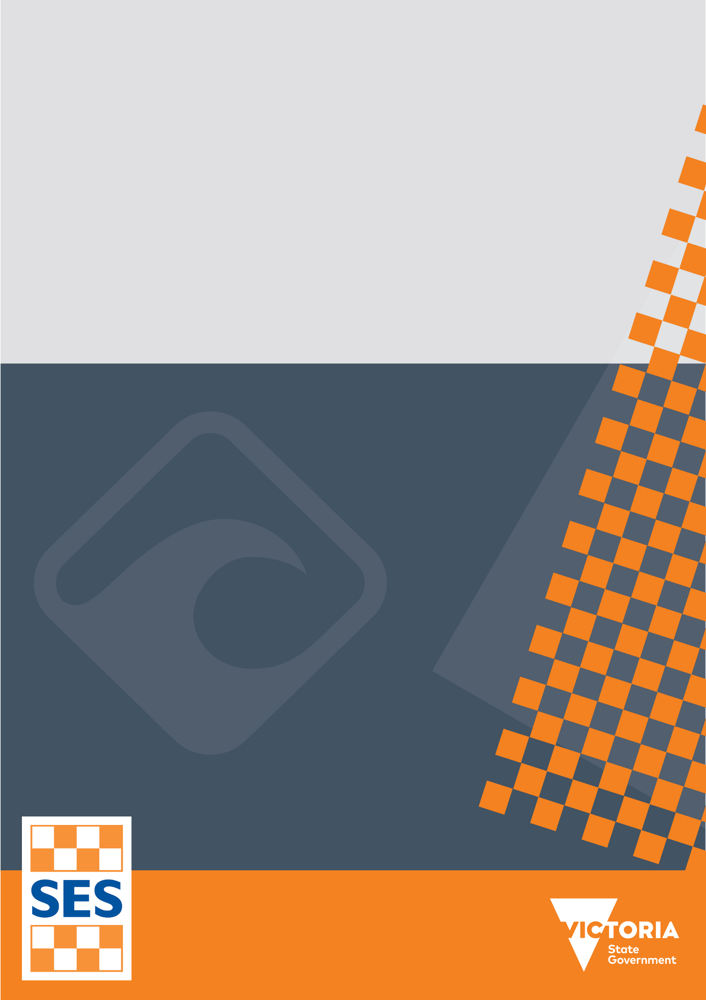
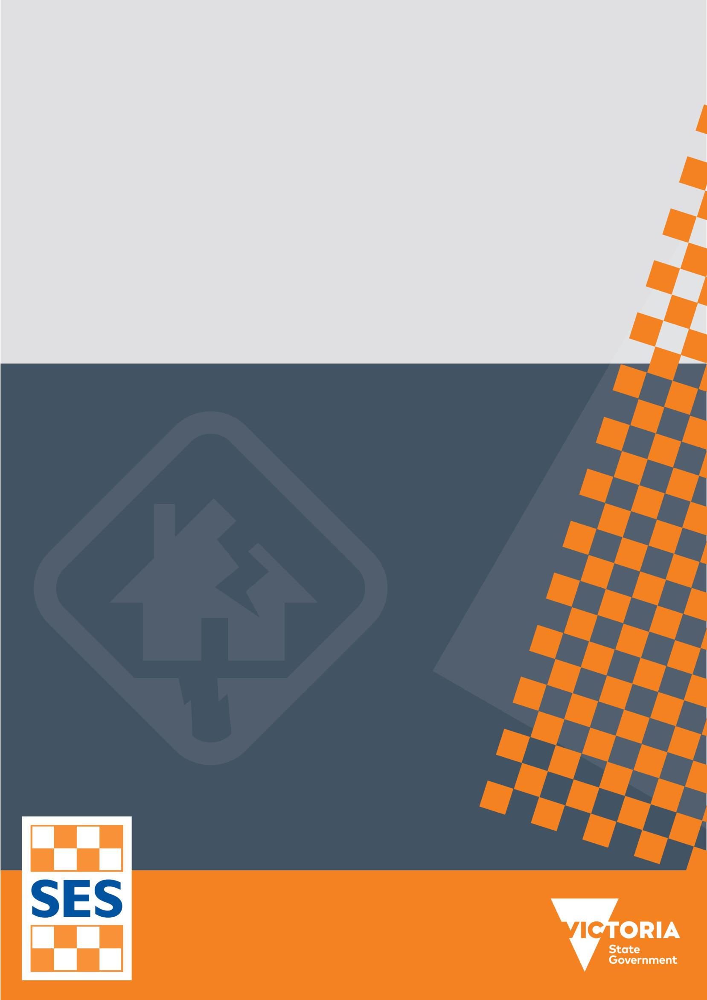
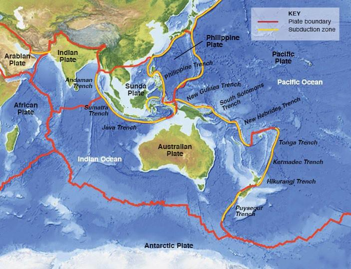
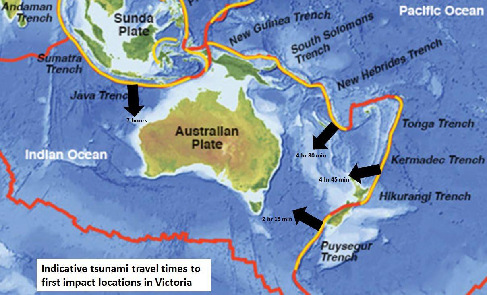
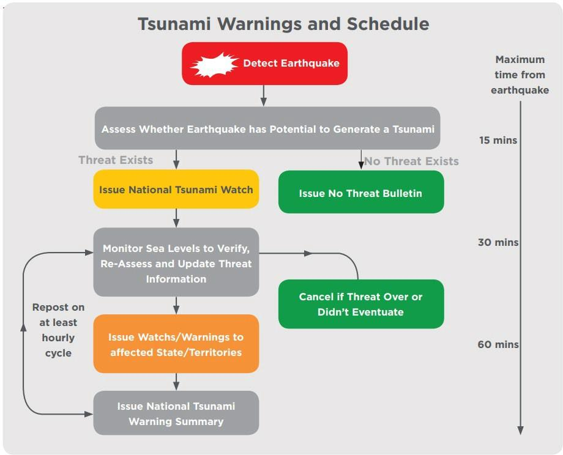
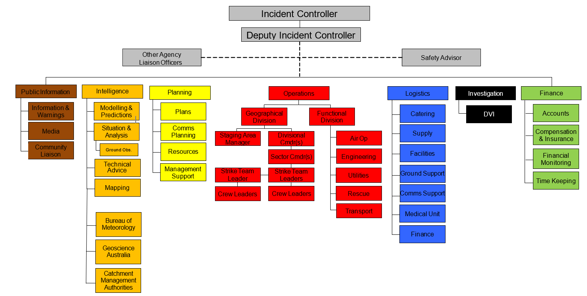
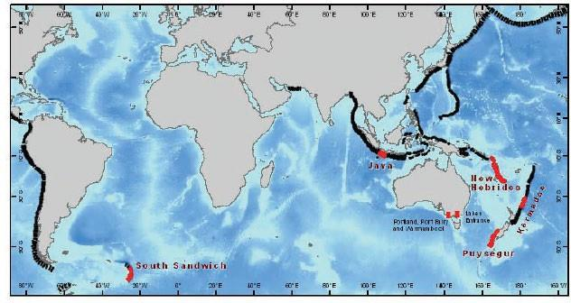

# State Emergency Management Plan — Tsunami Sub-Plan (Edition 3.0 (November 2023))

> **Source**: Emergency Management Victoria
> **URL**: https://files.emv.vic.gov.au/2023-11/SEMP%20Tsunami%20Sub-Plan%20Edition%203.0.PDF
> **Licence**: © State of Victoria; emergency-management practitioner reference
> **Retrieved**: 2026-05-07T23:44:05Z
> **SHA-256**: `59872e3b82e433c6967689af1570fe8a1ca1e31794436d9d1a588664e61820cc`
> *Converted from PDF to Markdown format.*

---
## Page 1

 
 
 
State Emergency 
Management Plan, Tsunami 
Sub-Plan 2023 
Edition 3.0

---
## Page 2

 
 
 
 
SEMP TSUNAMI SUB-PLAN - EDITION 3.0 – November 2023    
2 
Acknowledgment of Traditional Owners 
The Victoria State Emergency Service respectfully acknowledges the Traditional Owners of the land 
and waters. We pay our respects to Elders past and present, and are committed to working with 
Aboriginal and Torres Strait Islander communities to achieve a shared vision of safer and more resilient 
communities.   
 
 
 
 
 
 
 
 
 
 
 
 
 
 
 
 
 
 
 
Authority 
This plan has been endorsed by the State Crisis and Resilience Council (SCRC) as a  sub-plan to the 
State Emergency Management Plan. 
 
Authorised and published by 
Authorised and published by the Victorian Government  Melbourne November 2023  
 
© Copyright State of Victoria 2023 
 
You are free to re-use this work under a Creative Commons Attribution 4.0 licence, provided you credit 
the State of Victoria (Emergency Management Victoria) as author, indicate if changes were made and 
comply with the other licence terms. The licence does not apply to any images, photographs or 
branding, including Government logos. 
 
If you would like to receive this publication in an accessible format, please email 
emergencyplanning@emv.vic.gov.au. This document is also available in PDF format at emv.vic.gov.au 
 
Document information 
Date of approval November 2023

---
## Page 3

 
 
 
 
SEMP TSUNAMI SUB-PLAN - EDITION 3.0 – November 2023    
3 
Executive summary  
 
This State Emergency Management Plan (SEMP) – Tsunami Sub-Plan Edition 3 (this plan), 
replaces the State Emergency Response Plan – Tsunami Sub-plan Edition 2 published in 2019. 
 
The plan includes provision of current and accurate information relating to: 
▪ 
Any VICSES changes in organisation, agency roles and responsibilities. 
▪ 
Operational response in a complex and multi-hazard environment that has impacted Victoria 
since the previous version published in 2019.  
▪ 
Alignment with arrangements contained in the SEMP approved in November 2023, inclusive 
of Machinery of Government changes that took effect on 1 January 2023. 
 
This plan was prepared with regard to the SEMP, and the Guidelines for Preparing State, 
Regional and Municipal Emergency Management Plans (SEMP Guidelines), including formal 
consultation and statement of assurance.

---
## Page 4

 
 
 
 
SEMP TSUNAMI SUB-PLAN - EDITION 3.0 – November 2023    
4 
Table of contents 
Executive summary................................................................................................................................ 3 
1 
Introduction .................................................................................................................................... 5 
1.1 
Purpose and objective ............................................................................................................. 5 
1.2 
Scope ...................................................................................................................................... 5 
1.3 
Authorising environment and activation .................................................................................. 5 
1.4 
Exercise, evaluation and review ........................................................................................... 7 
1.5 
Audience and linkages ............................................................................................................ 7 
2 
The emergency context ................................................................................................................ 9 
2.1 
 Risks ....................................................................................................................................... 9 
2.2 
What is a tsunami? .................................................................................................................. 9 
2.3 
Characteristics of tsunami ..................................................................................................... 10 
2.4 
Tsunami sources ................................................................................................................... 10 
2.5 
When does a tsunami become an emergency? ................................................................... 12 
2.6 
Warning lead time ................................................................................................................. 12 
2.7 
 Impacts and consequences ................................................................................................. 13 
3 
Managing tsunami emergencies ................................................................................................ 17 
3.1  
Emergency management priorities ....................................................................................... 17 
3.2 
Shared responsibilities .......................................................................................................... 17 
3.3  
Roles and responsibilities ..................................................................................................... 18 
3.4  
Mitigation ............................................................................................................................... 19 
3.5 
Preparedness ........................................................................................................................ 24 
3.6 
Response .............................................................................................................................. 25 
3.7 
Recovery ............................................................................................................................... 30 
Appendix ............................................................................................................................................ 33 
APPENDIX 1 ....................................................................................................................................... 33 
APPENDIX 2 ....................................................................................................................................... 34 
APPENDIX 3 ....................................................................................................................................... 35

---
## Page 5

 
 
 
 
SEMP TSUNAMI SUB-PLAN - EDITION 3.0 – November 2023    
5 
1. Introduction 
 
 
1.1 
Purpose and objective  
Purpose  
This plan outlines the Victorian arrangements for managing tsunami events across all emergency 
management. 
 
The plans’ purpose is to provide sources of information and to outline the arrangements for ensuring 
an integrated and coordinated approach to the state’s management of tsunami events, and to 
reduce the impact and consequences of these events on the community, infrastructure, and 
services.  
Objective  
In alignment with the SEMP, this plan contextualises the current arrangements, roles and 
responsibilities for tsunami mitigation, preparedness, response (including relief) and recovery. 
1.2 
Scope    
This plan acknowledges the often-concurrent emerging threats and their consequences of tsunamis, 
including earthquakes, landslides, water surges, as well as the structural integrity of critical 
infrastructure, including water storages and water supply, wastewater services, gas and electricity, 
transport, health and telecommunication service disruptions. 
The scope of this plan includes: 
▪ 
The description of potential risks and consequences of tsunamis to the social, built, 
economic, and natural environments. 
▪ 
The policy and programs in place to mitigate these risks before, during, and after a 
tsunami event. 
▪ 
The positions with accountability and the agencies responsible for managing specific 
strategies. 
▪ 
The multi-agency management arrangements at the national, state, regional and local 
levels. 
▪ 
Links to sources of information where the reader can obtain further detail. 
 
References are made to the SEMP where necessary to avoid duplication. It does not include detail 
about the operational activities of individual agencies. 
1.3 
Authorising environment and activation  
Authorisation  
In 2018, amendments to the Emergency Management Act 2013 (EM Act) were passed through 
parliament, requiring the Emergency Management Commissioner (EMC) to arrange for the 
preparation of a SEMP. The SEMP allows for an integrated, coordinated, and comprehensive 
approach to emergency management at the state level. It contains provisions for the mitigation of, 
response (including relief) to, and recovery from emergencies (before, during and after), and 
specifies the roles and responsibilities of agencies in relation to emergency management.

---
## Page 6

 
 
 
 
SEMP TSUNAMI SUB-PLAN - EDITION 3.0 – November 2023    
6 
Under the EM Act, tsunamis (or other natural events), are a Class 1 Emergency. A Class 1 
Emergency is a major fire or any other major emergency where either the Country Fire Authority 
(CFA), Fire Rescue Victoria (FRV) or VICSES is the control agency. 
The EM Act defines a major emergency as an event which:  
• 
Is a large or complex emergency (however caused), which – 
(i) Has potential to cause or is causing loss of life and extensive damage to property, 
infrastructure, or the environment; or 
(ii) Has the potential to have, or is having significant adverse consequences for the 
Victorian community or a part of the Victorian community; or 
(iii)  Requires the involvement of two or more agencies to respond to the emergency; or 
o Is a Class 1 Emergency 
o Is a Class 2 Emergency 
This plan aligns with the SEMP and was prepared with regard to the Guidelines for Preparing State, 
Regional and Municipal Emergency Management Plans; and was endorsed by the State Crisis and 
Resilience Council (SCRC) on the 29 November 2023.  
 
This plan was published and took effect from the 29 November 2023. 
 
The following legislation, while not exhaustive, is the principal legislation for tsunamis in Victoria: 
▪ Emergency Management Acts 1986 and 2013 (EM Act) 
▪ Victoria State Emergency Service Act 2005 
▪ Essential Services Act 1958 
▪ Planning and Environment Act 1989 
▪ Aboriginal Heritage Act 2006 
▪ Marine Safety Act 2010 
 
VICSES, on behalf of the EMC, coordinated the development of this plan in conjunction with 
stakeholders including, but not limited to: 
▪ 
Ambulance Victoria (AV) 
▪ 
Australian Red Cross 
▪ 
Australian Tsunami Advisory Group (ATAG) 
▪ 
Bureau of Meteorology (BOM) 
▪ 
Country Fire Authority (CFA) 
▪ 
Department of Education (DE) 
▪ 
Department of Energy, Environment and Climate Action (DEECA)  
▪ 
Department of Government Services (DGS) (including Local Government Victoria)  
▪ 
Department of Health (DH) 
▪ 
Department of Families, Fairness and Housing (DFFH) 
▪ 
Department of Jobs, Skills, Industry and Regions (DJSIR) 
▪ 
Department of Transport and Planning (DTP)  
▪ 
Emergency Recovery Victoria (ERV) 
▪ 
Emergency Services Telecommunications Authority (ESTA) 
▪ 
Environment Protection Authority (EPA) 
▪ 
Fire Rescue Victoria (FRV)

---
## Page 7

 
 
 
 
SEMP TSUNAMI SUB-PLAN - EDITION 3.0 – November 2023    
7 
▪ 
Geoscience Australia (GA) 
▪ 
Great Ocean Road Coast and Parks Authority 
▪ 
Joint Australian Tsunami Warning Centre (JATWC) 
▪ 
Life Saving Victoria (LSV)  
▪ 
Municipal Association of Victoria 
▪ 
Victoria Police 
▪ 
WorkSafe Victoria 
Activation of the plan  
The arrangements in this plan apply on a continuing basis and do not require activation. 
1.4 Exercise, evaluation and review 
Exercise and Evaluation 
This sub-plan will be exercised and evaluated every three years from the date of publication. The 
exercise will be evaluated and, where improvements to the emergency management arrangements 
in this plan are required, the plan will be amended, and a revised version issued.  
Exercises will be conducted in accordance with the Australian Institute for Disaster Resilience 
(AIDR) Managing Exercises Handbook, available at 
https://knowledge.aidr.org.au/resources/handbook-managing-exercises/ 
Review  
This plan will then be reviewed and updated at least every three years, with consideration given to 
earlier revisions as required to ensure the plan provides for a current, integrated, coordinated, and 
comprehensive approach to tsunami emergencies, and consideration of potential escalation of 
climate-related hazards.  
 
Earlier reviews may be triggered by this plan being applied in a major emergency or exercise or 
following a substantial change to relevant legislation or arrangements, including the SEMP.  
1.5 Audience and linkages  
Audience 
This plan recognises that for emergency management and supporting communities to be safer and 
more resilient it is the shared responsibility of all Victorians, not just the emergency management 
sector.  
The audience for this plan comprises the Victorian Government and agencies within the emergency 
management sector, including business, industry, councils and community with a significant role in 
the mitigation of, response to, and recovery from tsunamis. 
This plan should be read in conjunction with the SEMP. 
Linkages and hyperlinks 
This plan refers to a range of existing resources relating to tsunamis, including documents and 
websites. This plan does not seek to duplicate the information contained in these resources, and 
instead provides links to where the reader can obtain further information.  
 
For more operational or sensitive information a log-in may be required, such as for documents 
saved on the Emergency Management Common Operating Picture (EM-COP), including Joint 
Standard Operating Procedures (JSOPs). 
 
Documents or resources that are referred to frequently throughout this plan (such as the SEMP) are

---
## Page 8

 
 
 
 
SEMP TSUNAMI SUB-PLAN - EDITION 3.0 – November 2023    
8 
not hyperlinked in each instance.  
 
All hyperlinks were accurate at time of publication, and the currency of the linked content remains 
the responsibility of the host agency. 
Consequence management  
Secondary consequences for tsunami can be complex and compounding. The arrangements for 
managing consequences of tsunami are contained in relevant SEMP Sub-Plans, including, but not 
limited to:  
▪ 
SEMP Earthquake Sub-Plan  
▪ 
SEMP Energy Sub-Plan 
▪ 
SEMP Flood Sub-Plan 
▪ 
SEMP Health Emergencies Sub-Plan 
▪ 
SEMP Landslide Sub-Plan 
▪ 
SEMP Maritime Emergencies (non-search and rescue) Sub-Plan 
▪ 
SEMP Public Transport Disruption Sub-Plan 
▪ 
SEMP Storm Sub-Plan 
 
Where necessary, VICSES has prepared Regional Tsunami Sub-Plans, and Municipal Tsunami 
Sub-plans for endorsement by the respective Regional Emergency Management Planning 
Committees (REMPC’s) and Municipal Emergency Management Planning Committees (MEMPC’s). 
 
Regional and Municipal Tsunami Emergency Plans can be found via the VICSES website. 
 
In the case of a concurrent emergency (e.g. human health pandemic or an energy disruption), the 
arrangements detailed in this plan may need to be adjusted as required.

---
## Page 9

 
 
 
 
SEMP TSUNAMI SUB-PLAN - EDITION 3.0 – November 2023    
9 
2. The emergency context 
 
2.1 
 Risks  
The more likely tsunami threat to Victoria and the broader Australian coastline is likely to result from 
a marine threat tsunami. Likely effects of a marine threat tsunami include dangerous rip tides, 
waves and strong currents. Land threat tsunami events are rare but extremely hazardous and can 
cause inundation in low-lying coastal regions. The online publication ‘Tsunami: the ultimate guide’, 
developed by AIDR indicates that there have been more than 50 recorded tsunami events on the 
Australian coastline since European settlement, however, it is widely acknowledged that there are 
limited records of tsunami events and associated consequences. 
With close to 2,000km of Victorian coastline and approximately 80% of Victoria’s population living 
within 50km of the coast, Victoria can be deemed to have a susceptibility to marine based hazards, 
such as tsunami. This vulnerability is heightened during peak holiday seasons, most notably during 
the spring and summer months, where coastal populations reach peak due to transient populations 
and short-term stays by tourists and holiday makers. 
Despite this, Victoria is considered to have a lower tsunami risk than many other parts of Australia 
and the world. This is because the waters of Bass Strait, seaway separating Tasmania from the 
mainland, are in large part protected from effects due to: 
▪ 
Distance – the long distance between the waters along Victoria coastline and the edge of the 
continental shelf, where many tsunami events resulting from earthquake originate. 
▪ 
Offshore barriers and land formation – that obstruct a tsunami entering Bass Strait and in 
turn minimising wave heights reaching Victoria’s most populous locations. Examples include: 
▪ 
Furneaux Islands and the shape of the Victorian coastline (in particular, Wilson’s 
Promontory) obstructing a tsunami entering Bass Strait from the east, reducing the wave 
heights reaching communities around Melbourne. 
▪ 
King Island and Wilsons Promontory which effectively block tsunami events originating 
from the west, and in turn reduce wave heights at Yarram and Lakes Entrance. 
A tsunami can impact communities outside Bass Strait which are not protected by offshore features, 
including but not limited to Warrnambool, Portland and Port Fairy in the south-west of Victoria, and 
Lakes Entrance and Mallacoota in the south-east. 
The most definitive inventory of tsunami events and associated impacts in Australia is captured by 
Goff and Chague-Goff in the 2014 publication, The Australian Tsunami Database: A review. 
2.2 
What is a tsunami? 
A tsunami is a series of ocean waves generated by a sudden displacement of large volumes of 
water. The impacts of a tsunami can vary widely. A small tsunami may result in unusual tides or 
currents occurring where they would not normally occur that can be dangerous to swimmers or 
cause damage to berthed vessels. A large tsunami can cause widespread flooding and destruction. 
It may also cause strong rips and currents in oceans around the world for up to a few days after the 
initiating earthquake. 
A tsunami may be caused by one or a combination of: 
▪ 
Vertical movement of the sea floor as a result of a large earthquake. 
▪ 
Sub-marine or coastal volcanic eruptions.

---
## Page 10

 
 
 
 
SEMP TSUNAMI SUB-PLAN - EDITION 3.0 – November 2023    
10 
▪ 
Meteor impacts. 
▪ 
Coastal landslides and slumps, either land-based or sub-marine. 
The size of tsunami can range from centimetres resulting in strong and unusual currents, to tens of 
metres causing the flooding of coastal land.  
Earthquakes have generated the majority of tsunami that have occurred in the Pacific Ocean and 
recorded on the Australian coast. However, not all earthquakes generate a tsunami. To generate a 
tsunami, the fault where the earthquake occurs must be underneath or near the ocean, and the 
earthquake must cause significant vertical movement of the sea floor over a large area. Shallow 
focus earthquakes along tectonic plate subduction zones are responsible for the most destructive 
tsunami. https://knowledge.aidr.org.au/tsunami-the-ultimate-guide/#/   
2.3 
Characteristics of tsunami 
Tsunamis are primarily characterised by their long wave length, which can range from 10 to 500 
kilometres long. Tsunamis travel outward in all directions from their point of origin and can strike 
coastal areas at great distances from the source. The generation of waves, however, is not 
necessarily symmetrical. The larger waves are focused in directions at right angles to the orientation 
of the earthquake rupture.  
The speed of a tsunami is dependent on water depth and wave period. In deep water and in the 
open ocean, waves can reach speeds of 800 kilometres per hour. Heights of tsunami waves in deep 
water are small and the waves can go unnoticed. As a tsunami wave enters shallow water, its 
speed decreases rapidly. This causes the length of the wave to decrease and the height of the 
wave to increase.  
Wave period is dependent upon the mode of propagation (relative velocity and magnitude of the 
disturbance, the water depth in which the wave is generated, and the volume of water displaced by 
the event generating the waves). Tsunamis can arrive with a leading crest or a leading trough. A 
tsunami may strike the coast as a cresting wave, a fast-rising tide, or a bore. At some locations, the 
advancing turbulent front will be the most destructive part of the wave. In other situations, the 
greatest damage will be caused by the outflow of water back to the sea, between successive 
tsunami waves. 
The magnitude of a tsunami at the coast is dependent on the configuration of the coastline, the 
shape of the ocean floor, reflection of waves, tides, and wind waves. Narrow bays, inlets and 
estuaries may cause funneling effects that enhance tsunami magnitude. The combination of these 
factors means that the flooding produced by a tsunami can vary greatly from place to place over a 
short distance. 
A tsunami is not one wave, but a series of waves. The time between the successive waves is 
usually between 5 and 90 minutes. Destructive waves may continue for a number of hours, and 
several days may pass before the sea returns to its normal state. The first wave in the series may 
not be the largest. 
Tsunamis can wrap around islands, and damage can be worst on coasts on the sides that face 
away from the source of the tsunami. A tsunami impacting on harbours and bays can create 
damaging wave activity and currents. In these enclosed environments, maximum wave magnitudes 
may possibly occur somewhat later than the arrival of the initial wave. Even a small tsunami can 
generate currents strong enough to cause damage to boats and associated facilities. 
2.4 
Tsunami sources 
Earthquake  
Local sources: There is potential for earthquakes occurring within the continental shelf off 
Victoria to produce tsunami. No historical tsunami events that have been recorded in Victoria 
have been attributed to local earthquakes.

---
## Page 11

 
 
 
 
SEMP TSUNAMI SUB-PLAN - EDITION 3.0 – November 2023    
11 
  
Regional sources: Regional earthquake sources are major contributors to the tsunami threat 
facing Victoria. The largest contributors to the tsunami hazard are the Tonga-Kermadec Trench 
and the New Zealand - Puysegur Trench (see Figure 1). 
Distant sources: Distant earthquakes have the potential to generate tsunami which can affect 
Victoria. Within European history, the largest tsunami events have come from South America 
(1960, 1877 and 1868). The South Sandwich Islands region is the main contributor to the 
distant source hazard for western Victoria, while fault lines along the west coasts of North and 
South America are contributors to the distant source hazard for eastern Victoria. 
 
Figure 1: Possible regional earthquake sources – subduction zones 
 
Source: Tsunami: The Ultimate Guide 
 https://knowledge.aidr.org.au/tsunami-the-ultimate-guide/#/ 
Volcanic 
Local sources: No local volcanic sources exist capable of generating tsunami. 
Regional sources: The nearest volcanic sources likely to produce a tsunami are located in the 
Pacific Islands and New Zealand. In the area from New Zealand to Papua New Guinea there 
are more than 130 volcanic centres known to have erupted in the last 10,000 years. While 
some of these are too small or are located too far inland to produce tsunami, a surprisingly 
large proportion has some potential to generate tsunami. 
On 15 January 2022 Victoria experienced a Tsunami warning event as a result of the eruption of the 
Hunga Tonga-Hunga Ha’apai submarine volcano off the coast of Tonga on the Kermadec-Tonga 
Ridge in the South Pacific, 65 kilometres north of Tongatapu, the country's main island.  
Distant sources: Large scale collapses of volcano edifices have occurred on a number of 
occasions. The best understood of these are repeated failures of Hawaiian volcanoes, with a 
suspected frequency of about once every 100,000 years, or less frequently. Slope failures have

---
## Page 12

 
 
 
 
SEMP TSUNAMI SUB-PLAN - EDITION 3.0 – November 2023    
12 
been large and capable of generating Pacific-wide tsunami. 
Landslide 
Only very limited information is available about the potential for submarine landslides on the 
Victorian coast and adjacent areas. Though in the event of a submarine landslide, the impacts 
of a tsunami may reach the Victorian coastline prior to triggering deep-water buoys and the 
associated warning system (see 2.6 for further information). 
Asteroid/meteor 
There are no known examples, during recent human history, of a tsunami being generated by 
asteroids, although the earth does preserve geological evidence of asteroid impacts. 
Meteotsunami 
Meteotsunamis are large waves caused by air-pressure disturbances often associated with fast-
moving weather events.  
Meteotsunamis are not classified as Tsunamis in Victoria and are known as storm surges. More 
information on storm surges can be found in the SEMP Storm Sub-plan.  
2.5 
When does a tsunami become an emergency? 
A tsunami event may be defined as an emergency when there is either threat of, or community 
consequences resulting from a tsunami event, and may result from a no-notice event (i.e. sub-
marine landslide) or a known event (i.e. earthquake). For earthquake generated tsunami 
events, pre-defined thresholds based on likely consequences to the community have been 
determined through the partnerships of the Australian Tsunami Warning System which trigger 
the issuing of a Tsunami Warning (Marine or Land Threat) by the Joint Australian Tsunami 
Warning Centre (JATWC).   
Further details about the associated threat-based tsunami warning products and the associated 
arrangements under the Australian Tsunami Warning System can be accessed in Section 4.3 – 
Tsunami warnings of this plan. 
2.6 
Warning lead time 
Warning time, and therefore warning arrangements, will vary depending on the proximity of 
tsunami generation (see Figure 2 below, for indicative tsunami travel times from possible 
earthquake sources), for example: 
▪ 
A distant tsunami (e.g. Chile, California or Alaska) may arrive over 12 hours after it has 
been generated. 
▪ 
An earthquake generated tsunami along the Puysegur Trench in New Zealand may 
arrive approximately two hours after it was generated. 
▪ 
A local tsunami possibly caused by a submarine landslide may arrive at the initial point 
of impact along the Victorian coast within minutes. Under these circumstances, limited 
warning time may be available to adjacent coastal communities outside the initial impact 
area. 
It is critical that timely, tailored, and relevant public information and warnings are issued to 
maximise lead time of a tsunami event and provide opportunity for community members to take 
protective action. While it is acknowledged effective communication is important for all hazards, 
it may be the only protective tool available before and during a tsunami event with little lead 
time.

---
## Page 13

 
 
 
 
SEMP TSUNAMI SUB-PLAN - EDITION 3.0 – November 2023    
13 
Figure 2: Indicative tsunami travel times from possible regional earthquake sources 
Source: Tsunami: The Ultimate Guide 
https://knowledge.aidr.org.au/tsunami-the-ultimate-guide/#/ 
   
 
2.7 
 Impacts and consequences 
2.7.1  Tsunami impacts 
Small tsunami event 
Most tsunami events in Victoria will be small, resulting in strong currents and changing water levels 
over a period of time, which may affect marine based risk elements such as people on beaches, 
swimmers, boaters, divers, fishers, aqua- culture industries and submarine infrastructure (e.g. 
submarine cables). 
Large tsunami event 
Large tsunami events are rare in Victoria. Impacts are most likely to be marine based, however, 
there is a possibility of land inundation. Below are the potential impacts from a land threat tsunami: 
▪ 
Inundation (or flooding) 
▪ 
Wave and debris impact on structures 
▪ 
Erosion 
The current generation Australian Tsunami Warning System tsunami scenario database suggests 
that Victorian Land-Threat Warnings could be issued for earthquakes of about magnitude 8.5 or 
larger occurring on some of the nearby subduction zones illustrated in Figure 1. Land inundation 
might also occur due to intraplate earthquakes close to the Victorian coast or from non-seismic 
events such as a meteotsunami (large wave caused by storms, defined in Victoria as ‘Storm 
Surge’), landslide, volcano, or asteroid impact. These non-subduction tsunami sources have 
received little study in the Victorian context, but land-inundation from such sources is probably rare.

---
## Page 14

 
 
 
 
SEMP TSUNAMI SUB-PLAN - EDITION 3.0 – November 2023    
14 
 
Realistic worst case tsunami event 
Worst case tsunami events that threaten inundation of the Victorian coastline are considered to be 
very unlikely, but plausible. Despite marine threat Tsunamis being more likely in Victoria, focus on 
extreme cases aids conceptualisation of the potential threat posed by the hazard and associated 
consequences (refer to section 3.2). 
A scenario that illustrates the threat of land inundation for the east coast of Victoria is a magnitude 
8.8 earthquake, originating from the Puysegur Trench. While the likelihood of occurrence is 
extremely low (based on the Probabilistic Tsunami Hazard Assessment 2018 (PTHA18), there is a 
0.024% chance of occurrence in the next 50 years), it is still possible, and smaller land inundation 
events are more likely. 
An example of a M8.8 Puysegur Trench Tsunami Warning is included in Appendix C (page 35), 
which depicts the likely threat area in the warning graphic and explains the potential threat and 
recommended action within the text. 
It is acknowledged that the possible impact of a tsunami event is influenced by a large number of 
variables that influence hazard behaviour and will be unique for each tsunami event, and as such 
this example should be viewed as a guide only. 
2.7.2 Damage and disruption 
Agriculture – loss of and/or damage to stock, crops, food and fibre production and agricultural 
infrastructure. Loss of access to market. 
 
Built infrastructure damage – loss of essential services or key community infrastructure (e.g. 
roads, bridges, marinas, ports and essential services (water, gas, and electricity)) homes and 
businesses. 
 
Cultural and heritage – loss of or damage to Indigenous or culturally significant sites (i.e. 12 
Apostles and Great Ocean Road). 
 
Displacement or isolation – relocation or disconnection of community members from temporary or 
permanent housing, including caravan parks, camp grounds, and low-lying coastal areas or on 
floodplains in tidal river areas. 
 
Economic – disruption and closures to local trade centres including ports, local businesses 
including aqua-culture (i.e. mussel farms) and fisheries resulting in lost revenue (i.e. closure of the 
Port of Melbourne is estimated to cost the Victorian economy approximately $2,795 per minute for a 
marine pollution event, and closures to ports may impact oil/fuel supply within a matter of days), 
potential job loss, and impacts to agricultural exports (i.e. livestock, forestry and grain). This also 
includes maritime casualty and potential maritime pollution impacts requiring state and potentially 
national response and significant local impacts. 
 
Education - disruptions to or closure of education and early childhood and care facilities as a result 
of essential service disruptions, community impact, and access issues. School bus transportation 
may also be impacted by road infrastructure damage and closures. 
 
Energy (electricity and gas) – Damage to coastal electricity assets (such as transmission and 
distribution lines) may cause power supply disruption to Victorian communities. This may impact on 
infrastructure reliant on electricity such as telecommunications and water supply. Any damage to 
gas infrastructure (such as overland gas pipelines and compressor stations) may cause reduced 
gas production and/or disruption of gas through parts of the network.  
 
Environment – temporary and potentially long-term degradation of natural ecosystems and

---
## Page 15

 
 
 
 
SEMP TSUNAMI SUB-PLAN - EDITION 3.0 – November 2023    
15 
amenities. 
 
Environmental health - potential for contamination and disruption to built or natural environments 
that can increase the risks to public health. 
 
Food and grocery logistics – potential of isolation and reduced access and/or loss/spoilage of 
products due to refrigeration and transport issues. 
 
Health and emergency services – road closures resulting in reduced access for ambulances and 
other emergency services, in addition to an inability for health staff to access work premises. There 
will be a requirement for rescue agencies to assist ambulance in accessing patients. The 
compounding nature of access issues and delay will impact on human health.  
 
Health services – overwhelming of local healthcare systems due to casualties, injuries, or illness. 
Health services are likely to be damaged and operating at a reduced capacity with the potential be a 
significant decrease in ambulance services within the affected area due to issues of road access 
and availability of staff. Potential for a decrease in the quality of living conditions for affected 
populations may increase the risk of communicable disease transmission.  
Human health – potential drowning deaths associated with tsunamis and traumatic injuries such as 
broken limbs and head injuries are caused by the physical impact of people being washed into 
debris such as houses, trees, and other stationary items. As the water recedes, the strong suction 
of debris being pulled into large populated areas can further cause injuries and undermine buildings 
and services. Loss of shelter will leave people vulnerable to insect exposure, heat, and other 
environmental hazards. 
 
Public order and community safety – overwhelming of local road infrastructure in the event of an 
evacuation or inundation of low-lying roads, and loss of services such as food, water, sanitation, 
and telecommunications resulting in health risks lack of accessibility to available services. 
 
Road and transport access – restricted access to or closure of major roads, rail lines and/or ports 
due to infrastructure damage results in delays or cancellations of services. Causes significant 
disruption to community and business at local, state and/or national levels, particularly if arterial, 
public transport and/or sea transport routes are disrupted. 
 
Telecommunications – disrupted or loss of telecommunication services including network and 
website outages, resulting from damage to infrastructure or overwhelming of services. May also 
impact on provision of health, emergency, and transport services. 
 
Water supply and waste-water – contamination of drinking water supplies resulting from broken 
pipes and sewerage lines blockages resulting in loss or service and/or potential backflow to 
properties. 
 
Wildlife – reduction in sizes of local seal colonies and potential threat to migratory birds due to loss 
or damage of habitat. 
 
2.7.3  Tsunami consequences 
The consequences of a tsunami will vary depending on its magnitude. Consequences are 
categorised under the themes of wellbeing, livability, sustainability, viability, and community 
connectedness. 
While Victoria has a low tsunami risk, potential consequences have been identified which may 
require consideration when responding to large tsunami events. 
Consideration should also be given to other key characteristics of the Victorian environment which

---
## Page 16

 
 
 
 
SEMP TSUNAMI SUB-PLAN - EDITION 3.0 – November 2023    
16 
will influence the impact and associated consequences (i.e. prior flooding in the landscape, Highest 
Astronomical Tide (HAT) and marine or land based activities being undertaken by the community). 
In addition to consideration of cascading events created by a tsunami (i.e. a loss of power may 
result in a loss of telecommunications, transport (road and rail) management and/or monitoring 
systems and disruption to supply chains). 
Damage to coastal transport (road and rail) infrastructure may result in isolation of properties and/or 
communities. Damage to ships, ports or surrounding facilities may result in risk to life and/or marine 
pollution harming (marine ecosystems and animals).

---
## Page 17

 
 
 
 
SEMP TSUNAMI SUB-PLAN - EDITION 3.0 – November 2023    
17 
3. Managing tsunami emergencies  
 
 
 
3.1  Emergency management priorities 
The State Emergency Management Priorities that are outlined in the SEMP guide all decisions 
before, during, and after any emergency, and apply to all aspects of this plan. The priorities are:  
▪ 
Protection and preservation of life and relief of suffering is paramount. This includes:  
▪ 
Safety of emergency response personnel. 
▪ 
Safety of community members, including vulnerable community members and 
visitors/tourists.   
▪ 
Issuing of community information and community warnings detailing incident information that 
is timely, relevant, and tailored to assist community members to make informed decisions 
about their safety. 
▪ 
Protection of critical infrastructure and community assets that support community resilience.  
▪ 
Protection of residential property as a place of primary residence.  
▪ 
Protection of assets supporting individual livelihoods and economic production that supports 
individual and community financial sustainability.  
▪ 
Protection of environmental and conservation assets that considers the cultural, biodiversity, 
and social values of the environment. 
3.2 
Shared responsibilities  
The SEMP recognises that emergency management is the shared responsibility of all Victorians, not 
just the emergency management sector. In emergency management, shared responsibility refers to 
the collective obligations and accountabilities held by a range of actors. A commitment to shared 
responsibility recognises that no single actor can be responsible for emergency mitigation, 
preparedness, response or recovery, and that shared responsibility in emergency management is 
everyone’s business. Individuals, communities, organisations, businesses, all levels of government 
and the not-for-profit sector all have a role to play in planning for, responding to and recovering from 
emergencies. 
Tsunami events can happen anytime and, as with all hazards, cannot be fully mitigated from 
potential impacts on the community. As such, it is imperative that there is a shared and individual 
responsibility for action which if further explained in the National Strategy for Disaster Resilience, 
developed by the Council of Australian Governments (COAG) and is available at: 
https://knowledge.aidr.org.au/resources/national-strategy-for-disaster-resilience  
This strategy provides high-level guidance on disaster management to agencies with a role in 
emergency management. 
Foremost in the strategy is the principle of all of society taking responsibility for preparing for 
disasters. Examples in the context of tsunami include: 
▪ 
Individuals being aware of their tsunami risk and following advice from emergency services 
when responding to warnings. 
▪ 
Councils, emergency management committees, and communities undertaking ‘Community 
Emergency Risk Assessment (CERA)’ activities, including tsunami discussion, and ensuring

---
## Page 18

 
 
 
 
SEMP TSUNAMI SUB-PLAN - EDITION 3.0 – November 2023    
18 
consideration within emergency management planning, intelligence, and land use planning. 
▪ 
Industry and businesses planning for the risk of disruption, and ensuring arrangements are 
in place to maintain critical services and assist communities. 
▪ 
Government agencies undertaking: 
▪ 
Risk assessments to gain an appreciation of tsunami risk. 
▪ 
Engagement with the community regarding tsunami risk. 
▪ 
Work with communities to plan the management of tsunami risk. 
▪ 
Provision of emergency information and tsunami warnings. 
▪ 
Effective and well-coordinated response during a tsunami event. 
▪ 
Identify and support those most at risk during a tsunami event  
▪ 
Activities to help communities recover and learn following a tsunami event and build 
their resilience to future events. 
 
In Victoria, Emergency Management Victoria (EMV) has led the development of the Community 
Resilience Framework for Emergency Management. It defines community resilience as “the capacity 
to survive, adapt and thrive no matter what kind of chronic stresses and acute shocks they 
experience”. Information can be found at: emv.vic.gov.au/how-we-help/community 
 
Likewise, the Community Resilience Strategy Renewal 2019-22, (currently being reviewed as part of 
VICSES Strategic Planning 2023-2027) defines a key and measurable objective to increase the 
level of interest, and support behavior change within our communities, so they are more aware, 
informed and prepared for emergencies – supporting them to understand their risk, and the 
relevance of taking action before, during and after emergencies. Information can be found at: 
ses.vic.gov.au/who-we-are/resilience 
3.3  Roles and responsibilities 
The SEMP details the roles and responsibilities for tsunamis. Several primary roles are noted in the 
following.  
3.3.1 State Crisis and Resilience Council 
The State Crisis and Resilience Council (SCRC) is the peak crisis and emergency management 
body to the Victorian Government and provides advice to ministers and relevant cabinet sub-
committees. It is responsible for the development and implementation of whole of government 
emergency management policy and strategy. It does not make operational or tactical decisions. 
3.3.2 Emergency Management Commissioner 
Under the EM Act 2013, the Emergency Management Commissioner (EMC) has legislated 
management responsibilities across major emergencies. These include response coordination, 
ensuring effective control arrangements are established, and ensuring effective coordination of 
consequences. 
3.3.3 Victoria State Emergency Service 
VICSES is identified as the control agency for Class 1 Natural Event Emergencies including 
Earthquakes, Floods, Storms, Landslides and Tsunamis.   
 
Specifically related to the tsunami hazard, the following activities listed expand on those outlined in 
the VICSES agency role statement in the SEMP, with VICSES taking accountability for: 
▪ 
The strategic and operational planning for response. 
▪ 
Provision of public information and warnings, including the provision of public safety advice 
to the community. 
▪ 
Providing advice to the State Response Controller and Regional Controllers on appropriate

---
## Page 19

 
 
 
 
SEMP TSUNAMI SUB-PLAN - EDITION 3.0 – November 2023    
19 
structures and initial operational activities in response to a tsunami. 
▪ 
Supporting Victoria Police with evacuations. 
▪ 
Rescue of persons in partnership with other rescue agencies. 
▪ 
Protection of critical community infrastructure from further damage. 
3.3.4 Supporting agency roles and responsibilities 
A range of government and non-government agencies/organisations have the skills, expertise, 
and/or resources to support tsunami emergency response, relief, and recovery.  
 
Refer to the SEMP agency role statements  that support agencies may undertake across all the 
emergency management phases related to tsunami. 
3.3.5 Emergency Management Teams 
Emergency Management Teams (EMTs) at state (State Emergency Management Team (SEMT)) 
and regional tiers (Regional Emergency Management Team (REMT)) will be activated to coordinate 
initial intelligence relating to impact and consequence, ahead of Incident Control Centres (ICCs) and 
Incident EMTs being established to manage the response, including any initial relief requirements. 
EMTs should be based on consequence management and consider the National Emergency 
Management Agency Framework and connectivity to the National Coordination Mechanism. 
 
More detailed information on EMTs is outlined in the SEMP. 
3.3.6 Emergency Management Planning Committees 
Emergency Management Planning Committees operate at the state, regional and municipal tiers to 
guide mitigation and preparedness activities.  
 
More detailed information on emergency management planning committees is outlined in the 
SEMP. 
3.3.7 Australian Tsunami Advisory Group 
The Australian Tsunami Advisory Group (ATAG) comprises of representatives from relevant 
Commonwealth agencies and jurisdictions. It provides national leadership in programs and projects 
relating to tsunami response and recovery capability development aimed at enhancing community 
resilience and industry capability. It also works as a consultative and coordinating forum to facilitate 
processes for effective national exchange of practice, research, information, and knowledge 
management in relation to tsunami. 
3.4  Mitigation  
Mitigation activities for tsunami impacts include, but are not limited to: 
▪ 
Community engagement, education, and awareness  
▪ 
Exercising 
 
VICSES continues to apply a continual improvements approach for further mitigation opportunities 
including infrastructure considerations, enhanced early warning systems and more targeted 
community engagement, education and awareness. 
 
Information regarding resilience and business continuity in Victoria’s emergency management 
sector is detailed in the Emergency Management Sector Outcomes Framework and Strategic 
Roadmap 2022–28. 
3.4.1 Tsunami warnings 
There are two originating sources of public information and tsunami warnings in Victoria. Warnings

---
## Page 20

 
 
 
 
SEMP TSUNAMI SUB-PLAN - EDITION 3.0 – November 2023    
20 
issued are designed to be coordinated and complementary, reflecting the likely impact associated 
with the tsunami threat, and the roles of lead agencies in the Australian Tsunami Warning System. 
The warning service and products relating to tsunamis caused by earthquakes only, are in Figure 3. 
Australian Tsunami Warning System 
The official tsunami warning centre for Australia is the Joint Australian Tsunami Warning Centre 
(JATWC). The centre is responsible for issuing tsunami Bulletins, Watches and Warnings for 
Australia including Victoria. The JATWC is jointly operated 24 hours a day by the Bureau of 
Meterology (BOM) and Geoscience Australia (GA). Based in Melbourne, Brisbane and Canberra, it 
has been established so that Australia has an independent capability to detect, monitor, verify and 
warn the community of the existence of tsunami in the region and possible threats to Australian 
coastal locations and offshore islands. 
Figure 3: 
National tsunami warning process (Earthquake generated tsunamis only)   
 
 
National Tsunami No Threat Bulletin 
A Tsunami No Threat Bulletin is issued by BOM after the JATWC has detected a large undersea 
earthquake and based upon an evaluation of the magnitude and location of this earthquake it has 
been determined that there is no threat of a dangerous tsunami to the Australian mainland, islands 
or territories. 
Tsunami Watch 
If there is a threat of tsunami, BOM will issue a National or State Tsunami Watch. A Tsunami Watch 
is a notification of a possible tsunami threat after an undersea earthquake has been detected and 
analysed. Two types of Tsunami Watches exist in the Victorian context. Both have the same 
technical meaning but differ in the areas they apply to:

---
## Page 21

 
 
 
 
SEMP TSUNAMI SUB-PLAN - EDITION 3.0 – November 2023    
21 
▪ 
National Tsunami Watch – issued in the context of Australian region. 
▪ 
Victorian Tsunami Watch – issued in the context of Victoria only. 
 
The National Tsunami Watch will be issued immediately following the detection of an undersea 
earthquake which has the potential to generate a tsunami that may threaten Australia. If the tsunami 
remains unconfirmed by sea level observations and is still more than 90 minutes away from any 
potential first point of impact, then State Tsunami Watches will be issued at hourly intervals 
following the initial National Watch. 
Tsunami Warning 
A Tsunami Warning may be issued by BOM once there is high degree of confidence that a tsunami 
threat exists based upon detection that a tsunami has been generated; or if the tsunami is less than 
90 minutes away from a potential first point of impact. The Tsunami Warning will outline the areas 
under threat using coastal waters forecast districts and the actions that should be taken by the 
community. Warnings are stratified to give some indication of tsunami magnitude. The following 
specific categories of threat exist: 
▪ 
Marine and Immediate Foreshore Threat: The tsunami is expected to mainly affect the 
marine environment for specified coastal areas. Warning of potentially dangerous waves and 
strong ocean currents. Although major land flooding is not expected, there may be local 
amplification of the tsunami in some areas leading to flooding in limited low-lying coastal 
areas. Significant sea level variations may continue for many hours and even days, along 
the affected coastal areas. Strong rips and currents may result in extreme danger to people 
in the water. Potential for damage to marine facilities and craft in marinas and harbours. 
Potential for sea water intrusions to the top of the beach, minor overtopping of sea walls and 
even over very low-lying foreshore areas such as paths, roads, beachfront car parks, etc. 
▪ 
Land Inundation Threat: Warnings for low lying coastal areas of major land flooding, 
dangerous waves and strong ocean currents. Significant over-topping of foreshore dunes 
and sea walls, with areas of flooding beyond the immediate foreshore. Extreme danger 
extending beyond the water to low lying coastal areas. Probable extensive damage to ports, 
marinas, and small boats. Potential damage to buildings and infrastructure near the shore. 
Extremely dangerous affects in the water continuing for many hours and even days. 
Tsunami Warnings can be cancelled if the situation is reassessed as having no threat, or at 
a point following an event at which the situation is assessed as posing no further threat. 
Community safety advice 
VICSES use the nationally agreed key safety messages developed by the Australian Tsunami 
Advisory Group (ATAG), of which VICSES are an active member. The key safety messages are 
designed to support the community respond immediately before, during and after a tsunami event. 
They are available on the VICSES website at: https://www.ses.vic.gov.au/plan-and-stay-
safe/emergencies/tsunami. 
National Tsunami Warning Summary 
Once separate Tsunami Warnings are issued for individual states and territories, a National 
Tsunami Warning Summary will be issued summarising the warnings and cancellations that are in 
effect for the current tsunami event. The JATWC website (see http://www.bom.gov.au/tsunami/) 
provides a complementary coastal threat graphic showing the regions currently under threat. 
Tsunami Watch Cancellation or Tsunami Warning Cancellations 
A Tsunami Warning Cancellation will be issued by the JATWC through BOM in consultation with 
VICSES after confirmation that destructive impacts will not eventuate from a tsunami or after 
confirmation that a tsunami event has ended, and the coastal area is safe for emergency services to 
enter the impact area to commence immediate post-impact response operations.

---
## Page 22

 
 
 
 
SEMP TSUNAMI SUB-PLAN - EDITION 3.0 – November 2023    
22 
Advice regarding potential regional and distant tsunami in the Pacific Ocean is also issued by the 
Pacific Tsunami Warning Centre (PTWC); however, the JATWC Tsunami Bulletins, Watches, 
Warnings are regarded as the primary source of tsunami information for Victoria. BOM does not 
encourage the use of the Pacific Tsunami Warning Centre warnings as they apply different 
thresholds and standards that may cause confusion or conflict with JATWC Tsunami Watches or 
Warnings. 
In the absence of detailed tsunami inundation modelling, the depth and extent of flooding from a 
tsunami are not generally predictable. A range of variables including the angle of approach of the 
wave(s), local bathymetry and localised coastal geographic features will influence its impact. 
Notification of tsunami other than from the Bureau of Meteorology  
To maximise the opportunity for some warning following the initial impact of a locally generated 
tsunami such as a submarine or coastal landslide, for which there is no pre-impact notification via 
BOM, the following is to be undertaken: 
▪ 
Local VICSES units will report any tsunami impact through their relevant VICSES Regional 
Duty Officer and then onto the State Duty Officer. 
▪ 
Life Saving Victoria will notify the relevant VICSES Regional Duty Officer when unusual 
ocean behaviour which may be indicative of an imminent tsunami occurs or when a tsunami 
has occurred. 
▪ 
Victoria Police will notify the VICSES State Duty Officer of any information they receive 
indicating the impact of a tsunami (e.g. information received via calls received by 000), 
including information from adjacent states. 
▪ 
VICSES State Duty Officer will alert BOM to the impact of the tsunami. BOM will issue a 
Tsunami Warning to all Victorian coastal broadcast media and emergency services. 
 3.4.2 Victorian tsunami warnings 
VICSES seeks to meet the second state emergency management priority for the need to be 
proactive in notifications to the community, regarding a tsunami and its associated impacts.  
VICSES leads the coordination of business rules that govern the issuing of community notifications 
upon advice of a Tsunami Watch or Warning from the JATWC. They can be found in the following 
location:  
EMCOP – Library – IMT Toolbox – IMTTB – Public Information – EMCOP Business Rules – 
Tsunami Business rules, or here. 
The business rules outline that the tsunami community notifications are managed by the VICSES 
State Duty Officer and/or State Agency Commander. The business rules also set triggers for when 
community information is issued, and what warning level is required.  
Whether the JATWC issue a Tsunami Watch, Marine Warning or Land Warning guide the triggers 
for warnings levels.  
3.4.3 VicEmergency and warning channels 
VICSES use the state endorsed multi-hazard warning platform, EM-COP Public Publishing, to 
disseminate public information and warnings to the community via VicEmergency and its associated 
channels 
VicEmergency warning recipients include emergency broadcasters (i.e. commercial and ABC radio) 
who are required to re-disseminate warning information and sound the Standard Emergency 
Warning Signal (SEWS) if required, in accordance with the Emergency Broadcasting Practice Note 
and the agreed Memorandum of Understandings. 
A range of approaches are used by VICSES to disseminate public information and warnings that 
are selected based on the needs of the community and the nature of the event. Examples include: 
▪ 
Door knocking for evacuation of a small area if time permits.

---
## Page 23

 
 
 
 
SEMP TSUNAMI SUB-PLAN - EDITION 3.0 – November 2023    
23 
▪ 
Emergency Alert (EA) for urgent dissemination of warnings to telephones (including mobile 
phones) within a specific geographic location. 
An EA has limitations, which are particularly important to consider in a Tsunami Event. The current 
platform (EAP4) allows for a maximum of eight concurrent campaigns nationally, with a maximum of 
170,000 local-based SMS alerts for any one campaign. Communication should therefore be 
undertaken with affected jurisdictions, coordinated through NEMA, to determine appropriate use of 
EA and prioritisation as required. 
VICSES ensure public information and warnings align to current best practice, as outlined in the 
National Public Information and Warnings Handbook, (see Public Information and Warnings 
Handbook) and the Victorian Warnings Protocol, available on the Public Information section of the 
IMT Toolbox on EM-COP. 
The VICSES Tsunami EM-COP Public Publishing Business Rules can also be found on the Public 
Information section of the IMT Toolbox. 
Adjoining states will be consulted over public information messages if impacts have occurred in a 
border area. 
Additional monitoring and issuing of marine warning channels include: 
▪ 
Vessel Traffic Services (VTS) 
▪ 
Marine Radio Victoria (MRV)  
Life Saving Victoria, can also provide land based (coast) warnings channels including: 
▪ 
LIMSOC - Incident notification and dispatch system.  
▪ 
SURFGUARD - Communication with all members 
3.4.4 VicEmergency Hotline  
Community members can call the VicEmergency Hotline (1800 226 226) to access emergency 
information during and after major incidents in Victoria, including tsunami events. It also offers 
information to help Victorians plan for and recover from emergencies. 
The VicEmergency Hotline is staffed by operators from Monday to Friday 8:00am – 6:00pm, with 
opening times extended during significant emergency events. The hotline also features an 
automatic text to speech function, which ensures Victorians can access important emergency 
information outside of operator hours, at any time of the day or night, by entering their postcode. 
The hotline is managed by the Department of Energy, Environment and Climate Action (DEECA) 
Customer Contact Centre. The VICSES State Agency Commander may, in consultation with the 
State Response Controller, request enhanced readiness and staffing in anticipation of, or in 
response to, an emergency event. This may include extending the operating hours of the centre 
beyond standard arrangements, including weekends. 
3.4.5 Community meetings 
Community meetings are a useful and effective method of disseminating up-to- date information and 
engaging with communities. They can be used to provide face-to-face information before, during or 
after an incident, to assist community members to make decisions and educate about the roles of 
relevant agencies. A ‘virtual meeting’ can also be held through online platforms where a face-to- 
face meeting is not possible for any reason or to reach a wider audience (i.e. Facebook). 
The decision to run a community meeting is made within the Incident Management Team (IMT) 
through the Incident Controller and Public Information Officer, in consultation with the Emergency 
Management Team (EMT). 
3.4.6 Community safety messages 
VICSES uses key safety messages designed to promote protective action by the community,

---
## Page 24

 
 
 
 
SEMP TSUNAMI SUB-PLAN - EDITION 3.0 – November 2023    
24 
developed in line with the national tsunami key safety messages created by ATAG members. The 
key safety messages provide action-based advice for what to do immediately before, during and 
after a tsunami event. The latest version of the VICSES Hazard Key Messages can be found on the 
Public Information section of the IMT Toolbox and have been split based on the likely threat of a 
tsunami (marine and land threat). 
3.5 Preparedness 
Preparing for tsunami events includes developing arrangements to ensure that resources and 
services needed to respond can be efficiently mobilised and deployed. 
Preparedness activities include: 
▪ 
Identifying and assessing the risk.  
▪ 
Developing emergency management policy, arrangements, and plans. 
▪ 
Ensuring adequate resources, systems, and processes are in place. 
▪ 
Training response personnel and educating stakeholders and potentially affected industries 
and communities. 
▪ 
Maintaining and developing expertise. 
▪ 
Conducting exercises. 
▪ 
Evaluating preparedness and response activities. 
▪ 
Ensuring the necessary relationships, formal and informal mechanisms are in place across 
government and industry to support community outcomes. 
 
The risk management approach aligns with the SEMP and outcomes and objectives of the Sendai 
Framework for Disaster Risk Reduction 2015–2030 and the National Disaster Risk Reduction 
Framework. At the state level, EMV is responsible for coordinating the state-wide emergency risk 
assessment published in the Emergency Risks in Victoria Report. 
3.5.1 Regional tsunami emergency planning 
Where a tsunami hazard is identified through the Regional Emergency Risk Assessment (RERA) as 
a high risk to a region, VICSES will provide advice and support to the Regional Emergency 
Management Planning Committee (REMPC) to ensure the Regional Emergency Management Plan 
(REMP) contains at a minimum arrangement for the response to a tsunami event based on all-
hazards and all-agency response.  
 
Regional Tsunami Sub-plans are prepared by VICSES for regions as warranted by the assessed 
tsunami risk. The REMPC may adopt the prepared tsunami plan as a sub-plan to its REMP based 
on regional risk assessments. 
3.5.2 Municipal tsunami emergency planning 
Where tsunami hazard is identified through the Community Emergency Risk Assessment (CERA) 
as a high risk to a community, VICSES will provide advice and support to the Municipal Emergency 
Management Planning Committee (MEMPC) to ensure the Municipal Emergency Management Plan 
(MEMP) contains at a minimum, arrangements based on an all-hazards and all-agency response to 
tsunami.  
 
Municipal Tsunami Sub-Plan are prepared by VICSES for municipalities as warranted by the 
assessed tsunami risk. The MEMPC may adopt the prepared tsunami plan as a sub-plan to its 
MEMP based on community emergency risk assessments 
 
3.5.3    Community preparedness 
VICSES has actively implemented the Community Resilience Strategy Renewal 2019-22, and this is 
now being reviewed as part of VICSES Strategic Planning 2023-2027. A key and measurable 
outcome of the strategy has been, and is envisaged to be, an increase the level of interest, and

---
## Page 25

 
 
 
 
SEMP TSUNAMI SUB-PLAN - EDITION 3.0 – November 2023    
25 
support behaviour change within communities. This enables them to be more aware, informed and 
prepared for emergencies by supporting them to understand their risk, and the relevance of taking 
action before, during and after emergencies. Information can be found via the VICSES website. 
 
Community preparedness material for tsunami was updated at the time of publishing this plan can 
also be found via the VICSES website. 
3.6 Response 
3.6.1 Readiness 
VICSES response to a tsunami event is triggered by the notification of a likely tsunami event, as 
detailed below. 
Notification and escalation for tsunami events originating from earthquakes 
BOM maintains distribution lists for Tsunami Bulletins, Watches and Warnings. The distribution lists 
contain VICSES, Victoria Police, Marine Search and Rescue, Department of Transport and 
Planning (DTP), Port Authorities, and the media. Bulletin, Watch and Warning messages are also 
automatically uploaded to the BOM website and available on local radio and TV announcements or 
via a phone info line (1300 878 6264). 
Tsunami notifications from JATWC to VICSES will be provided directly from BOM to the VICSES 
State Duty Officer. VICSES, as control agency for response to tsunami in Victoria, has the 
responsibility to disseminate notifications and advice to the emergency services and key support 
organisations at state, regional and municipal levels. 
Upon receipt of a Tsunami Warning or Watch from the JATWC, the VICSES State Duty Officer will 
notify all Emergency Service Organisations (ESOs), including the Emergency Services 
Telecommunications Authority (ESTA) and Life Saving Victoria, of events that are identified as 
having a potential marine or land based threat to Victoria via the SEMT and relevant agency State 
Duty Officers. Regional Duty Officers will notify all Regional ESOs via their EMT and relevant 
agency Regional Duty Officers. 
The VICSES Chief Officer is responsible for notifying the Emergency Management Commissioner 
(in accordance with JSOP 3.16 Significant Event Notification). The EMC can assist through the 
State Control Centre (SCC) to notify State Coordination Team and the SEMT. 
Notification and escalation for undetected tsunami events 
When a tsunami event originates from an undetected source such as a sub- marine landslide 
originating closer to the Victorian coastline than the offshore detection buoys near the coast of New 
Zealand or an undetected meteor/asteroid, the likely trigger for notification will be field observations. 
While there is currently no agreed notification and escalation process in place for such events, key 
agencies are collaborating to address this gap which will rely on field observations being reported to 
VICSES as lead agency and conduit to JATWC as outlined in section 4.3.2. 
VICSES has developed a detailed notification process for tsunami events which is documented in 
the VICSES Standard Operating Procedures. 
3.6.2 SCC and RCC activation - SRC response and relief considerations  
At the state tier, VICSES acts as the control agency for the response to a tsunami event. Other 
agencies will support operations as detailed in this plan. The EMC may vary this arrangement in 
consultation with VICSES and the State Response Controller. 
Soon after the receipt of a Tsunami Watch or Warning the Emergency Management Commissioner, 
VICSES and all agencies with responsibilities in the management of a tsunami event will collectively 
prepare for the integrated management of the likely impact and consequences at the state and 
regional tiers through the state, regional and Incident Emergency Management Teams. Actions may 
include:

---
## Page 26

 
 
 
 
SEMP TSUNAMI SUB-PLAN - EDITION 3.0 – November 2023    
26 
▪ 
Establishing the control structure for managing the event. 
▪ 
Providing consistent and accessible emergency warnings and information to the community. 
▪ 
Implementation of evacuation and emergency relief plans. 
▪ 
Confirming agencies at all tiers are activated and appropriate arrangements are in place. 
▪ 
Identifying the likely consequences of the tsunami and any interdependencies that may 
affect planning, e.g., critical infrastructure/essential services. 
▪ 
Confirming agencies have adequate resources in place to fulfil their responsibilities and are 
planning for sustainment and surge capacity. This may include identification of need for 
inter-state or international assistance. 
▪ 
Identifying mass gatherings or large public events that maybe at-risk, and arrangements to 
ensure the safety of individuals attending or those travelling. 
▪ 
Analysis of traffic management requirements and development of traffic management plans. 
▪ 
Pre-positioning resources to priority areas. 
▪ 
Confirming agencies with call taking responsibilities have resources in place and back up 
arrangements to cope with the expected call load. 
▪ 
Positioning of Emergency Management Liaison Officers (EMLO) from key support agencies 
to the SCC and Regional Control Centres (RCCs), where appropriate. 
▪ 
Arranging for regular meetings of the state, regional and Incident Emergency Management 
Teams. 
▪ 
Providing whole-of-government situation reports to relevant Government Ministers. 
 
Control and coordination of a tsunami event should be carried out at the lowest effective level. The 
State Response Controller shall consult with the Regional Controller and the State Control Team to 
determine the most appropriate structure to manage the event. 
There may be multiple consequential emergencies resulting from a tsunami (e.g. fire, building 
collapse, hazmat, flooding). Incident Controllers shall therefore be appointed from appropriate 
support agencies to lead incident control under the ‘all agencies – all emergencies’ focus. 
At all times, Incident Controllers will ensure the occupational health and safety of emergency 
service personnel. This includes ensuring that a dynamic risk assessment is undertaken and 
adequate risk treatments are implemented in the event of secondary tsunami effects. 
As the control agency for tsunami, VICSES has the responsibility to issue public information and 
warnings to the potentially affected community and to other agencies. 
Establishing an appropriate control structure to manage the response from a tsunami event should 
be determined by the impact and associated consequences that are likely to be experienced from a 
tsunami event. The tsunami threat level and associated control structure should be based on 
information provided by the JATWC. 
3.6.3 Cross jurisdictional arrangements  
The cross jurisdictional arrangements to support operational response to tsunami events are 
underpinned by national and interstate agreements, including: 
▪ 
Arrangement for Interstate Assistance which provides the national governing arrangements 
for interstate deployments and support. 
▪ 
Inter-state Memorandums of Understanding (MOUs) between VICSES and South Australia  
SES and New South Wales SES respectively, which detail arrangements for cross 
jurisdictional response within 40km of the state boundaries. 
▪ 
Local arrangements are also detailed in VICSES regional plans. 
Some of the key considerations when establishing cross jurisdictional arrangements that are 
relevant to tsunami response include:

---
## Page 27

 
 
 
 
SEMP TSUNAMI SUB-PLAN - EDITION 3.0 – November 2023    
27 
▪ 
Use of the national warning platform, Emergency Alert, to provide urgent information to 
community members above and beyond state warning platforms (i.e. VicEmergency). 
Establishment of offline communication (i.e. radio networks). 
 
In the event of major impacts and consequences, the VICSES Chief Operations Officer or the State 
Response Controller may request the EMC seek the activation of the Commissioners and Chief 
Officers Strategic Committee (Operational) to be conveyed to look at initial requests for assistance 
from other jurisdictions. 
3.6.4 Local knowledge 
The community and other organisations can provide valuable local knowledge about incidents and 
how they may evolve. This information is commonly referred to as local knowledge. 
 
It is essential that communications pathways are created and maintained to ensure appropriate 
local knowledge can be captured before, during and after incidents. 
 
As an incident escalates from local control to a larger incident management structure, it is essential 
that local knowledge capability is retained within the overall structure. 
 
VICSES has developed a tool to improve communication from Field Observers to Incident 
Management Teams (IMTs) using the Snap, Send, Solve app. A network of local Field Observers 
has been created statewide to provide real-time information and images from the field to the 
Intelligence Section in IMTs to support situational awareness and intelligence verification. 
 
The VICSES Regional Duty Officer is responsible for the activation of Field Observers - refer to 
SOP073 Field Observer for role information and activation process. Consideration will be given to 
incorporating people with relevant local knowledge into relevant roles within an IMT. SOP073 can 
be found Emergency Management Common Operating Picture (EM-COP). 
 
VICSES has developed a Local Knowledge Policy which outlines key strategies for incorporating 
local knowledge into the management of emergency events, and can accessed via the VICSES 
website.   
3.6.5 Impact assessment 
Undertaking an impact assessment provides all decision makers with relevant information regarding 
the nature and extent of the hazard, and any potential consequences during and after the 
emergency to ensure efficient, timely and appropriate support for communities. 
The Regional (or Zone) Controller is responsible, with the Regional Control Team agencies, for 
initiating and managing Initial Impact Assessments (IIAs). 
In the initial phase of response, this may involve: 
▪ 
Aerial reconnaissance of the impact area. 
▪ 
Individual agencies reporting on community impacts within communities where they have a 
presence. 
▪ 
The SCC Intelligence and Public Information Cells monitoring media channels and 
community sentiment through the likes of social media. 
 
The aim of an IIA is to capture, during the initial 48 hours of an emergency, the nature and scale of 
the tsunamis impact on people, community infrastructure, and the economic, natural, and built 
environments, in order that emergency relief and early recovery activities can commence. 
 
An IIA typically begins in the first 24-48 hours of an emergency event and is focused on the collation 
of immediate impact data. An IIA is a preliminary assessment generally from visual inspection

---
## Page 28

 
 
 
 
SEMP TSUNAMI SUB-PLAN - EDITION 3.0 – November 2023    
28 
undertaken by response agencies, assisting in determining the scale and impact of the tsunami 
emergency on people, community infrastructure, and the economic, natural, and built environments.  
 
An IIA provides early information to assist in the prioritisation of immediate needs of individuals and 
communities, requirements of Secondary Impact Assessments (SIA), and supports commencement 
of emergency relief and early recovery activities. To ensure the expedient collection of information, 
the Incident Controller may task personnel from any response agency to collect relevant 
information. 
 
The EMC is responsible for ensuring the coordination, collection, collation and reporting of incident 
data and impact assessment processes as required. All agencies have a responsibility to assist the 
EMC with the IA process, as per the SEMP and the relevant impact assessment guidelines 
available on EM-COP. The data from IAs (including SIA) is used to identify where to focus early 
recovery activities.  
3.6.6 Evacuation 
Evacuation orders are not compulsory in Victoria, however, the Australian Institute for Disaster 
Resilience (AIDR) Evacuation Planning Handbook defines evacuation as a risk management 
strategy that may be used to reduce loss of life or lessen the effects of an emergency on a 
community, or during, an emergency. It involves the planned movement of people threatened by a 
hazard to a safer location and, typically, their eventual safe and timely return. For an evacuation to 
be effective, it should be appropriately planned and implemented.  
 
Evacuation is a scalable activity in that it may be applied to individuals, a house, a street, a large 
facility (i.e., school or hospital), a suburb, a town, or a large area of the state. Where an area is 
identified (by means of local knowledge, prior history of a higher risk of evacuation, etc.) as 
requiring a specific detailed evacuation plan, consideration should be made to include this plan as 
part of the respective MEMP.  
 
The Incident Controller is responsible for making a decision as to whether evacuation is a safe 
option for communities and individuals and activate this in collaboration with Victoria Police. In 
making this decision the Incident Controller may seek advice from other agencies or communities, 
as detailed in JSOP03.12 – Evacuation for Major Emergencies and Evacuation Guidelines.  
3.6.7 Energy, communications, water, agriculture, and transport disruptions 
Tsunamis can disrupt energy, communications, water (potable and waste), agricultural, marine 
business and industries, and transport services.  
 
Refer to SEMP Roles and Responsibilities for details on restoration of services resulting from 
natural events in various settings. Refer to SEMP for details of coordination arrangements related to 
restoration of services. 
3.6.8 Maritime Casualty and Marine Pollution Incidents 
Any casualty or marine pollution incident that occurs as a result of a tsunami is a Class 2 
Emergency and will be managed in accordance with State Maritime Emergencies (non-Search and 
rescue) Sub-plan and by the specified control agency/s outlined in the sub-plan. 
3.6.9 Health response 
During a tsunami event, the Department of Health has a support function to coordinate the health 
response and works to minimise the impacts on individuals, communities, public health, and the 
health system.  
 
The SEMP Health Emergencies Sub Plan outlines the arrangements for coordinating the health and 
medical response to emergencies.

---
## Page 29

 
 
 
 
SEMP TSUNAMI SUB-PLAN - EDITION 3.0 – November 2023    
29 
During a tsunami event, Ambulance Victoria and the Department of Health have a shared support 
function to coordinate the health response and works to minimise the impacts on individuals, 
communities, public health, and the health system. 
 
The Department of Health also administers Victoria’s safe drinking water regulatory framework, 
which requires water businesses to have emergency management arrangements and procedures 
for dealing with an incident, event, or emergency that may adversely affect the quality or safety of 
drinking water or result in water being supplied that poses a risk to human health. The Department 
of Health is also the control agency for drinking water contamination. 
 
In response to mass fatalities, Victoria Police will manage the disaster victim identification process 
and will administer the handling and investigation of deceased persons and their subsequent 
removal on behalf of the State Coroner (Refer to SEMP Roles and Responsibilities – Table 10). 
3.6.10 Animal welfare 
Tsunami events may result in significant displacement or other welfare issues for livestock, 
companion animals and wildlife. The SEMP Roles and Responsibilities defines DEECA as the 
control agency for wildlife welfare arising from an emergency event and  as the Lead Response 
Support Agency for animal welfare (wildlife, livestock and companion animals). The Victorian 
Emergency Animal Welfare Plan provided a framework for responding to animal welfare emergency 
needs in Victoria. 
3.6.11  Relief 
Emergency relief involves the provision of essential needs to individuals, families, and communities 
during and in the immediate aftermath of an emergency. The relief needs of individuals, families, 
and communities will be complex and specific to each incident. Relief planning and coordination is a 
function of the Controller from the onset of the emergency. However, there are several overarching 
relief priorities for tsunami emergencies which are:  
▪ 
Provision of need-based assistance for the immediate health and wellbeing of individuals 
and communities.  
▪ 
Planned and timely access to restore critical infrastructure (including transport infrastructure, 
water (potable and waste), electricity and gas, and telecommunications). 
▪ 
Planned and timely return of communities to tsunami impacted areas to minimise further 
physical and psychological harm.  
▪ 
Provision of timely, relevant, tailored, and accessible relief information to assist community 
members to make informed decisions.   
▪ 
Effective and efficient state, region/incident and local relief coordination arrangements.  
Refer to the SEMP for the relief responsibilities of the Incident Controller, Regional Controller and 
the SRC.  
 
In line with the SEMP Roles and Responsibilities, relief coordination operates at both tier and 
functional activity levels. Tier level coordination is as follows:  
▪ 
State relief coordination: Emergency Recovery Victoria (ERV) 
▪ 
Regional relief coordination: Department of Families, Fairness and Housing (DFFH)  
▪ 
Municipal relief coordination: Councils 
Several agencies, government departments, and non-government organisations have responsibility 
for coordinating or providing direct assistance to individuals, families, and communities, or indirect 
assistance through the resupply of essential goods or services to communities isolated in an 
emergency. Relief Lead Agencies are identified in the SEMP Relief Coordination table (Table 12). 
3.6.12  Debris removal and cleanup

---
## Page 30

 
 
 
 
SEMP TSUNAMI SUB-PLAN - EDITION 3.0 – November 2023    
30 
Debris removal and clean-up will need to comply with the relevant Environment Protection Act and 
Regulations in the manner of minimising the risks of harm to human health and the environment. 
3.7 Recovery 
Under the EM Act 2013, the EMC is responsible for the coordination of consequence management 
and coordinating recovery for major emergencies and can delegate this responsibility to relevant 
agencies.  
In line with the SEMP Roles and Responsibilities, recovery coordination operates at both the tier 
and functional activity levels. Tier level coordination is as follows: 
▪ 
State and regional recovery coordination: ERV, partnering with all levels of government, 
business and not-for-profit organisations and responsible to deliver recovery programs and 
services (including community services).  
▪ 
Municipal recovery coordination: Councils are responsible for recovery information for 
community and the coordination of community recovery services. 
3.7.1 Transition to recovery 
The SEMP specifies the arrangements for the coordinated planning and management of transition 
from response to recovery in Victoria.  
 
Transition to recovery may occur on a municipality-by-municipality basis, with the support of ERV, 
while response may be still occurring in other municipalities. 
 
The response function will continue at least until the following conditions are met: 
▪ 
All rescues have been accomplished.  
▪ 
All injured have been attended to. 
▪ 
Displaced people have been provided with shelter, and essential services. 
▪ 
Impacts to community assets and infrastructure are at repair and/or rebuilding phase (noting 
this may mean significant levels of disruption may still be present within the community). 
 
Transition plans should be developed collaboratively between Incident Controllers and Regional 
Controllers, as well as ERV Recovery Coordinators and Municipal Recovery Managers at the 
relevant tiers with appropriate and agreed resources, both prior to and post transition.  
 
The community must receive continuous services during the transition. 
 
An important component is a seamless transition of communications, where recovery messaging 
should be integrated with response information as early as possible to facilitate a smooth transition 
to recovery, alongside other components required for effective transition to recovery. 
 
Key concepts guiding transition include: 
▪ 
Coordination of transition from response (including relief) to recovery, in partnership with the 
lead recovery agency, and in consultation with other agencies affected by the transition. 
▪ 
Seamless transition of information, concise and household specific impact data, and 
consequence planning. 
▪ 
Continuity of emergency management for individuals and community. 
▪ 
Integration of recovery within the IMT – supporting knowledge management into recovery. 
 
Transition from response to recovery is not always a clearly defined step. For a tsunami impacting 
on a large coastline or multiple coastlines, there may be a legitimate need to instigate recovery in 
some areas while the response phase is still in operation. This is a phased transition to recovery.

---
## Page 31

 
 
 
 
SEMP TSUNAMI SUB-PLAN - EDITION 3.0 – November 2023    
31 
The teams at the relevant incident, regional and state tiers should agree on the timing and phasing 
of the transition, the activities required and who is responsible. 
3.7.2 Agency roles and responsibilities across the lines of recovery  
In Victoria, recovery is undertaken across five lines of recovery – people and well-being, Aboriginal 
culture and healing, business and economy, environment and biodiversity, and buildings and 
infrastructure. This provides a framework within which recovery can be planned, delivered, and 
monitored. This framework can be adapted to meet the needs of people and communities affected. 
People and wellbeing  
People’s health, safety and wellbeing can suffer after an emergency event. Psychosocial support is 
integral to the people and wellbeing line of recovery. Support needs relating to trauma, post-
traumatic stress disorder, and vicarious trauma will vary for individuals, communities and service 
providers impacted by the disaster. Activities in this line of recovery address physical and mental 
health and wellbeing, financial and social support.  
 
The Department of Health is the Recovery Coordinating Agency (RecCA) for health and medical 
assistance, and the Recovery Lead Agency (RecLA) for providing and promoting mental health 
support services and information. The Department of Families, Fairness and Housing is the RecCA 
for psychosocial support, and RecLA for psychosocial support services to affected people and 
communities.  
Aboriginal culture and healing 
For Aboriginal people, relationships to country, culture and community are not only interconnected, 
but intrinsically linked and enmeshed with identity. Aboriginal people may therefore be uniquely 
impacted by a natural disaster. It is critical to recognise that any impact is compounded by, and 
cannot be detached from, trauma incurred due to longstanding social dislocation and upheaval as a 
direct result of past policies of governments at all levels.  
 
Activities in this line of recovery support the recognition of culture and knowledge, physical and 
mental health and wellbeing, engagement with education, respect for land practices, connection to 
land, water, and wildlife, and strengthened representation in workforce. Recovery activities to meet 
these commitments span across all lines of recovery but are unified through this line of recovery and 
its outcomes. 
Environment and biodiversity 
Emergencies can cause destruction to flora and fauna through loss of life and habitat. Emergencies 
also compromise Victoria’s natural assets and resources, as well as public use of parks and forests 
enjoyed by Victorians and visitors alike.  
 
Activities in this line of recovery look to support the vitality of biodiversity through prioritisation of 
threatened species and native vegetation, and the restoration of natural habitats. Natural resources 
are safeguarded through activity that supports sustainable use of land, water and energy resources. 
Environmental recovery also looks to restore the productive and accessible amenity of parks and 
forests for recreation and nature-based tourism.  
 
DEECA is the RecCA for the recovery activities for natural environment, public land and inland 
waters, and wildlife and threatened ecosystems and species. As with all lines of recovery, the 
community plays a key role in supporting the delivery of these activities.  
Business and economy 
Businesses and local economies suffer a range of setbacks after emergencies, including loss of 
business and livelihoods and impacts to supply chains and demand. Business owners may incur 
multiple hardships, and this is important to consider as part of the recovery effort.

---
## Page 32

 
 
 
 
SEMP TSUNAMI SUB-PLAN - EDITION 3.0 – November 2023    
32 
 
Activities in this line of recovery focus on how businesses and local economies can survive in the 
short-term and thrive in the long-term. Building on existing economic strengths and opportunities 
with a focus on tourism, primary producers, small businesses, medium and large business, industry 
and sectors is critical. This line of recovery also captures opportunities for strategic investment in 
regional infrastructure to boost economic recovery and future development.  
 
DEECA is the RecCA for recovery activities relating to agriculture. Department of Jobs, Skills, 
Industry and Regions (DJSIR) is the RecCA for recovery activities relating to economy and 
businesses, and the RecLA (working with councils, Regional Tourism Boards and Visit Victoria) to 
implement approved funded activities, projects, and programs to assist economic and business 
recovery and encourage the resumption of trade following an emergency. 
Buildings and infrastructure 
Residential, commercial, and agricultural buildings are often damaged or destroyed in emergencies. 
Similarly, essential utilities and infrastructure such as running water, electricity, roads, and 
community facilities can all be damaged, destroyed or impacted during emergencies. There are also 
significant state-owned assets, such as schools, health facilities and emergency management 
facilities that can require repair and restoration following emergencies. 
 
This line of recovery seeks to address loss in the built environment and to restore essential 
community infrastructure safely and quickly. Some of the desired outcomes are to ensure utilities 
and transport routes are restored and resilient and public infrastructure is relevant and of high-
quality– this could include factoring in Victoria’s future climate when rebuilding damaged 
infrastructure. 
 
DEECA is the RecCA for recovery activities relating to energy services and reticulated water and 
wastewater services. Department of Government Services (DGS) is the RecCA for recovery 
activities relating to public telecommunications. DTP is the RecCA for recovery activities relating to 
transport. 
3.7.3 Coordination 
Recovery activities, in accordance with the SEMP, begin immediately and continue beyond the 
need for relief activities, and therefore should be considered during response. As such, high levels 
of understanding and cooperation are required between response and recovery organisations at 
each operational tier (state, regional, municipal) and each recovery environment and activity. 
Response and recovery activities may need to be managed concurrently in some areas impacted by 
a tsunami.   
 
As highlighted in 3.7.1, coordination is a key element for the transition to recovery to ensure roles, 
responsibilities and messaging is clear and consistent.  
Spontaneous volunteers 
Refer to SEMP Roles and Responsibilities Table 14 which outlines the coordination arrangements 
for spontaneous volunteers.

---
## Page 33

 
 
 
 
SEMP TSUNAMI SUB-PLAN - EDITION 3.0 – November 2023    
33 
Appendix 
 
APPENDIX 1   
History of Tsunami Warnings in Victoria within the last 70 years 
Date  
Event 
Trigger  
Location  
Details  
15 January 
2022 
Submarine 
Volcano 
Eruption 
Hunga Tonga-Hunga 
Ha’apai 
▪ 
Marine warning issued for Victoria – Lakes Entrance 
to 128km east of Gabo Island which prompted a Vic 
Emergency Warning.  
▪ 
Marine warning also issued for a significant stretch of 
the East Coast including QLD, NSW & TAS. This 
prompted interjurisdictional communications. 
▪ 
Tsunami land warnings were issued for Norfolk 
Island and Lord Howe Island. 
27 
February 
2010 
M8.8 
Earthquake 
Originating - South 
America 
▪ 
The tsunami was estimated to take approximately 15 
to 18 hours to travel across the Pacific Ocean, and 
was first observed on tide gauges at Australian 
locations on Sunday 28 February 2010.  
▪ 
At Portland, Victoria, tsunami effects were observed 
from 10:22am EDT, highest wave: 11 cm.  
▪ 
Sea level fluctuations outside normal conditions were 
recorded at many locations around Australia for more 
than 12 hours after the initial arrival of the tsunami.  
03 May 
2006 
M8.0 
Earthquake 
Originating -  Tonga 
▪ 
Warnings issued 
▪ 
Little to no impact on Victorian coastlines 
26 
December 
2004 
M9.0  
Earthquake 
Originating – Indian 
Ocean, Sumatra 
region 
▪ 
Warnings issued 
▪ 
Little to no impact on Victorian coastlines  
May 1960 
M9.5 
Earthquake 
Originating - South 
America - Chile 
The following quote from the Sydney Morning Herald 
May 1960 provides some indication of the effects of a 
tsunami on the Victorian coastline following a 9.5 
magnitude earthquake in Chile, which resulted in strong 
currents along the coast. 
▪ 
“Salmon spotting pilot Dick Ritchie yesterday saw Three 
Mile Beach, Wilson’s Promontory “disappear” while he was 
flying over it. ‘I usually land on this beach – but it seemed 
to be under several feet of water’ he said. ‘But inside a 
minute and a half while I flew over it, the water rushed 200 
yards out. I first noticed it at 11am. The whole coastal area 
was disturbed for most of the day. I saw a lagoon nearly a 
mile by half a mile wide near Port Albert empty one minute, 
completely full the next, then empty again. Swirling sand 
and weeds were everywhere. I thought I was seeing 
things.” 
▪ 
“The Lakes Entrance Harbour Master said the freak tides 
had turned the lakes northern arm into a “vacuum”. He said 
the Lakes Entrance old timers described it as the fastest 
moving tide in memory. ‘Water came rushing in at a terrific 
rate – then bored out just as fast’ he said. ‘It gouged three 
feet of sand away from the pier piles. Marine growth on the 
bottom was ripped out, and travelled along at three or four 
miles an hour.”

---
## Page 34

 
 
 
 
SEMP TSUNAMI SUB-PLAN - EDITION 3.0 – November 2023    
34 
APPENDIX 2 
Multi Agency Incident Management Structure - Tsunami

---
## Page 35

 
 
 
 
SEMP TSUNAMI SUB-PLAN - EDITION 3.0 – November 2023    
35 
APPENDIX 3 
Inundation Scenarios  
Onshore inundation maps were developed by Geoscience Australia in 2010 to support Victorian 
planning and response to possible tsunami events, based on three likely scenarios. These maps 
have been included to provide a guideline of potential impacts resulting from a tsunami impacting 
the four communities of Port Fairy, Portland, Warrnambool and Lakes Entrance.  
The full suite of tsunami inundation maps is accessible on EM-COP Library under Hazard 
Information, available: cop.em.vic.gov.au. 
More localised detail is also included in the Barwon South West Region Tsunami Plan  and the 
Gippsland Region Tsunami Plan  . 
It is critical to note that the 2010 maps should not be used as a definitive planning product. While 
they provide an indication of the potential onshore impacts of a tsunami event based on three 
potential tsunami event scenarios, the supporting data has since been superseded by the 
publication of the Probabilistic Tsunami Hazard Assessment 2018 (PTHA18). 
Additionally, the 2010 onshore maps do not include any changes to infrastructure and topography of 
the land that is likely to have occurred in the last decade. 
The tsunami events modelled are representative of the most significant sources of tsunami hazard 
to the Victorian coast and are generated from the Puysegur Trench (to the southeast), the New 
Hebrides Trench (to the north-east), the Java Trench (north-west), the Kermadec Trench (east) and 
the South Sandwich Island Trench subduction zone segments. The map below shows the major 
faults and illustrates the main tsunami sources used in this study. 
Geoscience Australia, 2011, National Tsunami Inundation Modelling: Tsunami Inundation Scenarios for Four 
Victorian Communities

