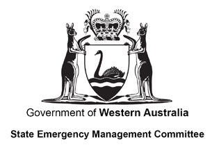
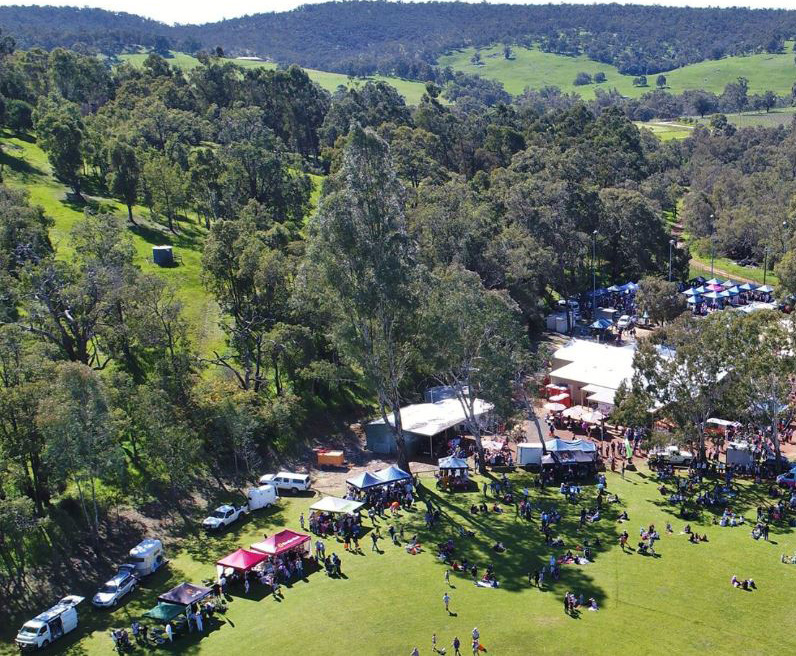
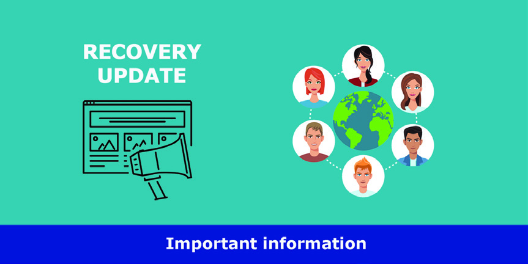

# Communicating in Recovery — Guidelines (WA)

> **Source**: WA SEMC
> **URL**: https://semc.wa.gov.au/Documents/Resources/EMTools/CommunicatingInRecoveryGuidelines.pdf
> **Licence**: © Government of Western Australia; emergency-management practitioner reference
> **Retrieved**: 2026-05-07T23:43:02Z
> **SHA-256**: `23003ffb6f650635ad6581cb065ea2ea921e9da3e087d3b467f1e9fad7ced584`
> **Archived copy**: Internet Archive Wayback Machine — `https://web.archive.org/web/20190310115733id_/https://semc.wa.gov.au/Documents/Resources/EMTools/CommunicatingInRecoveryGuidelines.pdf`
> *(Live publisher URL no longer resolves; this archived snapshot was used for ingest. Cite the publisher URL above.)*
> *Converted from PDF to Markdown format.*

---
## Page 1

Communicating in Recovery Guidelines  1
	
COMMUNICATING IN RECOVERY
GUIDELINES
State Emergency Management Committee
Public Information Reference Group 
COMMUNICATING IN 
RECOVERY GUIDELINES
State Emergency Management Committee
Public Information Reference Group

---
## Page 2

Acknowledgements
The ‘Communicating in Recovery Guidelines’ has been developed as a result of a Natural Disaster Resilience Program grant to 
the State Emergency Management Committee – Public Information Reference Group (PIRG). The project has been supported 
by in-kind contributions from the WA Police Force and the Australian Red Cross. 
The WA Police Force, on behalf of PIRG, has facilitated the development of the guidelines through the Recovery Communication 
Project Advisory Group. The advisory group member agencies include PIRG representatives from the Department of Fire and 
Emergency Services, Department of Biodiversity, Conservation and Attractions, the Office of Emergency Management, the 
Western Australian Local Government Association, the Water Corporation, the WA Police Force and representatives from the 
Australian Red Cross and an independent panel member. 
These guidelines have been developed using the ‘National Principles of Disaster Recovery’ and to be used in conjunction with 
the ‘Communicating in Recovery’ resource book first published by the Australian Red Cross in 2011. This guide is available 
online at www.redcross.org.au 
PIRG wishes to thank and acknowledge the work of the Australian Red Cross, who has generously supported this project. 
Many of the templates within this document have been based on those developed by the Australian Red Cross. 

©April 2018
Front cover image courtesy of the Shire of Northam

---
## Page 3

Communicating in Recovery Guidelines  1
TABLE OF CONTENTS
1.0	 Introducing Communicating in Recovery.......................................................................................................................3
1.1	 Recovery in Western Australia......................................................................................................................................3
1.2	 Communicating in recovery..........................................................................................................................................4
1.3 	 Principles of communicating in recovery.......................................................................................................................5
1.3.1 Community reactions..........................................................................................................................................6
1.4	 About these guidelines.................................................................................................................................................7
1.5	 How to use the guidelines............................................................................................................................................8
2.0	 Recovery Communications Functions............................................................................................................................9
2.1	 Introduction..................................................................................................................................................................9
2.2	 Scalable functions........................................................................................................................................................9
2.3	 Communications functions.........................................................................................................................................10
2.3.1 	 Recovery communications manager or coordinator.........................................................................................10 
2.3.2 	 Community liaison...........................................................................................................................................10
2.3.3 	 Stakeholder engagement................................................................................................................................10
2.3.4 	 Media liaison...................................................................................................................................................11
2.3.5 	 Social media...................................................................................................................................................11 
2.3.6 	 Internal communication...................................................................................................................................11
2.3.7 	 Publications....................................................................................................................................................11
2.3.8 	 Ministerial liaison.............................................................................................................................................11
3.0	 Recovery Communications Stages...............................................................................................................................12
3.1	 Introduction................................................................................................................................................................12
3.2	 Stage One – Response (during the emergency)..........................................................................................................13
3.3	 Stage Two - Response to Recovery Hand Over Period...............................................................................................13
3.4	 Stage Three – Recovery (after the emergency)............................................................................................................14
3.4.1 	 First week.......................................................................................................................................................14 
3.4.2 	 First three months...........................................................................................................................................15
3.4.3 	 Three to twelve months...................................................................................................................................15
3.4.4 	 One year and beyond.....................................................................................................................................15 
3.4.4.1  Anniversary........................................................................................................................................16 
3.4.4.2  Memorial............................................................................................................................................16 
3.4.4.3  Ongoing community needs................................................................................................................16

---
## Page 4

2  Communicating in Recovery Guidelines
4.0	 Recovery Communications Templates.........................................................................................................................17
4.1	 Status update............................................................................................................................................................18
4.2	 Talking points.............................................................................................................................................................19
4.3	 Social media applications...........................................................................................................................................20
4.4	 Media release.............................................................................................................................................................21
4.5	 Community meetings.................................................................................................................................................22
4.5.1	 Community Meetings Checklist.......................................................................................................................22 
4.6 	 Notice boards............................................................................................................................................................23
4.7 	 Media conference.......................................................................................................................................................24
4.7.1 	 Media Conference Checklist..........................................................................................................................24 
4.7.1.1	Before............................................................................................................................................................24 
4.7.1.2 	The day of and during....................................................................................................................................24 
4.8	 Community newsletter................................................................................................................................................25
4.9	 Newspaper article......................................................................................................................................................26
4.10	Recovery communications plan..................................................................................................................................27
5.0	 Recovery Communications Advice...............................................................................................................................30
5.1	 Introduction................................................................................................................................................................30
5.2	 Procedure..................................................................................................................................................................30
5.3	 Process......................................................................................................................................................................30
6.0	 Conclusion.......................................................................................................................................................................31
7.0	 References.......................................................................................................................................................................32

---
## Page 5

Communicating in Recovery Guidelines  3
1.0 	 Introducing Communicating 
in Recovery
1.1	
Recovery in Western Australia
1	 State Emergency Management Committee, 2016a, p. 17
2	 State Emergency Management Committee, 2016b, p. 36
Recovery is defined as ‘the support of emergency affected 
communities in the reconstruction and restoration of physical 
infrastructure, the environment, the community, psychosocial 
and economic wellbeing’, Section 3 of the Emergency 
Management Act 2005 (the EM Act).
Recovery is the last phase of the comprehensive approach 
to emergency management which also includes prevention, 
preparedness and response. Local government in Western 
Australia are prescribed in the EM Act to manage recovery 
following an emergency. 
Local governments lead, manage and coordinate community 
recovery at the local level and undertake these responsibilities 
in close cooperation with or directly supported by State 
Government departments and supporting agencies.1 
Recovery management commences during the response 
to an emergency, with the start of activities in recovery 
coordinated during the response phase.2
Local government are best placed to provide specialist 
knowledge and support to the affected community during 
and after an emergency. Local governments have well 
developed community links and community support 
mechanisms, as they know the local environment and 
demographic features of their communities. 
“Recovery is too important to be left to chance. 
Recovery needs to be planned, exercised and regularly 
reviewed, with considerable resources, both financially and with 
people, dedicated to this important task. Recovery also must 
be long term and led by the affected community. 
Our people deserve nothing less.”
Steve Joske CSC, State Recovery Coordinator

---
## Page 6

4  Communicating in Recovery Guidelines
1.2	
Communicating in recovery
3	 Australian Red Cross, 2010, p. 14
4	 Australian Red Cross, 2010, p. 14
5	 Nicholls, 2012, p. 49
6	 Gould, 2013, p. 54
7	 Nicholls, 2012, p. 49
Recovery communications refers to the practice of sending, 
gathering, managing and evaluating information in the recovery 
stage following an emergency.3 Communication in recovery is 
about continuing the dialogue with the affected community that 
started during the response phase. If local government can 
continue to use and support effective communication channels 
then it can facilitate important social processes within the 
community during this time.4 
Poor communication in emergencies during response and 
recovery from formal organisations has been highlighted as a 
constant barrier for communities. Communities immediately 
need a great deal of information, but they may not know 
what they want, or need, and are often unable to act on the 
information they are provided, based on high levels of stress 
and anxiety5
Both receiving information and seeking information is perceived 
as difficult by those affected by an emergency.6 However 
ongoing dialogue is essential for understanding the diverse 
needs of the affected community and providing them support 
during recovery.7
Successful communication in recovery is about connecting 
with people by enabling access to clear, relevant, targeted 
and high quality information to assist them build their own 
capacity and gain a greater understanding of community 
needs in the process. Good recovery communications is 
not only about sending information out, it’s about engaging 
in two-way dialogue. This means that local government and 
emergency management agencies have to be able to find 
ways of receiving and seeking information from the community. 
During the response phase, the Hazard Management Agency 
(HMA) has the task of managing communications in an 
emergency. The HMA officially hands this responsibility to 
the relevant local government/s leading the recovery via the 
Comprehensive Impact Assessment, in the transition to the 
recovery management phase. Coordinating the affected 
community in recovery, including communications, rests 
with the local government.
Local government are best placed to coordinate recovery 
as they are the closest level of government to the community, 
who is the focus of their work at all times. To support effective 
recovery, local government should provide regular, up to date 
information about the recovery effort and engage in constant 
ongoing dialogue using a community-led approach. 
“Embrace every opportunity to connect people with 
each other and the services available, this may be through 
regular morning teas, shared dinners or breakfasts.”
Melissa Howard, Shire of Harvey Recovery Team

---
## Page 7

Communicating in Recovery Guidelines  5
1.3	
Principles of communicating in recovery
8	 Attorney General’s Department, 2011, p. 24 
9	 Australian Red Cross, 2010, p. 18 - 19
Communicating with an affected community needs to be 
carefully planned and managed, and should be done so based 
on the key principles outlined in the ‘National Principles of 
Disaster Recovery’.8 The most relevant principle for recovery 
communication is the need to employ effective communication 
strategies with affected communities and other stakeholders. 
The principle is based on the following:
Ÿy Messages need to be clear, relevant, accurate and timely;
Ÿy Communication needs to be two-way;
Ÿy Information needs to be accessible to a wide-ranging 
audience, including those with special needs;
Ÿy Have well-structured communication networks, both with 
individuals and organisations; and
Ÿy Adopt strategies to reiterate key messages. 
In support of the National Principles of Disaster Recovery, the 
Australian Red Cross specifically outlines nine principles of 
recovery communications9 which ensures people are carefully 
considered during a stressful and disruptive time in their lives. 
These include:
Ÿy Public information, not public relations;
Ÿy The right to know;
Ÿy Respect people;
Ÿy Build on local assets;
Ÿy Ask the community how they want to receive information;
Ÿy Repeat information;
Ÿy Remember the ‘unaffected’;
Ÿy Acknowledge the impact; and
Ÿy No spin.
Image courtesy of the Shire of Chittering and Craig Hyne

---
## Page 8

6  Communicating in Recovery Guidelines
1.3.1	 Community reactions
10	  Attorney General’s Department, 2011, p. 95
It is important to understand the common reactions 
that individuals and the affected community as a whole, 
move through, when they are touched by an emergency. 
Understanding the psychosocial impacts of emergencies 
can provide insight to assist people get back on their feet 
and to re-establish their post-emergency life. 
Figure 1 below illustrates the four-stage cycle that explains 
the emotions and behaviours that usually occur in people after 
an emergency. This process is indicative only. It should not be 
read as a sequential process, but as a guide to help anticipate 
predictable challenges in the recovery phase. 
Figure 1: Community reaction to disasters.10
All recovery communications must take into account the 
normal reactions that people encounter after an emergency 
and be mindful of this cycle. By understanding this, recovery 
communications can be carefully tailored to suit the community 
as they move through each phase.
“Communication must be two-way. Provide avenues for impacted 
residents to have their say, a simple way is to provide blank forms 
such as “make statement” or “ask a question.”
Melissa Howard, Shire of Harvey Recovery Team
Heroic
Feeling of altruism
Family, friends and 
neighbours.
Honeymoon
Sense of shared survival. Anticipation of help/return 
to normal community and outside agencies.
Disappointment
Frustration
Anger
Disputes
Red tape
Loss of support
Exhuastion
Groups weaken/
fragmented
Delays
Obstacles
Reconstruction
Community Reaction to Disasters

---
## Page 9

Communicating in Recovery Guidelines  7
1.4	
About these guidelines
11	  Australian Red Cross, 2010, p. 14
In Western Australia, the legislative responsibility for recovery 
rests with the local government/s impacted by the emergency. 
As previously mentioned, good communication between the 
local government and their community is a key component 
of successful recovery. 
Not all local governments will be equipped to undertake the 
recovery communications role. These guidelines have been 
developed to assist local governments to support organisations 
and communities, in sending, gathering, managing and 
evaluating information in the recovery stage of an emergency. 11
The guidelines provide:
Ÿy advice about the key functions that are required within a 
recovery communications team in a large recovery effort;
Ÿy advice about the most appropriate flow of information at 
particular stages of recovery;
Ÿy templates for recovery communications activities; 
Ÿy information on how to activate State Government advice to 
support recovery communications; and
Ÿy information about the Australian Red Cross ‘Communicating 
in Recovery’ resource book.
 “Recovery is about people. It is critical that everyone 
connected to recovery understand what this simple statement 
means. Road blocks, anxiety and frustrations popped up whenever 
those involved did not understand that recovery was about people 
and what this actually meant.”
Gail Ipsen-Cutts, Director Community Services, Shire of Manjimup

---
## Page 10

8  Communicating in Recovery Guidelines
1.5	
How to use the guidelines
These guidelines have been developed to support local government with recovery communications activities, at each stage 
of an emergency – BEFORE, DURING AND AFTER. 
BEFORE
Ÿy Ensure all communications staff have read and understood 
these guidelines.
Ÿy Ensure the communications officer/person/team is 
capable of undertaking the recovery communications role. 
For example, attend the ‘Communicating in Recovery’ 
course provided by the Australian Red Cross.
Ÿy Ensure a copy of the ‘Communicating in Recovery’ 
Australian Red Cross resource book has been obtained.
Ÿy Assess the local government capacity and capability 
to resource the recovery communications role and/
or functions based on business continuity and 
workforce plans.
Ÿy Pre-plan for communications staff according to the 
Recovery Communications Functions described 
in Section 2.
DURING
Ÿy Ensure the communications officer/team/person is 
briefed by either the Local Recovery Coordinator or local 
government liaison officer as part of the Incident Support 
Group or has contact with the Public Information Officer 
within the HMA so they can be briefed on communications 
issues during the emergency. 
Ÿy Assess the local government’s capacity and capability 
to resource the recovery communications role and/or 
functions based on information received from the Hazard 
Management Agency.
Ÿy Download copies of the Recovery Communications 
Templates in Section 4.
AFTER
Ÿy Reassess the local government’s capacity and capability 
to perform recovery communications and determine 
additional requirements.
Ÿy Ensure the communications officer/person/team 
has determined which Recovery Communications 
Functions are required based on information 
received during the emergency. 
Ÿy Ensure the communications officer/person/team is 
aware of the Recovery Communications Stages 
as described in Section 3, to assist with recovery 
communications planning.
Ÿy Commence development of a Recovery 
Communications Plan to be included in the 
Operational Recovery Plan.
Ÿy Consider using the ‘Communicating in Recovery’ 
resource book and Recovery Communications 
Templates in Section 4. 
Ÿy Consider additional assistance to support recovery 
communications by enacting any regional or 
neighbouring local government support through 
a current Memorandum of Understanding (MOU).
Ÿy Contact the State Recovery Coordinator (usually 
through the District Advisor from the Office of 
Emergency Management) to activate state level 
Recovery Communications Advice at Section 5, 
if required.

---
## Page 11

Communicating in Recovery Guidelines  9
2.0	 Recovery Communications 
Functions
2.1	
Introduction
12	  Australian Red Cross, 2010, p. 14
During the recovery phase of an emergency there are 
eight key functions that may be required during recovery 
communications. These will help support a local government 
managing recovery to engage in meaningful dialogue with 
their community following a large-scale emergency. 
Key responsibilities have been assigned to each of the eight 
functions so people understand the types of tasks that will be 
required to undertake. 
The team member/s will support the work of the Local 
Recovery Coordination Group (LRCG) and relevant sub-
committees, which are set up to assist the local government 
to manage recovery following an emergency. 
How these functions will be performed needs to be carefully 
considered and planned prior to an emergency. This will ensure 
effective recovery communication supports important social 
processes between individuals, groups and the community.12 
 
Recovery communications support may 
be required for weeks, months and even years.
2.2	
Scalable functions 
The eight listed functions can be performed as one person 
during recovery, if the event is of a small scale, and the person 
performing the role has considerable experience in either 
recovery and/or communications. The functions are scalable, 
so that there may be a person performing each function, or 
one person performing all functions, depending on the extent 
of recovery and the length of time local government is 
participating in recovery. 
Some functions may be combined if there is a lack of resources. 
Suggested combinations include:
Ÿy Media Liaison and Community Liaison;
Ÿy Media Liaison and Ministerial Liaison;
Ÿy Community Liaison and Stakeholder Engagement;
Ÿy Publications and Social Media; and
Ÿy Internal Communication and Publications.
IMPORTANT: Any combinations of the above functions are 
appropriate so long as consideration is given to the skills, ability 
and experience of the person/s in the role/s.
The 8 functions are scalable, which means one 
person or a team may be able to perform all or some of these 
functions at the same time.

---
## Page 12

10  Communicating in Recovery Guidelines
2.3	
Communications functions
All of the following recovery communications functions may be performed by one person or a person may perform each function 
within a team. 
2.3.1	
Recovery Communications Manager or 
Coordinator 
The Recovery Communications Manager/Coordinator function 
leads and manages the recovery communications work and 
team. The role should be part of, or have access to, the senior 
management or executive team; be included in the Local 
Recovery Coordination Group and relevant sub-committees; 
and report to the Local Recovery Coordinator. 
Responsibilities
Ÿy Lead recovery communications team;
Ÿy Establish resourcing requirements for the recovery 
communications team including rosters and additional 
staffing support;
Ÿy Ensure resource requirements take into account fatigue 
management issues that may arise;
Ÿy Keep abreast of all communications related to the emergency 
(from its outset) from the HMA and other sources;
Ÿy Provide support to the Local Recovery Coordinator;
Ÿy Advise the Local Recovery Coordinator on any additional 
resource requirements for communications; 
Ÿy Ensure timely briefing and debriefing for team members 
is completed;
Ÿy Develop a Recovery Communications Plan;
Ÿy Develop and coordinate time critical recovery messaging 
for the community;
Ÿy Coordinate and prioritise recovery messaging for the local 
government; and
Ÿy Be a member of the Local Recovery Coordination Group 
or sub-committee.
2.3.2	
Community liaison
The community liaison function undertakes direct liaison with 
key community groups. This includes obtaining and providing 
information and messages received to and from the affected 
community via the recovery centre, telephone line, outreach and 
any other methods. This function can have a direct link to the 
Community Liaison Unit within the Hazard Management Agency 
(if utilised by the HMA) and the Community Development/
Engagement team or officer with the local government.
Responsibilities
Ÿy Gather, coordinate and maintain community contact lists;
Ÿy Maintain liaison through various channels such as the 
recovery centre, telephone line and outreach;
Ÿy Coordinate key information analysis from the Community 
Liaison Unit (where available) and the local government 
community development/engagement team or officer;
Ÿy Coordinate public information messaging and gathering 
at community events such as public meetings;
Ÿy Contribute to key recovery messaging using intelligence 
gathered from community liaison activities and provide to 
the Local Recovery Coordination Group; 
Ÿy Provide input to the Recovery Communications Plan; and
Ÿy Be part of briefing and debriefing with team members.
2.3.3	
Stakeholder engagement 
The stakeholder engagement function coordinates with key 
agency, organisation and local government stakeholders and 
keeps them informed, engaged and involved. The stakeholders 
may be assisting directly as a member agency of the Local 
Recovery Coordination Group or relevant sub-committee or 
outside of this arrangement supporting recovery activities within 
the affected community. 
Responsibilities
Ÿy Coordinate and maintain key stakeholder contacts;
Ÿy Ensure information flow is coordinated from all agencies and 
organisations in and out of the local government;
Ÿy Ensure relevant organisations who are integral to the recovery 
effort are represented at appropriate times on the Local 
Recovery Coordination Group;
Ÿy Contribute to key recovery messaging using intelligence 
gathered from liaison with stakeholders; 
Ÿy Provide input to the Recovery Communications Plan; and
Ÿy Be part of briefing and debriefing with team members.

---
## Page 13

Communicating in Recovery Guidelines  11
2.3.4	
Media liaison 
The media liaison function has direct contact with media 
stakeholders and support key messaging in recovery.
Responsibilities
Ÿy Coordinate and maintain media contact list;
Ÿy Coordinate media opportunities for the local government 
with the media;
Ÿy Brief local government spokesperson before and after media 
interviews and conferences;
Ÿy Contribute to key recovery messaging using intelligence 
gained from liaison with the key media contacts; 
Ÿy Provide input to the Recovery Communications Plan; and
Ÿy Be part of briefing and debriefing with team members.
2.3.5	
Social media 
The social media function provides expertise in social media 
applications that may be utilised by the local government in 
communicating with the affected community during recovery. 
This function requires the use of social media to gather 
intelligence and to provide up to date information and engage 
with the community.
Responsibilities
Ÿy Coordinate and maintain social media platforms utilised by 
the local government to engage with the community;
Ÿy Monitor community led social media sites to gather 
intelligence to contribute to recovery decisions by the Local 
Recovery Coordination Group;
Ÿy Contribute to key recovery messaging using intelligence 
gathered from social media platforms; 
Ÿy Provide input to the Recovery Communications Plan; and
Ÿy Be part of briefing and debriefing with team members.
2.3.6	
Internal communication 
The internal communications function coordinates information 
and messaging about what is happening in recovery to keep 
staff within the local government informed. Internal reporting 
mechanisms are used as appropriate, to support staff dealing 
with the affected community in a face-to-face, customer service 
and on the ground environment on a daily basis. 
Responsibilities
Ÿy Coordinate and maintain information to staff on relevant 
platforms utilised by the local government for internal 
communications;
Ÿy Contribute to key recovery messaging using intelligence 
gathered from staff members who have direct liaison with the 
community; 
Ÿy Provide input to the Recovery Communications Plan; and
Ÿy Be part of briefing and debriefing with team members.
2.3.7	
Publications 
The publications function is to develop, produce and 
maintain key documentation used in recovery to support 
communications within the affected community such as 
newsletters, pamphlets, flyers, website etc.
Responsibilities
Ÿy Develop, produce and maintain documents to support the 
local government’s recovery activities;
Ÿy Ensure key recovery messages are included in the recovery 
documents produced; 
Ÿy Provide input to and document the Recovery 
Communications Plan; and
Ÿy Be part of briefing and debriefing with team members.
2.3.8	
Ministerial liaison 
The ministerial liaison function supports the role of the State 
Recovery Coordinator to ensure coordination and consistent 
messaging between the relevant ministers, local government 
and the affected community. It supports dealings with the 
local government and contact with the Department of Local 
Government, Sport and Cultural Industries, Department of the 
Premier and Cabinet, Premier, Ministers, Ministerial Advisers, 
Members of Parliament and local members.
Responsibilities
Ÿy Coordinate and maintain ministerial contact lists;
Ÿy Maintain liaison with relevant departments, Ministers and 
Ministerial Advisers;
Ÿy In conjunction with the State and Local Recovery 
Coordinators, coordinate ministerial visits to the affected 
community and community venues;
Ÿy Contribute to key recovery messaging by gathering 
intelligence from Ministers and local members who have 
direct contact with the community; 
Ÿy Provide input to the Recovery Communications Plan; and
Ÿy Be part of briefing and debriefing with team members.

---
## Page 14

12  Communicating in Recovery Guidelines
3.0	 Recovery Communications 
Stages
3.1	
Introduction
13	 Attorney General’s Department, 2011, p. 95
14 Australian Red Cross, 2010, p. 16-17
This section describes the typical communications activities 
required during each recovery stage. For each stage the 
guidelines offer key considerations and ideas for local 
governments to assist them in communicating effectively at 
these times.
Consistent with the National Principles of Disaster Recovery the 
principle, ‘employing effective communication’ advises that it is 
important ensure that all communication is relevant, timely, clear, 
accurate, targeted, credible and consistent.13 
Specific recovery messaging can adhere to simple rules of 
recovery communications by the Australian Red Cross which 
asks; is it relevant, is it clear and is it targeted?14 
The four-stage community reactions cycle, as outlined in 
section 1.3.1, will be important to remember as you move 
through each recovery communications stage. This model 
helps in understanding the emotions and behaviours that 
usually occur in people after an emergency.

 
Heroic
Feeling of altruism
Family, friends and 
neighbours.
Honeymoon
Sense of shared survival. Anticipation of help/return 
to normal community and outside agencies.
Disappointment
Frustration
Anger
Disputes
Red tape
Loss of support
Exhuastion
Groups weaken/
fragmented
Delays
Obstacles
Reconstruction
Community Reaction to Disasters

---
## Page 15

Communicating in Recovery Guidelines  13
3.2	
Stage One - Response (during the emergency)
The Recovery Communications Manager or Coordinator, or someone within the recovery communications team will need to action 
some or all of these items in the response stage of the emergency.
15	 Australian Red Cross, 2010, p. 29 - 31
F
F Consider locating the Recovery Communications Manager/
Coordinator within the Incident Support Group, alongside 
the Local Recovery Coordinator. 
F
F Local Recovery Coordinator or Recovery Communications 
Manager/Coordinator to gather key communications 
information and track all key communications activities 
by the Hazard Management Agency (HMA) during the 
emergency.
F
F Recovery Communications Manager/Coordinator to make 
contact with the HMA Public Information Officer located 
within the Incident Management Team.
F
F Establish a recovery communications team within the 
local government.
F
F Conduct a Communication Needs Assessment (CNA).15 
Key communication information and messaging 
is gathered from the Incident Support Group meetings to assist 
the local government manage their communication information. 
This sets up early interaction between the HMA and the local 
government to ensure that local government messaging is included, 
and flows on from response messaging by the HMA.
3.3	
Stage Two - Response to Recovery hand over period
The Recovery Communications Manager or Coordinator or team member within the recovery communications team will need to 
action some or all of these items in the response to recovery hand over period.
3.3.1	
Leadership 
F
F Confirm who the local government spokesperson is. 
F
F Ensure spokesperson is briefed on the current situation and 
is prepared to be quoted in the media and ready for any 
media conferences.
F
F Ensure Recovery Communications Manager/Coordinator as 
a member of the Local Recovery Coordination Group.
3.3.2	
Identify communication gaps 
F
F What is the affected community telling you?
F
F What do the affected community need to know?
F
F What additional information does the local government 
need?
3.3.3	
Methods
F
F What communication methods and channels will be used to 
gather and receive information from the community and key 
stakeholders?
F
F What methods are being used at present? 
F
F What methods are appropriate in this recovery?
F
F Evaluate what methods are working well and those that 
are not.
F
F See Recovery Communications Templates in Section 4.

---
## Page 16

14  Communicating in Recovery Guidelines
3.3.4	
Messaging
F
F What are the key messages required for the affected 
community?
F
F What are the key messages required internally?
F
F Make sure that all information provided adheres to the 
Giuliani method of communicating information which 
includes: 
—
—
what we know; 
—
—
what we don’t know; 
—
—
what we are doing; and 
—
—
what we want you to do.
F
F See ‘Status Update’ in Recovery Communications 
Templates in Section 4.
3.3.5	
Recovery communications plan
F
F Develop a Recovery Communications Plan if needed, for 
this emergency – the what, how, who, when and where 
in a coordinated and detailed plan that includes a two-
way feedback loop of communication with the affected 
community. 
F
F This will need to be included as part of the overarching 
Operational Recovery Plan. 
F
F See ‘Recovery Communications Plan’ in Recovery 
Communications Templates in Section 4.
F
F Prepare Recovery Communications Plan to be tabled 
at the Local Recovery Coordination Group meetings for 
discussion.
3.4	
Stage Three – Recovery 
(after the emergency)
The Recovery Communications Manager or Coordinator or 
team member will need to action some or all of these items in 
the first four weeks after recovery has been handed over.
3.4.1	
First week
F
F Determine the key listening posts that will be used to gather 
intelligence and information about community needs in 
recovery to ensure a two-way feedback loop is established. 
F
F Consider additional resources to support the recovery 
communication effort. Review the local government 
Business Continuity Plan and Workforce Plan to meet 
operational requirements. Consider the use of volunteers 
or community members with communications experience 
to support the workload.
F
F Speak to the Local Recovery Coordinator about additional 
support required through the State Recovery Coordinator. 
F
F Develop the first ‘Status Update’ at Recovery 
Communications Templates in section 4 with timely and 
accurate information regarding issues such as deaths and 
injuries, homes and properties destroyed, road blocks, 
water and electricity supplies, donated goods, spontaneous 
volunteers, recovery centre location, community meetings 
and outreach. Some of this information can be sourced from 
the Comprehensive Impact Assessment document provided 
by the HMA.
F
F Develop the ‘Talking Points’ document at Recovery 
Communications Template section 4 to be utilised as 
the basis for all forms of communication. Update as new 
information becomes available. 
F
F Prepare first ‘Media Release’ at Recovery 
Communications Template section 4 and gain approval 
from the designated local government spokesperson. 
F
F Prepare for first media conference in recovery in conjunction 
with the local government spokesperson at Recovery 
Communications Template section 4. 
F
F Develop or refine ‘Recovery Communication Plan’ template 
at Recovery Communications Templates in section 4. 
F
F Consult with the Department of Communities and other key 
stakeholders such as the Australian Red Cross, regarding 
the potential need for an immediate outreach program to 
assess, determine and prioritise community needs, including 
communication requirements. 
F
F Set up a database for local government to gather all 
communication requirements with all community members. 
F
F Ensure all messaging adheres to the Giuliani method of 
information communication which includes information to 
the community that is:
—
—
what we know;
—
—
what we don’t know;
—
—
what we are doing; and
—
—
what we want you to do.

---
## Page 17

Communicating in Recovery Guidelines  15
3.4.2	
First three months
F
F Review the key listening posts being used to gather 
intelligence and information about community needs in 
recovery. 
F
F Ensure ‘Status Update’ and ‘Talking Points’ are being 
reviewed regularly.
F
F Maintain community meetings and make certain they are 
being held as regularly as the community requires. Ensure 
information that is conveyed during community meetings is 
in line with the ‘Status Update’ and ‘Talking Points’.
F
F Local government should coordinate an outreach program 
that meets the needs of the community in conjunction with 
key non-government, not-for-profit and state government 
agencies and organisations to assist with an Outreach 
Impact Assessment.
F
F Review ‘Recovery Communication Plan’ to ensure 
effectiveness in current situation. Review all methods of 
communication and timings.
F
F Prepare media releases and press conferences in line with 
‘Status Update’ and ‘Talking Points’. Generate positive and 
good news stories to assist with the recovery effort.
F
F Review communications capacity and fatigue issues within 
the local government communications team to assist 
with the organisation of additional resources to support 
communications.
F
F Consider the need for a community thank you event to 
celebrate achievements since the emergency. Ensure direct 
dialogue with the community to discuss the suitability and 
subsequent arrangements, if required.
3.4.3	
Three to twelve months
The Recovery Communications Manager or Coordinator or team 
member will need to consider some of the emerging challenges 
in the three to twelve-month period.
F
F Review the key listening posts being used to gather 
intelligence and information about community needs in 
recovery. 
F
F Ensure ‘Status Update’ and ‘Talking Points’ are being 
reviewed regularly.
F
F Confirm the Recovery Centre (if determined appropriate) is 
operating effectively and in a long-term strategic location for 
the affected community. 
F
F Maintain community meetings and make certain they are 
being held as regularly as the community requires. Ensure 
information that is conveyed during community meetings is 
in line with the ‘Status Update’ and ‘Talking Points’.
F
F Review ‘Recovery Communication Plan’ to ensure 
effectiveness in current situation. Review all methods of 
communication and timings.
F
F Prepare media releases in line with ‘Status Update’ and 
‘Talking Points’. Continue to generate positive and good 
news stories to assist with the recovery effort.
F
F Commence communication arrangements with the affected 
community to discuss commemorating the first-year 
anniversary of the emergency at 12 months. 
Establishing a network of key listening posts is essential to 
understand community needs in recovery. Communication is 
two-way so each local government should consider ways to gather 
information to assist with decision making in recovery.

---
## Page 18

16  Communicating in Recovery Guidelines
3.4.4	
One year and beyond
Long-term recovery in large or emotional emergencies can take many years, and even a generation before a sense of normality 
is restored within the affected community. At the one-year anniversary the Recovery Communications Manager or Coordinator 
will need to take into consideration the issues that will emerge within the affected community.
3.4.4.1 Anniversary
F
F The first-year anniversary of the emergency brings back 
memories for the community so it is essential that the 
commemorations are sensitive to community needs. 
Be aware that the media may be interested in these events 
so consider necessary and respectful approaches to the 
affected community are discussed.
F
F What will be acknowledged/commemorated? 
Where and when? 
Who should attend? 
How will this be communicated?
F
F Ensure staff or volunteers trained in psychological 
well-being attend the anniversary event to provide 
psychological and emotional support to the family, 
individuals and community members.
F
F Communicate to the affected community the feelings and 
emotions they may experience in the lead up to and during 
the anniversary events, and let them know that these 
are normal. A reminder that how it is commemorated by 
people may be different and this is also normal. 
3.4.4.2 Memorial
F
F Does the family or families want a memorial event for 
their family member that was lost during the emergency? 
If so, this must be done in direct consultation with the 
family or families and should include attendance of staff 
or volunteers trained in psychological well-being.
F
F Does the community want to host a memorial for anyone 
from the community that was lost during the emergency?
F
F Where will this be held? 
What time and date? 
What will the event consist of? 
How will this be communicated? 
Who will be invited?
F
F Ensure staff or volunteers trained in psychological 
well-being attend the event to provide psychological 
and emotional support to the family, individuals and 
community members.
F
F Consider the recommendations for planning for memorials 
located at 
https://www.churchilltrust.com.au/media/fellows/
Whitton_S_2015_Mmethods_of_planning_and_managing_
disaster_memorials.pdf
3.4.4.3 Ongoing community needs
F
F At the twelve-month anniversary of the emergency it is 
important that the community members are aware and 
reminded of the support that is available to them, as they 
may be experiencing unusual feelings, emotions and 
reactions at the anniversary period.
F
F The local government/s should work with 
the Department of Communities and the 
Australian Red Cross to determine the needs of 
the community and how best to address these.

---
## Page 19

Communicating in Recovery Guidelines  17
4.0 	 Recovery Communications 
Templates
Introduction
The Recovery Communications Templates provide ten commonly used templates of different methods that may be used in recovery 
communications, to assist or support existing methods already used by local government. The templates are generic in nature and 
must be adapted to suit the local government, the community needs and the recovery effort. Using unique branding developed for 
recovery information will provide relevance and recognition relating to recovery efforts in communication 
The templates may be used in conjunction with the Australian Red Cross ‘Communicating in Recovery’ resource book which 
provides an analysis of the strengths and limitations of some of these methods. 
The templates referred to in this section are available in multiple formats on the USB provided with these guidelines.
 
SUMMARY 
INCIDENT DATE 
INCIDENT DESCRIPTION 
PREPARED BY 
Date 
Incident 
Name 
STATUS SUMMARY 
STEPS TAKEN 
% DONE 
DUE DATE 
ASSIGNED TO 
NOTES 
 
 
 
 
 
 
 
 
 
 
 
 
 
 
 
 
 
 
 
 
 
 
 
 
 
 
 
 
 
 
 
 
 
 
 
 
 
 
 
 
 
 
 
 
 
 
 
 
 
 
RISK AND ISSUE HISTORY 
ISSUE 
ASSIGNED TO 
DATE 
 
 
 
 
 
 
 
 
 

MEDIA RELEASE
CATCHY TITLE IN A SHORT SENTENCE WHICH IS 
BRIEF, CLEAR AND TO THE POINT.
First and/or second sentences must explain what the recovery 
announcement is. The most important information is at the top of the 
media release.
Short snippets of information should be gathered from your talking 
points to provide key information that can be easily picked up and 
used by the media.
The essential recovery information should include the: 
Who
What 
When
Where 
How and the why if appropriate.
Ensure the local government spokesperson is “regularly quoted” 
throughout the media release.
Media release to include the local government logo and the recovery logo (if 
developed) at the top.
Media Enquiries 
Local Government spokesperson name, contact number 0411 111 111
Media Liaison contact name, contact number 0411 111 111
 
SUMMARY 
INCIDENT NAME/DATE 
VERSION DATE/TIME 
VERSION NUMBER 
 
 
 
KEY POINTS 
TALKING POINTS 
 
 
 
 
 
 
 
 
 
 
 
LATEST POINTS 
In this section you can provide further background information that is in an easy to read bullet point form. You may 
wish to use sub-headings such as ‘Personal Support’, ‘Infrastructure’, ‘Utilities’, ‘Roads, 
‘, or other relevant themes based on your recovery priorities. You may also choose to use the ‘FAQ’ format if there 
are specific matters of high public interest. 
 
PERSONAL SUPPORT

---
## Page 20

18  Communicating in Recovery Guidelines
4.1	
Status update
The status update is the first information assessment about what is happening, which provides crucial information about the 
emergency and recovery efforts. These are maintained on a daily basis in summary form, which are used to inform key talking 
points for use by local government.
 
SUMMARY 
INCIDENT DATE 
INCIDENT DESCRIPTION 
PREPARED BY 
Date 
Incident 
Name 
STATUS SUMMARY 
STEPS TAKEN 
% DONE 
DUE DATE 
ASSIGNED TO 
NOTES 
 
 
 
 
 
 
 
 
 
 
 
 
 
 
 
 
 
 
 
 
 
 
 
 
 
 
 
 
 
 
 
 
 
 
 
 
 
 
 
 
 
 
 
 
 
 
 
 
 
 
RISK AND ISSUE HISTORY 
ISSUE 
ASSIGNED TO 
DATE

---
## Page 21

Communicating in Recovery Guidelines  19
4.2	
Talking points
The talking points are developed from information contained within the status updates.  
The talking points provide key messages to be used by the spokesperson and all members of the local government who 
are in contact with the affected community and general public. The talking points can be used for all communication methods 
such as the newsletter, community meetings etc. Page 1 of Talking Points is displayed below.
SUMMARY 
INCIDENT NAME/DATE 
VERSION DATE/TIME 
VERSION NUMBER 
 
 
 
KEY POINTS 
TALKING POINTS 
 
 
 
 
 
 
 
 
 
 
 
LATEST POINTS 
In this section you can provide further background information that is in an easy to read bullet point form. Y
wish to use sub-headings such as ‘Personal Support’, ‘Infrastructure’, ‘Utilities’, ‘Roads, 
‘, or other relevant themes based on your recovery priorities. You may also choose to use the ‘FAQ’ format if
are specific matters of high public interest.

---
## Page 22

20  Communicating in Recovery Guidelines
4.3	
Social media applications
Social media can be used effectively as an engagement tool with the community in recovery. A commitment by local government to 
the regular use, monitoring and reliable updating must be made to use this medium effectively.
If using these mediums consideration must be given to:
Ÿy Graphics that are developed need to be designed in a way 
where they can be used for both Facebook and Twitter; and
Ÿy Using correct dimensions and dead space, a Facebook 
graphic will automatically be adjusted to suit Twitter.
Some examples of social media templates.  All templates are available on the USB provided with these 
guidelines.

---
## Page 23

Communicating in Recovery Guidelines  21
4.4	
Media release 
Media releases can provide a vital way of providing instant information that can be picked up by the local newspaper or radio 
station. The designated local government spokesperson must be used in the media release.
Local government should consider co-branded media releases that relate to a specific stakeholder in the early stages of the 
response to recovery phase.

MEDIA RELEASE
CATCHY TITLE IN A SHORT SENTENCE WHICH IS 
BRIEF, CLEAR AND TO THE POINT.
First and/or second sentences must explain what the recovery 
announcement is. The most important information is at the top of the 
media release.
Short snippets of information should be gathered from your talking 
points to provide key information that can be easily picked up and 
used by the media.
The essential recovery information should include the: 
Who
What 
When
Where 
How and the why if appropriate.
Ensure the local government spokesperson is “regularly quoted” 
throughout the media release.
Media release to include the local government logo and the recovery logo (if 
developed) at the top.
Media Enquiries 
Local Government spokesperson name, contact number 0411 111 111
Media Liaison contact name, contact number 0411 111 111

---
## Page 24

22  Communicating in Recovery Guidelines
4.5	
Community meetings 
Community meetings are essential in response and recovery as it is important to address the community in a face-to-face setting 
early on, to earn the trust and respect of the affected community and engage in meaningful dialogue.
Community meetings may involve many state government agencies such as the Hazard Management Agency, along with local 
government and community organisation representatives. It is important that the Master of Ceremony and spokesperson are 
delegated by the local government.
4.5.1	
Community Meeting Checklist
BEFORE
F
F Determine the Master of Ceremony (MC) and local 
government spokesperson. This may be the same 
person or different, depending on the local 
government and the community.
F
F Ensure key speakers from the Hazard Management 
Agency (HMA), combat agencies, support organisations 
and local government are included, invited, allowed to 
contribute to the agenda and briefed.
F
F Invite relevant Community Liaison Unit from the HMA 
to attend meeting to support the community with their 
information needs during the response phase.
F
F Select an easy, central and significant location for the 
community meeting.
F
F Prepare a clear agenda using talking points, time frames 
and input from all agencies.
F
F Determine a question and answer feedback option for 
community members during and after the meeting.
F
F Advise and notify community members of the meeting 
details including location, time and agenda.
F
F Organise audio visual requirements, parking, seating, 
catering, record of attendance and feedback capture.
F
F Test all audio equipment, electrical outlets and sound 
system. Consider filming the speakers to be hosted 
on the local government website, if appropriate.
F
F Brief and prepare local government spokesperson by 
practising answers.
F
F Plan for the presence of media at the meeting.
DURING
F
F MC to communicate agenda to the audience and 
introduce speakers. Agenda is used as a structure for 
the meeting but allow for other issues at the end of the 
meeting to be discussed.
F
F MC to review previous community meetings including 
any issues and updates that need to be communicated. 
MC to advise when the next meeting will be or how often 
the meetings will continue for.
F
F Determine community members preferred 
communication methods. Consider using a voting 
system with dots/stickers/post it notes on the walls 
to get a clear picture of preferred methods.
F
F Assign a person who will take notes, action issues 
and advise the recommended completion or action 
time to the community. Advise how these will be 
distributed or communicated after the community 
meeting.
F
F Ensure all speakers adhere to the Giuliani method 
of information communication which includes information 
to the community that is: 
—
— what we know;
—
— what we don’t know;
—
— what we are doing; and
—
— what we want you to do. 
F
F Allow questions from the community using a roaming 
microphone.
F
F MC to thank attendees and advise of availability of 
refreshments after the conclusion of the meeting.
AFTER
F
F Ensure speakers are available for further discussion or any contact details available or point of reference for 
further information.
F
F Ensure the Department of Communities and other support agencies, such as Australian Red Cross are attending the 
community meeting to provide psychological well-being to community members if required.
F
F Provide follow up ways to gather information for any audience members that were unable to ask questions during 
the meeting. 
F
F Upload recording of the meeting to the local government website or provide a summary of the information presented.

---
## Page 25

Communicating in Recovery Guidelines  23
4.6	
Notice boards 
A central notice board at a key location in the community can be used to provide information in recovery. This may be a location 
already being used or one that is decided that is best placed for the recovery effort.
Ÿy The information must be general, local and provide people 
with call to actions such as contact numbers and places to 
go for additional information.
Ÿy The notice board may also be used to gain feedback directly 
from the community, if required.
Key messages from the Status 
Update and/or Talking Points
F
F
__
F
F
__
F
F
__ 
F
F
__
F
F
__
F
F
__
F
F
__
Key recovery contact details including location, phone 
numbers and email addresses
How can we 
contact you?
Key Issues
Ensure that key information 
from the status updates and 
talking points are located in 
the newsletter.
Short, brief and with a call to 
action.
Each key issue should be in 
colour and include a 
photograph or graphic if 
possible.
Community News
Information 
update
Ensure the newsletter is kept 
to 1-2 pages in total.
Key recovery contacts 
including phone numbers, 
emails and website.
Where to find copies of the 
newsletters and other 
information.
How to get in touch with the 
recovery team or the local 
government with information 
updates.
Contacts
Information update
Repeat information where   
necessary.  
2 August 2018
Issue No. 32
Lake Yealering image courtesy of the 
Shire of Wickepin.

---
## Page 26

24  Communicating in Recovery Guidelines
4.7	
Media conference 
A media conference can be utilised if 
there is public and media interest after 
the emergency and can be used to get 
specific messages across the media, 
general public and the community.
F
F A media conference should be 
managed by the Media Liaison 
function located within the Recovery 
Communications team.
F
F The announcement will need to be 
prepared, the spokesperson chosen 
and briefed and the time of the 
conference chosen to suit relevant 
media deadlines.
4.7.1	
Media Conference Checklist
4.7.1.1 Before
F
F Consider the news cycle timings.
F
F Make a media invitation list and send 
invite via email.
F
F Select an easy access location for 
the media conference.
F
F Arrange for parking and catering 
requirements (only if remote and 
needed).
F
F Arrange seating so all media have 
clear access to the spokesperson – 
if this is a small event, media can be 
standing.
F
F Position local government logo 
on the podium or behind the 
spokesperson – if this is a small 
conference, a podium and the logo 
may not be needed.
F
F Test all audio equipment, electrical 
outlets and sound system.
F
F Brief and prepare local government 
spokesperson by practising 
answers.
4.7.1.2 The day of and during
F
F Greet media and show them where 
to set up.
F
F Prepare and distribute any 
information to give to the media.
F
F Arrange catering (only if needed).
F
F Start exactly on time.
F
F Introduce local government 
spokesperson or they introduce 
themselves.
F
F Ensure cut off time is adhered to, 
including time for questions.
F
F Thank the media for their 
attendance.
Image courtesy of the Shire of Northam

---
## Page 27

Communicating in Recovery Guidelines  25
4.8	
Community newsletter 
A community newsletter that is printed or emailed is a simple and easy method of communication in recovery. 
 
Key Issues
Ensure that key information 
from the status updates and 
talking points are located in 
the newsletter.
Short, brief and with a call to 
action.
Each key issue should be in 
colour and include a 
photograph or graphic if 
possible.
Community News
Information 
update
Ensure the newsletter is kept 
to 1-2 pages in total.
Key recovery contacts 
including phone numbers, 
emails and website.
Where to find copies of the 
newsletters and other 
information.
How to get in touch with the 
recovery team or the local 
government with information 
updates.
Contacts
Information update
Repeat information where   
necessary.  
2 August 2018
Issue No. 32
Lake Yealering image courtesy of the 
Shire of Wickepin.

---
## Page 28

26  Communicating in Recovery Guidelines
4.9	
Newspaper article
A newspaper article may be picked up by the newspaper from the media release that has been issued, the local government may 
be given a regular space each week to address the issues in recovery for the community or be able to place paid advertising within 
the newspaper.
An opening sentence or paragraph (around 25-40 words) providing the most important information first which includes the: who, what, when and where of the 
emergency and recovery efforts.
Additional sentences or paragraphs (around 30 – 40 words) which has ideas and facts that must be accurate and balanced about recovery.  
Sentences include a local government spokesperson where quotes, comments, opinions or statements can be provided.
Use photographs, maps, illustrations or graphics to add additional information and interest to the article (see top).
Details are given in the order of importance so the most important information is given in the beginning, with the least important down towards the end.
Te end of the article must summarise the event.  
Catchy title in a short sentence 
Which is brief, clear and to the point.
Name of person/reporter.

---
## Page 29

Communicating in Recovery Guidelines  27
4.10	 Recovery communications plan
A recovery communications plan details the local governments’ strategy on communication and consultation with the affected 
community in recovery.
Vision
Recovery vision for the affected community.
Mission
Mission of the recovery communications plan. 
Why?
Who?
What?
When?
Where?
How?
Background
Brief detailed description of the emergency events.
Communication Objectives
Clear, measurable and achievable objectives. 
No more than five.

---
## Page 30

28  Communicating in Recovery Guidelines
Key Target Audience
Who are the key community members that are being targeted and how is this being done? 
Who is responsible for the communication method and by when?
Target Audience
Descriptions
Actions
Who
By When
Key Messages
What are the current key messages and how are they being distributed, to whom?
Message
Method
Who
Actions
What communications are being undertaken to which stakeholder group and how is this being done? 
Who has responsibility and how often will they be distributed and/or updated?
Stakeholder Group
Communication
Method
Who
Frequency

---
## Page 31

Communicating in Recovery Guidelines  29
Monitor and Evaluate
How is each communication method being monitored and evaluated for effectiveness? 
How often will they be monitored and evaluated?
Method
Monitor and 
Evaluate
Frequency
Communications Budget
How much money has been allocated to be spent on each communication method? 
Keeping up to date records of how much is being spent against the budget is essential.
Method
Amount allocated
Amount spent/Date
Communications Plan Review
Who is responsible for monitoring the complete recovery communications plan, what date was it reviewed and what were the major 
changes that were made?
By Whom
Date
Major changes
Adapted from: Shire of Harvey Recovery Communications Plan 2016

---
## Page 32

30  Communicating in Recovery Guidelines
5.0	 Recovery Communications 
Advice
5.1	
Introduction
State government may assist local government manage 
their recovery communications efforts if the emergency and 
subsequent work in recovery is large-scale. The support will 
be in the form of telephone advice during office hours from 
communication advisors from State Government and members 
of the SEMC Public Information Reference Group (PIRG) trained 
in recovery communications. The support is provided under the 
State Emergency Public Information Plan.
The advisors will be activated by the State Recovery 
Coordinator, if and when needed. The support provided will be 
negotiated between the State Recovery Coordinator (SRC), the 
State Emergency Public Information Coordinator (SEPIC) and 
the local government on a case-by-case basis.
5.2	
Procedure 
Ÿy Local government must make contact with the State 
Recovery Coordinator to ask for assistance in support of 
their recovery communications requirements, based on the 
level of recovery needs. This may be done in a number of 
ways for example through the District Advisor at the Office of 
Emergency Management, by the Local Recovery Coordinator 
or the Chief Executive Officer directly to the State Recovery 
Coordinator. 
Ÿy State Recovery Coordinator contacts the State Emergency 
Public Information Coordinator (SEPIC) to activate and advise 
what communications assistance is required. 
Ÿy SEPIC ensures coordination of recovery communications 
advice as per the State Emergency Public Information Plan.
5.3	
Process 
Ÿy SEPIC makes contact with relevant State Government 
and PIRG members to ascertain availability for office-hours 
support to be provided to the local government via telephone. 
Costs associated with this support will be incurred by the 
State government / PIRG member agencies.
Ÿy If local government requests support onsite this may be 
negotiated with the State Emergency Public Information 
Coordinator on a case by case basis. All costs associated 
with any deployment will be at the expense of the local 
government making the request.
Ÿy This support and advice would be provided during the initial 
stages of recovery to assist the local government in recovery 
communications.
Ÿy State Recovery Coordinator to advise local government 
once negotiation is complete the details of the support to be 
provided, including when this will commence.

---
## Page 33

Communicating in Recovery Guidelines  31
6.0	 Conclusion
The ‘Communicating in Recovery Guidelines’ has been developed to support the work of local government in recovery, specifically 
in recovery communications.
If as a result of reading these guidelines the reader has additional questions a member of the State Emergency Management 
Committee - Public Information Reference Group (PIRG) may be able to assist. 
Please contact the State Emergency Public Information Coordinator (SEPIC) listed in the State Emergency Public Information Plan 
(SEPIP) on the Office of Emergency Management website for further information and assistance.

---
## Page 34

32  Communicating in Recovery Guidelines
7.0	 References
Attorney General’s Department. (2011). Community Recovery: Handbook 2. Canberra: author.
Australian Red Cross. (2010). Communicating in recovery. Carlton, Victoria: Australian Red Cross.
Eyre, A. (2004). Psychosocial aspects of recovery: practical implications for disaster managers. Australian Journal of Emergency 
Management, 19(4), 23 - 27. Retrieved from: https://ajem.infoservices.com.au/items/AJEM-19-04-04
Gould, L. (2013). Communicating in recovery – professional development for recovery practitioners. Australian Journal of 
Emergency Management, 28(4), 54 – 55. Retrieved from: https://ajem.infoservices.com.au/items/AJEM-28-04-10
Nicholls, S. (2012). The resilient community and communication practice. Australian Journal of Emergency Management, 27(1), 
46 - 51. Retrieved from: https://ajem.infoservices.com.au/items/AJEM-27-01-12
State Emergency Management Committee, 2016a. Local Recovery Guidelines. Perth, Western Australia: Author.
State Emergency Management Committee. 2016b. State Emergency Management Policy. Perth, Author.

---
## Page 35

---
## Page 36

34  Communicating in Recovery Guidelines

