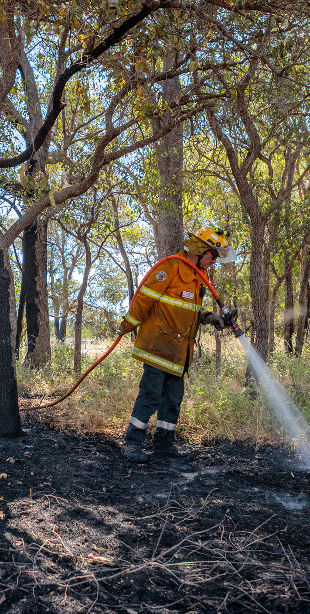
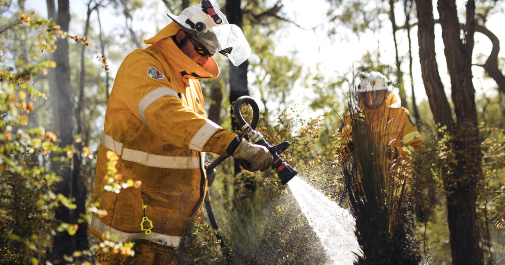
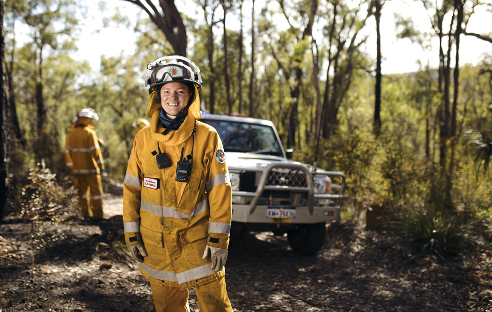
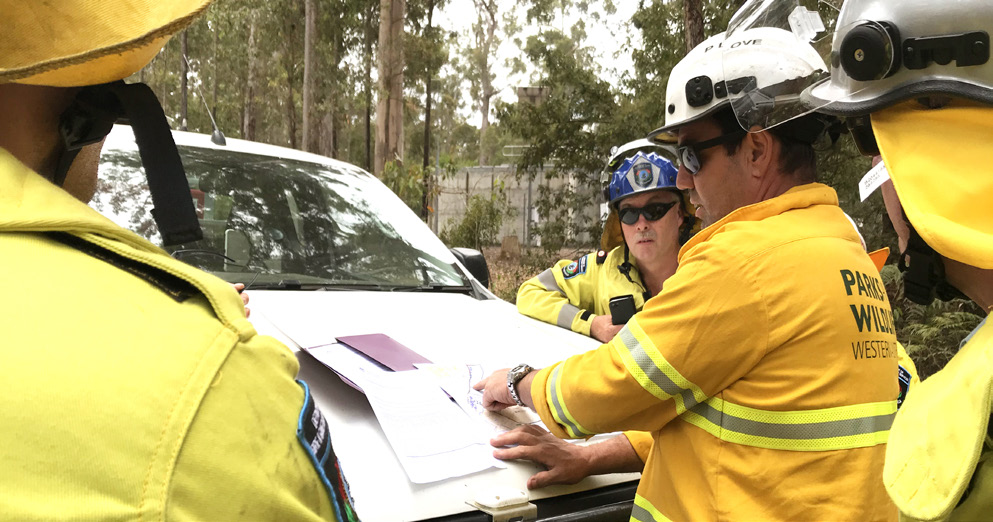
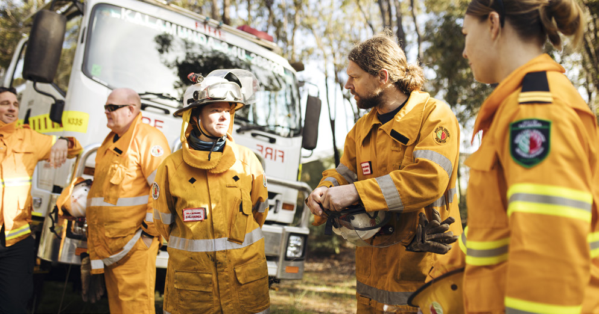
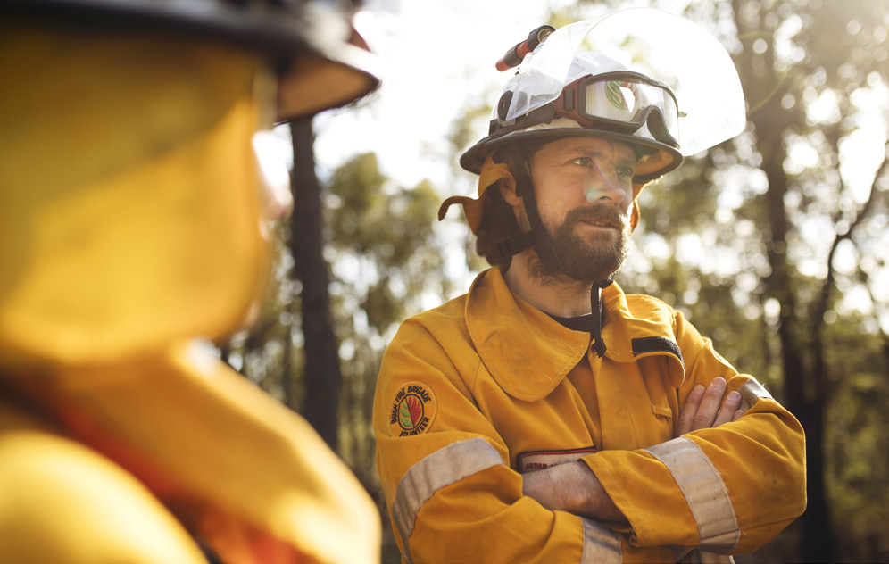

# Guidelines for Preparing a Bushfire Risk Management Plan (BRMP) (2020)

> **Source**: WA DFES
> **URL**: https://dfes.wa.gov.au/documents/Guidelines-for-Preparing-a-Bushfire-Risk-Management-Plan-2020.pdf
> **Licence**: © Government of Western Australia; emergency-management practitioner reference
> **Retrieved**: 2026-05-07T23:43:06Z
> **SHA-256**: `3f6bcf16c1fe034a1da6d85dd5582751100b6252fb365d1bc8fc37cc456ae448`
> **Archived copy**: Internet Archive Wayback Machine — `https://web.archive.org/web/20240318212729id_/https://dfes.wa.gov.au/documents/Guidelines-for-Preparing-a-Bushfire-Risk-Management-Plan-2020.pdf`
> *(Live publisher URL no longer resolves; this archived snapshot was used for ingest. Cite the publisher URL above.)*
> *Converted from PDF to Markdown format.*

---
## Page 1

Guidelines for Preparing a Bushfire Risk Management Plan
1
GUIDELINES FOR 
PREPARING A 
BUSHFIRE RISK 
MANAGEMENT 
PLAN 2020

---
## Page 2

Guidelines for Preparing a Bushfire Risk Management Plan
2
© Department of Fire and Emergency Services 2020
Other than permitted under the Copyright Act 1968, no part of this publication may be reproduced by 
any means without written permission of the Department of Fire and Emergency Services of Western 
Australia. Enquiries should be addressed to:
Wherever a third party holds copyright in material presented in this publication, the copyright remains 
with that party. Their permission may be required to use the material.
This document contains Standards Australia Ltd and ISO copyrighted material that is distributed by SAI 
Global on Standards Australia Ltd and ISO’s behalf. Standards Australia Ltd and ISO’s material is not for 
resale, reproduction or distribution in whole or in part without written permission from SAI Global Ltd: 
tel + 61 2 8206 6355 or copyright@saiglobal.com
Office of Bushfire Risk Management
Department of Fire and Emergency Services
PO Box P1174 Perth WA 6844
Website: dfes.wa.gov.au/OBRM
Email: obrm@dfes.wa.gov.au

---
## Page 3

Guidelines for Preparing a Bushfire Risk Management Plan
3
Disclaimer 
The information contained herein is provided by the Office of Bushfire Risk Management, Department 
of Fire and Emergency Services (“the Office”) in good faith as a public service. This material has been 
released as a general guide. Recipients should exercise their own skill and care in respect to its use. 
Persons relying on this information do so at their own risk. The Office does not guarantee the accuracy of 
this information, and it is the responsibility of recipients to make their own enquiries as to the accuracy, 
completeness and relevance of the information for their purposes. If you consider any aspect of this 
information is of significance to you, you should obtain professional advice relevant to your particular 
circumstances. The Office, its servants and agents expressly disclaim liability for any act or omission 
made in reliance on this information or for any consequence of such act or omission. The Office, its 
servants and agents expressly disclaim liability for loss or damage howsoever caused, including as a 
result of negligence of the Office. 
These Guidelines were prepared by the Office of Bushfire Risk Management (OBRM) and have been 
endorsed as the standard for Bushfire Risk Management (BRM) planning in Western Australia. OBRM would 
like to thank all those who contributed to the development and testing of these Guidelines, especially 
those that have been involved in the BRM Planning Program since its inception in 2015. 
Currency of the Guidelines
These Guidelines describe the standard and methodology for developing a BRM Plan. The Guidelines 
were updated in 2020 to align them with contemporary practice. A full review of the Guidelines and the 
methodology used in BRM Planning is currently underway.
The formulas and data used within these Guidelines are based on the best available information at the 
time of development. These may be subject to change over time as new knowledge becomes available.

---
## Page 4

Guidelines for Preparing a Bushfire Risk Management Plan
4
Contents
Chapter 1 – Introduction	

6
1.1  Background	 
6
1.2  What is Bushfire Risk?	

6
1.3  What is a Bushfire Risk Management Plan?	

7
Chapter 2 – Developing a Bushfire Risk Management Plan	 
10
2.1  The Bushfire Risk Management Planning Process	

10
2.2  Roles and Responsibilities	

12
2.3  Record Keeping and Auditing	
16
2.4  Communication Strategy	

16
2.5  Establishing the Context	

17
2.6  Planning Areas	

22
Chapter 3 – Assets and Risk Assessment	

23
3.1  Asset Identification	 
23
3.2  The Bushfire Risk Assessment Process	

28
3.3  Assessing Consequence	

29
3.4  Assessing Likelihood	
37
Chapter 4 – Risk Evaluation and Treatment	 
38
4.1  Purpose of Risk Evaluation	

38
4.2  Risk Acceptability	

38
4.3  Treatment Priority	 
39
4.4  Risk Treatment	

40
Chapter 5 – Approval, Monitoring, Review and Reporting	

44
5.1  The Approval Process	

44
5.2  Dispute Resolution	 
45
5.3  Publishing the Bushfire Risk Management Plan	

45
5.4  Annual Reporting	

45
5.5  Reviewing the Bushfire Risk Management Plan 
46

---
## Page 5

Guidelines for Preparing a Bushfire Risk Management Plan
5
Glossary	

47
Common Abbreviations	

49
Appendix A – Assessment Criteria	

50
Appendix B – Self Assessment Checklist	

53
List of Figures
Figure 1 – Components of the Bushfire Risk Management Plan	

8
Figure 2 – The Bushfire Risk Management Process	

11
Figure 3 – Bushfire Risk Management Plan Roles and Responsibilities	

15
Figure 4 – The Bushfire Risk Management Plan Approval Process	 
45
List of Tables
Table 1 – Human Settlement Asset Categories and Subcategories	 
24
Table 2 – Economic Asset Categories and Subcategories	 
25
Table 3 – Environmental Asset Categories and Subcategories	

26
Table 4 – Cultural Asset Categories and Subcategories	

27
Table 5 – Determining the Risk Rating	

28
Table 6 – Consequence Ratings for Human Settlement Assets	

30
Table 7 – Consequence Ratings for Economic Assets	

32
Table 8 – Vulnerability Assessment for Economic Assets	 
33
Table 9 – Consequence Ratings for Environmental Assets	 
34
Table 10 – Vulnerability Ratings for Environmental Assets	 
35
Table 11 – Consequence Ratings for Cultural Assets	

36
Table 12 – Likelihood Ratings for Bushfire Risk	

37
Table 13 – Treatment Priorities	

40

---
## Page 6

Guidelines for Preparing a Bushfire Risk Management Plan
6
1.1 Background
Under the State Hazard Plan - Fire, local governments in Western Australia (WA) with significant bushfire 
risk are required to develop an integrated Bushfire Risk Management (BRM) Plan that addresses 
bushfire risk across all land tenures. These Guidelines for Preparing a Bushfire Risk Management Plan 
(the Guidelines) describe the process and requirements for identifying and assessing bushfire risk and 
preparing a BRM Plan.
The BRM Planning Program is a state-wide initiative led by the Department of Fire and Emergency Services 
(DFES) to support local governments across WA to develop a contextualised BRM Plan to reduce bushfire 
risk within their local community. The tools, templates and guidance available to local governments 
participating in the BRM Planning Program align to the standards established in these Guidelines.
1.2 What is Bushfire Risk?
Bushfire risk can be defined as the chance of a bushfire igniting, spreading and causing damage to the 
community or the assets they value.
CHAPTER 1 
Introduction

---
## Page 7

Guidelines for Preparing a Bushfire Risk Management Plan
7
1.3 What is a Bushfire Risk Management Plan?
A BRM Plan is a strategic document developed by local government to facilitate a coordinated approach 
towards the identification, assessment and treatment of assets exposed to bushfire risk. The aim of a 
BRM Plan is to effectively manage bushfire risk in order to protect people, assets and other things of local 
value. The objectives of a BRM Plan are to:
•	 guide and coordinate a tenure blind, multi-agency BRM program over a five-year period;
•	 document the process used to identify, analyse and evaluate risk, determine priorities and develop 
a plan to systematically treat risk;
•	 facilitate the effective use of the financial and physical resources available for BRM activities;
•	 integrate BRM into the business processes of local government, land owners and other agencies;
•	 ensure there is integration between land owners, BRM programs and activities; and
•	 document processes used to monitor and review the implementation of treatment plans to ensure 
they are adaptable and that risk is managed at an acceptable level.
Specifically, the BRM Plan and associated data:
•	 establishes the context for managing bushfire risk in a local government, including defining the risk 
assessment criteria and process and the level of acceptable bushfire risk;
•	 identifies assets of value that are at risk from bushfire including communities, infrastructure, 
economic, cultural and environmental assets;
•	 captures the risk ratings assigned to assets identified and assessed in the BRM Plan and their 
priority for treatment;
•	 describes and prioritises actions required to treat bushfire risk according to the risk criteria;
•	 assigns risk ownership and responsibility for implementing treatments; and
•	 specifies a timeframe for treatment owners to implement the required treatments.

---
## Page 8

Guidelines for Preparing a Bushfire Risk Management Plan
8
Figure 1 provides an overview of the templates, data and reports that form part of the BRM Plan and 
support the BRM planning process. Appended to the BRM Plan are the Communication Strategy and the 
Local Government Wide Controls Table. The Communication Strategy identifies the key stakeholders to be 
involved in the BRM planning process, their role in the BRM Plan and the objectives for communication 
activities. The Local Government Wide Controls Table is used to identify and record the programs and 
activities currently undertaken by the local government and other stakeholders that contribute to 
managing bushfire risk within the local government.
The Bushfire Risk Management System (BRMS) is an online application that supports the development and 
implementation of BRM Plans. BRMS is used to record and map assets, undertake risk assessments and 
record the treatments associated with specific assets. BRMS can also generate reports and maps that 
provide a summary of the assets identified as being at risk from bushfire within the local government and 
their associated risk ratings and treatments.
FIGURE 1 - Components of the Bushfire Risk Management Plan
Bushfire Risk 
Management Plan 
(template)
Communication 
Strategy (template)
Local Government Wide 
Controls Table (template)
Asset data
Risk assessment 
data
Treatment data
Asset Risk 
Register
Treatment 
Schedule
Maps
Bushfire Risk Management Plan
Bushfire Risk Management System
System Generated Reports

---
## Page 9

Guidelines for Preparing a Bushfire Risk Management Plan
9
The development and implementation of the BRM Plan and Treatment Schedule must comply with relevant 
legislation, regulations, policy, standards and guidelines, including those related to: 
•	 Bushfire and emergency management;
•	 Land and asset management;
•	 Protection of environmental and heritage values;
•	 Land development; and
•	 Risk management.
Local governments need to ensure that BRM planning processes are integrated into their organisations’ 
corporate framework, including relevant internal processes, policies and procedures. Alignment 
of organisational processes will ensure activities related to the BRM Plan comply with legislative 
requirements, adhere to best practice standards and support the local government’s goals and objectives. 
The BRM Planning Handbook provides a detailed list of relevant legislation, policies and other documents 
that relate to the BRM Plan and associated activities.

---
## Page 10

Guidelines for Preparing a Bushfire Risk Management Plan
10
2.1 The Bushfire Risk Management Planning Process
The BRM planning process involves identifying assets that are important, or determined to have local 
value and assessing the consequence and likelihood of a bushfire impacting upon these assets 
(Figure 2). Based on the risk rating, assets are prioritised for treatment. When a risk treatment is 
recommended, monitoring and review processes ensure that risks are continuously managed.
CHAPTER 2 
Developing a 
Bushfire Risk 
Management Plan

---
## Page 11

Guidelines for Preparing a Bushfire Risk Management Plan
11
Calculate risk rating
Human Settlement
Economic
Environmental
Cultural
Assess consequence
Assess likelihood 
•	 Determine the fuel age
•	 Determine the separation distance
Risk analysis
Determine which risks require asset-specific treatment
•	 Review each asset’s risk rating against the criteria for risk acceptance
•	 Consider the current controls and treatments
•	 Identify treatment priorities
Risk evaluation
Treat unacceptable risks
•	 Determine the treatment strategy or strategies to be implemented, in consultation with stakeholders
•	 Plan and implement treatment strategies to manage risks at an acceptable level
Risk treatment
FIGURE 2 – The Bushfire Risk Management Process1
1Adapted from AS/NZS ISO 31000 with permission from SAI Global under licence number 1510-c081.
The Bushfire Risk Management Planning Process
Monitoring and review
Monitor and review risks, evaluate treatments
Recording and reporting
Reporting to council and other stakeholders
Communication and consultation
Development and implementation of the communication strategy
Identify assets at risk from bushfire 
(Human settlement, economic, environmental and cultural assets)
Risk
identification
Establish the context for risk assessment 
•	 Strategic and corporate framework
•	 Location, boundaries and tenure
•	 Population and demographics
•	 Economic activities and industry
•	 Topography and landscape features
•	 Climate and bushfire seasons
•	 Vegetation
•	 Threatened species and communities
•	 Bushfire frequency and causes of ignition
•	 Current local government wide controls
Establish context

---
## Page 12

Guidelines for Preparing a Bushfire Risk Management Plan
12
2.2 Roles and Responsibilities
2.2.1 Local Government
The State Hazard Plan – Fire requires local governments with bushfire risk to develop an integrated 
BRM Plan for their area. While DFES, Department of Biodiversity, Conservation and Attractions 
(DBCA) and other significant land owners and asset managers will contribute to the process, local 
government are the custodians of the BRM Plan and coordinate its development and ongoing review. 
With support from DFES, local governments negotiate a commitment from land owners to treat risks 
identified in the BRM Plan. This is appropriate in light of the powers and responsibilities given to local 
government under the Bush Fires Act 1954, their responsibility for community service provision at the 
local level, local knowledge, existing relationships with land owners and involvement in local planning, 
fire management and community engagement programs. Local governments are encouraged to 
engage their Bush Fire Advisory Committee (BFAC) and Local Emergency Management Committee 
(LEMC) in the development and implementation of their BRM Plan to ensure the outcomes of BRM 
planning are integrated into emergency management activities. 
Local governments implement treatment strategies to address risk on land that they manage. As 
part of the approval process, the BRM Plan is submitted to council for approval and adoption in their 
local government.
2.2.2 Department of Fire and Emergency Services
DFES is the state government agency responsible for delivery of the BRM Planning Program. 
In line with the agency’s responsibilities under the State Hazard Plan - Fire, DFES will participate in, 
and contribute to locally developed and implemented BRM Plans. DFES support local government by 
providing expert knowledge and advice in relation to bushfire risk, prevention and treatment; 
assisting with the identification of appropriate risk treatment strategies and engaging State and 
Federal government agencies in the BRM planning process.
DFES facilitates a number of state-wide programs and initiatives that are likely to be included as 
treatment strategies in a BRM Plan. DFES may also act in support of other agencies and land owners 
that do not have the capacity to undertake particular treatment strategies, such as planned burning, 
on their own land.

---
## Page 13

Guidelines for Preparing a Bushfire Risk Management Plan
13
DFES is the custodian of BRMS and undertakes all aspects of system administration, user support, 
quality assurance and the training. Access to BRMS is provided to local governments participating in 
the BRM Planning Program to support the development and implementation of BRM Plans.
DFES administer and coordinate the Mitigation Activity Fund (MAF) Grants Program on behalf of the 
State. Local governments that have an endorsed BRM Plan2 are eligible to apply for MAF funding 
though an annual competitive grants process.
DFES’ Office of Bushfire Risk Management (OBRM) provides policy advice and undertakes risk 
assurance programs to support the management of bushfire risk and related activities in accordance 
with AS/NZS ISO 31000 and other best practice standards. OBRM has developed and endorsed these 
Guidelines as the standard for preparing a BRM Plan and is responsible for their periodic review.
In addition, OBRM will review a local government’s draft BRM Plan for consistency with the Guidelines, 
prior to approval by the local government’s council. OBRM may also implement a quality assurance 
and audit program in relation to BRM planning. OBRM report annually to the Fire and Emergency 
Services (FES) Commissioner on the state of bushfire risk across WA.
2.2.3 Department of Biodiversity, Conservation and Attractions – Parks and Wildlife Service
In line with their responsibilities under the State Hazard Plan – Fire, DBCA will participate in, and 
contribute to, locally developed and implemented BRM Plans. DBCA undertake a substantial annual 
treatment program to mitigate bushfire risk on land they manage. Their programs will be important 
to consider as part of the BRM planning process. Local governments are encouraged to seek advice 
from DBCA when identifying environmental assets that are vulnerable to fire and planning appropriate 
treatment strategies for their protection. DBCA is likely to be a significant land owner and treatment 
manager in most local governments due to their management responsibilities, activities and programs.
2 A BRM Plan reviewed and endorsed by DFES’ Office of Bushfire Risk Management as being consistent with the processes, methodology and templates set out 
in the Guidelines for Preparing a Bushfire Risk Management Plan.

---
## Page 14

Guidelines for Preparing a Bushfire Risk Management Plan
14
2.2.4 Department of Planning, Lands and Heritage
The Department of Planning Lands and Heritage (DPLH) manages bushfire risk on land owned by the 
WA Planning Commission and provides funding to DFES and DBCA for the management of bushfire 
risk on Unallocated Crown Land (UCL) and Unmanaged Reserves (UMR) across the State of WA. DPLH 
can assist local governments by providing expert advice to support the identification, assessment and 
treatment of Aboriginal and European heritage sites that require inclusion in the BRM Plan.
2.2.5 Forest Products Commission
Forest Products Commission (FPC) manage timber plantation and native forest resources owned 
by the State, and in line with their responsibilities under the State Hazard Plan – Fire, they will 
participate in, and contribute to, locally developed and implemented BRM Plans. FPC can support 
local governments by providing information about their assets and current risk treatment programs. 
As a land manager, FPC may plan and implement risk treatments on land they manage to address 
significant risks identified in the BRM Plan.
2.2.6 Other State and Federal Government Agencies and public utilities
As required, local governments and DFES will engage other state and federal government agencies 
and public utilities in the development and implementation of BRM Plans. These agencies may support 
local governments by providing information about their assets and current risk treatment programs, 
or by planning and managing treatments on their own land to address risks identified in the BRM Plan.
2.2.7 Corporations and Private Land Owners
As required, local government will engage corporations and private land owners in the development 
and implementation of BRM Plans. These stakeholders may support local governments by providing 
information about their assets or current risk treatment programs. Where privately owned or 
managed land presents a significant risk to assets, local governments may engage with corporations 
and private land owners to assist them to identify appropriate treatment strategies for reducing 
bushfire hazards on their own land.

---
## Page 15

Guidelines for Preparing a Bushfire Risk Management Plan
15
DPLH 
•	 Land use planning
•	 Expert advice
•	 Asset owner
•	 Land/treatment manager
FPC 
•	 Asset owner
•	 Land/treatment manager
Private Land Owners 
•	 Asset owners
•	 Land/treatment managers
Public Utilities 
•	 Asset owners
•	 Land/treatment managers
Local Government 
•	 Plan custodian & coordinator
•	 Asset owner
•	 Land/treatment manager
DBCA 
•	 Expert advice
•	 Asset owner
•	 Land/treatment manager
DFES 
•	 Expert advice
•	 Training & assistance
•	 BRMS administration
•	 Administer MAF grants
OBRM 
•	 BRM guidelines & standards
•	 BRM plan endorsement
•	 Quality assurance
Local Government Bushfire Risk Management Plan
The roles and responsibilities of all agencies are summarised in Figure 3.
FIGURE 3 – Bushfire Risk Management Plan roles and responsibilities

---
## Page 16

Guidelines for Preparing a Bushfire Risk Management Plan
16
2.3 Record Keeping and Auditing
Many decisions will be made during the development and implementation of the BRM Plan. It is important 
that adequate records are maintained to satisfy corporate and legislative record keeping requirements. 
Effective record keeping will provide evidence of:
•	 a systematic approach to risk identification and analysis;
•	 the reasoning behind decision making and the outcomes;
•	 appropriate consultation with stakeholders and that approval processes have been followed; and
•	 treatments have been completed and treatment objectives have been achieved.
OBRM may audit local government and other agencies to ensure that BRM Plans are implemented 
appropriately and treatment objectives are achieved.
2.4 Communication Strategy
Communication and consultation is an important part of effective risk management. Participation from 
a diverse range of stakeholder groups is important to the BRM planning process. Development of a 
Communication Strategy ensures consultation is appropriate, timely and effective. The strategy should detail:
•	 the communication objectives;
•	 communications roles and responsibilities;
•	 key stakeholders for communication;
•	 a Communications Log recording which stakeholders were engaged in the development of the 
BRM Plan and Treatment Schedule; and
•	 a Communications Plan for the implementation and review of the BRM Plan and Treatment 
Schedule.
The Communication Strategy Template is the preferred format for developing the BRM Plan 
Communication Strategy.

---
## Page 17

Guidelines for Preparing a Bushfire Risk Management Plan
17
2.5 Establishing the Context
Establishing the context is the first step in the risk management process and should occur before risk 
assessments are conducted. The context statements are a description of the environment in which 
bushfire risk is being managed and the criteria that will influence risk evaluation. This includes the 
local government’s objectives for bushfire risk: a description of the natural, cultural and economic 
environments and any other factors that will significantly influence bushfire risk or the approach taken to 
managing it. Information discovered during this stage will inform decision making by providing perspective 
on the potential consequences of a bushfire event, the likelihood of it occurring, the community’s 
acceptance of bushfire risk and the treatment options available. 
Sections 2.7 and 2.8 of these Guidelines describe the factors that should be considered when sourcing 
information that describes the context of the local government and preparing the BRM Plan context 
statements. Further guidance is provided in the BRM Planning Handbook.
2.5.1 Describing the Local Government and Community Context
Strategic and Corporate Framework
The context statement within the BRM Plan will need to establish the relationship between BRM and the 
local government’s other strategic and corporate planning frameworks. It should address the following:
•	 how the BRM Plan will help the local government achieve its corporate vision and how it relates 
to outcomes of the corporate and/or business plan and other high level community strategies 
and plans;
•	 the governance and structure of the local government, identifying the area(s) responsible for 
BRM planning processes;
•	 how bushfire risk should be integrated across the structure of the local government, including 
the planning and development, operations, community services and corporate services areas;
•	 how outcomes from the BRM Plan will link to, or be used to inform, related local government 
functions, such as the LEMC/BFAC or annual mitigation programs; and
•	 the current perception of bushfire risk and the general attitude of the community towards 
bushfire risk and preparedness.
Identifying how the BRM Plan will be embedded into the local government’s strategic and corporate 
frameworks will reinforce a commitment to BRM at the corporate level.

---
## Page 18

Guidelines for Preparing a Bushfire Risk Management Plan
18
Location, Boundaries and Tenure
The BRM Plan context statement should briefly describe the location and boundaries of the local 
government and provide a general breakdown of land tenure. This defines the area covered by 
the BRM Plan and identifies the key land owner groups to be involved in the development and/or 
implementation of the BRM Plan.
Population and Demographics
The BRM Plan context statement should describe the population and demographics of the local 
government, including where and how people live, the location of communities and general trends. It 
should address the following:
•	 location and population of the main communities;
•	 presence and nature of any communities that are particularly vulnerable to bushfire (for 
example retirees, young families, tourist populations, commuter groups (Fly-In/Fly-Out 
or daily), absentee land owners, or culturally and linguistically diverse communities) and 
programs being delivered to support their preparedness and resilience;
•	 the degree of engagement, preparedness and understanding of bushfire risk in the 
community; and
•	 identify any areas experiencing rapid, short term (2-5 years) growth or new development 
within the rural urban interface.
Economic Activities and Industry
The BRM Plan context statement should describe the significant economic activities and industries 
within the local government that may require special consideration in BRM planning, including 
any major agricultural industries and mining operations. Particular attention should be given to 
documenting industry or economic activities that are of regional or state significance, for example 
major transport routes into the state. The section should identify any activities that may have an 
effect on bushfire risk, management or treatment (for example, the impact of smoke on vineyards 
or during significant tourist seasons). If tourism is a significant activity, detail the general number of 
annual visitors (if known) and the peak seasons type of activity.

---
## Page 19

Guidelines for Preparing a Bushfire Risk Management Plan
19
2.5.2 Describing the Environment and Bushfire Context
Topography and Landscape Features
Topography has a significant effect on bushfire behaviour and, therefore, the risk to assets. The 
BRM Plan context statement should describe the topography of the local government, with specific 
reference to any landscape features that influence bushfire risk or limit the capacity to implement 
effective treatments (for example, steep terrain, wetlands, riparian vegetation, peat soils, or areas 
sensitive to erosion or salinity).
Climate and Bushfire Season
The BRM Plan context statement should describe the climate and the weather patterns that typically 
occur within the local government. Bushfire behaviour is significantly influenced by climate, so 
understanding the climatic and seasonal factors that affect bushfire risk will help determine the 
appropriate treatment strategies to be implemented and any conditions that could reduce their 
effectiveness. The context statement should include:
•	 a description of the length and timing of all seasons;
•	 annual temperature and rainfall patterns; and
•	 prevailing conditions and weather patterns that typically give rise to the worst fire 
weather conditions throughout the year.
Vegetation and Fuel 
The BRM Plan context statement should describe the vegetation categories that commonly occur 
throughout the local government. Bushfire fuel is that portion of the vegetation that is available to 
be burnt in a fire. The quantity, arrangement and composition of fuel strongly affects the rate of 
spread and intensity of a bushfire. This includes the probability of crown fire development and ember 
attack. The list of vegetation categories applicable to BRM planning is available in the BRM Planning 
Handbook.

---
## Page 20

Threatened Species and Ecological Communities
Threatened fauna and flora and Threatened Ecological Communities (TECs) are significant 
environmental assets that may need to be recorded and assessed in BRMS. The presence of these 
conservation listed species or communities may influence the timing and suitability of certain bushfire 
risk treatment activities or require a permit or clearance to be obtained prior to the treatment activity 
being conducted. Datasets are available within BRMS to assist local governments with this process. 
However, further advice on the threatened species or TECs that may be present within the local 
government should be obtained from DBCA. The BRM Plan context statement should include:
•	 a list of threatened species and TECs protected under both state and federal legislation, 
including their conservation status;
•	 the identification of any threatened species or TECs that are fire sensitive or likely to be 
negatively impacted by fire; 
•	 the identification of any threatened species or TECs that may be adversely impacted by 
bushfire risk treatment activities; 
•	 the identification of any other locally significant or iconic taxa or communities; and
•	 reference the processes in place within the local government to ensure planned risk 
treatment activities comply with relevant legislation and that the appropriate approvals, 
permits or licences to undertake an activity are obtained.
Guidelines for Preparing a Bushfire Risk Management Plan
20

---
## Page 21

Guidelines for Preparing a Bushfire Risk Management Plan
21
Bushfire Frequency and Causes of Ignition
Considering the bushfire frequency for the local government and previous fire history can help to 
identify locations where fires are more likely to start. Analysis of fire report data and statistics can 
identify common causes of ignition, which potentially could be reduced by improving controls and 
undertaking targeted education campaigns to reduce their occurrence. The following information 
should be included in the BRM Plan context statement:
•	 fire history and areas of frequent ignition;
•	 common causes of ignition and any actions that are recommended to reduce these types of 
ignitions; and
•	 historical fires of significance and any outcomes or improvements that resulted from these.
Current Local Government Wide Controls
In most local governments a range of activities (controls) are already being undertaken by local 
government, state agencies and other stakeholders that contribute to managing bushfire risk. 
These controls are not activities that are implemented to protect a specific asset, or assets, but are 
activities that are broadly applied across the local government in relation to managing bushfire risk. 
The BRM Plan context statement should identify any local government wide controls currently in 
place. The effectiveness of the control measures and their ability to manage risk at an acceptable 
level will be considered during risk evaluation. If controls are not able to adequately manage a risk, 
then asset -specific treatments will need to be implemented to further reduce the risk to the asset.
The following programs and activities are examples of current local government wide controls that 
should be considered when developing the BRM Plan context statement and Local Government Wide 
Controls Table:
•	 the use of Bush Fires Act 1954 section 33 Fire Management Notices, including applicable fuel 
management requirements, firebreak standards and annual enforcement programs;
•	 the application of State Planning Policy 3.7 – Planning for Bushfire Prone Areas to manage 
development in areas identified on the Map of Bushfire Prone Areas. Local planning 
schemes, development policies and land subdivision and building standards applied within 
the local government;
•	 the declaration and management of burning restrictions, such as Total Fire Bans, Restricted 
Burning Times, Prohibited Burning Times and Harvest and Vehicle Movement Bans to reduce 
ignition risk;

---
## Page 22

Guidelines for Preparing a Bushfire Risk Management Plan
22
•	 the distribution and capability of response resources, including career and volunteer 
fire brigades;
•	 community engagement activities or programs that support community awareness, 
preparedness and resilience prior to bushfire events; and
•	 any other broadly applied practices or programs undertaken by local government or 
state agencies that contribute to managing bushfire risk, including controls under state 
government policies, agreements and memorandums. For example, state-wide arson 
programs or vegetation management programs.
A summary of the identified controls should be appended to the BRM Plan using the Local 
Government Wide Controls Table Template.
2.6 Planning Areas
Planning areas are a subdivision of the local government. They are based on local government ward 
boundaries and are used to define an area at an appropriate mapping scale. Where a local government 
does not have wards, then there is only one planning area for the local government. Planning area 
boundaries are available to view within BRMS.

---
## Page 23

Guidelines for Preparing a Bushfire Risk Management Plan
23
3.1 Asset Identification
An asset is anything valued by the community that is vulnerable, or requires protection from bushfire. 
There are four categories of assets considered in the BRM Plan: human settlement, economic, 
environmental and cultural assets (see Tables 1-4).
Only those assets at risk from bushfire need to be assessed and included in the BRM Plan. As a guiding 
principle, assets located within 400 metres of classified vegetation are deemed to be at sufficient risk 
from bushfire to warrant inclusion in the BRM Plan. Assets located beyond 400 metres may still be 
included, but will generally be assigned a lower risk rating that those located nearer to vegetation.
The decision to include an asset in the BRM Plan will be assessed case by case. Where it is unclear, the 
decision to include an asset should be determined in consultation with the asset owner or managing 
agency. Specific business rules for categorising assets are provided in the BRM Planning Handbook. 
Further advice can also be sought from DFES’ Bushfire Risk Management Branch.
To include an asset in the BRM Plan the asset must be recorded in BRMS using the processes outlined in 
the BRM Planning Handbook and BRMS User Guide.
CHAPTER 3 
Assets and 
Risk Assessment

---
## Page 24

Guidelines for Preparing a Bushfire Risk Management Plan
24
Assets may fall into more than one category. Where this is the case, multiple risk assessments can be 
completed against the asset, with the assessment resulting in the highest risk rating being the rating 
assigned to the asset.
Assets should be grouped for assessment, rather than assessed on an individual basis. To be grouped, 
assets must be of the same asset category and subcategory, and have similar risk characteristics for risk 
assessment (for example, vegetation, slope, separation distance and vulnerability inputs).
Table 1 – Human Settlement Asset Categories and Subcategories
Asset Category
Asset Subcategories
Human Settlement Assets
Residential 
Residential areas, including dwellings in rural areas and the rural-urban interface.
•	 In urban areas, a street, or group of streets, along the urban interface may be classified as an asset. 
Places of temporary 
occupation
Commercial and industrial areas, mining sites or camps and other locations where people may work or 
gather (for example, mining camps, industrial complexes, showgrounds, sports facilities and recreation 
centres).
Special risk and 
critical facilities
Locations and facilities where occupants may be especially vulnerable to bushfire for one or more of the 
following reasons:
•	 Occupants may have limited knowledge about the impact of bushfires;
•	 Occupants may have a reduced capacity to evaluate risk and respond adequately to a bushfire event;
•	 Occupants may be more vulnerable to stress and anxiety arising from a bushfire event or the effects 
of smoke; 
•	 There may be significant communication barriers with occupants; or
•	 Relocation and/or management of occupants may present unique challenges or difficulties, such as 
transportation, or providing alternative accommodation, healthcare or food supplies.
(for example, schools, nursing homes, hospitals and patient care facilities, specialised care facilities, 
childcare facilities, tourist accommodation (incl. caravan parks), prisons and detention centres, 
retirement villages, shared home or supported accommodation and independent living facilities)
Facilities that are critical to the community during a bushfire emergency.
(for example, police, fire and emergency services facilities, designated evacuation centres, incident 
control centres, local government administration and depot facilities)

---
## Page 25

Guidelines for Preparing a Bushfire Risk Management Plan
25
Table 2 – Economic Asset Categories and Subcategories
Asset Category
Asset Subcategories
Economic Assets
Agricultural 
Areas under production, such as pasture, livestock, crops, viticulture, horticulture and associated 
infrastructure. Must be grouped for assessment and should not be assessed at the level of individual 
farms or properties.
Commercial and 
Industrial
Major industry, waste treatment plants, mines (economic interest), mills, processing and manufacturing 
facilities and cottage industry.
Critical infrastructure
Power lines and substations, water pumping stations, tanks/bores and pipelines, gas pipelines, 
telecommunications infrastructure, railways, bridges (timber/timber-hybrid), port facilities and waste 
water treatments plants.
Tourist and 
recreational
Tourist attractions, day-use areas and recreational sites that generate significant tourism and/or 
employment within the local area. These assets are different to tourist accommodation described as a 
Human Settlement Asset (see above).
Commercial forests 
and plantations
Plantations and production native forests.
Drinking water 
catchments
Land and infrastructure associated with drinking water catchments.

---
## Page 26

Guidelines for Preparing a Bushfire Risk Management Plan
26
Table 3 – Environmental Asset Categories and Subcategories
Asset Category
Asset Subcategories
Environmental Assets
Protected 
Flora, fauna and ecological communities that are listed as a:
•	 Critically Endangered, Endangered or Vulnerable species under the Environmental Protection and 
Biodiversity Conservation Act 1999 (Cth) (EPBC Act 1999) (including associated critical habitat);
•	 Critically Endangered, Endangered or Vulnerable species under the Biodiversity Conservation Act 2016;
•	 Critically Endangered, Endangered or Vulnerable ecological community under the EPBC Act 1999 (Cth);
•	 Critically Endangered, Endangered or Vulnerable Threatened Ecological Community (TEC) endorsed by 
the Minister for Environment (WA);
•	 Fauna protected under international conventions; and
•	 Ramsar wetlands of international importance.
Priority
Flora, fauna and ecological communities that are a:
•	 Priority species listed on the Priority Flora or Priority Fauna Lists held by DBCA (Priority 1-5).
•	 Priority Ecological Community (PEC) (Priority 1-5); and
•	 Wetlands of national or state importance.
Locally Important
Species, populations, ecological communities or habitats that the local community or independent 
scientific experts consider important for the area and for which there is some scientific evidence that 
protection would be beneficial.
Wetlands of local importance.
Sites being used for scientific research.
Note: Environmental assets only need to be included and assessed in the BRM Plan if the time since fire is less than the minimum 
fire threshold for the species or community (i.e. the shortest period of time that fire should be excluded from an asset to avoid 
any localised decline or loss of species from excessive burning). Advice relating to fire interval thresholds for particular species, 
populations, communities or habitats can be sought from DBCA.

---
## Page 27

Guidelines for Preparing a Bushfire Risk Management Plan
27
Table 4 – Cultural Asset Categories and Subcategories
Asset Category
Asset Subcategories
Cultural Assets
Aboriginal heritage
Places of indigenous significance identified by DPLH or the local community.
DPLH has established the Aboriginal Heritage Inquiry System (AHIS) as per the Aboriginal Heritage Act 
1972. The register holds the details of all known Aboriginal cultural heritage places and objects within 
Western Australia.
Additional sites may become known through discussions with local Aboriginal communities or other 
people and can be included in the BRM Plan and referred to DPLH for possible inclusion in the AHIS.
European heritage
Non-indigenous heritage assets afforded legislative protection through identification by the National 
Trust, State Heritage List or Local Planning Scheme Heritage List.
Non-indigenous heritage assets are generally those places or items of significant cultural value arising 
from the early occupation of Western Australia by European or non-indigenous settlers and pioneers.
Local heritage
Assets identified in a Municipal Heritage Inventory or identified by the local community as being 
significant to local heritage.
Other
In some areas, the local community values other cultural assets. These may include community halls, 
churches, clubs and recreational facilities.

---
## Page 28

Guidelines for Preparing a Bushfire Risk Management Plan
28
Table 5 – Determining the Risk Rating
3.2 The Bushfire Risk Assessment Process
Risk assessment uses a combination of consequence and likelihood to determine the level of bushfire 
risk. Once an asset has been identified, mapped and categorised, a risk assessment can be conducted to 
determine an asset’s exposure to bushfire risk. The level of exposure to bushfire risk is called the risk rating.
BRMS will automatically calculate the risk rating, based on the consequence and likelihood inputs entered 
for an asset. Table 5 demonstrates how likelihood and consequence combine to determine the risk rating. 
There are five risk ratings: Low, Medium, High, Very High and Extreme.
Likelihood
Consequence
Minor
Moderate
Major
Catastrophic
Almost Certain
High
Very High
Extreme
Extreme
Likely
Medium
High
Very High
Extreme
Possible
Low
Medium
High
Very High
Unlikely
Low
Low
Medium
High

---
## Page 29

Guidelines for Preparing a Bushfire Risk Management Plan
29
3.3 Assessing Consequence
Consequence is described as the outcome or impact of a bushfire event on the asset. The approach used 
to determine the consequence rating is different for each asset category: Human Settlement; Economic; 
Environmental; and Cultural. This is due to the different aspects, or values at risk, and the type of 
information that needs to be considered when undertaking the risk assessment. There are four possible 
consequence ratings: Minor, Moderate, Major and Catastrophic.
3.3.1 Consequence Assessment - Human Settlement Assets
When considering human settlement assets, the methodology used to determine the consequence 
rating will be based on the following (Table 6):
•	 Hazard
The hazard posed by the classified vegetation; and
•	 Vulnerability
The vulnerability of the asset.
3.3.1 (a) Calculating the Bushfire Hazard
The bushfire hazard is calculated in BRMS using relevant information about the classified vegetation, 
fuel age, canopy cover, separation distance, slope under the vegetation and slope from the asset to 
vegetation.

---
## Page 30

Guidelines for Preparing a Bushfire Risk Management Plan
30
Table 6 – Consequence Ratings for Human Settlement Assets
Where the vegetation being assessed in relation to an asset is not excluded as low hazard (see 
section 3.3.1(b)), the following information is used to calculate the bushfire hazard:
•	 Vegetation Class
The hazard vegetation is to be classified according to the vegetation categories described 
in the BRM Planning Handbook. The vegetation that poses the greatest hazard to the asset 
should be assessed. This is not necessarily the vegetation closest to the asset. 
•	 Fuel Age and Canopy Cover
The fuel age (in years) of the vegetation assessed and its estimated percentage canopy cover.
•	 Separation Distance
The separation distance is defined as the distance between the asset and the vegetation.
•	 Slope under the Vegetation
The effective slope in the land under the hazard vegetation.
•	 Slope from Asset to Vegetation
The slope of the land between the asset and the hazard vegetation.
Vulnerability 
                Bushfire Hazard
Low
Medium
High
Very High
High Vulnerability
Moderate
Major
Catastrophic
Catastrophic
Moderate Vulnerability
Minor
Moderate
Major
Catastrophic
Low vulnerability
Minor
Minor
Moderate
Major

---
## Page 31

Guidelines for Preparing a Bushfire Risk Management Plan
31
3.3.1 (b) Low Hazard Exclusion
If the classified vegetation being assessed in relation to an asset meets one or more of the following 
criteria3, the bushfire hazard will automatically be rated as LOW:
•	 More than 100 metres from the asset
Vegetation of any type that is more than 100 metres from the asset.
•	 Single area less than 1 hectare
Single areas of vegetation less than 1 hectare in area and not within 100 metres of other 
areas of vegetation being classified.
•	 Multiple areas less than 0.25 hectares each
Multiple areas of vegetation less than 0.25 hectares in area and not within 20 metres of the 
asset, or each other.
•	 Strips of vegetation with a width less than 20 metres
Strips of vegetation less than 20 metres in width regardless of the length and not within 
20 metres of the asset or each other, or other areas of vegetation being classified.
•	 Non-vegetated areas
Non-vegetated areas, including waterways, roads, footpaths, buildings and rocky outcrops.
•	 Low hazard vegetation
Low threat vegetation, including managed grassland4, maintained lawns, golf courses, 
maintained public reserves and parklands, botanical gardens, vineyards, orchards, cultivated 
ornamental gardens, commercial nurseries, nature strips and wind breaks.
3.3.1 (c) Rating Vulnerability – Human Settlement Assets
The vulnerability of a human settlement asset describes the susceptibility of the asset and its 
occupants to the adverse effects of a bushfire. There are three categories of vulnerability for human 
settlement assets: High, Moderate and Low.
The Human Settlement Vulnerability Tool in the BRM Planning Handbook is used to select the category 
that best describes the estimated vulnerability of the asset.
3 Source: AS 3959–2009, reproduced with permission from SAI Global under licence number 1510-c081.
4 Managed in a minimal fuel condition, which means there is insufficient fuel available to significantly increase the severity of bushfire attack, recognised as 
short cropped grass to a height of 10 cm.

---
## Page 32

Guidelines for Preparing a Bushfire Risk Management Plan
32
3.3.2 Consequence Assessment – Economic Assets
When considering economic assets, the methodology used to determine the consequence rating will 
be based on the following (Table 7):
•	 Hazard
The hazard posed by the classified vegetation; and
•	 Vulnerability
The vulnerability of the asset, based on the level of impact and susceptibility of the asset to 
the adverse effects of bushfire.
3.3.2 (a) Calculating the Bushfire Hazard
The bushfire hazard is calculated in BRMS using relevant information about the classified vegetation, 
slope and separation distance between the vegetation and the asset. See section 3.3.1(a) for further 
information on calculating the bushfire hazard.
3.3.2 (b) Rating Vulnerability – Economic Assets
The vulnerability of an economic asset is determined by assessing susceptibility of the asset to 
bushfire (Table 8). There are three categories of vulnerability for economic assets: High, Moderate 
and Low.
Table 7 – Consequence Ratings for Economic Assets
Vulnerability 
                Bushfire Hazard
Low
Medium
High
Very High
High Vulnerability
Moderate
Major
Major
Catastrophic
Moderate Vulnerability
Minor
Moderate
Moderate
Major
Low vulnerability
Minor
Minor
Minor
Moderate

---
## Page 33

Guidelines for Preparing a Bushfire Risk Management Plan
33
Table 8 – Vulnerability Assessment for Economic Assets
3.3.2 (c) Level of Impact
The level of impact describes the relative importance of the asset and the potential impact its loss, 
disruption or damage from bushfire, may have on the wider economy. There are three levels of 
impact: Local, Regional and State or Critical.
The Level of Impact Decision Tool in the BRM Planning Handbook is used to select the category that 
best describes the level of impact for the asset. 
3.3.2 (d) Asset Susceptibility
The asset susceptibility describes the ability of an asset to withstand the adverse effects of a 
bushfire. There are three levels of asset susceptibility: Low, Moderate and High.
The Asset Susceptibility Table in the BRM Planning Handbook is used to select the category which 
best describes the susceptibility of the asset to a bushfire impact.
3.3.3 Consequence Assessment – Environmental Assets 
When considering environmental assets, the methodology used to determine the consequence rating 
will be based on the following (Table 9):
•	 Vulnerabilty
The vulnerability of the asset, based on its conservation status and geographic extent; and
•	 Potential Impact of Fire 
The potential impact of a bushfire event or fire regime on the asset.
Asset Susceptibility 
                Level of Impact
Local
Regional
State or Critical
High Susceptibility
Moderate
High
High
Moderate Susceptibility
Low
Moderate
High
Low Susceptibility
Low
Low
Moderate

---
## Page 34

Table 9 – Consequence Ratings for Environmental Assets
3.3.3 (a) Rating Vulnerability – Environmental Assets
The vulnerability of an environmental asset to an impact from bushfire is based on its conservation 
status and geographic extent (Table 10). There are four categories of vulnerability for environmental 
assets: Very High, High, Moderate and Low. 
Potential Impact of Fire
                Vulnerability
Low
Moderate
High
Very High
Fire Sensitive – Exclude Fire
Moderate
Major
Major
Catastrophic
Fire Influenced – Restrict Fire
Minor
Moderate
Moderate
Major
Fire Dependent – No Conditions
Minor
Minor
Minor
Moderate
Guidelines for Preparing a Bushfire Risk Management Plan
34

---
## Page 35

Guidelines for Preparing a Bushfire Risk Management Plan
35
Table 10 – Vulnerability Ratings for Environmental Assets
3.3.3 (b) Potential Impact of Fire
The potential impact of fire describes the long term effect a fire regime may have on a vegetation 
type and the characteristics associated with each category. There are three categories for the 
potential impact of fire: Fire Sensitive, Fire Influenced and Fire Dependent.
The Potential Impact of Fire Table in the BRM Planning Handbook is used to select the category that 
best describes the potential impact of fire on the asset. 
3.3.3 (c) Conservation Status
The conservation status describes the relative importance of an environmental asset for protection. 
There are three categories for conservation status: Threatened, Priority and Local Conservation.
The Conservation Status Table in the BRM Planning Handbook is used to select the category that best 
describes the conservation status of the asset. 
3.3.3 (d) Geographic Extent
The geographic extent describes the distribution of an environmental asset. Unique or rare 
environmental assets will have a highly restricted geographic extent and therefore warrant a 
higher level of protection than species or communities occurring more frequently. There are three 
categories of geographic extent: Highly Restricted, Restricted and Widespread. 
The Geographic Extent Table in the BRM Planning Handbook is used to select the category that best 
describes the geographic extent of the asset. 
Geographic Extent 
                Conservation Status
Local Conservation
Priority
Threatened
Highly Restricted
Moderate
High
Very High
Restricted
Low
Moderate
High
Widespread
Low
Low
Moderate

---
## Page 36

Guidelines for Preparing a Bushfire Risk Management Plan
36
3.3.4 Consequence Assessment – Cultural Assets 
When considering cultural assets, the methodology used to determine the consequence rating will be 
based on the following (Table 11):
•	 Hazard
The hazard posed by the classified vegetation; and
•	 Vulnerability
The vulnerability of the asset.
Table 11 – Consequence Ratings for Cultural Assets
3.3.4 (a) Calculating the Bushfire Hazard
The bushfire hazard is calculated in BRMS using relevant information about the classified vegetation, 
slope and separation distance between the vegetation and the asset. See section 3.3.1(a) for further 
information on calculating the bushfire hazard.
3.3.4 (b) Rating Vulnerability – Cultural Assets
The vulnerability of a cultural asset describes the susceptibility of the asset to the adverse effects of 
a bushfire. There are three categories of vulnerability for cultural assets: Low, Moderate and High.
The Cultural Vulnerability Table in the BRM Planning Handbook is used to select the category that best 
describes the estimated vulnerability of the asset.
Vulnerability
                Hazard
Low
Medium
High
Very High
High Vulnerability
Minor
Moderate
Major
Catastrophic
Moderate Vulnerability
Minor
Moderate
Moderate
Major
Low Vulnerability
Minor
Minor
Moderate
Moderate

---
## Page 37

Guidelines for Preparing a Bushfire Risk Management Plan
37
3.4 Assessing Likelihood
Likelihood is described as the potential for a bushfire to ignite, spread and impact on an asset. The 
approach used to determine the likelihood rating is the same for each asset category: Human Settlement, 
Economic, Environmental and Cultural. There are four possible likelihood ratings: Unlikely, Possible, Likely 
and Almost Certain.
To determine the likelihood rating, the following is considered for the asset being assessed:
•	 Fuel Age (in years)
The fuel age (in years) of the classified vegetation identified as the hazard.
•	 Separation Distance 
The distance between the asset and the classified vegetation identified as the hazard.
Table 12 – Likelihood Ratings for Bushfire Risk
*Unmanaged grasslands are assessed in the >3–6 years fuel age category because of their 
relatively low maximum fuel weight and limited capacity to generate embers.
Fuel Age (in years)
(*excluding) grasslands)
                Separation Distance
>100 m-400 m
>30 m-100 m
0-30 m
0-3 years
Unlikely
Unlikely
Possible
>3-6 years
Unlikely
Possible
Likely
>6 years
Possible
Likely
Almost Certain

---
## Page 38

Guidelines for Preparing a Bushfire Risk Management Plan
38
4.1 Purpose of Risk Evaluation
The purpose of evaluating risk is to:
•	 confirm that the risk ratings for each asset are appropriate;
•	 consider risk acceptability and identify which assets require treatment; and
•	 identify treatment priorities.
4.2 Risk Acceptability
It is not possible, or practical to treat all bushfire risks identified in the BRM planning process. In some 
circumstances risks may be acceptable without the need for specific treatment. For example, assets with 
a Low to Moderate risk rating are likely to be adequately managed through routine local government wide 
controls, so committing resources to further reduce the risk may not be justifiable.
When considering risk acceptability, keep in mind the availability of resources, capacity to undertake 
treatments, budget constraints and the practicality of implementation. These factors will heavily influence 
the ability of land owners and managers to treat risk.
CHAPTER 4 
Risk Evaluation 
and Treatment

---
## Page 39

Guidelines for Preparing a Bushfire Risk Management Plan
39
Ultimately, it will be at the discretion of the local government, together with DFES and the relevant land 
owner, to determine the most appropriate course of action for a particular asset. However, for each risk 
rating the BRM Plan should document the following:
•	 Criteria for Acceptance
The criteria to be used when determining the acceptability of a risk; and
•	 Courses of Action
General courses of action to be taken for each of the five possible risk ratings: Low; Moderate; 
High; Very High and Extreme.
Local government and land owners are strongly encouraged to implement asset-specific treatment 
strategies for risks rated High, Very High and Extreme.
4.3 Treatment Priority
No organisation has unlimited resources to manage risks, therefore it is necessary to prioritise 
unacceptable risks for treatment. Risk acceptability indicates which assets need to be treated, based on 
the risk rating received during risk assessment. The treatment priority provides guidance on the order 
that assets (or risks) should be prioritised for treatment, including how assets should be prioritised within 
a particular risk rating. For example, Table 13 shows that there are three combinations of consequence 
and likelihood that will result in an asset receiving an Extreme risk rating. However, the alpha-numeric 
treatment priority (e.g. 1A, 1B, 1C) assigned to each combination is different. Assets with a higher treatment 
priority (e.g. 1A) should be considered for treatment before addressing assets with a lower treatment 
priority (e.g. 1C, 2B etc.) 
The treatment priority will be automatically assigned by BRMS, based on the asset’s risk assessment. 
Table 13 shows how consequence and likelihood combine to give the risk rating and subsequent treatment 
priority for an asset.

---
## Page 40

Guidelines for Preparing a Bushfire Risk Management Plan
40
Table 13 – Treatment Priorities
Local governments and other land owners and managers are encouraged to allocate resources to 
treatments that address higher priority risks and provide the best return on investment. This applies to 
the allocation of current resources and when seeking funding for additional resources.
4.4 Risk Treatment
The purpose of risk treatment is to reduce the potential impact of bushfire on the community, economy 
and environment. This is achieved by implementing treatments that modify the characteristics of the 
community or the environment.
Assets are likely to require risk treatment when:
•	 the risk rating associated with the asset is at an unacceptable level;
•	 local government wide controls identified earlier in the BRM process are not sufficient to 
adequately manage the risk at an acceptable level; and/or
•	 existing treatment programs or recent mitigation activities need to be maintained into the future to 
ensure the risk rating remains at an acceptable level. 
Likelihood
Consequence
Minor
Moderate
Major
Catastrophic
Almost Certain
3D (High)
2C (Very High)
1C (Extreme)
1A (Extreme)
Likely
4C (Medium)
3A (High)
2A (Very High)
1B (Extreme)
Possible
5A (Low)
4A (Medium)
3B (High)
2B (Very High)
Unlikely
5C (Low)
5B (Low)
4B (Medium)
3C (High)

---
## Page 41

Guidelines for Preparing a Bushfire Risk Management Plan
41
4.4.1 Asset-Specific Treatment Strategies
Asset-specific treatments are implemented to protect an individual asset or group of assets, 
identified and assessed in the BRM Plan as having an unacceptable level of risk from bushfire. 
Asset-specific treatments are recorded and managed within BRMS. There are five asset-specific 
treatment strategies:
•	 Fuel management 
Treatment reduces or modifies the bushfire fuel through manual, chemical or planned 
burning methods;
•	 Ignition management 
Treatment aims to reduce potential sources of ignition in the landscape; 
•	 Preparedness 
Treatments aim to enhance the community’s capacity to fight to a bushfire, for example by 
improving vehicle access, water supply or availability of fire fighting appliances;
•	 Planning 
Treatments focus on developing plans to improve the ability of firefighters and the 
community to prepare, respond and recover from bushfire; and
•	 Community Engagement
Treatments seek to build relationships, raise awareness and change the behaviour of people 
exposed to bushfire risk.
The treatment strategy (or combination of treatment strategies) selected will depend on a range of 
factors and not all treatment strategies will be suitable in all circumstances.
Where an asset-specific treatment is not required or not possible, only local government wide 
controls will be used to manage the risk. This should also be recorded in BRMS to ensure risks are 
periodically scheduled for review.

---
## Page 42

4.4.2 Selecting the Treatment Strategy
Selecting the most appropriate treatment strategy or combination of treatment strategies for an 
asset involves balancing the costs of implementing treatments against the benefits derived. In 
general, the cost of managing the risk needs to be proportionate to the benefits obtained.
Appropriate strategies will include a mix of treatments that are undertaken in both close proximity to 
the asset and in the wider landscape. Further advice on selecting appropriate treatment strategies is 
provided in the BRM Planning Handbook.
The process for recording treatments in BRMS is detailed in the BRM Planning Handbook and 
BRMS User Guide.
Guidelines for Preparing a Bushfire Risk Management Plan
42

---
## Page 43

Guidelines for Preparing a Bushfire Risk Management Plan
43
4.4.3 Development of the Treatment Schedule
The Treatment Schedule will evolve and develop throughout the life of the BRM Plan. In the first 
instance, efforts should focus on developing a program of works that identifies the treatment 
activities to be undertaken within the first year of implementation of the BRM Plan. This initial 
Treatment Schedule (first year) is to be provided with the draft BRM Plan when it is submitted to 
OBRM for endorsement.
Responsibility for Treatment
Land owners and occupiers are ultimately responsible for treatments implemented on their own land. 
This includes any costs associated with the treatment and obtaining the relevant approvals, permits 
or licences to undertake an activity. Where agreed, another agency may manage a treatment on 
behalf of a land owner. However, the onus is still on the land owner to ensure treatments identified in 
the BRM Plan’s Treatment Schedule are completed.
The BRM planning process is founded on the notion that…
“Those that own or occupy the land, own the risk.”

---
## Page 44

Guidelines for Preparing a Bushfire Risk Management Plan
44
5.1 The Approval Process
Once developed, BRM plans are to be endorsed by OBRM prior to approval by the local government 
council. Council approval signifies the local government’s acknowledgement of the assets that have been 
identified within their local community and the risk ratings and treatment priorities assigned. Approval 
of the plan is a commitment by local government to work with land owners and managers to address 
unacceptable risk within their community. It is not an acceptance of responsibility or commitment to treat 
risks occurring on land that is not owned or managed by the local government.
DFES’ BRM Branch undertake a quality assurance review of all draft plans, prior to submission to OBRM. 
This review ensures draft BRM Plans meet the minimum standard for endorsement and streamlines 
review processes.
OBRM’s review of the draft BRM Plan will consider its consistency with the Guidelines. Figure 4 provides 
an overview of the BRM Plan approval process. Appendix A provides a checklist for submitting the draft 
BRM Plan to OBRM for endorsement, along with the key criteria that will be assessed. Further information 
regarding the approval process is also available in the BRM Planning Handbook.
CHAPTER 5 
Approval, Monitoring, 
Review and Reporting

---
## Page 45

Guidelines for Preparing a Bushfire Risk Management Plan
45
FIGURE 4 – The Bushfire Risk Management Plan Approval Process
5.2 Dispute Resolution
All attempts should be made to negotiate an acceptable solution to an issue at the local or lowest 
possible level. If this course of action is unsuccessful, then the matter may be referred to the regional or 
State level for resolution. All attempts should be made to resolve issues at the earliest opportunity.
5.3 Publishing the Bushfire Risk Management Plan
Local governments are encouraged to publish the BRM Plan on their website. Promotion of the BRM Plan 
to the wider community may raise the level of risk awareness and help private land owners understand 
how they can contribute to reducing bushfire risk on their own land.
5.4 Annual Reporting
Local governments are encouraged to report regularly (at least annually) to council, the LEMC and/or 
BFAC on progress made towards implementation of the BRM Plan and Treatment Schedule. Upon request, 
local governments will be asked to contribute information relating to their bushfire risk treatment 
activities to OBRM’s annual Fuel Management Activity Report.
Local Government 
finalise Draft BRM Plan
Draft BRM Plan 
submitted to DFES for 
quality assurance review
Draft BRM Plan 
submitted to OBRM 
for endorsement
Endorsed BRM Plan 
submitted to council 
for approval
1
2
3
4

---
## Page 46

Guidelines for Preparing a Bushfire Risk Management Plan
46
5.5 Reviewing the Bushfire Risk Management Plan
The BRM Plan is to undergo a comprehensive review within five years against the Guidelines current at 
the time of commencing the review.
5.5.1 Managing Treatment Data in BRMS
The BRM Planning Handbook provides the process for recording and managing treatment data within 
BRMS. To ensure the currency of information entered into BRMS is maintained, data is to be reviewed 
and updated where:
•	 a new treatment is identified;
•	 the details of an existing treatment change, including reassigning or rescheduling the 
treatment;
•	 a treatment has been completed;
•	 a treatment evaluation has been completed;
•	 the post-treatment risk assessment is completed; or
•	 the treatment is no longer required due to an unplanned event, such as a bushfire.

---
## Page 47

Guidelines for Preparing a Bushfire Risk Management Plan
47
Glossary
Asset
A term used to describe anything of value that may be 
adversely impacted by bushfire. This may include residential 
houses, infrastructure, commercial, agriculture, industry, 
environmental, cultural and heritage sites.
Asset Category
There are four categories that classify the type of asset – 
Human Settlement, Economic, Environmental and Cultural.
Asset Owner	
The owner, occupier or custodian of the asset itself. Note: 
this may differ from the owner of the land the asset is 
located on – for example, a communication tower located 
on leased land or private property.
Asset Register	
A component within the Bushfire Risk Management System 
(BRMS) used to record the details of assets identified in the 
Bushfire Risk Management (BRM) Plan.
Asset Risk Register 	
A report produced within BRMS that details the 
consequence, likelihood, risk rating and treatment priority 
for each asset identified in the BRM Plan.
Bushfire 
Unplanned vegetation fire. A generic term which includes 
grass fires, forest fires and scrub fires both with and 
without a suppression objective.
Bushfire Attack	 
Mechanisms by which a bushfire may ignite or cause 
damage to an asset, such as ember attack, radiant heat or 
direct flame contact.
Bushfire Hazard
The hazard posed by the classified vegetation, based on the 
vegetation category, slope and separation distance.
Bushfire Risk	
The chance of a bushfire igniting, spreading and causing 
damage to the community or the assets they value.
Bushfire Risk Management	
A systematic process to coordinate, direct and control 
activities relating to bushfire risk; with the aim of limiting the 
adverse effects of bushfire on the community.
Classified Vegetation	
Vegetation that has been classified as a bushfire hazard, 
i.e. any vegetation that does not meet the criteria for Low 
Hazard Exclusion. 
Consequence	
The outcome or impact of a bushfire event on the asset.
Geographic Information System (GIS)	
A data base technology, linking any aspect of land related 
information to its precise geographic location.
Land Owner	
The owner of the land, as listed on the Certificate of Title; or 
leaser under a registered lease agreement; or other entity 
that has a vested responsibility to manage the land.
Likelihood	
The chance of something occurring. In this instance, it is the 
potential for a bushfire to ignite, spread and impact on an 
asset.
Map	
The mapping component of BRMS. Assets, treatments and 
other associated information is spatially identified, displayed 
and recorded within the Map.
Planning Area
A geographic area, generally based on a local government 
ward boundary, which is used to provide a suitable scale for 
risk assessment, stakeholder engagement and reporting.

---
## Page 48

Guidelines for Preparing a Bushfire Risk Management Plan
48
Priority	
See Treatment Priority.
Risk Acceptability/Acceptance
The informed decision to accept a risk, based on the 
knowledge gained during the risk assessment process.
Risk Analysis
The application of consequence and likelihood to an event in 
order to determine the level of risk.
Risk Assessment
The systematic process of identifying, analysing and 
evaluating risk.
Risk Evaluation
The process of comparing the outcomes of risk analysis to 
the risk acceptability criteria in order to determine whether 
a risk is acceptable.
Risk Identification
The process of recognising, identifying and describing risks.
Risk Register
A component within BRMS used to record, review and 
monitor risk assessments and treatments associated with 
assets identified in the BRM planning process.
Risk Treatment
A process to select and implement appropriate measures 
undertaken to modify risk.
Rural	
Any area where residences and other developments are 
scattered and intermingled with forest, range, or farm land 
and native vegetation or cultivated crops.
Rural Urban Interface 	
The line or area where structures and other human 
development adjoin or overlap with undeveloped bushland.
Slope	
The angle of the ground’s surface measured from the 
horizontal.
Tenure Blind	
An approach where multiple land parcels are consider as a 
whole, regardless of individual ownership or management 
arrangements.
Treatment	
An activity undertaken in order to modify risk, such as a 
planned burn.
Treatment Priority	
The order, importance or urgency for allocation of funding, 
resources and opportunity to treatments associated with 
a particular asset. The treatment priority is based on an 
asset’s risk rating.
Treatment Schedule 	
A report produced within BRMS that details the treatment 
priority of each asset identified in the BRM Plan and the 
treatments scheduled.
Treatment Strategy	
The broad approach that will be used to modify risk, such as 
fuel management.
Vulnerability	
The susceptibility of an asset to the impacts of bushfire.

---
## Page 49

Guidelines for Preparing a Bushfire Risk Management Plan
49
Common Abbreviations
AFAC	
	
Australasian Fire and Emergency Services Authorities Council
BFAC	
	
Bush Fire Advisory Committee
BRM	
	
Bushfire Risk Management
BRM Branch	
Bushfire Risk Management Branch (DFES)
BRM Plan	
Bushfire Risk Management Plan
BRMS	 	
Bushfire Risk Management System
DBCA	 	
Department of Biodiversity, Conservation and Attractions
DFES	
	
Department of Fire and Emergency Services
DPLH	
	
Department of Planning, Lands and Heritage
EPBC Act	
Environmental Protection and Biodiversity Conservation Act
FPC	
	
Forest Products Commission
GIS	
	
Geographical Information System
LEMC	 	
Local Emergency Management Committee
MAF	
	
Mitigation Activity Fund 
OBRM	 	
Office of Bushfire Risk Management (DFES)
PEC	
	
Priority Ecological Community
PWS	
	
Parks and Wildlife Service (DBCA) 
RFD	
	
Rural Fire Division (DFES)
SEMC	 	
State Emergency Management Committee
TEC	
	
Threatened Ecological Community
UCL	
	
Unallocated Crown Land
UMR	
	
Unmanaged Reserve
WA	
	
Western Australia
WAPC	 	
Western Australian Planning Commission

---
## Page 50

Guidelines for Preparing a Bushfire Risk Management Plan
50
Appendix A – Assessment Criteria
Assessment Criteria
How the Criteria will be Assessed
Plan Preparation – General
Does the plan follow the format of the 
Office of Bushfire Risk Management 
(OBRM) Bushfire Risk Management 
Plan (BRM Plan) Template and have all 
sections been addressed?
Review BRM Plan
	
τ OBRM template has been used (preferred)
	
τ All sections have been addressed
	
τ Section numbering and order consistent with template
Have all required Appendices been 
attached to the BRM Plan?
Check Appendices
	
τ Communication Strategy
	
τ Asset Risk Register (optional)
	
τ Treatment Schedule
	
τ Local Government Wide Controls Table
Have the roles and responsibilities of 
the various agencies/stakeholders been 
described?
Review Roles and Responsibilities table
	
τ Roles and responsibilities section completed
Has an appropriate Communication 
Strategy been developed?
Review Communication Strategy
	
τ OBRM template has been used (preferred)
	
τ All sections have been addressed
	
τ Scope and outcomes have been set
	
τ Range of stakeholders identified

Communications Log from the development of the BRM Plan complete
	
τ Key messages developed
	
τ Communications Plan developed

---
## Page 51

Guidelines for Preparing a Bushfire Risk Management Plan
51
Establishing the Context
Has the Local Government and 
Community context for the risk 
assessment been described?
Review the Local Government and Community context
	
τ Has a link to the strategic and corporate framework been established?
	
τ Has the Local Government’s location and boundaries been described?
	
τ Has a link to the land tenure, land owners and bushfire risk management been 
described?
	
τ Has the population and demographics of the community been well described?
	
τ Has an overview of the economic and industrial activities been provided?
	
τ Has the information provided been appropriately sourced and referenced?
Has the Environment and Bushfire 
context for the risk assessment been 
described?
Review the Environment and Bushfire context
	
τ Has the topography and landscape in the context of bushfire risk been described?
	
τ Has the climate and bushfire season been described?
	
τ Have the vegetation complexes/types been linked to bushfire risk and have any 
Threatened Species or Communities been listed?
	
τ Has a bushfire history been provided including frequency and causes of ignition?
	
τ Has the information provided been appropriately sourced and referenced?
Asset Identification and Assessment
Have assets been identified in all 
planning areas?
Review Asset Risk Register
	
τ Assets identified in all planning areas within the Bushfire Risk Management System (BRMS)
	
τ Have assets been identified across all asset categories?
	
τ Have assets been grouped appropriately in BRMS?
	
τ Have assets been named appropriately in BRMS?
Have stakeholders been engaged in the 
identification of assets?
Review BRM Plan and Communications Strategy
	
τ Evidence of DBCA consultation with the identification and assessment of 
environmental assets.
	
τ Evidence of consultation with other stakeholders including relevant State 
Government agencies, business areas across the local government, industry and 
community.
Have risk assessments been completed 
and recorded for all assets identified?
Review Asset Risk Register
	
τ Risk assessment recorded for each asset

---
## Page 52

Guidelines for Preparing a Bushfire Risk Management Plan
52
Risk Evaluation
Is the level of risk acceptability 
documented in the BRM Plan?
Review BRM Plan
	
τ Criteria for acceptance of risk and course of action table complete
Risk Treatment
Have the Local Government Wide 
Controls been identified, reviewed and 
documented in the BRM Plan?
Review BRM Plan
	
τ Current Local Government Wide Controls listed in BRM Plan
	
τ Local Government Wide Controls have been reviewed and any potential gaps or 
opportunities have been identified?
	
τ Local Government Wide Control Table identifies actions, timeframes and 
responsibilities
Has a Treatment Schedule been provided 
as an appendix at the time of BRM Plan 
submission?
Review Treatment Schedule
	
τ Does the Treatment Schedule include any treatments known at time of submission?
	
τ For the treatment strategies identified, are they appropriate to the level of risk 
identified?
	
τ Is there evidence in that land owners and treatment managers were engaged in 
the development of the Treatment Schedule?
Monitoring and Review
Has a monitoring and review process 
been described in the BRM Plan?
Review Monitoring and Review
	
τ Have appropriate processes for monitoring and review of the BRM Plan been 
documented?
	
τ Have the responsibilities for the monitoring and review of the BRM Plan been 
detailed?
Draft BRM Plan Submission
Has the BRM Plan been ‘locked’ in BRMS?
Review locked date
	
τ Locked date is recorded
Has the self–assessment checklist 
been completed and attached to the 
submission?
Review Checklist
	
τ Checklist attached
	
τ Contact person nominated
Has a cover letter from the local 
government CEO (or delegate) been 
attached to the submission?
Review cover letter
	
τ Cover letter attached

---
## Page 53

Guidelines for Preparing a Bushfire Risk Management Plan
53
Appendix B – Self Assessment Checklist
Draft Bushfire Risk Management Plan (BRM Plan) submission
To be completed and attached to the draft BRM Plan submission.
	
τ
Cover letter from the local government CEO or delegate submitting the draft BRM Plan to the 
Director of Office of Bushfire Risk Management (OBRM) for review attached
	
τ
All sections of the BRM Plan Template have been addressed
	
τ
Communication Strategy attached
	
τ
Context statements are complete
	
τ
Local Government Wide Controls are identified and recorded
	
τ
All assets at risk of bushfire have been identified and assessed
	
τ
Evidence of consultation with the Department of Biodiversity, Conservation and Attractions 
regarding environmental assets included (if relevant)
	
τ
Asset Risk Register attached (optional)
	
τ
Initial Treatment Schedule attached
	
τ
BRM Plan has been ‘locked’ in BRMS

---
## Page 54

Guidelines for Preparing a Bushfire Risk Management Plan
54
The contact person in regards to this submission is:
Name:	
Position:	
Organisation:	
Postal address:	
Contact Number:	
Email:	
Submissions to be forwarded to:
Office of Bushfire Risk Management, Department of Fire and Emergency Services
Postal Address: PO Box P1174, PERTH WA 6844
Email: 	 obrm@dfes.wa.gov.au

---
## Page 55

Guidelines for Preparing a Bushfire Risk Management Plan
55
dfes.wa.gov.au

