# Tropical Cyclone Preparedness Guide (WA)

> **Source**: WA DFES
> **URL**: https://dfes.wa.gov.au/site/cyclone/documents/tropical-cyclone-preparedness-guide.pdf
> **Licence**: © Government of Western Australia; emergency-management practitioner reference
> **Retrieved**: 2026-05-07T23:43:07Z
> **SHA-256**: `62dfe691afbdeaa267e824bd76cd9439cf37f098f59739c9fbd2c7c24869d9bd`
> **Archived copy**: Internet Archive Wayback Machine — `https://web.archive.org/web/20220308060704id_/https://dfes.wa.gov.au/site/cyclone/documents/tropical-cyclone-preparedness-guide.pdf`
> *(Live publisher URL no longer resolves; this archived snapshot was used for ingest. Cite the publisher URL above.)*
> *Converted from PDF to Markdown format.*

---
## Page 1

WESTERN AUSTRALIA
Tropical Cyclone  
Preparedness 
Guide
IS YOUR PROPERTY READY?

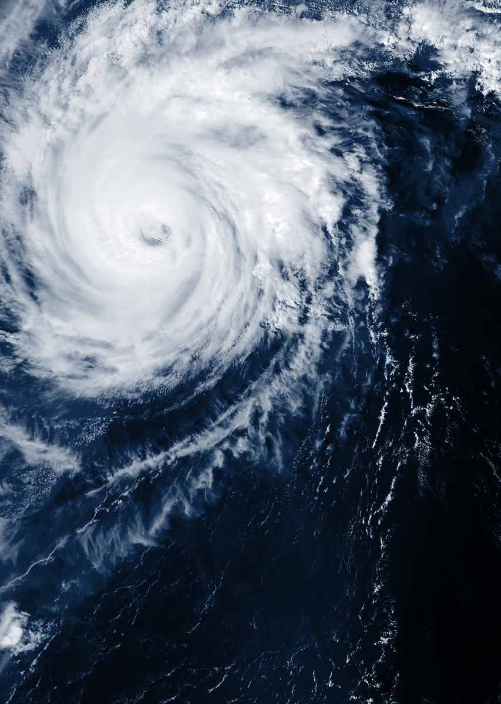

---
## Page 2

 
The information contained in this brochure is provided by the Cyclone Testing Station, Geoscience Australia (GA), 
Department of Mines, Industry Regulation and Safety (DMIRS) and Department of Fire and Emergency Services 
(DFES), and voluntarily as a public service. This document has been prepared in good faith and is derived from 
sources believed to be reliable and accurate at the time of publication (September 2020). Nevertheless, the 
reliability and accuracy of the information cannot be guaranteed and the Cyclone Testing Station, GA, DMIRS and 
DFES expressly disclaim any liability for any act or omission done or not done in reliance on the information and 
for any consequences, whether direct or indirect, arising from such act or omission. This document is intended to 
be a guide only and readers should obtain their own independent advice and make their own necessary enquiries. 
This guide was produced as a part of the Severe Wind Hazard Assessment project 2016-2017. This project 
acknowledges the funding contribution of the Commonwealth Government of Australia and support from the 
WA State Emergency Management Committee.

---
## Page 3

   
01 
Contents 
What is a tropical cyclone? 
02 
What are the characteristics of a cyclone? 
03 
Strong winds and rain 
03 
Storm surge and storm tide 
03 
When and where do cyclones occur? 
04 
Wind loading regions 
05 
Damage from cyclones 
06 
Wind and debris damage to buildings 
07 
Damage from wind-driven rain 
07 
Damage from storm tides and storm surge 
08 
Check and maintain your property 
08 
Rust 
09 
Rot in timber 
10 
Termites 
10 
Loose Fittings 
11 
Check and upgrade your property 
11 
Roof 
11 
Doors and windows 
13 
Garage doors 
14 
Gutters and downpipes 
14 
Flashings 
15 
Other items attached to buildings 
15 
Other items on and around your property 
16 
Choose a safe place to shelter 
17 
Further information 
18 
Appendix 
19 
Appendix A: Inspection and Maintenance Checklist 
19 
Appendix B: Checklist to Prepare your Property 
23 
SEPTEMBER 2020  |  CYCLONE PREPAREDNESS GUIDE

---
## Page 4

  
Category 
Maximum Mean 
Wind (km/h) 
Typical Strongest 
Gust (km/h) 
Typical Effects 
1 
63 - 88 
< 125 
Damaging winds. Negligible house damage.  
Damage to some crops, trees and caravans.  
Boats may drag moorings. 
2 
89 - 117 
125 - 164 
Destructive winds. Minor house damage. Significant 
damage to signs, trees and caravans. Heavy damage  
 to some crops. Risk of power failure. Small craft may 
break moorings. 
3 
118 - 159 
165 - 224 
Very destructive winds. Some roof and structural 
damage. Some caravans destroyed. Power failures likely. 
4 
160 - 199 
225 - 279 
Significant roofing loss and structural damage. Many 
caravans destroyed and blown away. Dangerous airborne 
debris. Widespread power failures. 
5 
> 200 
> 279 
Extremely dangerous with widespread destruction. 
02 
WHAT IS A TROPICAL CYCLONE? 
What is a tropical cyclone? 
Tropical cyclones (cyclones) are low-pressure systems that develop over the warm oceans off the northern coasts 
of Australia. They can produce very strong winds, storm surge, heavy rainfall and flooding. The severity of a tropical 
cyclone is described using a five-category system that is based on the strongest wind speeds generated near the 
centre of the cyclone. 
CYCLONE PREPAREDNESS GUIDE  |  SEPTEMBER 2020

---
## Page 5

   
 
 
WHAT ARE THE CHARACTERISTICS OF A CYCLONE? 
03 
What are the characteristics of a cyclone? 
Strong winds and rain 
Strong winds generated during severe cyclones can cause extensive property damage and create 
wind-borne debris that can cause injury to people and damage to buildings. Cyclones can also produce very heavy 
rainfall, which can cause both flash flooding and widespread flooding. Flooding can damage properties but will also 
cut roads and other infrastructure. The combination of damage from wind and rain can affect a community for 
many months. 
Storm surge and storm tide 
Storm surge is a rapid rise in sea level above the normal tide levels caused by strong onshore winds generated 
by an approaching cyclone. Storm surge has been responsible for more deaths during cyclones than strong winds. 
Storm surge is potentially most damaging when a cyclone’s surge of water coincides with high tide – “storm tide”. 
A 3 metre storm surge on top of a high tide that is 2 metres above the mean sea level will produce a storm tide 
that is 5 metres above mean sea level. 
A severe storm surge can damage or destroy buildings and wash away roads. The extent of sea water flooding 
from a storm tide can last for several hours, extend up to 100 kilometres along the coastline and up to several 
kilometres inland in low-lying areas. 
Important 
If your property is in a storm surge-prone area (check with your local council), you must relocate ahead of 
an approaching cyclone as it may not be safe to stay in your property. Severe wind and rain may also make 
any rescue effort too dangerous to execute until after the event. Think ahead and prepare a cyclone plan for 
you and your family. By the time a cyclone is approaching, it will be too late. A cyclone plan will help you act 
appropriately before, during and after an event. 
Further Information 
Information on preparing a cyclone plan:  
dfes.wa.gov.au/cyclone 
Information on the formation, characteristics and impacts of cyclones, storm surges and storm tides: 
bom.gov.au/cyclone/tropical-cyclone-knowledge-centre 
SEPTEMBER 2020  |  CYCLONE PREPAREDNESS GUIDE

---
## Page 6

  
04 
WHEN AND WHERE DO CYCLONES OCCUR? 
When and where do cyclones occur? 
Every year between November and April, coastal areas north of Denham are most at risk of being hit by cyclones. 
Figure 1: 
Historical tropical cyclone activity across Australia between 1981 and 2017. 
Image: Geoscience Australia via Bureau of Meteorology. 
CYCLONE PREPAREDNESS GUIDE  |  SEPTEMBER 2020

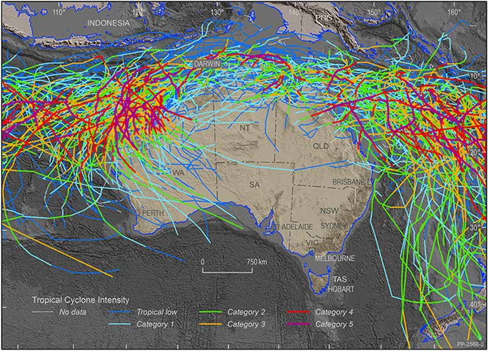

---
## Page 7

   
30° S
25° S
20° S
27° S
PERTH
GERALDTON
CARANARVON
EXMOUTH
KARRATHA
PORT HEDLAND
BROOME
WYNDHAM
KEY
Wind Region B
Wind Region C
Wind Region D
20° S
50km
150km
100km
Wind Region A
05 
WHEN AND WHERE DO CYCLONES OCCUR? 
Wind loading regions 
There are four wind loading regions in WA. Property owners in cyclone specific areas should inspect and maintain 
their properties to help reduce potential damage to both their home and the homes of their neighbours. 
Wind Region C 
Includes Broome, Derby, Wyndham and Denham. 
Buildings in this region should be designed to 
resist a Category 4 cyclone with expected gust 
wind speeds of around 250 km/h. 
Wind Region D 
Includes Port Hedland, Karratha, Onslow, Exmouth 
and Carnarvon. Buildings in this region should be 
designed to resist a Category 5 cyclone with gust 
wind speeds of around 300 km/h. 
Wind Region B 
Includes Geraldton, Mullewa, Marble Bar and 
Kununurra. Generally borders Wind Region C. 
Properties in Wind Region B must therefore be 
designed to resist weakened tropical cyclones. 
Property owners in this area should also inspect 
and maintain their properties. 
Wind Region A 
Areas inland and south of the cyclone wind 
regions can also experience high winds and large 
amounts of rain as a cyclone decays and moves 
inland or further south. 
Figure 2: 
AS/NZS 1170.2 2011 wind loading regions, with key locations marked (after AS/NZS 1170.2,2011) 
SEPTEMBER 2020  |  CYCLONE PREPAREDNESS GUIDE

---
## Page 8

CYCLONE PREPAREDNESS GUIDE   |   SEPTEMBER 2020
 
 
 
 
 
 
 
 
 
 
 
 
 
 
DAMAGE FROM CYCLONES 
Damage from cyclones 
Previous cyclones, including Orson in 1989, Vance and John in 1999, Rosita in 2000, George in 2007, 
Olwyn in 2015 and Damien in 2020 caused significant damage to properties in several towns in North West WA. 
The most common types of damage included: 
• Roofs blown away due to failure of rusted fasteners, connector plates, roof battens and other roof components.
In some cases, houses that had been re-roofed were damaged because either over-battens were removed
and not replaced, or the new tie-downs had inadequate strength.
• Damage to verandahs and roofs caused by failure of rot or termite-affected timber.
• Failure of inadequately secured gutters, flashings, fascia and eaves.
• Wind-driven rain entering buildings through vents, under flashings or through weep holes in windows and glass
sliding doors, causing damage to floors, ceilings, walls and building contents.
• Broken doors and windows caused by wind-borne debris, which can let in more rain and wind.
• Doors and windows blown open due to inadequate fixing to walls or inadequate locks and door sets.
• Garage doors being blown in or out.
• Collapse of unreinforced masonry walls.
• Damage to buildings, fences, pools, patios, carports etc. caused by falling trees or wind-borne debris.
• Property inundation and damage caused by storm tide.
Important 
Buildings that are older (pre-1980s), poorly maintained, or located in exposed positions such as near the top 
of hills, on the beach or next to open land are significantly more likely to experience damage. 
06
06

---
## Page 9

SEPTEMBER 2020    |   CYCLONE PREPAREDNESS GUIDE
 
 
 
 
DAMA
AMAGE FROM CYCLONES
E FROM CYCLONES 
Wind and debris damage to buildings 
Severe winds generated by cyclones can cause structural damage to homes and other buildings. This damage may 
cause injury to occupants and place other members of the community at risk because the debris picked up by the 
wind can damage other buildings. 
Figure 3: 
Damage to a building during a previous  
tropical cyclone. 
Wind damage to your property will expose 
occupants to wind, rain and risk of injury  
from debris. Take shelter in the small rooms  
of the building. 
Damage from wind-driven rain 
Even if there is no structural or debris damage to your roof or external walls, wind-driven rainwater can cause 
significant damage to ceilings, internal walls, carpets, furniture and belongings. Strong winds can drive large 
volumes of water into your property during a cyclone through: 
• Weep holes (drainage slots at the bottom of frames) or seals in windows and glass sliding doors
• Roof vents
• Holes, cracks, gaps or wherever a pipe or cable pierces the wall or roof
• Flashings
Figure 4: 
Water damage caused by wind-driven rain. 
Strong winds will drive rain into buildings.  
There is a risk that wind-borne debris could 
break the glass and cause severe injuries. 
Stay away from windows and glass doors  
during a cyclone. 
07
07

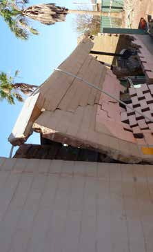

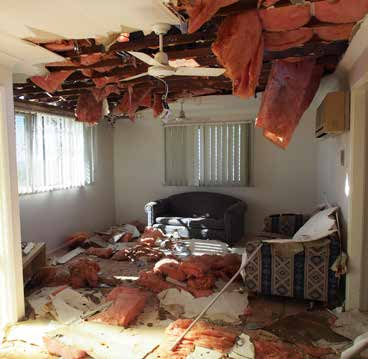

---
## Page 10

08 
CYCLONE PREPAREDNESS GUIDE   |   SEPTEMBER 2020
DAMAGE FROM CYCLONES 
Damage from storm tides and storm surge 
Storm tides are abnormally high sea levels that result from the combination of normal (astronomical) tide levels 
and the storm surge height. If the water level rises high enough that it floods infrastructure and buildings, it can 
cause significant damage and risk to life. Buildings close to the sea front can be damaged by waves and debris 
such as rocks, damaged building material, trees, furniture and even cars that can be swept along by the storm 
tide. Storm tides can also erode soil and expose building foundations. Inundation by salt water can also cause 
buildings and infrastructure to corrode more quickly than they otherwise would have, which can have longer-term 
social and economic consequences. 
Figure 5: 
Scour damage to a road from storm surge. 
Few buildings can withstand the effects of 
storm surge, so do not stay in your property 
during a cyclone if it is in a storm surge  
area. Roads may become impassable when  
the seawater rises, so relocate before the  
cyclone arrives. 
Check and maintain your property 
It is important that you regularly inspect, maintain and repair your property to help protect people sheltering in 
it during a cyclone. This is just as important as servicing your car. Many building materials deteriorate over time; 
steel elements and reinforcement in concrete can corrode, and rot or termites can affect timber. The rate of 
deterioration will vary depending on factors such as the property’s age; distance to the sea; exposure to other 
hazards such as earthquakes or flash flooding; and types of materials used. Even a building originally constructed 
according to building code requirements will need regular inspection and maintenance. 
Regular inspection and maintenance will help minimise the chance that damaged parts of your property  
become wind-borne debris that could damage someone else’s property, or seriously injure or even kill someone. 
You always need to have your property cyclone-ready. It will be too late to undertake work to your property as  
a cyclone is approaching. 
Important 
A thorough inspection and maintenance of key structural elements by a building professional should be 
undertaken for all properties: 
• after any cyclone or other hazard, such as an earthquake, that has damaged buildings in your  
community; or 
• whenever the roofing is removed (e.g. for replacement of roof sheeting). This is especially important if 
heavy roof materials are replaced with lighter materials; or 
• every seven to ten years.

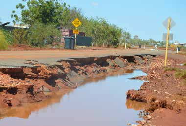

---
## Page 11

SEPTEMBER 2020    |   CYCLONE PREPAREDNESS GUIDE
09 
CHECK AND MAINTAIN YOUR PROPERTY 
Rust 
Check for signs of rust around your property. Check the outside of the roofing for signs of corrosion of fasteners 
or the roof cladding, especially at the laps of adjoining sheets. Look inside the roof space for rust on metal roof 
coverings, metal battens, batten straps, fixing bolts, fixing plates, screws, nails, etc. Properties close to the coast 
are at higher risk of corrosion. Corrosion resistant fixings such as heavily galvanized steel or stainless steel need 
to be used and installed in accordance with manufacturer’s specifications. Check if metal components are showing 
signs of rust. These may need to be replaced. 
Figure 6: 
Roof failure occurred due to 
corroded roofing fasteners. 
Figure 7: 
Signs of rust at the bottom of  
a verandah post. 
Important 
Buildings with corrosion in roof fasteners, verandah posts or other building components are at greater risk  
of damage in cyclones.

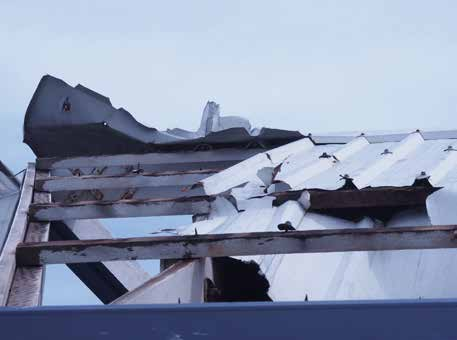

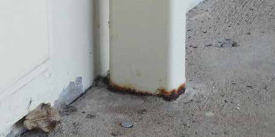

---
## Page 12

10
CYCLONE PREPAREDNESS GUIDE   |   SEPTEMBER 2020
CHECK AND MAINTAIN YOUR PROPERTY
Rot in timber
Timber can rot over time. There is a higher risk of timber rotting if it is often exposed to moisture, for example 
from a leaking gutter or water pipe. Rotten timber should be replaced.
Figure 8: 
Timber rot in a rafter. 
Termites
Termites are particularly active in the cyclone regions of WA. Timber and their termite protection systems should 
be regularly inspected and maintained to ensure they provide an effective barrier to termite attack. If termites 
have been detected in your property, seek expert advice on replacing the timber and restoring the termite 
management system.
Figure 9: 
Termite damage to roof timbers.

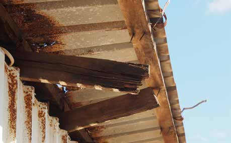

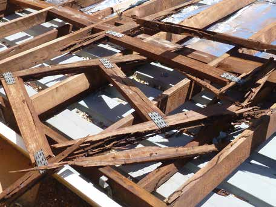

---
## Page 13

11
SEPTEMBER 2020    |   CYCLONE PREPAREDNESS GUIDE
CHECK AND MAINTAIN YOUR PROPERTY
Loose fittings
Alternating wet and dry seasons in cyclone areas can cause some structural components to shrink or expand,  
and some connections to become loose. Previous cyclones may also have loosened structural components. 
Thoroughly check for any loose fasteners and re-tighten them where possible, or install extra connections.
Figure 10: 
Loose fixings resulting from  
a previous cyclone.
Important
• Engage a qualified building practitioner such as a suitably qualified structural engineer, registered 
building surveyor, or registered builder to inspect your property and advise whether it has suitable 
structural details. 
• The Cyclone Testing Station has produced several useful videos on building, maintaining and upgrading 
properties in cyclone areas: jcu.edu.au/cyclone-testing-station/videos-And-resources/for-the-home-
owner-And-occupier
Check and upgrade your property
You can minimise the risk of cyclone damage to your property by upgrading key areas where wind and rainwater 
can cause damage, and by identifying any potential hazards around your property. These critical areas include the 
roof, doors and windows, garage doors, roof eaves, attachments to your buildings (e.g. verandahs and carports) 
and equipment including satellite dishes, aerials and solar panels. A building professional will evaluate the wind 
loads on your property using the appropriate Australian Standards, which will give wind pressures or a wind 
classification appropriate to your location. These will be used to determine the details and products required  
to upgrade your property.
Roof
The roof is the most vulnerable part of a building during a cyclone because it is subjected to strong uplift forces. 
The size of these forces is influenced by many factors, including the shape of the roof; for example, a building with 
a near flat roof is subjected to larger uplift forces than one with a hip roof. The uplift forces near the edges and 
ridges of roofs are higher, so connections in these areas need to be even stronger.

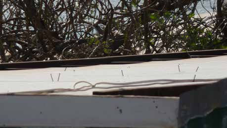

---
## Page 14

12
CYCLONE PREPAREDNESS GUIDE   |   SEPTEMBER 2020
CHECK AND UPGRADE YOUR PROPERTY
Important
The roofs of more recently constructed buildings should also be checked if a cyclone has caused damage  
to other buildings in the area; there could be damage to the internal roof structure that is not obvious  
from the outside.
Some properties built before the mid-1980s might not be constructed to current building standards; the 
connections and materials might not be strong enough to resist cyclonic winds. Roof battens that are poorly 
connected to rafters or trusses are a common weakness in older buildings.
Figure 11: 
Roof failure following a cyclone.
Older properties are particularly 
vulnerable to damage.
If you are reroofing your building, 
also check the roof structure and 
tie- downs.
Recommendations
The roof cladding and the roof structure underneath may need to be  
upgraded to meet current building standards.
Roof Cladding
Metal roofs must be fixed to battens with the 
correct type of screws and washers and at the 
spacings recommended by manufacturers. 
Every tile, including ridge capping in tiled 
roofs must be secured to the battens with the 
correctly rated clips or fixings.
Roof battens
Must be securely fixed to the rafters or trusses 
with the appropriate type, size and number 
of connectors (screws, or straps with correct 
nails).
Trusses or 
rafters
Must be the correct size, installed at the 
correct spacing and securely tied down to 
the top of the walls using appropriate details. 
Girder trusses (large trusses that support 
smaller trusses) require even stronger tie 
downs than regular trusses.

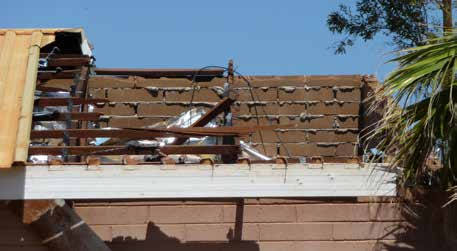

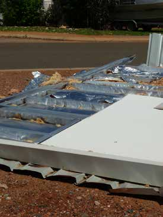

---
## Page 15

13
SEPTEMBER 2020    |   CYCLONE PREPAREDNESS GUIDE
CHECK AND UPGRADE YOUR PROPERTY
Doors and windows
Doors and windows are vulnerable to damage from wind forces and wind-borne debris. Strong winds entering 
your property through damaged windows or doors can cause high internal pressures inside the building, which 
can increase the risk of your roof blowing off. Large volumes of wind-driven rain can also enter through damaged 
doors and windows.
All glass needs to be the correct thickness and type for the wind classification of your property. Confirm with your 
builder that all window assemblies comply with Australian Standards, have the correct wind classification, and are 
securely fastened to the building structure.
Figure 12:
Wind-driven rain entering a property via the 
windows. 
You can help minimise the amount of wind-driven 
rain entering your property through doors and 
windows by replacing any worn or damaged 
window or door seals. Sealing the gaps under 
doors will also help minimise the amount of 
rainwater entering your property during  
a cyclone.
Recommendations 
• Ensure windows and doors are securely fixed to 
frames and walls: awa.org.au/resources/agwa- 
guide-series
• Ensure the hinges and latches on doors 
(particularly double doors) are large and strong 
enough to cope with strong winds.
• Protect windows and doors from wind-borne  
debris by installing either temporary or permanent 
impact-resistant screens1 or shutters2.
1    Cyclone shutters are plates of metal or plywood that are mounted in front of windows and doors that can protect them from wind-borne debris and reduce the amount 
of wind-driven rain entering. Temporary shutters can be as simple as sheets of plywood securely fastened across windows.  
2  Debris screens are open and grid-like. When fitted on windows and glass doors they can absorb the impact of debris and reduce the chances of glass breaking but won’t 
reduce the amount of rainwater entering your property. Debris screens can be permanently fixed and may double as security screens or can be temporary and need to be 
fitted before each cyclone.
Notes

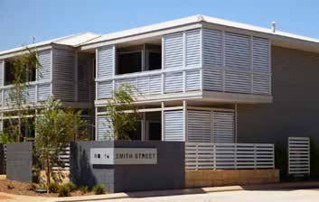

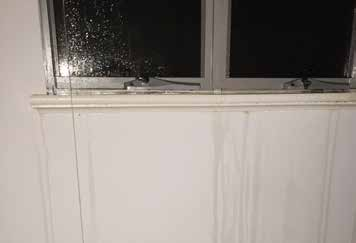

---
## Page 16

14
CYCLONE PREPAREDNESS GUIDE   |   SEPTEMBER 2020
CHECK AND UPGRADE YOUR PROPERTY
Important
Products that have a debris rating have been tested to demonstrate their effectiveness against small or 
medium-sized debris.
Garage doors
Some garage doors can be pushed in or sucked out by strong winds. Damage to garage doors can let wind inside 
the property and increase the pressure on the underside of the ceiling and roof and lead to damage or loss of 
parts of the roof.
Recommendations
• Install garage doors that are adequately wind 
and debris rated (all new garage doors in cyclone 
regions must comply with AS/NZS 4505). In some 
cases, garage walls may need to be strengthened 
at the same time as the door is upgraded.
• Purchase a temporary bracing system that can 
be installed to support your garage door against 
inward or outward pressures as part of the 
preparation for an approaching cyclone.
Gutters and downpipes
Blocked, damaged or leaking gutters can lead to large volumes of rainwater entering a building during a cyclone. 
This can cause damage to ceilings, walls and personal belongings. Even gutters in good condition can be damaged 
if they are not securely fastened to the roof. Damaged gutters can also become wind-borne debris. The cost of 
repairing the guttering can be substantial if scaffolding is required.
Recommendations
• Clean gutters and downpipes regularly to prevent them from becoming blocked – this will enable water to 
drain away as quickly as possible during a cyclone.
• Repair or replace leaking gutters.
• Make sure gutters are securely fastened – install extra gutter clips if necessary.

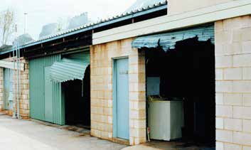

---
## Page 17

15
SEPTEMBER 2020    |   CYCLONE PREPAREDNESS GUIDE
CHECK AND UPGRADE YOUR PROPERTY
Flashings
Flashings are thin sheets of metal that keep out water around windows and the edge of roof and wall panels. Wind 
pressure can rip them off if they are not properly fastened. Large amounts of rainwater can be blown into the 
building, damaging ceiling and wall linings.
Recommendations
• Securely fasten all faces of flashing with screws 
(not pop rivets) no more than 500mm apart.
• Check that any gaps between flashings and the 
roof and walls are adequately sealed.
Other items attached to buildings
Porches, verandahs, patios, pergolas, carports and screen enclosures attached to a building can significantly 
increase the wind uplift forces on the building. If they are damaged by strong winds, they could peel back  
the roof of the main part of the building. Aerials, satellite dishes and solar panels that are not fastened  
through the roof cladding to suitable roof structural elements are likely to fail in a cyclone. Damaged building 
additions or attachments can become wind-borne debris that could further damage your property or other 
neighbouring properties. 
Recommendations
• Engage a qualified building practitioner to check the connections between these structures and the main 
building and upgrade them if necessary.
• Check that the structures and connections, particularly those at the base of columns, are in good condition.
• Fasten aerials, satellite dishes and solar panels to the roof structure through the roof cladding.

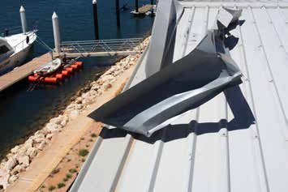

---
## Page 18

16
CYCLONE PREPAREDNESS GUIDE   |   SEPTEMBER 2020
CHECK AND UPGRADE YOUR PROPERTY
Other items on and around your property
Recommendations
Fencing
It is difficult to design fencing that can 
resist wind loads. 
• The base of any fence posts can be designed to ensure they 
remain attached to the footings, even if they fail. In these cases, 
if your fence is blown over, it will not become wind-borne debris 
causing further damage to your property. 
• Wind forces on open mesh fencing are significantly lower than 
on paling or sheet fences.
Sheds
Sheds are light and often become  
wind-borne during cyclones if they  
are not adequately anchored to  
the ground.
• Install ground anchors beside sheds so that cables or slings 
can be fitted over the shed as part of the preparation for an 
approaching cyclone.
• For more information on how to make sheds resilient to cyclonic 
winds visit: shedsafe.com.au
Boats and caravans
Boats and caravans can be picked up  
by the wind, overturned or smashed  
into nearby buildings.
• Store boats and caravans under cover if possible or install 
ground anchors so that cables or slings can be fitted over  
the boat or caravan as part of the preparation for an 
approaching cyclone.
Trees
Trees can be blown over and fall  
on roofs, or branches can become  
wind-borne debris that can break 
windows or damage roof and  
wall cladding.
• Trim trees and branches that hang over your roof and remove 
loose or weak branches from any trees on your property.

---
## Page 19

17
SEPTEMBER 2020    |   CYCLONE PREPAREDNESS GUIDE
CHOOSE A SAFE PLACE TO SHELTER
Choose a safe place to shelter
As part of your preparation for the cyclone season, decide whether you will feel safe sheltering in your property 
during the cyclone or whether you need to go elsewhere. Consider the possibility that you may need to remain in 
the building for several days after the cyclone has passed. 
• Inspect, maintain, and upgrade the key areas of your property if necessary. Engage a building professional to 
provide advice and undertake any work required to ensure your property is safe to shelter in during a cyclone.
• If you are in a storm tide prone area, you will need to relocate to a safer place BEFORE the cyclone arrives. 
Prepare a cyclone plan. It will help you decide, what to do, when to go and where to relocate to.
• You should also find a safer place to shelter if you DO NOT have confidence that your property will resist the 
expected winds.
• If you choose not to relocate, you will need to decide where you will take shelter during a cyclone. This should 
be a secure part of the building; in a small room with small windows such as the bathroom, or a small room or 
hallway in the middle of your building.
• Also consider making your bathroom a ‘strong room’ in which your family can safely shelter during a cyclone by 
installing a ‘strong door’ that is slid across to reinforce the standard door, reinforcing the walls and ceiling with 
plywood or metal to make it resistant to damage from debris and wind forces.
Important
There is no such thing as a cyclone-proof property. However, if you understand the effect of strong winds on 
your property and plan ahead to maintain and protect it, you can reduce the likelihood of it being damaged 
in a cyclone and keep your property and occupants safe.

---
## Page 20

18
CYCLONE PREPAREDNESS GUIDE   |   SEPTEMBER 2020
FURTHER INFORMATION
Further information
For more information on cyclones, cyclone preparedness and ways to protect your property, please visit your local 
council and the following websites: 
• Department of WA Fire and Emergency Services: dfes.wa.gov.au/cyclone
• Cyclone Testing Station: jcu.edu.au/cyclone-testing-station
• Bureau of Meteorology: bom.gov.au/cyclone
• Department of Mines, Industry Regulation and Safety: https://www.commerce.wa.gov.au/building-and-energy/
building-or-renovating-your-home (other relevant publications available soon) 
• Geoscience Australia: ga.gov.au/scientific-topics/community-safety/severe-wind
• Reports on damage investigations: jcu.edu.au/cyclone-testing-station/research/reports/technical-reports
• Videos for homeowners and builders: jcu.edu.au/cyclone-testing-station/videos
• Local councils – storm tide maps
For up-to-date information during a cyclone:
Emergency WA Website: emergency.wa.gov.au
Local ABC Radio
DFES Public Information Line: 13 DFES (13 33 37)
DFES Facebook page: facebook.com/dfeswa
DFES twitter feed: twitter.com/dfes_wa
Bureau of Meteorology Cyclone Warning Line: 1300 659 210
Road Closures: 138 138

---
## Page 21

19
SEPTEMBER 2020    |   CYCLONE PREPAREDNESS GUIDE
APPENDIX A: INSPECTION AND MAINTENANCE CHECKLIST
  
Roofs
Completed 
Sheet metal roofing and fasteners are in good condition.
Roof tiles are in good condition i.e. not broken, dislodged or missing.  
Mortar between tiles is in good condition i.e. not missing or broken, especially at ridges and 
hips or along the edges of the roof. Tile tie down clips are not missing.
Roof sarking membrane is in good condition.
There are no signs of corrosion in any metal components including nails and screws.
There are no signs of rot or termite activity in any timber components.
All connections are tight.
Gaps and/or cracks around the dryer, bathroom and range hood vents have been sealed.
If a building professional has not recently checked your roof, engage one to check that:
Battens are securely fixed to the rafters or trusses with connections that are appropriate 
for the wind classification of your property.
Connectors holding down the trusses/rafters to the walls are the appropriate size  
and in good condition.
Appendix A: Inspection and Maintenance Checklist
As the property owner, it is your responsibility to help minimise damage to your property during a cyclone 
by inspecting your property annually, before the cyclone season and after a cyclone. If you have any  
doubts about the condition of your property, contact a qualified building practitioner to have your property  
professionally inspected.  
 
The following is a list of items on your property that should be checked regularly and repaired or replaced  
as necessary.

---
## Page 22

20
CYCLONE PREPAREDNESS GUIDE   |   SEPTEMBER 2020
APPENDIX A: INSPECTION AND MAINTENANCE CHECKLIST
Doors and windows
Completed  
Window and door seals are in good condition.
Any gaps around windows or door frames have been sealed.
If a building professional has not recently checked your doors and windows, engage one to check that:
Entry doors have locks and hinges to resist the wind pressure.
Sliding glass doors and windows are correctly rated for the wind classification or  
pressure at your particular location.
Window and door frames are securely fixed to the building structure.
Garage doors
Completed  
The garage door complies with AS/NZS 4505 and is correctly rated to resist wind  
pressure or has a bracing system that can be installed as part of the preparation for  
an approaching cyclone.

---
## Page 23

21
SEPTEMBER 2020    |   CYCLONE PREPAREDNESS GUIDE
APPENDIX A: INSPECTION AND MAINTENANCE CHECKLIST
Other items on your property
Completed  
Freestanding carports, pergolas and patios are in good condition and well secured  
to the ground.
Carports, verandahs or patios attached to buildings are in good condition and are well 
secured to the building and to the ground.
The pool fence is securely attached to the ground and/or wall.
Roof attachments such as air conditioning compressor units, satellite dish antennas, 
outdoor hot water tanks, hot water or solar panels are securely  fastened  to  structural  
roof members and there are no signs of deterioration.
Sheds have appropriate anchorage to the ground.
The fence is in good condition i.e. there is no corrosion in metal, rot in timber, and no loose 
fasteners, etc.
If a building professional has not recently checked the following items, engage one to check that:
Carports, verandahs or patios attached to buildings are strong enough to carry wind loads 
to the ground without endangering your buildings.
All roof attachments are secured to the roof structure (not the roof cladding only).

---
## Page 24

22
CYCLONE PREPAREDNESS GUIDE   |   SEPTEMBER 2020
APPENDIX A: INSPECTION AND MAINTENANCE CHECKLIST
Additional recommended actions for properties in storm-tide prone areas
Completed  
Consider replacing carpet or timber flooring in ground level storeys with tiles.
Consider relocating circuit breakers, electrical junction boxes, air conditioners, and power 
points to well above storm tide level.
Use corrosion resistant connections such as stainless-steel fittings and connections.  
Any existing galvanised connections that have changed colour to red or brown need  
to be replaced.
Consider replacing less resilient materials below the storm tide level with more resilient 
materials that can cope with flooding and wave action.
Protect the edge of concrete slabs and posts to prevent erosion. This can be achieved 
by placing extra concrete in critical locations. (In some cases, this can be achieved using 
grout injection by suitably qualified professionals i.e. geotechnical engineer.)

---
## Page 25

23
SEPTEMBER 2020    |   CYCLONE PREPAREDNESS GUIDE
APPENDIX B: CHECKLIST TO PREPARE YOUR PROPERTY
Completed  
Fit temporary debris shutters or screens.
Clean out gutters and downpipes.
Take down shade sails.
Securely store or tie down all loose items such as outdoor furniture, trampolines, toys, 
garden pots, etc.
Move caravans and boats under cover or securely anchor to the ground.
Put heavy duty close-fitting plastic bags over old style single-unit wall or window-mounted 
air conditioners and whirly birds. Cover any gable vents.
Decide on a strong small room to shelter in.
Be prepared for all persons who ‘shelter in place’ to survive independently for several days 
following a cyclone impact.
Prepare a cyclone emergency kit and make sure all occupants know where it’s stored.
Appendix B: Checklist to Prepare your Property
For more information, visit dfes.wa.gov.au/cyclone
If you live in a storm tide prone area
Completed  
Make plans to relocate early.
Identify which indoor items you will need to raise or relocate to a higher property.
Store all poisons well above ground level.

---
## Page 26

24
CYCLONE PREPAREDNESS GUIDE   |   SEPTEMBER 2020
APPENDIX B: CHECKLIST TO PREPARE YOUR PROPERTY
Myth Busters
Myth
Busted
Tape an ‘X’ on your window
Taping an ‘X’ on your window won’t prevent them from breaking.  
Taping a sheet of plastic inside the frame to reduce water entry is a 
better use of the tape.
Open windows on the lee side and 
close them on the windward side of 
the property
This means that you are continually monitoring the wind direction 
(wind direction will change during the cyclone) and moving around 
your property during the cyclone instead of sheltering in a small room 
– you are risking injury if debris breaks a door or window and you are 
near it at the time.
Debris screens are only needed  
on the side of the property facing 
the ocean
The wind direction will change during the cyclone, so debris screens 
should be installed on all windows.
Whirly birds will keep your roof on
Whirly birds can be damaged by wind or debris and allow both wind 
and water into your roof.
Mopping up rainwater as it comes 
through doors and windows will 
prevent damage to floors, walls  
and ceilings
Water comes through the same windows or doors that would be hit by 
debris, so you are risking injury if debris breaks a door or window and 
you are near it at the time. Other rainwater may accumulate above 
ceilings, behind walls and in other places you are unable to access, 
which will cause damage anyway.

---
## Page 27

---
## Page 28

20 Stockton Bend Cockburn Central WA6164 
T: +61 8 9395 9300 
E: dfes@dfes.wa.gov.au 
ABN: 39 563 851 304  
dfes.wa.gov.au/cyclone

