# Western Australia Natural Hazards Risk Profile (2017)

> **Source**: WA SEMC
> **URL**: https://semc.wa.gov.au/capability-and-preparedness/reports-and-reviews/Documents/WesternAustraliaNaturalHazardsRiskProfile2017.pdf
> **Licence**: © Government of Western Australia; emergency-management practitioner reference
> **Retrieved**: 2026-05-07T23:43:03Z
> **SHA-256**: `b9ba0ffe7f8257c4c23dab69989340ee732e9fba94ede818c2aa8c267e5bcf17`
> **Archived copy**: Internet Archive Wayback Machine — `https://web.archive.org/web/20220710065525id_/https://semc.wa.gov.au/capability-and-preparedness/reports-and-reviews/Documents/WesternAustraliaNaturalHazardsRiskProfile2017.pdf`
> *(Live publisher URL no longer resolves; this archived snapshot was used for ingest. Cite the publisher URL above.)*
> *Converted from PDF to Markdown format.*

---
## Page 1

 
 
 
 
 
 
 
 
 
 
 
 
 
 
 
 
 
 
 
 
 
 
 
 
Western Australia’s Natural 
Hazards Risk Profile 2017

---
## Page 2

2 
 
Executive Summary 
This document follows on from the initial assessment of Western Australia’s seven 
sudden onset natural hazards in 2013. This iteration fulfils the State’s obligations 
under the National Partnership Agreement (NPA) on Natural Disaster Resilience and 
presents the results of the updated state-level risk assessment of its natural hazards 
– bushfire, cyclone, earthquake, heatwave, flood, storm, and tsunami. 
In 2013, the SEMC coordinated the first risk assessment workshop series to analyse 
the risks from these same hazards using the 2010 National Emergency Risk 
Assessment Guidelines (NERAG). While there are some similarities, the results of 
the two series vary. These variances are primarily due to the different criteria and 
methodology used, and notably, a greater maturity of our understanding of risk.  
Among the high risks that have remained constant across the two assessments are 
the impact of heatwave to people’s health and the effect of flooding on the state’s 
economy. Widespread flooding is expected to result in longer-term disruption to 
transport networks and resource sector operations, potentially slowing the State’s 
productive capacity. 
Workshops with stakeholders were held in May and June 2017 to determine the risks 
posed to the state’s economy, its people, public administration, environment and 
community. The approach used credible worst case scenarios and follows the ISO 
31000:2009 standard and the methodology outlined in the NERAG 2015.  
A total of 435 risks were assessed for the seven hazards. Of the risk statements 
assessed, there are no extreme risks, 4.6% are high, 18.9% are medium, 50.3% are 
low and 26.2% are very low. The bushfire, heatwave and storm scenarios are 
dominated by low risks and cyclone and tsunami by low and very low risks. While the 
majority (50.5%) of the risks have been assessed as low, each hazard does have 
some high risks, with earthquake and flood having the greatest number. 
Of the 20 high risks identified, there are nine statements (2% of all statements) that 
have catastrophic consequences which relate to the earthquake, storm and tsunami 
scenarios. These are consequences that have the potential to strain or outstrip the 
State’s resources. Table 1 lists these 20 statements, their consequence and the area 
that they impact. The hazard with the greatest number of high risks (6), all having 
catastrophic consequences, is earthquake. 
The results have been analysed and themed across nine different facets: agency 
core service delivery; agriculture; built environment; business and industry; 
community wellbeing; environment; health; transport and utilities.  
Agriculture, community wellbeing and environment risks were assessed as low and 
very low, with a few medium risks. In most cases, it was expected that the likely

---
## Page 3

3 
 
impacts would be localised or that existing resources would be sufficient to return the 
community to normal.  
The highest risks for transportation come from the damage to aviation infrastructure 
from the storm scenario and the disruption to transportation routes from the flood 
scenario. No hazard scenarios were assessed as posing an extreme or high risk to 
utilities. Power supply infrastructure and services are most at risk of all of the utilities.  
The greatest risks to government services stem from the bushfire, earthquake and 
flood scenarios. The impact to Department of Fire and Emergency Services (DFES) 
and Parks and Wildlife (P&W) from the bushfire scenario could result in these 
agencies having to temporarily halt some core services, with the majority of their 
organisations focused on responding to the event. The volume of displacement 
anticipated in the earthquake scenario would result in the Department for Child 
Protection and Family Support (CPFS), who are responsible for welfare support, 
being unable to deliver their core services in the short to midterm when dealing with 
the anticipated volume of displacement expected. A critical issue would be the 
sourcing of appropriate evacuation centres. The impact on local governments from 
state wide flooding was assessed as a high risk as their ability to maintain core 
services would be severely reduced due to the focus on recovery.  
The highest risks to the built environment are expected to come from the earthquake 
and tsunami scenarios. The earthquake is likely to cause catastrophic damage to 
private and commercial buildings. Modelling by Geoscience Australia indicates the 
potential for 30% of private buildings in the Perth area to sustain moderate to 
complete damage. Similarly, the tsunami scenario is anticipated to cause 
catastrophic impacts to commercial buildings, particularly those associated with 
marinas and ports. High risks to commercial buildings are also expected from the 
storm and flood scenarios from hail damage and inundation ($1 - 10 billion losses).  
The greatest risks to people’s health are from the deaths, injuries and illnesses 
directly attributable to the hazard scenarios. All seven natural hazards have the 
potential to result in deaths, with earthquake, heatwave and tsunami anticipated to 
lead to the greatest number of deaths. The earthquake scenario could result in 
catastrophic consequences, estimated as having a 50% chance of at least 263 
deaths. Heatwave and tsunami were expected to result in at least 27 deaths.  
The greatest impacts to commercial activities stem from the earthquake, flood and 
tsunami scenarios. Earthquake and tsunami scenarios were assessed to have 
catastrophic economic consequences for the state of greater than $9.5 billion in 
losses. As a result of the earthquake, damaged buildings that contained asbestos or 
buildings that could collapse, would likely have a cordon around them for health and 
safety reasons. These cordons could restrict access to nearby businesses impacting 
commercial activities. The tsunami scenario would result in a number of businesses 
along the whole WA coastline requiring remediation of building interiors, during which

---
## Page 4

4 
 
they would likely need to close. Impacts to the mining industry from the cyclone 
scenario were assessed as a high risk, with losses stemming from the costs 
associated with ships remaining anchored offshore during the event and the need to 
evacuate approximately 1500 people from Barrow Island. 
As our collective understanding of risk has improved over the last four years, the 
2017 assessments provide a substantially more robust and advanced picture of the 
State’s risk profile than the 2013 assessment. Changes in the workshop format and 
methodology have provided a balanced view of risk. Combined with a greater 
appreciation of the scale of the assessment, this has changed is how the impacts are 
perceived. An additional factor may be that there have been a few relatively large 
emergency events in WA in the last four years, which have shown that the credible 
worst-case scenarios are, in fact, credible.

---
## Page 5

5 
 
Hazard 
Risk Statement* 
Impact Area 
Consequence 
Risk Level 
Confidence Level 
Priority 
Earthquake 
will impact the health of people and cause death(s). 
People 
Catastrophic 
High 
Low 
2 
Earthquake 
will impact the health of people and cause injury and/or serious illness. 
People 
Catastrophic 
High 
High 
3 
Earthquake 
will impact commercial buildings and contents, resulting in financial losses. 
Economy 
Catastrophic 
High 
Moderate 
2 
Earthquake 
will disrupt business activities, resulting in financial losses. 
Economy 
Catastrophic 
High 
Low 
2 
Earthquake 
will impact private buildings and contents, resulting in financial losses. 
Economy 
Catastrophic 
High 
High 
3 
Earthquake 
will impact CPFS, impacting their ability to maintain core services. 
Public Administration 
Catastrophic 
High 
High 
3 
Tsunami 
will impact commercial buildings and contents, resulting in financial losses. 
Economy 
Catastrophic 
High 
Low 
2 
Tsunami 
will disrupt business activities, resulting in financial losses. 
Economy 
Catastrophic 
High 
Lowest 
2 
Storm 
will impact the aviation sector (e.g. damage to infrastructure, disruption to 
services), resulting in recovery costs and/or financial losses. 
Economy 
Catastrophic 
High 
Moderate 
2 
Storm 
will impact commercial buildings and contents, resulting in financial losses. 
Economy 
Major 
High 
Low 
2 
Cyclone 
will impact natural resource industries (mining, oil, gas) infrastructure and/or 
operations, resulting in a lack of production, recovery costs and/or financial 
losses. 
Economy 
Major 
High 
Low 
2 
Bushfire 
will impact DFES services, impacting their ability to maintain core services. 
Public Administration 
Major 
High 
High 
2 
Bushfire 
will impact on Parks & Wildlife services, impacting their ability to maintain core 
services. 
Public Administration 
Major 
High 
High 
2 
Flood 
will impact commercial buildings, contents and services, resulting in financial 
losses. 
Economy 
Major 
High 
Low 
2 
Flood 
will disrupt business activities, resulting in financial losses. 
Economy 
Major 
High 
Low 
2 
Flood 
will disrupt major freight routes, resulting in financial losses. 
Economy 
Major 
High 
High 
3 
Flood 
will impact DFES services, impacting their ability to maintain core services. 
Public Administration 
Major 
High 
Moderate 
2 
Flood 
will require recovery works to be undertaken by Local Governments, impacting 
their ability to deliver core services. 
Public Administration 
Major 
High 
Moderate 
2 
Heatwave 
will impact the health of people and cause injury and/or serious illness. 
People 
Major 
High 
Moderate 
2 
Heatwave 
will impact the health of people and cause death(s). 
People 
Major 
High 
High 
3 
*As the workshops took place before 1 July 2017 when some WA government departments were amalgamated, the agencies are referred to by their name prior to this date.

---
## Page 6

6 
 
1  Introduction 
This report presents Western Australia’s (WA) second iteration of a state-level risk 
assessment of its seven sudden onset natural hazards – storm, earthquake, bushfire, 
tsunami, heatwave, cyclone and flood.  
The risks from these seven hazards have been analysed by their impacts to the state’s 
economy, its people, public administration, the environment and the social setting. The 
approach used follows the ISO 31000:2009 standard and the methodology outlined in the 
National Emergency Risk Assessment Guidelines (NERAG) 2015. 
All hazards were assessed within a workshop setting in Perth (see Table 1 for schedule) and 
used a credible worst-case hazard scenario developed by relevant hazard experts. Credible 
worst-case scenarios are chosen with the rationale that planning and risk reduction activities 
for the largest event will address impacts of smaller events, even if the smaller events are 
more frequent. 
During each workshop relevant experts presented the hazard context, the anticipated 
vulnerabilities and impacts, and described the scenario. Following this, as a group, the 
participants worked through a series of risk statements to estimate the potential 
consequences of the scenario event. Each risk statement describes an impact that is likely 
to eventuate given the scenario and is collectively assigned a likelihood, consequence and 
confidence level using the NERAG 2015 criteria. Discussion was encouraged among 
participants to explore different aspects of the hazards and impacts. Decisions were based 
on group consensus. Risk statements are grouped into five impact areas: economy; people; 
public administration; social setting; and environment with approximately 60 risk statements 
assessed per hazard. Data were captured and analysed following the workshop. The results 
are presented in this report. 
A range of agencies attended the workshops and contributed to the assessment. A list of 
agencies involved can be found in Appendix A. As the workshops took place before 1 July 
2017 when some WA government departments were amalgamated, the agencies are 
referred to by their name prior to this date. 
 
 
Table 1: Dates of risk assessment workshops. 
Hazard 
Date of workshop 
Bushfire  
31 May 2017 
Cyclone  
25 May 2017 
Earthquake  
7 June 2017 
Flood  
9 May 2017 
Heatwave  
23 May 2017 
Storm  
25 May 2017 
Tsunami  
7 June 2017

---
## Page 7

7 
 
2  Hazard scenarios 
The seven credible worst case hazard scenarios (detailed below) used in the assessments 
were developed with the assistance of: 
 
Bureau of Meteorology (BOM) 
 
Department of Fire and Emergency Services (DFES) 
 
Department of Health (DOH) 
 
Department of Parks and Wildlife (P&W) 
 
Department of Water 
 
Geoscience Australia (GA) 
 
Office of Bushfire Risk Management (OBRM) 
 
Office of Emergency Management (OEM) 
 
Water Corporation 
 
Western Power 
 
Bushfire 
The bushfire scenario was developed by DFES, P&W and OBRM and has approximately a 
3.9% chance of occurrence in any given year. 
In February, a number of dry lightning strikes in the south west on a line from Jurien Bay to 
Bremer Bay result in 80-90 fires across the state. Trough movement causes changes in the 
wind direction from north-east to north-west to south-west. On the first day winds and 
thunderstorms are too strong for aviation services to continue for an extended period of time. 
Simultaneous to this event, the Midwest-Gascoyne is experiencing significant flooding. 
Of the multiple ignitions, four fires become significant: 
1. The Hovea fire was ignited by lightning in the John Forrest/Park Road/Hovea area 
(Figure 1). The fire forms a large front across John Forrest National Park towards the 
Great Eastern Highway which is crossed at approximately 8pm on the first day. 
There is a threat to residents in Hovea and National Park users due to the proximity 
of the fires and the single entry/exit roads in the area. The approximate duration of 
the fire is 9-10 days before it is passed back to local government. 
2. The Harvey fire was ignited by lightning north east of the Harris River in the Harris 
River State Forest (Figure 2). The fire moves south and then later east threatening 
Worsley Alumina, Allanson and Collie (including the Muja Power Station). The 
approximate duration of the fire is one week before it is passed back to local 
government. 
3. The Yellowdine Nature Reserve fire north of the Great Eastern Highway near the 
Yellowdine Roadhouse was thought to be ignited by human causes (Figure 3). The 
spread of the fire is slow due to the sparse vegetation; however after 36 hours the 
fire spreads and crosses the Great Eastern Highway and threatens the roadhouse. 
The approximate duration of the fire is up to four weeks before it is handed back to 
local government. 
4. The Leeuwin Ridge fire was ignited by lightning along the coast approximately 10 km 
north of Yallingup (Figure 4). The fire spreads east and south towards Eagle Bay and

---
## Page 8

8 
 
Dunsborough threatening and then impacting these town sites. The approximate 
duration of the fire is 2-4 days before it is passed back to local government. 
 
 
Figure 1: Hovea bushfire fire shape after 24 hours. 
 
Figure 2: Harvey bushfire fire shape after 30 hours.

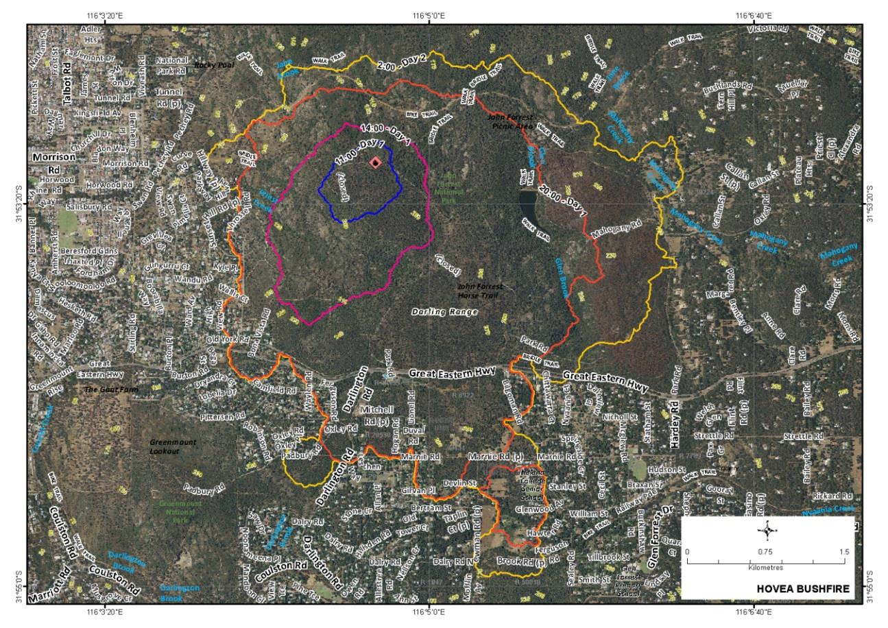

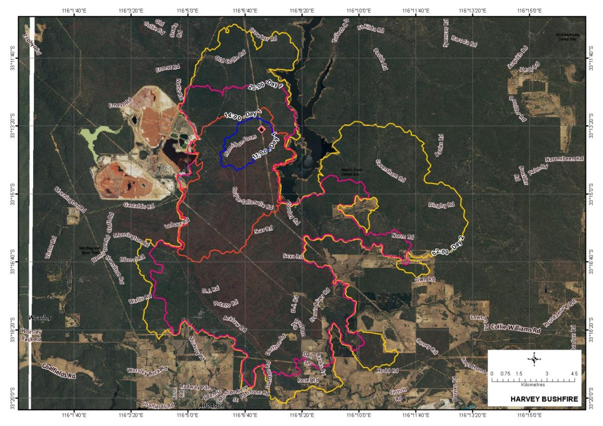

---
## Page 9

9 
 
 
Figure 3: Yellowdine Nature Reserve bushfire fire shape after 36 hours. 
 
Figure 4: Leeuwin Ridge bushfire fire shape after 24 hours.

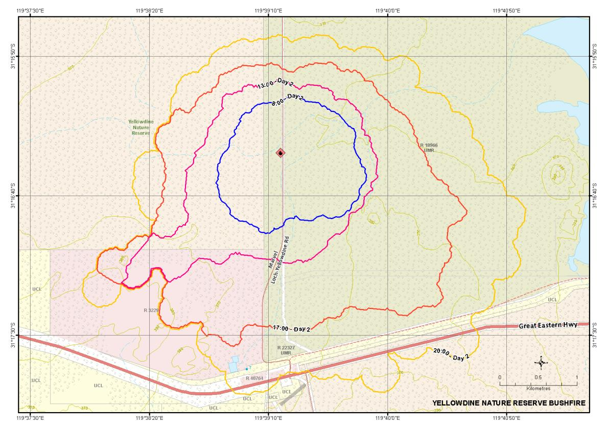

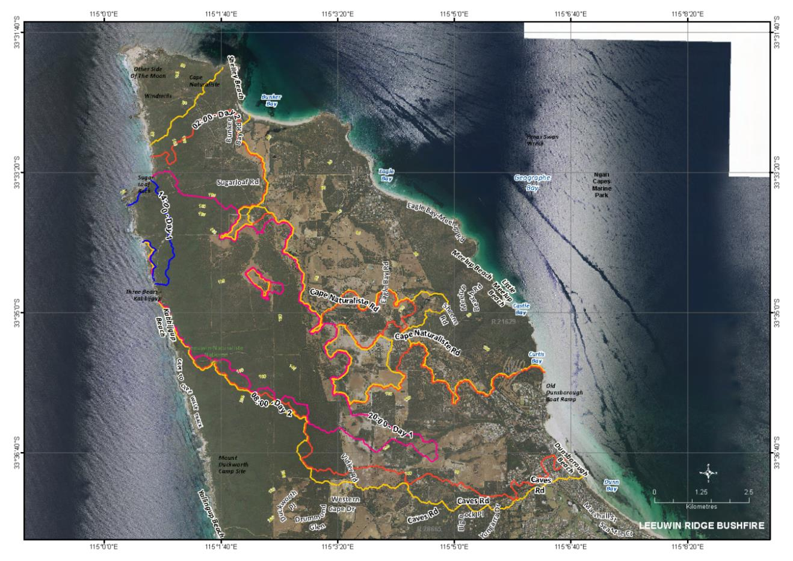

---
## Page 10

10 
 
Cyclone 
The cyclone scenario was developed by BOM and DFES and has approximately a 0.5% 
chance of occurrence in any given year. 
The week before Christmas a tropical low forms off the coast of the Northern Territory and 
increases to cyclone intensity as it tracks down the coast (Figure 5). The system makes 
landfall as a Category 3 cyclone east of Derby, before heading back out to sea.  
 
Figure 5: Track of Severe Tropical Cyclone Emily. 
The system re-energises and reaches Category 5 intensity to the north west of Karratha 
before moving south east to make landfall just west of Karratha on 22 December (Figure 6). 
At Karratha a storm tide of 8.7 m above highest astronomical tide (HAT) is expected. The 
system continues inland weakening to a Category 2 as it passes over Tom Price early on 23 
December. 
 
 
Figure 6: Severe Tropical Cyclone Emily's Track between 22nd and 23rd of December.

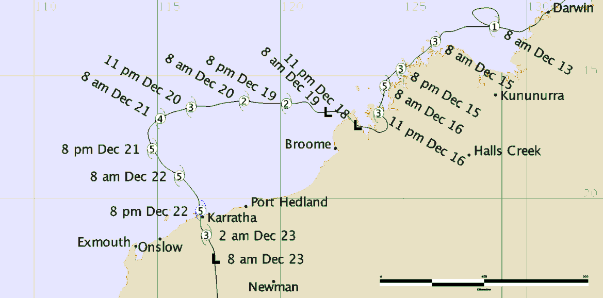

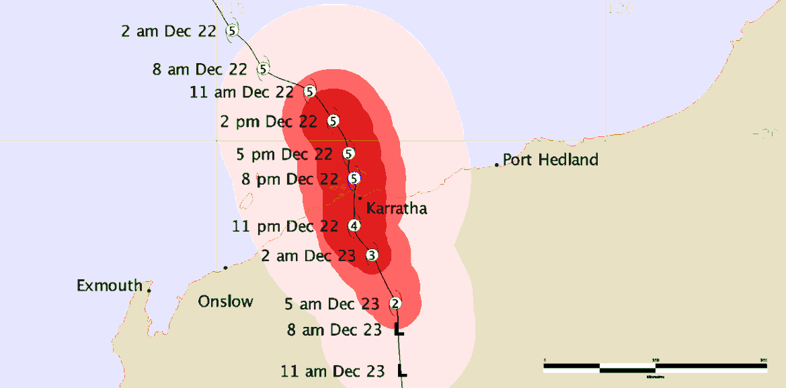

---
## Page 11

11 
 
Earthquake 
The earthquake scenario was developed by Geoscience Australia and has approximately a 
0.04% chance of occurrence in any given year.  
A magnitude 6.4 earthquake occurs at 5pm on a Tuesday in June. The Perth greater 
metropolitan area experiences shaking of 7-7.5 on the Modified Mercalli Intensity scale 
(Figure 7). Shaking lasts approximately 30 seconds. The epicentre is located 25 km west of 
Perth in the Badaminna Fault System at a depth of 10 km. Building losses (Table 2, Figure 
8) and human casualties (Table 3) are anticipated.  
 
Figure 7: Ground shaking (MMI) from a M6.4 earthquake off the coast of Perth. Image supplied by 
Geoscience Australia1. 
                                               
1 Wehner M., Ryu H., Corby N., Robinson D. and Edwards M. 2013. Earthquake Impacts Scenarios for Western 
Australia. Professional Opinion 2013. Geoscience Australia: Canberra.

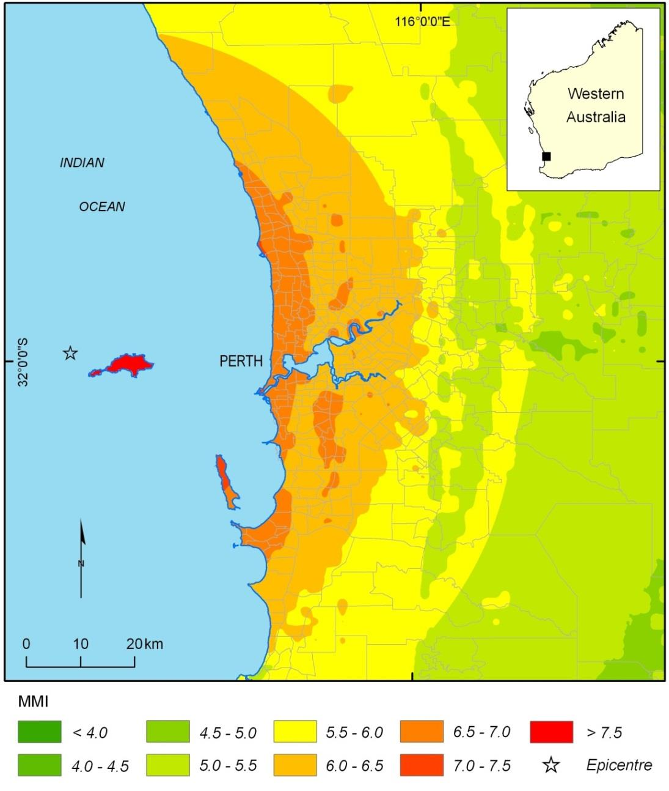

---
## Page 12

12 
 
Table 2: Modified Mercalli Index, examples and expected impacts2. 
MMI 
Example event 
Expected impact 
V 
Kalgoorlie, CBD 
20 April 2010 
Cracking of vulnerable masonry (e.g. parapets & 
chimneys) with minor falls. Minor cracking to masonry 
houses.  
VI 
Boulder CBD 
20 April 2010 
Collapse of vulnerable masonry and severe cracking 
to other masonry structures.  
VII 
Newcastle 
27 December 1989 
Severe damage to URM buildings, some damage to 
housing, damage to low ductility framed buildings, 
particularly irregular buildings with some collapses.  
VIII 
Christchurch 
22 February 2011 
Severe to complete damage to URM buildings, 
severe damage to low ductility buildings.  
IX 
Meckering 
14 October 1968 
Destruction of URM and low ductility framed 
buildings, damage to all other types.  
 
Table 3: Anticipated human casualties for the earthquake scenario based on ATC-13 methodology2. 
 
Table 4: Estimated residential building loss ratio and number of buildings in each damage state for the earthquake 
scenario2. 
 
                                               
2 Wehner M., Ryu H., Corby N., Robinson D. and Edwards M. 2013. Earthquake Impacts Scenarios for Western 
Australia. Professional Opinion 2013. Geoscience Australia: Canberra. 
Minor injuries 
Major Injuries 
Fatalities 
3793 
508 
127 
Mean 
loss 
ratio 
Number of buildings 
Slight 
damage 
Moderate 
damage 
Extensive 
damage 
Complete 
damage 
6.3% 
119 444 
(22.3%) 
82 270 (15.4%) 
59 635 (11.2%) 
39 077 (7.3%)

---
## Page 13

13 
 
 
Figure 8: Average building loss ratio across all building types by suburb for the earthquake scenario. Image supplied 
by Geoscience Australia3. 
 
Flood 
The flood scenario was developed by BOM and has approximately a 0.5% chance of 
occurrence in any given year. 
The flood scenario occurs during late March. In the previous winter (April-November) the 
South West Land Division had an above average rainfall. Catchments recorded 400-600 mm 
of rainfall over this period, filling farm dams and causing minor to moderate flooding 
throughout the winter. Similarly, during the previous summer (December-March) the coastal 
areas of the Pilbara and Gascoyne regions had above average rainfall. Rainfall of 
                                               
3 Wehner M., Ryu H., Corby N., Robinson D. and Edwards M. 2013. Earthquake Impacts Scenarios for Western 
Australia. Professional Opinion 2013. Geoscience Australia: Canberra.

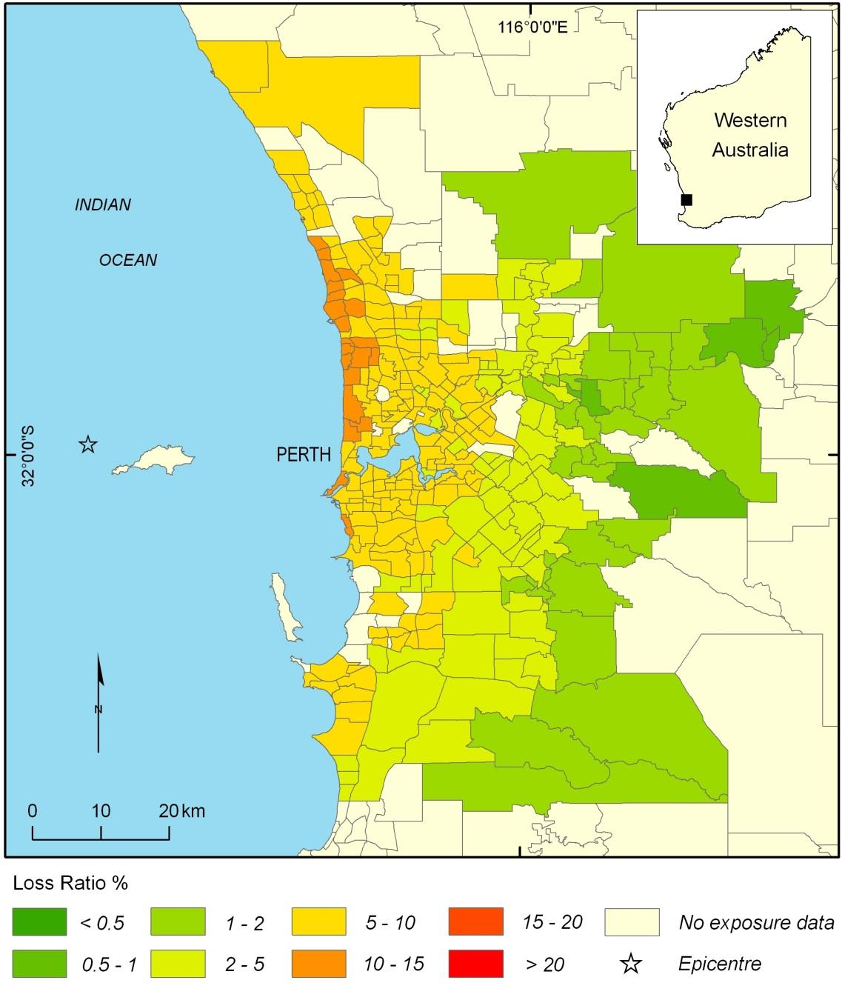

---
## Page 14

14 
 
200-400 mm fell over these districts saturating the soil and causing minor flooding in some 
catchments. 
The flooding scenario resulted from two consecutive tropical cyclones – TC “Alpha” and TC 
“Beta” – crossing the coast two days apart. Both cyclones travel down the coast bringing 
flooding rain to coastal areas of the Gascoyne and Central-West catchments. TC “Alpha” 
makes landfall at Geraldton (Figure 9) and TC “Beta” crosses at Exmouth (Figure 10) before 
tracking inland through the Midwest-Gascoyne, Wheatbelt and into the Southern Goldfield 
districts, bringing heavy rain. 
 
 
Figure 9: Track of Tropical Cyclone "Alpha”.

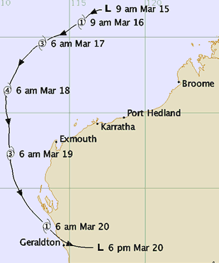

---
## Page 15

15 
 
 
Figure 10: Track of Tropical Cyclone "Beta". 
 
As a result of the two cyclones widespread flooding occurs across the state. The following 
summarises the flooding in various catchments: 
 
Major flooding occurs in the Avon River catchment including the townships of 
Beverley, York, Northam and Toodyay. Areas of York town will be inundated and 
there is a possibility of the banks at Northam overtopping and/or failing. 
 
Major flooding occurs in the Swan River catchment and major flood levels at 
Walyunga, Guildford and Barrack Street Jetty. 
 
Major flooding is expected in the Blackwood catchment at Bridgetown and Nannup 
several days after peaks are observed in Avon and Swan Rivers. 
 
Significant flooding occurs in the Onslow Coastal Rivers catchments resulting in the 
cutting of the North West Coastal Highway. 
 
Major flooding occurs in the Gascoyne River catchment including the township of 
Carnarvon with upstream catchment areas significantly impacted. The Great 
Northern Highway is cut at multiple locations. 
 
Significant overland flooding in the Goldfields district catchment results in major 
infrastructure damage. Significant impacts to East-West rail and road transport 
routes. 
 
Significant overland flooding in the Southern Interior catchments results in major 
infrastructure damage. 
 
Significant overland flooding in the South East Coastal and Eucla District catchments 
results in major infrastructure damage.

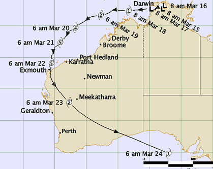

---
## Page 16

16 
 
Heatwave 
The heatwave scenario was developed by BOM and DOH and has approximately a 1% 
chance of occurrence in any given year. 
The state has experienced a mild December and a cool start to January with regular sea 
breezes and maximums in the low 30’s along the coast. On 3 January the wind changes to 
northeasterly and the temperature begins to rise. The northeasterly wind is expected to 
remain for the next seven days. 
Forecasts indicate seven consecutive days in excess of 38°C in the metro area (Figure 11) 
with peak temperature in the mid-40s. Temperatures exceeding 40°C are also expected over 
a wide area from Geraldton to Albany and Esperance (Figure 12). 
On 7 January the temperature reaches 41°C. A failure occurs at the Armadale substation 
leaving 30-40,000 customers without power, including schools and hospitals. The heat is 
also restricting power generation and resulting in vehicle movement bans. The restoration 
time for power is uncertain. 
On 9 January the temperature reaches 46°C. A water main bursts on the corner of Albany 
and Brookton Highways. Smaller water pipes also burst in North Perth and Beeliar. The 
restoration time is uncertain. Power issues in the Armadale area are ongoing.  
 
Figure 11: Temperature profile for the beginning of January at Perth Airport (Temperatures across the 
city and eastern suburbs is likely to be higher) 
The 10 January the temperature peaks at 47°C resulting in disruption to public transport as 
speed restrictions are placed on the rail network. Further water pipes burst in Bentley and 
Yokine. A number of events are expected to take place during this period, including the 
Fringe World Festival, the Perth Scorchers 20/20 and the Hopman Cup.

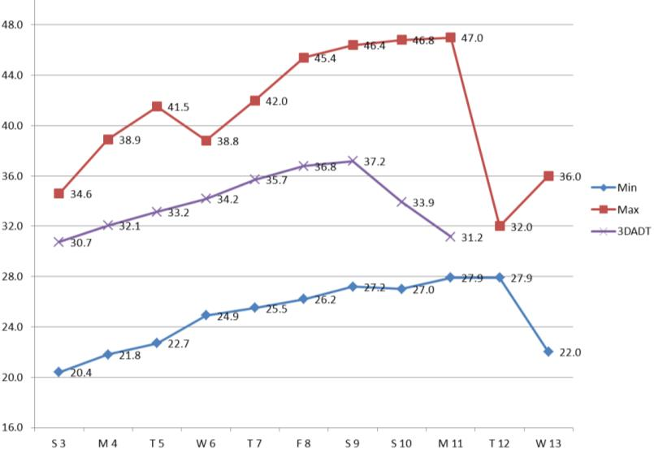

---
## Page 17

17 
 
 
Figure 12: Indicative map of heatwave intensity. 
 
Storm 
The storm scenario was developed by BOM and DFES and has approximately a 1% chance 
of occurrence in any given year. 
Over the Australia Day weekend, the state experiences a number of warm season severe 
thunderstorm cells, which produce heavy rainfall, hail and severe wind gusts in excess of 
125 km/hr (Figure 13). The storm cells develop and weaken over time and at varying rates. 
These changes may lead people to think the storm is over when further cells are yet to pass 
through.  
The day before Australia Day storm cells track over the Midwest and northern Wheatbelt 
(Figure 13).

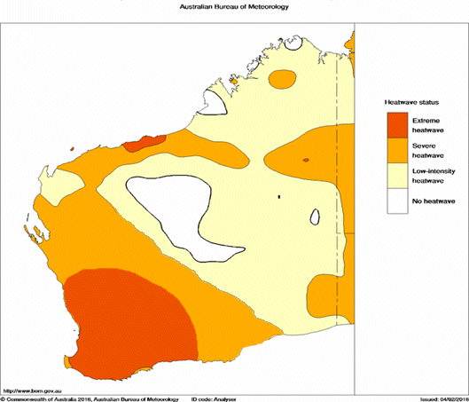

---
## Page 18

18 
 
 
Figure 13: Thunderstorm warning areas for the 25th of January. 
 
Figure 14: Thunderstorm warning areas for the 26th of January. 
On Australia Day storm cells move over the Perth metropolitan area (Figure 14). Cells pass 
over the Perth central business district (CBD), Perth Airport, Perth Hills and Mandurah/Peel 
area. A tornado also touches down in the CBD. 
2 
1
3 
4

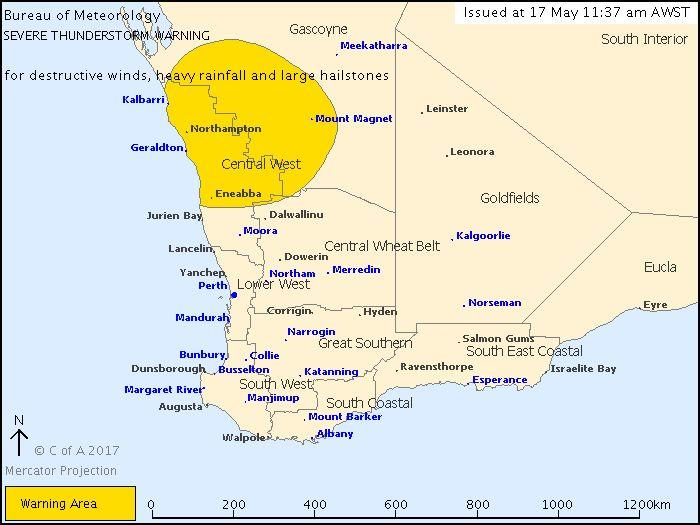

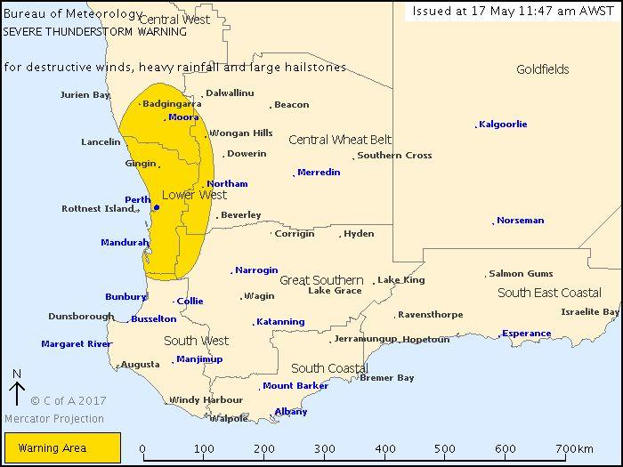

---
## Page 19

19 
 
 
Figure 15: Thunderstorm warning areas for the 27th of January. 
 
The day after Australia Day similar storm cells move over the South and East including the 
Great Southern and parts of the Wheatbelt (Figure 15).  
The storm systems cause widespread power outages for up to four weeks. Significant flash 
flooding causes traffic management and public transport issues and threats to personal 
safety particularly at Australia Day events (e.g. Swan foreshore). Surface flooding along the 
Swan River also occurs from the down-draught of storm cells.  
 
Tsunami 
The tsunami scenario was developed by BOM and DFES and has approximately a 0.01% 
chance of occurrence in any given year.  
It is April school holidays and the Monday after ANZAC weekend. After a front with heavy 
rainfall over the southwest on the previous weekend, it is a lovely sunny day.  
At 5:00am, an earthquake of magnitude 8.5 strikes near Cilicap, Western Java. A tsunami 
watch is issued for Australia indicating a potential tsunami threat for WA. A tsunami warning 
is then issued for WA (Wallal to Kalbarri) for threat to the marine environment. The expected 
tsunami arrival time is 9:15am at Carnarvon and 9:45am at Port Hedland.

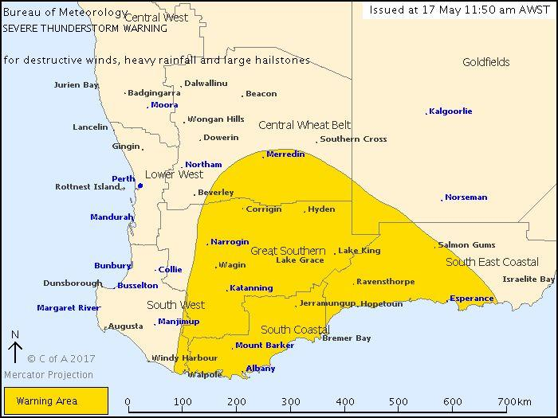

---
## Page 20

20 
 
A little while later, the magnitude of the earthquake is upgraded to 9.3. A revised tsunami 
warning is issued for WA with the threat is upgraded to include land inundation (Figure 16; 
Figure 17). 
 
Figure 16: Indication of wave energy and wave distribution from the tsunami. Scale is indicative of wave 
height (in cm) in deep water. Image supplied by BOM WA. 
 
The West Australian coast from the Northern Territory to Bremer Bay is expected to be 
affected with estimated times of arrival between 8:45 and 9:45am (Table 5). 
Table 5: Estimated time of arrival for the tsunami scenario. 
Area 
Estimated time of arrival of first wave 
Lancelin/Jurien Bay 
After 8:45 am 
Geraldton/Cape Leeuwin/Perth/Mandurah 
9:15 am 
Denham/Augusta 
After 9:30 am  
Albany/Bunbury/Busselton 
9:45am

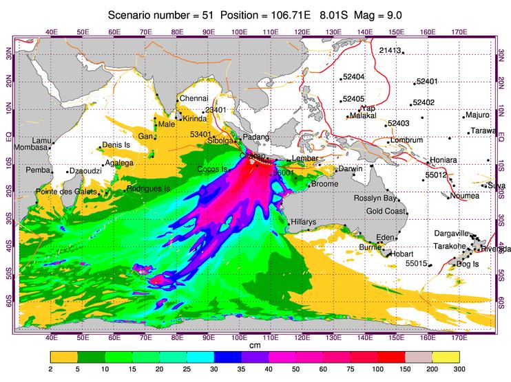

---
## Page 21

21 
 
Major land inundation, flooding, dangerous rips, waves and strong currents are expected. 
The most susceptible regions (in terms of inundation and population) are predicted to be 
Geraldton, Fremantle and the Southwest including Geographe Bay, Bunbury and 
Dunsborough. 
Evacuation orders are put in place for some communities and advice is issued to go to 
higher ground (at least ten metres above sea level), or if possible to move at least one 
kilometre away from all beaches, marinas, harbours and coastal estuaries. 
 
Figure 17: Land and marine threat to Western Australia from the tsunami scenario. Image supplied by BOM WA.

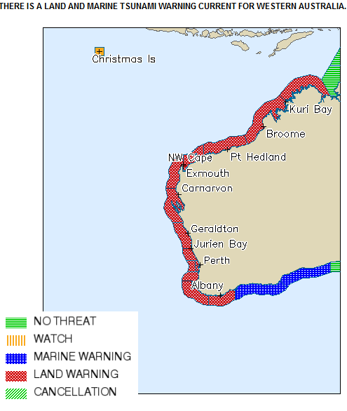

---
## Page 22

22 
 
3  Risk profile 
A total of 435 risk statements were assessed for the seven hazards across the five NERAG 
impact areas – economy, people, public administration, environment and social setting. The 
risk statements were assessed using the tailored NERAG 2015 consequence criteria table 
for the state (Appendix B). The consequence levels are based on gross state product 
($239.7 billion) and the population of WA (2.623 million). 
Of the risk statements assessed, none are extreme risks, 4.6% are high, 18.9% are medium, 
50.3% are low and 26.2% are very low. Figure 18 shows a breakdown of the risk levels per 
hazard. The bushfire, heatwave and storm scenarios are dominated by low risks and cyclone 
and tsunami by low and very low risks. While the majority (50.3%) of the risks have been 
assessed as low, all hazards have some high risks, with earthquake and flood having the 
greatest number. 
 
Figure 18: Percentage of risk statements in each risk level for each hazard. 
Figure 19 (over page) shows the percentage of risk statements for each hazard as they sit 
on the NERAG 2015 risk matrix. The matrix is used to categorise risk statements by their 
likelihood, consequence and risk level. The likelihood of the seven hazards ranges between 
unlikely to extremely rare with tsunami being the most infrequent hazard to occur with an 
annual chance of occurrence of 0.01%. This matrix reveals that many of the low and very 
low risks are a result of a minor or insignificant consequence level. 
Figure 19 also clearly highlights risks and hazards which have catastrophic consequences. 
These are consequences that could have a potential to strain or outstrip the state’s 
resources. There are nine statements (2% of all statements) that have catastrophic 
consequences which relate to the earthquake, storm and tsunami scenarios. These 
particular statements concern disruption to business activities, damage to private and 
0%
20%
40%
60%
80%
100%
Bushfire
Cyclone
Earthquake
Flood
Heatwave
Storm
Tsunami
Percentage of risk statements
Hazard
Percentage of risk statements per risk level by hazard
Extreme
High
Medium
Low
Very Low

---
## Page 23

23 
 
commercial buildings, death and injury, disruption of Department for Child Protection and 
Family Support (CPFS) service provision and impacts to the aviation sector. 
 
Figure 19: Percentage of risk statements for each hazard assessed across the state categorised by their 
likelihood, consequence and risk level. 
 
Of the 435 statements, 20 are rated as high risk. The following tables contain these 
statements by hazard and their relevant impact areas.

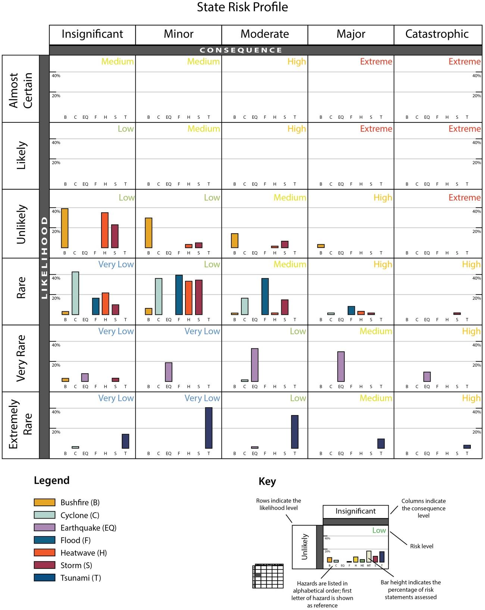

---
## Page 24

24 
 
 
Bushfire: Four major bushfires across WA: 
PUBLIC 
ADMINISTRATION 
 
 
will impact DFES services, impacting their ability to 
maintain core services. 
 
will impact on Parks & Wildlife services, impacting their 
ability to maintain core services. 
 
Cyclone: A category 5 cyclone making landfall just west of Karratha: 
ECONOMY 
 
 
will impact natural resource industries (mining, oil, gas) 
infrastructure and/or operations, resulting in a lack of 
production, recovery costs and/or financial losses. 
 
Earthquake: A magnitude 6.4 earthquake off the coast of Perth: 
ECONOMY 
 
 
will impact private buildings and contents, resulting in 
financial losses. 
 
will impact commercial buildings and contents, resulting 
in financial losses. 
 
will disrupt business activities, resulting in financial 
losses. 
PEOPLE 
 
 
will impact the health of people and cause death(s). 
 
will impact the health of people and cause injury and/or 
serious illness. 
PUBLIC 
ADMINISTRATION 
 
 
will impact CPFS, impacting their ability to maintain 
core services.

---
## Page 25

25 
 
Flood: Widespread flooding across WA: 
ECONOMY 
 
 
will impact commercial buildings, contents and 
services, resulting in financial losses. 
 
will disrupt major freight routes, resulting in financial 
losses. 
 
will disrupt business activities, resulting in financial 
losses. 
PUBLIC 
ADMINISTRATION 
 
 
will impact DFES services, impacting their ability to 
maintain core services. 
 
will require recovery works to be undertaken by Local 
Governments, impacting their ability to deliver core 
services. 
 
Heatwave: A prolonged heatwave across WA: 
PEOPLE 
 
 
will impact the health of people and cause death(s). 
 
will impact the health of people and cause injury and/or 
serious illness. 
 
Storm: A significant storm across SW and Midwest WA: 
ECONOMY 
 
 
will impact commercial buildings and contents, resulting 
in financial losses. 
 
will impact the aviation sector (e.g. damage to 
infrastructure, disruption to services), resulting in 
recovery costs and/or financial losses. 
 
Tsunami: A tsunami along the WA coast: 
ECONOMY 
 
 
will impact commercial buildings and contents, resulting 
in financial losses. 
 
will disrupt business activities, resulting in financial 
losses.

---
## Page 26

26 
 
4  Analysis of risks 
The assessed risks have been grouped into categories to identify determine common 
themes and determine if certain areas and sectors are at higher risk. The nine themes 
identified are: agency core service delivery; agriculture; built environment; business and 
industry; community wellbeing; environment; health; transport and utilities. Each theme is 
discussed below and the data are displayed in tabular form.  
In the following tables, risk statements are represented by showing the hazard name under 
the assigned risk level. Where a number follows the hazard name, more than one statement 
from that hazard fits into that category and risk level. There may also be more than one 
statement for a hazard in a category. 
The colour coding in these tables follows the impact areas: pink – economy; orange – public 
administration; blue – people; purple – social setting; green – environment. 
 
Agency core service delivery 
The greatest risks to government services stem from the bushfire, earthquake and flood 
scenarios (5 high risks - Table 6). The impact to DFES and P&W from the bushfire scenario 
could result in these agencies having to temporarily halt some core services, with the 
majority of their organisations focused on the event. This would be more problematic for 
DFES as they would have limited resources available if another incident were to take place. 
The ability to meet the response demand for smaller fires would be impacted. The larger 
fires would become the priority with interstate assistance likely needed. P&W would maintain 
core services which are not directly related to fire response; however, a significant amount of 
resources would be required – potentially half of their current staff.  
In the event of a magnitude 6.4 earthquake off the coast of Perth, modelling indicates that 
~39,000 residential buildings would be in a complete damage state. A further ~260,000 
residential buildings are expected to have slight to extensive damage. A large number of 
residents would be displaced, potentially for an extended period, as structural surveying 
would be required to determine which structures are habitable. As a result of this volume of 
displacement, the CPFS, who are responsible for welfare support, would be unable to deliver 
their core services in the short to midterm. A critical issue would be the sourcing of 
appropriate evacuation centres. Although there may be a range of large venues available, 
the structural integrity of such buildings would need to be established first. With the 
earthquake occurring in the winter, it is likely that weather conditions would further 
complicate the habitability of damaged homes.   
The impact on local governments from state-wide flooding was assessed as a high risk. 
Their ability to maintain core services would be severely reduced due to the focus on 
recovery. As a large portion of the state would be impacted, resource sharing is likely to be 
limited. The impact on some local governments would be greater than others due to the 
severity of the flooding in their jurisdiction and their capacity to recover. DFES would also 
encounter a severe reduction in their core services as a result of the flood scenario. The 
geographic extent of the flooding would require multiple incident management teams in 
multiple districts running concurrently. In addition, a large number of responders would be

---
## Page 27

27 
 
volunteers and endurance of the response may be affected. Serious consideration would be 
given for interstate assistance. Further to this, road access may impede the response in 
isolated and remote areas.  
The earthquake scenario produces the greatest number of medium risks. A number of 
agencies, particularly local governments, Main Roads WA, DFES and the Department of 
Environment Regulation (DER) and would be impacted by the event such that it would 
severely reduce their ability to maintain core functions. These impacts are primarily a result 
of a prolonged disruption to services and the densely populated area of impact.  
The volume of waste from the earthquake event would severely impair the ability to dispose 
of hazardous waste. The large number of buildings expected to suffer damage would lead to 
a large amount of waste. There is limited landfill capacity and this event would likely have a 
long term impact on local government waste management. In addition, as a small team, 
DER has limited capacity to respond to HAZMAT incidents. Two major incidents at any one 
time can be supported; however, multiple incidents would occur as the result of an 
earthquake. Issues including asbestos release, chemical spills, air quality and hazardous 
waste across a wide area of impact would overwhelm DER services and they would require 
assistance. They could potentially maintain licensing functions; however EM services and 
functions would likely be stretched, particularly due to environmental health aspects.  
Of the other medium risks, Department of Agriculture and Food WA (DAFWA) services were 
most impacted by storm and flood; Main Roads WA by flood and earthquake; DFES and 
DER by tsunami and earthquake; CPFS by cyclone and storm; and WA Police by flood.  
 
Table 6: Risks to agency core service delivery. Note: EQ = earthquake. 
Agency core service delivery 
Category 
Extreme 
High 
Medium 
Low 
Very Low 
Government 
services 
 
Bushfire (2) 
EQ 
Flood (2) 
Bushfire (4) 
Cyclone 
EQ (6) 
Flood (3) 
Storm (3) 
Tsunami (2) 
Bushfire (6) 
Cyclone (2) 
EQ (4) 
Flood (2) 
Heatwave (7) 
Storm (6) 
Tsunami (5) 
Cyclone (6) 
EQ 
Flood 
Heatwave 
Tsunami (5) 
 
Agriculture 
Agriculture risks were low or very low, with the exception of one medium risk from flooding 
impacts to agricultural and horticultural infrastructure. The flood scenario occurs in late 
March, so grain crops would have been harvested and the costs resulting from inundation of 
grain storage facilities is expected to be low. Impacts would primarily result from erosion, 
loss of fences, and not being able access farms. Losses from the February 2017 flooding in 
Ravensthorpe are estimated at $100,000 of uninsurable damage per farm from erosion, lost 
fences, and no access to paddocks. If 1000 of WA’s 10,000 farms were impacted in a similar 
manner by the flooding, the resultant cost would be at least $100 million.

---
## Page 28

28 
 
In addition, the Carnarvon horticultural industry experienced $10-12 million of losses 
following Cyclone Olwyn in 2010 from impacts to shade houses, irrigation and the recovery 
of top soil. Similar losses would be anticipated in this scenario, along with horticulture crops 
in the Swan Valley being impacted for an extended period. 
Some of the hazards are spatially constrained by their nature or scenarios used. Agricultural 
infrastructure close to the coast is minimal, so damage to horticulture products and land from 
salt water inundation would be the only expected impact from tsunami. The Pilbara is largely 
used as pastoral leases so impacts from the cyclone scenario would be insignificant 
(impacts from other cyclone tracks are presented in the flood scenario). The greatest impact 
from the bushfire scenario is likely to be to vineyard infrastructure, which could affect the 
following year’s production. Likewise, grapes would be most at risk in the storm scenario. 
 
Table 7: Risks to agriculture. Note: EQ = earthquake. 
Agriculture 
Category  
Extreme 
High 
Medium 
Low 
Very Low 
Impacts to 
agricultural and 
pastoral activities 
 
 
Flood 
Bushfire (3) 
Flood 
Heatwave (2) 
Storm (3) 
Tsunami  
Cyclone (3) 
EQ (3) 
Flood 
Heatwave 
Tsunami (2) 
 
Built environment 
The highest risks to the built environment are expected to come from the earthquake and 
tsunami scenarios. The earthquake is likely to cause catastrophic damage to a number of 
commercial buildings located in Fremantle, the Kwinana Industrial area and Cockburn 
Central. These areas in particular have a high concentration of commercial buildings and are 
expected to receive higher earthquake shaking intensity than other areas (Figure 7). A 
number of buildings in the Kwinana Industrial area were built in the 1970s, prior to the 
establishment of the national building code in 1988 and may be more susceptible to impacts. 
Service stations with broken pipelines were also mentioned as having a higher cost of repair 
than other commercial buildings. Buildings within the central business district (CBD) may 
also be impacted, even if they have not sustained significant damage themselves, due to the 
danger posed by damaged neighbouring buildings. The single high risk for damage to 
private buildings also arose from the earthquake scenario. Earthquake loss modelling by 
Geoscience Australia4 estimates that up to 30% of private buildings in the Perth area could 
sustain moderate to complete damage (Table 4). Combined with buildings that may sustain 
minor damage, the financial cost could exceed $10 billion; the threshold to reach the 
catastrophic consequence level. 
                                               
4 Wehner M., Ryu H., Corby N., Robinson D. and Edwards M. 2013. Earthquake Impacts Scenarios for Western 
Australia. Professional Opinion 2013/XX. Geoscience Australia: Canberra.

---
## Page 29

29 
 
The tsunami scenario is anticipated to cause catastrophic impacts to commercial buildings, 
particularly those associated with marina and ports. Areas of concern are Hillarys Boat 
Harbour, the Fremantle Port area, Geraldton and Bunbury harbour area. Damage is thought 
to occur through the direct impacts of tsunami waves on buildings and from the inundation of 
salt water, sand and debris.  
High risks to commercial buildings are also expected from the storm and flood scenarios, 
though with major consequences ($1-10 billion losses). Hail damage to glass exteriors and 
windows from the storm cells would be significant. Associated tornadoes could damage and 
remove roofs from commercial buildings in the CBD. Buildings built before 1995 are more 
vulnerable due to changes in building codes; large multistorey buildings however are less 
vulnerable as they are designed for high wind loadings. The flood may cause impacts to 
commercial buildings, in particular to public buildings which are often located in low lying 
areas. 
Medium risks for the cyclone scenario related to damage to commercial buildings around 
Karratha, close to where the cyclone makes landfall (Figure 6). Buildings in the industrial 
areas of Karratha house unused mining machinery and equipment which could be damaged 
along with the structures themselves. 
Medium risks for residential building damage arose from the bushfire, cyclone, flood and 
storm scenarios. A Category 5 cyclone and the associated storm surge in Karratha would 
cause damage to residential buildings; although it is unlikely that every building in the town 
would be damaged or inundated. For the bushfire scenario, the majority of the houses that 
could be impacted would be in the Hovea and Dunsborough areas. Around 200 houses 
could be lost (~$100 million) despite asset protection work which would be ongoing during 
the bushfires. Both the flood and storm were anticipated to cause approximately $500 million 
of damages across the state. 
 
Table 8: Risks to the built environment. Note: EQ = earthquake. 
Built environment 
Category  
Extreme 
High 
Medium 
Low 
Very Low 
Impacts to 
commercial 
buildings, 
contents and 
services 
 
EQ 
Flood 
Storm 
Tsunami 
Cyclone 
Bushfire 
Heatwave 
 
Impacts to 
private buildings 
and contents 
 
EQ 
Bushfire 
Cyclone 
Flood 
Storm 
Tsunami 
Heatwave

---
## Page 30

30 
 
Business and industry 
The greatest impacts to commercial activities stem from the earthquake, flood and tsunami 
scenarios. Earthquake and tsunami were assessed to have catastrophic economic 
consequences for the state of greater than $9.5 billion in losses. As a result of the 
earthquake, damaged buildings that contained asbestos or buildings that could collapse 
would likely have a cordon around them for health and safety reasons. These cordons could 
restrict access to nearby businesses impacting commercial activities. Some larger 
businesses, or those with multiple office locations, might be able to continue without 
significant losses. As a result of building damage and trading loss, some businesses may 
close down; however others are likely to start up. It was anticipated that large sums of 
money would come into the state for the recovery and reconstruction effort, though this 
would likely occur over the long term. 
The flood scenario has the potential to cause more than $1 billion of losses or damages to 
businesses. One of the primary ways would be through impacts to the distribution of goods, 
both perishables (via road) and non-perishables (via rail). The flooding impacts to the east-
west rail line and road network could result in delays of interstate deliveries for up to two 
weeks, or longer in some areas. Some businesses are vulnerable to cash flow interruptions 
and contracts could be lost if items do not arrive in time. The temporary loss of business 
could be recovered in time as stocks are replenished; however, smaller businesses may 
suffer as they are may not have the cash flow to survive. The transport of mining and 
agriculture products to export ports would also be impacted. In addition, the inundation of 
open pit mines may result in some losing production for over 12 months while they are being 
drained. Previous floods in Queensland resulted in large pits being offline for several years. 
The impact of flood to business premises by inundation or isolation would also contribute to 
disruption costs.  
The tsunami scenario would result in a number of businesses along the coast requiring 
remediation of building interiors, during which they would likely need to close. Due to the 
extent of impacts along the whole WA coastline and the limited number of trades personnel 
available, larger businesses are likely to be prioritised for repair. When including port 
services in this category, the disruption to which can cost up to $2.5 million per hour, the 
overall consequence was assessed as catastrophic (greater than $9.5 billion).   
Impacts to the mining industry from the cyclone scenario were assessed as a high risk, with 
potential losses of up to $9.5 billion. These losses were expected to stem from the costs 
associated with disruption to ships, which will need to remain anchored offshore during the 
event and the need to evacuate approximately 1500 people from Barrow Island. This would 
likely cause a delay in operations, incurring significant costs to the industry.   
Similar impacts to the mining industry were assessed for the earthquake scenario, but due to 
the lower likelihood of the scenario, the risk level is medium. Facilities for chemical 
manufacturers, oil refineries, fertiliser manufacturers and alumina would be closed for an 
extended period. While the construction standards are unknown for many of these buildings, 
a large portion of the economic impacts are thought to stem from disruptions to operations 
and need to inspect all plant and equipment for structural damage.  
Cyclone and tsunami would have the greatest impact on the marine industry, resulting in 
medium risks. The tsunami would impact multiple ports, as well as marine infrastructure,

---
## Page 31

31 
 
along the coast. Limited opportunities to divert shipping to other ports would be exacerbated 
if ports are damaged. Losses of over $950 million could be expected.  
The impacts from the cyclone scenario are expected to cause significant damage to ports 
and channels, particularly those in the Pilbara, resulting in a medium risk. Wind strengths 
and the expected 12 metre storm surge in Karratha would have an impact on some 
infrastructure. The most significant cost could come from damage to a shipping channel and 
re-dredging that may be required. Re-dredging was estimated to cost up to $500,000 and 
take months to complete, incurring disruption costs. Even if damage to infrastructure (a berth 
in particular) or the channel was not substantial, the expected disruption would last up to 20 
days. Other port structures would require surveying before operations could continue.  
Impacts to tourism were assessed to be low or very low risk. Tourist attractions and 
accommodation would likely experience damage, particularly during the earthquake scenario 
with the epicentre of the earthquake located just offshore of Rottnest Island, a prominent 
tourist destination. For most hazards, the decline in tourism was expected to be localised, 
and relatively short term, resulting in losses of less than $100 million.  
 
Table 9: Risks to business and industry. Note: EQ = earthquake. 
Business and industry 
Category  
Extreme 
High 
Medium 
Low 
Very Low 
Impacts to 
commercial 
activities 
 
EQ 
Flood 
Tsunami 
Bushfire 
Cyclone 
Heatwave 
Storm 
 
Impacts to 
marine 
infrastructure 
and industry 
 
 
Cyclone 
Tsunami 
Flood 
Storm 
Bushfire 
EQ 
Heatwave 
Impacts to 
mining 
infrastructure 
and industry 
 
Cyclone 
EQ 
Flood 
Bushfire 
Heatwave 
Tsunami 
Storm 
Impacts to 
tourism 
 
 
 
Bushfire 
EQ 
Flood 
Heatwave 
Storm 
Cyclone 
Tsunami

---
## Page 32

32 
 
Community Wellbeing 
Community wellbeing is assessed for the state as a whole. It does not focus on those 
individuals who would be directly affected by the scenario events but rather the broader WA 
community.  
The community wellbeing of the state was largely assessed to be at low or very low risk from 
the seven hazards. In most cases, it was expected that the state could use its existing 
resources to return the community to normal; or there would be only isolated or short term 
interruptions to services provided to the community.  
Due to its lower likelihood of occurrence, the earthquake scenario produces medium risks 
with higher consequences than other hazards. There are an additional four earthquake 
statements that are low risk, but have moderate consequences worth noting.  
A major consequence (medium risk) anticipated from the earthquake scenario is the loss of 
culturally significant facilities and/or heritage buildings. Widespread damage and permanent 
loss of heritage and cultural buildings would be expected as most heritage buildings are 
unreinforced masonry, the most susceptible building type. Heritage buildings in Fremantle 
were of particular concern due to the higher expected ground shaking in this area (Figure 7) 
and the knock-on impact to tourism that this may have. Other areas of Perth would also 
experience significant damage. The reconstruction cost of heritage buildings is very high due 
to the measures required to restore them safely to heritage standards. For hazards other 
than earthquake, there would be isolated losses of some heritage buildings and culturally 
significant facilities; however impacts to the community wellbeing were not anticipated to be 
widespread across the state.  
Impacts to the community wellbeing as a result of earthquake damage to residential 
buildings were rated lower than for heritage buildings. However, this was still assessed with 
moderate consequences (low risk) as some people may permanently move from WA due to 
their homes being damaged. 
Two other medium risks to the community wellbeing stem from impacts to home-based 
services and service providers such as NGOs, Meals on Wheels and Silver Chain. The 
earthquake has been assessed to create a major consequence, such that there is a severe 
reduction to services provided. Those who provide these services are likely to have been 
affected by the earthquake themselves and may not be able to attend work. Heatwave was 
also assessed to impact these services as many of those vulnerable to heatwave impacts 
are those who require home services. There may be limited capacity to redistribute 
resources in the face of high demand. Delays in public transport services as a result of the 
heatwave could also impact service providers.  
The earthquake scenario was assessed to result in on-going reductions in the day to day 
services of facilities for vulnerable people (aged, childcare, disability) and in the availability of 
basic commercial products and services. Most aged care facilities are already at capacity so 
there would be issues absorbing residents into other facilities if some are damaged. 
Facilities work closely to relocate residents with reciprocating arrangements; however, in the 
case of the earthquake, unlike bushfire or storm, all metropolitan facilities may be in a similar 
situation without alternatives. There is the potential for ongoing issues for a prolonged period 
of time.

---
## Page 33

33 
 
The availability of basic commercial products would be an issue initially as shop items will 
fall off shelves or spoil. Perishable items travelling by road are likely to be impacted and the 
movement of non-perishables by train would depend on the impact to rail infrastructure and 
operations. Nonetheless, supply chains tend to be resilient and alternative goods would be 
sourced with some delays. Speciality items, such as building materials, would likely be 
impacted over a longer period of time due to their sourcing from eastern states or abroad 
and the high demand after such an event.   
The flood scenario is expected to result in a significant reduction in services provided in 
aboriginal communities. A number of communities will be isolated, as would any of their 
resident staff. Though supplies may have been stocked at the beginning of the wet season, 
these could be running low by late March. Emergency services may take over the provision 
of immediate services and supplies but this would not include aspects such as financial 
payments and community activities. Disruption would also occur to health services and 
commercial services as staff based in regional centres may have reduced access to 
communities.  
The extensive flooding may also result in a loss of income and employment such that some 
of the affected may move interstate. This was mentioned with particular regard to mining and 
the flooding of open pit mines that result in temporary to prolonged mine closures.  
 
Table 10: Risks to the community wellbeing. Note: EQ = earthquake. 
Community Wellbeing 
Category  
Extreme 
High 
Medium 
Low 
Very Low 
Administration of 
aboriginal 
communities 
 
 
Flood 
Heatwave 
Storm 
Bushfire 
Cyclone 
EQ 
Tsunami 
Availability of 
essential supplies 
 
 
 
Bushfire 
Cyclone 
EQ 
Flood 
Heatwave 
Storm 
Tsunami 
Culturally 
significant facilities 
and customs 
 
 
EQ 
Bushfire 
Flood (2) 
Heatwave 
Storm 
Cyclone 
Tsunami 
Death/injury of 
animals 
 
 
 
Storm 
Bushfire 
Cyclone 
EQ 
Flood 
Heatwave 
Tsunami 
Displacement or 
isolation of 
communities 
 
 
 
Bushfire (2) 
Cyclone 
EQ 
Flood (2) 
Cyclone 
EQ 
Storm 
Tsunami (2)

---
## Page 34

34 
 
Community Wellbeing 
Category  
Extreme 
High 
Medium 
Low 
Very Low 
Heatwave 
(2) 
Storm 
Educational 
facilities 
 
 
 
Bushfire 
Flood 
Storm 
Cyclone 
EQ 
Heatwave 
Tsunami 
Facilities for 
vulnerable people 
 
 
 
Bushfire 
EQ 
Flood 
Heatwave 
Storm 
Cyclone 
Tsunami 
Home care 
services 
 
 
EQ 
Heatwave 
Bushfire 
Cyclone 
Flood 
Storm 
Tsunami 
Impacts to 
people's health 
 
 
 
Bushfire 
Storm 
Cyclone 
EQ 
Flood 
Heatwave 
Tsunami 
Loss of income 
 
 
Flood 
Bushfire 
Heatwave 
Storm 
Cyclone 
EQ 
Tsunami 
Residential 
building damage 
 
 
 
Bushfire 
EQ 
Heatwave 
Storm 
Cyclone 
Flood 
Tsunami 
Social service 
providers 
 
 
 
Bushfire 
Heatwave 
Storm 
Cyclone 
EQ 
Flood 
Tsunami 
 
Environment 
The majority of environment risks are low. Environmental damage may occur in some 
instances, but it is expected to be localised. 
There are seven medium risks across the seven hazards. The only major consequence 
results from the earthquake scenario, as a result of land and airborne contamination. 
Asbestos and dust would be a significant issue, as many of the buildings vulnerable to 
collapse contain asbestos. The clean-up and monitoring of asbestos contamination would 
likely require a substantial effort. The potential contamination of the Swan and Canning 
Rivers from accidental chemical releases would require localised clean-up programs. 
Similarly if the waste water system is not operating, waste would likely be discharged into 
waterways, though its impact is generally diluted. A clean up may not be required, but 
monitoring would be undertaken.

---
## Page 35

35 
 
Flood is expected to cause the most environmental risks as a result of debris and pollutants 
entering riverine or marine environments, coastal impacts and soil erosion. Pollutants would 
enter aquatic environments during the floods, but quantifying the impact on marine ecology 
is difficult. Large amounts of silt and decaying organic materials along with sediment 
disturbance and temperature changes can result in low dissolved oxygen levels in the water, 
which in turn can cause large fish kills after floods. Along the coast, minor damage is 
expected for ecosystem or species of national significance.  
During the February 2017 flooding, there was erosion damage to ~20% of the impacted 
landscape. Soil erosion would certainly occur during this flood scenario, with any 
interventions primarily done for the benefit of farmers. A top soil replacement scheme was 
put into effect in the Gascoyne region following Cyclone Olwyn in 2015. 
Large hail from the storms would impact wildlife in general, and significant endangered 
species. The environmentally sensitive ecosystem of the Dampier archipelago, particularly 
birds and reefs, would be vulnerable to cyclone impacts.  
 
Table 11: Risks to the environment. Note: EQ = earthquake. 
Environment 
Category  
Extreme 
High 
Medium 
Low 
Very Low 
Coastal impacts 
 
 
Flood 
Bushfire 
Cyclone 
Heatwave 
Tsunami 
EQ 
Storm 
Contamination 
from toxic 
substances 
 
 
EQ 
Bushfire 
Flood 
Heatwave 
Tsunami 
Cyclone 
Storm 
Debris or 
pollutants 
entering the 
riverine or marine 
environment 
 
 
Flood 
Bushfire 
Cyclone 
EQ 
Heatwave 
Storm 
Tsunami 
 
Flora and fauna 
 
 
Cyclone 
Storm (2) 
Bushfire (3) 
Cyclone 
EQ (2) 
Flood (3) 
Heatwave 
(3) 
Storm 
Cyclone 
EQ 
Tsunami 
(3) 
Soil erosion 
 
 
Flood 
Bushfire 
Heatwave 
Tsunami 
Cyclone 
EQ 
Storm

---
## Page 36

36 
 
Health 
The greatest risks to people’s health are from deaths, injuries and illnesses directly 
attributable to the hazard scenarios. All seven natural hazards have the potential to result in 
deaths, with earthquake, heatwave and tsunami anticipated to lead to the greatest number of 
deaths. The earthquake scenario could result in catastrophic consequences, estimated as 
having a 50% chance of at least 263 deaths. This estimate was based on figures provided 
by Geoscience Australia using the ATC-13 methodology5. Heatwave and tsunami were 
expected to result in at least 27 deaths; however, the lower likelihood of an occurrence of a 
tsunami brings its risk level to medium.  
Injuries and illnesses are a high risk for earthquake and heatwave, and a medium risk for all 
other hazards. For the earthquake scenario, the capacity of DFES urban search and rescue 
(USAR) would be stretched. In addition, there are 14 USAR trained paramedics in WA; 
therefore it is likely that interstate assistance would be required. This could take up to 24 
hours to arrange and as a result some injuries may worsen. In the case of heatwave, pre-
existing conditions are often exacerbated within vulnerable groups of the community. An 
increased number of presentations would be expected in the emergency room; however it 
may not be easy to attribute these impacts to the heatwave event itself. In addition, a 
number of heat related illnesses would likely go unreported, particularly by vulnerable groups 
who are less likely to ask for help (e.g. elderly living at home).  
Earthquake is expected to place the greatest demand on health services, resulting in 
medium risks. The severity of this issue would likely depend on the damage received to 
health facilities, which would impact their ability to deal with a large volume of patients. Of 
particular concern are certain specialist areas such as surgery and high dependency units. 
Royal Perth and Fremantle Hospitals are expected to be impacted the most by the shaking 
(building age and location); but it was assumed that all tertiary facilities, including private 
facilities, would be impacted to some extent. Outer metropolitan area facilities may function 
but would already be at capacity. Patient transfers around the greater metropolitan area 
could be affected by a lack of available facilities and transport disruptions. For these 
reasons, WA health services would likely encounter a severe reduction in the delivery of 
their core functions. This limitation has the added potential to lead to a further death, directly 
attributable to the earthquake event.  
Flood, earthquake and storm are expected to place the greatest demand on emergency 
services (primarily medical transport), resulting in the potential for a further death directly 
attributable to the emergency event. For all three hazards, this is mainly due to limited 
access to persons as a result of damage or inundation of critical infrastructure. In the 
earthquake scenario, a large number of resources would be required due to the high volume 
of injuries. A focus on earthquake-related injuries may prevent other daily incidents from 
being prioritised.  
The impact on St John Ambulance (SJA) services is greatest from earthquake and flood. In 
these events, core services would be maintained by bringing in personnel to assist but there 
is likely to be some reduction in services. There is a large SJA volunteer base in the greater 
                                               
5 Wehner M., Ryu H., Corby N., Robinson D. and Edwards M. 2013. Earthquake Impacts Scenarios 
for Western Australia. Professional Opinion 2013/XX. Geoscience Australia: Canberra.

---
## Page 37

37 
 
metropolitan area from which to draw on. However, in the earthquake scenario, this 
volunteer base may be personally impacted affecting their ability to respond. Additionally, 
volunteers often play multiple roles which may conflict during an earthquake event (e.g. 
community paramedic vs. firefighter). Even if a sufficient number of personnel are available 
to assist, there may be a lack of equipment, such as ambulances. In the flood scenario, it is 
unlikely that SJA would experience a surge in calls. However they would be required to 
assist in moving people around (e.g. to evacuation centres) which would require significant 
effort. Services may be further restricted by access issues.  
 
Table 12: Risks to health. Note: EQ = earthquake. 
Health 
Category  
Extreme 
High 
Medium 
Low 
Very Low 
Deaths 
 
EQ 
Heatwave 
Bushfire 
Cyclone 
Flood 
Storm 
Tsunami 
 
 
Emergency 
services 
 
 
EQ 
Flood 
Storm 
Bushfire 
Cyclone 
Heatwave 
Tsunami 
 
Emergency 
services 
 
 
EQ 
Flood 
Bushfire 
Cyclone 
Heatwave 
Storm 
Tsunami 
 
Health 
services 
 
 
EQ 
Bushfire 
Cyclone 
Heatwave 
Storm 
Tsunami 
Flood 
Health 
services 
 
 
EQ 
Flood 
Bushfire 
Heatwave 
Storm 
Tsunami 
Cyclone 
Injuries and 
illnesses 
 
EQ 
Heatwave 
Bushfire 
Cyclone 
Flood 
Storm 
Tsunami

---
## Page 38

38 
 
Transport 
The highest risks for transport come from the damage to aviation infrastructure from the 
storm scenario and the disruption to transportation routes from the flood scenario.  
The storm scenario is expected to cause catastrophic damage (greater than $9.5 billion) to 
aviation infrastructure, particularly at Perth Airport. There are assets valued in the billions of 
dollars at the airport that are vulnerable to hail. The removal of these assets from their 
regular aviation services could potentially result in long term economic failures within the 
aviation industry, with a flow on impact to dependent industries. Lightning is also a concern, 
as outside operations at the airport would be stopped for health and safety reasons. This 
would likely cause delays resulting in further financial losses. 
The flood would cause significant impacts and disruption on the road network, particularity 
the main north-south and east-west freight routes. This disruption to the road network would 
affect freight and supplies coming into the state as well as the transport of mining products to 
export ports. In addition to disruption costs, the flood scenario would also cause physical 
damage to the road network and associated bridges. The February 2017 flooding provided a 
basis for the assessment, where the widespread and extensive damage to the road network 
and bridges cost an estimated $100 million. Given the state-wide nature of the scenario, 
similar or greater damage is expected. In a similar manner, the storm scenario would cause 
maintenance issues across the road network with the possibility of more significant washouts 
from flash flooding in some areas and debris clearing required in most areas (medium risk). 
While earthquake and tsunami present lower risks than flood in terms of disruption to 
transport routes, both have the same consequence level (major). They would cause 
considerable disruption to freight routes, in particular ports and road bridges. Port 
infrastructure (Fremantle Ports in particular) could sustain damage during the earthquake 
requiring repair and delaying operations. Disruption costs are currently estimated to be $2.5 
million per hour. Similar, the Fremantle bridges would require inspection, if not restoration, 
following the earthquake. The cost of disruption of the road bridge is estimated at $300,000 
per day.  
The tsunami scenario could reduce the safety margin of ships entering shipping channels 
due to potential infilling of channels with sediment and debris. Closure and delays in port 
operations would result in significant financial losses. However, the closure of large ports 
would likely be short term and would therefore not significantly affect service delivery at ports 
and some marinas. The strong winds and storm surge associated with the cyclone could 
also impact ports in the north of the state causing disruption; assessed as a medium risk. If a 
channel is damaged from the storm surge, re-dredging could be required which may take 
months to complete. In general, expected disruption could be up to 20 days to repair any 
damage and undertake structural surveys of port infrastructure if required. 
The cyclone scenario is expected to impact rail facilities at ports required for mineral loading 
and private rail lines linking mines to the port towns. Extra costs associated with utilising 
road transport as an alternative are not understood and have not been accounted for. 
Another risk worth consideration is the impact of the earthquake scenario on the rail network. 
Though rated as a low risk due to the scenario’s likelihood, significant damage to the Public 
Transport Centre in East Perth could render all public transport trains inoperable as the 
control centre is onsite. The heritage listed building is known to not adhere to the current

---
## Page 39

39 
 
building code and it could be inaccessible if damaged or deemed unsafe to enter. Damage 
to rail infrastructure across the city, tracks and signals, is also likely.  
 
Table 13: Risks to transportation. Note: EQ = earthquake. 
Transport 
Category  
Extreme 
High 
Medium 
Low 
Very Low 
Disruption to 
aviation 
services 
 
 
Storm 
Bushfire 
Cyclone 
EQ 
Flood 
Tsunami 
Heatwave 
Disruption to 
transport 
routes 
 
Flood 
Cyclone 
EQ 
Tsunami 
Bushfire 
Heatwave 
Storm 
 
Impacts to 
aviation 
 
Storm 
Cyclone 
EQ 
Bushfire 
Flood 
Heatwave 
Tsunami 
Impacts to 
bridges or their 
approaches 
 
 
Flood 
Bushfire 
Cyclone 
EQ 
Heatwave 
Storm 
Tsunami 
Impacts to port 
and marina 
services 
 
 
 
Cyclone 
Flood 
Storm 
Bushfire 
EQ 
Heatwave 
Tsunami 
Impacts to rail 
infrastructure 
 
 
Cyclone 
Bushfire 
EQ 
Flood 
Storm 
Heatwave 
Tsunami

---
## Page 40

40 
 
Transport 
Category  
Extreme 
High 
Medium 
Low 
Very Low 
Impacts to 
road 
infrastructure 
 
 
Flood 
Storm 
Bushfire 
Cyclone 
EQ 
Heatwave 
Tsunami 
 
 
Utilities 
The highest risks to utilities relate primarily to the service delivery of the utility rather than 
repairs costs of damaged assets. Exceptions relate to the flood and earthquake scenarios 
which may have the potential to result in a moderate level of financial impact to power and 
communications infrastructure respectively. While the earthquake scenario is a rare event, 
the potential level of damage could result in major consequences for power utilities.  
Of all of the utilities, power supply infrastructure and services are most at risk. While all 
hazard scenarios, with the exception of tsunami and cyclone, have the potential to create 
moderate level impacts to power supply service delivery, the earthquake scenario is the only 
scenario expected to affect power infrastructure significantly. The primary concern for 
earthquake impacts surrounds generation plants at Kwinana, substations in areas with high 
levels of shaking (Figure 7) and poles in areas of possible liquefaction. The level of shaking 
may also result in the tripping of a safety system causing short term but widespread loss of 
power. The scenario is likely to impact underground infrastructure which will take longer to 
repair than above ground equipment, leading to longer outages. For hazards other than 
earthquake, the level of risk is primarily related to the length of time it may take to restore all 
services. This is particularly relevant for bushfire where exclusion areas may slow restoration 
times. In addition, the response to the events may cause planned maintenance to be 
postponed which is likely to take several months to reschedule. 
The highest risk to the natural gas supply relates to the earthquake scenario. The 
earthquake would likely result in gas leaks which could restrict access to certain areas and 
impact the operation of key facilities, such as hospitals. The economic impact of damage to 
the ATCO Gas network in Perth was assessed as a medium risk (major consequence), as 
the majority of the network would be affected. Some disruption is also possible from the 
tsunami and cyclone scenarios due to the dependence on offshore infrastructure.  
Economic impacts to communications infrastructure were assessed as low or very low risk 
for all hazards with the exception of flood (medium risk). This is likely the result of a high 
level of redundancy at individual infrastructure sites such as portable or permanent backup 
generators. For the flood scenario, potential long term impacts are expected due to need to 
replace fibre cables and the possible inundation of some exchanges. Impacts to the delivery 
of communication services in these scenarios are more substantial. Storm, flood and 
bushfire would likely require interstate resources for restoration.

---
## Page 41

41 
 
The flood scenario presents the greatest risk to the water supply and sewerage system 
infrastructure and services and has the potential to cause a medium level of risk to sewerage 
service delivery. This is because wastewater systems are typically located in low lying areas. 
The amount of work required to repair systems across a large area (Figure 9 and Figure 10) 
would result in high workloads and necessitate the deployment of additional staff to regional 
areas. It is worth noting that despite the low risk rating of both systems for earthquake, such 
an event could create moderate level impacts. 
 
Table 14: Risks to utilities. Note: EQ = earthquake. 
Utilities 
Category  
Extreme 
High 
Medium 
Low 
Very Low 
Disruption to supply of 
natural gas 
 
 
 
Bushfire 
EQ 
Cyclone 
Flood 
Heatwave 
Storm 
Tsunami 
Impacts to 
communication 
infrastructure 
 
 
Flood 
Bushfire 
Cyclone 
Storm 
EQ 
Heatwave 
Tsunami 
Impacts to 
communication service 
delivery 
 
 
Bushfire 
Flood 
Storm 
Cyclone 
EQ 
Heatwave 
Tsunami 
 
Impacts to natural gas 
distribution 
 
 
EQ 
Bushfire 
Cyclone 
Heatwave 
Flood 
Storm 
Tsunami 
Impacts to power 
supply infrastructure 
 
 
EQ 
Bushfire 
Cyclone 
Flood 
Heatwave 
Storm 
Tsunami 
 
Impacts to power 
supply service delivery 
 
 
Bushfire 
EQ 
Flood 
Heatwave 
Storm 
Cyclone 
Tsunami 
 
Impacts to sewerage 
service delivery 
 
 
Flood 
Bushfire 
EQ 
Heatwave 
Storm 
Cyclone 
Tsunami 
Impacts to sewerage 
systems 
 
 
 
Bushfire 
EQ 
Flood 
Heatwave 
Cyclone 
Storm 
Tsunami

---
## Page 42

42 
 
Utilities 
Category  
Extreme 
High 
Medium 
Low 
Very Low 
Impacts to water 
supply infrastructure 
 
 
 
Bushfire 
Cyclone 
EQ 
Flood 
Heatwave 
Storm 
Tsunami 
Impacts to water 
supply service delivery 
 
 
 
Bushfire 
Cyclone 
EQ 
Flood 
Heatwave 
Storm 
Tsunami

---
## Page 43

43 
 
5  Comparison to 2013 risks 
In 2013, the SEMC coordinated the first risk assessment workshop series to analyse the 
risks from these same seven natural hazards using the 2010 National Emergency Risk 
Assessment Guidelines (NERAG). While there are some similarities, the results of the two 
series vary. These variances are primarily due to the different criteria and methodology 
used, and notably, a greater maturity of our understanding of risk.  
The first workshop series used the 2010 NERAG, which contains six categories (people, 
economy, environment, infrastructure, public administration and social setting); while the 
most recent workshops used the 2015 NERAG. Some of the significant changes in the 2015 
version are: no infrastructure category; the people category is limited to deaths and injuries; 
and the economy category is based on the whole economy not government revenue alone. 
Aspects of the public administration, social setting and environment categories have also 
been refined. Consequently, the comparison of risks across the two series becomes difficult 
as risks for the same element (e.g. displacement of people) are assessed with different 
consequence criteria.   
In addition to the criteria changes, the workshop series differed in their formats. In 2013, the 
impact categories were assessed in separate workshop tables to maximise participants’ time 
and inputs. As a result, the data between tables was hard to normalise. One significant and 
positive change to the workshops has been running the assessment as a large group 
(between 15-35 participants) and assessing all categories collectively. This format has 
provided a balanced view across the categories and has relieved the issue of expertise 
being on one table and not another.  
As our collective understanding of risk has improved over the last four years, another aspect 
that has changed is how the impacts to the social setting are perceived. The social setting 
category encompasses community and community-based services and cultural, emotional 
and psychological aspects of society. In 2013, many of the social setting risks were 
assessed as having major or catastrophic impacts in 2013. Comparatively in 2017, there is 
only one major consequence and it addresses the permanent loss of culturally important 
heritage buildings. It appears that there is a greater appreciation of the scale of the 
assessment, measuring how the entire state community is impacted rather than the 
particular individuals involved. An additional factor may be that there have been a few 
relatively large emergency events in WA in the last four years, which while significant, have 
not had a notable impact on the majority of the State’s community.    
Among the high risks that have remained constant across the two assessments are the 
impact of heatwave to people’s health and the effect of flooding on the state’s economy. 
Widespread flooding is expected to result in longer-term disruption to transport networks and 
resource sector operations, potentially slowing the state’s productive capacity. Beyond these 
similarities, the 2017 assessments provide a substantially more robust and advanced picture 
of the State’s risk profile.

---
## Page 44

44 
 
Appendix A: Agencies involved in risk assessment 
 
As the workshops took place before 1 July 2017 when some WA government departments 
were amalgamated, the agencies are referred to by their name prior to this date. 
 
Association of Volunteer Bush Fire Brigades 
Bethanie Group 
Building Commission - Department of Commerce 
Bureau of Meteorology 
City of Perth 
City of South Perth 
Department for Child Protection and Family Support 
Department of Agriculture and Food WA 
Department of Defence 
Department of Environment Regulation 
Department of Fire and Emergency Services 
Department of Health 
Department of Parks and Wildlife 
Department of Planning 
Department of the Premier and Cabinet 
Department of Transport, Marine Safety 
Department of Water 
Geoscience Australia 
Horizon Power 
Main Roads WA 
Office of Bushfire Risk Management 
Office of Emergency Management 
Public Utilities Office 
Red Cross 
St John Ambulance 
Surf Life Saving WA 
Telstra 
Tourism WA 
WA Local Government Association 
WA Police 
Water Corporation 
Western Australian Council of Social Services 
Western Power

---
## Page 45

 
Appendix B: State consequence table

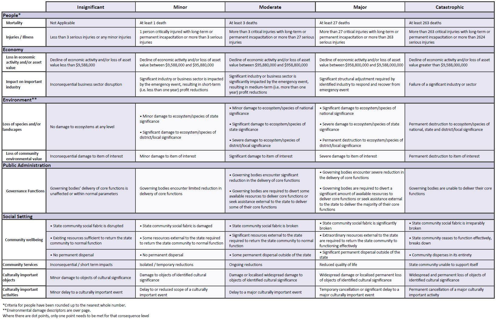

---
## Page 46

