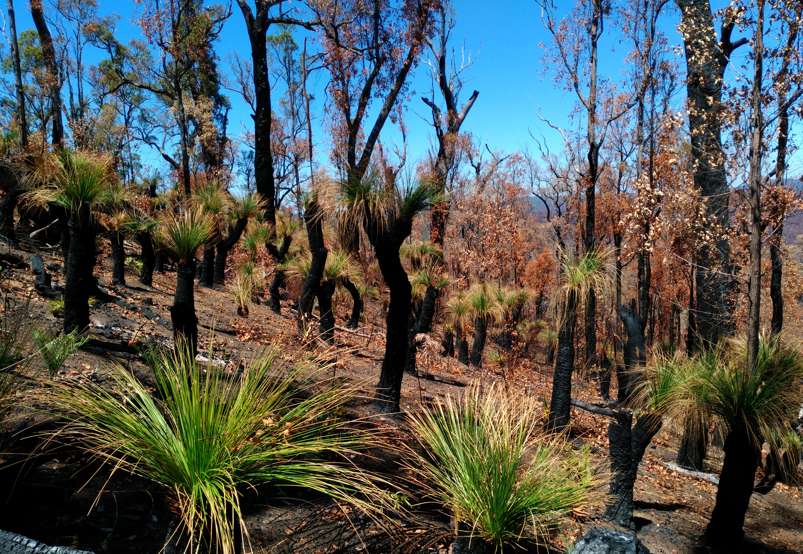
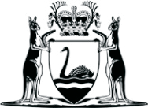
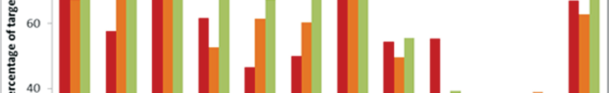
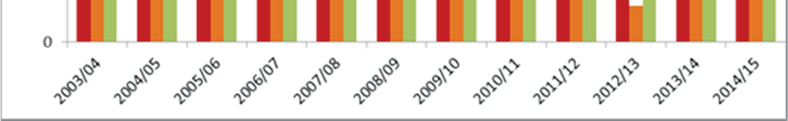
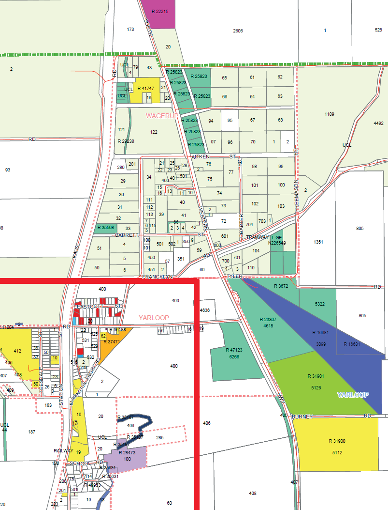

# Reframing Rural Fire Management — Report of the Special Inquiry into the January 2016 Waroona Fire (Ferguson Report) (2016)

> **Source**: WA SEMC / Ferguson
> **URL**: https://semc.wa.gov.au/capability-and-preparedness/reports-and-reviews/Documents/WaroonaBushfireSpecialInquiry/ReframingRuralFireManagement-ReportoftheSpecialInquiryintotheJanuary2016WaroonaFire.pdf
> **Licence**: © Government of Western Australia; emergency-management practitioner reference
> **Retrieved**: 2026-05-07T23:43:10Z
> **SHA-256**: `70b51029776a22d39b388588866b4c1e61c61735d9b5b5d2c8b10fe7d554ddc6`
> **Archived copy**: Internet Archive Wayback Machine — `https://web.archive.org/web/20220313162538id_/https://semc.wa.gov.au/capability-and-preparedness/reports-and-reviews/Documents/WaroonaBushfireSpecialInquiry/ReframingRuralFireManagement-ReportoftheSpecialInquiryintotheJanuary2016WaroonaFire.pdf`
> *(Live publisher URL no longer resolves; this archived snapshot was used for ingest. Cite the publisher URL above.)*
> *Converted from PDF to Markdown format.*

---
## Page 1

“Reframing Rural Fire Management”
Report of the Special Inquiry 
into the 
January 2016 Waroona Fire
Volume 1: Report

---
## Page 2

 
 
Government Of 
Western Australia 
 
 
 
 
“REFRAMING RURAL FIRE MANAGEMENT” 
 
 
 
REPORT OF THE SPECIAL INQUIRY  
INTO THE  
JANUARY 2016 WAROONA FIRE

---
## Page 3

---
## Page 4

Waroona Fire Special Inquiry 
 
 
 
 
 
 
 
 
29 April 2016 
 
 
 
Mr M C Wauchope 
Commissioner 
Public Sector Commission 
Locked Bag 3002 
WEST PERTH  WA  6827 
 
 
 
 
Dear Mr Wauchope, 
 
SPECIAL INQUIRY INTO JANUARY 2016 WAROONA FIRE 
 
I am pleased to submit the Report of the Special Inquiry into the January 2016 Waroona 
Fire.  The Special Inquiry has been conducted in accordance with the provisions of the 
Public Sector Management Act 1994 and the Terms of Reference. 
 
The Special Inquiry started in early February, ran for 13 weeks and held formal hearings on 
22 days.  The Special Inquiry has evoked a significant response.  One hundred and sixty five 
written submissions have been received.  One hundred people appeared at formal hearings 
and five people gave evidence via telephone. We have met and interacted with  
42 organisations and interest groups.  My gratitude goes to all those who contributed their 
wisdom, knowledge and experience to this Special Inquiry. 
 
The Special Inquiry team has worked diligently to inquire against the Terms of Reference 
and to analyse the matters presented in submissions and in formal hearings. The  
Special Inquiry has endeavoured to meet with and listen to all who registered an interest.  
Mindful of the timeframe, this has been a significant task. 
 
The report of the Special Inquiry carries 17 ‘Recommendations for Strategic Change’ and  
23 ‘Agency Opportunities for Improvement’.  It is my belief that, when actioned, these will 
reframe rural fire management in Western Australia for the benefit of the community. 
 
I particularly acknowledge those who have been directly affected by the fire, and who, in a 
time of turmoil, gave of their time to tell us their story.  Many were traumatised by the fire.  
Others were coming to terms with the loss of neighbours, stock, farm assets, homes, 
plantations and livelihoods.  We spoke with firefighters, many of whom were seasoned and 
had vast experience.  The depth of impact of this fire on them was evident from the look in 
their eyes, the emotion in their words and the pain in their hearts.  I hope that this report 
reflects all these stories.

---
## Page 5

 
I also want to acknowledge the unfailing support that has been given by officers and the 
heads of many agencies including the Department of the Premier and Cabinet, the 
Department of Fire and Emergency Services and the Department of Parks and Wildlife.  The 
Special Inquiry also gratefully acknowledges support provided by the Shires of Harvey and 
Waroona. 
 
Finally, I extend my heartfelt thanks to the staff of the Special Inquiry.  Each of them has 
made a lasting contribution.  They are individually mentioned elsewhere in this report.  
Without their effort and judgement this Special Inquiry and its Report would not have been 
possible.   
 
Thank you for the opportunity to contribute to the vision of a safer Western Australian 
community. 
 
Yours sincerely 
 
 
Euan Ferguson AFSM 
Special Inquirer 
Waroona Fire Special Inquiry

---
## Page 6

 
 
 
 
 
 
 
 
 
 
 
 
 
This report is dedicated to those affected by the Waroona fire.  In particular: 
 
to the memory of those whose lives were lost; 
 
to those who have suffered injury and hurt that may be ongoing; 
 
to those whose livelihoods have been destroyed or disrupted;  
 
and 
 
to those who did their best to fight the fire and protect the community  
during a time of adversity. 
 
 
“Hope springs from adversity”

---
## Page 7

 
 
Acknowledgements 
 
This Special Inquiry Report has been made possible through the dedication and hard work of 
a small team of very talented people drawn from a range of Western Australian Government 
departments.  I acknowledge the assistance given by the following: the Department of the 
Premier and Cabinet through Ms Emma Clegg, Ms Bethany Couper, Mr Angus Duncan, Mr 
Frank Fiorillo, Ms Helen Gladstones, Ms Jean Perkins, and Ms Barbara Willinge; the 
Department of Planning through Ms Courtney Barron; the State Emergency Management 
Committee Secretariat through Ms Narelle Edmonds; and the State Solicitor’s Office through 
Ms Fiona Seaward. 
 
I particularly would like to thank Ms Courtney Barron who acted as the very capable 
Executive Officer for the Special Inquiry and who, with Ms Fiona Seaward, provided 
essential analysis and insightful contributions to the conduct of the Special Inquiry. 
 
I thank the Shires of Waroona and Harvey, the City of Bunbury and the Department of 
Planning in Bunbury for allowing their premises to be used for formal hearings.  Also, thanks 
to the Shires of Waroona and Harvey for the support they have given during the Special 
Inquiry. 
 
I thank the Director of the State Emergency Management Committee Secretariat, the Fire and 
Emergency Services Commissioner and staff of the Department of Fire and Emergency 
Services for providing office, logistical and technical support. 
 
I also thank the members of the Yarloop and Cookernup Bush Fire Brigades for meeting with 
me at a time when many were struggling to reconcile the consequences of this fire on their 
community and on themselves. 
 
Finally, I thank those community members who have been affected by this fire and who came 
forward to share with me their story and identify lessons to be learned for the future.  Your 
thoughts and proposals have foreshadowed a future rich in opportunity.

---
## Page 8

January 2016 Waroona Fire Special Inquiry  7 
Report of the Special Inquiry into the January 2016 Waroona Fire 
 
 
Contents - Part One: Addressing Terms of Reference 
 
 
 
Chapter 1  
 
Letter of transmittal  
Acknowledgements  
Contents Page 
 
Chapter 2 
Prologue .................................................................................................  
11 
 
Chapter 3 
Executive Summary and Recommendations ......................................  
15 
 
Strategic Recommendations 
 
Opportunities for Improvement 
 
Chapter 4 
Compelling Questions and Findings ................................................... 
27 
 
Chapter 5 
Lessons Learned from Previous Bushfire Emergencies .................... 
41 
 
 [ToR 2 & 3] 
 
Summary of previous reports 
 
Assessing Implementation 
 
Chapter 6 
The Fire ..................................................................................................  
63 
 
The Waroona fire 
 
Losses and damages 
 
Chapter 7 
Fuel Management and Fire Prevention ..............................................  
89 
 
 [ToR 1(a) & (b)] 
 Defining fuel management 
 Hazard reduction burns 
 Department of Parks and Wildlife  
 Other agencies 
 Fuel management around Yarloop 
 Other fuel management considerations 
 Local solutions for local problems 
 
Chapter 8 
Incident Management ...........................................................................  
115 
 
 [ToR 1 (c) & (d)] 
 
Initial Response 
 
Incident management over the course of the fire

---
## Page 9

8   January 2016 Waroona Fire Special Inquiry 
Chapter 9 
Resource Efficiency ...............................................................................  
143 
 
 [ToR 1 (c) & (d)] 
 
Observation on resource management over the course of the fire 
 
Maps 
 
Resource management arrangements 
 
Automatic vehicle location capability 
 
 
Chapter 10 
Information, Alerts and Warnings ......................................................  
159 
 
 [ToR 1 (f)] 
 
Policy framework 
 
Types of emergency information 
 
Information issued to residents of Waroona 
 
Information issued to residents of Yarloop 
 
General issues regarding the wording of community alerts 
 
General issues regarding maps 
 
 
Chapter 11 
Evacuation and Shelter Issues .............................................................  
185 
 
 [ToR 1 (g)] 
 
Evacuation framework 
 
Evacuations during the Waroona fire 
 
Shelter options during a bushfire 
 
 
Chapter 12  
Traffic Management .............................................................................  
193 
 
 [ToR 3] 
 
Current legislative and policy framework 
 
Traffic management during the Waroona fire 
 
Location of vehicle control points and inappropriate detours 
 
Transportation of workers to the Wagerup refinery 
 
Previous recommendations regarding traffic management 
 
The need to fix the traffic management policy 
 
 
Chapter 13 
Essential Services ..................................................................................  
207 
 
 [ToR 1 (e)] 
 
Water Infrastructure 
 
Communication Infrastructure  
 
Power Infrastructure 
 
Roads Infrastructure

---
## Page 10

January 2016 Waroona Fire Special Inquiry  9 
Chapter 14 
Transition to Recovery .........................................................................  
217 
 
 [ToR 1 (g) & ToR 3] 
 
Recovery Framework 
 
Commencement of Recovery  
 
Emergency services’ role in recovery 
 
Participation in Recovery 
 
Welfare Considerations 
 
 
Chapter 15 
Rural Fire Capability ...........................................................................  
233 
 
 [ToR 3] 
 
Rural fire management across Australia 
 
History and framework 
 
Use of volunteers in IMT’s 
 
Capability 
 
Training and advancement of bushfire volunteers in DFES  
 
Volunteers within the Incident Management Team 
 
Industrial Relations 
 
Volunteer Voice 
 
A Rural Fire Service 
 
Rural Fire Management Framework 
 
 
Chapter 16 
Concluding Comments .........................................................................  
263

---
## Page 11

10   January 2016 Waroona Fire Special Inquiry 
Contents - Part Two: Appendices 
 
 
Appendix 1:  
Letter of appointment and Terms of Reference 
 
Appendix 2:  
Acronyms List 
 
Appendix 3:  
Traffic Light of the Status of Previous Review Recommendations 
 
Appendix 4: 
Reconstruction of the spread and behaviour of the Waroona bushfire 
(Perth Hills 68) by Lachlan McCaw; Neil Burrows, Brett Beecham and 
Paul Rampant (Department of Parks & Wildlife WA) 
 
Appendix 5: 
Maps of fire progression by Lachlan McCaw; Neil Burrows, Brett 
Beecham and Paul Rampant (Department of Parks & Wildlife WA) 
 
Appendix 6: 
Meteorological Aspects of the Waroona Fire January 2016 by the 
Bureau of Meteorology, Western Australian Regional Office, Perth WA 
 
Appendix 7:  
Chronology 
 
Appendix 8:  
List of written submissions 
 
Appendix 9:  
List of oral submissions 
 
Appendix 10:  
List of introductory scoping meetings

---
## Page 12

January 2016 Waroona Fire Special Inquiry   11 
Chapter Two – Prologue 
 
In early January 2016 a major bushfire swept down from the parched Darling Escarpment and 
across the farms of the Swan Coastal Plain.  The fire had a severe impact on the settlements 
of Waroona, Yarloop, Preston Beach and surrounding areas.  For the many people affected, it 
will take time to adjust to the pain of loss and suffering.  For some, there will be enduring, 
lifelong memories of hurt and loss. 
 
This Special Inquiry has been established to respond to the Terms of Reference (refer to 
Appendix 1).  The Terms of Reference refer to the “Waroona Fire”, but the impact extends 
widely to a number of towns and communities, including the town of Yarloop, where two 
people lost their lives.  One hundred and eighty one dwellings were destroyed.  Every one of 
these was someone’s home.  Many businesses and livelihoods, including farm and forestry 
businesses, will take years to re-establish.   
 
An important duty has been to read and listen to the stories and recollections of the members 
of these communities.  There are many questions arising from the ashes of this disaster.  
Wherever possible, this Special Inquiry has endeavoured to answer those questions.  But even 
four months after the event, some questions remain only partially answered. 
 
It has been the objective of this Special Inquiry to seek to identify improvements to the 
systems of community safety and bushfire risk management in Western Australia.  The 
recommendations and opportunities identified in this report are aimed at making  
Western Australia a safer place not just for the present, but far into the future.  Some 
recommendations for strategic change will take time, possibly years, to establish and to reap 
the benefits. 
 
The Special Inquiry has had the benefit of time and the luxury of hindsight.  It has been 
informed by the views, experiences, and the collective knowledge and careful consideration 
of many wise advisers.  I thank these contributors, some of whom have set a high bar of 
expectation. 
 
Hindsight is a wonderful thing.  But we must act with disciplined caution when exercising 
this hindsight.  It must always be remembered that those who were key players in this fire 
emergency were not afforded such luxury.  Many individuals, be they citizens or members of 
agencies or in community teams, worked in extreme and challenging conditions.  Many were 
hot, hungry, dehydrated and sometimes sick with worry and exhaustion.  Dangers were ever 
present.  Fast decisions had to be made with information that was incomplete and sometimes 
conflicting.  There were many unknowns.  People made decisions.  Assumptions changed.  
Best laid plans failed.  Teams used their initiative and adjusted.  Even the most 
straightforward of tasks became complex.  Emergency and essential services worked to create 
order out of chaos.  Everyone worked against time and the progression of the fire. 
 
It would be easy to look at any shortcomings and be tempted to fall into the trap of finding 
fault and allocating blame.  This must be resisted.  In striving for excellence in bushfire 
emergency management, it must be recognised that there are many parts of the system: the 
fire, the weather, the terrain and the actions and reactions of people that are subject to sudden 
and unpredictable change.  Under these conditions, much is unknown.  Almost everything is 
shrouded by uncertainty.  People make judgements and those judgements are not infallible.  
Errors can and do occur, despite the best intentions and best efforts of people.

---
## Page 13

12   January 2016 Waroona Fire Special Inquiry 
 
Blame is a poor tool for strengthening resilience.  Whilst blame is a natural reaction, it is a 
waste of energy.  Wherever possible it has been the intent of this Special Inquiry to regard 
any shortcomings firstly as shortcomings in the systems of work for bushfire management.  
Everyone works within a system.  If we want to improve the way that people operate within 
that system, then we must look to improving the system, rather than to first look to allocating 
blame on individuals.  Good decisions come from wisdom, knowledge and experience.  It is 
through a process of identifying then implementing lessons that systems can be improved and 
we can better equip people to make good decisions so that such large and destructive fires are 
dealt with properly, or better still, avoided.  This is how we, and future generations, gain 
wisdom. 
 
All of the people the Special Inquiry met with: citizens, landowners, farmers, business 
owners, personnel from agencies, essential services and from emergency services, were 
genuine in their commitment to do the best they could during this crisis.  The Special Inquiry 
noted a strong urge from all the witnesses and submissions to understand the failings in the 
current systems of work, to learn from this tragic experience, and to change the future. 
 
The Special Inquiry noted that there have been improvements in the systems of bushfire 
management in Western Australia over recent years.  Many Bush Fire Brigade members 
spoke of the strengthening collaborative and cooperative relationship with the staff of the 
Department of Parks and Wildlife (P&W).  New standards for the conduct of hazard 
reduction burning, introduced by the Office of Bushfire Risk Management, have been 
actively absorbed into the “business as usual” for P&W staff.  P&W exhibited a strong 
commitment to hazard reduction and incident management.   
 
There is a discernible renewed vitality and direction since the establishment of the 
Department of Fire and Emergency Services (DFES).  Many witnesses attested to the high 
degree of confidence held in DFES’ urban fire capability.  That capability is seen as 
professional, and highly competent.  There were many reports that the players – at every level 
– are making great efforts to work in a positive and collegiate manner.  Whilst there remain a 
number of challenges in relation to the rural fire system, it is evident that DFES staff have 
taken great strides to increase their capability in rural fire.   
 
This Special Inquiry has cast a spotlight on various aspects of the Waroona fire.  Some 
decisions and actions, taken in fleeting seconds, have been subject to detailed analysis, 
comment and review.  This analysis has highlighted deficiencies, not just in the firefighting 
operation, but also in the systems for managing bushfire in Western Australia.  The system 
for managing rural fire has been variously described as, at best, “disjointed and 
disconnected”; at worst, “dysfunctional and broken”.   
 
Of particular concern were many reports that the current arrangements are failing the 
cornerstone of rural fire management in Western Australia: the Bush Fire Brigade volunteers.   
 
It is my view that there exists a need to effect fundamental changes to the system of rural fire 
management in Western Australia.  My conclusion, which has been very carefully 
considered, is that the current system for managing bushfire in Western Australia is failing 
citizens and the government.

---
## Page 14

January 2016 Waroona Fire Special Inquiry   13 
This conclusion will be contentious.  But it is supported by many submissions and the 
repeated observations that point to the need for systemic change.   
 
Perhaps the most compelling support for fundamental change is the dramatic increase in the 
number and impact of damaging and costly bushfires over the last six years in  
Western Australia.  
 
In a hotter and drier world, the future will be increasingly volatile, uncertain, complex and 
ambiguous.  The bushfire problem will not diminish.  Concerted and direct action needs to be 
taken to address the risk and vulnerability from bushfire now, and for the next 10 years and 
beyond.  Without action, the stage is set for an escalation of bushfire risk and the 
consequences thereof. 
 
Emergency service organisations can only do so much in times of disaster.  The 
consequences of a major bushfire on a community may be mitigated by the community’s 
appreciation of, and ability to act on, their own risk.  This reinforces the philosophy of 
“shared responsibility” that has been identified by previous Inquiries.  During this Special 
Inquiry there were countless examples of individuals and neighbours who successfully fought 
the fire and then supported each other to recover after it.  More troubling were frequent 
accounts of well intentioned and capable community members who were thwarted from 
protecting their own properties and their neighbours’ properties by a system that was 
inflexible, impractical and, in some instances, defied common sense and ran counter to the 
principle of “shared responsibility”. 
 
There is a compelling argument that the State needs to readjust expenditure away from fire 
response and recovery, towards a greater investment in prevention and fuel hazard 
management.  This includes investing more in the education, resilience and readiness of local 
communities and individual citizens.  Many of the recommendations of this Special Inquiry 
set the background to enable this shift in focus.  There will be a need to maintain this 
momentum into the future.  If such change does not occur, then the prospect of a future 
catastrophic bushfire event becomes increasingly likely. 
 
This report must be a catalyst for change.  Should there be no change, then this Special 
Inquiry will have failed.  The Special Inquiry has made 17 ‘Recommendations for Strategic 
Change’.  These are intended to reframe whole of government policies and structures for 
managing rural fire in Western Australia and for bushfire risk management into the future.  
There are also 23 ‘Agency Opportunities for Improvement’ that, whilst being of a smaller 
scale, are crucial in order that agencies, individually and collectively, improve capacity and 
capability so that they are ready for the future. 
 
Acting on these recommendations sets the stage for a landscape that is resilient to fire, a 
community that is informed and adapted to their bushfire risk and emergency managers who 
are skilled and ready to serve.  I believe that the seeds of change sown by this Special Inquiry 
will lead to a safer Western Australian community.   
 
 
Euan Ferguson AFSM 
Special Inquirer 
Waroona Fire Special Inquiry

---
## Page 15

---
## Page 16

January 2016 Waroona Fire Special Inquiry   15 
Chapter Three - Executive Summary and Recommendations 
 
Executive Summary 
 
Context 
 
Previous Inquiry Recommendations not yet all completed 
Since 2007 there have been a number of significant fires in WA.  These have resulted in a 
number of reports (including two independent inquiries).  These reports have made a large 
number of recommendations.  Good progress has been made implementing many of these 
recommendations.  However, the analysis of evidence provided by agencies supports the view 
that, even though many actions have been deemed as “completed”, the intent established by 
some of the recommendations has yet to be achieved.  For some recommendations, the 
definition of success, or completion, may be open to different interpretation. 
 
Prior to the fire – a dry winter, temperatures warmest on record at Dwellingup 
The Bureau of Meteorology (BoM) report that rainfall was very much below average in the 
South West of WA in 2015. 
 
BoM report that rainfall totals were in the lowest 10% of records in areas west of a line from 
Jurien Bay to Wagin to Albany.  This below average rainfall in 2015 is consistent with a trend 
of declining annual rainfall that has been observed over the last 40 years (Appendix 6). 
 
2015 was also a very warm year.  Dwellingup experienced its warmest year in 75 years of 
records. 
 
As a result, forest fuels were significantly drier than average for that time of year.  This was a 
continuation of the trend of the last five years, where fuels have been the driest or very close to 
the driest over the last 23 years. 
 
Fuel reduction targets on public land not met in previous 12 years 
P&W has a hazard reduction burning policy that recognises three Land Management Zones for 
burning.  Land Management Zones A and B target asset protection objectives.   
Land Management Zone C targets broad scale landscape burns. 
 
For a range of reasons, the annual burning targets in every zone, in almost every year, have not 
been met. 
 
Recent new funding to build P&W capability 
P&W express a total public land landscape target (for the South West) of having 45 percent of 
the landscape below six years in fuel age. 
 
In 2015, P&W received additional funding from the State Government’s Royalties for Regions 
program of $20 million over four years.  The intent of this additional funding is to improve the 
P&W capability for conducting hazard reduction burning. 
 
Since the Margaret River burn escape in November 2011, it is evident that P&W has effected 
much change in its hazard reduction burn prescriptions and process.  It would be wrong not to

---
## Page 17

16   January 2016 Waroona Fire Special Inquiry 
acknowledge the improvements made in this area.  The commitment to hazard reduction 
burning was also evident from interactions with P&W staff. 
 
However, there is a significant backlog of planned burns arising from the moratorium on 
burning that was invoked immediately after that burn escape. 
 
P&W need to continually focus on maintaining hazard reduction and fire management as the 
highest priority.  Should hazard reduction targets not be met into the future, there will be more 
out of scale bushfires.  This will have adverse impacts on biodiversity, forest health as well as 
community impacts. 
 
Bauxite mining operations on State Forest restricted planned burns and created difficult access 
for firefighters 
Substantial areas of the State Forest in this part of the escarpment are subject to bauxite mining 
operations.  In this area, hazard reduction burning is severely limited by the vulnerability of 
young vegetation regrowth to fire.  The terrain is also very difficult, even for heavy 
earthmoving machinery.  Contoured rip lines (constructed to aid revegetation), mine pits, haul 
roads, conveyors and power easements all contributed to slow and difficult access in the mining 
lease area. 
 
Numerous blocks of forest to east of Yarloop also presented a hazard 
Immediately to the east of Yarloop are a number of blocks of (then) long unburnt forest.  The 
blocks have a mix of tenures including the State and local governments and community 
organisations.  Only a small block managed by P&W had been subjected to any recent burning 
(May 2015).  Shire of Harvey public reserves in and around Yarloop were mown about every 
two to three weeks and firebreaks were maintained annually.  With a fire bearing down from 
the east from the Darling Scarp, these forest blocks became a source of embers and spot fires. 
 
The “Waroona Main Drain” acted as a “fire fuse” to the west 
On the Swan Coastal Plain there were significant areas of heavy fuels, scrub and trees 
associated with irrigation, drainage and plantations.  Well established firebreaks were in place 
around the McLarty pine plantation, but the broad scale of the fire meant it swept across these.  
On the Waroona Main Drain there was minimal fire prevention work carried out.  The 
continuous nature of these fuels resulted in a long “fire fuse” where severe fire behaviour 
meant suppression was very difficult. 
 
The Fire 
 
Two fires (Fire 68 and Fire 69) were started by lightning in State Forest south of Dwellingup 
on the evening of Tuesday, 5 January 2016.  There was a concerted initial response to control 
the fires from the ground and from the air by P&W crews from Dwellingup. 
 
There were initial safety concerns for crews trying to access one of the fires (Fire 68) that they 
might be overrun by Fire 69 to the east.  This delayed initial control efforts on Fire 68. 
 
By late morning, Fire 68 was well established and had jumped the Murray River.  Crews were 
having difficulty fighting the fire due to fire behaviour, heavy forest fuels and steep rocky 
terrain.

---
## Page 18

January 2016 Waroona Fire Special Inquiry   17 
The fire burned through parts of the long unburnt Lane Poole Reserve, then through the 
surrounding State Forest on the Darling Scarp.  This area is subject to bauxite mining by Alcoa.  
This landscape presented obstacles for firefighters due to mining infrastructure (quarry pits, 
haul roads, conveyors, powerlines) and the presence of significant areas of recently 
rehabilitated forest.   
 
The unchecked progression of the fire through long unburnt forest and the heavy fuels of the 
rehabilitated forest resulted in severe fire behaviour and the development of the  
pyro-cumulonimbus cloud.   
 
Incident management was initially from P&W at Mundaring.  At around 1700 hours, the 
Incident Management Team (IMT) resolved to upgrade the fire to a Level 3 Incident, and to 
operate from the Orion mine site the following day.  During the late afternoon the fire 
behaviour increased and the plan changed to establish the IMT at Waroona. 
 
At dusk the rate of spread and fire behaviour increased.  At 2100 hours, a Watch and Act 
warning was issued for “Lane Poole Reserve, Alcoa mine site, and adjacent private properties 
in the Shire of Waroona”. 
 
During the evening new fires started on the eastern side of Waroona.  It is almost certain that 
these fires were started from lightning induced by the pyro-cumulonimbus cloud over the fire.  
These fires burned from the escarpment onto the Swan Coastal Plain.  They threatened 
Waroona and Hamel on Wednesday evening.  Resources from Fire and Rescue Brigades and 
Bush Fire Brigades worked to successfully protect Waroona and Hamel. 
 
The fire then spread west of Waroona on the coastal plain.  Suppression was hindered as 
intense fire burned along heavy fuels of the Waroona Main Drain and roadside vegetation. 
 
At 2225 hours an Emergency Warning was issued for “Waroona townsite, Alcoa minesite and 
adjacent private properties in Shire of Waroona”.  The warning specified an area bounded by: 
“Willowdale Road, Johnston Road, Somers Road, Coronation Road and Nanga Brook Road 
including Waroona townsite”.  This warning was progressively updated through the night. 
 
On Thursday morning, incident control transferred from Mundaring to Waroona. The IMT 
members coming in to the Waroona Incident Control Centre were delayed due to Vehicle 
Control Points and the active fire south of Waroona.  This resulted in shift handover briefings 
between the outgoing and the incoming IMTs mainly being done over the telephone. 
 
During Thursday the IMT was established, but it was in catch up mode.   
 
In the afternoon, local resources focused on the north of Yarloop, P&W crews worked to the 
east of the South Western Highway and DFES worked west of the Highway, focussing on the 
western side of the fire. 
 
At 1210 hours an Emergency Warning was issued for “Waroona and Harvey and surrounding 
areas, including Preston Beach, in the Shires of Harvey and Waroona”. 
 
In the late afternoon there was no town water in Yarloop.

---
## Page 19

18   January 2016 Waroona Fire Special Inquiry 
In the evening, between 1900 and 2000 hours, easterly winds increased dramatically and 
without warning.  The fire east of the South Western Highway made a run in a south westerly 
direction.   
 
From approximately 1930 hours to 2000 hours, the fire entered Yarloop from the east.  There 
was massive ember attack.  Many houses ignited simultaneously.  Firefighters and the small 
number of residents who remained were overwhelmed.  There were 11 Fire and Rescue and 
Bush Fire Brigade firefighting vehicles and eight P&W tankers in and around Yarloop at this 
time.  Some Yarloop residents sought refuge in their cars on the oval at Yarloop.  Some 
firefighting appliances assisted residents sheltering there.   
 
Tragically, during this period, two residents of Yarloop lost their lives. 
 
At 1935 hours the first Emergency Warning that explicitly mentions Wagerup, Yarloop and 
Cookernup was issued. 
 
To the west, the fire crossed the Forrest Highway and subsequently cut off Preston Beach.  Led 
by local residents and a number of Bush Fire Brigades, people took shelter at the carpark 
adjacent to the beach.  During the ensuing hours, Volunteer Marine Rescue activated boats to 
take residents off the beach and evacuate them to Bunbury. 
 
Vehicle Control Points were established around the expanded fire area.   
 
Over the next 10 days, firefighting operations continued to establish control lines around the 
fire perimeter and to extinguish hotspots.  Western Power, Main Roads and the  
Shires of Waroona and Harvey initiated recovery actions. 
 
Interstate crews were received from New South Wales to assist with fire operations. 
 
Over the course of the fire there emerged widespread dissatisfaction with traffic management.  
There were many reports of an inflexible approach being used at Vehicle Control Points.   
 
A detailed description of the fire is found at Chapter 6.  Further detail is found at Appendices 4, 
5 and 6. 
 
Summary of Losses and Damage 
 
Tragically, during the fire, two residents of Yarloop lost their lives.  The fire burned a total area 
of 69,165 hectares comprising 31,180 hectares of private property and 37,985 hectares of 
public land. One hundred and eighty one properties were destroyed.  At time of writing, it is 
estimated that the cost of the fire, including the costs of suppression, losses, damage and 
recovery (including estimated insurance losses) totals approximately $155 million.  More detail 
can be found at Chapter 6. 
 
Strategic Recommendations and Opportunities for Improvement 
 
In this report, recommendations are made in two contexts.  First, 17 ‘Recommendations for 
Strategic Change’ are made.  These are larger and more strategic proposals that will require 
whole of government attention.

---
## Page 20

January 2016 Waroona Fire Special Inquiry   19 
Secondly, and supporting the above, 23 ‘Agency Opportunities for Improvement’ have been 
identified.  These are actions that require the attention of one or more agencies either 
individually or collectively.  In the main, these should be able to be undertaken by relevant 
agencies with changes of policy or by a redirection of internal resources  
 
Recommendations and opportunities are listed numerically, by chapter subject, in the order that 
they appear in the body of the report. 
 
Lessons Learned From Previous Bushfire Emergencies 
 
Recommendation 1:  The State Government to explore options for streamlining the functions 
and the independence of the State Emergency Management Committee Secretariat and the 
Office of Bushfire Risk Management with a view to including an inspectorate function, and 
appointing a person who is dedicated to that role.  The purpose is to provide assurance and 
reporting, and to inquire into, monitor and report transparently on emergency management 
standards, preparedness, capability, service delivery and investment performance outcomes.  
Within two years of the establishment of this arrangement the State Government to review and 
assess whether it is meeting the desired outcomes. 
 
The Fire 
 
Opportunity 1:  The Departments of Fire and Emergency Services and Parks and Wildlife 
(and, when established, the Rural Fire Service) to engage with the Bureau of Meteorology and 
the Bushfire and Natural Hazards Cooperative Research Centre to investigate the prediction of 
cloud to ground lightning occurrences. 
 
Opportunity 2:  The Departments of Fire and Emergency Services and Parks and Wildlife 
(and, when established, the Rural Fire Service) to engage with the Bureau of Meteorology and 
the Bushfire and Natural Hazards Cooperative Research Centre to investigate the causes of and 
effects of pyro-cumulus weather occurrences on bushfire behaviour. 
 
Fuel Management and Fire Prevention 
 
Recommendation 2:  The Department of Parks and Wildlife to plan for the highest priority 
hazard reduction burning effort around settlements and critical assets in the South West and 
Perth Hills.  The annual objective is to treat a total of 60,000 hectares of priority hazard 
reduction per annum, comprising 20,000 hectares per annum of Land Management Zone A and 
40,000 hectares per year of Land Management Zone B. 
 
Recommendation 3:  The Department of Parks and Wildlife to continue emphasis on 
landscape hazard reduction burning with the annual objective of treating 140,000 hectares per 
annum in Land Management Zone C.  In combination with Recommendation 2 (above) the 
strategic objective will be that a fuel age of less than six years will be maintained across 45% of 
the landscape on State Forest, National Parks and other Parks and Wildlife managed lands in 
the South West and Perth Hills.  This will address the current backlog (created from under 
achievements of the recent two decades of burn programs) by the end of the 2020-2021 burning 
season (i.e. within the next 5 years). 
 
Recommendation 4:  The Departments of Parks and Wildlife and Fire and Emergency 
Services to develop options for the expansion of the ‘Bushfire Mitigation Grant Scheme’

---
## Page 21

20   January 2016 Waroona Fire Special Inquiry 
utilising both State and Commonwealth Government funding to enable the implementation of 
hazard reduction works identified through the Bushfire Risk Management Planning process.  
This will target hazard reduction projects on land owned by private landholders in rural-urban 
interface areas, critical infrastructure protection, local government land, roadsides and land 
managed by utilities. 
 
Recommendation 5:  The Department of Fire and Emergency Services, utilising the Office of 
Bushfire Risk Management, to develop a simplified and fast track hazard reduction burn (and 
other fuel mitigation techniques) planning and approval process to ensure the timely conduct of 
township and asset protection burns by Bush Fire Brigades and individual property owners.  
The process is to be agile and adaptable for the range of stakeholders which may participate in 
low risk, small scale, low complexity burn planning and approvals.  
 
Opportunity 3:  The Department of Parks and Wildlife and the Forest Products Commission to 
explore policy options for mechanical thinning of forest, including mining rehabilitation forest, 
for the purpose of bushfire mitigation. 
 
Opportunity 4:  The Department of Fire and Emergency Services, in collaboration with the 
Departments of Planning, Parks and Wildlife, Environment Regulation and Water, to lead 
consideration of developing guidance to landholders with respect to bushfire ‘fuse breaks’ 
along lineal fuels such as roadsides and irrigation drainage channels. 
 
Incident Management  
 
Recommendation 6:  The State Emergency Management Committee to adopt, across all 
hazards, the doctrine of: 
 the primacy of life; 
 the ‘Strategic Control Priorities’ (as documented by the Department of Fire and 
Emergency Services); and 
 community warnings that are timely, tailored and relevant. 
 
Agencies will reinforce amongst emergency management personnel the importance of this 
doctrine through briefings and intent statements. 
 
Recommendation 7:  The State Government to establish an arrangement to develop a 
‘network’ of Western Australian State Government agency personnel who can be called upon 
for bushfire and emergency incident management capability within Western Australia.  The 
arrangement will be led by the State Emergency Management Committee and modelled on 
systems used by the Department of Parks and Wildlife. 
 
Recommendation 8:  The Departments of Parks and Wildlife and Fire and Emergency 
Services to adopt the policy that all bushfire Level 3 Incident Management Teams in the Perth 
Hills and the South West will be integrated and pre-formed from the start of the 2016/17 fire 
season with substantial involvement of both the Departments of Parks and Wildlife and Fire 
and Emergency Services personnel on all teams.  
 
Opportunity 5:  The Departments of Fire and Emergency Services and Parks and Wildlife 
(and, when established, the Rural Fire Service) to investigate options for improving aerial and 
satellite based bushfire intelligence gathering.  In particular, to investigate the provision of 
Infra-Red Linescan capability.

---
## Page 22

January 2016 Waroona Fire Special Inquiry   21 
Opportunity 6:  The Departments of Fire and Emergency Services and Parks and Wildlife, in 
conjunction with the Australasian Fire & Emergency Service Authorities Council, to explore 
the development of a standardised approach and content for an ‘initial (4 hour)’ Incident Action 
Plan. 
 
Opportunity 7:  The Departments of Fire and Emergency Services and Parks and Wildlife to 
assess the merits and disadvantages of Incident Controller and Incident Management Team 
work cycle extending over a 24 hour period (but still allowing for individual rest times in line 
with fatigue policy). 
 
Resource Efficiency 
 
Recommendation 9:  The State Emergency Management Committee, in consultation with 
Western Australian Farmers Federation, the Association of Bush Fire Brigades, the Contractors 
Association of WA, and the Forest Industries Federation of WA, to establish systems for the 
voluntary registration of: 
 farmer firefighting units; 
 contractor firefighting resources; and 
 forestry industry brigades.  
 
The purpose of the arrangement is to facilitate the safe, efficient and effective recognition, 
organisation, deployment, management and coordination of farmer, contractor and forestry 
firefighter resources.   
 
The systems would include a process for enabling access through traffic management points 
during bushfires. Progress towards establishing these systems is to be reported by State 
Emergency Management Committee in its annual preparedness report. 
 
Recommendation 10:  The Departments of Fire and Emergency Services and Parks and 
Wildlife to investigate and adopt an emergency services resource management system that will 
enable the registration, tasking, tracking, management and coordination of emergency 
management personnel, vehicles, plant and aircraft. 
 
Opportunity 8:  The Department of Fire and Emergency Services to review the policy of 
dispatching task force resources from Perth metropolitan and regional urban locations to 
bushfires to ensure that only vehicles that are fit for purpose and appropriate to the task are 
deployed. 
 
Information, Alerts and Warnings 
 
Recommendation 11:  The Department of Fire and Emergency Services to investigate and 
adopt a system that will allow the public to opt in, monitor and receive, through a ‘push 
mechanism’, bushfire and other emergency warnings, maps and information using a wide 
variety of devices including personal hand held smart devices. 
 
Opportunity 9:  The State Emergency Management Committee to develop policy guidance for 
local governments regarding the installation of bushfire and emergency community warning 
sirens in ‘at risk’ communities.

---
## Page 23

22   January 2016 Waroona Fire Special Inquiry 
Evacuation and Shelter Issues 
 
Recommendation 12:  The Department of Fire and Emergency Services to work with the 
Department of Planning and Local Governments to adopt a policy which enables  
Local Governments to identify, register and communicate, ‘Places of Bushfire Last Resort’ in 
settlements and townsites where the life risk from bushfire is very high or greater.  
 
Opportunity 10:  The Department of Fire and Emergency Services to lead, in collaboration 
with the Department of Planning and the Building Commission, the development of a policy 
and guidance to landholders on a range of bushfire shelter options, including household 
bushfire refuges and community bushfire refuges. 
 
Opportunity 11:  The Departments of Fire and Emergency Services, Planning, and 
Environment Regulation to consider policy options with respect to the clearing of vegetation by 
landholders within a specified distance of an asset or dwelling, for the purposes of bushfire 
protection. 
 
Traffic Management 
 
Recommendation 13:  The Department of Fire and Emergency Services to issue a photo 
identification card to DFES members, members of Bush Fire Brigades, volunteer emergency 
services, Incident Management Teams, forestry industry brigade members and Networked 
Government Emergency Agency members.  DFES also to consider temporary windscreen 
signage to identify vehicles carrying such personnel. 
 
Recommendation 14:  The State Emergency Management Committee to review the policy for 
traffic management at emergency incidents so it reflects national ‘best practice’.  This includes 
the production and issuing of an aide-memoire to guide traffic management, emergency and 
incident management personnel.  
 
The policy should provide a practical balance between risk to life and the public value of 
enabling the timely restoration of livelihoods and the movement of critical resources, 
(including essential services, critical businesses and livestock welfare services), through traffic 
management points.  
 
The review will involve a range of stakeholders including the Departments of Fire and 
Emergency Services, Parks and Wildlife, Agriculture and Food WA; Main Roads WA, WA 
Police, WA Farmers Federation, WA Local Government Association, Forest Industries 
Federation, and the Transport Industry and ensure that the views of the community are 
considered.  
 
Transition to Recovery 
 
Opportunity 12:  The Department of Fire and Emergency Services to engage with the  
WA Local Government Association to explore opportunities for Local Government personnel 
to be included in the make-up of Rapid Impact Assessment Teams.  
 
Opportunity 13:  The State Emergency Management Committee to develop an aide-memoire 
for Incident Controllers to guide the initial recovery considerations during an incident.  The 
aide-memoire to include: triggers for the initiation of rapid impact assessment and the

---
## Page 24

January 2016 Waroona Fire Special Inquiry   23 
escalation of the recovery function; and immediate and likely future community health, welfare 
and safety considerations.  These triggers will inform the Incident Controllers when 
considering the discretionary appointment of ‘Deputy Incident Controller, Recovery’ during an 
incident that impacts on the community.  The role of the ‘Deputy Incident Controller, 
Recovery’ would be (with the Incident Controller) to consider the initiation of the recovery 
process and to manage the transition from incident response to the recovery phase. 
 
Rural Fire Capability: 
 
Recommendation 15:  The State Government to create a Rural Fire Service to enhance the 
capability for rural fire management and bushfire risk management at a State, regional and 
local level.  The proposed Rural Fire Service will: 
 be established as a separate entity from the Department of Fire and Emergency Services 
or, alternatively, be established as a sub-department of the Department of Fire and 
Emergency Services; 
 have an independent budget; 
 be able to employ staff; 
 have a leadership structure which, to the greatest degree possible, is regionally based 
and runs the entity; 
 be led by a Chief Officer who reports to the responsible Minister on policy and 
administrative matters; and to the Commissioner for Fire and Emergency Services 
during operational and emergency response; 
 have responsibilities and powers relating to bushfire prevention, preparedness and 
response; and 
 operate collaboratively with the Department of Fire and Emergency Services, the 
Department of Parks and Wildlife, Local Government and volunteer Bush Fire 
Brigades. 
 
In creating the Rural Fire Service, the State Government to consider whether back office and 
corporate support services could be effectively provided by an existing Department, such as the 
Department of Fire and Emergency Services or the Department of Parks and Wildlife. 
 
The State Government to review the creation of the Rural Fire Service two years after its 
establishment, to assess whether its structure and operations are achieving the intended 
outcome. 
 
Recommendation 16:  The State Emergency Management Committee to establish a State 
Bushfire Coordinating Committee as a sub-committee of SEMC.  The State Bushfire 
Coordinating Committee will be chaired by the Director of the Office of Bushfire Risk 
Management and will have the primary responsibility to: 
 develop a State Bushfire Management Policy and a set of long term bushfire risk 
management objectives; 
 provide a forum for key bushfire risk management stakeholder agencies; 
 advise the SEMC on matters pertaining to bushfire, in particular, to report against the 
investment in, and achievement of the bushfire risk management objectives; 
 provide advice and support to the proposed Chief Officer of the Rural Fire Service on 
bushfire risk management matters; and 
 report to SEMC and to the community on bushfire risk management matters on at least 
an annual basis.

---
## Page 25

24   January 2016 Waroona Fire Special Inquiry 
 
Recommendation 17:  The Department of the Premier and Cabinet to conduct an independent 
review of the current arrangement for the management and distribution of the Emergency 
Services Levy.  The review will have the specific purpose of: 
 seeking input from key entities including the Departments of Treasury, Finance, Fire 
and Emergency Services, Lands, and Parks and Wildlife, WA Local Government 
Association, and the Office of Bushfire Risk Management. 
 ensuring the arrangement has the flexibility and agility to deal with emerging bushfire 
risk priorities. 
 establishing a budget process that enables a shift in investment towards prevention, 
mitigation and building community resilience and capability. 
 
Opportunity 14:  The Department of Fire and Emergency Services training for Fire and 
Rescue career staff (at LFF and S/O training courses) to include enhanced training in natural 
hazard incident management; hazard reduction burning; rural and forest fire behaviour and the 
Department of Parks and Wildlife use of fire as a management tool. 
 
Opportunity 15:  The Departments of Fire and Emergency Services and Parks and Wildlife 
(and, when established, the Rural Fire Service) to agree on minimum targets for volunteer 
participation as Sector Commanders, and in Incident Management Team positions and develop 
strategies to meet those targets. 
 
Opportunity 16:  The Department of Fire and Emergency Services (and, when established, the 
Rural Fire Service) and the Volunteer Associations to develop fatigue management guidelines 
for emergency service volunteers. 
 
Opportunity 17:  The Department of Fire and Emergency Services (and, when established, the 
Rural Fire Service) to measure and report annually on the volunteer fire and emergency service 
worker contribution.   
 
Opportunity 18:  The Department of Fire and Emergency Services (and, when established, the 
Rural Fire Service) in consultation with the Association of Bush Fire Brigade Volunteers, to 
review the policy for disposal of ‘retired’ firefighting vehicles to first make disposed vehicles 
available to landowners who are sponsored by the local Brigade.  Such vehicles to be subject to 
a limited decommissioning process. 
 
Opportunity 19:  The Department of Parks and Wildlife, in consultation with their workforce 
and the Community and Public Sector Union (CPSU) and the Australian Workers Union 
(AWU), to carry out a workforce workload analysis of its fire program (covered by both the 
CPSU and the AWU workforce).  The analysis to have a particular emphasis on the 
management of workload and fatigue in employees involved in the fire program.  
 
Opportunity 20:  The Department of Fire and Emergency Services to investigate, with the 
United Firefighters Union, an ‘emergency roster’ arrangement that enables the temporary 
adoption of extended firefighter shift arrangements to enable more career firefighters to be 
made available for duty during significant emergencies. 
 
Opportunity 21:  The Department of Fire and Emergency Services (and, when established, the 
Rural Fire Service) to implement (and act on) a volunteer emergency service worker 
consultation framework to promote effective and meaningful ongoing consultation with fire

---
## Page 26

January 2016 Waroona Fire Special Inquiry   25 
and emergency services volunteers on matters that affect volunteer systems of work, equipment 
and health, welfare and safety. 
 
Opportunity 22:  The Departments of Fire and Emergency Services and Parks and Wildlife 
(and, when established, the Rural Fire Service), in consultation with relevant stakeholders 
including the Public Sector Commission and the Volunteer Associations, to conduct (and act 
on) an annual culture survey amongst paid and career staff and volunteer emergency service 
workers. 
 
Opportunity 23:  When established, the Rural Fire Service, in conjunction with the 
Departments of Parks and Wildlife and Fire and Emergency Services, to establish a Western 
Australian Centre for Excellence in Rural and Forest Fire Management.  The Centre to include 
a networked capability for research, planned burning, lessons learned and facilitating training 
for rural firefighters, especially for members of volunteer Brigades.

---
## Page 27

---
## Page 28

January 2016 Waroona Fire Special Inquiry   27 
Chapter Four– Compelling Questions and Findings  
 
Soon after the fire the members of the affected and broader community started asking 
questions.  Many of these questions were echoed by written submissions and in oral evidence.  
These questions, and my best attempt at seeking out, and explaining, the answers, follow.   
 
Further, on a number of matters I have chosen to make specific findings.  These findings are 
made on the basis of the facts available to me and, where appropriate, on the basis of my 
judgement. 
 
1. 
What was the time between ignition and detection of the fire? 
 
Answer:  Lightning activity was recorded by BoM on the evening of Tuesday 5 January 2016 
between 1800 hours and 2000 hours.  It is likely that Fires 68 and 69 were ignited some time 
in this time frame. 
 
The fire was detected by a P&W officer who was checking the Sentinel Hotspots website 
(Landgate/Geoscience Australia) from his home at 0630 hours on Wednesday 6 January 
2016. 
 
FINDING:  The fires known as Perth Hills Fire 68 and 69 were started by lightning in State 
Forest known as the Lane Poole Reserve after dark on Tuesday 5 January 2016 at an 
undetermined time. 
 
2. 
Who reported the fire? 
 
Answer:  The fire was detected by a P&W officer who was checking the Sentinel Hotspots 
website (Landgate/Geoscience Australia) from his home at 0630 hours on Wednesday  
6 January 2016.  He contacted the P&W Regional Duty Officer who initiated initial attack 
resources. 
 
3. 
What was the elapsed time between detection and first attack? 
 
Answer:  As it was a Wednesday (work day), many P&W employees were already on their 
way to work.  The Regional Duty Officer notified a field based P&W officer, and by  
0703 hours the Field Officer was en route to the fire.  He arrived in the fire area around  
0830 hours.  Concurrently, P&W staff were being notified and resources were en route. 
 
4. 
What was the initial weight of attack on the fire? 
 
Answer:  The initial attack focussed on Fire 69 first, due to concerns that the direction of 
spread of Fire 69 might threaten crews that otherwise might have been deployed to Fire 68. 
The initial attack resources included: 
 
 4 x fire tankers from Dwellingup; 
 4 x fire tankers from Jarrahdale; 
 2 x D6 bulldozers; 
 2 x front end loaders; and 
 1 x spotter aircraft.

---
## Page 29

28   January 2016 Waroona Fire Special Inquiry 
 
 
5. 
When were aircraft deployed to the fire? 
 
Answer:  A P&W spotter aircraft detection flight had been arranged the previous evening for 
a routine 0700 hours flight.  This aircraft was airborne at 0658 hours and reported smoke as 
it approached the escarpment.  This aircraft then provided accurate locations for Fires 68 
and 69. 
 
At 0726 hours P&W requested the State Operations Air Desk to provide air support from 
firebombing aircraft.  Over the next 90 minutes the following aircraft were dispatched to both 
fires from Bunbury and Jandakot: 
 
 4 x fixed wing Single Engine Air Tankers; 
 7 x rotary wing Helitaks; and 
 1 x rotary wing Aircrane. 
 
6. 
When was heavy plant deployed to the fire? 
 
Answer:  Heavy plant was part of the initial attack response.  The first Nash contractor dozer 
arrived on the fire at 0935 hours.  The second Nash contractor dozer arrived at 1015 hours. 
 
7. 
Were there fire spread predictions carried out (eg: “Aurora” or “Phoenix” 
 
predictions)? 
 
Answer:  The IMT used Project Vesta predictions to estimate the fire progression.  During 
the daytime on Wednesday 6 January, fire behaviour and progression were reasonably in 
accordance with those forecast by the Vesta tables. 
 
8. 
Did P&W ask for help quickly enough? 
 
Answer:  There was a concerted initial attack mounted on Fire 69.  By 0730 hours  
(one hour after detection) the following resources were on scene or en route to the fires: 
 
 15 firefighters; 
 8 tankers; and 
 4 heavy plant. 
 
By 0946 hours there were 27 firefighters from P&W at the fires or en route.  This does not 
include the contractor personnel associated with heavy plant that had been activated 
(approximately eight additional personnel), and does not include aviation resources.   
 
When the fire crossed the Murray River there was a reassessment of the plan and more 
resources were requested.  At this stage the intensity of the fire and its rapid rate of spread, 
combined with the heavy fuels and difficult terrain, meant that the fire was uncontrollable 
until either it burnt into lighter fuels, or there was a significant change in the weather. 
 
It should be acknowledged that P&W staff were also creating a reserve of resources in case 
of more lightning fires showing up during the day.

---
## Page 30

January 2016 Waroona Fire Special Inquiry   29 
During the initial response, at 0804 hours, the Incident Controller (IC) arranged for the 
DFES Communications Centre to be advised of the fire.  
  
The IC, in evidence to the Special Inquiry, stated that: “There was a discussion later in the 
morning about whether or not we utilised brigade assistance, and, in fact, there were several 
discussions about it”.  
 
Due to the steepness of the terrain and the fact that the bulldozers were encountering 
difficulty creating access for fire trucks; and that a number of (at least eight) tankers (and 
water carts) were at the fire area, it was resolved that there was no requirement for Bush 
Fire Brigade resources at that time. 
 
9. 
Why did the fire get so big so fast? 
 
Answer:  There were two initial lightning fires in close proximity.  The fires were discovered 
by a P&W officer from the Sentinel Hotspots web site at 0630 hours on Wednesday  
6 January 2016.  The subsequent initial response by P&W was timely and concerted.  The 
P&W Field Officer assessed that there was a risk that the most south east of the two fires 
(Fire 69) had the potential to overrun crews if they were deployed to the fire to the north west  
(Fire 68).  Thus, allowing for safety, there was a delay in crews and heavy plant commencing 
work on Fire 68.  Fire 69 was contained at 1143 hours.  The initial attack was also hampered 
by slow access and steep and rocky terrain on the fall into the Murray River.  This slowed the 
rate of control line construction. 
 
Further, the very dry winter and spring had resulted in extremely dry forest fuels.  This 
contributed to fire behaviour that was greater than expected, particularly in the evening and 
overnight on the Wednesday night.  Moderate easterly winds pushed Fire 68 down to, and 
ultimately across, the Murray River.  Once the fire crossed the Murray River, it spread 
rapidly up slope into long unburnt forest fuels and the fragmented rehabilitation forest of the 
Alcoa mining and rehabilitation area.  Access through much of the mining lease was made 
very difficult because of mine extraction roads, conveyors, power easements and thick 
pockets of heavy vegetation regeneration. 
 
FINDING:  The timing, weight of attack and strategies employed on the initial fire attack on 
Fires 68 and 69 were reasonable. 
 
FINDING: Rainfall in South West Western Australia was very much below average in 2015.  
From May to October 2015, the Waroona region recorded rainfall in the lowest 10% of 
records.  In 2015 Dwellingup recorded its warmest year of day-time maximum temperatures 
in its 75 years of records.  Bureau of Meteorology measures of the dryness of heavy forest 
fuels indicated that forest fuels were significantly drier than the five year average.  The dry 
condition of forest fuels contributed to the difficulty of suppressing and extinguishing the 
fire. 
 
FINDING:  The Incident Management Team decided to delay initial suppression actions on 
Fire 68 due to concerns that Fire 69, should it not be controlled quickly, might overrun crews 
that would otherwise have been deployed on Fire 68.  Given the likelihood and consequences 
of the safety risks that this scenario presented, this was an appropriate decision.

---
## Page 31

30   January 2016 Waroona Fire Special Inquiry 
FINDING:  From about 1030 hours on 6 January 2016, the ability to control Fire 68 was 
hampered by: 
 
 
difficult access; 
 
very dry fuels; 
 
heavy forest fuels; 
 
the intensity of the fire; 
 
steep and rocky terrain; and 
 
the delay caused by safety risks presented by Fire 69. 
 
FINDING:  After it crossed the Murray River, the ability to control Fire 68 was hampered by 
terrain, heavy forest fuels and difficult ground access in the State Forest, including the area 
known as the Alcoa Mining Lease. 
 
10. 
Why weren’t fuels in the Alcoa mining lease area reduced? 
 
Answer:  There are complex issues in relation to the rehabilitation of bauxite mined areas.  
Rehabilitation areas under five years old do not have sufficient fuel to carry a low intensity 
fire.  Regenerating trees do not reach seed “maturity” until about 25 years old.  This means 
that, up to 25 years old, the eucalypts do not carry viable seed sources.  If rehabilitation less 
than 25 years old is burnt, then there will be a total kill of trees. 
 
In addition, during rehabilitation, bulldozers prepare ground for seeding by ripping contour 
lines.  The result is a very uneven terrain that is extremely difficult to walk over and requires 
experienced bulldozer operators to navigate fire control line. 
 
The issue of fuel reduction on the Alcoa mining lease area is further discussed in this report. 
 
11. 
Was the transfer of control to a Level 3 IMT early enough? 
 
Answer:  The fire was declared a Level 3 Incident at 2215 hours on 6 January 2016.  At that 
time a Level 3 IC assumed control of the fire from the Level 2 IC.  With the benefit of 
hindsight, the decision to activate a Level 3 IMT could have been made earlier.  The fire 
crossing the Murray River was a signal that the fire was likely to develop into a campaign 
(and therefore a Level 3) fire.  Other cues that the fire might develop into a Level 3 fire were 
that: 
 
 the head fire was unable to be controlled; 
 forest fuels were drier than average; 
 access was hampered by steep rocky terrain; 
 the fire was burning into State Forest where Alcoa bauxite mining operations 
hampered access and suppression; and 
 a pyro-cumulonimbus cloud had formed over the fire. 
 
This needs to be considered in the context that the fire behaviour and the rate of spread from 
dusk and overnight were greater than forecast by fire behaviour models.

---
## Page 32

January 2016 Waroona Fire Special Inquiry   31 
The transfer of control to the incoming Level 3 IMT was further compounded by transport 
obstacles faced by the incoming IMT early the next morning.  On Thursday morning the 
following transitions occurred concurrently: 
 
 Transfer of control from the Mundaring P&W ICC to the Waroona Incident Control 
Centre (ICC); 
 Portable ICC buildings established on the Waroona Oval; 
 New incoming IMT; 
 Normal shift changeover (night shift to day shift). 
 
FINDING:  There were a number of cues that the fire had the potential to be declared a 
Level 3 Incident.  Despite these cues, the potential for a Level 3 fire was not recognised until 
after 1530 hours on Wednesday 6 January 2016. 
 
FINDING:  There were a number of delays and setbacks to the Incident Management Team 
who were incoming to Waroona on Thursday 7 January 2016.  These delays and setbacks 
were largely outside their control and affected the ability of the Incident Controller to 
establish the strategy for most of the day. 
 
12. 
Why were some people not warned? 
 
Answer:  Many warnings were issued during the fire.  The majority were timely and 
accurate.  However, during the first two days of the fire a number of warnings were neither 
timely nor accurate.  These included: 
 
 warnings around Waroona on the evening of Wednesday 6 January 2016; and 
 warnings around Yarloop and Cookernup on the evening of Thursday 7 January2016. 
 
In relation to Waroona, the IMT had estimated that the fire was moving at a rate of spread of 
between one to two kilometres  per hour.  If not controlled, this would not result in impact on 
the town of Waroona for a further six to12 hours.  The actual fire behaviour supported these 
predictions.  As at 1900 hours, the IMT understood that the fire was approximately  
13 kilometres from the town of Waroona. 
 
Investigations after the bushfire have been unable to conclusively account for the fast spread 
of the bushfire to Waroona on the evening of 6 January 2016.  However, the origin of the 
fires that threatened the township of Waroona on the evening of the 6 January 2016 are more 
likely to have been from cloud to ground lightning from a fire induced cloud over the fire (as 
opposed to have been from either the main fire of Fire 68 or spotfires emanating from 
Fire 68).  This conclusion is reached based on reports from two eyewitnesses who saw a 
lightning strike originating from the pyro-cumulonimbus cloud that had developed over the 
fire.  These eyewitnesses saw the lightning start new fires.  
 
The Special Inquiry is satisfied that members of the IMT appropriately considered all 
available information when preparing and issuing community alerts and warnings on  
6 January 2016.  The Special Inquiry is satisfied that it was the sudden occurrence of a 
separate fire near Waroona which resulted in the lack of an emergency warning alert being 
issued to people in Waroona prior to the fire reaching Waroona.

---
## Page 33

32   January 2016 Waroona Fire Special Inquiry 
In relation to Yarloop, the incoming IMT personnel on 7 January 2016 were faced with a 
number of setbacks, and were in catch-up mode for most of the day on 7 January 2016, their 
first day at the fire. 
 
At 1253 hours the IC participated in a pre-recorded interview with ABC radio in which he 
referred to the fire bearing down on the townships of Yarloop, Cookernup and Harvey.  
Unfortunately this recording never went to air. 
 
Leading up to the fire burning through Yarloop, there had been extensive Emergency 
Warnings issued for areas to the east and north east of Yarloop.  These Emergency Warnings 
included a part of Yarloop, north of Johnston Road.  These took the form of warnings on the 
P&W and DFES web sites, warnings on local radio and a number of telephone Emergency 
Alerts.  These warnings specifically mentioned Waroona, Harvey and surrounding areas.   
 
It was not until 1935 hours that an Emergency Warning specifically naming Yarloop and 
Cookernup was issued.  There was no telephone Emergency Alert issued for Yarloop or 
Cookernup on 7 January 2016.  There was no organised “house by house” advice to leave. 
 
It is most likely that the lack of access to an updated map by the staff in the DFES Public 
Information Section contributed to the lack of appreciation of the impending risk to residents 
of Yarloop and Cookernup. 
 
The ‘Spot Weather Forecast’, issued by the Bureau of Meteorology at 1459 hours on 
Thursday 7 January 2016 for the Waroona fire area, forecast an 1800 hours temperature of 
34 degrees, a relative humidity of 23 percent and 1800 hours winds (at 10 metres) as:  
‘ENE 15-25 km/h’.  Under the heading ‘Significant wind changes and uncertainties 
associated with the forecast’ the Spot Weather Forecast states:  ‘Variable gusts to 90 km/h 
possible with thunderstorms’.  The Forecast also states: ‘Winds are forecast to tend to 
E/NE’ly and fresh gusty again overnight’.  The Spot Weather Forecast indicated ENE winds 
increasing to 40 kilometres per hour, gusting to 60 kilometres per hour at 0300 to 0600 on 
the morning of Friday 8 January 2016. 
 
The onset of the very strong, dry and hot winds around 1930 hours was not specifically 
forecast and was not expected. 
 
Whilst many residents had a general awareness that a major fire was burning in the area to 
the east, many did not appreciate that there was an escalating risk to residents in and around 
Yarloop and Cookernup.  The lack of a specific warning mentioning Yarloop contributed to 
this lack of awareness.   
 
The presence of the State Operations Centre (SOC) and the Regional Operations Centre 
(ROC)  are also relevant here.  Whilst it is reasonable to accept that one of the functions of 
these two layers in the line of control is to overview and provide analysis of the IMT plans, it 
is not evident that staff at either facility critically reviewed warnings.   
 
The following excerpt from the findings of the 2009 Victorian Bushfires Royal Commission is 
relevant: 
 
The Commission observed a disturbing tendency among senior fire agency 
personnel— including the Chief Officers—to consistently allocate responsibility

---
## Page 34

January 2016 Waroona Fire Special Inquiry   33 
further down the chain of command, most notably to the incident control centres.  
Although 
incident 
management 
teams 
certainly 
have 
direct 
management 
responsibility for the response to the fires, under the AIIMS arrangements this should 
be seen as a delegation of authority, rather than a shifting of responsibility or 
accountability. This principle that accountability must rest ultimately at the top of the 
chain of command applies to Victoria Police as well as to the CFA and DSE.1 
 
In these instances the IMT could have been supported by the staff in the SOC and ROC in 
identifying gaps in these warnings.  It is concluded that there is room for improvement, by 
reinforcing the primacy of warnings during bushfire events at every level in the 
organisations.  The role of the SOC and the ROC needs to be re-visited to ensure that a 
facilitating, supporting and enquiring role is defined.  If, on the basis that the IMT require 
more specific guidance, then, and only then, should the SOC and ROC staff adopt a directing 
or a commanding role. 
 
Finally, many residents were, apparently, waiting for a final official message to leave.  This 
highlights the risk of over reliance by the public on systems that may fail (due to a range of 
causes including human error and technology failures) and of the tendency for bushfires to 
change progression without warning. 
 
FINDING:  The origin of the fires that threatened the township of Waroona on the evening 
of 6 January 2016 are more likely to have been from cloud to ground lightning from a fire 
induced cloud over the fire (as opposed to have been from either the main fire of Fire 68 or 
spotfires emanating from Fire 68). 
 
FINDING:  On the evening of Thursday 7 January 2016, there was a delay in issuing a 
Bushfire Emergency Warning that was specific to Wagerup and the townships of Yarloop 
and Cookernup.  An Emergency Warning was issued at 1935 hours.  There was no 
Emergency Alert telephone warning that specifically mentioned Yarloop or Cookernup 
issued on 7 January 2016. 
 
13. 
Could people (at Yarloop) have been evacuated earlier? 
 
Answer:  There were a number of cues that a major fire was burning to the north east and 
east of Yarloop.  These included: 
 
 The fire-induced pyro-cumulonimbus cloud over the fire was visible during 
Wednesday afternoon and Thursday morning. 
 The sound of firefighting aircraft and helicopters. 
 The presence of fire appliances in the local area. 
 An Emergency Warning was issued from the IMT in relation to the area north of 
Johnston Road (which is actually within the Yarloop townsite) and the townsites of 
Waroona and Harvey. 
 
The IMT had to deal with a number of concurrent fire runs and vulnerabilities.  These 
included: fire runs on the western side of the fire (and around the Forrest Highway);  
                                                          
1 Royal Commission into Victoria's Bushfires, McLeod, R. N., Pascoe, S. M., & Teague, B. G., Final 
 report: Volume 2, 2010, Melbourne, Government Printer for the State of Victoria, p. 79

---
## Page 35

34   January 2016 Waroona Fire Special Inquiry 
Preston Beach; south of Hamel; the Wagerup Refinery; and fire emerging from State Forest 
to the east of Harvey and Yarloop.   
 
With the benefit of hindsight, there may have been an opportunity to issue a specific 
Emergency Warning to Yarloop residents, including a telephone Emergency Alert message.  
This, in conjunction with the local fire units using vehicle sirens and door knocking by police 
and fire services, may have resulted in more people evacuating earlier.  However at that time 
there were many competing priorities that required attention.  The ability to realise the threat 
to Yarloop and Cookernup would have required not just detailed planning and resources, but 
also the ability to foresee a wind event that was not specifically forecast. 
 
On the evidence available, it is also noted that neither staff at the DFES SOC nor the ROC 
identified or discussed the gap in warnings to Yarloop. 
 
14. 
Were there enough fire trucks in Yarloop? 
 
Answer:  The Shire of Harvey’s Chief Bush Fire Control Officer (CBFCO) estimates there 
were seven Bush Fire Brigade trucks and four Fire and Rescue Trucks in Yarloop as the 
ember attack occurred at around 1930 hours on Thursday evening.  In addition, eight P&W 
trucks 
and 
a 
number 
of 
bulldozers 
had 
relocated 
to 
Yarloop 
from 
the  
South Western Highway, where the fire had overrun them. 
 
During Thursday afternoon, the Harvey CBFCO had requested a minimum of 12 additional 
heavy tankers be sent to supplement resources at Yarloop.  This request was made by radio to 
the DFES communications bus.  There is no indication that the request was acted upon. 
 
At 2015hours, the Harvey CBFCO spoke directly to the Western Division Commander over a 
mobile phone.  He reiterated his request for 12 additional fire appliances and advised that 
the fire was causing significant impact on Yarloop.  The Division Commander immediately 
dispatched a strike team (five fire trucks) to Yarloop and then set about re-deploying 
additional trucks from elsewhere on the fire to Yarloop.  
 
FINDING:  During Thursday 7 January 2016, the Incident Management Team were 
confronted with a large number of concurrent and immediate priorities.  The significance and 
potential of the threat to Yarloop and Cookernup during Thursday evening was not fully 
appreciated by the Incident Management Team.  As a result, additional resources were not 
dispatched to Yarloop until after the severe wind event that occurred between  
1930 to 2000 hours. 
 
FINDING:  On the evening of Thursday 7 January 2016, there was a delay in recognising the 
request from the Harvey Chief Bush Fire Control Officer for additional firefighting resources 
for the protection of Yarloop, and in providing them.  
 
15. 
Why was there no water in Yarloop? 
 
Answer:  The Yarloop water supply relies on water being pumped from a network of pipes as 
part of a broader regional water supply scheme.  Water is piped into holding tanks.  Power 
was interrupted mid-morning on the Thursday resulting in the water pumps ceasing 
operation.  Water held in storage dams was depleted from late morning on

---
## Page 36

January 2016 Waroona Fire Special Inquiry   35 
Thursday 7 January 2016.  By 1500 hours the storage dams were empty due to the high 
demand as residents wetted down their properties. 
 
Harvey Water also had a system for delivering agricultural water to Yarloop from the 
Stirling Trunk Main pipes.  There was a network of water points or hydrant points through 
Yarloop, including one at the Yarloop Fire Station.  A number of these points were utilised 
(presumably by local Brigade personnel). 
 
It is likely that some residents and some visiting Brigades would not have been aware of the 
Harvey Water supply scheme water points. 
 
There was an attempt by some Fire and Rescue personnel on the oval to access the  
Harvey Water delivery point at the oval.  However, there was not a compatible fitting. 
 
FINDING:  At around 0726 hours on Thursday 7 January 2016 the power to the Water 
Corporation Yarloop Town Water Supply was lost.  This resulted in an inability to pump 
water to fill two 225,000 litre service tanks that gravity feed the Wagerup and Yarloop Town 
Water Supplies.  This event, associated with the extreme water demand from Wagerup and 
Yarloop customers on 7 January 2016, resulted in the service tanks running empty and the 
water supply in Yarloop failing from around 1424 hours on that day. 
 
16. 
Were resources sent to protect the Alcoa refinery at the expense of the 
 
settlements? 
 
Answer:  A Task Force of Fire and Rescue appliances with career Fire and Rescue 
commanders was deployed to the Wagerup Refinery on Thursday 7 January 2016 during the 
afternoon.  This Task Force, along with some local resources, and supported by Alcoa staff, 
was actively involved in defending the Wagerup Refinery as the fire burnt up to and around 
the Refinery.  As the fire threat eased at Wagerup, the risk then transferred to Yarloop. 
 
There is no evidence that supports the contention that resources were sent to Wagerup at the 
expense of Yarloop.  At the time that resources were deployed to Wagerup and the fire was 
impacting the Refinery, the threat to Yarloop was still to be realised. The  
Division Commander responsible for the Wagerup Refinery Sector was cognisant of a 
number of significant consequences if the refinery was damaged and had to cease operation. 
 
17. 
Could large air tankers have been used? 
 
Answer:  DFES utilised Large Air Tankers (LAT) from Victoria at the O’Sullivan fire in 
February 2015.  The set up time in that instance was 20 hours.  Planning undertaken by 
DFES suggests a minimum set up time of 10 hours is required. 
 
The Fire and Emergency Services Commissioner gave evidence that the LAT were not 
requested by the State because there was no request from the IC. 
 
Information provided by DFES states that the “lead in time to mobilise LAT/Very Large Air 
Tankers (VLAT) for Waroona would have made assistance impractical at the point in time 
that additional resources were needed…”.

---
## Page 37

36   January 2016 Waroona Fire Special Inquiry 
The characteristics of the VLAT and LAT aircraft require specific runway length, pavement 
strength, refuelling and water/foam mixing capability at the airbase.  This means that  
Perth Airport, RAAF Base Pearce and Busselton were possible options during this fire.   
 
DFES advised the Special Inquiry that “the Helitaks, Aircrane and Fixed Wing aircraft 
would have outperformed the VLAT and LAT in the volume of water/suppressant dropped, 
average drops per hour … their target flexibility and agility on the fireground … during the 
Waroona fires”. 
 
On the basis of these limitations, DFES is of the view that “the LAT/VLAT would not have 
affected the extent and impact of the Waroona fire”. 
 
In addition to the above, with the development of a pyro-cumulonimbus cloud formations 
over the fire at periods on Wednesday 6 and Thursday 7 January 2016, air operations would 
have been affected by up and down bursts of winds.  There would have been potential safety 
consequences from LAT operating in the fire area.  
 
In acknowledging the DFES conclusion that “the Helitaks, Aircrane and Fixed Wing aircraft 
would have outperformed the VLAT and LAT” it is noted that Western Australia made no 
requests for these classes of aircraft from the eastern states.  The mere fact that individual 
officers on the IMT did not request the aircraft does not preclude DFES, as the  
Hazard Management Agency (HMA) for fire, from considering proactively requesting them 
as a resource that could have been made available either for this fire, or in the event of 
another fire. 
 
The Special Inquiry observed that, amongst witnesses from DFES and P&W, there is not a lot 
of experience or capability familiarity with LATs amongst fire management personnel (from 
both DFES and P&W).  The fact that the IMT officers did not request the LAT or VLAT 
aircraft is hardly surprising.  This may suggest that more information could be provided on 
this capability in pre-fire season briefings in the future. 
 
18. 
Why was there so much destruction in Yarloop? 
 
Answer:  When the fire entered long unburnt forest to the east and south east of Yarloop, fire 
behaviour increased.  This is evident by the increased amount of crown fire.  About this time 
a pool of hot, dry air (that had originated well east of the fire area during the day), moved 
over the fire area and directly affected the fire around Yarloop.  There was a sharp increase 
in wind speed (estimated to be over 50 kilometres per hour).  Combined with the spot fires 
from the long unburnt forest, this resulted in massive ember showers across the  
South Western Highway and through and around Yarloop. 
 
From evidence available, there were also some areas of high fuel load (eg: some roadsides, 
some blocks of forested land and some house blocks) within the town area that sustained the 
fire through the town. 
 
This, combined with the older style of construction of the timber houses, resulted in multiple 
ignitions of many houses within a short time.  This overwhelmed the suppression resources 
available.  Notwithstanding this, there were numerous reports of houses being saved by 
residents and firefighters.

---
## Page 38

January 2016 Waroona Fire Special Inquiry   37 
FINDING:  Sometime between 1900 hours and 2000 hours on Thursday 7 January 2016 a 
strong easterly wind event affected the fireground.  This was particularly felt at Yarloop.  On 
advice from the Bureau of Meteorology, the origin of this wind event was a pool of hot, dry 
air that had originated east of the fire (in the Great Southern weather district) earlier in the 
day. 
 
19. 
Was the devastation of Yarloop foreseeable? 
 
Answer:  Like many Western Australian communities, the settlement of Yarloop exists in a 
bushfire prone environment.  That part of Yarloop west of the South Western Highway was 
not included in the definition of Bushfire Hazard Areas.  It has been tragically shown how 
vulnerable the town and surrounds is to bushfire. 
 
The following factors resulted in an increased vulnerability for Yarloop: 
 
 the older construction style of the mainly timber houses; 
 areas within the town boundary where there were trees overhanging roads and long 
grass in some reserves; 
 a number of forested blocks to the north east and east of the town that were long 
unburnt and subject to the creation of burning embers; and 
 the strong easterly wind event on the evening of Thursday 7 January 2016. 
 
It is self-evident that many did not foresee the possibility that the town might be consumed by 
a bushfire. 
 
20. 
What is the land tenure of the forest blocks around Yarloop?  Who is responsible 
 
for that land?  What hazard reduction had been undertaken around and within 
 
Yarloop? 
 
Answer:  There is a mix of owners of forested block around Yarloop.  (Refer to Land Tenure 
map).  The land tenure map shows forested blocks as follows: 
 
 Shire of Harvey; 
 Main Roads Western Australia; 
 WA Rifle Association; 
 Log Fence Pony Club; 
 Department of Lands, and 
 Department of Parks and Wildlife. 
 
A 
P&W 
Nature 
Reserve 
at 
the 
intersection 
of 
Johnston 
Road 
and 
the  
South Western Highway had been burnt by P&W in May 2015.  Plans had been approved for 
other P&W reserves to be burnt in autumn and spring of 2016. 
 
Shire of Harvey grassed reserves within the town site were cut every two to three weeks and 
firebreaks were maintained annually.

---
## Page 39

38   January 2016 Waroona Fire Special Inquiry 
FINDING:  On the east side of Yarloop, east of and adjacent to the South Western Highway, 
there is an area of forest, of mixed tenure, that is long unburnt.  When the fire entered this 
forest it became impossible to suppress.  The forest then became a source of burning embers 
that were then borne by the strong easterly wind event.  This contributed to the difficulty of 
fire suppression and the difficulty of protecting houses in Yarloop. 
 
21. 
Did Yarloop residents recognise and understand the risk? 
 
Answer:  Yarloop is one of numerous settlements that is located on the edge of the  
Darling Scarp and the Swan Coastal Plain.  When a particular weather pattern occurs, there 
is a risk of hot, dry and strong easterly winds to blow off the escarpment.  This weather event 
occurs periodically, but probably several times every summer. 
 
Further, the occurrence of evening downslope winds (also known as “katabatic winds”) is a 
feature that numerous locals have observed and have remarked on this to the Special Inquiry. 
 
A significant area of forested land to the north east and east of Yarloop presented a risk of 
spotting into the town with a strong easterly wind. 
 
In December 2015, the State published “Bushfire Prone Area maps”.  These are intended as 
a development planning tool (developments in Bushfire Prone Areas must meet certain 
building standards).  A part of Yarloop (east of the South Western Highway) has been 
identified as being a Bushfire Prone Area. 
 
Notwithstanding this, it is likely that few residents of Yarloop fully understood the bushfire 
risk and their own vulnerability. 
 
FINDING:  The loss of life, loss of houses and damage in Yarloop on 7 January 2016 were 
directly attributable to the fire. 
 
22. 
Why weren’t bulldozers or private firefighting vehicles let through  
 
Vehicle Control Points? 
 
Answer:  The operation of Vehicle Control Points was broadly in line with the SEMC policy 
on traffic management in emergencies.  The policy and its implementation left much to be 
desired.   
 
In 2007, three truck drivers died following a decision to allow transport vehicles through a 
partial road closure on the Great Eastern Highway near Boorabbin.  The three truck drivers 
were killed by the fire when a sudden wind change swept the fire over the Highway.  There is 
little doubt that this event and the criticisms stemming from it, weigh heavily on the minds of 
the WA Police, Main Roads WA and P&W staff.  It could be considered that this event has 
resulted in an overly risk averse approach when dealing with traffic management at 
bushfires. 
 
Notwithstanding the need to carefully weigh up risks when enabling re-entry into a fire area, 
it is the view of the Special Inquiry that a range of people and resources, (that could have 
been effectively used during the fire and in the immediate aftermath and recovery), were 
denied access or were unnecessarily slowed and impeded.

---
## Page 40

January 2016 Waroona Fire Special Inquiry   39 
Repeated examples of inflexible and impractical traffic management support the conclusion 
that the policy and its implementation is flawed.  When traffic management policies in WA 
are compared to those in a number of other states, it is clear that there is room for 
substantial improvement. 
 
The Special Inquiry has recommended that there be a review of the policy and the practice of 
traffic management in emergencies in order that there is a balance between protecting life 
and protecting livelihoods. 
 
Other recommendations deal with systems for registering private firefighting resources and 
enabling fireground access. 
 
FINDING:  The application of the traffic management policy at some locations during the 
Waroona fire did not meet the expectations of the community.  On this basis, the policy and 
its application requires review. 
 
23. 
Did agencies “work as one”? 
 
Answer:  In considering past criticisms of the key agencies not working together, the  
Special Inquiry has seen evidence of significant improvements in the relationships between 
various agencies over the last 5 years.  The Special Inquiry was repeatedly told that the 
relationship between Bush Fire Brigades and the P&W was good and that there was a strong 
underpinning trust, common methodology and good interoperability.   
 
There were comments that the methodology and approach used by some DFES staff and 
some Fire and Rescue Brigades was more suited to urban or Rural-Urban Interface 
situations.  There were some examples given of fire appliances and personnel that were not 
used effectively, and which did not integrate as well as could be expected. 
 
Staff and volunteers from P&W, DFES and Bush Fire Brigades all agreed strongly that there 
was a need for a better system for resources management during an incident.  IMT personnel 
are being hampered and let down by the absence of a resources management system. 
 
There is also evidence that some fire appliances sent into the fire area were not fit for the 
potential role they might play and the risks that they faced.  An example of this was when the 
Rockingham Pumper was disabled and subsequently destroyed on the active fire edge. 
 
Finally, the Special Inquiry was concerned that there is still significant work to be done to 
have truly multi-agency pre-formed IMTs.  The concept appears to be mature within P&W, 
but it is noted that there are very low levels of involvement of DFES staff or volunteers.

---
## Page 41

---
## Page 42

January 2016 Waroona Fire Special Inquiry  41 
Chapter Five – Lessons Learned From Previous Bushfire 
Emergencies 
 
Good decisions come from wisdom, knowledge and experience.  Wisdom, 
knowledge and experience come from bad decisions (Anon) 
 
Introduction 
 
Since 2011, a number of reviews have been commissioned by the Western Australian 
Government to consider the management of bushfire incidents.  This Special Inquiry was 
directed to consider the following reports: 
 
 A Shared Responsibility – Report of the Perth Hills Bushfire February 2011 Review; 
 Appreciating the Risk – Report of the Special Inquiry into the November 2011 
Margaret River Bushfire; 
 Post Incident Analyses of the 2011 Margaret River and Nannup Bushfires;  
 Parkerville Bushfire Review; and 
 O’Sullivan and Lower Hotham Bushfires Review 
 
The Special Inquiry is of the view that it is imperative that there is a culture of continuous 
improvement in fire and emergency services, natural resource managers and the owners and 
operators of critical infrastructure.  It is through this lens that the above reports have been 
considered. 
 
The dynamic nature of the system within which fire and emergency services operate has been 
aptly described by the United State Army as ‘VUCA’: ‘Volatile, Uncertain, Complex and 
Ambiguous’.  There are many unknowns when fire and emergency workers go to a call-out 
and so it is not unreasonable that some actions might be taken that, on review, could have 
been done differently. 
 
It is critically important that there is a system whereby the lessons that are identified through 
after action reviews, debriefs, formal reviews and investigations can then be implemented.  
A lesson identified is not learned until it is implemented and actioned by current players, built 
into doctrine for future generations and is subject to a process of periodic review. 
 
The box below summarises the background and framework of each of reports which the 
Special Inquiry has been directed to consider. 
 
Title 
A Shared Responsibility – Report of the Perth Hills Bushfire February 
2011 Review 
Author 
Mr Mick Keelty AO (with support from the Department of the Premier 
and Cabinet) 
Date delivered 
17 August 2011 
Terms of 
Reference 
1. The adequacy of current preventative measures, specifically 
prescribed burning and other bushfire mitigation activities. 
2. The impact of land use, environmental and building laws, 
practices and policies in the affected areas, affecting bushfire 
prevention, mitigation and response and what, if any, changes 
may be required.

---
## Page 43

42   January 2016 Waroona Fire Special Inquiry 
3. The actions that can and should be taken by landowners, residents 
and tenants in relation to bushfire risk management including 
undertaking vegetation clearance, operation of evaporative air-
conditioners 
and 
storage 
and/or 
removal 
of 
hazardous 
inflammable material surrounding their dwellings and buildings. 
This should include consideration of associated enforcement 
regimes and penalties. 
4. The 
adequacy 
and 
effectiveness 
of 
information 
and 
communication campaigns and mechanisms, including systems 
for alerting residents in relation to the fire or potential fires. 
5. Improvements that can be made in relation to the coordination of 
activities across all levels of government, including with volunteer 
groups. 
Number of 
recommendations 
55 
 
Title 
Appreciating the Risk – Report of the Special Inquiry into the 
November 2011 Margaret River Bushfire 
Author 
Mr Mick Keelty AO (with support from the Department of the Premier 
and Cabinet) 
Date delivered 
27 January 2012 
Terms of 
Reference 
Examine and report on: 
a) The causes of the November 2011 Margaret River Bushfire. 
b) The basis for and circumstances leading up to Department of 
Environment and Conservation prescribed burn BS520 within 
the Leeuwin-Naturaliste National Park. 
c) The extent to which this prescribed burn was consistent with 
departmental policy and standard operating procedures. 
 
Determine whether critical decisions regarding the prescribed burn, 
and its management, had sufficient regard for relevant risks, 
particularly the forecast weather conditions over the period of the burn. 
 
Based on such examination, make such recommendations as 
considered necessary for the prudent management of future prescribed 
burns. 
Number of 
recommendations 
10 
Additional 
response 
measures 
In addition to accepting the recommendations of the Report, the 
Government committed to undertaking a number of actions, including: 
 Any Level 3 bushfire to automatically fall under the control of 
the Fire and Emergency Services Commissioner; 
 Declaration of South West bushfire risk zone; and 
 Establishment of the Office of Bushfire Risk Management

---
## Page 44

January 2016 Waroona Fire Special Inquiry  43 
Title 
Post Incident Analysis for Blackwood Fire 8 – Ellensbrook – 
Gnarabup, 23/24 November 2011 
Author 
Noetic Solutions  
Date delivered 
14 November 2012 
Terms of 
Reference 
1. Weather conditions during and following the fire escape  
2. Effectiveness of pre-suppression bushfire mitigation strategies  
3. Effectiveness of suppression strategies and tactics during the fire  
4. Effectiveness of incident management  
5. Level of resourcing  
6. Information management and effectiveness of community advice  
7. Effectiveness of evacuation procedures  
8. Effectiveness of people welfare  
9. Effectiveness of aerial suppression  
10. Effectiveness of interagency operations  
11. Effectiveness of emergency management procedures  
12. Effectiveness of recovery actions  
13. Recommendations 
Number of 
recommendations
58 
 
Title 
Post Incident Analysis for Blackwood Fire 11 – Milyeannup-Sollya, 23 
November to 5 December 2011 (Nannup PIA) 
Author 
Noetic Solutions 
Date delivered 
14 November 2012 
Terms of 
Reference 
1. Context of the burn in relation to land tenure and burn history  
2. Review of the planning process for the prescribed burn  
3. Burn Prescription  
4. Implementation of the burn prescription  
5. Weather conditions leading up to and during the fire escape  
6. Factors contributing to the escape  
7. Effectiveness of pre suppression and bushfire mitigation strategies 
including resourcing  
8. Effectiveness of suppression strategies and tactics during the fire  
9. Effectiveness of incident management  
10. Level of resourcing  
11. Information management and effectiveness of community advice  
12. Effectiveness of evacuation procedures  
13. Effectiveness of people welfare  
14. Effectiveness of aerial suppression  
15. Effectiveness of interagency operations  
16. Effectiveness of emergency management procedures  
17. Effectiveness of recovery actions  
18. Recommendations 
Number of 
recommendations
33

---
## Page 45

44   January 2016 Waroona Fire Special Inquiry 
Title 
Parkerville Stoneville Mt Helena Bushfire Review 
Author 
SEMC (with support from the DFES and the Department of the 
Premier and Cabinet) 
Date delivered 
10 June 2014 
Terms of 
Reference 
To understand the aspects of the event that worked well and should be 
built on and highlight any issues that could be improved on. The 
review addressed: 
1. Understand and document the context of the incident including 
timing, conditions, resources available and any other concurrent 
incidents which may have impacted on response. 
2. The 
effectiveness 
of 
response 
by 
agencies, 
incident 
management, public information, and suppression strategies 
and tactics during the fire. 
3. The effectiveness of recent SEMC approved changes to 
policies, plans and associated agency procedures at incident, 
operational and strategic levels. 
4. The effectiveness of relevant legislation such as the Bush Fires 
Act, and the Emergency Management Act 2005. 
5. The effectiveness of associated activities across Prevention, 
Preparedness, Response and Recovery (PPRR) and any other 
relevant matters. 
6. Comment on the improvements proposed as arising from the 
review and any other factors to improve the effectiveness of 
PPRR. 
Number of 
recommendations 
27 identified opportunities for improvement 
 
Title 
Lower Hotham and O’Sullivan Bushfire 
Author 
State Emergency Management Committee (co-authored by the 
Australasian Fire and Emergency Services Authorities Council, the 
NOUS Group and the Bushfire and Natural Hazards Cooperative 
Research Centre) 
Date delivered 
20 February 2016 
Terms of 
Reference 
To specifically examine: 
 operational vertical communications; 
 interstate resource deployment; and 
 interagency collaboration. 
Number of 
recommendations 
23 identified opportunities for improvement. 
 
In total, across these Reports there are 206 recommendations. These recommendations are 
listed in Appendix 3 to this Report. 
 
Assessing implementation 
 
Ascertaining the progress towards implementation of each recommendation was not a 
straightforward task for this Special Inquiry. This can be attributed to the following reasons: 
 
 deficiencies in internal processes for capturing recommendations and opportunities 
for improvement;

---
## Page 46

January 2016 Waroona Fire Special Inquiry  45 
 a lack of clear reporting lines to oversight bodies;  
 a lack of clear Key Performance Indicators set by oversight bodies; and 
 differing views as to what constitutes ‘complete’.  
 
Deficiencies in internal processes for capturing recommendations and opportunities for 
improvement  
 
‘Continuously improve our services’ and ‘work together as a committed team’ are amongst 
the Core Values of DFES, as outlined in its Annual Report.1  
 
The Special Inquiry is concerned that these Core Values are not adequately reflected within 
the governance processes adopted by DFES to review incidents and capture lessons learnt. 
These processes range from informal ‘hot’ debriefs following an incident, to more formal 
Post Incident Analyses (PIAs) and Major Incident Reviews (MIRs).  
 
It is noted that DFES provided internal policies to the Special Inquiry outlining governance 
arrangements for incident analysis and the Integrated Planning and Reporting System (IPRS).   
 
However, during the course of this Special Inquiry it was also noted that: 
 
 a number of key consultative committees, aimed at creating dialogue on 
improvements with Bush Fire Brigade volunteers, have either been wound up, or they 
are inactive (including the Volunteer Occupational Health, Safety & Welfare 
Committee); 
 in discussions with members of two Bush Fire Brigades weeks after the fire, it was 
revealed that there had been no attempt to debrief those members; 
 following the conduct and publication of the Joint Agency Operational Audit Report 
into the Waroona Fire of January 2016 (11 March 2016), at the time of giving 
evidence to the Special Inquiry, key fire management staff had not seen the Report; 
 following the Esperance Fire (December 2015) a MIR was conducted by DFES alone, 
in spite of the fact that P&W was a key player in aspects of that fire; and 
 senior IMT members before the Inquiry had not received a pre-season briefing on 
LAT capability.  The National Aerial Firefighting Centre (NAFC), of which DFES is 
a member, co-published a paper in August 2015 entitled Large Air Tanker 
Evaluation.  That evaluation made a generally positive conclusion in relation to the 
operations of the LATs in Victoria in the 2014/15 Victorian fire season, including the 
deployment of Victorian LATs to Western Australia during the Northcliffe fire.  That 
the results of this evaluation were not recognised and discussed with senior 
operational personnel, such as Level 3 ICs, is troubling. 
 
These instances give rise to concern.  They indicate deficiencies in the ability of DFES to 
gather and communicate lessons from previous incidents amongst on-the-ground fire 
practitioners and ensure these lessons are acted upon and reflected in doctrine.  
 
A lack of clear reporting lines to oversight bodies  
 
From 2011 to 2013 the progress towards implementing the 2011 Perth Hills Bushfire Report 
was reported to the Bushfire Review Implementation Group (BRIG). Until the BRIG 
                                                          
1 DFES, Annual Report 2014/15, 2015

---
## Page 47

46   January 2016 Waroona Fire Special Inquiry 
disbanded and its work transferred to the SEMC, relevant agencies thus reported to BRIG for 
the implementation of one report (Perth Hills Bushfire Report) and SEMC for the 
implementation of another (Margaret River Report). 
 
The SEMC Secretariat advised the Special Inquiry that it currently monitors the 
recommendations of all previous relevant bushfire inquiries, through a report tabled at every 
SEMC meeting.2 Whilst the Special Inquiry acknowledges it is preferable for all Reports to 
be monitored by the one body, it would appear that the progress of Reports is one item on an 
already lengthy agenda, and it is thus uncertain whether substantive assessment and 
discussion can occur. 
 
This approach taken to date in reporting on implementation appears focussed on counting 
recommendations completed, rather than measuring overall progress and change. The  
Special Inquiry questions how Government was effectively able to maintain a holistic view of 
the progress towards implementing recommendations without there being a single oversight 
body and a forum where progress can be shared and challenged. 
 
The transparency of reporting on the progress towards implementation has also been variable. 
Following the 2011 Perth Hills Bushfire Report, the BRIG regularly published Stakeholder 
Briefings on the Department of the Premier and Cabinet, and later SEMC, websites. These 
stakeholder briefings gradually incorporated some, but not all recommendations from 
subsequent reviews. 
 
The Special Inquiry is concerned that the last publicly available stakeholder briefing is dated 
August 2014.  Since that time the implementation of Reports has been noted as an item 
contained in SEMC meeting communiques, but has not contained the same level of detail as 
previously the case.  It is unclear how stakeholders can now effectively monitor progress 
against specific recommendations. 
 
As noted by the Western Australian Local Government Association (WALGA): 
 
Whilst there is a requirement to undertake these reviews the subsequent process for 
adopting, implementing and evaluating the changes implemented is lacking. The 
reports are tabled with the SEMC with recommendations allocated to various 
committees and agencies.  This fragments the implementation process and leads to 
confusion amongst stakeholders.  Separate status reports are tabled at subsequent 
SEMC meetings; however the holistic picture is lost.3  
 
The Special Inquiry notes that at the March 2016 SEMC meeting, the creation of a single 
database to track all review recommendations was supported.  This notion is supported by the 
Special Inquiry, but it is not sufficient in itself to ensure effective monitoring and assessment 
of progress. 
 
As will be discussed further in this Chapter, it is the Special Inquiry’s view that the annual 
SEMC Preparedness Reports would be an appropriate medium in which to provide the public 
with a clear view of progress being made towards implementation.  The 2015 Preparedness 
Report notes that SEMC continues to monitor the implementation of recommendations of 
                                                          
2 Cronstedt, M, & Edwards, F., Hearing, 30 March 2016  
3 Submission of Western Australia Local Government Association

---
## Page 48

January 2016 Waroona Fire Special Inquiry  47 
major reviews, but there is no assessment or acknowledgement of the progress made by 
agencies in this regard.  
 
A lack of clear Key Performance Indicators 
 
Where agencies have been reporting back to a body or committee such as the BRIG or the 
SEMC on their progress towards implementing review recommendations, there does not 
appear to be any key performance measures or a comprehensive reporting framework.  This 
has led to a situation where agencies provide reports which are largely qualitative, of varied 
quality, and in which progress is difficult to measure. 
 
The Special Inquiry concurs with the view expressed by WALGA, that accountability and 
effectiveness in relation to implementing previous Reports is neither measured nor reported 
in an appropriate manner.4 
 
WALGA recommended to the Special Inquiry that the SEMC Secretariat develop an 
assurance framework to monitor the implementation and effectiveness of recommendations 
emanating from all public inquiries and reviews.  The Special Inquiry agrees with this 
proposal, and the scope for an enhanced role for the SEMC Secretariat is discussed later in 
this chapter. 
 
Differing views of ‘complete’ 
 
Related to the above point, it is unclear whether a recommendation is treated as complete 
when its intended outcomes have been delivered, or once the associated project has been 
absorbed into the works program of the relevant agency. This has led to a scenario where 
agencies and stakeholders have differing views as to the progress that has been made in 
implementing previous reports. 
 
For example, in its submission to the Special Inquiry, DFES advised that 97.8% of 
recommendations allocated to their agency before 2016 are complete.5 As can be seen in the 
assessment of recommendations contained in Appendix 3 to this Report, the Special Inquiry 
does not share this view. 
 
This issue is not confined to DFES.  As documented in Appendix 3, the Special Inquiry has 
queried the reporting of all agencies with respect to some recommendations. 
 
General progress towards implementation 
 
Previous inquiries and reviews, when considering the implementation of recommendations, 
have noted that whilst some improvements remain to be made, generally there has been 
progress.  For example: 
 
It is clear overall that the progress achieved in interagency collaboration, 
interoperability and coordination in recent years is becoming well established … 
Inevitably however some deficits were also noted and some of these are issues that 
have come to attention in previous reviews.6 
                                                          
4 Submission of WALGA 
5 Submission of DFES 
6 State Emergency Management Committee, O’Sullivan and Lower Hotham Review Report, 2016, p. 4

---
## Page 49

48   January 2016 Waroona Fire Special Inquiry 
The Review noted that there have been improvements in the capabilities of the major 
fire-fighting agencies arising from the implementation of recommendations contained 
in these reports.7 
 
Whilst the Special Inquiry shares this view, it cannot be ignored that the presence of similar 
issues arising across reports is indicative of at least some recommendations not being 
effectively implemented.  
 
The O’Sullivan and Lower Hotham Bushfires Review noted: 
 
In relation to interagency collaboration, four main areas previously identified as 
issues also come to the fore in this Review. These are: 
 
 the use of pre-formed incident management teams; 
 design and use of incident management systems; 
 clarity of roles and expectations; and 
 interoperability of systems and equipment.8 
 
Witnesses in one of the hearings in this Special Inquiry highlighted that many issues which 
arose in the Lower Hotham fires were repeated in Waroona.9 
 
In noting these comments, the Special Inquiry is cognisant of the fact that recent reviews that 
are received by the SEMC (either through having been conducted by the SEMC Secretariat or 
by a consultant engaged by the SEMC) contain an assessment of agencies headed by some 
SEMC members.  The system seems fraught with the potential for bias through conflict of 
interest and the need to portray performance through a soft lens. 
 
Specific improvements that have been made 
 
Due to the large volume of recommendations, the Special Inquiry has not been able to 
conduct a detailed assessment of the implementation of each. There is value however, in 
highlighting and evaluating a number of specific improvements which have been made since 
2011. 
 
DFES organisational improvements 
 
The 2011 Perth Hills Bushfire Report was scathing in its assessment of the effectiveness of 
the (then) Fire and Emergency Services Authority (FESA), and the Special Inquiry 
commends DFES for the organisational improvements that have been undertaken since that 
time.  
 
For example, the FES Commissioner has implemented a reform program which has included 
measures to address a lack of operational focus, the transition from a board-governed state 
authority to a State Government department and the articulation of the strategic direction for 
DFES into the future. 
 
                                                          
7 SEMC, Parkerville Stoneville Mt Helena Bushfire Review, 2014, p. 14 
8 SEMC, O’Sullivan and Lower Hotham Review Report, 2016, p. 8 
9 Peterson, P., Hall, G., & Booth, M., Hearing, 9 March 2016

---
## Page 50

January 2016 Waroona Fire Special Inquiry  49 
DFES has also established a governance framework, standardised processes and 
methodologies for business improvement projects to ensure that they are delivered on time, 
within agreed cost and to the desired quality.10 
 
Whilst there are still identifiable agency level improvements that can be made, as will be 
discussed in Chapter 15 of this Report, the Special Inquiry notes the organisational 
development changes that have been made at DFES. 
 
Community engagement 
 
A further area in which DFES has particularly focussed resources is the improvement in its 
community engagement practices.  The Community Liaison Unit (CLU) was established in 
2012 in response to the recommendations of the Perth Hills Bushfire Report.  As noted in the 
O’Sullivan and Lower Hotham Bushfires Review, the presence of the CLU at major incidents 
has reduced the burden on the Department of Child Protection and Family Services (CPFS) 
staff and has enabled better information and support to affected community members.11 
 
The Bushfire Ready program is also indicative of improvements in community engagement.  
Since the 2011 Perth Hills fires, DFES has worked to increase the number of Bushfire Ready 
facilitators in the State from 40 to approximately 150.  The Parkerville Bushfire Review 
expressed the view that this has led to a significant improvement in the approach to annual 
training/forums, a focus on development of the facilitator training modules, improvements to 
communications tools and reference material.12 
 
P&W improved prescribed burn practices 
 
Recommendations 1 and 2 of the Margaret River Bushfire Report, and the Government’s 
response to that Report, directed the former Department of Environment and Conservation to 
undertake a major review of its prescribed burn practices, to ensure alignment with  
AS/NZS ISO 31000:20009 Risk Management – Principles and Guidelines.  
 
The Special Inquiry is impressed by P&W’s implementation of these recommendations, and 
received evidence that OBRM has conducted audits in each of P&W’s nine regions, which 
confirm that P&W’s prescribed burning activities have been planned and conducted in line 
with the international standard. 
 
Whilst P&W have been unable to meet their yearly burn targets, as discussed in greater detail 
in Chapter 7 of this Report, this should not detract from the considerable work that has been 
undertaken to improve the focus of the agency on contemporary and effective risk 
management practices. 
 
Capes enhanced service delivery reform 
 
The 
Capes 
enhanced 
service 
delivery 
reform, 
led 
by 
DFES 
and 
the  
Shire of Augusta-Margaret River, has impressed the Special Inquiry as an example of a 
positive reform following the 2011 Margaret River Bushfire Report.  
 
                                                          
10 Submission of DFES 
11 SEMC, O’Sullivan and Lower Hotham Review Report, 2016, p. 42 
12 SEMC, Parkerville Stoneville Mt Helena Bushfire Review, 2014, p. 27

---
## Page 51

50   January 2016 Waroona Fire Special Inquiry 
Within the Capes region (broadly bounded by Busselton and Bussell Highway to the north 
and east of the region with Augusta to the South), the project has been successful in the 
delivery of the following outcomes: 
 
 gazettal of the town sites of Yallingup, Cowaramup, Gnarabup/Prevelly and 
Witchcliffe as DFES fire districts. Bushfire Brigades in these areas have been 
transitioned to dual registered fire brigades with responsibility for, and the capacity to 
service a ‘special Capes Zone Response’ area established for both structural and 
bushfire response; 
 development, exercising and implementation of a special Capes Zone Response 
arrangements between DFES, local governments and P&W in areas of high bushfire 
risk; and 
 establishment of multi-agency and all hazards major incident control centres in 
Busselton and Margaret River, which are capable of managing level 2/3 incidents. 
 
The Special Inquiry concurs with the view expressed by DFES, that these enhancements, 
which are reviewed annually, have vastly improved rapid response arrangements.13 
 
The provision of additional resources into the Capes region has also enabled greater 
flexibility to release resources to support other shires/regions without unduly impacting on 
local response capability.14  For example, in the Waroona fire, bushfire brigades from the 
City of Busselton provided more than 380 volunteer days, and brigades from the  
Shire of Augusta-Margaret River provided more than 200. 
 
DFES expressed a view that younger volunteers are now more interested in joining the 
brigades, because of the higher level of training and support available.15  This view was 
supported by anecdotal evidence received by the Special Inquiry when it visited the  
Augusta-Margaret River area. 
 
Combined Air Desk 
 
In November 2013 the State Operations Air Desk commenced operation.  It is a combined 
initiative between the P&W and DFES, enabling the management of the State’s aerial 
suppression fleet on behalf of both agencies.  The relationship of P&W and DFES in relation 
to the Combined Air Desk is formalised through a heads of agreement, and there are  
sub-arrangements pertaining to the fixed wing operation and the rotary water/firebombing 
operation. 
 
The Parkerville Bushfire Review expressed the view that during that incident: 
 
… the interoperability gained through the establishment of the joint air desk with 
DFES and P&W contributed to the successful operation of such a large fleet of 
aircraft.16 
 
The FES Commissioner advised the Special Inquiry that a combined intelligence desk is now 
being developed, based on the successful model of the State Operations Air Desk.17 
                                                          
13 Submission of DFES 
14 Ibid 
15 Ibid 
16 SEMC, Parkerville Stoneville Mt Helena Bushfire Review, 2014, p. 43

---
## Page 52

January 2016 Waroona Fire Special Inquiry  51 
 
Areas to be addressed 
 
The Special Inquiry is of the view that there are some clear areas relating to 
recommendations of previous reviews, where further work is required by agencies. Whilst 
several of these areas are discussed in further detail throughout this Report, they are worth 
noting in the holistic view of the implementation of previous Reports. 
 
Traffic management 
 
As noted by the Parkerville Bushfire Review, difficulties with traffic management commonly 
arise in bushfire incidents: 
 
An issue consistently raised by those who provided submissions or were interviewed 
was access to the fire ground after the fire and the issue of traffic management (road 
blocks) in general. This was also a difficulty experienced in the Perth Hills Fire and 
Margaret River Fire and comment in the subsequent inquiries. It was also a feature of 
the 2012 Tasmanian Fires and the 2009 Victorian Fires.18 
 
Traffic management was the subject of recommendations in two of the Reports that this 
Special Inquiry has been directed to consider; namely: 
 
 2011 Perth Hills Bushfire Report, Recommendation 32:  
o The Western Australia Police and the FESA jointly examine the Traffic 
Management System developed in response to the 2009 Victorian bushfires 
and seek its adaptation to use in Western Australia with additional attention to 
the access and egress by bona fide residents to areas that are evacuated. 
 2014 Parkerville Bushfire Review, Recommendation 3.5.15:  
o A Restricted Access Permit system for the entry/re-entry of residents, based on 
the one developed for the Parkerville Stoneville Mt Helena Bushfire should be 
finalised. 
 
DFES and WA Police have advised the Special Inquiry that both of the above 
recommendations are regarded as complete. In March 2012 the SEMC considered the Traffic 
Management System utilised in Victoria, and referred to by Mr Keelty in his Perth Hills 
Bushfire Report.  SEMC accepted the recommendation from its Traffic Management 
Working Group that the Victorian model not be adopted as it was considered cumbersome. 
 
DFES and WA Police further advised that a draft traffic management policy has been 
developed and promulgated, and a restricted access permit system is being trialled. 
 
The Special Inquiry is of the view that, despite the difficulties faced in all jurisdictions to 
appropriately manage traffic during bushfire incidents, the relevant recommendations relating 
to this issue in previous reports have not been sufficiently implemented.  
  
                                                                                                                                                                                    
17 Gregson, W., Hearing, 6 April 2016 
18 SEMC, Parkerville Stoneville Mt Helena Bushfire Review, 2014, p. 52

---
## Page 53

52   January 2016 Waroona Fire Special Inquiry 
The issue of bona fide resident access has not been adequately addressed19 in Western 
Australia, and was one of the most contentious issues that arose during the Waroona bushfire 
incident.  The Special Inquiry has thus chosen to focus on this issue in Chapter 12 of this 
Report, and in that chapter suggests how this issue can be more sufficiently addressed in 
future, including by expanding the agencies involved in the development of policies so that 
they more appropriately reflect the needs of all stakeholders during an incident. 
 
Bushfire Risk Management Planning Process 
 
In the Perth Hills Bushfire report, Mr Keelty made a number of recommendations pertaining 
to the measurement of fuel loads across all land irrespective of tenure. In the Report, 
Mr Keelty states the following: 
 
Until the scale of the risk posed by the build-up of fuel loads is quantified by local 
governments and the State government agencies responsible for fire, it is not possible 
to ensure that the most effective programs are in place to mitigate against it.20 
 
To address this issue, and fulfil a number of recommendations of the Perth Hills Bushfire 
Report, DFES has led the development of a process for Bushfire Risk Management Plans 
(BRMPs). This process involves conducting tenure blind risk assessments of a local 
government area (or areas within a local government boundary) and identifying and 
prioritising treatments to address these risks within a specified timeframe. 
 
Under schedule 3.9 of State Emergency Management Policy 2.9 ‘Management of Emergency 
Risks’, local governments identified as having a high or extreme level of bushfire risk are 
required to develop a BRMP. The aim of a BRMP is to facilitate a coordinated and efficient 
approach towards the identification, assessment and treatment of assets exposed to bushfire-
related risk.21 
 
In accordance with guidelines and utilising systems developed by DFES, local governments 
develop the BRMP in collaboration with stakeholders responsible for managing land within 
their area, including State Government agencies. Landholders are then responsible for 
implementing treatment strategies to reduce risks identified in the BRMP, and report back to 
local government on their progress. 
 
A range of government and non-government stakeholders before the Special Inquiry 
expressed support for the BRMP process as a ‘tenure blind’ approach to the identification and 
treatment of bushfire risks. This view is shared by the Special Inquiry. 
 
A pilot for the BRMP process was conducted between March and July 2014 in the  
South West and Lower South West DFES regions. 
 
The City of Cockburn is the only local government with a completed BRMP, and this was 
undertaken by that local government independently, outside of the BRMP process. 
 
                                                          
19 Submission of Association of Volunteer Bushfire Brigades (AVBFB) 
20 Government of Western Australia, A Shared Responsibility: The Report of the Perth Hills Bushfires February 
  2011 Review, 2011, p. 89 
21 Office of Bushfire Risk Management, Guidelines for Preparing a Bushfire Risk Management Plan, November 
  2015, p. 11

---
## Page 54

January 2016 Waroona Fire Special Inquiry  53 
However, the development and implementation of this project has been, in the view of the 
Special Inquiry, unacceptably slow.  Indeed, while the Director of OBRM stated that the 
tenure blind integrated approach is “what the future looks like”, the BRMP process has 
lacked sufficient penetration. 22 
 
A common concern arising on the part of stakeholders involved with the BRMP process is a 
lack of resources to both develop the plans, and implement the treatments identified. DFES 
itself, as the agency having oversight of this project, advised that progress has been stalled by 
a lack of fiscal and human resources.23 
 
Local governments, whilst indicating support for the concept of BRMP, have raised 
objections to being responsible for the preparation of the plans due to a lack of funding and 
limited resources. The WALGA advised the Special Inquiry that it requested the State 
Government to undertake a full assessment of the costs and resources required to develop and 
manage the plans, and resultant mitigation works, but that such an assessment was not 
undertaken (or provided to WALGA).24 
 
Some stakeholders also express concerns about the varying abilities of local governments to 
undertake this work.  For example: 
 
The concept is right, that we need to have a plan at local government level which is 
tenure blind and which looks at the whole question of bushfire prevention, 
preparation, damage mitigation, coordination and detection… The problem with it 
that I see at the moment is that the plans are intended to be implemented by local 
government, and I don’t see a commitment or the experience or the expertise within 
most local government areas.25 
 
The O’Sullivan and Lower Hotham Bushfires Review noted the success of the BRMP will 
depend on “adequate funding being made available to enable local governments to undertake 
BRMP requirements”.26 
 
Similarly the Parkerville Bushfire Review expressed the view that: 
 
a more rapid rollout of this initiative could be advantageous, with funding allocated 
to maximise the opportunities for participation by local governments, so that the State 
reaps the benefit of the program as quickly as possible.27  
 
State agencies with land management responsibilities have also expressed concern in relation 
to the resourcing imposition of the BRMP process, both in terms of attending BRMP 
meetings in each local government area, and arranging for on the ground treatments identified 
for land for which they are responsible.  To be able to undertake this work effectively, an 
agency would need to be able to prioritise treatments across the State (or at least multiple 
local government areas), but under the current design of the project it is unclear whether this 
would be possible. 
                                                          
22 Carter, M., Hearing, 5 April 2016 
23 Submission of DFES,  p. 17 
24 Submission of WALGA  
25 Underwood, R., Hearing, 11 March 2016 
26 SEMC, O’Sullivan and Lower Hotham Review Report, 2016, p. 13 
27 SEMC, Parkerville Stoneville Mt Helena Bushfire Review, 2014, p. 21

---
## Page 55

54   January 2016 Waroona Fire Special Inquiry 
It is for this reason that the Department of Lands has advocated for a more centrally 
coordinated approach to the planning, funding and implementation of BRMPs.28  In addition, 
the Department of Lands has proposed that a whole of government “Mitigation Activity 
Fund” seeded initially by the Royalties for Regions program, be introduced to supplement 
current funding and agency expenditure for bushfire mitigation activities on State-owned 
land.29 
 
As will be discussed in greater detail in Chapter 7, the Special Inquiry shares the view that 
additional resources should be made available for the implementation of the BRMP process, 
potentially through a grant scheme utilising both State and Commonwealth funding.  
 
The Special Inquiry concurs with the view expressed by Mr Keelty in his 2011 Perth Hills 
Bushfire Report, that “the size of the challenge is not an acceptable reason for shrinking from 
it”.30  
 
Emergency Services Levy 
 
The Emergency Services Levy (ESL) was introduced on 1 July 2003, and funds career and 
volunteer fire brigades, volunteer State Emergency Service (SES) units and volunteer 
emergency service units in Western Australia.  The ESL is a State Government charge, levied 
on rates notices issued by local governments.  Money collected by local governments is then 
provided to DFES for allocation.  Local governments can apply to receive grant funding from 
the ESL for capital and operating costs. 
 
In the 2015/16 financial year, of the total DFES budget of approximately $360 million, just 
over $320 million was sourced from the ESL. The remaining sources of funding are State 
Government funding, and '“other revenue and Commonwealth Government Grants”.31 
 
In the Perth Hills Bushfire Report, Mr Keelty queried the appropriateness of DFES both 
managing the distribution of ESL funding and being a recipient.  Mr Keelty referred to issues 
raised by a 2006 Community Development and Justice Standing Committee Report into the 
ESL and by submissions to the Perth Hills Bushfire Report.  He expressed the view that a 
review of the ESL should be urgently undertaken, and made the following recommendation: 
 
Recommendation 48: The State Government move the responsibility for the 
management and distribution of the Emergency Services Levy to the Department of 
Finance.  
 
The Parkerville Bushfire Review noted that this recommendation had yet not been 
implemented, and submissions to that Review argued that the ESL was too focussed on 
response capability, and should be utilised to improve community resilience.32 
 
                                                          
28 Submission of Department of Lands 
29 Ibid. 
30 Government of Western Australia, A Shared Responsibility: The Report of the Perth Hills Bushfires February 
  2011 Review, 2011, p. 77 
31 DFES, Emergency Services Levy Question and Answer Guide 2015/16, 2015, p. 4 
32 SEMC, Parkerville Stoneville Mt Helena Bushfire Review, 2014, p. 17

---
## Page 56

January 2016 Waroona Fire Special Inquiry  55 
DFES advised this Special Inquiry that it had worked with the Department of Finance to 
consider this recommendation, and it was determined that there was no major benefit evident 
in transferring the assessment and collection of the ESL to the Department of Finance.  This 
advice is consistent with what has been publicly reported through the Stakeholder Briefings 
of the BRIG. 
 
However, several stakeholders raised the issue of the ESL with this Special Inquiry, with 
concerns being similar to those which arose during the Perth Hills 2011 Review and the 
Parkerville Bushfire Review. 
 
Key concerns regarding the administration of the ESL include: 
 
 increases in the levy amount are perceived to be used to supplement the 
administrative costs of DFES.  For example, the ESL rate for 2015/16 increased by 
10.8% on the previous year.  This increase saw an additional $31.3 million in funding 
for DFES, along with a reduction of $15.6 million from consolidated revenue; 
 insufficient funding being directed towards mitigation activities, despite the value for 
money benefits that can be derived from investment in mitigation as compared to 
response; and 
 a lack of transparency in the allocation of funding, and concern that it is not based 
upon risk. 
 
The Association of Volunteer Bush Fire Brigades described sentiment towards the 
administration of the ESL as follows: 
 
This is a very strong issue amongst volunteers and the local governments.  There is a 
perception that the rules are different for Department of Fire and Emergency Services 
who are now in control of the distribution of the funding.  There is a strong sense of 
conflict of interest that the body administering the levy is the main beneficiary of the 
level of funding to which they receive?  There needs to be clear separations and the 
rules re-visited to ensure volunteers and local governments have access to funding to 
enable bushfire mitigation to occur and fairer access to equipment and resources 
funding.33 
 
The Bushfire Front agreed that there remains a need to review the ESL: 
 
I would like to see a much more independent decision-making process relating to… 
levy money as part of the overall funds that are available for bushfire management in 
Western Australia and they should go into the pool, which is then allocated according 
to a properly thought out strategy: where is the problem, what are the priorities, 
where will this money do most good?34 
 
Evidently whilst relevant Government agencies may be of the view that Recommendation 48 
of the Perth Hills Bushfire Report has been adequately considered, and regarded as 
inappropriate, this is not a view shared by stakeholders.  
 
                                                          
33 Submission of AVBFB, p. 8 
34 Underwood, R., Hearing, 11 March 2016

---
## Page 57

56   January 2016 Waroona Fire Special Inquiry 
The Special Inquiry is concerned that the consideration of this recommendation was 
undertaken by DFES and the Department of Finance in a way that was not sufficiently 
inclusive or transparent.  The administration of the ESL is of such broad ranging consequence 
that a larger number of stakeholders should have been involved in its review, including 
WALGA, volunteer representatives, P&W and the Department of Lands.  Even if a broader 
review had reached the same conclusion, that the current administration is appropriate, this 
would have allowed all parties to have a greater understanding of each other’s position. 
 
As such, the Special Inquiry considers that the implementation of Recommendation 48 of the 
2011 Perth Hills Bushfire Report remains incomplete.  This is not based on a view as to 
whether responsibility for the ESL should be transferred to the Department of Finance; rather, 
the recommendation is regarded as incomplete because of the manner in which it was 
considered by Government. 
 
As will be discussed in further detail at Chapter 15, in light of the changes to the framework 
for rural fire management proposed by this Special Inquiry, there is undoubtedly a need for 
an independent review of the ESL to be conducted. 
 
Structural Reforms since 2011 
 
Since 2011 the Government has undertaken two major structural reforms relating to risk 
management and emergency preparedness: the creation of the Office of Bushfire Risk 
Management, and increasing the independence of the SEMC and SEMC Secretariat. Whilst 
generally these reforms have been positive, the Special Inquiry is of the view that further 
enhancements to both of these bodies would go towards addressing some of the outstanding 
issues relating to bushfire risk management in Western Australia. 
 
Office of Bushfire Risk Management  
 
On 23 February 2012, as part of the release of the Margaret River Bushfire Review Report, 
the Government announced the establishment of the Office of Bushfire Risk Management 
(OBRM) as an office of the then FESA, with specific expertise in and a focus on bushfires. 
 
At that time, the stated role of the OBRM was to have independent oversight of prescribed 
burning undertaken within the South West Bushfire Zone, with the authority to direct, subject 
to specific criteria, that any prescribed burn could not occur or be delayed if risks were not 
adequately considered.35 
 
Since its establishment, OBRM has achieved the following outcomes in bushfire risk 
management: 
 
 developed and implemented guidelines for preparing bushfire risk management plans; 
 developed and implemented the mapping standard for bushfire prone areas;  
 overseen the review of P&W’s prescribed burning programs to ensure compliance 
with ISO 31000 Risk Management principles and guidelines; 
 developed a best practice guide for prescribed burning in the Kimberley region; and 
                                                          
35 Parliament of Western Australia Legislative Assembly, Statement by Premier, Margaret River Bushfires – 
Keelty Report (Hansard), 23 February 2012, p 292b-298a

---
## Page 58

January 2016 Waroona Fire Special Inquiry  57 
 conducted audits of the prescribed burning activities of P&W, DFES and the 
Kimberley Land Council. 
 
Evidently, OBRM undertakes roles related to both policy development and to assurance and 
reporting. 
 
The work that OBRM undertakes with P&W is well regarded by the Special Inquiry. This 
work includes approving three year master burn plans and providing assurance against the 
overall program.  OBRM also has the ability to investigate any P&W prescribed burn which 
escapes and has a significant impact.  
 
The Director of OBRM expressed the view that the relationship between OBRM and P&W 
“has been very successful” and that Government agencies such as P&W see value in an 
independent organisation such as OBRM being able to examine their operations. 36 
 
This view is shared by the Director General of P&W, who stated that the role OBRM has 
undertaken in auditing P&W practices has been “positive” and that “it is important for 
community confidence that you have a third party in that space”37.  The Director General also 
stated that “it gives me confidence, in terms of progressing with a vigorous burn program, to 
know that we have in place processes that deal with that public risk.” 
 
In the view of the Director General, OBRM has also been vital in maintaining community 
support for P&W’s fuel management activities: 
 
That’s also a risk to the whole process of prescribed burning, if it is done 
unsuccessfully or has adverse outcomes, that we will then lose community support for 
that as a tool… we can use (OBRM) as a third party to come in and evaluate our 
processes, post-incidents, to provide feedback.38 
 
It is the view of the Special Inquiry that OBRM has been instrumental in the increasingly risk 
based approach to bushfire management in the State.  
 
However, the Special Inquiry is of the view that OBRM’s ability to undertake an assurance 
role with respect to DFES is far more limited, due to it sitting within the structure of that 
organisation.  The Special Inquiry received evidence that there is three years’ worth of 
OBRM audit reports highlighting issues with DFES’ prescribed burning frameworks, which 
are prepared for the Commissioner and not publicly released.  Whilst not released publicly 
due to sensitive information, the Inquiry questions the value of an Audit Report which is only 
provided to the subject being audited. 
 
In his hearing before the Special Inquiry, the Director of OBRM noted the issue around 
perceptions of a lack of independence of OBRM from DFES.  He emphasised however that 
the Commissioner values the independence of OBRM and that OBRM has functionally 
operated independently of DFES. 
 
                                                          
36 Carter, M., Hearing, 5 April 2016 
37 Sharp, J. Hearing, 7 April 2016 
38 Ibid.

---
## Page 59

58   January 2016 Waroona Fire Special Inquiry 
The position of OBRM within the framework and the machinery of government were 
acknowledged by the Director of OBRM as being “the elephant in the room since the 
formation of OBRM”. He continues: 
 
That has been a tension since OBRM was formed as far as that level of independence, 
and that’s clearly where the tension is around that, the audit and assurance 
function.39 
 
Increasing the independence of OBRM would enable it to both improve the effectiveness of 
its assurance role with respect to prevention, and also potentially extend its role to assessing 
suppression.  Although such a task could be undertaken by an Auditor General, the Director 
General of P&W stated that due to the expertise required and the frequency of the role, “to 
have an office that functions as an audit office of both mitigation and suppression may well 
be a valid role for it to play”.40 
 
Increasing the independence of OBRM would also assist in clarifying its role in assurance, 
reporting and standard setting, rather than the implementation of policy and projects, which it 
does not have sufficient resourcing to do.  This has become an increasing risk as OBRM has 
expanded its role from working with P&W and DFES, to working more closely with local 
governments. The Director of OBRM noted that there is a particular expectation on the part 
of volunteers, that OBRM will deliver the implementation of policies. In his view, “we need 
to support it [the BRMP process] without being so descriptive.”41 
 
The Special Inquiry has received evidence however that some stakeholders, particularly 
volunteers, feel that the processes being created by OBRM are overly prescriptive.  For 
example: 
 
… we had the Margaret River fire and that really put government in a bit of a spin 
and everybody went ultra-conservative after that. The Office of Bushfire Risk 
Management has actually made things a lot more difficult to actually – to do 
prescribed burning.42 
 
At a community level it has been too hard to do any preventative burns or risk 
remediation around town sites that local brigades used to do.43 
 
The Special Inquiry is of the view that there is scope for OBRM to develop a more simplified 
process for conducting low risk burns, and this is discussed in greater detail in Chapter 7 of 
this Report. 
 
State Emergency Management Committee and Secretariat 
 
The SEMC Secretariat is a sub department of DFES, and was created in 2012 through the 
restructuring of the FESA business unit known as Emergency Management Western 
Australia.  This complemented reforms to the SEMC under which the SEMC relinquished 
                                                          
39 Carter, M., Hearing, 5 April 2016 
40 Sharp, J. Hearing, 7 April 2016 
41 Carter, M., Hearing, 5 April 2016 
42 Iffla, J., Hearing, 9 March 2016 
43 Quinlan, M. Hearing, 9 March 2016

---
## Page 60

January 2016 Waroona Fire Special Inquiry  59 
some operational roles and responsibilities, and three independent members were appointed, 
including an independent Chair and Deputy Chair. 
 
As a sub-department, the SEMC Secretariat has its own financial appropriation, and some of 
the powers of the FES Commissioner are devolved to the Executive Director of the SEMC 
Secretariat.  The FES Commissioner remains the employing authority for the SEMC 
Secretariat. 
 
The SEMC Secretariat’s strategic objective is to develop and improve the State’s emergency 
management arrangements through capability building and the provision of advisory and 
support services.  Its core functions are to: 
 
 administer the Emergency Management Act 2005, including the development and 
maintenance of related regulations, policies, plans and procedures; 
 provide executive and administrative support to the SEMC; 
 provide whole-of-government representation on four SEMC subcommittees and two 
reference groups; and 
 build local emergency management capacity by advising local governments, local 
emergency management committees and other regional stakeholders through a State-
wide network of District Emergency Management Advisors. 
 
Since the beginning of 2014 the SEMC Secretariat has also had a role in providing support to 
the State Recovery Coordinator. 
 
The Special Inquiry commends the work of the SEMC Secretariat in relation to two particular 
projects: 
 
 the State Risk Project, which seeks to gain a comprehensive understanding of the risks 
that Western Australia faces at the state, district and local level; and 
 the Strategic Plan, which rests on the three pillars of risk, capability and impact. 
 
Both of these projects are indicative of the development of a more strategic level of thinking, 
appropriate for a body tasked with oversight responsibilities in emergency management. 
 
This Special Inquiry has been specifically directed to consider the Preparedness Reports, 
annually produced by the SEMC Secretariat since 2012.  The purpose of the Preparedness 
Reports is to capture and report in a single document the state of preparedness of key 
government and non-government entities and the general community.  This is done through 
an assessment of key indicators aligned to a state emergency management capability 
framework.  SEMC Preparedness Reports are provided to the Minister and tabled in 
Parliament, and attempt to measure the capability to manage major emergencies.  
 
The Special Inquiry has received evidence that the process to develop these reports is 
continuing to evolve, but is concerned that they are not as incisive as they could be.  Whilst 
the Preparedness Reports provide a high level summary of agency activities relating to 
emergency management, in the absence of identifiable key performance indicators or issues 
to be addressed, it is difficult to see how the level of preparedness can be meaningfully 
assessed.

---
## Page 61

60   January 2016 Waroona Fire Special Inquiry 
Further, the Special Inquiry is of the view that the Preparedness Reports would be an 
appropriate medium in which to report on the implementation of previous reviews, as 
discussed above. 
 
In its submission to the Special Inquiry, the SEMC Secretariat acknowledged that 
improvements to the Preparedness Reports could be made: 
 
The last four iterations of the Preparedness Report collectively provide a foundation 
for the ongoing collection and analysis of data relating to the State’s emergency 
readiness... There is potential for the Report to be of much greater use to Government 
for providing information on emergency management performance and to guide 
resource allocation priorities. However, to do that there will be the need to have 
expertise and systems in place to provide consistent, reliance and robust data to 
inform the process.44 
 
Stakeholders were more explicit in their concern that the Reports were not yet an accurate 
measure of the preparedness of the State. For example: 
 
… unless you actually physically get out there and start checking, it’s probably not as 
rosy as what they are telling the State Emergency Management Committee.45 
 
Similarly, confidence in incident reviews undertaken by the SEMC Secretariat is also varied. 
The Special Inquiry noted that the Parkerville Bushfire Review in particular, was not incisive 
in its identification of key issues.  The SEMC Secretariat itself noted the difficulties it faces 
in undertaking this role: 
  
The SEMC Secretariat is inevitably required to report on the actions of its parent 
agency DFES or even on activities in which the SEMC Secretariat staff are directly 
involved, such as the functioning of Incident Support and Operational Area Support 
Groups.46 
 
The independence of the Chair and the Deputy Chair was intended, in part, to enable the 
SEMC to undertake this role.  The current chair noted the value of his independence:  
 
… the appointment (of the Chair) infers that the Chair will act with independence and 
not with any regard to any particular allegiance of any Government department, and 
the fact that we can’t meet without either the Chair or the Deputy Chair, because 
they’re the two independent people being in that position, doesn’t allow it to be 
carried by any particular agenda.47 
 
The Special Inquiry notes that some stakeholders do not believe that the SEMC or the  
SEMC Secretariat is sufficiently independent to carry out its intended role. For example: 
 
There is a view of a conflict of interest with the State Emergency Management 
Committee being under the Department of Fire and Emergency Services... The 
current model is perceived as the State Emergency Management Committee that set 
                                                          
44 Submission of SEMC Secretariat, p. 4 
45 Iffla, J., Hearing, 9 March 2016 
46 Submission of SEMC Secretariat, p. 3 
47 Edwards, F., Hearing, 30 March 2016

---
## Page 62

January 2016 Waroona Fire Special Inquiry  61 
strategic State policy being subservient to a department, whose head is a person that 
sets the policy for that Department? This perceptively implies an ability to influence 
policy so it would not be detrimental to a particular department’s operations?48 
 
In its submission to the Special Inquiry, the SEMC Secretariat notes that in his 2011 Report, 
Mr Keelty advocated a “greater degree of separation and independence than has been 
achieved to date”49 for the body. It should be noted however that the Chair of the SEMC 
advised the Special Inquiry that the FES Commissioner has not acted in any way so as to 
compromise the independence of the Committee.50 
 
This Special Inquiry has received evidence, both formally and anecdotally, to indicate 
support 
from 
Government 
agencies 
and 
non-Government 
stakeholders 
for 
the  
SEMC Secretariat to have greater independence from DFES, and that this may be best 
achieved through transferring it to the Department of the Premier and Cabinet.  Such a 
structural change would also be consistent with the recommendations made by Mr Keelty in 
the Perth Hills Bushfire Report, who was of the view that independence was necessary for the 
(then) Emergency Management WA to truly gain a whole of government perspective.51 
 
Indeed, the SEMC Secretariat has expressed support for this proposition: 
 
Alignment with or under the DPC has been seen as the most appropriate model under 
current circumstances, in that the State Recovery Coordinator is located within DPC 
and whole-of-government considerations are critical to both emergency preparedness 
and recovery (as evidenced by the Waroona fires and recovery effort).52 
 
Whilst greater independence in a structural sense may be of value, the Special Inquiry is of 
the view that it is more important for the SEMC and the SEMC Secretariat to be empowered 
to undertake a more thorough assurance and reporting role.  This could be achieved through 
the development of a designated inspectorate role within the SEMC Secretariat.  There is also 
scope for greater alignment with the OBRM, given its own assurance and reporting role 
discussed above. 
 
The Director of the SEMC Secretariat agreed that it is a natural trajectory for the SEMC 
Secretariat to move towards examining more thoroughly emergency management risks, 
capability and impact, and documenting the progress made.53 In its written submission, the 
SEMC Secretariat also noted that further developing and monitoring compliance with risk 
assessment and mitigation standards would complement and reinforce the work currently 
undertaken by OBRM, and that given the “similarity of roles” there may be opportunity to 
incorporate elements of OBRM within a realigned SEMC Secretariat.54 
 
                                                          
48 Submission of AVBFB, p. 8 
 
49 Submission of SEMC Secretariat, p. 2 
50 Cronstedt, M, & Edwards, F, Hearing, 30 March 2016 
51 Government of Western Australia, A Shared Responsibility: The Report of the Perth Hills Bushfires February 
  2011 Review, 2011, p. 171 
52 Submission of SEMC Secretariat, p. 3 
53 Cronstedt, M, & Edwards, F, Hearing, 30 March 2016 
54 Submission of SEMC Secretariat, p. 3

---
## Page 63

62   January 2016 Waroona Fire Special Inquiry 
The State Recovery Coordinator, in his hearing before the Special Inquiry, agreed: 
 
I think that such an inspectorate could have a very useful role in establishing 
standards and targets for improvement and the interaction between such an 
inspectorate and the preparedness report prepared by SEMC would be very useful so 
that could give some substance to standards being achieved and provide a much 
better basis for the assessment of risk.55 
 
Recommendation 1:The State Government to explore options for streamlining the functions 
and the independence of the State Emergency Management Committee Secretariat and the 
Office of Bushfire Risk Management with a view to including an inspectorate function, and 
appointing a person who is dedicated to that role.  The purpose is to provide assurance and 
reporting, and to inquire into, monitor and report transparently on emergency management 
standards, preparedness, capability, service delivery and investment performance outcomes.  
Within two years of the establishment of this arrangement the State Government to review 
and assess whether it is meeting the desired outcomes. 
                                                          
55 Hay, B., Hearing, 24 March 2016

---
## Page 64

January 2016 Waroona Fire Special Inquiry   63 
Chapter Six – The Fire  
 
A rolling wave of flame.1 
 
Direct reference is made within this Chapter to the following Appendices:  
 
 Appendix 3 – Reconstruction of the Spread and Behaviour of the Waroona Bushfire 
Perth Hills 68;  
 Appendix 4 – Maps of fire progression; and  
 Appendix 5 – Meteorological aspects of the Waroona Fire of January 2016. 
 
 
The Waroona Fire 
 
Phase 1: 0630 to 1900 hours 6 January 2016 
 
Fuels 
 
Lightning activity during 5 January 2016 ignited two fires west of Murray Road in a young 
forest block.  The two fires were titled Fire PH68 (Fire 68) and Fire PH69 (Fire 69). 
 
Both fires were first detected by P&W staff monitoring the Landgate ‘FireWatch’ website at 
0630 hours on 6 January 2016. 2  
 
FINDING:  The fires known as Perth Hills Fire 68 and Fire 69 were started by lightning in 
State Forest known as the Lane Poole Reserve after dark on Tuesday 5 January 2016 at an 
undetermined time. 
 
Whilst Fire 69 was contained by 1143 hours, the initial attack on Fire 68 was slower due to 
safety concerns that the crews downwind of Fire 69 might be overrun by that fire.  These 
safety concerns were valid and the actions of the IMT were appropriate.  Access to Fire 68 
was also hampered by large rocky outcrops and the presence of a large number of dead trees.  
Fire 68 became the main fire front known as the Waroona fire. 
 
Both fires initially developed in open State Forest of jarrah and marri on the eastern side of 
the Murray River valley in six year old fuels, dating from a spring 2009 hazard reduction 
burn in young forest.  Reports from the 2009 burn indicated the fire was of moderate intensity 
and consumed ground and near shrub level fuels.  Fuels on the steep west-facing aspect of the 
valley burnt patchily or not at all which may suggest the fuel age was greater than six years 
old.  The reconstructed rate of spread between 1140 hours and 1450 hours was 1,105 metres 
per hour. 
 
Fuels west of the Murray River were considerably older than those to the east, ranging from 
10 to 37 years since last burnt.  
 
                                                          
1 Smith, S., telephone hearing with Special Inquiry, 15 April 2016 
2 DFES and P&W, Joint Agency Operational Audit, 11 March 2016 p. 9

---
## Page 65

64   January 2016 Waroona Fire Special Inquiry 
A significant proportion of the State Forest impacted by this phase of the fire had been 
subject to bauxite mining.  The landscape was modified by mining infrastructure (quarry pits, 
haul roads, conveyors, powerlines) and the presence of significant areas of recently 
rehabilitated forest.  These presented significant challenges for access by firefighters, and 
limited the application of fire control strategies. 
 
As the fire progressed further west it encountered an increased proportion of older 
rehabilitated bauxite pits, densely stocked with jarrah and marri saplings.  
 
Reconstruction of the fire suggests that between 1800 and 1906 hours the rate of spread of the 
fire increased to 3272 metres per hour.  This period coincided with the fire encountering an 
area of un-mined forest in a proposed national park: this area was last burnt in 1978 and 
contained fuel with an age of 37 years. 
 
The initial response 
 
At 0700 hours a P&W spotter plane was deployed.  It confirmed the presence of two fires 
near Nanga Road, Dwellingup at 0725 hours. 3 
 
At 0703 hours, following the initial detection of the fire, the P&W Duty Officer requested the 
following P&W crew to be dispatched from the P&W Dwellingup depot: four four-wheel-
drive heavy fire vehicles and one front end loader.4  A P&W Field Operations Officer was 
dispatched from Dwellingup.  He was directed by the Duty Officer to head to Nanga Road, 
based on the preliminary spotter plan observations of the fire location and because there are a 
number of camping facilities in that area.5 
 
Between 0720 hours6 and 0730 hours7, the P&W machinery was mobilised, with trucks and a 
front end loader despatched from Dwellingup.  The initial P&W crews were tasked to first 
work on the easternmost (Fire 69).  This was due to the direction in which Fire 69 was 
moving. The presence of easterly winds made Fire 69 a threat to the safety of crews who may 
be deployed to fight the westerly Fire 68.8  The P&W Field Operations Officer informed the 
Special Inquiry: 
 
… the way that Fire 69 was running was going to run towards Fire 68 … we would 
have potentially been putting people in between the two fires, which we didn’t think 
was a safe move to do… [W]e thought we needed to get 69 under control so we 
weren’t putting people potentially in front of that one.9 
 
This approach was consistent with firefighting safety principles, including the LACES 
(Lookout; Awareness; Communication; Escape routes; Safety zones) principle.10 
 
                                                          
3 Pasotti, M., Hearing, 16 March 2016 
4 DFES and P&W, Joint Agency Operational Audit, 11 March 2016, p. 39 
5 Pasotti, M., Hearing, 16 March 2016 
6 DFES and P&W, Joint Agency Operational Audit, 11 March 2016, p. 9 
7 Pasotti, M., Hearing, 16 March 2016 
8 Ridley, J, Hearing, 17 March 2016 
9 Gunn, S., Hearing, 1 April 2016 
10 DFES, Safety Circular 10/2015, November 2015. This document explains the LACES principle which is a 
  well-recognised safety system used to streamline firefighter’s decision making processes in hazardous       
  environments.

---
## Page 66

January 2016 Waroona Fire Special Inquiry   65 
Making the westernmost fire (Fire 68) the second priority was also due to the fire being 
located in terrain that hindered access to the fire site.  In practical terms, the landscape made 
tracking the fire with machinery difficult.  This limited the ability to apply a direct attack 
strategy.  Heavy machinery was required to cut a track to the fire – a front end loader was 
initially dispatched; two dozers and two additional front end loaders despatched shortly 
after.11  Once the P&W machinery reached the fire, crews were able to construct a mineral 
earth control line around the fire.  The rate of construction of this control line was about  
100 metres per hour; but this was not as fast as the fire was moving.12 
 
Aerial support was part of P&W’s initial resource deployment.  At 0726 hours, four fixed 
wing water bombers were requested by the P&W duty officer,13 and at 0745 hours two water 
bombers were dispatched from both Jandakot and Bunbury (making four in total).  The 
aircraft were instructed to focus their suppression activities on Fire 68, with the aim of 
holding it until ground crews could gain access. 
 
At 0800 hours, an IMT was established at the P&W Mundaring office to manage the 
Department’s 
response 
to 
the 
fire.14 
The 
P&W 
Duty 
Officer 
became 
the  
IC.  Shortly after establishment, the IMT informed the DFES Communications Centre of the 
fire.15  
 
At 0830 hours, the IC declared the fire to be a Level 1 incident.16 Westplan – Fire provides 
that a Level 1 fire incident is characterised as being able to be controlled through local or 
initial response resources within a few hours of notification of the fire.17  A Level 1 incident 
is broadly defined by meeting one or more of the following typical conditions: 
 
 there are no significant issues;  
 there is a single or limited multi agency response (day to day business);  
 there is minimal impact on the community;  
 the incident can be managed by a Controlling Agency IMT only; or 
 there is a low level of complexity.18 
 
At the time of declaration as a Level 1 incident, it was anticipated by the IMT that the fire 
would be brought under control with relative ease.  
 
By approximately 0830 hours, the total P&W resources deployed to the fire included four 
trucks from Dwellingup and four trucks from Jarrahdale, each manned by two people; two 
dozers; and two front end loaders.19  
 
                                                          
11 DFES and P&W, Joint Agency Operational Audit, 11 March 2016, p. 40 
12 Pasotti, M., Hearing, 16 March 2016 
13 Ibid 
14 Ibid 
15 At 0804 hours the IMT informed the DFES Communications Centre of the fire; DFES and P&W, Joint     
  Agency Operational Audit, 11 March 2016 p.10 
16 Ibid 
17 State Emergency Management Committee, State Emergency Management Plan for Fire (Westplan – Fire), 
  2013, p. 24 
18 State Emergency Management Committee, State Emergency Management Policy No 4.1 - Incident  
 
  Management, 2013, p. 4 
19 Ridley, J., Hearing, 17 March 2016

---
## Page 67

66   January 2016 Waroona Fire Special Inquiry 
The first Incident Action Plan (IAP) was prepared by the IMT at 0930 hours.  As set out in 
the IAP, the initial objectives of the P&W response were to: contain both fires east of the 
Murray River and west of Murray Road; to protect users of the Bibbulmum Track and 
infrastructure at the Murray Campsite; and to keep the community informed for the duration 
of the incident.  The strategies to be employed to achieve containment were direct attack on 
the fire using dozers and front end loaders, with support by aircraft and ground crews.20  It 
was estimated that approximately two kilometres of tracking with machinery was required.21 
 
By 1000 hours, the resources deployed by P&W had increased.  The Special Inquiry received 
evidence from the IC which stated that the deployed resources consisted of seven experienced 
officers, eight trucks, two front end loaders, two dozers and three water carts.  Two additional 
trucks were on their way from Boddington.22  The IC reported to the Special Inquiry that he 
and his team were comfortable with this level of deployment; particularly given experienced 
operators were working on the fire.23 
 
Fire 69 was tracked and contained by 1143 hours on 6 January 2016.  Containment was 
achieved through ground based direct attack.24  Despite Fire 69 being contained, the Special 
Inquiry heard that significant access issues remained for crews attempting to fight Fire 68: 
 
… because of the location and the terrain, we were having great difficulty in 
establishing – or rapidly establishing – mineral earth breaks … it was right on the 
breakaway into the Murray Valley.  There was also a creek line to the south of it … 
So although we had machinery quite quickly on site … the initial tracking was 
difficult.25 
 
These initial difficulties meant that Fire 68 continued to burn uncontained.  However, the 
P&W Duty Field Officer considered that: 
 
… during those initial stages the fire probably wasn’t doing anything out of the 
norm… And even the spotter reports were getting to some point mid-afternoon it was 
probably within the realms of what would have been expected.26 
 
As the fire continued to move west, the strategy was to try to anchor the fire into the  
Murray River on the east; to bring crews to the western side of the river and then to build 
containment lines.  The intent was to try to get around the fire (meaning the entire perimeter) 
during the night of 6 January 2016.27 
 
                                                          
20 Incident Action Plan, Shift 1, 6 January 2016, p. 1 
21 Ibid., p 3 
22 Ridley, J., Hearing, 17 March 2016 
23 Ibid 
24 DFES and P&W, Joint Agency Operational Audit, 11 March 2016, p. 40 
25 Ridley, J., Hearing, 17 March 2016 
26 Gunn, S., Hearing, 1 April 2016 
27 Pasotti, M., Hearing, 16 March 2016

---
## Page 68

January 2016 Waroona Fire Special Inquiry   67 
The Special Inquiry heard that the IMT did not believe it was possible to directly address the 
head of the fire.  The Operations Officer reported that: 
 
… there was no safe way to put people on the west side of the river [to fight the fire], 
initially, because the fire would – if it crossed, was probably going to cross mid-slope, 
spot across, and they would be stuck between the two fires.28  
 
As tackling the fire from the west would have been dangerous, the P&W crews applied the 
“usual strategy of start from the tail [of the fire] and track your way to the front”.29   
 
By 1200 hours, aerial intelligence and reports from the field indicated that the fire was  
800 metres east of the Murray River.  The original proposition of catching the fire prior to it 
crossing the river was looking increasingly less likely to the IMT, particularly due to the 
speed of the containment line production.30 
 
At 1330 hours, the fire had reached 160 hectares in size.31  It was when the fire jumped the 
Murray River shortly after this time that a marked escalation of the response occurred. 
 
FINDING:  The timing, weight of attack and strategies employed on the initial fire attack on 
Fires 68 and 69 were reasonable. 
 
FINDING:  The Incident Management Team decided to delay initial suppression actions on 
Fire 68 due to concerns that Fire 69, should it not be controlled quickly, might overrun crews 
that would otherwise have been deployed on Fire 68.  Given the likelihood and consequences 
of the safety risks that this scenario presented, this was an appropriate decision. 
 
FINDING: Rainfall in South West WA was very much below average in 2015.  From May 
to October 2015, the Waroona region recorded rainfall in the lowest 10% of records.  In 2015 
Dwellingup recorded its warmest year of day-time maximum temperatures in its 75 years of 
records.  Bureau of Meteorology measures of the dryness of heavy forest fuels indicated that 
forest fuels were significantly drier than the five year average.  The dry condition of forest 
fuels contributed to the difficulty of suppressing and extinguishing the fire. 
 
FINDING:  From about 1030 hours on 6 January 2016, the ability to control Fire 68 was 
hampered by: 
 
 
difficult access; 
 
very dry fuels; 
 
heavy forest fuels; 
 
the intensity of the fire; 
 
steep and rocky terrain; and 
 
the delay caused by safety risks presented by Fire 69. 
 
                                                          
28 Ibid 
29 Ibid 
30 Pasotti, M., Hearing, 16 March 2016 
31 DFES and P&W, Interim Fire Chronology, 1 February 2016

---
## Page 69

68   January 2016 Waroona Fire Special Inquiry 
FINDING:  After it crossed the Murray River, the ability to control Fire 68 was hampered by 
terrain, heavy forest fuels and difficult ground access in the State Forest, including the area 
known as the Alcoa Mining Lease. 
 
Escalation from Level 1 to Level 2 
 
The uncontained fire crossed the river at approximately 1345 hours.  It then continued to 
gather momentum and increase in size.32  The head fire was reported by aerial surveillance to 
be on the steep western slopes of the Murray River valley.  At around this time, the IC 
requested additional resources in the form of eight to ten more P&W trucks.33  Aerial 
resources were directed to try to contain the hop overs as best as possible.34  
 
As the fire crossed the river, the P&W crews were still confined to tracking the fire on its 
eastern boundary.  The Special Inquiry heard that attacking the fire from the west was still 
considered too risky.35  
 
Following the fire crossing the river, it appeared likely to the IC that the fire would start 
impacting on infrastructure and key roads.  Tracking wasn’t occurring at a rate which would 
allow for the fire to be wound in.  There was also a degree of uncertainty about how the fire 
would behave once it reached the disturbed areas in the landscape to the west, such as the 
Willowdale mine site and surrounding land.36 
 
Consequently, the IC escalated the fire from a Level 1 to Level 2 incident at 1530 hours on  
6 January 2016.37  DFES personnel were briefed on the fire at 1600 hours.38 
 
Level 2 fires are considered to be more complex than a Level 1 fire either in size, required 
resources, risk or community impact.  They usually require delegation of a number of 
incident management functions, and may require interagency response.39   
 
A Level 2 incident is broadly defined by meeting one or more of the following typical 
conditions: 
  
 requires a multi-agency response; 
 has a protracted duration;  
 requires coordination of multi-agency resources;  
 there is some impact on critical infrastructure;  
 there is a medium level of complexity;  
 there is a medium impact on the community (health, safety, economic, technological 
or other);  
 there is potential for the incident to be declared an ‘Emergency Situation’; or 
 the incident involves multiple hazards.40 
                                                          
32 DFES and P&W, Joint Agency Operational Audit, 11 March 2016, p. 10 
33 Ridley, J., Hearing, 17 March 2016 
34 Gunn, S., Hearing, 1 April 2016 
35 Pasotti, M., Hearing, 16 March 2016 
36 Ridley, J., Hearing, 17 March 2016 
37 Ibid 
38 Todd, B., Diary, 6 January 2016  
39 State Emergency Management Committee, Westplan – Fire, 2013, p. 24 
40 SEMC, SEMP No 4.1 – Incident Management, 2013, p. 4

---
## Page 70

January 2016 Waroona Fire Special Inquiry   69 
Once the fire was declared a Level 2 incident, the IMT decided to establish an ICC at the 
Orion facility within the Alcoa Willowdale mine site.  This decision was revised at 
approximately 1700 hours as the result of an increase in fire behaviour, which led the IMT to 
believe there was potential for the fire to reach that site in the near future.41  
 
The IMT had not anticipated that the fire would reach private property or Waroona townsite 
within the next eight to 10 hours, based on the rate of spread at that time.  The Waroona Oval 
was therefore considered to be a suitable alternative ICC location (the Waroona ICC).  Plans 
were put in place to have the Waroona ICC established by 0600 hours on 7 January 2016.42 
 
The IMT also agreed that a pre-formed Level 3 P&W IMT needed to be made available for 
the following day.43  P&W has five preformed IMTs.  Each team carries a complement of 
around 50 personnel filling different IMT roles.44  The intention is to have one team available 
for each duty week covering the South West’s bushfire season.  
 
Consideration of the need for a preformed IMT commenced from around 1400 hours.  The 
P&W preformed Red IMT was activated at 1710 hours on 6 January 2016, for intended 
commencement of duty at 0600 on 7 January 2016 at the Waroona ICC. 45  
 
When giving evidence before the Special Inquiry, the IC who activated the Red IMT stated 
that the request for the preformed IMT reflected an appreciation for the likelihood that the 
fire would become a Level 3 incident in the near future, if it was not already considered to be 
one.46 
 
The Special Inquiry has considered whether the Waroona fire could have been declared a 
Level 3 Incident earlier than it was – 2215 hours on 6 January 2016.  
 
The Special Inquiry considers there is one key point in time where an earlier escalation to 
Level 3 may have been considered: the fire jumping the Murray River. 
 
Westplan – Fire defines Level 3 fire incidents as incidents which are considered to be 
protracted, large and resource intensive.  They may affect community assets and/or public 
infrastructure, and attract significant community, media and political interest.  Level 3 
incidents will usually involve delegation of all the Incident Management functions.47  
 
State Emergency Management Policy 4.1 ‘Incident Management’ (SEMP 4.1) outlines the 
key criteria of a Level 3 incident, which are:  
 
 the incident requires significant multi agency response;  
 there is a protracted response duration;  
 there is significant impact on critical infrastructure;  
 there is significant coordination of multi-agency resources;  
 there is a high level of complexity;  
                                                          
41 Ridley, J., Hearing, 17 March 2016 
42 DFES and P&W, Joint Agency Operational Audit, 11 March 2016, p. 10 
43 Ridley, J., Hearing, 17 March 2016 
44 P&W, SOP 091 ‘Preparedness and mobilisation of preformed AIIMS teams’, 1 December 2015 
45 P&W have five colour-named, preformed IMTs operating on a standby roster system. 
46 Ridley, J., Hearing, 17 March 2016 
47 SEMC, Westplan – Fire, p. 25

---
## Page 71

70   January 2016 Waroona Fire Special Inquiry 
 there is significant impact on the community (health, safety, economic, technological 
or other);  
 there are multiple incident areas; 
 evacuation and/or relocation of community is required; 
 there is actual or potential loss of life or multiple, serious injuries; or 
 a declaration of an ‘Emergency Situation’ or ‘State of Emergency’ is required.48 
 
At the time the fire crossed the Murray River there were a number of cues that the fire was 
likely to develop into a significant (and therefore a Level 3) fire: 
 
 the head fire was unable to be controlled; 
 forest fuels were drier than average; 
 access was hampered by steep rocky terrain; 
 the fire was burning into State Forest where bauxite mining operations hampered 
access and suppression; and 
 a pyro-cumulonimbus cloud had formed over the fire. 
 
This needs to be considered in the context that the fire behaviour and the rate of spread from 
dusk and overnight were greater than forecast by fire behaviour models. 
 
FINDING: There were a number of cues that the fire had the potential to be declared a  
Level 3 Incident.  Despite these cues, the potential for a Level 3 fire was not recognised until 
after 1530 hours. 
 
Shortly after activating the Red IMT, P&W requested assistance from DFES.  A Sector 
Commander, eight tankers, a resource officer and a local government representative were 
sought from DFES, to be available for duty on the morning of 7 January 2016.49  
 
There was continued exponential growth of the fire, including an ‘unexpected and dramatic’ 
escalation at 1700 hours – at this time the fire crossed Nanga Road.50  The fire was plotted as 
being 800 hectares in size, moving at approximately one to one and a half kilometres per 
hour, even when travelling uphill.51  
 
It became apparent to the IMT that the fire had the potential to reach the scarp within the next 
12 to 14 hours.  Due to the fuel types in the mine site and the limitations accessing the fire 
due to the landscape, the next opportunity to safely catch the fire was thought to be in the 
open pasture at the bottom of the scarp.52  
 
The Special Inquiry heard that local experience suggested that the fire entering the pasture on 
the Swan Coastal Plain would have made it more accessible, providing the ability for 
firefighters to hold the fire in the pasture while machinery contained the flanks.53  In 
anticipation, plans were put in place for additional machinery to be made available for the 
                                                          
48 SEMC, SEMP 4.1 –  Incident Management, 2013, p. 5 
49 DFES and P&W, Joint Agency Operational Audit, 11 March 2016, p. 11 
50 Ibid 
51 Pasotti, M. Hearing, 16 March 2016 
52 Ibid 
53 Ibid

---
## Page 72

January 2016 Waroona Fire Special Inquiry   71 
morning of 7 January 2016.54  However, with fires breaking out around Waroona later in the 
evening, and the head fire continuing to move at a fast pace, the IMT was not in position to 
action this strategy. 
 
 
During a hearing with the Special Inquiry, the Incident Controller B conceded: 
 
… it was a very frustrating evening [of 6 January], very, very difficult to formulate a 
coherent strategy that you could say was aimed at supressing the fire … it was a 
larger, more intense fire than we thought it should have been, and so, yes, we didn’t 
formulate a coherent suppression strategy as opposed to a protection of assets of the 
community.55 
 
At 1730 hours, a large pyro-cumulonimbus cloud had formed above the fire, and the plume 
was moving towards the south-west.56  This thunder cloud formation brought additional risks 
of strong erratic updraft and downdraft winds which result in unpredictable fire behaviour.  
The cloud was easily visible from the Swan Coastal Plain.  Numerous ground lightning 
strikes were detected by sensors from 1640 hours onwards, ceasing at around 2015 hours.57 
 
By 1800 hours, P&W had nine machines working on the fire, along with 20 heavy-duty 
vehicles, 14 IMT staff, multiple water carts and seven aerial water bombers.58    
 
As dusk settled, the rate of spread of the fire increased.   
 
Phase 2: 1900 hours 6 January 2016 to 0930 hours 7 January 2016 
 
Fuels 
 
During the second phase, the fire spread through a complex mosaic of active mining 
operations, mining infrastructure, rehabilitated bauxite pits and remnant native forest.  Much 
of this area carried fuels older than 20 years, apart from some areas to the south which were 
burnt in 2006. 
 
Once the fire reached the edge of the escarpment it encountered a mixture of remnant 
woodlands and pastures.  The northern flank of the fire, just east of Waroona, encountered 
one year old fuels burnt during a 2015 bushfire.  
 
As the fire reached the Swan Coastal Plains it encountered cured and irrigated pasture, 
remnant woodlands and swamp vegetation along drains and road verges. 
 
Between 1900 and 2300 hours on 6 January 2016 the fire spread at a faster than predicted 
rate.  Possible reasons for this increased rate of spread include the presence of extensive areas 
of rehabilitated forest with heavy unmanaged fuel loads, and the unusually dry antecedent 
conditions.  
                                                          
54 Low, K., Hearing, 16 March 2016 
55 Ibid 
56 McCaw, L., Burrows, N., Beecham, B. Rampant, P., Reconstruction of the spread and behaviour of the      
  Waroona bushfire (Perth Hills 68), P&W, 6 April 2016, p. 22 
57 Ibid., p. 21 
58 Ridley, J., Hearing, 17 March 2016

---
## Page 73

72   January 2016 Waroona Fire Special Inquiry 
At around 2130 hours a tongue of fire was reported to have crossed the  
South Western Highway between Waroona and Hamel.  The area where the fire crossed the 
highway is the Drakes and Sampson Brook convergence.  It is likely that the alignment of the 
two Brooks and the terrain contributed to channelling the wind and path of the fire.  
 
West of the South Western Highway the fire entered the Waroona main drain.  The heavy 
fuels around the drain allowed the fire to rapidly spread north west.  This spread resulted in a 
very long narrow fire shape.  Efforts to contain the fire along the drain were hampered by the 
speed and intensity of the fire in the remnant vegetation adjoining the drain.  
 
By 0200 hours on 7 January 2016 the fire was impacting the eastern outskirts of Waroona 
where it burnt through one year old fuel dating from the January 2015 bushfire.  This young 
fuel is thought to have reduced the fire intensity and the likelihood of spot fires starting.59  
 
New fires around Waroona during the evening of 6 January 2016  
 
Aerial intelligence from 1912 hours indicated that the fire had grown to 2800 hectares and 
was predicted to be spreading at approximately one and a half to two kilometres per hour.  As 
the rate of spread overnight was double that predicted, the IMT identified that there was a 
need to prepare for potential impact on Waroona by the morning of 7 January 2016.60  
 
As aerial intelligence ceased overnight, information on the location and behaviour of the fire 
was greatly reduced and instead continued to be tracked by P&W personnel on the grounds.  
The available intelligence was restricted to observations from the field, often made a 
considerable distance away.61  
 
At approximately 1900 hours, the IMT had predicted that there was an estimated 12 hours 
before the fire reached the Waroona townsite.  The fire was approximately 13 kilometres 
from Waroona and eight kilometres from the nearest private property.  It was predicted by the 
IMT to be moving, at worst, at a rate of 2,000 metres per hour.62 
 
However, shortly after 2100 hours the Waroona townsite was reported to be under sustained 
ember attack.63  At that same time a ‘Watch and Act’ alert was issued for  
Lane Poole Reserve, the Alcoa mine site, and adjacent private properties in the Shire of 
Waroona.   
 
The Harvey CBFCO informed the Special Inquiry that at 2115 hours he received a call from 
the DFES Communications Centre advising that there was fire in Waroona.  The P&W fire 
reconstruction report noted that there was evidence of a number of independent ignition 
points a distance from the main fire – this included in areas to the east of Waroona.  It is 
thought that these were caused by lightning strikes from the pyro-cumulonimbus cloud.64  
 
                                                          
59 McCaw, L., Burrows, N., Beecham, B. Rampant, P., Reconstruction of the spread and behaviour of the     
 Waroona bushfire (Perth Hills 68), P&W, 6 April 2016 
60 DFES and P&W, Joint Agency Operational Audit, 11 March 2016, p. 50 
61 McCaw, L., et al, op. cit., p. 22 
62 Pasotti, M., Hearing, 16 March 2016 
63 McCaw, L., et al, op. cit., p. 22 
64 Ibid

---
## Page 74

January 2016 Waroona Fire Special Inquiry   73 
The spot fires were approximately 13 kilometres away from the last known location of the 
head fire.65  The Special Inquiry heard how the presence of the spot fires rapidly and 
unexpectedly escalated the fire situation, severely undermining the IMT’s IAP and the 
ongoing fire suppression effort.  The IMT, particularly from a warnings and strategy 
perspective, lost a significant amount of time that was anticipated to be available to prepare 
for the fire before it posed a serious risk to lives and property.  
 
From the IMT’s point of view, the fire had shifted 13 kilometres in an hour and a half.  This 
rendered the fire behaviour predictions to date and the IMT’s predetermined strategy 
redundant.  As the Operations Officer at the time succinctly put it in evidence before the 
Special Inquiry: 
  
It beat us to the punch, basically.66 
 
These sentiments were echoed by the incoming Level 3 IC: 
 
So it was a … frustrating evening, very, very difficult to formulate a coherent strategy 
that you could say was aimed at suppressing the fire, and virtually all our energy was 
placed in trying to get intelligence from wherever we could, but it never … came to 
shape.67 
 
At the time the spot fires around Waroona broke out, all the P&W resources were located on 
the east side of the Murray River and were not readily deployable to Waroona, which is 
located to the west of the river.  At approximately 2215 hours, the IMT requested additional 
resources from the local government and DFES for deployment into Waroona for asset 
protection.  The requested resources were drawn from the Waroona Volunteer Fire and 
Rescue Service and Yarloop and Cookernup Bush Fire Brigades.68 
 
The impact of the fires around Waroona on the planning and response by the IMT cannot be 
understated: the IMT was surprised.  A significant amount of time that they had anticipated 
would be available to contain the head fire essentially disappeared; for the next few days, the 
IMT was left constantly chasing a fire that was growing larger and larger. 
 
FINDING:  The origin of the fires that threatened the township of Waroona on the evening 
of 6 January 2016 are more likely to have been from cloud to ground lightning from a fire 
induced cloud over the fire (as opposed to have been from either the main fire of Fire 68 or 
spotfires emanating from Fire 68). 
 
Opportunity 1:  The Departments of Fire and Emergency Services and Parks and Wildlife 
(and, when established, the Rural Fire Service) to engage with the Bureau of Meteorology 
and the Bushfire and Natural Hazards Cooperative Research Centre to investigate the 
prediction of cloud to ground lightning occurrences. 
 
                                                          
65 Ridley, J., Hearing, 17 March 2016 
66 Pasotti, M., Hearing, 16 March 2016 
67 Low, K., Hearing, 16 March 2016 
68 DFES and P&W, Joint Agency Operational Audit, 11 March 2016, p. 50

---
## Page 75

74   January 2016 Waroona Fire Special Inquiry 
Opportunity 2:  The Departments of Fire and Emergency Services and Parks and Wildlife 
(and, when established, the Rural Fire Service) to engage with the Bureau of Meteorology 
and the Bushfire and Natural Hazards Cooperative Research Centre to investigate the causes 
of and effects of pyro-cumulus weather occurrences on bushfire behaviour. 
 
Escalation to a Level 3 Incident  
 
Preparations for the fire to be declared a Level 3 incident had begun prior to the formal 
escalation.  The preparations including activating the preformed Red IMT, commencing the 
establishment of an ICC at Waroona, and the request for additional resources from DFES and 
P&W. 
 
The DFES SOC became fully activated by 2200 hours on 6 January 2016.69  The MOC in 
Perth, along with the Bunbury, Northam and Manjimup ROCs were escalated at 2224 hours 
to assist with the provision of resources.70 
 
Formal escalation of the fire from a Level 2 to a Level 3 incident occurred at 2215 hours on 
6 January 2016.71  Under Westplan – Fire, any Level 3 fire, being a complex fire in which life 
and property are at risk, automatically falls under the overall control of the  
FES Commissioner.72  
 
The declaration of a Level 3 incident, and utilisation of section 13 of the  
Bush Fires Act 1954, does not mean that a DFES employee will automatically assume the IC 
role; rather it provides that the FES Commissioner has the authority to direct the response to 
the fire.73  A Controlling Agency can also be appointed.  A Controlling Agency is the agency 
with 
responsibility, 
either 
through 
legislation 
or 
by 
agreement 
with 
the  
Hazard Management Agency, to control the response activities to an incident.74 
 
In the case of the Waroona fire, P&W was the Controlling Agency, and P&W staff continued 
to be appointed as the ICs for the four Operational Periods immediately following the fire 
being escalated to Level 3, and for a number of subsequent shifts over the course of the fire. 
 
At 2215 hours, the FES Commissioner’s delegate appointed the first Level 3 IC under  
section 13 of the Bush Fires Act 1954.  Section 13 of the Bush Fires Act 1954 provides that 
the FES Commissioner can appoint an authorised person to take control of all operations to 
assist in managing an incident. 75   
 
The Special Inquiry understands that a handover between the initial IC and the incoming 
Level 3 IC commenced at 2200 at the P&W Mundaring office.  The incoming Level 3 IC had 
been shadowing the initial IC for two hours in anticipation of the section 13 of the  
Bush Fires Act 1954 appointment being made. 
 
                                                          
69 DFES and P&W, Joint Agency Operational Audit, 11 March 2016, p. 12 
70 Ibid., p. 40 
71 Ibid., p. 12 
72 State Emergency Management Committee, Westplan – Fire, 2013 
73 DFES and P&W, Joint Agency Operational Audit, 11 March 2016, p. 29 
74 SEMC, SEMP 4.1 – Incident Management, 2013, p. 7 
75 DFES and P&W, Joint Agency Operational Audit, 11 March 2016, p. 29

---
## Page 76

January 2016 Waroona Fire Special Inquiry   75 
At 2225 hours an Emergency Warning was issued for the “Waroona townsite, Alcoa mine 
site and adjacent private properties in Shire of Waroona”.  The warning specified an area 
bounded by: “Willowdale Road, Johnston Road, Somers Road, Coronation Road and  
Nanga Brook Road including Waroona townsite”.  This warning was progressively updated 
through the night. 
 
Establishment of the ICC in Waroona and incoming IMT difficulties 
 
A portable ICC was established on the Waroona oval for use by the incoming IMT early on 
the morning of 7 January 2016.   
 
On Thursday morning the following transitions occurred concurrently: 
 
 transfer of control from the Mundaring P&W ICC to the Waroona ICC; 
 portable ICC buildings established on the Waroona Oval; 
 new incoming IMT (first shift on this fire); and 
 normal shift change-over (night shift to day shift). 
 
When some members of the incoming IMT arrived to commence their shift, the setup of the 
Waroona ICC was not yet complete.76 
 
Many of the incoming IMT membered suffered delays in arriving at the ICC.  Most of the 
IMT team members were due to commence their shift at around 0600 hours.  Many had left 
their homes around 0400 hours in order to arrive.77  However, those members of the 
incoming IMT located to the south of Waroona (being the majority of P&W personnel) faced 
delays in the form of Vehicle Control Points.  The IC did not arrive until around  
0900 hours,78 whilst the Public Information Officer and Alerts Officer arrived between  
0800 hours79 and 0850 hours.80 
 
All of the above matters necessarily affected the effectiveness of the handover processes and 
the smooth commencement of this shift of the IMT.  In some cases, shift handover briefings 
between the outgoing and the incoming IMTs were being done over the telephone.  This 
delay had flow on effects for the remainder of the shift. 
 
FINDING: There were a number of delays and setbacks to the Incident Management Team 
who were incoming to Waroona on Thursday 7 January 2016.  These delays and setbacks 
were largely outside their control and affected the ability of the Incident Controller to 
establish the strategy for most of the day. 
 
Management of the Level 3 incident  
 
During the night of 6 January 2016 and early morning of 7 January 2016, the IMT for  
Operational Period 1 prepared an IAP for the incoming IMT for Operational Period 2.   
 
                                                          
76 Wegwermer, T., Transcript, 21 April 2016 
77 Hill, C., Transcript, 18 March 2016 
78 Mair, G., Transcript 18 March 2016 
79 Henderson, P., Transcript, 18 March 2016 
80 Hill, C., Transcript, 18 March 2016

---
## Page 77

76   January 2016 Waroona Fire Special Inquiry 
The ‘Operations Summary’ within the IAP, prepared at 0015 hours on 7 January 2016, noted 
that the fire was a complex fire, which was uncontrolled and uncontained.  The fire was 
estimated at being 12,000 hectares in size, with a perimeter of 80 kilometres.  Less than  
10 kilometres of the fire had been tracked.81 
 
The Operations Summary noted that there was a very high Fire Danger Rating forecast for 
the coming day.  The ‘Incident Objectives’ listed within the IAP included to “contain the fire 
by 2400 hours on 7 January 2016”.82  The strategies to achieve this objective were: “continue 
to attack the main run of the fire; attack, contain and mop up hop overs as they occur; and 
utilise aviation resources tactically”.  The strategy and tactics also included the sourcing and 
tasking of graders and front end loaders to contain the fire on the coastal plain.83  
 
By daybreak on 7 January 2016, it was apparent to some members of the IMT for the first 
operational period that “it was going to be very ugly”:84 the north-easterly winds forecasted 
meant that the fire front, which had uncontained flanks, would be entering into inaccessible 
forest made up of reasonably heavy fuels.  As a result of the wind direction and the size and 
ferocity of the fire, the IMT were concerned about the townships south of Waroona.85  
 
Adding to concerns it was reported by the Water Corporation at 0726 hours that power had 
been lost to the Yarloop town water supply system.86  This meant that water supplied to 
Yarloop was gravity fed, which would result in reduced water pressure for the end user.  
Applications by the Water Corporation to enter Yarloop to reconnect power to the water 
supply system were rejected by the Operations Officer then, and again at 1300 hours on  
7 January 2016.87  At 1700 hours on 7 January 2016 the Water Corporation reported that 
there was “no water at Yarloop”.   
 
Despite this, the Special Inquiry heard that there was still optimism that the spread of the 
head of the fire to the west could be tackled in open pasture to the west of South Western 
Highway to stop the spread in a westerly direction.88  The Operations Officer noted that a 
number of assets, being brigade, DFES and private units, along with machinery, were in place 
to the west of the scarp and could deal with the fire’s spread west.89   
 
However, evidence given at Special Inquiry hearings by members of the IMTs for both 
Operational Period 1 and Operational Period 2 suggested that there was little hope among 
staff on the ground of containing the fire in the immediate future.  Operations Officer A 
conceded: 
 
 
So I guess based on our handover notes [for Operational Period 2 commencing at 
0600 hours on 7 January], we were aware that the towns south of Waroona were in a 
pretty ordinary spot, and what was going to happen to them apart from I guess what 
we could do to defend them was – we weren’t going to be able to stop the impact that 
                                                          
81 Incident Action Plan, Shift 2, 7 January 2016, p.  4  
82 Ibid., p. 3 
83 Ibid., p. 4 
84 Pasotti, M., Hearing, 16 January 2016 
85 Ibid 
86 DFES and P&W, Joint Agency Operational Audit, 11 March 2016, p. 45; Submission of the Water  
   
  Corporation, 11 March 2016  
87 Ibid 
88 Pasotti, M., Hearing, 16 March 2016 
89 Ibid.

---
## Page 78

January 2016 Waroona Fire Special Inquiry   77 
was going to happen.  It was just a matter of how bad it was going to be, when it was 
going to be and what we could do about it.  But it was probably inevitable at that 
point.90 
 
The resignation to the inevitable described above was, in contrast, not shared by the  
DFES Duty Assistant Commissioner located in the SOC.  He informed the Special Inquiry 
that when he handed over to the incoming DFES Duty Assistant Commissioner at 0830 hours 
on 7 January 2016, he thought: 
 
… we had a manageable fire. Yes, it was going to take a bit of effort and a bit of 
grunt, but, you know, kind of, I thought with the … capability which we had sent down 
there, with the management structures which were being put into place, with the 
support of the aerial resources, that – and also with … a pretty strong boundary … in 
the Forrest Highway, that we … would be able to hold it.91 
 
It is likely that the differences in appreciation of the severity of the fire may be attributable to 
the different locations of the persons who held them; nonetheless, these divergent views 
concern the Special Inquiry.  The differing views call into question the respective roles of, 
and the level of communication between, the IMT and the ROC on one hand; and the ROC 
and the SOC on the other. 
 
The Special Inquiry heard that early on the morning of 7 January 2016, a decision was made 
to create two divisions on the fire.  The dividing line was based on the expertise of each 
agency.  P&W were responsible for fighting the fire to the east of South Western Highway – 
an area made up of predominantly forest country.  DFES were responsible for the west of 
South Western Highway – an area that contained numerous assets and structures requiring 
protection.92  The Western Division Commander also had the Wagerup Refinery within his 
division. 
 
Phase 3: 0930 to 1830 hours 7 January 2016 
 
Fuels 
 
When the fire entered the third phase east of Muja Northern terminal powerlines, the fire 
encountered fuels in the jarrah marri forest with a fuel age of 6 to 10 years.  West of the 
terminal the fire encountered more jarrah marri forest with a fuel age of 20 years, including 
some areas of up to 37 years.  There was also extensive areas with rehabilitated mine pits 
containing fuels of varying ages.  South of Willowdale Road, Wagerup, vegetation where the 
fire burnt through was predominantly native forest with the youngest fuels being 8 years old. 
 
Throughout the morning there was an obvious increase in fire intensity.  This intensity was 
likely a result of older fuels in the fire area.  Fire intensity increased later in the morning as it 
burnt through an area with a fuel age of 20 years or more.  In the afternoon the wind became 
a northerly which had the effect of extending the fire southward along the escarpment to the 
east of Yarloop. 
 
                                                          
90 Pasotti, M., Hearing, 16 March 2016 
91 Gifford, G., Hearing, 24 March 2016 
92 Chick, J., Hearing, 1 April 2016

---
## Page 79

78   January 2016 Waroona Fire Special Inquiry 
Throughout the day the fire also remained active in agricultural lands on the coastal plain 
west of Waroona.  The pattern of fire spread on the coastal plain was strongly influenced by 
factors of land use and conditions of pastures, native vegetation and belts of planted trees.93 
 
Planning and protection of Yarloop 
 
West of the South Western Highway was a mix of Fire and Rescue appliances and  
Bush Fire Brigade tankers.  These resources were focussing on the Forrest Highway and 
around the pine plantations.  Some of these appliances were two wheel drive pumpers that 
had limitations operating in the rural fire environment they were in. 
 
A tongue of fire moved down the escarpment, under the influence of north-east winds, 
crossing the South Western Highway in a number of locations to the south of Waroona.94  
The fire continued to extend towards the east of Yarloop.  
 
The South West ROC records indicate that by 1430 hours on 7 January 2016 the following 
resources (in addition to ongoing aerial support consisting of four fixed wing bombers, two 
helitaks and an aircrane)95 were deployed to the Waroona fire: 96 
 
Department of Parks and Wildlife 
Department of Fire and Emergency Services 
Personnel 
Career and volunteer personnel 
Ground 
157 
Ground 
234 
IMT 
64 
IMT 
16 97 
Machines/Equipment 
Equipment 
Grader 
1 
Trucks 
33 
Front End Loader 
6 
Light tankers 
23 
Dozer 
9 
Fire and Rescue Service Pumper 
6 
Water cart 
4 
 
Snorkel 
1 
Trucks 
36 
Light Tankers 
34 
Table 6.1: Resources deployed to Waroona fire as at 1430 7 January 201698 
 
It is not possible for the Special Inquiry to provide a specific breakdown of the exact location 
of each piece of equipment and all personnel at specific times – this reinforces the need for an 
emergency services resource management system which allows tracking of personnel, 
vehicles, plant and aircraft as discussed later in this chapter.  
 
Table 6.1 is the most concise breakdown of resources deployed to the Waroona fire provided 
to the Special Inquiry.  The Special Inquiry notes that the disparity in the number of IMT 
staff between P&W – 64 – and DFES – 16 – doesn’t reflect a fully balanced multi-agency 
IMT. 
 
                                                          
93 McCaw, N., et al, op. cit. 
94 McCaw, N., et al, op. cit. 
95 DFES, Commissioner’s Briefing Note 1600 hours, 7 January 2016, p. 4 
96 DFES and P&W, Joint Agency Operational Audit, 11 March 2016, p. 51 
97 Page 51 of the DFES and P&W Joint Agency Operational Audit stated that DFES had ‘1’ person in the IMT 
   at this time; the Special Inquiry received subsequent information that the correct number was 16.  
98 DFES and P&W, Joint Agency Operational Audit, 11 March 2016, p. 51

---
## Page 80

January 2016 Waroona Fire Special Inquiry   79 
Recognition of the threat to Yarloop 
 
The Special Inquiry has found that there was some awareness of the threat the fire posed to 
Yarloop at least 24 hours before the fire impacted the town. 
 
The DFES Duty Assistant Commissioner in the SOC informed the Special Inquiry that in the 
handover he received when he commenced his shift at 1655 hours on 6 January 2016, he was 
informed:  
 
WITNESS: … resource planning was underway and a contingency plan had been 
developed with regards to the rural urban interface around Yarloop and Waroona.” 
 
SPECIAL INQUIRER:  The specific mention around Yarloop and Waroona – so 
someone specifically said that there was a strategy for rural urban interface 
operations? 
 
WITNESS:   Correct.99 
 
The Special Inquiry also received evidence that the IMT, or at least some members of the 
IMT, considered the vulnerability of Yarloop during the early stages of the fire.  In addition 
to general concern for the townsites south of Waroona, Operations Officer A identified the 
following item as one he needed to discuss on handover: 
 
Also need to do some triage and planning for fire impact to Yarloop and south if 
northerly influence takes effect.100 
 
Whilst the Operations Officer cannot recall to whom or when this information was imparted, 
he believes that it was shared.101   
 
At the request of the Waroona CBFCO, the Harvey CBFCO gathered a small Task Force of 
local tankers and positioned them in and around Yarloop, but particularly to the north of 
Yarloop.  This action would suggest that volunteer firefighters were aware of the risk posed 
by the fire to the township of Yarloop.  
 
The IAP for Operational Period 3, prepared at 1700 hours on 7 January 2016, noted that there 
was “fire around Waroona and Yarloop townsites and threatening Preston Beach”.102  It also 
noted that: 
 
There has been little progress possible on the southern boundary of the fire east of 
Waroona and a major effort will be required to track and contain this flank of the 
fire.103 
 
The same IAP lists the townsites of Waroona, Hamel, Yarloop, Cookernup, Harvey,  
Preston Beach, Myalup and Binningup as being significant assets in the area that were under 
                                                          
99 Gifford, G., Hearing, 24 March 2016 
100 Pasotti, M., Hearing, 16 March 2016 
101 Ibid. 
102 Incident Action Plan, Shift 3, 7 January 2016, p. 4 
103 Ibid

---
## Page 81

80   January 2016 Waroona Fire Special Inquiry 
threat by fire, and had a high priority for action.  It is noted in the IAP that the protection of 
life takes precedence over assets.104 
 
On the afternoon of 7 January 2016, the IMT were facing a very large and complex fire with 
multiple areas of concern.  For the division west of the South Western Highway, areas of 
concern included Lake Clifton, Preston Beach, Myalup, Cookernup, Yarloop and the Forrest 
Highway.105 
 
FINDING:  During Thursday 7 January 2016, the Incident Management Team were 
confronted with a large number of concurrent and immediate priorities.  The significance and 
potential of the threat to Yarloop and Cookernup during Thursday evening was not fully 
appreciated by the Incident Management Team.  As a result, additional resources were not 
dispatched to Yarloop until after the severe wind event that occurred between 1930 to 2000 
hours. 
 
Protection of the Yarloop township 
 
The ‘Spot Weather Forecast’, issued by the Bureau of Meteorology at 1459 hours on 
Thursday 7 January 2016 for the Waroona fire area, forecast an 1800 hours temperature of 34 
degrees, a relative humidity of 23 percent and 1800 hours winds (at 10 metres) as: ‘ENE 15-
25 km/h’.  Under the heading ‘Significant wind changes and uncertainties associated with the 
forecast’ the Spot Weather Forecast states:  ‘Variable gusts to 90 km/h possible with 
thunderstorms’.  The Forecast also states: ‘Winds are forecast to tend to E/NE’ly and fresh 
gusty again overnight’.  The Spot Weather Forecast indicated ENE winds increasing to  
40 kilometres per hour, gusting to 60 kilometres per hour at 0300 to 0600 on the morning of 
Friday 8 January 2016. 
 
The Divisional Commander for the division west of the South Western Highway was aware 
of this forecast and that there might be a thunderstorm which might create some erratic 
winds.  The Divisional Commander agreed that this is not uncommon with a thunderstorm.106   
However, the Divisional Commander went on to explain that: 
 
… the wind conditions through the first – what I would say the first three to four days 
of that incident were extremely erratic.  They were very strong.  One part of the fire 
would report that the fire – the wind conditions going in one direction, the next sector 
would actually report it going in a 45 completely opposite direction.  So the weather 
conditions were very – extremely unpredictable at that point, and it made it very 
difficult for us to have an idea of where exactly this fire could well have been at that 
point and where it was going to go.107 
 
By 1500 hours on 7 January 2016, the fire was reported as being three kilometres north and 
five kilometres east of Yarloop.108  
 
Construction of an earth break along existing powerlines east of Yarloop by a grader 
supported by firefighting vehicles commenced mid-afternoon.  This was commanded by the 
                                                          
104 Ibid., p. 11 
105 Wegwermer, T., Hearing, 21 April 2016 
106 Ibid 
107 Ibid 
108 DFES and P&W, Joint Agency Operational Audit, 11 March 2016, p. 14

---
## Page 82

January 2016 Waroona Fire Special Inquiry   81 
CBFCO for the Shire of Harvey.109  During this time it is estimated that there were 11 
firefighting vehicles and 55 firefighters in and around Yarloop. 
 
It is reported that from 1700 hours, the winds became constant east-south-easterlies, pushing 
the fire closer to Yarloop.  The winds continued to rise in strength over the next two and half 
hours.110   
 
Phase 4: 1830 to 2400 hours 7 January 2016 
 
Fuels 
 
When the fire entered the final phase it was mostly burning on freehold land which included 
extensive areas of remnant native forest, partially cleared lands with pasture, a vineyard and 
other agriculture enterprises. On the eastern side of the Yarloop townsite there were a number 
of small crown reserves established for a variety of purposes including a rifle range, nature 
reserve, recreation, road verge and rubbish pit. 
 
Bushland around Yarloop is typically an open forest of jarrah with dense mid-storey of 
flowering trees and a well-developed under-storey of shrubs.  The recent fire history of this 
area is not well documented, but local knowledge indicates that most of the bushland around 
Yarloop has not been burn for at least 20 years, with the exception of a small nature reserve 
at the southern end of the townsite and west of the South Western Highway that was burnt by 
a P&W hazard reduction burn in May 2015. 
 
During the evening of 7 January 2016, the rate of fire spread increased as the fire came into 
areas with older fuel loads.  The extreme fire behaviour in heavy fuel loads caused massive 
spotting that impacted Yarloop resulting in the ignition of a large number of buildings in a 
very short time.  
 
The rapid escalation of the fire behaviour experienced at Yarloop was reflected across the 
western side of the fire.  This included the east of Waroona in the Lake Navarino area and 
west of Waroona on the coastal plain, where the fire made a major run through McLarty pine 
planation and the Yalgorup National Park.  This run was interrupted by Lake Preston, 
although spot fires landing on the western side of the lake ignited costal heathland that 
continued to burn westwards until it reached bare dunefields.111  
 
The Fire impacts Yarloop 
 
At 1830 hours, the fire was reported to be one to two kilometres both north and east of 
Yarloop.  Immediately prior to Yarloop being impacted, consideration was being given to 
thickening the powerline firebreak.  This plan was abandoned as changing conditions meant 
all firefighting east of Yarloop had to cease – crews were pulled back to the  
South Western Highway for safety.112  
 
                                                          
109 DFES and P&W, Joint Agency Operational Audit, 11 March 2016, p. 15 
110 McCaw, N., et al, op. cit., p. 31 
111 McCaw, N., et al, op. cit. 
112 DFES and P&W, Joint Agency Operational Audit, 11 March 2016, p. 15

---
## Page 83

82   January 2016 Waroona Fire Special Inquiry 
The Special Inquiry heard that prior to 1830 hours the Harvey CBFCO communicated with 
the DFES Incident Control Vehicle in Waroona a request for extra firefighting units for asset 
protection. 113  
 
 
The Harvey CBFCO advised the Special Inquiry during a hearing that: 
 
… they [the Incident Control Vehicle personnel] noted that I had called and they said 
they would take it to the [operations] officer and … get back to me.   
 
I called again probably just prior to – it would have been – yes, it would have been 
half-seven and requested the same and then the next time that I called them I actually 
stated that we had multiple structure fires and I still hadn’t had a response from the 
first [request].114 
 
The DFES Deputy Operations Officer advised the Special Inquiry that he only became aware 
of this request through an “overheard conversation while moving around in the ICC”.115  The 
Deputy Operations Officer informed the Special Inquiry that: 
 
… [the Harvey CBFCO] was requesting support, but [he] wasn’t actually within the 
structure.116 
 
The Special Inquiry understands that the comment that the Harvey CBFCO wasn’t ‘within 
the structure’ refers to the fact the Harvey CBFCO was working on the fire but was not 
fulfilling a position within the IMT structure.  As a result, he was not reporting through a 
Divisional Commander.  It would seem that the Harvey CBFCO’s position and the 
significance of his request was not recognised by the Division Commander or the IMT 
Operations structure. 
 
This highlights the need for an improvement in the recognition of local knowledge, and the 
inclusion of local firefighters (especially Fire Control Officers and CBFCOs) in the IMT 
structure – particularly in Operations.  This also reinforces the need for a resource 
management system that enables increased visibility of resources on the fire ground. 
 
The Special Inquiry understands the resource request was discussed, but was not fulfilled.  
The DFES Deputy Operations Officer advised the Special Inquiry that there were no Fire and 
Rescue resources available on the east side of the fire that could have been redeployed to 
assist the Harvey CBFCO.117 
 
FINDING:  On the evening of Thursday 7 January 2016, there was a delay in recognising, 
and in providing the additional firefighting resources that were requested by the Harvey Chief 
Bush Fire Control Officer for the protection of Yarloop. 
 
                                                          
113 Penny, P., Hearing, 10 March 2016 
114 Ibid 
115 Norman, P., Hearing, 24 March 2016 
116 Ibid 
117 Ibid

---
## Page 84

January 2016 Waroona Fire Special Inquiry   83 
Shortly after 1900 hours fire behaviour along the south west flank of the fire was reported to 
escalate rapidly due to extremely strong winds.  This wind blew out all containment lines 
around Yarloop: 
 
SPECIAL INQUIRER: So there had been reports that the fire, you know, went 
through from one end of Yarloop to the other in seven minutes, which is incredibly 
rapid time.  But is – I mean, was it seven minutes or do you think it was a little bit 
longer than seven minutes? 
 
WITNESS:  Probably seemed like seven hours on the night, but the initial – I guess, 
the initial attack, which was basically a gust of wind which – it could have been 
100 kilometres an hour.  It could have been more.  It could have been less.  Bit hard 
to – bit hard to tell.  But it was – it was unbelievably hot.  And that, sort of, lasted 
10 seconds, maybe longer.  And the ember attack, basically, followed straight after 
that.  And that was – look, I – yes.118 
 
FINDING:  Sometime between 1900 hours and 2000 hours on Thursday 7 January 2016 a 
strong easterly wind event affected the fireground.  This was particularly felt at Yarloop.  On 
advice from the Bureau of Meteorology, the origin of this wind event was a pool of hot, dry 
air that had originated east of the fire (in the Great Southern weather district) earlier in the 
day. 
 
At this time it is understood that approximately 11 vehicles – being Bush Fire Brigade and 
P&W vehicles – and 55 firefighters were positioned in Yarloop.  
 
The Special Inquiry has received evidence that residents in and around Yarloop, as well as in 
other areas affected by the fire, did not see any fire resources putting out the fire as it neared 
their property.  
 
A submission the Special Inquiry received from a Yarloop resident noted: 
 
We certainly had no support from fire units at our place… No effort was made to 
control the fire prior to it reaching Yarloop or our place.119 
 
Another Yarloop resident advised the Special Inquiry that: 
 
I drove up to the fire front and measured it back to our property. There were no fire 
units in the area that I saw nor heard on the radio. I should point out that this is the 
fire front that I believe travelled down the hill to the west of me and through Yarloop.   
 
At about 6.30pm [on 7 January] I decided to ring 000 … [to] ask for fire [fighting 
assistance] and after a short time was connected to a fire controller. I asked if she 
was in Waroona and she said she was in Perth.  After some direction onto a map with 
her I was able to indicate that the fire front was 2 kilometres east of my property and 
on the south side of Hoffman Road. I estimated it would be at my place in the hour. 
The fire controller announced she was not aware of a fire front in that location.   
 
                                                          
118 Penny, P., Hearing, 4 April 2016 
119 Submission of member of the public 44

---
## Page 85

84   January 2016 Waroona Fire Special Inquiry 
Shortly after my call we had several drops from heli attack before they had to leave 
pending last light.  Sadly although it was nice to see them it had little effect on the 
inferno.120 
 
The Special Inquiry also received numerous accounts of idle equipment during the Waroona 
Fire.  
 
From the evidence available, it is difficult to conclude whether there were any suitable 
resources able to be deployed to Yarloop.  There clearly were resources the question is 
whether they were able to be deployed. It is also unclear why they needed to be on the west 
side of South Western Highway, they could have come from anywhere.  
 
A ferocious fire  
 
The Special Inquiry received numerous reports of the ferocity of the fire as it approached 
Yarloop at approximately 1930 hours.  The extreme fire behaviour caused massive spotting 
and ember attack which resulted in the ignition of many buildings in Yarloop within a very 
short period of time.121 
 
Many houses ignited simultaneously, overwhelming the firefighters and small number of 
residents who remained.  Tragically, two residents lost their lives when they were sheltering 
in their homes.  Some Yarloop residents who had not left town sought refuge in their cars on 
the oval at Yarloop.  Some firefighting appliances deployed to the oval to assist residents 
sheltering there.   
 
At 1935 hours, the first Emergency Warning that explicitly mentioned Wagerup, Yarloop and 
Cookernup was issued. 
 
The Special Inquiry heard from Operations Officer A, who was at the ICC at the time the fire 
impacted Yarloop awaiting handover from the Operations Officer B.  He stated that he 
believed the firefighting crews in Yarloop were overrun because: 
 
… in my mind, because they tried – they were trying to establish an anchor point 
halfway along a flank and then work into the wind upslope out – up the scarp.  It’s 
just completely ineffective.  They were never going to have a long-term win.  So the 
fire we had was too strong to make that viable.  That could be viable if it was a really 
mild, high humidity, benign fire behaviour.  You could do that.  But it wasn’t. It was 
running hard.  So there was no anchor point.122   
 
Despite the suggestion above that the strategy being applied may have been ineffective, the 
Special Inquiry heard many accounts of the unexpected escalation and ferocity of the fire at 
the time it impacted Yarloop, which rendered it extremely difficult to defend. 
 
SPECIAL INQUIRER:  So I think – and I don’t want to put words into your mouth – 
but would you agree that Yarloop was undefendable? 
 
                                                          
120 Ibid 
121 McCaw, N., et al, op. cit., p. 32 
122 Pasotti, M., Hearing, 16 March 2016

---
## Page 86

January 2016 Waroona Fire Special Inquiry   85 
WITNESS:  Given what I know of Yarloop and in terms of its preparedness and its 
setting and the nature of most of the buildings and the fire, the nature of the fire that 
came through there, I would agree with that.  It was undefendable, certainly on the 
eastern side – yes – the eastern side of the town that took the brunt of the impact.123   
 
The Operations Officer B told the Special Inquiry: 
 
… at one stage every single boundary was a head fire when, you know, it went 
through Yarloop.  Like, the whole thing just exploded in a massive downdraught.124 
 
This is reinforced by his Deputy Operations Officer – a DFES firefighter with over 25 years 
of experience – who told the Special Inquiry that: 
 
… in my experience, I’ve never seen an event like it. On that falling sunset and the 
wind event – the increase of winds to, in my estimation, 80 to 100 kilometres an hour 
all around that 8 o’clock nightfall period that …  the fire just jumped every direction – 
north, south, east and west.   
 
Never seen anything like it from a fire that was pretty well controlled, being tracked, 
that we were comfortable with, other than one area that didn’t pose any risk to 
community, and, as I said, as my notes said at 8 o’clock, we just had multiple hop 
overs on every containment line, so –yes.  I haven’t seen anything like that.125 
 
At 21+-00 hours on 7 January 2016, an emergency situation for the Shires of Waroona and 
Harvey was declared by the DFES Commissioner’s delegate under section 50 of the  
Emergency Management Act 2005.126 
  
Losses and damage 
 
The Special Inquiry acknowledges the assistance provided by various agencies and bodies in 
collating the cost of losses and damages arising from the Waroona fire.  It is recognised that 
these costs are indicative at the time of writing – further costs will arise as the recovery 
continues.   
 
The information below provides an overview of some of the losses sustained in the loss and 
restoration of assets, infrastructure and services.  It is also acknowledged that there will be 
many costs, including uninsured losses, which will be considerable but difficult to quantify. 
 
Total area burnt: 
 
 
 
 
 
69,165 hectares 
Private property area burnt:  
 
 
 
31,180 hectares 
Public land area burnt: 
 
 
 
 
37,985 hectares 
Forest Products Commission plantation burnt: 
 
3,300 hectares 
Fatalities: 
 
 
 
 
 
 
2 
Buildings 
 
 
 
 
 
 
181 (166 dwellings in Yarloop) 
 
 
 
 
                                                          
123 Mair, G., Hearing, 18 March 2016 
124 Chick, J., Hearing, 1 April 2016  
125 Norman, P., Hearing, 24 March 2016 
126 Declaration made under section 50 of the Emergency Management Act 2005 dated 7 January 2016

---
## Page 87

86   January 2016 Waroona Fire Special Inquiry 
Costs incurred and / or damage estimates  
 
Agency 
Type of cost 
$ Dollar value
Department 
for Child 
Protection 
and Family 
Support 
Response 
Recovery 
Other 
 
Total 
422,087 
299,180 
997,800 
 
1,719,067
Department 
of  Parks and 
Wildlife 
 
Employee costs 
Accommodation, food etc 
Aviation fuels 
Aircraft costs 
Fleet costs 
Other general items 
Contractor machinery 
Total 
2,815,652 
1,712,137 
   208,286 
   736,256 
   609,804 
   360,458 
3,531,611 
 
9,974,204
Department 
of Fire and 
Emergency 
Services 
 
Air operations 
Employee costs 
Fleet 
Contractor, accommodation 
Burnt pumper 
Contribution to LGA costs 
Administration and general 
Total 
2,178,000 
   956,000 
   103,000 
   114,000 
   755,000 
     50,000 
   591,000 
 
4,747,000
Department 
of 
Agriculture 
and Food  
WA  
Employee costs 
Operating Expenses, Equip 
Stock 
Fencing 
Dairy 
Bee Hives 
Pasture 
Horticulture 
(vegetables 
& 
citrus) 
Vineyard 
 
Total 
   116,500 
     15,800 
   700,000 
7,900,000 
   300,000 
     17,400  
1,300,000 to 3,600,000 
693,000 to 763,000 
2,150,000 to 2,250,000 
 
13,192,700
to 15,662,700
Water 
Corporation 
Incident response 
Recovery activities  
Incident recovery revenue lost 
Total 
   678,193 
   596,253 
   233,370 
1,507,816
WA Police 
Employee 
costs, 
travel 
and 
accommodation 
 
826,000
Western 
Power 
 
Cost of repair to electrical 
distribution infrastructure 
Total 
 
26,000,000
Main Roads 
WA 
Samson Brook bridge 
Traffic Control 
Repairs and maintenance 
Total 
1,025,000 
   585,000 
   431,000 
2,041,000

---
## Page 88

January 2016 Waroona Fire Special Inquiry   87 
Agency 
Type of cost 
$ Dollar value
Shire of 
Harvey 
Loss of Building and contents 
Road infrastructure 
Clean-up and site safety 
Other costs 
Total 
9,277,900 
   561,000 
1,779,000 
1,223,000 
 
12,840,900
Shire of 
Waroona 
Employee costs 
Verge clearing and tree works 
Forecasted costs 
Other costs 
Total 
   178,970 
   271,360 
   250,071 
   145,715 
846,116
Forest 
Products 
Commission 
Direct losses to the timber 
industry 127 
 
 
8,000,000
Insurance 
Council of 
Australia 
Estimated loss value 128 
 
 
71,000,000
 
Total 
152,667,893
to
155,164,803
Table 6.2: Costs incurred and / or damage estimates 
 
 
FINDING:  The loss of life, loss of houses and damage in Yarloop on 7 January 2016 were 
directly attributable to the fire. 
 
                                                          
127 Gartry, L., Waroona bushfire damage to pine plantations to cost WA economy up to $50m, 15 February 2016, 
    http://www.abc.net.au/news/2016-02-15/waroona-bushfire-damage-to-pine-plantations/7170034 
128 Insurance Council of Australia, Victorian Bushfire Losses Push Summer Catastrophe Bill Past $550m, 25 
    March 2016, http://www.insurancecouncil.com.au/media_release/plain/357

---
## Page 89

---
## Page 90

January 2016 Waroona Fire Special Inquiry   89 
Chapter Seven - Fuel Management and Fire Prevention 
 
If you don’t have fuel load you just can’t have a wild fire.1 
 
What is fuel management? – Leaves, twigs & trees  
 
Fuel management is the cornerstone of every issue relating to the Waroona fire. 
 
Fuel is the accumulation of live and dead vegetation, including twigs, leaves, bark or shrubs, 
which can be consumed during a fire.  Forests naturally accumulate fuel.  Various native 
species are adapted to fire and promote periodic fire by shedding flammable bark, leaves, 
twigs and branches. 
 
The structure of fuels can be described as follows: 
 
 litter level: exists at the bottom of the structure, consisting of dead leaves, fallen bark 
and twigs; 
 shrub level: sits above the litter level, consisting of small trees and shrubbery; and 
 crown level: is the top level, consisting of tall trees.  
 
Most fires will typically burn at the litter and shrub levels.  When there is sufficient intensity, 
some fires will be carried aloft to burn at the crown level (“crowning”). 
 
Fuel management techniques include scrub rolling, physically removing fuel, slashing and 
hazard reduction burning.  Hazard reduction burning is the most prevalent form of forest fuel 
management used by natural resource managers. 
 
The aim of conducting a hazard reduction burn is to reduce both the likelihood and intensity 
of a fire.  
 
There are two areas of priority for hazard reduction.  First, asset based hazard reduction 
conducted to protect highly valued assets including houses, critical infrastructure and town 
sites.  Secondly, broad scale hazard reduction which is intended to manage fuel loads across 
the landscape. 
 
Generally, legislation provides that the person or organisation responsible for fuel 
management is the owner of the land.  
 
Indigenous practices – Fire is part of Australia’s history  
 
Bushfire has shaped the Australian landscape.  When Europeans discovered and colonised 
Australia in 1788 the Aboriginal people occupied the whole of the Australian continent.  
There were over 400 tribal groups who all had one common technique for survival and 
managing the land: - fire.  
 
 
                                                          
1 Ierace, J., Hearing, 9 March 2016

---
## Page 91

90   January 2016 Waroona Fire Special Inquiry 
It is important to acknowledge the expertise in fire management Aboriginal people possess in 
their culture.  Bill Gammage described: 
 
Nothing shows so powerfully how crucial land care was.  This was no casual burning. 
It was a mortal duty, a levy on the souls of brave men and women.  In the driest and 
most fire prone continent on earth, abundance was natural.  It was made by skilled, 
detailed and provided management of country.2 
 
Luke and McArther (1977) say that: 
 
Fires lit by them (Aboriginals) spread widely in many parts of Australia.  When 
lightning is considered also, it seems reasonable to believe that fire occurred 
frequently in most seasons and extensively in dry seasons following above average 
rainfall.  It can also be concluded that fuel seldom accumulated to the same extent as 
it has during the period of European settlement.3 
 
The Special Inquiry received evidence that jarrah forests in the South West of  
Western Australia were burnt by Aboriginal people every three to four years.4  
 
Periodic fire is part of the natural environment across much of Western Australia.  Using fire 
to manage the land is therefore part of the Australian landscape and part of the Australian 
heritage.  Traditional Aboriginal fire techniques may help inform how best to use fire on the 
land. 
 
Why are hazard reduction burns important? 
 
Failure to act on reducing bush fuel loads will have an inevitable result in yet another 
unstoppable, cataclysmic firestorm busting from the bush as a tsunami of flame, 
smoke and embers.5 
 
For a fire to burn, you must have three things oxygen, heat and fuel.  To control a fire you 
need to remove one of these elements.  The Special Inquiry accepts that the reason why 
hazard reduction burning is so important is because, of these three elements, in the natural 
environment fuel is the easiest to modify or remove.   
 
The underpinning principle, supported by research, is that fires that occur in fuel-reduced 
areas burn less intensively, cause less damage and are easier to control. 6  Existing research is 
supported by evidence provided to the Special Inquiry by P&W which compares the extent of 
prescribed burning with the size of bushfires occurring.  Figure 7.1 below shows that since 
the 1960s the decline in areas subject to a hazard reduction correlates to an increase in the 
area burnt by bushfire.   
 
                                                          
2 Gammage, B., The Biggest on Earth. How Aborigines made Australia,, Allen & Unwin, Sydney, 2012,  p. 434 
3 Luke, R.H & McArther A.G Bushfire in Australia. Australian Government Publishing Service. Canberra, 
 1978, p. 359 
4 Submission of member of the public 61 
5 Submission of member of the public 72 
6 Burrows, N., & McCaw, L., ‘Prescribed burning in southwestern Australia forests’, Frontier in Ecology 
 environment, vol. 11, no. 1, 2011, pp.25-34. p.28; Burrow, N. More burning, Less Fire: A Discussion Paper, 
Department of Environment and Conservation, Science Division, November 2012; Submission of P&W

---
## Page 92

January 2016 Waroona Fire Special Inquiry   91 
 
Figure 7.1: Department of Parks and Wildlife hazard reduction burns and bushfire 
decade average area burnt since 1960 
 
The Special Inquiry notes that fuel management, hazard reduction burning and the ecological 
effects of fire are all still the subject of considerable discussion and research effort, both in 
Australia and across the world.  The Special Inquiry received a number of views on this 
point.  
 
For example, one concern raised was the possibility of a hazard reduction burn escaping 
thereby putting life and property at risk, like the November 2011 Margaret River bushfire.  
 
The Special Inquiry notes that over the last decade only about 2% of hazard reduction burns 
have escaped and in most cases the burns which do escape have been quickly contained.7 
 
Other critics of hazard reduction burning acknowledge that fire, as a tool of hazard reduction, 
has a place: 
 
If it [hazard reduction burning] is very carefully targeted with a very specific 
outcome in mind in terms of protecting a particular community asset or whatever, 
then, okay, maybe prescribed burning has a role to play there.8 
 
It is the view of the Special Inquiry that the use of hazard reduction burning remains the best 
practice to reduce the severity of fire over broad forest landscapes.  The Special Inquiry 
strongly urges a recommitment to the principles and philosophies of hazard reduction burning 
around assets.  Ongoing discussion on hazard reduction burns should be led by researchers 
and land management practitioners.   
 
 
 
 
                                                          
7 Burrow, N. More burning, Less Fire: A Discussion Paper, Department of Environment and Conservation, 
 Science Division, November 2012 
8 Robertson, P., & Shultz, B., Hearing, 11 March 2016 
0
50,000
100,000
150,000
200,000
250,000
300,000
350,000
400,000
1960-70
1970-80
1980-90
1990-00
2000-10
2010-16
Area (ha)
Year
Decade Average
Area Subject to
DPaW  Hazard
Reduction Burn
Decade Average
Area Affected by
Bushfire

---
## Page 93

92   January 2016 Waroona Fire Special Inquiry 
P&W – Unable to meet targets 
 
Really it’s about controlling their bloody parks fuel load.  That’s all it’s about, mate.9   
 
A large proportion of the area burnt by the Waroona fire was State Forest land managed by 
P&W. 
 
P&W is the lead agency responsible for conserving native flora, fauna and natural ecosystems 
across 114 million hectares of land or 45% of Western Australia, an area larger in size than 
New South Wales, Victoria and Tasmania combined. 
 
Under the Conservation and Land Management Act 1984 (CALM Act) P&W manages land 
including: 
 
 national park; 
 regional parks; 
 State forests; 
 time reserves; 
 nature reserves; 
 unallocated Crown land; and 
 unmanaged reserves outside town sites and across the State. 
 
Fire management, including conducting hazard reduction burns, forms a large part of P&W’s 
statutory responsibility.10  P&W uses hazard reduction burns for the purposes of: 
 
 maintaining biodiversity; 
 mitigating the severity of bushfires and to help protect lives and property by reducing 
the build-up of flammable fuel loads; 
 rehabilitating vegetation after disturbance, such as timber harvesting and mining; and 
 
undertaking research on fire and its interactions with our environment. 
 
Policy context  
 
To understand how the role and responsibility of fire management is developed in P&W it is 
important to examine the historical context in which P&W has operated. 
 
Pre-the 1961 Dwellingup Fire 
 
Following European settlement in Western Australia in 1829 there was little to no attempt to 
deal with bushfires. This changed with the passage of the Forests Act 1918 and the creation 
of the Forests Department in 1919.  
 
Under the guidance of the Forests Act and Forest Department, throughout the 1920s bushfire 
prevention focused on an approach of ‘fire exclusion’.  Rather than use fire as a management 
tool, fire exclusion consisted of dividing forest into smaller plots through the creation of a 
network of tracks.  These tracks did little to prevent the spread of bushfire.11  By the 1930s 
                                                          
9 Ierace, L., Hearing, 10 March 2016 
10 Section 33(1)(aa) of the Conservation and Lands Management Act 1984 (WA) 
11 Submission of P&W

---
## Page 94

January 2016 Waroona Fire Special Inquiry   93 
the policy of fire exclusion was disregarded as the number of uncontrolled bushfires had 
increased.12  Between 1930 and 1954 there was no clear fire policy. 
 
In 1954 the Forests Department introduced a policy of broad scale hazard reduction burning 
to manage the build-up of fuels.  These initial burns mainly took place in the northern jarrah 
forest of the South West of Western Australia over winter.  Little was done elsewhere in the 
southern forests area to manage fuel build up.  The primary reason was because of a lack of 
access and the difficulty of predicting fire behaviour in karri and karri-tingle forests. 
 
Post the 1961 Dwellingup Fire 
 
The lack of any clear fire prevention policy in the South West of Western Australia 
culminated in the devastating Dwellingup bushfire of 1961.  Like the Waroona fire, the 
Dwellingup fire was caused by a series of lightning strikes and strong hot winds, leading to 
an area of 350,000 hectares being burnt.  This included the town of Dwellingup and the 
smaller settlements of Holyoake, Nanga Brook and Karridale.  While there was no loss of 
human life, there were significant losses of houses, buildings, infrastructure, pasture, stock 
and fencing.  
 
In the wake of the 1960/61 fire season and the Dwellingup fire a Royal Commission was 
held.  The report of the Commission contained many recommendations concerning measures 
necessary to prevent and control bushfires.  The following recommendation is considered to 
be the most significant: 
 
The Forest Department is to make every endeavour to improve and extend the 
practice of control burning to ensure that the forests receive the maximum protection 
practical consistent with silvicultural requirements. 
 
This recommendation did not represent a new fuel management policy, but rather reinforced 
and gave credence to the practice of small scale burns which the Forests Department adopted 
in 1954.  In response to the Royal Commission’s recommendation the Forests Department 
commenced a comprehensive fire behaviour research program to investigate new techniques 
for fuel reduction burning.13  This approach also included the introduction of aerial ignition 
techniques.14  
 
The hazard reduction burning program became progressively better planned, taking into 
account a wide variety of factors including community protection, forest management 
objectives, protection of rare fauna and flora, visual amenity along tourist routes and smoke 
management.15  Up until the 1980s an average area of 300,000 hectares was consistently 
subject to hazard reduction programs. 
 
 
                                                          
12 Submission of P&W 
13 Bushfire Front, ‘Forest Fire History’, 2012, http://bushfirefront.com.au/bushfire-problems/fire-management-
  on-public-lands  
14 Submission of member of the public 39  
15 Bushfire Front, ‘Forest Fire History’, 2012, http://bushfirefront.com.au/bushfire-problems/fire-management- 
 on-public-lands

---
## Page 95

94   January 2016 Waroona Fire Special Inquiry 
Old growth forests 
 
Since the 1990s there has been a decline in the number of hazard reduction burns conducted. 
The Special Inquiry was provided with several explanations which explain the decline in 
hazard reduction burns: 
 
 increase in red tape for conducting fuel reduction burns; 
 less money being set aside for State and local agencies to conduct fuel reduction 
burns; and 
 fewer experienced State agency staff capable of conducting fuel reduction burns. 
 
The decline in hazard reduction burning can also be attributed to changes in forest policy in 
old growth forests. In the late 1980s there was a push from the community to establish 
national parks and nature reserves as a way of protecting old growth forests. 16  The success 
of these movements saw the creation of the Shannon National Park and Lane Pool Reserve in 
the 1980s. 
 
An unintended consequence of this change in forest policy is that the forest industry, which 
had previously played a significant role in fire suppression and hazard reduction burning, was 
no longer the fire management resource that it once was. 
 
From 2000 onwards large uncontrollable wildfires burning in forests with heavy fuel loads 
have become more frequent.   
 
It is of fundamental importance that, in establishing policies for the management and 
protection of old growth forests in Western Australia, fire management continues to be an 
overarching priority.  The trend for increasing size and intensity of forest fires shows that a 
failure to practise effective fire management results in significant damage to biodiversity and 
visitor experience, along with impact on built assets, infrastructure and residents of forest 
communities.  Derogation of the duty to manage fuels properly ultimately results in 
consequences whose measure goes well beyond dollar value. 
 
P&W hazard reduction burns – Current approach, performance, comments  
 
Current approach 
 
Hazard reduction burning continues to be a fuel management tool utilised by P&W. The 
Special Inquiry concurs with the following statement submitted by P&W: 
 
The extent of prescribed burning undertaken over the past 55 years in South West 
Western Australia has enabled fire managers to achieve a high level of protection for 
community assets and natural values on and near the lands managed by P&W.  There 
have been numerous examples where the fuel reduction burning program has resulted 
in relatively rapid containment of bushfires and significant saves, even under extreme 
fire weather conditions.17 
 
                                                          
16 Submission of  Hon Wilson Tuckey MP 
17 Submission of P&W

---
## Page 96

January 2016 Waroona Fire Special Inquiry   95 
In accordance with the Code of Practice for Fire Management (Code of Practice), P&W 
develops fire management plans, where necessary, for specific areas, and ensures the 
integration of hazard reduction burns with other land management activities to achieve 
identified land management goals. 
 
P&W’s current approach to fire management is outlined in a range of plans and policies 
under the CALM Act.  In particular, Policy Statement No. 19 and Policy Statement No. 88 
contain the fire management objectives of P&W.  Broadly these policy documents make a 
number of statements relating to risk management, use of fire, fire suppression, bushfire 
prevention and fire research.  
 
Of particular importance is Point 5.1 in Policy Statement No.88 which provides that P&W: 
 
will use prescribed burning to reduce fire-related risk to communities and built and 
natural assets at both the local scale and landscape scale, and also to achieve 
biodiversity conservation, forest silviculture, research and other land management 
objectives.18  
 
Performance 
 
In performing annual hazard reduction burns P&W is the only government agency to have a 
fuel reduction target, which is 200,000 hectares per annum.  This figure is informed by the 
science that:  
 
We (P&W) need to burn at least 8% (of public forests land area) per annum, 
otherwise we are going to see a steep increase in area burnt by wildfire, and if more 
area is burnt by wildfire, then the risk to the community increases, not to mention 
damage to the environment, ecosystem and biodiversity.19 
 
To achieve a target of 200,000 hectares P&W recognises three different Land Management 
Zones: 
 
 Land Management Zone A (LMZ A): an area within 3.5 kilometres of a built asset. 
LMZ A has an annual hazard reduction burn target of 20,000 hectares. 
 Land Management Zone B (LMZ B): an area between 3.5 kilometres and  
11 kilometres away from an asset. LMZ B has an annual target of 40,000 hectares.  
 Land Management Zone C (LMZ C): all other areas (in the landscape).  LMZ C has a 
target of 140,000 hectares per annum.  
 
Completing burns in LMZ A and B is given the highest priority because of the fuel load’s 
relative position to an asset.20 
 
                                                          
18 P&W, Corporate Policy Statement No. 88, December 2015, Part 5.1 
19 Burrow, N. More burning, Less Fire: A Discussion Paper, Department of Environment and Conservation, 
  Science Division, November 2012, p. 1 
20 Sharp, J., Hearing, 7 April 2016

---
## Page 97

96   January 2016 Waroona Fire Special Inquiry 
Figure 7.2 below demonstrates that since 2003/04, P&W has only once been able to achieve 
its burning target for one land management zone.  
 
 
Figure 7.2: Proportion of the prescribed burning target achieved in each Landscape 
Management Zone since 2003/04 
 
Of note in the above graph is the particularly low percentage of the target achieved for all 
land management zones in the 2012/13 and 2013/14 burn seasons.  This is attributable to the 
moratorium placed on the then Department of Environment and Conservation in response to 
escapes of hazard reduction burns near Margaret River in November 2011. 
 
As evident in Figure 7.2, P&W annual hazard reduction burning targets continue to be 
elusive.  The consequence is that there is an accumulation of unburnt fuels.  This adds a 
‘backlog’ that needs to be considered when planning future burn targets.  Disturbingly, there 
seems to be no structured process to recognise areas that have been planned for burning but 
where the burn is not achieved (the ‘backlog’).  For example if only 180,000 hectares are 
burnt in one year, P&W does not adjust the new annual burn target for the following year  
(to catch up on this backlog) at 220,000 hectares. The target of 200,000 hectares remains a 
constant, irrespective of previous years’ achievements (or under-achievements). 
 
P&W have submitted that, to assist in addressing this accumulating fuel load, P&W was 
allocated $20 million over 4 years in May 2015 from the Royalties for Regions (RfR) fund.  
These funds have been directed towards improved flexibility and movement of personnel and 
resources across the south west, and the engagement of contractors to assist with hazard 
reduction burns.  From May to December 2015, P&W achieved 131,224 hectare of hazard 
reduction burning, a significant increase in achievement compared to the previous year’s 
achievement over the same six month period.  
 
The allocation of RfR funds is a positive recognition by Government of both the importance 
of fuel management and the resources required by P&W to address its responsibilities.  There 
is no guarantee that this funding will be available to P&W in future years. The  
Special Inquiry strongly suggests that the ability of P&W to meet its burn target across any of 
the Land Management Zones and to treat the current backlog is totally dependent on

---
## Page 98

January 2016 Waroona Fire Special Inquiry   97 
sufficient funding being sustained and additional funding being made available to address this 
backlog. 
 
In discussions with senior P&W officers on this matter, they reinforce that there is an 
overarching fuel load strategy that they are striving to achieve.  The strategic objective is that 
a fuel age of less than six years will be maintained across 45% of the landscape on  
State Forest, National Parks and other Parks and Wildlife managed lands in the South West 
and Perth Hills.  The Director General has assured the Special Inquiry that, over the next five 
years, if the strategic objective is met, then the ‘backlog’ will also be dealt with. 
 
The Special Inquiry supports the P&W strategic objective for fuel age on P&W land in the 
South West.  It reinforces the need that the burn targets and the fuel age profile must be 
monitored and reported on at least an annual basis. 
 
Recommendation 2:  The Department of Parks and Wildlife to plan for the highest priority 
hazard reduction burning effort around settlements and critical assets in the South West and 
Perth Hills.  The annual objective is to treat a total of 60,000 hectares of priority hazard 
reduction per annum, comprising 20,000 hectares per year of Land Management Zone A and 
40,000 hectares per year of Land Management Zone B. 
 
Recommendation 3:  The Department of Parks and Wildlife to continue emphasis on 
landscape hazard reduction burning with the annual objective of treating 140,000 hectares per 
annum in Land Management Zone C.  In combination with Recommendation 2 (above) the 
strategic objective will be that a fuel age of less than six years will be maintained across 45% 
of the landscape on State Forest, National Parks and other Parks and Wildlife managed lands 
in the South West and Perth Hills.  This will address the current backlog (created from under 
achievements of the recent two decades of burn programs) by the end of the 2020-2021 
burning season (i.e. within the next 5 years). 
 
A General Comment on P&W 
 
P&W has the lead role in responding to and suppressing bushfires on P&W managed land, 
aside from the Perth metropolitan region and in DFES gazetted fire districts.  P&W works 
collaboratively with DFES in combating bushfires.  In the South West of Western Australia, 
P&W has significant firefighting capabilities and is currently supported by the  
Forest Products Commission (FPC) and volunteer Bush Fire Brigades.  
 
The Special Inquiry received a written submission from P&W and was provided with 
additional information over several meetings, and held a hearing with its Director General. 
 
The Special Inquiry also had a number of meetings with P&W staff.  Elsewhere in this report, 
the two unions that represent P&W employees have also given evidence and provided 
submissions in relation to P&W resourcing and fatigue management. 
 
The Special Inquiry was impressed with the professionalism, approach and conduct of the 
P&W burning program.  This includes evidence provided by P&W bushfire researchers.  
Whilst succession planning continues to be a challenge for P&W, the level of expertise 
within the agency (particularly since the 2011 Margaret River burn escape) was 
commendable.  The Special Inquiry is of the view that the person, body or agency responsible

---
## Page 99

98   January 2016 Waroona Fire Special Inquiry 
for the management of public land should also retain responsibility for managing fuels on that 
land.  This is consistent with the theme of ‘Shared Responsibility’. 
 
 
Other agencies  
 
In Western Australia, the responsibility for fire prevention activities is shared by a number of 
agencies. 
 
Department of Fire and Emergency Services 
 
During 
the 
Special 
Inquiry 
some 
uncertainty 
was 
expressed 
as 
to 
whether  
FES Commissioner has an over-arching responsibility for fire prevention and mitigation 
(including fuel management) as well as the response to and suppression of fires.   
 
A view that has been put to the Special Inquiry by a number of individuals and groups is that 
DFES has eroded its bushfire prevention capability.  It has been further suggested that DFES 
has, over time, become a ‘response only’ organisation.  The FES Commissioner has on a 
number of occasions publicly stated that he has no responsibility for fire prevention and 
mitigation. In one interview, when asked about prescribed burning the FES Commissioner 
made clear that, “The issue of prescribed burning is a matter for [P&W].”21 
 
Given the significance of his leadership role with fire in the state, it would seem logical that 
the FES Commissioner would want to have overarching interest and ability to effect fire 
prevention policy and practice.  This position appears to be supported by the legislation. 
 
The Emergency Management Act 2005 allows for the prescribing (by regulation) of “a hazard 
management agency for emergency management, or an emergency management aspect” in 
relation to a hazard.  The FES Commissioner is prescribed as the hazard management agency 
for emergency management of the hazard of fire for the whole of the State.22  
 
‘Emergency management’ is defined as the “management of the adverse effects of an 
emergency” and includes prevention, preparedness, response and recovery.23  Prevention 
includes, “the mitigation or prevention of the probability of the occurrence of, and the 
potential adverse effects of, an emergency”.24 
 
Section 10(1) of the Bush Fires Act 1954 outlines the various functions of the  
FES Commissioner.  These include:  
 
 report to the Minister as often as the FES Commissioner thinks is expedient so to do 
on the best means to be taken for preventing or extinguishing bush fires;25  
 carry out such fire prevention measures as the FES Commissioner considers 
necessary;26 
                                                          
21 De Ceglie, A., WA bushfires: Fire Commissioner Wayne Gregson has ‘no regrets’ of handling of South West  
  fires,  17 January 2016, at http://www.perthnow.com.au/news/western-australia/wa-bushfires-fire- 
  
  commissioner-wayne-gregson-has-no-regrets-over-handling-of-south-west-fires/news-    
    
  story/e97a5003c45093f60a40bc5db7c58503 
22 Regulation 17(2) of the Emergency Management Regulations 2005 
23 Section 3 of the Emergency Management Act 2005  
24 Section 3 of the Emergency Management Act 2005 
25 Section 10(1)(a) of the Bush Fires Act 1954 
26 Section 10(1)(e) of the Bush Fires Act 1954

---
## Page 100

January 2016 Waroona Fire Special Inquiry   99 
 carry out research in connection with fire prevention and control and matters 
pertaining to fire prevention and control; 27 and 
 conduct publicity campaigns for the purpose of improving fire prevention measures.28 
 
Further, section 35 of the Bush Fires Act 1954 provides the FES Commissioner with the 
power to issue section 33 firebreak notices and to carry out associated works in the event of a 
default by the relevant local government authority. 
 
On the information available, the Special Inquiry suggests that the FES Commissioner does, 
by virtue of being the HMA for fire, have an overarching responsibility for fire prevention 
and mitigation.  Should this be proven not to be the case, then it is strongly recommended 
that the Government, either through legislation or by policy, move to recognise that the  
FES Commissioner has an overarching fire prevention, mitigation and management 
responsibility for the State. 
 
Department of Lands 
 
The Department of Lands administers Western Australia’s Crown land estate under the  
Land Administration Act 1997.  Crown land makes up 92% of the State and includes all land 
(other than freehold), and all State coastal and other waters.  
 
Crown Land that is leased, vested in other agencies, or reserved and managed by other bodies 
is the management responsibility of such lesssess, vestees or management bodies.  As such 
the responsibility for many Crown land parcels rests with private individuals, corporations 
and Commonwealth, State and Local Government entities. 
 
The Department of Lands has direct responsibility for the remaining UCL and UMR, 
including on-ground management of fire risk.  The Department of Lands has a Memorandum 
of Understanding (MOU) with DFES and P&W for fire management on these lands.  DFES 
typically manages mitigation of fire risk on parcels of UCL and UMR within the Perth 
metropolitan area, regional centres and townsites, while P&W manages the equivalent risk on 
remaining parcels of UCL and UMR elsewhere in Western Australia. 
 
Department of Education 
 
The Department of Education has a MOU with DFES for the purpose of coordinating 
bushfire risk management activities.  DFES and the Department of Education undertook a 
bushfire risk assessment of the Yarloop Primary School in September 2015, and identified 
treatment actions which were subsequently completed prior to the Waroona fire.29 
 
Local Government 
 
Local governments are responsible for undertaking prevention activities on all land vested in 
the local government. 
 
                                                          
27 Section 10(1)(f) of the Bush Fires Act 1954 
28 Section 10(1)(g) of the Bush Fires Act 1954 
29 Submission of Department of Fire and Emergency Services (DFES), p. 8

---
## Page 101

100   January 2016 Waroona Fire Special Inquiry 
In addition, under the Bush Fires Act 1954, local governments have a number of powers to 
require individual property owners to establish fire breaks and undertake hazard reduction. 
 
Most local governments utilise the services of their volunteer Bush Fire Brigades and Bush 
Fire Control Officers in relation to these activities. 
 
Fuel management around Yarloop - A disaster waiting to happen? 
 
Many government agencies in Western Australia own or manage land but undertake 
no bushfire management.  That produces very serious consequences, one of which we 
believe was, in fact, the destruction of the town of Yarloop.30 
 
In examining fuels in the area affected by the Waroona fire it is clear that there is still some 
way to go to achieve the vision of ‘shared responsibility’ expressed in the Perth Hills 
Bushfire Report.  
 
Private land owners are bound to undertake hazard reduction on their land, and can be issued 
with a notice from local government pursuant to section 33 of the Bush Fires Act 1954 
requiring mitigation be undertaken on their property.  However, there is no requirement for 
Crown land to be maintained to the same standard. 
 
The Special Inquiry received evidence that identified a number of examples of poor fuel 
management practices.  To quote examples: 
 
Bagieau Road bush reserve has had no maintenance for many years.  The last time the 
bush was cleared from under the power poles was back in 2003.31 
 
Roadside vegetation and crown land, unburnt for 20 or more years, vacant town site 
land with dry grass, weeds and leaf litter unaltered by any form of bushfire mitigation 
in the preceding spring provided the perfect scenario.32 
 
Many road verges were poorly maintained and carried heavy fuels of dry grass and 
weeds.33 
  
The saw mill on Campton Rd had no fire plan in place … all the offcuts and old timber 
had been pushed into the bushland.34   
 
A new planting of plantation pines directly behind our residence has had no weed 
management, such that the dead weeds are quite thick around young pines.35 
 
Roadside burning has now ceased and no fuel reduction has occurred for several 
years.36 
 
                                                          
30 Underwood, R., Hearing, 11 March 2016 
31 Submission of Vineyard 28  
32 Submission of member of public 39 
33 Submission of the Institute of Foresters WA Division  
34 Submission of member of public 57 
35 Submission of Vineyard 28 
36 Submission of member of public 63

---
## Page 102

January 2016 Waroona Fire Special Inquiry   101 
However, the Special Inquiry did receive some examples of good fuel management.  One 
example is the Yarloop Primary School: 
 
The Primary School remained standing throughout the fire.  Although unattended as 
the fire passed, the school survived this was due to the fire Protection Plan developed 
by local fire experts - this plan included fuel reduction and separation of buildings 
from vegetation.37 
 
This plan was developed in accordance with the MOU between DFES and the  
Department of Education to identify and development treatment options for addressing 
bushfire related risk.  This MOU applies to all schools identified in the  
Department of Education bushfire zone register. 
 
These stories demonstrate varying levels of fuel management in the burnt area.  
 
As will become evident, the difficulty in addressing fuel management in relation to the area 
affected by the Waroona fire stems from the number of different land holders, and because of 
the varying landforms, land uses and vegetation types the fire burnt through.38 
 
Case Example Yarloop: “You own the fuel you own the risk” - it’s not that simple  
 
Yarloop was significantly affected by the fire with two fatalities of residents and the 
destruction of 166 houses and residential buildings.  It is the view of the Special Inquiry that 
localised areas of long unburnt fuel within and adjoining Yarloop played a significant 
contribution to the damage in town by generating very high fire intensities and mass ember 
attack that resulted in extensive damage to buildings.39 
 
The Special Inquiry believes that fuel management in Yarloop is indicative of the broader 
approach to fuel management across the region. 
 
This section will specially examine several parcels of land to the south east where the fire 
first impacted and then entered Yarloop.  The parcels of land discussed are significant 
because of the different number of landholders responsible for fuel management including 
State Government agencies, Local Government and private land holders.  Figure 7.3 
demonstrates the variety of landholders managing the areas of land discussed below.  
 
Shire of Harvey 
 
The Shire of Harvey was responsible for several plots of land to the south east including 
parks, reserves, Yarloop Bushfire Brigade Station and an area of forest designated for rubbish 
disposal. 
 
Fuel management activities undertaken by the Shire of Harvey include: 
 
 mowing long grass; 
 weed control; 
                                                          
37 Submission of member of public 39 
38 Burrows, N., & McCaw, L., Hearing 6 April 2016 
39 McCaw, L., Burrows, N., Beecham, B. Rampant, P., Reconstruction of the spread and behaviour of the      
 Waroona bushfire (Perth Hills 68), P&W, 6 April 2016

---
## Page 103

102   January 2016 Waroona Fire Special Inquiry 
 removal of Victorian teatree; 
 working with other stakeholders to install fire breaks; 
 regular fuel inspections; and 
 ‘cool’ burns conducted between 2009-11. 
 
Aerial images show a significant area of the townsite was covered by native vegetation on 
roadsides, some house blocks and various tracts of public land.  There were heavy fuels in 
these areas.  Information received in relation to one parcel of land notes that ‘fuel load 
reduction’ measures were conducted, but very little detail is provided on what these measures 
were other than to say woody debris was removed.  The removal of teatrees in some areas 
was noted. 
 
Shire of Waroona  
 
The Shire of Waroona manages a small area of land 4.4. hectares in size to the north of 
Yarloop.  The Shire reported that it only conducts fuel management programs on areas that 
are considered to be a strategic risk.  The area the Shire is responsible for was not identified 
as an area of strategic risk as it is not heavily vegetated, so no fuel management activities 
were undertaken.  
 
P&W 
 
P&W reported that an area of land it is responsible for was subject to a prescribed burn in 
autumn 2015, with remaining areas scheduled to be burnt in autumn/spring 2016.  P&W also 
reports conducting annual inspections of tracks to ensure they are clear of any fuel load.  
 
Main Roads WA 
 
Main Roads WA is responsible for two areas of land, a rehabilitated sand pit and road 
reserves along the South Western Highway. 
 
Main Roads manages the rehabilitated sand pit in conjunction with P&W.  Main Roads 
reported that no fuel reduction or fire breaks have been undertaken on the site.  
 
Road reserves directly alongside the road, where there are no overhanging trees or understory 
vegetation, are treated annually with slashing and herbicide. Areas further back from the 
roadside which does contain vegetation, including trees and shrubs, have no reported fuel 
management work undertaken to maintain their conservation value.  
 
Log Fence Pony Club (LFPC) 
 
The LFPC reported having conducted annual hazard reduction burns over the past 5 years. 
 
These burns have been conducted alongside other fuel management approaches, including: 
 
 establishing fire breaks;  
 weed spraying along the fence line; 
 mowing tall grass; 
 tree pruning;

---
## Page 104

January 2016 Waroona Fire Special Inquiry   103 
 removing large trees close to the club house; and 
 installing gutter guard on large gutters around the club house. 
 
During the Waroona fire the LFPC clubhouse, despite receiving some fire damage, did 
survive.  Club members attribute the club house survival due to the installation of the gutter 
guard. 
 
In 2016 the LFPC plans to continue to remove large trees from around the clubhouse and 
continue to install gutter guard. 
 
The LFPC is to be commended for their thorough fuel management program. 
 
West Australian Rifle Association 
 
The West Australian Rifle Association (WARA) has undertaken a number of fuel 
management measures including maintaining fire breaks, emptying rubbish bins, clearing 
gutters and maintaining the area around the building.  The house on the land survived the 
Waroona fire. 
 
WARA expressed concerns about the difficulty in conducting prescribed burns on their land.  
The Association writes that it conducted a prescribed burn on the land many years ago, but 
more recent attempts have been more difficult.  The Association also noted that during their 
last attempt to conduct a prescribed burn five years ago the local fire brigade attended, put the 
fire out and informed the Association of the rules around prescribed burning.  This evidence 
demonstrates some of the difficulties in conducting a prescribed burn on occupied public 
land.  
 
FINDING:  On the east side of Yarloop, east of and adjacent to the South West Highway, 
there is an area of forest, of mixed tenure, that was long unburnt.  When the fire entered this 
forest it became impossible to suppress.  The forest then became a source of burning embers 
that were then borne by the strong easterly wind event.  This contributed to the difficulty of 
fire suppression and the difficulty of protecting houses in Yarloop.

---
## Page 105

104   January 2016 Waroona Fire Special Inquiry 
Figure 7.3: Yarloop Landholders 
 
 
Department of 
Lands 
WA Rifle 
Association Inc. 
Main Roads WA 
Log Fence 
Pony Club 
Conservation 
and Lands 
Management 
Executive 
Director- 
managed by 
P&W 
Conservation 
Commission of 
WA- managed 
by P&W 
Shire of 
Waroona 
P&W 
Shire of Harvey 
Shire of Harvey 
Shire of Harvey 
Main Roads 
WA, managed in 
conjunction with 
P&W

---
## Page 106

January 2016 Waroona Fire Special Inquiry   105 
Discussion  
 
These examples lead the Special Inquiry to the conclusion that regular, effective fuel 
management activities are not being undertaken by all landowners or bodies with 
responsibility for parcels of land.  There are three important impediments to hazard reduction 
performance: 
 
 the lack of implementing a BRMP process; 
 the onerous nature of the hazard reduction burn process; and 
 the lack of funds and resources to undertake these burns. 
 
Bushfire Risk Management Plan  
 
In 2011, the Keelty Perth Hills Bushfire Report recommendations led to the development and 
implementation of the BRMP process.  In December 2015 OBRM published the ‘Guidelines 
for Preparing a Bushfire Risk Management Plan.’ 
 
These plans are consistent with the broader National Strategy for Disaster Resilience released 
by Council of Australian Governments on 7 December 2009.  The strategy calls for: 
 
A new focus on shared responsibility; one where political leaders, governments, 
business and community leaders, and the not-for-profit sector all adopt increased or 
improved emergency management and advisory roles, and contribute to achieving 
integrated and coordinated disaster resilience.40 
 
The National Strategy states that:  
 
Disaster resilience is a long-term outcome, which will require long-term commitment.  
Achieving disaster resilience will require achieving sustained behavioural change, the 
results of which should be seen across a number of years and political cycles.41 
 
As discussed in Chapter 5, BRMPs are to be utilised by local governments as a way of 
engaging in a tenure blind risk assessment to identify who is responsible for fuel 
management, how should the risk be prioritised and what treatment should be undertaken to 
deal with that risk. The value of developing a BRMP is that it can assist Government by 
providing accurate and real advice on the state of the bushfire risk.  
 
The City of Cockburn is the only local government in Western Australia with a completed 
BRMP.  However, it was completed outside of the BRMP process. 
 
The Special Inquiry also visited the City of Wanneroo for a briefing and inspection of their 
fire prevention and hazard reduction burning program.  The City, through its planned burning 
Officer and the Community Emergency Services Manager, is a leader in its approach for 
local government fuel management programs.  The Special Inquiry commends the City and 
its Officers on their approach and achievements.  The Special Inquiry, whilst being cognisant 
of the costs involved, suggests that this is a model for Western Australian local governments. 
                                                          
40 Council of Australian Governments, National Strategy for Disaster Resilience: Building our nation's  
 
  resilience to disasters, 2011, Commonwealth of Australia, p. 3  
41 Ibid., p. 4

---
## Page 107

106   January 2016 Waroona Fire Special Inquiry 
Although the guidelines for developing a BRMP were only released in December 2015, the 
Special Inquiry believes that a BRMP for Yarloop would have assisted in identifying who 
was responsible for fuel management, and would have prioritised and identified which areas 
of land required fuel management treatment.   
 
DFES is the responsible agency for providing guidance to and coordinating local 
governments to enable the production of a BRMP.42 OBRM is responsible for setting the 
BRMP standards.43 
 
In evidence to the Special Inquiry, when the Director of OBRM was asked about progress, he 
said: 
 
… that’s early on and I would say has lacked enough penetration, you know, in two 
years of being there to – well, we actually don’t have any. So, no, they haven’t 
actually finished one of them.  So it has been very, very slow going for a range of 
reasons and one of which is around the structural issues that I described earlier in 
that it has been managed through a central process where my belief is that, once 
again, it would be better managed through regional delivery mechanisms within a 
bushfire-focused structure.  I’m – I have no doubt about that.44 
 
A second challenge for implementing BRMPs is funding.  Across local government there is 
widespread support to implement BRMPs, however there is a lack of resources.  
 
The process essentially shifted the responsibility and cost for assessing and 
coordinating bushfire risk on crown lands from the State to Local Government.45 
 
The implementation of treatments identified in BRMPs (or outside of the BRMP process) is 
currently funded through the National Bushfire Mitigation Program (NBMP).  This program 
is a competitive grants process to distribute money based on the highest priority mitigation 
works.  The NBMP provides $1 million to Western Australia over three years, in other words 
around $330,000 per year. The need to secure ongoing funding for BRMP will be vital for the 
future. 
 
Concerns exist Australia wide about the quantum and proportion of funds for natural disaster 
prevention and mitigation. The recent Inquiry into Natural Disaster Funding by the 
Productivity Commission found that current natural disaster funding arrangements “are not 
efficient, equitable or sustainable.”46  It found they are prone to “cost shifting, ad hoc 
responses and short-term political opportunism”. 47 
 
                                                          
42 Carter, M., Hearing, 5 April 2016 
43 Gregson, W., Hearing, 6 April 2016 
44 Carter, M., Hearing, 5 April 2016 
45 Submission of WALGA 
46 Productivity Commission, Productivity Commission Inquiry Report: Natural Disaster Funding Arrangements, 
  December 2014, vol. 1, p. 2  
47 Ibid.

---
## Page 108

January 2016 Waroona Fire Special Inquiry   107 
The Productivity Commission go on to say that:  
 
Governments over-invest in post-disaster reconstruction and under invest in 
mitigation that would limit the impact of natural disasters in the first place ... The 
funding arrangements matter because they impact the incentives to manage risks….  
 
Governments can do better in terms of policies that enable people to understand 
natural disaster risks and also give them the incentive to manage the risks 
effectively.48 
 
The Special Inquiry commends the development of a BRMP process.  However, both the 
planning and the implementation have barely commenced.  The current resources engaged to 
develop and facilitate these plans are on short term tenure within DFES.  The Special Inquiry 
supports any effort to maintain or enhance these resources until such time as all Local 
Governments have a BRMP. 
 
Recommendation 4:  The Departments of Parks and Wildlife and Fire and Emergency 
Services to develop options for the expansion of the ‘Bushfire Mitigation Grant Scheme’ 
utilising both State and Commonwealth Government funding to enable the implementation of 
hazard reduction works identified through the Bushfire Risk Management Planning process.  
This will target hazard reduction projects on land owned by private landholders in rural-urban 
interface areas, critical infrastructure protection, local government land, roadsides and land 
managed by utilities. 
 
Hazard Reduction Burn Process 
 
The evidence presented by the West Australia Rifle Association, to some extent, highlights 
the difficultly some organisations and individuals face in attempting to carry out a hazard 
reduction burns.   
 
The City of Gosnells experienced similar difficulties in relation to a small fuel reduction burn 
on a parcel of land less than one hectare in size, but which had the potential to reduce the 
threat of bushfires to nearby residential dwellings and also provide a small strategic buffer 
between two much larger areas of bushland.  The City spent in excess of $10,000 over an 
18 month period of time in order to obtain the relevant environmental approvals and land 
clearing permits.49 
 
An individual or a Bush Fire Brigade wanting to conduct a hazard reduction burn during a 
restricted period on private property requires a local government permit.  Outside of a 
restricted period there still may be a requirement to have a permit. 
 
Currently there is no overarching State wide approval process to acquire a permit.  Instead 
each request is based on the policy set by the LGA in which the parcel of land is situated.  
OBRM approves each LGA’s permit approval process.  OBRM has its own set of policies for 
approving a permit process. 
 
                                                          
48 Productivity Commission, Key points of the Productivity Commission Inquiry Report: Natural Disaster 
 Funding Arrangements,  December 2014, at http://www.pc.gov.au/inquiries/completed/disaster-funding/report 
49 Submission City of Gosnells

---
## Page 109

108   January 2016 Waroona Fire Special Inquiry 
However, in placing the obligation on LGA to issue burn permits there has developed a 
tendency for local governments to not approve hazard reduction burns: 
 
The system itself is too prohibitive to allow someone to get on and do what they need 
to do.50 
 
Another group commented: 
 
So I think everyone has fallen back to a safety position where it’s safer to do nothing 
and I think that’s the stage where we’ve got to now.51 
 
Finally: 
 
It has become impossible for us to continue to carry out these fuel reduction practices 
on our own property.  We have encountered resistance, hostility, frustration and red 
tangled tape from our local district fire brigades when trying to obtain permits when 
it is a legally permitted burning period in order to carry out these fuel reduction 
burns and when the right conditions prevail, even though we have demonstrated that 
we have the necessary equipment to safely carry out control measures and the human 
resources available to be in attendance at the time.52 
 
The Special Inquiry discussed this point with the Executive Director of OBRM who advised 
that there is no restriction or guidelines currently produced by OBRM.  However, this has 
been identified as the next area of work to be undertaken.53 
 
This discussion with the Executive Director of OBRM confirmed the difficulties faced by 
individual landholders wanting to conduct a hazard reduction burn.54  That is in order to 
reduce the potential liability of local government conditions placed on a permit to burn may 
be so onerous that an individual landholder may not be able to undertake a burn. 
 
Difficulties around DFES involvement in fuel management has been previously discussed.  
The issue of local volunteer fire brigades undertaking hazard reduction burning was also 
discussed with the FES Commissioner. 
 
The FES Commissioner agreed that developing a simple and fast tracked hazard reduction 
process would facilitate increased hazard reduction burns on private property. 
 
Evident from the discussion with both the Executive Director of OBRM and the  
FES Commissioner is the uncertainty and lack of policies for local Bush Fire Brigades to 
utilise when planning and conducting a hazard reduction burns.  Greater certainty and work is 
needed in this area. 
 
                                                          
50 Carter, M., Hearing, 5 April 2016 
51 Iffla, J., Hearing, 9 March 2016 
52 Submission of member of the public 90 
53 Carter, M., Hearing, 5 April 2016 
54 Ibid

---
## Page 110

January 2016 Waroona Fire Special Inquiry   109 
Recommendation 5:  The Department of Fire and Emergency Services, utilising the Office 
of Bushfire Risk Management, to develop a simplified and fast track hazard reduction burn 
(and other fuel mitigation techniques) planning and approval process to ensure the timely 
conduct of township and asset protection burns by Bush Fire Brigades and individual 
property owners.  The process is to be agile and adaptable for the range of stakeholders which 
may participate in low risk, small scale, low complexity burn planning and approvals.  
 
 
Other Fuel Management Considerations 
 
Alcoa Bauxite Mine Lease area – Alcoa or Parks and Wildlife? 
 
A significant proportion of the total fire area (41%) occurred on State forest subject to 
bauxite mining operations undertaken by Alcoa of Australia.  The significance of this 
particular land use lies in the heightened level of complexity with respect to land 
management of bushfire risk.  
 
Bauxite mining has had a significant impact on the land.  The pattern of mining has resulted 
in a very patchy and varied landscape with large areas undergoing different stages of land 
rehabilitation.  When Alcoa completes mining in one area it is then required to rehabilitate 
the land mined land back to or as close to its original natural state.  There are two problems 
with this process.  As Alcoa shifts to mine different areas and begins rehabilitation, new 
rehabilitated areas then contain a wide variety of vegetation types, fuel structures and fuel 
ages compared with older rehabilitated areas of land.  Related to this first problem is that 
rehabilitated land cannot be subject to a hazard reduction burn for a period up to 25 years. 
The reason being is that young planted saplings would not yet be fire resistant and would 
burn during a fire.  
 
The fuel therefore in the Alcoa Mining Lease area was patchy with newly rehabilitated areas 
having very heavy fuel loads, whilst older areas where fuel management activities could be 
conducted were likely to have less of a fuel load.  
 
Consequently, when the fire reached the area of rehabilitated forest it; 
 
Went through the mining envelope, barely hiccupped, I suspect, maybe took a breath but 
it didn’t – it certainly didn’t slow up that much.  It maybe, in fact, sped up during parts… 
certainly, the mining and the change of fuel and vegetation structure through the mining 
envelope was a significant feature of this fire and its behaviour.55 
 
Hazard reduction burning is unsuitable on rehabilitated mining land.  There is an opportunity 
to investigate alternative forms of fuel management that can be utilised including mechanical 
thinning.  This form of fuel management involves mechanically removing selected trees at 
fixed intervals and has been shown to be effective in areas of younger regenerated native 
forests and planation.56  A system of mechanical thinning has already been successfully 
applied in younger karri regrowth where these forests have heavy fuel loads and that 
prescribed burning can only occur after mechanical thinning. 
 
                                                          
55 Burrows, N., Hearing, 5 April 2016 
56 Submission of Forest Products Commission

---
## Page 111

110   January 2016 Waroona Fire Special Inquiry 
The Commonwealth Government has made available funding for trials in mechanical 
thinning of forests.  These trials aim to establish whether mechanical thinning of forests can 
reduce bushfire risk in areas where prescribed burning is undesirable.57 
 
Opportunity 3:  The Department of Parks and Wildlife and the Forest Products Commission 
to explore policy options for mechanical thinning of forest, including mining rehabilitation 
forest, for the purpose of bushfire mitigation. 
 
A further issue related to the Alcoa Mining Lease is determining responsibility for fuel 
management in the mining lease area.  
 
P&W in their submission advised that where fuel management activities do not interfere with 
mining operations, fuel management is a P&W responsibility, whereas P&W’s responsibility 
to undertake fuel management in areas where mining operations are in progress may be 
restricted due to mining operations by Alcoa.  
 
What is clear to the Special Inquiry is that there are complexities and practical constraints in 
achieving any fuel management in a mining lease environment.  Therefore, the  
Special Inquiry encourages P&W to establish clear guidelines as to responsibilities for fuel 
management in areas of land subject to a mining lease.  The Special Inquiry also encourages 
Alcoa to commit to best practice fuel management principles. 
 
Waroona and Harvey Irrigation Open Channel Water Delivery System  
 
One factor that allowed the fire to escalate was the lineal fuel loads around the Waroona and 
Harvey Irrigation Open Channel Water Delivery System.  The heavy fuel load and remnant 
forest running alongside the channels created a very long and narrow fire shape which 
allowed the fire to travel quickly to impact west of Waroona. 
 
During the Waroona bushfire the network … drains acted as wicks that allowed fire 
to spread very rapidly.58 
 
One volunteer firefighter commented: 
 
Once the fire got into the flat country, you know, we could pull it up in open 
paddocks, but we were losing it down drains, road reserves, tree lines. That’s 
basically where we lost it.59  
 
Tongues of fire were able to race away from the fire front down drains at speeds estimated to 
be 5-6km an hour.60 
 
The open channel system was constructed by and for the operation of Government managed 
irrigation schemes.  In summer, the channels aid in supplying water from dams to irrigators, 
whilst in winter the channels drain water from the catchment to the estuaries to the west.  
 
                                                          
57 Department of Agriculture and Water Resources, Mechanical Bushfire Fuel Load Reduction Programme,    
  Government of Australia, 7 March 2016, at http://www.agriculture.gov.au/forestry/national/nbmp 
58 Submission of the Institute of Foresters  
59 Penny, P., Hearing, 10 March 2016 
60 Penny, P., Hearing 10 March 2016

---
## Page 112

January 2016 Waroona Fire Special Inquiry   111 
In identifying which agency was responsible for fuel management around the channels, the 
Special Inquiry contacted the Water Corporation and Harvey Water. 
 
In response, the Water Corporation stated that it is: “Not involved in the operations or 
maintenance of the open channel water delivery system” and directed the Inquiry to Harvey 
Water. 
 
Harvey Water responded to the request by stating that;  
 
As far as we are aware there is nothing in the Act (Water Agencies (Powers) Act 
1984) and the transfer of powers that specially requires Harvey Water to be 
responsible for bushfire mitigation in respect of the channel.61 
 
The lack of certainty over responsibility for fuel management around these channels is of 
concern to the Special Inquiry.  The Special Inquiry sought legal advice on who was 
responsible, but at the time of writing, this was still not satisfactorily resolved.  The  
Special Inquiry encourages Harvey Water and the Water Corporation to enter into discussions 
to develop a fuel management plan around the Open Channel Water Delivery Systems. 
 
Opportunity 4:  The Department of Fire and Emergency Services, in collaboration with the 
Departments of Planning, Parks and Wildlife, Environment Regulation and Water, to lead 
consideration of developing guidance to landholders with respect to bushfire ‘fuse breaks’ 
along lineal fuels such as roadsides and irrigation drainage channels. 
 
McLarty and Myalup pine plantations 
 
The Special Inquiry received evidence that lineal fuel loads allowed the fire to race towards 
McLarty pine planation faster than expected.  The Waroona fire tore through the McLarty 
and Myalup pine plantations west of Waroona.  The fire destroyed 3,330 hectares of pine 
planation. 
 
Commercial tree plantations are valuable assets with a long investment timeframe, up to  
30 years in the case of pines.  If a plantation is burnt, there can be significant ‘down-stream’ 
impacts on timber harvesters, processors and the transport industry.  During the past decade 
major bushfires have resulted in very significant damage to pine plantations in the 
Blackwood Valley, at Gnangara and Yanchep, and most recently at Waroona.62 
 
The FPC is the agency responsible for fuel management on the pine plantations.  In evidence, 
the FPC outline fuel management activities undertaken including:63 
 
 establishing fire breaks in excess of the size required by the Code of Practice for 
Timber Plantations in Western Australia;  
 fire break maintenance was undertaken from August to November 2015 in preparation 
for the heat of summer; 
 pruning across access roads was undertaken in August September 2015; and 
 needle bed burning in the plantation is undertaken in the winter/spring of each year. 
                                                          
61 Supplementary submission of Harvey Water  
62 Submission of the Institute of Foresters Australia WA Division 
63 Submission of the Forest Products Commission

---
## Page 113

112   January 2016 Waroona Fire Special Inquiry 
The mitigation activities outlined above provide adequate plantation protection for small to 
medium fires.  However, the fire conditions on 7 January 2016 were of such intensity that 
firebreaks and reduced fuel areas within the plantation were not adequate to prevent spread of 
the fire.  The Special Inquiry has observed that, within the plantations, areas that were needle 
bed burnt in 2015 had less fire impact and damage. 
 
Furthermore, the land adjacent to the planation was only subject to irregular small scale 
hazard reduction burning.  Previously vegetation around McLarty Pine Planation had been 
burnt every 3 to 4 years as protection for the planation.64  This lack of fuel management may 
have contributed to the destruction of the pine planation. 
 
Individual landholders – “If you own the fuel load you own the problem” 
 
Finally, private individual landowners need to be reminded that fuel management first falls 
upon the landowner.  Fuel management is a shared responsibility:  
 
A person who looks after their property can be let down by a neighbour who is not as 
conscientious.65  
 
The Special Inquiry received evidence that demonstrated the varying degrees to which people 
undertook fuel management activities on their private properties.  That is evident from the 
following submission regarding Yarloop: 
 
So here’s a bloke, you know, with a good crop, a lot of dried ground and he’s got a 
firebreak alongside his boundary and the reserve next-door has got something there 
full of noxious weeds and bloody fire hazard and all this hasn’t been burnt off for 
years.66   
 
Although, as previously recognised in this chapter, the process for conducting hazard 
reduction burns on private property is onerous, this is no excuse not to manage fuel loads.  
 
Individuals are still able to carry out the following fuel management actives without a permit 
such as: 
 
 mowing or slashing long grass; 
 physically removing fuel within 20 meters of a house or other infrastructure; 
 weeding; 
 installing fire breaks;  
 clearing gutters; 
 providing water points; 
 creating access; 
 irrigating grass to maintain it in a green state; 
 grazing out, slashing and mowing of grass; 
 construction of mineral earth and slashed firebreaks; 
 thinning and pruning of trees and plantations; or 
 chaining (with and without burning) of vegetation. 
                                                          
64 Tyler, L., Hearing 22 March 2016 
65 Government of Western Australia, A Shared Responsibility: The Report of the Perth Hills Bushfires February 
  2011 Review, 2011, p. 68 
66 McKay, R. Hearing, 22 March 2016

---
## Page 114

January 2016 Waroona Fire Special Inquiry   113 
Good fuel management can be the explanation as to why some infrastructure burnt during the 
Waroona fire and some didn’t. 
 
The Special Inquiry would like to commend those individuals who carried out fuel 
management activities in the lead up to the 2015/16 fire season. 
 
Local Solutions for Local Problems 
 
The following discussion outlines a series of proposed solutions which have the potential to 
empower local communities in preventing the risk of bushfire.  The Special Inquiry 
commends these ideas for exploration by local community groups. 
 
Whilst partnerships between local government and the community sector take time to 
develop, it is now increasingly recognised that engagement of local people is critical to 
achieving meaningful outcomes within a local community.67 
 
A good example of local government and community engagement was the Yarloop Primary 
School.  As quoted earlier the primary school had engaged with local fire experts to develop a 
fire protection plan.68  The survival of the primary school can be attributed to this plan which 
the community, under the guidance of Government agencies, came together to carry out. 
 
Every community is unique and to some extent faces its own challenges. Local government is 
well placed to coordinate planning, identifying and providing for local needs.  The most 
beneficial changes often take place through community engagement and empowerment 
initiatives which respond to opportunities or deal with problems.  
 
The ‘Fire Wise’ Concept 
 
‘Fire Wise’ is an initiative currently being utilised by a small group of people living in the 
Rural Urban Interface in the South West and Perth Hills.  The Fire Wise concept empowers 
individuals and the community to become more self-reliant in reducing the bushfire risk 
rather than relying on Government.  Part of the focus of this concept involves individuals, 
neighbours and the community coming together to conduct fire prevention activities.  
 
The Fire Wise concept gives sound consideration to several key areas including:69 
 
 implementing vegetation exclusion zones around homes; 
 using techniques to reduce ember penetration into a home during a fire; 
 retrofitting houses and gardens to make them more bushfire resistant; 
 engendering a culture of self-reliance in homeowners and within communities; 
 encouraging a willingness in the community to share with Government bodies the 
responsibility for fire safety; 
 using supportive bushfire mitigation messages rather than being directive; and 
 encouraging individuals and the media to showcase how to develop Fire Wise 
gardens. 
 
                                                          
67 Office for the Community Sector, Department of Planning and Community Development Victoria,  
 
  Community collaboration: The changing context of local government and community sector partnerships, 1 
  July 2013, Government of Victoria 
68 Submission of member of the public 39 
69 Submission of Fire Wise

---
## Page 115

114   January 2016 Waroona Fire Special Inquiry 
Combining the Fire Wise message with a campaign similar to the Water Corporation’s 
‘Waterwise’ message may result in significant community take up.  The Special Inquiry 
encourages consideration of the Fire Wise campaign approach. 
 
Landcare Australia 
 
Another local level approach involving people working together to improve and manage their 
communities is Landcare Australia.  
 
Landcare is a national network of thousands of locally-based community groups who care for 
the natural resources in their communities.  Members of these networks work together to 
make decisions about the long term social, economic and environmental health of their 
region.  
 
This example demonstrates a model that could be applied to bushfire management.  The 
community partnership offers opportunities for collaborative learning and encourages joint 
decision making, giving the community greater say in what is important and what needs to be 
done.  Fire prevention could form part of this process or, alternatively, be modeled on it. 
 
A concluding comment on fuel 
 
Fuel management was the second most common issue raised during the course of the Special 
Inquiry.  The length and detail of the foregoing chapter reflects those submissions.  It also 
attests to the complexity of managing fuel and, therefore, bushfire risk.  Notwithstanding this, 
the Special Inquiry reinforces the fundamental relationship between proper fuel management 
and bushfire risk reduction. 
 
It is because of the difficulty and challenges associated with meeting this aspiration, that the 
community is forced to resort to a range of secondary bushfire protection measures. 
 
If there was to be nothing else done but to manage fuels properly in areas vulnerable to 
bushfire, then much of the work of this Special Inquiry would have been done.

---
## Page 116

 
January 2016 Waroona Fire Special Inquiry  115 
Chapter Eight – Incident Management 
 
The whole thing just exploded in a massive downdraught.1 
 
Initial response  
 
Responsibility for response 
 
The legislative framework in WA provides that the designation of the agency responsible for 
the initial response to a fire is primarily based on the type of land where the fire starts.  
 
DFES responds to fires that occur within gazetted fire districts. P &W provides the initial 
response to fire which starts on land to which the Conservation and Land Management Act 
1984 applies.  Local Governments, through their brigades, are generally responsible for 
responding to fire on most private property and UCL outside of fire districts.2 
 
The framework for emergency management arrangements under which the responsible 
agency operates during a bushfire is provided by Westplan – Fire.  Westplan – Fire provides 
that DFES, P&W and local governments are responsible for developing and implementing 
rapid, effective and complementary fire response arrangements for their jurisdictions.3 
 
The Waroona fire originated on land managed by P&W and was considered to be “well 
within Parks and Wildlife estate”.4  This meant the initial response to the fire was managed by 
P&W and the role of IC 5 was initially performed by the P&W Perth Hills District Officer 
who was on duty when the fire was detected.  
 
Framework for incident management in Western Australia 
 
Westplan – Fire details the response arrangements for responding to fire incidents in WA.  It 
provides that the Australasian Inter-service Incident Management System (AIIMS) is to be 
utilised by all fire controlling agencies.  AIIMS is an incident management structure used 
nationally by fire and emergency services. 
 
Section 4.3 of Westplan – Fire details the levels of response which apply to fire, including 
bushfire.  This section details: the principles which support the response; the requirement to 
appoint an IC; minimum IMT requirements; and criteria for the determination of incident 
level. 
 
Section 4.3 of Westplan – Fire also provides that SEMP 4.1 must be adhered to for incident 
response, control and coordination.6  
 
                                            
1 Chick, J., Hearing, 1 April 2016 
2 DFES and P&W, Joint Agency Operational Audit, 11 March 2016, p29 
3 SEMC, Westplan – Fire, 2013 
4 Ridley, J., Hearing, 17 March 2016  
5 As per Westplan – Fire, all fires requiring suppression will have an IC appointed by the Controlling Agency 
 which was, in this case, P&W. 
6 State Emergency Management Committee, State Emergency Management Policy 4.1 – Incident Management, 
 2013

---
## Page 117

 
116   January 2016 Waroona Fire Special Inquiry 
SEMP 4.1 is in place to ensure common understanding by all emergency management 
agencies on the principles, and structures utilised for emergency management in WA.  It 
provides the operational principles, such as declaring the incident level, and the operational 
structures applicable to incident management in WA. 
 
In addition to Westplan – Fire and the SEMP 4.1, there are a number of agency level policies, 
procedures and protocols which apply to incident management and responding to bushfires.  
These are referred to, where relevant, throughout this chapter. 
 
The role of the State Operations Centre, Metropolitan Operations Centre and Regional 
Operations Centre 
 
The principle of unity of command is based on the concept that each individual should only 
report to one supervisor. In the case of incident management, there should only be one IC for 
any incident.  The IC is responsible for directing and coordinating the actions of all personnel, 
with one set of objectives, and one plan for the management of the incident.7  
 
The ‘line of control’ above the IC is not defined by AIIMS.  Each State and Territory has 
their own approach.  In WA, there are three tiers to the line of control, being: 
 
 Incident level (through the ICC); 
 Regional level (through the ROC); and  
 State level (through the SOC). 
 
In addition to the SOC and the ROC, there is another branch of operational oversight within 
DFES; this is the MOC.  The SOC, MOC and ROC do not replace the role of IC.  Their role 
is to support, assist and advise the IC and IMT.  
 
During the Waroona fire, the SOC, MOC and three ROCs (Bunbury, Northam and 
Manjimup) were activated.8  
 
The SOC is located in the DFES Emergency Service Complex in Cockburn.  As described by 
the FES Commissioner, the SOC has a number of roles: 
 
Firstly, when there is not an incident it monitors all activity state-wide from a state 
perspective to ensure that there is adequate resources and that the Level 1 incidents 
are being appropriately attended to and that there are arguably no escalation of 
occurring events.  It considers risk of the various regions … so that we can do some 
pre-planning, pre-deployment, pre-coordination of resources if there [are] elevated 
levels of risk.  It considers day-to-day resources to ensure that there are appropriate 
capabilities in the various regions. It considers the disposition of the fleet and it 
considers ongoing activity in a broader, strategic sense to – in day-to-day.9 
 
                                            
7 DFES, Western Australian Fire and Emergency Services Manual, Part 6, 2014, p. 20 
8 DFES and P&W, Joint Agency Operational Audit, 11 March 2016, p. 40 
9 Gregson, W. Hearing, 6 April 2016

---
## Page 118

 
January 2016 Waroona Fire Special Inquiry  117 
The Special Inquiry accepts this description of the role of the SOC.  In contrast, the  
DFES Western Australian Fire and Emergency Services Manual (WAFESM) provides that: 
 
The DFES SOC maintains the overall command, control and coordination of both 
DFES and external resources available under the provisions of Western Australian 
legislation at a State level, whilst also maintaining an overview of latent resources 
and response capability from relevant state-based and national agencies.10 
 
The Special Inquiry notes that this may lead to inconsistencies with the AIIMs structure.  It is 
questioned whether there is actually ability for the SOC to simultaneously provide a 
command, control and coordination function.  It is important that the system of incident 
management, particularly at a regional and state level, should not be designed and tailored for 
just one incident.  Rather, it should be designed for coordination of responses to multiple 
concurrent incidents (of various types).  It appears to the Special Inquiry that the role of the 
SOC, particularly in respect to Level 3 incidents, is one of coordination rather than command 
or control. 
 
During major fires, such as the Waroona fire, the overall coordination of P&W resources is 
undertaken through a senior P&W officer present in the SOC.11 
 
As the FES Commissioner advised the Special Inquiry, when the SOC is activated it: 
 
… brings together the highest level of coordination across state government and non-
State Government resources, Commonwealth resources and oversight of the aerial 
fleet of intelligence and of costs and a whole range of other aspects that support the 
incident controller. So it has the objective then of overseeing, indeed mentoring the 
incident controller, ensuring that there is good situational awareness of the existing 
emergency, ensuring that the resources that are allocated to that and are being either 
requested by the incident controller or arguably might be requested by the incident 
controller are being corralled and preliminarily made available.12 
 
Consistent with comments in Chapter 9 of this Report, the Special Inquiry is of the view that 
the coordination role of both the SOC and ROC needs to be reinforced.  In relation to 
warnings, there is ample room for the SOC to scrutinise more closely both the content and the 
context of alerts, warnings and public messaging.  This is an important role for organisational 
elements above the ICC. 
 
The role of the MOC, when activated to support a regional incident, is to provide any 
required support to the ROC.  It becomes an expanded logistical support for the ROC, as it is 
difficult to maintain regional support over an extended period of time without support from 
the metropolitan area.13   
 
The Special Inquiry is aware of instances during the Waroona fire where the SOC and MOC 
became involved in directing operations of resources on the fireground.  This is problematic 
in that, when resources are dispatched to an incident, they should, on arrival, be under the 
exclusive command and control of the IC. This is discussed in detail later in this chapter. 
                                            
10 DFES, Western Australian Fire and Emergency Services Manual, Part 3, 2014, p. 8 
11 DFES and P&W, Joint Agency Operational Audit, 11 March 2016, p. 29 
12 Gregson, W. Hearing, 6 April 2016 
13 Ibid

---
## Page 119

 
118   January 2016 Waroona Fire Special Inquiry 
The role of the ROC is the coordination of operational resources at a regional level.  The 
WAFESM provides that: 
 
Whilst the ROC is not commanding or controlling individual incidents, its structure 
closely aligns to the functions of AIIMS. When considered necessary, the Regional 
Superintendent may direct an IMT to reassess their incident strategies based on the 
regional resource disposition and/or risks.14 
 
This is consistent with FES Commissioner’s view that the role of the ROC is: 
 
…. to bring together various regional stakeholders to assist the incident controller 
and to consider interaction at the local level of the various government, non-
government agencies and other stakeholders that are going to be required usually in 
direct support of the response and there are a number of for a that are established 
interagency working groups or operational groups that come together to ensure that 
the incident controller has got the best advice from what’s available from a resource 
perspective regionally. 15  
 
During an incident, the IMT requests additional resources initially through the ROC; the ROC 
then prioritises and attempts to fill the request and escalates through the chain of command to 
the MOC or SOC, as required. 
 
Observations on incident management over the course of the fire 
 
The Special Inquiry has considered the following key points regarding the management of the 
Waroona fire: 
 
 the need for clear priorities within the IMT and among personnel on the ground; 
 difficulty in the incoming IMT coming to grasp with a very large volatile and dynamic 
situation; 
 multiple points of the fire that were coming under pressure from the increasing wind 
speed on the evening of 7 January 2016; 
 challenges in re-setting strategy when the current plan has failed; and 
 the IMT, both individually and collectively, failed to act on a number of cues the 
highlighted the risk to Yarloop. 
 
The doctrine underpinning incident management in Western Australia 
 
Primacy of life  
 
The overarching recommendation of the 2009 Victorian Bushfires Royal Commission was 
that of ensuring the primacy of life.  Ensuring that primacy of life is the key focus of 
emergency response means all subsequent actions are undertaken in a manner which supports 
the philosophy. 
 
                                            
14 DFES, Western Australian Fire and Emergency Services Manual, Part 5, 2014, p. 5 
15 Gregson, W., Hearing, 6 April 2016

---
## Page 120

 
January 2016 Waroona Fire Special Inquiry  119 
In WA, Westplan – Fire recognises the primacy of life.  The first priority for Incident Action 
Planning is to ‘address the protection of community members and keep them informed’.16  
Westplan – Fire also provides that “the safety of personnel tasked to the incident will be the 
fundamental priority in all phases of incident management.”17 
 
The primacy life must be a central consideration in the tactics and decision making of all 
emergency management personnel, particularly those in the IMT.   
 
Whilst the primacy of life was recognised by the IMT in the Waroona Fire, the Special 
Inquiry believes there needs to be greater emphasis placed on the importance of providing 
warnings to the community.  As discussed in Chapter 10, there is room to reinforce the 
primacy of warnings during bushfire events to all those involved in the response to a Level 3 
bushfire.  In particular, the Special Inquiry considers that the role of the ROC and the SOC 
needs to be re-visited to ensure that a facilitating, supporting and enquiring role in relation to 
the dissemination of public emergency information is clearly defined. 
 
Strategic Control Priorities 
 
The Special Inquiry found that there are three sets of priorities for emergency management 
response within Western Australian policy.  These are the: 
 
 SEMC ‘State Core Objectives’;18 
 DFES ‘Strategic Control Priorities’;19 and 
 fire response priorities in Westplan – Fire.20 
 
At a strategic State level, the SEMC has endorsed six core objectives for emergency 
management in WA.  These are: 
 
 people - to protect the lives and wellbeing of people; 
 economy - to maintain and grow the state’s productive capacity; 
 infrastructure - to maintain key infrastructure such as transport and utilities; 
 social setting - to maintain public order, safety, sanitation, education, health and 
culture; 
 government - to maintain public administration, democracy and rule of law; and 
 environment - to protect the ecosystem and biodiversity of the state. 21 
 
The Special Inquiry recognises that the SEMC State Core Objectives are not necessarily used 
to determine the priority for operational response to an incident; rather they identify the key 
areas which are of critical importance to the State’s wellbeing and are often used when 
assessing risk.22  There is, however, overlap between these, the DFES Strategic Control 
Priorities and the Westplan – Fire priorities. 
 
                                            
16 SEMC, Westplan – Fire, 2013, p. 19 
17 Ibid 
18 SEMC, Emergency Preparedness Report 2015, October 2015, p. 19 
19 DFES, Strategic Plan 2012-2024, 2012, p. 3 
20 SEMC, Westplan – Fire, 2013, p. 19 
21 SEMC, Emergency Preparedness Report 2015, October 2015, p. 19 
22 SEMC, State Risk Project, Western Australia: Working together to manage emergency risk, no date, 
  
  https://semc.wa.gov.au/Documents/Resources/SRP%20Brochure.pdf

---
## Page 121

 
120   January 2016 Waroona Fire Special Inquiry 
The DFES Strategic Plan 2012-2024 identifies the Department’s six Strategic Control 
Priorities. These are: 
 
 protection and preservation of life;   
 community warnings and information; 
 protection of critical infrastructure and community assets;  
 protection of residential property;  
 protection of assets supporting individual livelihood and community financial 
sustainability; and 
 protection of environmental and heritage values.23 
 
The DFES Strategic Control Priorities are almost identical to the Strategic Control Priorities 
which were issued by the Victorian Fire Services Commissioner following the  
2009 Victorian Bushfires Royal Commission.24  These priorities were developed to give 
guidance to Victorian firefighting staff when responding to emergency situations.  Since their 
inception, they have been adopted as ‘State Strategic Control Priorities’ for application across 
all emergency response operations in Victoria.25 
 
The purpose of the Victorian ‘State Strategic Control Priorities’ is to: 
 
… provide clear direction on the factors that must be considered and actioned during 
the response to any emergency. The intent is to minimise the impacts of emergencies 
and enable affected communities to focus on their recovery as early as practicable.  
 
The state strategic control priorities underpin the planning and operational decisions 
made when managing the response to emergencies.26 
 
Importantly, the Victorian State Strategic Control Priorities and the DFES Strategic Control 
Priorities are not hierarchical in nature (other than the primacy of life remaining as the utmost 
priority).  Their aim is to provide a concise focus for emergency management personal during 
incidents, but can be ordered and applied as the each individual incident requires. 
 
The Special Inquiry considers that there is a lack of reinforcement of the Strategic Control 
Priorities outside of the DFES Strategic Plan 2012-2024.  It appears to the Special Inquiry 
that there is more awareness of the priorities for response contained within Westplan – Fire.  
 
Westplan – Fire provides that all fire response is to be based on the priorities of: life; 
property; critical infrastructure and environment.27  A DFES District Officer advised the 
Special Inquiry that the Westplan – Fire priorities are ‘drummed in pretty well’ as part of 
training.28  
 
                                            
23 DFES, Strategic Plan 2012-2024, 2012 
24 Country Fire Authority Victoria, Implementing the Government’s Response to the 2009 Victorian Bushfires  
  Royal Commission, May 2011, p. 16 
25 Emergency Management Victoria, Emergency Management Manual Victoria, State of Victoria, 2014, at   
  https://www.emv.vic.gov.au/policies/emmv/   
26 Emergency Management Victoria, Emergency Management Manual Victoria, Part 3 - State Emergency   
  Response Plan, 2014, page 3.2 
27 SEMC, Westplan – Fire, 2013, p. 19 
28 Norman, P., Hearing, 24 March 2016

---
## Page 122

 
January 2016 Waroona Fire Special Inquiry  121 
The Special Inquiry received numerous accounts of instances where persons affected by the 
Waroona fire were informed by emergency personnel that their priority was to protect assets, 
rather than agriculture.  One submission from a Waroona resident observed that: 
 
[Firefighting] personnel need to be aware that asset protection for farmers should 
include not only the house and yard but sheds, machinery, livestock, pasture, fences 
and stockyards – these are the assets and livelihood of farms.29 
  
This was echoed by another Waroona resident’s submission: 
 
In suburbs, bricks and mortar is top priority, while in grazing a country a hay shed 
full of hay can be more valuable than a house. 
 
The importance farmers put on livestock and animal welfare and farm assets does not 
appear to be taken into account by the people in control.30 
 
The Special Inquiry notes that the ability to protect agricultural assets was, in some instances, 
compounded by the deployment of resources not suited to agricultural firefighting, this is 
discussed further later in this chapter.  
 
Despite this, more flexibility in the application of protection priorities is required to ensure 
that rigid adherence to the priority doesn’t create ‘tunnel vision’ among emergency services 
personnel. The use of strategic control priorities which include both assets which recognises 
many different forms of assets, private property, critical infrastructure, community assets, and 
assets that support livelihood and business, will allow firefighting efforts to be directed where 
most appropriate. 
 
The Special Inquiry believes it would be most instructive for one set of strategic control 
priorities, which are non-hierarchical in nature with the exception of the primacy of life being 
retained as the ultimate priority to be adopted across for emergency management response in 
WA. This will ensure all personnel responding to an emergency have a common 
understanding of the factors that must be considered and actioned during the response to any 
incident.  
 
Recommendation 6:  
The State Emergency Management Committee to adopt, across all hazards, the doctrine of: 
● the primacy of life; 
● the Strategic Control Priorities” (as documented by the Department of Fire and Emergency 
Services); and 
● community warnings that are timely, tailored and relevant. 
 
Agencies will reinforce amongst emergency management personnel the importance of this 
doctrine through briefings and intent statements.   
 
                                            
29 Submission of member of the public 100 
30 Submission of member of the public 70

---
## Page 123

 
122   January 2016 Waroona Fire Special Inquiry 
The use of fire progression predictions by the Incident Management Team 
 
There were a number of options for developing fire progression predictions available to the 
IMT.  These include Aurora simulations, Vesta tables, the Sentinel Hotspots website, and 
accounts from those on the fire front.  However, use of these resources was limited, 
particularly after nightfall. 
 
Early during Operational Period 1 while the fire was relatively small in size air intelligence 
plots were being provided to the IMT.  These plots indicated the fire size and estimated rate 
of spread.31  Additional information on smoke behaviour was provided to the Operations 
Officer from the helitaks providing aerial suppression.32 
 
At the same time, the Planning Officer used Vesta calculations – a modelling tool which 
allows estimates to be made of fire behaviour and spread – as his primary source to predict 
how fast and fire the fire was likely to move.  He, appropriately, based his calculation on the 
oldest fuel type the calculation, allows 10 to 20 years, to ensure a ‘worst case scenario’ 
picture of fire progression.33 
 
A map of the fire plot produced on the basis of aerial intelligence was provided to the IMT at 
approximately 1900 hours on the evening of 6 January 2016.  This was the last map made 
available before the spotter plane was grounded for the evening. 34 
 
As night fell, the availability of the intelligence required to predict the fire’s behaviour was 
reduced to information relayed from the fire ground.  Incident Controller B informed the 
Special Inquiry, when asked whether any predictions of the fire progression where available 
when he commenced his shift at 2215 hours on 6 January 2016:  
 
No.  That was a frustration throughout the night … [W]hat we did know was the fire 
… was going a lot faster than any of our predictions could – would have suggested 
that it was going or should have gone. 35 
 
He advised the Special Inquiry that the planning section of the IMT never got to the stage of 
being able to produce a predictive map.36  He noted that: 
 
… where you have got such a dynamic fire, any information you get is useless to you 
anyway.   
 
What we did do was put an experienced officer out into the field and asked them to 
stay – to get as close to the fire as they could safely, given the access – the egress that 
was available, and give us as much information as they could about the progress of 
the fire.  But it was – it was patchy.37 
 
                                            
31 Pasotti, M., Hearing, 16 March 2016 
32 Ibid 
33 Todd, B., Hearing, 16 March 2016 
34 Ibid 
35 Low, K., Hearing, 16 March 2016  
36 Ibid 
37 Keith Low Oral Hearing Transcript 16/3/16 p15-16

---
## Page 124

 
January 2016 Waroona Fire Special Inquiry  123 
The Planning Officer A was asked by the Special Inquirer during a hearing whether Aurora – 
a national bushfire prediction, detection and simulation system – was used for fire 
progression predictions.  He informed the Special Inquiry that: 
 
… when I was looking at the maps that were generated … [and were] … kept as part 
of [P&W’s] records in our Kensington office the other day, I saw an Aurora 
prediction …  that was generated apparently around 3 o’clock on the morning of the 
7th [January], or it was … based on a fire plot … from about 3 o’clock in the morning.   
 
Now, I didn’t see that… I have no recollection at all of that, which I’m really 
confident that I would have noted it, I would have made some reference to it in my fire 
diary or it would have come up in an incident management team meeting.   
 
I just don’t recall seeing one at all.  Subsequently, down at Waroona, I don’t recall 
seeing any.38 
 
The Special Inquiry is concerned that maps were generated, but not provided,  the reason why 
is not clear, to members of the IMT, particularly the Planning Officer. 
 
The difficulties experienced overnight were reflected in evidence the Special Inquiry received 
from the Planning Officer C.  He informed the Special Inquiry that the IMT did not have a 
good fire shape at the initial IMT or planning meetings on the morning of 7 January 2016, 
noting that: 
 
[O]ne of the things I asked ... our intelligence unit leader to do – is to look at doing 
some predictions.  And he wasn’t able to do that at that stage, because he hadn’t had 
the fire shape.  And the intent was – as soon as he had the fire shape, he was able to 
do those.39 
 
He informed the Special Inquiry that later during Operational Period 2, the planning team 
produced predictive maps which were used in the preparation of the IAP for the next shift.40   
The Situational Analysis – Values and Objectives part of that IAP, prepared at 1700 hours on 
7 January 2016, indicated a high threat to a number of townsites, including Yarloop.41  The 
Planning Officer confirmed for the Special Inquiry that: 
 
Yes.  The work that they’d done on their predictions had showed that … Yarloop was 
going to be impacted by fire.42 
 
The above demonstrates that, despite the initial lack of predictive information available on  
7 January 2016, some predictions were developed later in the day.  
 
The lack of availability of intelligence at night due to darkness restricting the use P&W 
spotter aircraft, and the lack of information available from staff on the ground clearly 
hindered the IMT’s ability to track and predict the fire’s movement and behaviour. 
 
                                            
38 Towers, R., Hearing, 16 March 2016 
39 Carter, J., Hearing, 1 April 2016 
40 Ibid 
41 Incident Action Plan, Shift 3, 7 January 2016, p. 11 
42 Carter, J., Hearing, 1 April 2016

---
## Page 125

 
124   January 2016 Waroona Fire Special Inquiry 
The WA Police submission to the Special Inquiry noted that ‘WA Police air assets may assist 
with night time fire mapping on request’.43  This was elaborated upon at a hearing with a WA 
Police Commander who informed the Special Inquiry that one of the agency’s helicopters or 
the Cessna Airvan could be used.44 
 
The Special Inquiry discussed the potential for utilisation of the WA Police air resources 
during the evening of 6 January 2016 and morning of 7 January 2016 with the relevant IC. He 
advised that: 
 
We discussed, for example, the use of the police helicopter with the forward looking 
infrared camera, but we – we didn’t seek that, because – we actively discussed it, but 
we didn’t seek it because there’s a – there’s too much of a timeline between when you 
ask for that to occur and even when the photography is taken and when you get access 
to that.45 
 
It appears to the Special Inquiry that the IMT was left blind to the fire’s behaviour and 
progression overnight.  This – paired with the unexpected spot fires in Waroona meant the 
incoming IMT for Operational Period 2 was left scrambling for intelligence to inform their 
tactics and strategy for the day of 7 January 2016.  The Special Inquiry does not comment on 
whether WA Police air resources should have been engaged for the purpose of gathering 
aerial intelligence during the Waroona Fire. It was an operational decision made by the IC at 
the time, and there are known limitations to the use of the forward looking infrared camera at 
night during a fire. 
 
The Special Inquiry notes that WA does not have aerial support with infrared line scan 
capacity.  Infrared line scan is an effective tool for obtaining aerial intelligence during the day 
and at night. Line scanning is undertaken from aircraft flying over the fire area.  An infrared 
picture is taken of the fire.  It is then analysed for differences in the heat rising from the 
earth’s surface to determine the fire’s edge.  This information can be transposed onto a map; a 
useful intelligence tool for IMTs.46 
 
Aerial support with infrared line scan is available from New South Wales and Victoria, and 
could be in Western Australia approximately 12 hours following a request (subject to 
resource availability).  The deployment of infrared line scan technology during the evening of 
6 January 2016 or anytime during 7 January 2016 may have provided the IMT with vital 
information on fire shape, size and spread. 
 
Opportunity 5:  The Departments of Fire and Emergency Services and Parks and Wildlife 
(and, when established, the proposed Rural Fire Service) to investigate options for improving 
aerial and satellite based bushfire intelligence gathering.  In particular, to investigate the 
provision of Infra-Red Linescan capability. 
 
                                            
43 Submission of WA Police  
44 Tuttle, J., Hearing, 29 March 2016 
45 Low, K., Hearing, 16 March 2016 
46 Royal Commission into Victoria's Bushfires, McLeod, R. N., Pascoe, S. M., & Teague, B. G., Final  
  
  report: Volume 2, 2010, Melbourne, Government Printer for the State of Victoria, p. 119

---
## Page 126

 
January 2016 Waroona Fire Special Inquiry  125 
Aerial attack 
 
The Special Inquiry has received a number of submissions which suggest aerial support, or an 
increased level of aerial support, could have been called in to assist in suppression efforts 
earlier.  
 
The Special Inquiry notes that aerial support was, importantly, part of the initial resource 
deployment by P&W. P&W requested fixed wing water bombers and helitaks very soon after 
the fire was detected on 6 January 2016. 47   
 
Aerial support was maintained over the course of the fire; fixed wing water bombers, helitaks 
and an aircrane were used in suppression efforts.  A summary of the aerial suppression 
deployment during the initial stages of the Waroona Yarloop fire is detailed in Table 8.1. 
 
Date 
Start 
Time 
Air 
attack 
Fixed 
wing 
Helitak 
Aircrane 
Air Intel Total 
6 January  
0754h 
2 
4 
2 
1 
 
9 
7 January  
0615h 
3 
4 
2 
1 
1 
11 
8 January  
0615h 
4 
4 
4 
1 
1 
14 
9 January  
0613h 
6 
8 
4 
1 
1 
20 
10 January  
06h23 
3 
6 
2 
1 
1 
13 
Table 8.1: Aerial Fire Suppression Deployment Summary during 6-10 January 201648  
 
With respect to aerial support, a number of submissions to the Special Inquiry have 
questioned whether LAT or VLAT could have been requested from the Eastern States of 
Australia to provide additional aerial fire suppression support. 
 
National arrangements are in place for the request of LAT and VLAT; these resources are 
contracted under the National Aerial Firefighting Centre procurement arrangements, and may 
be deployed between Australian jurisdictions at any time, by negotiation. 
 
The Special Inquiry was informed that during the period of 6 January 2016 to  
19 January 2016 that one VLAT from NSW was available for deployment,49 and two LATs 
were available for deployment – one from NSW, the other from Victoria – to WA if 
requested.50  
 
There are a number of logistical considerations such as available, appropriate runways, and 
retardant mixing capabilities and supplies related to the deployment of LAT/VLAT.  There 
are also operational considerations, as the deployment of LAT/VLAT can affect the use of the 
State’s aerial firefighting assets. DFES noted that: 
 
It is estimated that the available State fleet would have completed more drops, 
impacted a greater range of targets and dropped more water/ suppressant without a 
LAT/ VLAT than if a LAT/ VLAT was added to the fleet.51 
 
                                            
47 Pasotti, M., Hearing, 16 March 2016 
 
48 DFES and P&W, Joint Agency Operational Audit, 11 March 2016, p. 38. 
49 With the exception of 14 January 2016 when it was utilised in a NSW fire. 
50 Email from Stuart Ellis to Special Inquirer, 23 March 2016 
51 DFES paper on the use of VLAT provided to Special Inquiry, 13 April 2016, p. 7

---
## Page 127

 
126   January 2016 Waroona Fire Special Inquiry 
The potential use of the LAT/VLAT was considered by DFES during the Waroona fire, and 
an operational assessment was made they were not required. The FES Commissioner 
emphasised that the decision not to employ the LAT or VLAT was not based on cost: 
 
The Department would have made an appropriate decision based on the effectiveness 
of the response.  Cost would not have been an issue.  And I say that notwithstanding 
the fact that there is some debate around the return on investment.52 
 
The Special Inquiry has received a paper prepared by DFES detailing the rationale for not 
engaging the LAT/VLAT. The paper notes that the LAT/VLAT would not have been 
considered suitable for deployment until 0942 hours on the 7 January 2016, when the fire 
entered pastoral land and a ‘long lineal target’ was identifiable.53   The LAT/VLAT would not 
have arrived in WA for deployment prior to Yarloop being impacted if requested at this time. 
 
The Special Inquiry accepts the operational decision made in respect to LAT/VLAT. 
 
However, the Special Inquiry also notes that there is not a lot of experience or capability 
familiarity with LAT/VLATs amongst fire management personnel (from both DFES and 
P&W).  Therefore the fact that the IMT officers did not request the LAT or VLAT aircraft is 
hardly surprising. 
 
The view of the Special Inquiry is that the mere fact that individual officers on the IMT did 
not request the aircraft does not preclude DFES, as the HMA for fire, from considering or 
proactively requesting them as a resource that could have been made available either for this 
fire, or in the event of another fire. 
 
The transition to Waroona Incident Control Centre 
 
While there are benefits in an incident being managed as close as possible to where the 
incident is taking place,54 it has been recognised that the relocation of the ICC to Waroona 
impacted the IMT operations in the transition period.  
 
The Joint Agency Operational Audit (JAOA) noted that the mobile P&W ICC deployment 
and associated infrastructure in Waroona appeared to have met the IMT’s requirements;55 
nevertheless, it is also noted that the ICC was temporarily compromised by highway closures 
and the possibility that the fire could have overrun the ICC itself.56  
 
It is recognised that proximity to the fire ground is generally an advantage when managing an 
incident – however, there was potential for the ICC to become isolated in the event the fire 
had a greater impact on Waroona than it did.57  Following the fire, Operations Officer A 
commented to the Special Inquiry that: 
 
When the northern flank was overrun that night [7 January] … it looked like that fire 
was actually going to overrun the town of Waroona and cut the southwest highway to 
                                            
52 Gregson, W., Hearing, 6 April 2016 
53 DFES paper titled ‘Consideration of whether the provision of Large Air Tankers (LAT) during the Waroona 
  Incident would have affected the extent and impact of the fire’ supplied to Special Inquiry, 14 April 2016, p. 7 
54 Low, K., Hearing, 16 March 2016 
55 DFES and P&W, Joint Agency Operational Audit, 11 March 2016, p. 46 
56 Ibid, p. 62 
57 Ibid, p. 43

---
## Page 128

 
January 2016 Waroona Fire Special Inquiry  127 
the north of Waroona as well, which would have meant that the ICC was isolated from 
the rest of the world as well as Waroona, so it had a potential to cut power, services 
and access to the control point.58 
 
Additionally the JAOA also recognises that there were issues with the location chosen for 
mobile ICC.   
 
As a result of road closures, which were put in place when the fire crossed the South Western 
Highway and the Forrest Highway, some of the Red IMT members had difficulty accessing 
Waroona for shift commencement at 0600 hours on 7 January 2016.  This resulted in a 
handover that was staggered between P&W Mundaring office and the Waroona ICC.  Much 
of the handover between the outgoing and incoming IMT staff members occurred by phone 
and email between approximately 0700 and 1000 on 7 January 2016.59  
 
The Special Inquiry understands that there was a proposal to bus members of the outgoing 
IMT to Waroona to brief the members of the incoming IMT.  However, this did not 
eventuate.60  
 
Incident Controller B who was initially working from the P&W Mundaring Office advised 
the Special Inquiry that the handover to the IMT at the Waroona ICC: 
 
… wasn’t an ideal handover for two reasons.  One was that we weren’t face to face. 
And the other was that it occurred in terms of discussion of substantive issues … when 
[the incoming Level 3 IC] had effectively been in situ and had received a lot of 
situational awareness on-site at Waroona before we spoke.61 
 
It is noted in the JAOA that existing offices of key combat agencies are not designed to 
operate as Level 3 ICCs and that pre-identified locations for possible Level 3 ICCs have not 
yet been developed.62  
 
The Special Inquiry makes the following observations regarding the Waroona ICC: 
 
 It is unclear to the Special Inquiry whether consideration was given to changing the 
location of the ICC at Waroona Oval (prior to it being completely established) given 
spot fires had broken out around the town on the evening of 6 January 2016 and 
during the night parts of the Forrest and Southwest Highway were closed.63 
 There was little overlap in the operation of the Mundaring ICC and the Waroona ICC 
– ideally there should have been some overlap in operation to ensure Waroona was up 
and running before downscaling Mundaring. 
 The ICC transfer occurred at the same time as an IMT shift change. This didn’t allow 
for any continuity in the IMT or for ideal handovers between staff. 
 
                                            
58 Pasotti, M., Hearing, 16 March 2016 
59 DFES and P&W, Joint Agency Operational Audit, 11 March 2016, p. 43 
60 Mair, G., Hearing, 26 April 2016 
61 Low, K., Hearing, 16 March 2016 
62 DFES and P&W, Joint Agency Operational Audit, 11 March 2016, p. 62 
63 Incident Action Plan, Shift 2, 7 January, p. 4

---
## Page 129

 
128   January 2016 Waroona Fire Special Inquiry 
Can the operation of Incident Management Teams be improved? 
 
Incident Action Plans 
 
It is a minimum P&W requirement that an IAP be prepared for Level 2 and 3 incidents within 
four hours of IMT assembly.64  P&W SOP 003 details the minimum standards for the content, 
preparation, timeliness and usefulness of P&W prepared IAPs.  IAPs are required for each 
shift to deal with the changing situation.65 
 
It is recognised by the Special Inquiry that the initial P&W IC prepared an IAP during the 
first three and a half hours of the fire being detected – while it was a Level 1 incident.  While 
this allowed for early consideration of strategy, tactics, resourcing and triggers by the IMT, 
the Special Inquiry heard from Incident Controller A that: 
 
It can be a very time-consuming effort and often, in the initial stages of a fire, you’re 
still building up your resources and your staffing so it’s an issue that a planning 
officer, an initial planning officer would need to do with perhaps some minor 
assistance 
 
… [T]here needs to be, I think, a template with standard drop-down boxes and things 
like this so that the whole process is very streamlined and it very much prompts you to 
provide the information that others will need ... [I]t’s a very important document but it 
needs to be streamlined in the process of doing it and it can be – you know, it is 
electronic at the moment.  You’ve got a spreadsheet there but I would like to see, you 
know, things like drop-down boxes and also the information that’s in it to be 
reviewed.66 
 
Incident Controller B concurred with the Incident Controller A’s sentiments, informing the 
Special Inquiry:  
 
[O]verall, our incident action plans, I think, are clunky and cumbersome, and we need 
to look at a more succinct version, particularly to go out into the field.67 
 
The utility of four hour IAPs in their current form was discussed with many witnesses who 
appeared before the Special Inquiry.  As a result, the Special Inquiry is of the opinion that 
there is potential to review the suite of current planning documents which make up the four-
hour IAP in order to produce a more concise report that could more easily be prepared within 
that four-hour period. 
 
A more streamlined IAP would allow the IMT to concert their efforts on managing the initial 
response to the incident.  This was recognised by the MIR of the Esperance district fires, 
                                            
64 P&W SOP 077 – ‘Deployment of Mobile Incident Management Facilities and Support Equipment’,  
 1 December 2015 
65 P&W SOP 003 – ‘Minimum requirements for incident actions plans’, 1 December 2015 
66 Ridley, J., Hearing, 17 March 2016 
67 Mair, G., Hearing, 18 March 2016

---
## Page 130

 
January 2016 Waroona Fire Special Inquiry  129 
which recommended that IAP formats and processes are reviewed to ensure they are 
appropriate to the nature of the emergency response.68  The MIR noted that: 
 
IAP formats and processes need to take into account the phase of the response, and 
must ensure fire responders receive appropriate information. Fire agencies may 
consider different levels of complexity of IAPs depending on the phase of the 
response. During the escalation of a fire, there may be shorter more focused IAPs that 
communicate the key safety and operational information that is needed by crews on 
the ground.69  
 
Similar to the above, the Special Inquiry is of the view exploration should occur as to whether 
the initial four hour IAP requirements in the AIIMS system could be refined. This should be 
undertaken by DFES and P&W, in conjunction with the Australasian Fire & Emergency 
Service Authorities Council (AFAC).  
 
 
Opportunity 6:  The Departments of Fire and Emergency Services and Parks and Wildlife, in 
conjunction with Australasian Fire & Emergency Service Authorities Council, to explore the 
development of a standardised approach and content for an ‘initial (4 hour)’ Incident Action 
Plan. 
 
Use of the Incident Controller’s time 
 
The Special Inquiry notes that a large amount of the Level 3 ICs’ time particularly during 
Operational Period 2 was consumed by attending various meetings, included an IMT meeting 
at 0923 hours, immediately followed by an Incident Support Group (ISG) meeting at  
1030 hours, immediately followed by a community meeting in Waroona at 1130 hours (which 
the IC was five minutes late arriving, due to the ISG meeting), a pre-recorded interview with 
the ABC at 1253 hours, a community meeting in Pinjarra at 1400 hours and some media 
interviews at 1700 hours.70 
 
Incident Controller C gave evidence to the Special Inquiry that: 
 
…  the travel in between [incident management team meetings, incident support group 
meetings and community meetings] is very consuming and it would take me out of the 
incident control centre for extended periods of time … [D]riving to Pinjarra from 
Waroona was a 25, 30 minute drive.  So there’s an hour straight just in the travel then 
the time at the meeting.71 
 
He went on to advise the Special Inquiry that there is there is an expectation in the 
community that someone senior, preferably the IC, attends community meeting, and that a 
similar expectation exists among the agencies present on the incident support group.  The IC 
noted that he can be perceived as seeing these tasks as unimportant by sending a junior 
officer.72   
                                            
68 Nous Group, Major Incident Review of the Esperance district fires: Department of Fire and Emergency    
  Services, 8 March 2016, p. 63 
69 Ibid., p 63 
70 Mair, G., Hearing, 16 April 2016 
71 Mair, G., Hearing, 18 March 2016 
72 Ibid

---
## Page 131

 
130   January 2016 Waroona Fire Special Inquiry 
He also suggested to the Special Inquiry that his Deputy IC was “less comfortable in doing 
community work, the media work, and the ISG Local Government and agency work, than I 
was.”73 
 
Incident Controller C informed the Special Inquiry that the division of roles between the IC 
and the Deputy IC was “a five minute conversation on the run, first up in the morning, to 
actually identify roles and responsibilities between myself and my deputy.”74 
 
With such a large scale, dynamic and demanding fire as the Waroona fire, it appears to the 
Special Inquiry that the IC’s attendance at community and incident support group meetings 
took critical time at a period where the IC was getting a grasp on the overall situation.  The IC 
reinforced that, in his mind, the IC needs to be available to attend these public briefings 
personally so that he is able to hear their concerns directly and that they can hear the IC’s 
briefings.  This is acknowledged and respected.  However, there is a potential that the IC may 
be distracted from developing and monitoring strategy at a crucial phase of the fire. 
 
The Special Inquiry believes that, with the benefit of hindsight, some of the IC’s duties in his 
first work period, in particular attendance at community meetings, could have been delegated 
to the Deputy IC or the most relevantly qualified person within the IMT.  This would have 
eliminated the travel time and time spent in meetings, allowing the IC to spend more time 
with the IMT establishing the strategy for the day. 
 
The Special Inquiry is not suggesting the IC’s involvement in community meetings and ISG 
meetings affected his abilities or the outcome of the Waroona fire.  It is simply stating that an 
IC’s time in any Level 3 incident is precious and it is best used on developing strategy and 
ensuring resources are properly tasked.  Therefore, there needs to be an option that other 
senior members can attend community briefings as a back-up plan in case the IC is unable to 
personally attend a particular community briefing. 
 
Considerations for 24-hour Incident Controller and Incident Management Team shifts 
 
In WA, AIIMS is generally implemented in a manner which provides for two 12 hour shifts 
in a 24 hour period.  This was evidenced in the Waroona fire where, other than for 
Operational Period 1, the remainder of the Operational Periods were 12 hours in length, with 
an incident action plan required for each shift.  
 
The current practice was discussed with the Incident Controller B: 
 
The first IC might do a 24 hour shift, as all the resources in the incident may well do – 
their first shift might be a 24 hour shift, in terms of the time from when they start – 
commenced work on the day that the fire commenced.   
 
Generally … it’s not practical to have a shift change on the evening of the first day, so 
we will work everyone, including the incident controller through that night.  So they 
might have only been on the fire for, you know, 15 or so hours, but they have had a  
24 hour shift, working shift … 
 
                                            
73 Ibid 
74 Ibid

---
## Page 132

 
January 2016 Waroona Fire Special Inquiry  131 
[A]fter that, we will usually fall back to a default of notional 12 hour shifts.  There has 
been some discussion of 24 hour shifts [and] models which would allow an incident 
controller to remain the IC of an incident on an ongoing basis, but where they had a 
deputy that could deputise sufficiently for them to have the rest periods that they 
need.75 
 
The Special Inquiry has considered whether there is opportunity for 24 hour shifts to be 
undertaken by ICs and IMT members to ensure continuity of coordination.  Several 
Australian jurisdictions have adopted 24 hour shifts for IMT members as standard practice 
during significant incidents.  Further, the practice is common practice in parts of the  
United States of America and Canada.  This idea was tested with a number of witnesses. 
 
When asked by the Special Inquiry about his familiarity with different ways of undertaking 
incident management in Australia and North America, the Planning Officer C noted: 
 
[The] 24-hour shift has a lot of advantages.  I should say the 12-hour shift works well 
for the incident management team when it’s based in one location and you’re 
reasonably close to your accommodation … I can see a lot of benefit of having 24-hour 
shifts and having a planning officer and a deputy planning, incident controller, deputy 
incident controller staggering their shift starts and finishes so you have that familiarity 
of – over that 24 hours.  You’re not changing from one person to another person… 
[H]aving the continuity is very beneficial. 
 
In this fire here as opposed to fires in previous years, I think the … continuity wasn’t 
too bad for those 12-hour shifts. You had the same people coming back on in between 
shifts.  Where it has failed, I think, is where you get a planning officer on one shift and 
he only does one shift or two shifts, [he] doesn’t build up that knowledge of the incident 
... [T]hen you get a new person in and they have to start learning from the start. I think 
that’s a real danger and a real risk to incident management.76 
 
The Special Inquiry also heard from the Operations Officer B that having a 24 hour shift, 
accompanied by a 24 hour IAP would “iron out so many – so many problems”.77  In 
particular, a 24 hour shift would allow the IMT focus more on the incident, rather than being 
preoccupied with preparing an  IAP for the next shift’s arrival, relatively early on, as occurs 
in a 12 hour shift.  
 
The Special Inquiry believes that the merits and disadvantages of the IC and IMT work cycle 
being extending over a 24 hour period (but still allowing for individual rest times in line with 
fatigue policy) for all shifts should be investigated by DFES and P&W. 
 
Opportunity 7:  The Departments of Fire and Emergency Services and Parks and Wildlife to 
assess the merits and disadvantages of Incident Controller and Incident Management Team 
work cycle extending over a 24 hour period (but still allowing for individual rest times in line 
with fatigue policy). 
 
                                            
75 Low, K., Hearing, 16 March 2016 
76 Carter, J., Hearing, 1 April 2016 
77 Chick, J., Hearing, 1 April 2016

---
## Page 133

 
132   January 2016 Waroona Fire Special Inquiry 
Network of Western Australian Government agency personnel 
 
The Special Inquiry heard that a number of qualified Incident Management personnel from 
P&W have gone on to pursue career opportunities with other government agencies.  Such a 
move often precludes them from continuing with their IMT role.  An example provided to the 
Special Inquiry was an employee with GIS experience who had transferred to the  
Department of Planning and was no longer able to participate in IMTs. 
 
The Special Inquiry heard that, arising from the split of Department of Environment and 
Conservation (DEC) into P&W and the Department of Environment Regulation, staff have 
been specifically dissuaded from participating in IMT roles. 
 
Ultimately this is a question for Government and the relevant agency heads.  However, it 
seems to make sense that, in times of major emergency, all relevant government agency staff 
are ready and utilised. 
 
Natural disasters are set to increase in prevalence and impact.  Policy encourages a 
philosophy of “Shared Responsibility” and asks citizens to act on their own risk. It seems 
logical that government agencies themselves should be ready and share the Incident 
Management workload through their agency staff.  If nothing else, this would set an example 
that government is prepared to commit all the resources it has during times of major crisis or 
emergency.  
 
 
 
Recommendation 7: The State Government to establish an arrangement to develop a 
‘network’ of Western Australian State Government agency personnel who can be called upon 
for bushfire and emergency incident management capability within Western Australia.  The 
arrangement will be led by the State Emergency Management Committee and modelled on 
systems used by the Department of Parks and Wildlife. 
 
The need for multi-agency pre-formed Incident Management teams 
 
The concept of multi-agency pre-formed IMTs is well established in many jurisdictions.  
 
Research from the Bushfire Cooperative Research Centre suggests that pre-formed incident 
management teams perform better on a number of measures, including timeliness of decision 
making, and the level of team situational awareness, than those established for the first time 
on the day of an incident.78 
 
The Special Inquiry is concerned that there are no pre-formed Level 3 IMTs which involved 
substantial numbers of both P&W and DFES personnel (inter-agency pre-formed IMTs).  The 
Red IMT which was initialised for Operational Period 2 had limited representation from 
DFES. 
 
                                            
78 Hayes, P, & Omodei, M, Getting the best bang for your buck: Ad hoc or pre-formed incident management 
  teams?, Proceedings of 3rd Human Dimensions of Wildland Fire, April 17 - 19, 2012, Seattle, Washington, 
  USA, International Association of Wildland Fire, Missoula, Montana, USA

---
## Page 134

 
January 2016 Waroona Fire Special Inquiry  133 
The JAOA recognised the lack of local inter-agency pre-formed IMTs (including DFES, 
P&W, LG, functional area specialists) as an ‘emerging issue’ that did not directly impact on 
the incident, but has the potential to adversely impact bushfire operations in WA.79   
 
The Special Inquiry considers the lack of inter-agency pre-formed IMTs to be an ongoing 
rather than an ‘emerging’ issue.  The need for inter-agency pre-formed IMTs was discussed in 
the MIR of Toodyay Fire December 2009,80 and the PIA for the 2011 Margaret River 
Bushfire.81 
 
The MIR of Toodyay Fire stated that FESA (now DFES) should incorporate the development 
of pre-formed multi-agency IMTs into preparedness activities to ensure that appropriate 
structures are in place early in the incident.  It was recommended that: 
 
FESA establishes a process (and associated systems and policies) to mobilise staff to 
an incident, incorporating pre-formed multi-agency Incident Management Teams.  
 
The development of Incident Management Teams should align with the principles of 
seamless and integrated escalation of command and control arrangements, and be 
based on a whole of capability approach (people, organisations, systems, training, 
procedures etc.).82 
 
The absence of pre-formed inter-agency IMTs was again noted in the PIA for the  
2011 Margaret River Bushfire.  It identified that a lesson learnt as a result of the fire was that 
DEC’s (now P&W) fire management expertise should be augmented by multi-agency IMTs 
that incorporate the expertise of other agencies and in fast developing situations the 
appropriate decisions will need to be made early.  The PIA recommended that there be an 
increase in frequency of multi-agency exercises and ensures debriefings cover effective 
deployments and update doctrine and training to reflect changes.83 
 
The Special Inquiry notes that attempts were made to establish inter-agency IMTs. Until 
2013/14, a small number of DFES regional personnel were members of P&W pre-formed 
IMTs.84  
 
More recently, the ‘Major Incident Review of the Esperance district fires’ recommended that 
there needs to be ‘pre-formed flexible multi-agency IMTs’.  The Review recognised that: 
 
Establishing multi‐agency pre‐formed IMTs would make it easier to deploy adequate 
IMT resourcing to major incidents. The benefits of pre‐formed IMTs have been 
identified by agencies and in research, primarily relating to the development of strong 
working relationships between IMT members.85 
 
                                            
79 DFES and P&W, Joint Agency Operational Audit, 11 March 2016 p. 62 
80 Noetic Solutions, Major Incident Review of Toodyay Fire December 2009, August 2010 
81 Noetic Solutions, Post Incident Analysis for Blackwood Fire 8 – Ellensbrook – Gnarabup, 23/24 November 
  2011, 2012  
82 Noetic Solutions, Major Incident Review of Toodyay Fire December 2009, August 2010, p. 16 
83 Noetic Solutions, Post Incident Analysis for Blackwood Fire 8 – Ellensbrook – Gnarabup, 23/24 November 
 2011, 2012 
84 Submission of P&W  
85 Nous Group, Major Incident Review of the Esperance district fires: Department of Fire and Emergency    
 Services, 8 March 2016, p. 62

---
## Page 135

 
134   January 2016 Waroona Fire Special Inquiry 
The P&W submission to the Special Inquiry notes that the arrangements work well from the 
perspective of P&W. However, due to operational and other departmental requirements, 
DFES ceased participation in the pre-formed teams.  
 
The P&W submission to the Special Inquiry notes that efforts by both agencies to develop 
integrated inter-agency pre-formed IMTs since 2013/14 have not overcome interdepartmental 
issues including: differing industrial, rostering and funding arrangements; difference in the 
range of tenures and hazards dealt with by the departments; and the associated availability 
requirements of personnel throughout the year.86  
 
Despite these barriers, P&W’s submission to the Special Inquiry indicates P&W’s support for 
the concept of multi-agency pre-formed teams for major bushfire incident management.  The 
submission recognises that the establishment of the teams needs to take into account of the 
cultures, resources, businesses and non-fire responsibilities of DFES, P&W, other agencies 
and Local Government.87 
 
The FES Commissioner advised the Special Inquiry of his own frustrations experienced when 
trying to maintain inter-agency pre-formed IMTs: 
 
A range of barriers have been encountered, including differences in the employment 
award conditions and the different agency – of different agency employees – my all-
hazard requirements, when, for example, Parks and Wildlife, although fully committed 
to fire as a hazard, have no capacity or interest in IMT teams responding to flood or 
cyclone or other hazards, and also the inability to be able to secure adoption within 
Parks and Wildlife to introduce WebEOC as a multi-agency incident management 
system.88  
 
The FES Commissioner indicated his strong support for a recommendation by the Special 
Inquiry that there be a renewal of inter-agency pre-formed IMTs for bushfire in WA, adding, 
when asked about the potential recommendation: 
 
I would support it even more greatly if you put ‘to be completed by the next bushfire 
season’ as part of your recommendation.89 
 
The Special Inquiry notes the condition emphasised by the FES Commissioner that any IMT 
arrangement reflects “my all-hazard requirements”.  The immediate need is to move to multi-
agency pre formed IMTs for bushfire in the first instance.  The Special Inquiry strongly 
suggests that prior to developing an all-hazards approach, multi-agency pre-formed IMTs for 
bushfire are established.  Ensuring the model is right for bushfire first is important before the 
concept is extended to all hazards. 
 
It is noted that the SEMC’s O’Sullivan and Lower Hotham Bushfires Review was released in 
February 2016 and recommended that: 
 
While recognising that workforce management, resourcing and geographical 
constraints present significant challenges, DFES and Parks and Wildlife should 
                                            
86 Submission of P&W 
87 Ibid 
88 Gregson, W., Hearing, 6 April 2016 
89 Ibid

---
## Page 136

 
January 2016 Waroona Fire Special Inquiry  135 
consider alternative approaches to determine how they will establish flexible multi-
agency pre-formed IMTs, at both Levels 2 and 3, to be prepared for forecast levels of 
bushfire risk.90 
 
The Special Inquiry supports this recommendation.  It is noted that the recent release of the 
Review means the recommendation is still under consideration by the Departments.91 
 
The Special Inquiry is of the view that the lack of cohesion between DFES and P&W 
displayed at times during the Waroona Fire could be bridged by the formation and ongoing 
promotion of inter-agency pre-formed IMTs, paired with regular training exercises of the 
teams to provide experience and increase expertise. 
 
The Special Inquiry strongly believes that there needs to be inter-agency pre-formed Level 3 
bushfire Incident Management teams for the Perth Hills and the South West.  The difficulties 
experienced to date are recognised by the Special Inquiry, however, these need to be 
overcome for the sake of rural fire capability and community safety in WA. 
 
The Special Inquiry notes the supportive views expressed by both the FES Commissioner and 
the Director General of P&W, and is of the view that inter-agency pre-formed IMTs need to 
be in place for the 2016/17 bushfire season.  
 
Recommendation 8:  The Departments of Parks and Wildlife and Fire and Emergency 
Services to adopt the policy that all bushfire Level 3 Incident Management Teams in the Perth 
Hills and the South West will be integrated and pre-formed from the start of the 2016/17 fire 
season with substantial involvement of both the Departments of Parks and Wildlife and Fire 
and Emergency Services personnel on all teams.  
 
Are we ‘working as one’ in incident management? 
 
Location of the Waroona Incident Control Centre and Department of Fire and 
Emergency Services Incident Control Vehicle  
 
The JAOA notes that during a teleconference on 6 January 2016 between the incoming Level 
3 IC, the DFES Duty Assistant Commissioner and the incoming Deputy IC, consideration 
was given to splitting the fire and associated responsibilities between two ICs.  A decision 
was made not to split the responsibility and it was agreed that a single IC would maintain 
command.92 
 
Despite this decision, it appears that there was some division in command and structure.  
 
Responsibility for the fire was split into divisions, with east of Southwest Highway becoming 
P&W responsibility, and west of South Western Highway being DFES responsibility.  In 
addition to this division, the Special Inquiry has received evidence that there was some 
physical separation in P&W and DFES operations.  
 
While the P&W IMT established the Waroona ICC on the Waroona Oval, evidence has been 
given that DFES briefly established their command at the Waroona Council Offices before 
                                            
90 Recommendation 3.2.1 of SEMC, O’Sullivan and Lower Hotham Review Report, 2016, p. 16 
91 Submission of P&W 
92 DFES and P&W, Joint Agency Operational Audit, 11 March 2016, p. 12

---
## Page 137

 
136   January 2016 Waroona Fire Special Inquiry 
moving to the Waroona Fire Station. 93  The DFES Incident Control Vehicle (ICV) was 
initially located outside the Waroona Fire Station. Incident Controller C informed the Special 
Inquiry that, at the time the Waroona ICC was established: 
 
I made it very clear there is only one ICC and that is the one that we were setting up 
and that everything needs to be pulled into that … 
 
I wasn’t 100 per cent comfortable with the fact that the van [the ICV] was in the main 
street and a little bit of separation from us [the Waroona ICC], and that is why I also 
sought assurance from our operations officer that they were all talking and working.94 
 
The distance between the two was approximately 100 to 150 metres, and it was reported to 
the Special Inquiry that this created a disconnect between the P&W IMT and those working 
in the DFES ICV.95  There was a need for IMT staff to engage in ‘to’ing and fro’ing’ between 
the ICC and the ICV to ensure coverage of both sides of the fire.96  
 
Relocation of the DFES ICV to a position closer to the Waroona ICC had been suggested on 
the morning of 7 January 2016; however due to the ongoing fire management priorities, it 
was unable to occur until the morning of 8 January 2016.97  
 
 Incident Controller C informed the Special Inquiry: 
 
I think it was one of the night shift, probably … the nightshift IC, [who] directed that 
[the] van, the DFES [ICV] van, be moved in off the highway away from the fire shed 
and be part of the setup we had inside the oval.98 
 
The Special Inquiry heard that the relocation of the ICV to the Waroona ICC, and the 
subsequent inclusion of the DFES Deputy Operations Officer in the same mobile office as the 
P&W Operations Officers more effective from the P&W staff’s point of view.99 Despite this, 
it was observed by Incident Controller C that: 
 
I did notice that a couple of days later, it was back out … on the highway. I don’t know 
the circumstances to that.100 
 
Incident Controller C considered this matter again in his written submission to the  
Special Inquiry: 
 
The movement of the [ICV] into and out of the Waroona Incident Control Centre 
complex on several occasions was curious and I trust this was only for practical 
reasons.101 
 
                                            
93 Low, K., Hearing, 16 March 2016 
94 Mair, M., Hearing, 18 March 2016  
95 Todd, B., Hearing, 16 March 2016 
96 Ibid 
97 Ibid 
98 Mair, G, Hearing 18 March 2016 
99 Todd, B, Hearing 17 March 2016 
100 Mair, G, Hearing 18 March 2016 
101 Supplementary information, Mair, G, 6 April 2016

---
## Page 138

 
January 2016 Waroona Fire Special Inquiry  137 
The DFES witnesses before the Special Inquiry explained that the ICV was originally set up 
at the Waroona fire station (originally the Council offices) as the set-up of the mobile ICC on 
the Waroona Oval was not complete.   Later, the ICV became the divisional headquarters for 
the division west of the South Western Highway.102 
 
The Special Inquiry also received a submission from a member of a Volunteer Bush Fire 
Brigade deployed to the Waroona fire.  He advised the Special inquiry that during his second 
deployment on 15 January 2016: 
 
There was a clear lack of cohesion between DFES, [P&W] and volunteer BFBs at this 
fire. When we arrived at the control point in Waroona on the morning of the 15th we 
searched around to find where to book in and lodge our t-cards. We visited the central 
area … and spoke to the Operations Officer, a [P&W] officer … and a number of 
other people. We asked where we should book in and no one was able to tell us.  
 
What struck me about this was that no-one in the central command area knew where 
the DFES people were set up, 9 days into the fire. The Ops Officer didn’t know … The 
distance between the central Ops area, and the fire station, is approximately 130m as 
the crow flies. It [was] as if some form of apartheid was in operation, with the [P&W] 
people using one set of facilities and the DFES people another. I’m not entirely sure 
how they were communicating with each other.103 
 
The reported lack of cohesion between the departments, not only in the first day of the 
Waroona ICC operation but a number of days into the firefighting effort, is of concern to the 
Special Inquiry.  
 
In addition to the separation of the ICC and ICV, the Special Inquiry also received evidence 
that a separate, somewhat independent fire command was set up by Bush Fire Brigade 
Volunteers at Cookernup Fire Station.104  The Special Inquiry understands this was set up due 
to the Harvey CBFCO’s frustrations with the central commands in Waroona, and due to road 
closures making it difficult for him and his teams to ‘check in’ at Waroona prior to fighting 
the fire.105  One volunteer fire fighter working from Cookernup Fire Station informed the 
Special Inquiry that: 
 
[W]e kind of became our little control point.106 
 
Despite the formal incident management and command structure in place in Waroona, this set 
up was able to evolve on its own, outside of the established structure.  
 
Given that, as a Level 3 fire, overall control of the fire automatically falls to the  
FES Commissioner, and that a P&W IC had been appointed, it would be anticipated that there 
would be a high level of coordination between the two agencies on the fire ground, and with 
the volunteers from Bush Fire Brigades, to ensure both agencies were aware of what was 
happening.   
 
 
                                            
102 Wegwermer, T, Hearing 21 April, Delaney, R, Hearing 29 March 2016, Norman, P, Hearing  24 March 2016  
103 Submission of member of the public 13 
104 Penny, P., Hearing, 4 April 2016 
105 Penny, P., Hearing, 10 March 2016 
106 Lawrence, R., Hearing, 4 March 2016

---
## Page 139

 
138   January 2016 Waroona Fire Special Inquiry 
The State Operations Centre, Metropolitan Operations Centre and Regional Operations 
Centre in operation during the Waroona fire 
   
The Special Inquiry received evidence that there was some breakdown in the line of control 
with: 
 
 resource deployments and command being made without IC or IMTs knowledge; 
 resource requests being made without the IC or IMT’s knowledge; and 
 situational awareness information being provided to the SOC or the MOC before, or 
even instead of, being provided to the IC or IMT. 
 
Additionally, the role of the ROC and SOC could have had in reviewing the IAPs, offering 
resources and providing a check for the IMT was not recognised or undertaken. 
 
Resource tasking by the State Operations Centre 
 
The Special Inquiry received evidence that the line of control was not being followed, and it 
was unclear how decisions on deployment and tasking were being made.  A submission to the 
Special Inquiry stated: 
 
The CBFCO was advised that crewing was the responsibility of the  
Incident [Management] Team, who would advise the SOC, who would in turn advise 
the SW ROC, who was required.   
 
However, across the period, the CBFCO (and others) received requirements from 
Sector Commanders, the ICT and SW ROC that were sometimes (enough times that it 
was a problem) untimely and inconsistent.  107 
 
The impact of this was significant: 
 
[It] resulted in crews being sent to the wrong Divisional Control, … crews being 
demobilised (after arriving at the ICV) only to be remobilised again some hours later 
after arriving home, and being deployed to another ICV by a separate sector.  This 
had impacts on crew planning and caused an excessive number of crew changes and 
calls to be required by brigades – on top of hundreds already made getting crews.  
This communication issue reflects on DFES planning and management.108 
 
 
Deputy Operations Officer B was not aware of this occurring: 
 
SPECIAL INQUIRER:  Is it ever – have you ever seen where the SOC will come in 
and say, “Where are you?  Move from this location to that location”? 
 
WITNESS:   Never.  No.  Left to the IMT.109 
 
                                            
107 Submission of Dardanup Volunteer Bush Fire Brigade 
108 Ibid  
109 Norman, P., Hearing, 24 March 2016

---
## Page 140

 
January 2016 Waroona Fire Special Inquiry  139 
The FES Commissioner, when asked about the situation described above, informed the 
Special Inquiry that he would: 
 
… find that surprising.  I would say that as a matter of record, if the  
State Operation Centre were to give a specific directive to resources to intercede in a 
response area that would be most unusual, it – I’m not saying it could never occur, 
but I would find it very, very unusual …  
 
I would find it, however, most unusual… and to an extent inappropriate, depending on 
the circumstances, for the SOC to task resources to an area...110   
 
The Special Inquiry received evidence indicating that the SOC directly intervened in incident 
management; resources were tasked and controlled on the fire ground without the knowledge 
of the IMT. An example of this was the deployment by the MOC of the Rockingham Pumper 
(along with a Task Force) directly to Lake Clifton.  This vehicle was subsequently burnt over 
by the fire and destroyed, with DFES personnel suffering minor injuries.111 The  
Incident Controller at the time only learned of this burn over after he left the fire and returned 
to his home location days later.112  This is discussed in more detail in Chapter 10. 
 
The correct line of control and process for resource tasking should be reinforced among 
DFES and P&W staff.  
 
 
Resource requests and deployment  
 
The JAOA notes there were some reports of resource deployments being made to the incident 
in the absence of a request from, or without the IMT’s knowledge.  The JAOA notes that this 
has occurred at previous Level 3 bushfire incidents, including the February 2015 O’Sullivan 
fire.113 
 
It is also noted in the JAOA that the flow of resource request information from the IMT to the 
ROC was hindered, as some personnel were not operating according to defined protocol. 
There were instances of resource requests being sent directly from the IMT to either the SOC 
or MOC, rather than through the ROC as required by protocol.   
 
The JAOA suggests this may be attributed to a lack of understanding of DFES operational 
structure by some regional personnel, and may be due to ongoing differences between the 
agencies understanding of IMT responsibilities.  These issues were recorded in the SOC at 
2200 hours on 7 January 2016 and were resolved at 2340 hours on 7 January 2016.114 
 
                                            
110 Gregson, W., Hearing, 6 April 2016 
111 DFES,  Internal report Rockingham pumper burn over investigation, provided to the Special Inquiry  
   20 March 2016, p. 19 
112 Mair, G., Hearing, 26 April 2016 
113 DFES and P&W, Joint Agency Operational Audit, 11 March 2016, p. 46 
114 Ibid

---
## Page 141

 
140   January 2016 Waroona Fire Special Inquiry 
Evidence presented to the Special Inquiry also suggests that resources were being sent to the 
Waroona fire by the SOC and ROC without a request being made by the IC or IMT: 
 
State [Operations Centre] don’t advise the IMT who’s coming and who they are to 
replace that well.  That needs to improve.115 
 
If the IMT is not informed of the incoming resources, resources may arrive at the fire without 
IMT having the opportunity to consider where they would be best tasked, leading to 
inefficiency.  
 
The Special Inquiry is of the view that the process for requesting resources during a Level 3 
incident needs to be reaffirmed with DFES and P&W staff.  The IMT should be informed of 
all resource deployments to an incident by the SOC, MOC, or ROC, which are not initiated 
by the IC or IMT.  This will allow for the IMT to give adequate forethought to the tasking of 
deployed resources. 
 
Provision of information to the State Operations Centre ahead of the Incident Management 
Team 
 
The Incident Controller C informed the Special Inquiry that there were instances during the 
Waroona Fire where: 
 
… information that should come to incident control centre to the IMT, goes to SOC or 
a ROC, and – and then it’s either a delay, or we don’t get it.116 
 
He elaborated: 
 
Some of that is compounded by – DFES has very much a central reporting tendency 
… That has got to be sorted out, you know, how the SOC and ROC actually function, 
and what their role is in an incident needs to be much, much clearer than what it is 
now.117 
 
The Special Inquiry strongly agrees with the statement that the function and role of the ROC 
and the SOC needs to be clarified. 
 
Planning Officer C relayed similar concerns to the Special Inquiry: 
 
We have had issues, and we’re still having issues … a lot of the times … our 
intelligence … would come up with a fire shape.   That [information] would then be 
transmitted to the state operations centre, the SOC… And there would be a delay in 
getting that information back to the ICC, to our intelligence unit, our intelligence 
mappers, to create a map.   
 
So there was, especially in that early stages, the first couple of shifts or first couple of 
days – there was a lack – a lag time of getting that current information back to the 
ICC.118 
                                            
115 Norman, P. Hearing, 24 March 2016 
116 Mair, G., Hearing, 18 March 2016 
117 Ibid 
118 Carter, J., Hearing, 1 April 2016

---
## Page 142

 
January 2016 Waroona Fire Special Inquiry  141 
When asked whether he knew what caused the delay, the Planning Officer informed the 
Special Inquiry that: 
 
I believe that at the SOC they had their own mappers getting the information and 
creating a map, and then provide the data back to the incident.  So they were doing – 
almost duplicating what was happening at the incident control centre, I believe … 
 
It’s not ideal … we need and we demand the information immediately.  As soon as it 
comes available, we should be getting it, so we have the current information and we 
can use it how we need to.  The other issue is – of not having the currency – is that if 
you’ve got duplication of roles, you may have one person doing a similar sort of role, 
but coming out with a different product.119 
 
It is not appropriate for the Special Inquiry to speculate on what effect the delays in the 
provision of information had on operations. However, in any fire situation – let alone a fire as 
fluid and unpredictable as the Waroona fire – current and accurate information is vital to 
ensure the IC and the IMT have situational awareness and can formulate appropriate 
strategies.  
 
Information needs to be provided to the IMT as a matter of priority.  Clarification of the 
process of the SOC receiving information and sharing it with the IC and IMT should be 
undertaken to ensure the IMT has the most up to date information at all times. 
 
This again throws the spotlight on the role of the SOC and the ROC and their respective 
reporting lines.  The FES Commissioner has indicated that AFAC is currently working with 
jurisdictions to develop a common approach to the line of control from a State level to the 
IMT.   
 
                                            
119 Ibid

---
## Page 143

---
## Page 144

 
January 2016 Waroona Fire Special Inquiry  143 
Chapter Nine – Resource Efficiency 
 
We can’t run fires as a single entity in this state while we don’t have across-
agency interoperability.1 
 
Observations on resource management over the course of the fire 
 
The Special Inquiry has considered the following key points in relation to resource 
management: 
 
 reports of idle equipment and personnel; 
 the deployment of equipment to the fireground which may not have been suitable for 
the rural-urban interface fire being fought; 
 the need for private firefighting resources to be recognised and utilised; and  
 the lack of a common or interoperable resource management system between P&W 
and DFES. 
 
Tasking, deployment and response – “Firefighters should fight fires”  
 
While much evidence presented to the Special Inquiry has focussed on deficits with the 
response to the Waroona fire, it is important to recognise where a job was well done.  A 
Waroona resident provided the Special Inquiry with a copy of the email of thanks she sent to 
a DFES officer she received assistance from: 
 
I raced … to inform you that my husband and two young sons were near our house … 
and needed assistance. You were by yourself and made radio contact, and [was] 
advised to take a meal break. Your response was “Negative, I require units”. 
 
Within minutes you had 2 or 3 light vehicles – Wanneroo Units which were low on 
water but happy to follow me back to our farm and refill with our high pressure 
irrigation system and be directed back out to where they could cross the paddock to 
assist my family. Your third unit was waiting on Buller Road for us and followed them 
out. By the time I got back to your corner you had organised some heavy units, passed 
on a message from my husband regarding a tractor and assured me that you would 
send my boys home. This was a relief as it meant my sons could patrol our western 
boundary for spot fires.  
 
Not once did you doubt my request or hesitate to help. The firies that filled up with 
water at our farm before heading out talked to me and kept me calm and gave me such 
confidence. I believe they were Wanneroo [and Perth] volunteers … using Kalbarri 
units. Please let these people know how much I appreciated their actions that night...2 
 
Unfortunately, the negative stories outnumbered the positive causing the Special Inquiry to 
consider reports of idle equipment, the appropriateness of deployed equipment, and delays in 
tasking of available resources. 
 
                                            
1 Mair, G., Hearing, 18 March 2016 
2 Submission of member of the public 100

---
## Page 145

 
144   January 2016 Waroona Fire Special Inquiry 
Reports of idle equipment 
 
The Special Inquiry received numerous accounts from members of the public about 
firefighting equipment which was idle or refused to provide assistance, despite the presence 
of nearby or specific requests from local residents.  One submission to the Special Inquiry 
from a Cookernup resident recounted: 
 
We then moved onto the next property in a convoy, which consisted of two farm units, 
a loader, and [a] water truck. This was the first time we saw fire trucks, but instead of 
feeling relief, we felt disgust as they were all stationary, parked in a neat half circle, 
facing the fire and taking photos of the fire or themselves with their mobile phones.  
 
We looked over and saw farm fire units, fighting the front of the fire. Not one fire 
truck was in the fire line assisting these farmers. We left shaking our heads and moved 
onto the next property.3  
 
Another submission from a Waroona resident informed the Special Inquiry that: 
 
On several occasions I asked the DFES crews to come and help put out the fire and 
work in conjunction with us, however, they gave the same response as they had with 
[another Waroona resident] the previous night. They said their orders were to defend 
property and infrastructure only, not to put out fires in paddocks or bush.4 
 
During a hearing, a Waroona resident whose family suffered significant losses as a result of 
the Waroona fire expressed his anger at the lack of support by emergency services.  After 
recounting his experience he said: 
 
I’m still asking what we pay [the Emergency Services Levy] for because I didn’t get 
any help, we didn’t get any help.5 
 
In addition to reports of a lack of assistance, a number of submissions advised the Special 
Inquiry emergency services personnel were advising those seeking assistance that priority 
was being given to protecting infrastructure.  For example: 
 
Firefighter crews (not from local area) said they were told not to fight agricultural 
fires just secure infrastructure.6 
 
In a hearing with the Special Inquiry, the Harvey CBFCO shared his experience: 
 
… [T]ake the Yarloop and Waroona fire … we had sector commanders that were 
telling crews they couldn’t go off the bitumen.  They had to wait for the fire to come to 
them… [H]ence the reason it hit the coast…. [T]here was, really, in one sense, no 
attempt by DFES to actually pull that fire up.7 
 
                                            
3 Submission of member of the public 81 
4 Submission of member of the public 118 
5 Tyler, L. M., Hearing, 22 March 2016 
6 Submission of member of the public 33 
7 Penny, P., Hearing, 4 April 2016

---
## Page 146

 
January 2016 Waroona Fire Special Inquiry  145 
This issue was discussed by the Special Inquirer with Incident Controller C.  The  
Special Inquirer asked whether the IC was aware of situations like those described above.  He 
advised: 
 
No.  If where they were being expected to go was unsafe or unsuitable for that vehicle, 
I could understand it … [W]hat I have heard is sometimes with the DFES people 
there’s a focus on asset – structural protection, I should say, perhaps to the detriment 
of putting the fire out.8   
 
The Special Inquiry recognises the importance of occupational safety and the priority of 
primacy of life, including firefighters’ lives.  It is understood that, for occupational safety 
reasons, some of the incidents observed by members of the public may have been too 
dangerous for firefighters to attempt to fight.   
 
However, the Special Inquiry has received evidence that the DFES two wheel drive pumpers 
require a hard surface in order to operate (that is bitumen or a hard limestone surface).  
Therefore, these pumpers are ordinarily unable to be taken into paddocks.9  This may account 
for some of the observations made by members of the public. 
 
Whilst the Special Inquiry agrees that all vehicles should only be operated in a manner which 
is safe to do so and in accordance with the operational parameters of the vehicle, the inability 
for the two wheel drive pumpers to be taken off hard roads does call into question their 
suitability in a rural fire setting.   
 
Each two wheel drive pumper is ordinarily also accompanied by a four wheel drive light 
tanker.  The Special Inquiry considered whether these four wheel drive light units can be used 
separately from the two wheel drive pumpers during a hearing with one of the  
Deputy Operations Officers: 
 
SPECIAL INQUIRER:  [H]ypothetically, if the taskforce commander is in situation 
he’s got, say, five light units … and there’s a fire trickling along in the paddock and 
he sees no issues with that, then, potentially, those [four wheel drive ] vehicles could 
leave the formed road, drive through the paddock and put out the trickling fire … 
[T]here’s no standing operating procedure that precludes the task force commander 
making that decision? 
 
WITNESS:  No… that’s generally what would happen … Instead of sitting idle, 
waiting, they would go on any active fire that’s impacting the property that they are 
protecting and they would go an extinguish it … [i]f possible.10 
 
Evidence received by the Special Inquiry suggests this practice did not regularly occur.  That 
is, the four wheel drive light tankers, for the most part, remained with their respective two 
wheel drive pumpers.  This resulted in an ineffective use of deployed resources; a tactic 
which should be reconsidered.  
 
 
                                            
8 Mair, G., Hearing, 18 March 2016 
9 Anderson, L., & Jolly, K., Hearing, 24 March 2016; Hamill, A., Hearing, 14 April 2016; Delaney, R., Hearing, 
 29 March 2016; Norman, P., Hearing, 24 March 2016  
10 Norman, P., Hearing, 24 March 2016

---
## Page 147

 
146   January 2016 Waroona Fire Special Inquiry 
Two submissions from Waroona residents observed that: 
 
The strategy of keeping all fire fighting resources on the road and not allowing them 
to go to the fire and meet it in low fuel areas is flawed.11 
 
Firefighters should fight fires … redefine the mission statement by stating crews are 
there to fight fires wherever/whenever the present.12 
 
The Special Inquiry agrees with these remarks.  Firefighters are specially trained, clothed and 
equipped in purpose built vehicles.  At times they will take additional risks – but these are 
measured in order that they are acceptable.  But there needs to be a bias to action.  Crews 
should take action, even when they are unable to communicate with their leader.  Fire control 
is largely a perimeter exercise.  If the perimeter is not controlled, the fire continues to get 
bigger and threaten more people and more resources.  There will be times where the fire is so 
intense and so ferocious, that the most prudent thing is to hold back and to focus exclusively 
on protecting life and property.  However, in most situations, there will be a range of tasks – 
all serving the community in need – that can be safely and effectively carried out.  The most 
important thing though, is that our firefighters and the community expect work to be carried 
out if there is work to be done.   
 
Appropriateness of deployed vehicles  
 
The Special Inquiry received evidence that DFES equipment deployed to rural fires, including 
in Waroona, is unsuited to a rural fire context and therefore is of limited value in a large 
moving grass, scrub or forest fire.  The Association of Volunteer Bush Fire Brigades 
described the fit for purpose vehicles and equipment as an “absolute joke”, and that vehicles 
were built to a city standard and not suitable to take off road.13 
 
This view was corroborated by the WA Volunteer Fire and Rescue Services Association, who 
advised the Special Inquiry that due to the “one size fits all approach” a vast majority of their 
brigades are equipped with a Heavy Specialist Response vehicle which is not designed to be a 
bushfire fighting appliance.  The equipment on the vehicle, such as breathing apparatus and 
road crash rescue, adds weight to the vehicle (reducing the capacity for carrying water) and 
makes it unsuitable for off road conditions.14 
 
One submission asserted that the lack of suitable rural fire equipment deployed by DFES is 
evidence of inflexibility, and “the fact that the FRS have continued employing two wheel 
drives when half their fires are bushfires speaks volumes.”15 
 
The FES Commissioner advised the Special Inquiry that it is the responsibility of the IC to 
request specific types of resources: 
 
[T]he request for resources would come from the incident controller.  So if, for 
example, he wanted assets – appliances to protect critical infrastructure, he might 
                                            
11 Submission of member of the public 70 
12 Submission of member of the public 83  
13 Gossage, D., & Papafili, T., Hearing, 31 March 2016 
14 Submission of the Volunteer Fire and Rescue Services Association 
15 Submission of member of the public 13

---
## Page 148

 
January 2016 Waroona Fire Special Inquiry  147 
request that capability.  If he requires assets to do more bushfire firefighting, he 
would request a different capability.  
 
… If you’re looking for a strike force for paddock fighting or bushfire firefighting or 
whatever else, then you would send the appropriate appliances.   
 
We have sufficient appliances in the metropolitan area to send such support as is 
requested notwithstanding it denudes your capability elsewhere.  But there is no 
limitation on the support that’s provided to the incident controller’s request.16 
 
However, as discussed in Chapter 8, there were instances of DFES resources being dispatched 
to the fire by DFES central command – the SOC, MOC or ROC – without specific request 
from the IC or IMT.  This may have resulted in inappropriate vehicles being sent to the 
fireground. 
 
The nature of the rural-urban interface in towns like Waroona, Yarloop, Hamel and 
Cookernup lends to fighting the fire in the ‘rural’, paddocks, fields and agricultural land, 
rather than just in the townships themselves: 
 
… [I]t is a fact that not many farmhouses are built close to bitumen roads so these 
vehicles need to be able to access these houses.17 
 
The Special Inquiry recognises the benefit of deploying two wheel drive pumpers to provide 
structure fire protection and suppression, especially in townsites. There is no question that 
two wheel drive pumpers were needed during the Waroona fire.  However, the question is 
whether they were tasked appropriately, and whether more suitable equipment, such as four 
wheel drive vehicles could have been deployed.  
 
The deployment of two wheel drive pumpers and four wheel drive light vehicles – generally 
the composition of taskforces deployed from the metropolitan or urban areas – is somewhat 
inflexible, particularly if the four wheel drive light tankers don’t leave two wheel drive 
pumpers under low risk situations.  
 
The suitability of Scania trucks to the rural context is particularly contentious, with a CBCFO 
advising the Special Inquiry that this “has been one of the biggest criticisms I’ve received 
from the community”.18 
 
During the Waroona fire, a burnover of a Scania truck occurred in the Western Division, near 
Lake Clifton on 7 January 2016.  In this incident the Scania was completely destroyed, and 
minor injuries were sustained by the crew. DFES conducted an internal investigation of this 
incident, which found that MOC directed the Task Force to Lake Clifton.  The report notes: 
 
This is traditionally not normal practice but seems to becoming more prevalent with 
the larger incidents when RUI [Rural Urban Interface] practices are required.19 
 
                                            
16 Gregson, W., Hearing, 6 April 2016 
17 Submission of member of public 100 
18 Twaddle, J., Hearing, 4 March 2016 
19 DFES, Internal report Rockingham pumper burn over investigation, provided to the Special Inquiry 20   
  March 2016, p. 19

---
## Page 149

 
148   January 2016 Waroona Fire Special Inquiry 
However, the report then finds that the location in question was a rural environment rather 
than an urban fire interface.  Key factors in this environment were unsealed access roads, 
restricted availability of local water supply and extreme fire intensity.  The report found that: 
 
Evidence Points to RUI Immediate Street Assessments and Structural Defence tactics 
may not be appropriate tactics to be employed in rural settings using urban fire 
appliances, where there are potential fuel loadings that may result in extreme fire 
intensity.20 
 
The Special Inquiry questions whether a highly specialised two wheel drive urban pumper 
appliance was fit for the purpose for which the crews were being tasked.  In the  
Special Inquiry’s view, the consequences for the crew in this situation could have been far 
worse. 
 
The Special Inquiry has noted that it is DFES practice to send Task Forces of appliances, 
including two wheel drive urban pumpers, to developing bushfires.  Where this occurs, it may 
not be as a result of a specific request from the IC.  Rather, pumper appliances may be sent in 
anticipation of the potential for rural urban Interface tactics to be employed.   
 
The practice of sending out of area Task Forces can provide much needed assistance during 
the developing stages of a major fire.  However it is imperative that these should either be 
requested by the IC or, alternately, the ROC or SOC discuss the need and application of such 
resources with the IC prior to dispatch. 
 
Opportunity 8:  The Department of Fire and Emergency Services to review the policy of 
dispatching task force resources from Perth metropolitan and regional urban locations to 
bushfires to ensure that only vehicles that are fit for purpose and appropriate to the task are 
deployed. 
 
The Special Inquiry has noted both DFES and P&W are proposing to retrospectively  
re-engineer bushfire burnover and safety specifications on rural tankers.  This follows the 
major incident review of the tragic burnover at the Black Cat Creek fire in October 2012 
where a P&W employee died and others were injured.   
 
The provision of crew burnover protection systems on rural tankers will then set a need to  
re-evaluate the fitness for purpose of two wheel drive pumper vehicles. 
 
Use of private resources – Farmers, foresters and contractors 
 
The town of Waroona has one of the highest ratios of earthmoving equipment to 
resident population in Australia.21 
 
Landholders, particularly farmers, who  are generally going to stay and defend their 
property and who usually have good fire fighting equipment,  including fire units and 
ploughs … Through their local knowledge and assets these landholders can and do 
make a huge difference.22 
                                            
20 Ibid., p. 20 
21 Parliament of Western Australia Legislative Council, Motion – Bushfire Management, 18 February 2016, p. 
  416  
22 Submission of Uduc Volunteer Bush Fire Brigade

---
## Page 150

 
January 2016 Waroona Fire Special Inquiry  149 
 
If local farmers and earthmoving contractors were seen as a resource instead of a 
problem, then firefighting capacity is enhanced.23 
 
Currently, the use of private firefighting resources during a large scale incident is managed in 
an ad-hoc manner.  There are farmers, foresters and private contractors, with large amounts of 
private vehicles and plant, available to support fire fighting efforts.  
 
The Special Inquiry received a number of submissions that stated private resources were 
available, and not used, during the Waroona fire. 
 
… a forest harvesting contractor was within 5 kilometres of the ignition point of the 
fire and could have responded to contain the fire at its critical early stages but was 
not called upon.24 
 
There were assets ready and available to assist the firefighting efforts… these 
additional resources could have been instrumental in assisting the firefighting efforts 
in Waroona and Yarloop.25 
 
It is recognised that some resources may not have been used because the IMT were not aware 
of their existence, and because of limitations in the current resource management processes of 
DFES and P&W.  The JAOA found that: 
 
The extent to which private fire appliances were used during the Waroona fire is 
unclear, although there is some documented evidence (in WebEOC) of their use once 
the fire reached the coastal plain.26 
 
The value that the farming, forestry and private business can bring to the response to 
bushfires needs to be recognised and harnessed, as suggested in submissions to the Special 
Inquiry: 
 
Forest Industry crews should be considered in the early stages of fire suppression 
given the heavy equipment capability that can be made available at reasonably short 
notice.27 
 
[T]here are pine harvesting contractors, native forest harvesting contractors, a large 
contingent of blue gum harvesting contractors. Collectively, they already are required 
under their various contracts with the employers… they are required to have certain 
minimum levels of firefighting equipment, including trucks and pumps and hoses… but 
if that was to be a bit more formalised into sort of a harvesting, logging sector 
brigades, that would be a good thing.28 
 
 
 
                                            
23 Submission of member of the public 70  
24 Submission of Forest Industries Federation WA  
25 Submission of WA Farmers Federation 
26 DFES and P&W, Joint Agency Operational Audit, 11 March 2016, pp. 29, 30 
27 Submission of Forest Industries Federation WA 
28 Clarke, J., Hearing, 3 March 2016

---
## Page 151

 
150   January 2016 Waroona Fire Special Inquiry 
In respect to famers, a submission observed that:  
 
In situations where fire is affecting or threatening farming properties the likelihood of 
owners staying and defending is high. They have considerable investment in assets as 
well as needing to protect and save livestock. They also have mobile firefighting 
equipment, tractors, discs, ploughs and front-end loaders … 
 
It is suggested that, rather than dismissing or ignoring such assistance, given that the 
reality is, farmers will remain at the fire front for the reasons above, whether they are 
recognised or not, there is invaluable local knowledge and committed assistance 
which can be a useful resource to those on the ground.29 
 
Farmers, landowners and volunteers possess vast knowledge in firefighting practices, 
but also hold invaluable local knowledge of the landscape itself as well as contacts for 
people within the locality. Capturing this local knowledge and expertise can prove 
essential in combating fires.30 
 
The AVBFB expressed the view that discouraging the use of private units on the fireground is 
disempowering, and contrary to the goal of building community resilience.31 
 
The United Firefighters Union expressed concerns about the use of private resources in 
firefighting efforts, stating in their submission: 
 
There are significant risks associated with the use of private firefighting units. There 
are no systems in place to guarantee quality control, the registration of competencies 
held, there are no checklists for the currency of alleged competencies held, the 
tracking of such appliances and crews and there is no quality control related to 
standard operational procedures or standard equipment or standard protective 
clothing.32 
 
Despite some parties already engaging in training and maintaining safety standards, the 
Special Inquiry was advised that their resources were still not called upon often as they could 
be: 
 
 
The plantation industry participates in industry training and resources sharing 
however find it difficult to be accepted into the DFES fire suppression system.33 
 
The Special Inquiry believes these concerns can be addressed through implementation of a 
system which allows for the registration of private resources.  Such a system needs to ensure 
adequate safety standards are maintained.   
 
The WA Farmers Federation put the following to the Special Inquiry: 
 
WA Farmers proposes that a register of people be kept with certified firefighting 
units; this will allow the Incident Control Manager to see what local assets are 
                                            
29 Submission of member of the public 102 
30 Submission of WA Farmers Federation 
31 Gossage, D., & Papafili, T., Hearing, 31 March 2016 
32 Submission of United Firefighters Union of Australia WA Branch  
33 Submission of Forest Industries Federation WA

---
## Page 152

 
January 2016 Waroona Fire Special Inquiry  151 
available in the immediate area. The benefit of this is that the fire front will be able to 
be extinguished from a far greater range of target points, leading to the containment 
of the fire in a shorter timeframe.34 
 
As noted by the WA Forest Industries Federation: 
 
The State would benefit from the better coordination of both State and private 
resources in the response to a fire threatening private property, plantation assets and 
State managed land.35 
 
Recommendation 9: State Emergency Management Committee, in consultation with 
Western Australian Farmers Federation, the Association of Bush Fire Brigades, the 
Contractors Association of WA and the Forrest Industries Federation of WA, to establish 
systems for the voluntary registration of: 
● farmer fire fighting units; 
● contractor firefighting resources; 
● forestry industry brigades. 
 
The purpose of the arrangement is to facilitate the safe, efficient and effective recognition, 
organisation, deployment, management and coordination of farmer, contractor and forestry 
firefighting resources. 
 
The systems would include a process for enabling access through traffic management points 
during bushfires.  Progress towards establishing these systems is to be reported by State 
Emergency Management Committee in its annual preparedness report. 
 
Maps – ‘We had no maps’ 
 
The Special Inquiry received evidence from numerous witnesses regarding the lack of 
suitable maps.  Those affected ranged from members of the IMT, to out of town Volunteer 
Bush Fire Brigade members.  In all cases, the lack of a suitable map impacted on the ability 
of the individual to perform their respective role. 
 
Significant issues were encountered by members of the incoming IMT on 7 January 2016 in 
obtaining a suitable map. 
 
The DFES South West Region Emergency Services Directory (ESD) did not extend to cover 
most of the Shire of Waroona.  The ESD is a map book provided to all agency and volunteer 
emergency services personnel, providing a common location reference tool. In particular, 
there is no ESD for the P&W Swan Region.  Further, the IMT needed to use multiple ESD 
books in order to create one useable map of part only of the fireground. 
 
P&W generates series of electronic maps, known as Conservation Operations Graphics maps 
(COG maps).  Whilst useful for that area of the fire falling within P&W managed land, the 
COG maps were not as useful for those areas in the coastal plain west of the  
South Western Highway.  In particular, the COG maps did not provide sufficient details of 
                                            
34 Submission of WA Farmers Federation 
35 Submission of Forest Industries Federation WA

---
## Page 153

 
152   January 2016 Waroona Fire Special Inquiry 
the townsites and roads.36  Further, the COG maps did not clearly show all road names  
(even when the zoom function was used) which caused difficulties for members of the  
Public Information Team. 
 
Volunteer Bush Fire Brigade members also commented on the lack of suitable maps: 
 
Better maps need to be handed out. Those given to sector commanders were on too 
large a scale and not detailed enough. This has also been the case at other fires that 
Uduc [Bush Fire Brigade] members have attended.37 
 
The control point doesn’t always issue maps that are readable especially when you 
are driving and more so at night. Some of the maps are out of date or have missing 
information.  
 
We had no maps of the area and as a GPS unit … is not supplied by DFES. 
[P]ersonnel were using Google maps on their own phones to find out where they 
were.38 
 
Maps – this is something that needs addressing as many accounts of the maps were 
very old and in the case of when I arrived it was 4 days old.39 
 
For those brigades located outside of the region, a suitable map is vital to enable the brigade 
to attend the correct location quickly and safely. 
 
The adequacy and availability of maps need to be addressed by both DFES and P&W as part 
of the resource management system.  Personnel at all levels must have access to maps that are 
recent and suitable if they are to operate safely and efficiently. 
 
Resource management arrangements - “Our resource management system is abysmal” 
 
We can’t run fires as a single entity in this state while we don’t have across-agency 
interoperability.40 
 
[If] we’re going to be there on the fire line together, we need to have the same systems 
that we know can work together.41 
 
Every person and every piece of equipment on that fire ground should be represented 
by an icon on a big screen.42 
 
There is no single resource management system for incident management in WA, nor is there 
a single system used by the two bushfire response agencies, DFES and P&W.  
 
                                            
36 Wegwermer, T., Hearing, 21 April 2016 
37 Submission of Uduc Volunteer Bush Fire Brigade 
38 Submission of member of the public 36 
39 Submission of member of the public 49  
40 Mair, G., Hearing, 18 March 2016 
41 Carter, J., Hearing, 1 April 2016 
42 Submission of member of the public 139

---
## Page 154

 
January 2016 Waroona Fire Special Inquiry  153 
SEMC has endorsed the use of WebEOC43 as the preferred platform for Western Australia’s 
all-of-government common crisis information system for interagency communications.  
However, the use of WebEOC during large scale, joint agency bushfire incidents in WA is 
problematic, as while DFES and a number of other WA Government use WebEOC, P&W do 
not.  The SEMC Emergency Preparedness Report states: 
 
The mechanism for DFES and DPaW to share WebEOC is available, as evidenced by 
the WebEOC partnerships between Main Roads WA and PTA, and WA Health and St 
John Ambulance. However, technological interoperability between these agencies is 
yet to be fully achieved.44 
 
The Special Inquiry understands that P&W has previously investigated the adoption of 
WebEOC.  However, it was found that adoption of the system would require substantial 
additional resources.45   
 
WebEOC is not a resource management system and will not meet all agency expectations into 
the future.  The current way which resource management is undertaken during a large scale, 
multiagency fire is what can best be described as piecemeal and inefficient.  A Planning 
Officer from the IMT told the Special Inquiry: 
 
We don’t have an overall management system that everyone is using and the current 
system now is a mixture of emails, whiteboards, shift registers and none of them are 
capable of dealing with an incident of [the Waroona fire] magnitude.46 
 
The Special Inquiry has discussed future whole of government emergency information 
technology requirements with the WA Chief Government Information Officer (CGIO).47  The 
Special Inquiry understands that the SEMC has developed an Emergency Services 
Communication Strategy for the consideration of Government.  One of the key themes of the 
Strategy is interoperability. 
 
The Special Inquiry also understands from correspondence with the CGIO that the SEMC is 
developing a proposal to implement a joint agency Crisis Information Management System 
based on WebEOC that will be hosted by WA Police and connect the existing siloed 
implementations of WebEOC.48  These actions are supported. 
 
Resource management at the Waroona fire  
 
The Special Inquiry received a number of negative comments from members of the IMT 
about the resource management system in place during the Waroona fire.  
 
This is alarming.  If those who are expected to strategise, deploy resources and ensure the 
safety of personnel and the community are dissatisfied with the systems available, how is it 
possible for resource management – and therefore the overall response to the fire – to be 
effective?  
                                            
43 WebEOC is a web-enabled system which used for incident management, emergencies and planned events. 
44 SEMC, Emergency Preparedness Report 2015, October 2015, p. 47 
45 Submission of P&W 
46 Carter, J., Hearing, 1 April 2016 
47 Letter from Office of the Chief Government Information Officer to Special Inquirer, 1 April 2016 
48 Ibid

---
## Page 155

 
154   January 2016 Waroona Fire Special Inquiry 
 
Operations Officer A commented that one of the big issues faced in the response to the 
Waroona fire was the resource management system: 
 
We don’t have a good resource management system, and it creates all sorts of 
problems down the line for operations and logistics and everyone suffers as a result. 
 
I think there needs to be – across both agencies – a system for managing people and 
trucks that works, and that can work at that level, where it’s complicated and there’s 
five staging areas and we have got crews coming in from all over the place … [We] 
need something that can manage that.49 
 
Operations Officer B relayed his experience of trying to manage resources across P&W and 
DFES during the fire: 
 
[T]he Parks and Wildlife structure was always up on the whiteboard.  You could come 
in, you could look at it – that shift, the next shift –  and it was always managed.   
 
I kept asking [the DFES Deputy Operations Officer at the time], “Look, I need that 
for, you know, the rest of the fire,” namely, all the DFES and the brigades.  I asked 
for it a lot and he said, “Yes.  We’ve got it all.  It’s in the ICV,” and I said, “Well, you 
know, we need a copy of it so, you know, everything is up in front of us.” 
 
I never saw it once and I’m not saying that they didn’t have it or they didn’t know 
where all the DFES personnel was, because I knew where all the div[isional] 
com[manders] were.… 
 
I never got that bit of paper or presentation.50 
 
 
The inability for the Operations Officer to quickly see the location of all resources both P&W 
and DFES deployed to the fire is a concern to the Special Inquiry.  The operation of two 
separate systems is inefficient and a potential risk to the safety of personnel on the fireground. 
 
The absence of a single system led to resource requests getting ‘lost’, and there is an inability 
to assure they have been considered. Planning Officer C informed the Special Inquiry that: 
 
We don’t use [WebEOC].  We use email, so I was emailing to the ROC.  They would 
put the information on to WebEOC.  That would go up to the SOC… [T]here’s no 
tracking of that information... [Q]uite often we were seeking information … and not 
getting any feedback on resource requests.  They would just get lost in the system…51 
 
In addition to the operation of independent resource management systems by P&W and 
DFES, the Special Inquiry received a large amount of evidence concerning two specific 
aspects of resource management: the need for automatic vehicle location systems and the 
inadequacy in the mapping of the fire progression.  
 
                                            
49 Pasotti, M., Hearing, 16 March 2016 
50 Chick, J., Hearing, 1 April 2016 
51 Carter, J., Hearing, 1 April 2016

---
## Page 156

 
January 2016 Waroona Fire Special Inquiry  155 
Automatic vehicle location capability – ‘a very, very good tool’ 
 
P&W currently have an automatic vehicle location (AVL) capability installed in some P&W 
resources, including the heavy fleet (trucks), P&W owned machinery, select contact 
machinery and some light fleet vehicles.52 
 
Special Inquiry heard that it is a ‘very, very good tool’ as it gives the Operations team visual 
representation of where all the appliances are at a particular point in time.53   
 
DFES, on the other hand, do not have AVL on their vehicles.  The JAOA notes this as an 
emerging issue: 
 
There were issues with the appropriateness of certain DFES vehicles on the 
fireground, particularly given the absence of vehicle location systems and crew 
protection in some appliances.54 
 
The Special Inquiry does not consider this to be an emerging issue as the need for AVL on 
DFES vehicles has been identified in the past.  The ‘Parkerville Stoneville Mt Helena 
Bushfire Review’ 2014 report recommended that:  
 
Automatic Vehicle Location technology should be adopted to enable a better 
appreciation of the deployment and location of appliances at an incident in order to 
increase situational awareness.55 
 
Installing AVL on DFES vehicles is a work in progress.  The Special Inquiry understands 
from information provided by DFES that, as at February 2016: 
 
 the AVL functional specifications for DFES vehicles are being finalised; 
 a number of technical options remain to be analysed and risk assessed prior to going 
to market – this work is expected to be completed by June 2016; and   
 the GPS/AVL tracking system will then be tendered. 
 
AVL is important for the safety of personnel, and is a very effective resource management 
tool.  The Special Inquiry believes that the future resource management system adopted by 
P&W and DFES must incorporate AVL. 
 
Recognition of need  
 
The need for a common or interoperable resource management system which addresses all of 
the concerns above was recognised in the P&W submission to the Special Inquiry: 
 
Previous reviews and inquiries have emphasised the need for a computerised 
integrated interagency resource management system … P&W supports these 
recommendations as resource management is a major challenge each season.56 
 
                                            
52 Todd, B., Hearing 16 March 2016 
53 Ibid 
54 DFES and P&W, Joint Agency Operational Audit, 11 March 2016, p. 62 
55 SEMC, Parkerville Stoneville Mt Helena Bushfire Review, 2014, p. 42 
56 Submission of P&W

---
## Page 157

 
156   January 2016 Waroona Fire Special Inquiry 
Also recognised by the JAOA: 
 
A limitation to the effective coordination of incidents between agencies is that there 
are no common incident information management systems.57 
 
The need for improved resources management by DFES and P&W has been recognised in 
previous reviews of bushfire incidents.  The O’Sullivan and Lower Hotham Bushfires Review 
stated that: 
 
Full interoperability between agencies is fundamental to achieving effective 
interagency collaboration and incident management.58 
 
That review identified opportunities for improvement in respect to resource management, 
specifically: 
 
DFES and Parks and Wildlife should jointly undertake a review of available resource 
management systems which could be readily integrated into their current human 
resources, vehicle and equipment systems. 
 
Develop an integrated inter-agency resource management system. An integrated 
system will improve the response to fire by supporting agencies to identify potential 
resources, tract resources and plan deployments more effectively. Incidents will be 
sufficiently resourced and deployed resources will be used appropriately while 
minimising risk.59 
 
The Special Inquiry found members of the IMT during the Waroona fire to be highly 
cognisant of the need for improved resource management system.  Incident Controller C was 
very frank: 
 
[O]ur resource management is abysmal when we get to a big fire like that.  We don’t 
have a resource management system in the state, that is common to all our agencies, 
that works.  And that causes all sorts of grief, because if you can’t manage the people, 
you don’t know who’s there, we end up with fatigue issues.  Questions about, well, do 
you know who is on the fire ground?”  How do we accommodate them?  How do we 
feed them?  How do we rest them?60 
 
Operations Officer A informed the Special Inquiry that “greater efficiency could be gained if 
there was a better and more effective resource management system in place”.61  This was 
reinforced by comments from Planning Officer B: 
 
The system is very complicated and it’s one of the least attractive tasks within an 
incident management team and – yes – the people that we put into running it are 
often, you know, finding themselves at the – getting the rough end of the stick.   
 
                                            
57 DFES and P&W, Joint Agency Operational Audit, 11 March 2016, p. 44 
58 SEMC, O’Sullivan and Lower Hotham Review Report, 2016, p. 16 
59 Ibid., p. 32 
60 Mair, G., Hearing, 18 March 2016 
61 Todd, B., Hearing, 16 March 2016

---
## Page 158

 
January 2016 Waroona Fire Special Inquiry  157 
[T]hey’re playing catch up from what has … happened in the previous shift or with 
staggered changes – changeovers between shift –  trying to get on top of it and trying 
to come up with a concise picture so that you can plan resourcing for subsequent 
shifts and for fatigue management purposes.62 
 
There is significant danger in not having a unified resource management system, as discussed 
with the Special Inquiry by Planning Officer C: 
 
Resource management is something that we do very poorly.   [I’m] not saying that 
from a people point of view but we don’t have a resource management system across 
the state and that is, I think, a real weakness and it is something that I think could 
lead …  to fatalities. 
 
We don’t know who’s out there, we don’t know how long they’ve been working, we 
don’t know where they are well enough.63 
 
Without an adequate resource management system that is common, or interoperable between, 
DFES and P&W, ICs and IMT members are being set up for failure.  In addition to this, the 
primacy of life is not being recognised as lives of personnel on the ground and the community 
generally are put at risk because a global view of the resources deployed to an incident is not 
available. 
 
What is needed? 
 
There is a real need for a single resource management system, or the adoption of fully 
interoperable systems, by DFES and P&W. As wisely put by Incident Controller C: 
 
We can’t run fires as a single entity in this state while we don’t have across-agency 
interoperability.64  
 
The Special Inquiry does not propose to specify in detail what such a system should look like, 
but believes there are some key elements to it: it should enable the registration, tasking, 
tracking, management and coordination of emergency management personnel, vehicles, plant 
and aircraft.  
 
The ‘bigger picture’ of resource availability, coordination and monitoring must be available 
to incident management personnel when tackling bushfires if we wish for them to be 
successful.  
 
A common system will improve public safety.  If the primacy of life is the ultimate 
consideration when managing an incident, the tools available to manage the incident should 
enable the protection of life.  An adequate resource management system will eliminate many 
of the current risks including: delays in relaying information between departments; lost 
resource requests; and the lack of visibility of resources on the fireground.  
 
                                            
62 Towers, R., Hearing, 16 March 2016 
63 Carter, J., Hearing, 1 April 2016 
64 Mair, G., Hearing, 18 March 2016

---
## Page 159

 
158   January 2016 Waroona Fire Special Inquiry 
The costs associated with implementing such a system are recognised.  However, the Special 
Inquiry believes that the long term benefits for the State, particularly in respect to protecting 
the community and improving incident management, outweigh the short term costs to develop 
or procure the required system. 
 
As mentioned earlier, the Special Inquiry understands from correspondence with the CGIO 
that an Emergency Services Communication Strategy has been developed.  As the strategy is 
currently with Government for consideration by Cabinet, the Special Inquiry has not been 
privy to its contents.  The CGIO assures the Special Inquiry that one of the key themes of it is 
interoperability, and that the strategy is ‘current, achievable, and in line with the new whole 
of government State ICT Strategy’.65 
 
Notwithstanding this, the Special Inquiry recommends that DFES and P&W investigate and 
adopt an emergency services resource management system as a matter of priority.  The 
system should enable the registration, tasking, tracking, management and coordination of 
emergency management personnel, vehicles, plant and aircraft. 
 
 
Recommendation 10:  The Departments of Fire and Emergency Services and Parks & 
Wildlife to investigate and adopt an emergency services resource management system that 
will enable the registration, tasking, tracking, management and coordination of emergency 
management personnel, vehicles, plant and aircraft. 
 
 
 
                                            
65 Letter from Office of the Chief Government Information Officer to Special Inquirer, 1 April 2016

---
## Page 160

January 2016 Waroona Fire Special Inquiry  159 
Chapter Ten – Information, Alerts and Warnings 
 
… to this day [I] have NOT received any warnings, alerts, messages of any 
kind to tell me that Yarloop was under threat…1 
 
Introduction 
 
Emergency warnings play a crucial role in the protection and resilience of communities.  
When implemented appropriately, they have the potential to reduce the effect of disasters on 
communities and properties, especially when combined with the community’s understanding 
of environmental risks and disaster preparedness.2 
 
The Special Inquiry received extensive and varying evidence regarding the effectiveness of 
the alerts and warnings issued in the Waroona fire.  Two particular points in time have been 
the subject of most of the evidence, being the warnings issued in relation to Waroona on the 
afternoon/evening of Wednesday 6 January 2016, and the warnings issued in relation to 
Yarloop on Thursday 7 January 2016. 
   
Policy framework 
 
Prior to considering the warnings issued in relation to the Waroona fire, it is first necessary to 
describe the applicable policy framework. 
 
The Emergency Management Act 2005 allows for HMAs to be prescribed by regulations.3 A 
HMA is a public authority or other person who, because of their specialised knowledge, 
expertise and resources, is to be responsible for emergency management in respect of a 
particular hazard.  A HMA is responsible for all aspects of the particular hazard, in 
accordance with relevant legislation and SEMC policies and plans. 
 
The FES Commissioner is prescribed as the HMA for Fire.4 
 
A Controlling Agency is the agency with responsibility, either through legislation or by 
agreement with the HMA, to control the response activities to an incident,5 including the 
provision and management of the emergency public information function.6  
 
In this incident, P&W was the Controlling Agency. 
 
State Emergency Management Policy 4.6 – Emergency Public Information (SEMP 4.6),  
Westplan - Emergency Public Information and Westplan - Fire provide the framework for the 
provision of public information during an emergency.  
  
DFES and P&W have entered into agreement in relation to the dissemination of public 
information during a bushfire.7  By way of overview, for Level 1 and 2 incidents, DFES and 
                                                          
1 Submission of member of the public 160 
2 Attorney General’s Department, Australia’s Emergency Warning Arrangements, April 2013, p. 3 
3 Section 4 of the Emergency Management Act 2005 
4 Reg.17(2)(h) of the Emergency Management Regulations 2006 
5 SEMC, SEMP 4.1 – Operational Management,  2013, p 34 
6 State Emergency Management Committee, Westplan - Emergency Public Information,  2012 
7 Public Information for Bushfire:  Fire Agencies Agreement, dated May 2013.

---
## Page 161

160   January 2016 Waroona Fire Special Inquiry 
P&W are separately responsible for the dissemination of public information.  However, for 
all Level 3 incidents, all dissemination of public information falls under the overall control of 
the DFES Manager, Media and Public Affairs.  The agreement details precisely how this will 
occur. 
 
The purpose of the provision of information to the public during an emergency is to furnish 
the public with consistent, adequate and timely information and instructions, so that people 
are be aware of the situation and can take appropriate actions to safeguard life and property.8 
 
Types of Emergency Information 
 
Public information is disseminated in a number of different ways during a bushfire. 
 
First, community alerts are issued for bushfires that threaten lives and property.  The 
following table (Table 10.1) of alert levels are issued to the community in Western Australia 
to assist in providing timely advice on the specific emergency at hand.  
 
Alert Level 
Detail 
Advice (Blue) 
Be aware and keep up to date. 
 
Issued at 11am and 4pm unless the 
situation changes  
These messages are to keep people informed 
and up to date with developments. 
Watch and Act (Yellow) 
Put your preparations into action – do not 
wait and see. 
 
Issued every two hours unless the 
situation changes  
These messages are identified as supporting 
the need for people to be aware of their 
situation and to take action to prepare and 
protect themselves. 
Emergency Warning (Red) 
Take immediate action to survive – you will 
be impacted by fire. 
 
Issued every hour unless the situation 
changes 
These messages are the highest level of risk 
to life and are aligned to the principle 
message that the safest option is to not be 
near the fire. A siren sound called Standard 
Emergency Warning Signal (SEWS) may be 
used on radio and television. 
All Clear (Grey) 
Take care to avoid any dangers and keep up 
to date. 
 
Issued when the threat has passed  
This alert indicates for people to still remain 
vigilant in case the situation changes and it 
may not be safe to return home.  
 
Table 10.1: Alert Levels 
 
The DFES website provides a description of alert levels, the circumstances when each alert 
will be issued and what community members should do in response. The alerts themselves 
may also provide extensive information around fire behaviour, options for evacuation or 
staying to defend, road and recreation or building closures as well as contact numbers and 
locations of community meetings.  
 
                                                          
8 State Emergency Management Committee, Westplan - Emergency Public Information, 2012,  p. 5

---
## Page 162

January 2016 Waroona Fire Special Inquiry  161 
P&W issues the same alert levels as DFES for fires on parks and other lands it manages or 
where the department is the agency managing the incident. There are minor differences with 
alert level colourings and the inclusion of small icons against each alert. P&W provide a link 
from their website to the DFES and ABC emergency alerts information pages. 
 
Methods of communicating alert levels include broadcast radio, television, DFES and P&W 
websites, some social media (Twitter) and the 13DFES (13 3337) emergency information 
line.  The Special Inquiry is satisfied that these alert levels are well documented for members 
of the public. 
 
The 
Special 
Inquiry 
has 
noted 
the 
alert 
levels 
are 
in 
line 
with 
the  
National Framework for Scaled Advice and Warnings to the Community (for bushfire), and 
other states such as Victoria use similar alert levels.  
 
Secondly, the Emergency Alert tool is the national telephone based warning system used to 
send verbal messages to land lines and verbal or text messages to mobile phones within a 
specified area based on either the billing address or the actual location.  It is not necessary to 
register to receive an Emergency Alert. 
 
Thirdly, the Standard Emergency Warning System (SEWS) is a distinctive siren sound 
played at the request of the Controlling Agency for five seconds at the beginning of a radio 
broadcast, alert or important message relating to a major emergency or disaster. The signal is 
intended to draw listeners’ attention to the emergency warning that follows and is used by the 
Controlling Agency in imminent life-threatening circumstances only. Conditions and 
procedures for the use of SEWS are detailed in SEMC Operational Procedure 5 –  
Standard Emergency Warning Signal. 
 
Fourthly, Fire Danger Ratings (FDR) are used by DFES and P&W as a warning to advise 
people about current fire conditions.  The FDR is based on the Fire Danger Index.  The Fire 
Danger Index is a numerical scale that has been developed that correlates to the fire intensity, 
damage potential and difficulty of suppression.  There is a Grassland Fire Danger Index 
(GFDI) and a Forest Fire Danger Index (FFDI).  The FDI tables were developed by CSIRO 
researchers in the 1970’s.  The original tables had an index a numerical value of 0 to 100.  
Following the 2009 Victorian bushfires, it was concluded that there was insufficient 
sensitivity at the higher end of the scale.  As a result the index was extended to over 150.  The 
Fire Danger Index, and therefore the Fire Danger Rating, is an algorithm that takes account 
of: 
 
 seasonal dryness; 
 Fuel condition; 
 the last rain; 
 temperature; 
 relative humidity; and 
 wind speed

---
## Page 163

162   January 2016 Waroona Fire Special Inquiry 
The following table summarises the FDR and their meaning:   
 
Category 
Fire Index 
Rating 
What should I do? 
Catastrophic 
100+ 
Act Now 
 
Extreme 
75-99 
Get Ready to Leave 
Severe 
50-74 
 
Very High 
32-49 
Be Aware 
 
High 
12-31 
Check your bushfire survival 
plan. 
Monitor conditions. 
Action may be needed. 
Leave if necessary. 
Low-Moderate 
0-11 
 
Table 10.2: Fire Danger Index 
 
Fifthly, the declaration of a Total Fire Ban (TFB) is another prevention measure used to warn 
members of the public against lighting any fires in the open air and any other activities that 
may start a fire. A TFB declaration prohibits certain actions from taking place in the open air 
(such as welding, grinding, lightning campfires) and sets heavy penalties for breaches.  A 
decision to invoke a Total Fire Ban is primarily made following consideration of the forecast 
Fire Danger Index (FDI) (Table 10.2) and the resultant Fire Danger Rating (FDR) for BoM 
fire weather districts as well as potential impacts on existing suppression resources in the 
event of response to further events or incidents. 
 
Finally, the departments and/or members of the IMT may engage in other awareness and/or 
media related activities, including attendances at community meetings and radio or television 
interviews. 
 
Information issued to residents of Waroona – 6 January 2016  
 
A total of 177 bushfire alerts were issued over a period of 17 days for the Waroona fire with 
majority of the alerts (133) being issued during the period of 6 – 11 January 2016.9  The 
Special Inquiry has focussed on the warnings issued to residents of Waroona and Yarloop in 
the period 6-7 January 2016. 
 
Community Alerts 
 
Both P&W and DFES issued a variety of community alerts on Wednesday 6 January 2016.  
  
The Special Inquiry understands that for Level 1 and 2 bushfires, DFES and any controlling 
agency are responsible for issuing their own separate community alerts.  A system is in place 
that community alerts that are published to the P&W web site are concurrently published on 
the DFES web site.  Once the bushfire becomes a Level 3 bushfire, all community alerts are 
issued through DFES. 
                                                          
9 DFES and P&W, Joint Agency Operational Audit, 11 March 2016, p. 53

---
## Page 164

January 2016 Waroona Fire Special Inquiry  163 
In relation to P&W issued alerts, whilst the bushfire was managed from the P&W Mundaring 
Office, the IMT Planning Officer, in consultation with the Incident Controller, was 
responsible for issuing the community alerts. 
 
The first community alert issued by P&W in relation to the bushfire was an Advice alert 
issued by P&W at 0850 hours directed to ‘people near Lane Poole Reserve, 25 kilometres  
south-east of Dwellingup, in the Shires of Waroona and Boddington’.  The Advice specified 
that a bushfire was burning in the Lane Poole Reserve in the Shire of Waroona. This Advice 
was repeated throughout the day of 6 January 2016, with additional details added during the 
day concerning the specific localities affected as the bushfire developed.  
 
The Planning Officer’s initial concern in relation to community warnings and alerts was to 
ensure that any campers in the area of the bushfire were warned.  In addition to issuing 
warnings, the Planning Officer also ensured that all campsites were physically checked.10 
 
The Special Inquiry understands that from around 1600 hours on 6 January 2016, the 
Waroona Chief Bush Fire Control Officer held some concerns that the warnings issued to this 
point did not adequately cater for Hamel, Yarloop or Cookernup.  When the Chief Bush Fire 
Control Officer contacted DFES media to attempt to amend the alert, he was advised that 
DFES could not do this as it was a P&W managed fire.11   
 
At 2100 hours, P&W issued a Watch and Act community alert for: 
 
… people bounded by Willowdale Road, South Western Highway and Nanga Brook 
Road west of the Murray River in Lane Poole Reserve and the Alcoa mine site, 
excluding the Waroona townsite, in the Shire of Waroona. 
 
At the same time, a bushfire Advice alert was issued for: 
 
…people in Waroona townsite and State forest adjoining Lane Poole Reserve in the 
Shire of Waroona. 
 
Members of the IMT relied upon a range of information to gain an appreciation of the size, 
location and rate of spread of the bushfire.  That information included weather forecasts 
(including predicted wind), information and intelligence from spotter aircraft, the nature of 
the terrain and the description of the smoke cloud.  The IMT also had access to fire prediction 
modelling, in the form of the Vesta calculations.   
 
Based on all the above information, as at 1700 hours on 6 January 2016, the IMT estimated 
that the bushfire was moving at a rate of one to one and a half kilometres per hour.12  Until 
1900 hours on 6 January 2016, the fire behaviour accorded with the predicted rate of spread.  
However, the information received at 1900 hours suggested that the bushfire was spreading at 
a rate of two kilometres per hour.13 
 
                                                          
10 Todd, B., Hearing, 16 March 2016 
11 Twaddle, J., Hearing, 4 March 2016 
12 Todd, B., Hearing, 16 March 2016; Pasotti, M., Hearing, 16 March 2016 
13 Pasotti, M., Hearing, 16 March 2016

---
## Page 165

164   January 2016 Waroona Fire Special Inquiry 
The above rates of spread would result in a possible impact on the town of Waroona in six to 
eight hours (if spreading at rate of two kilometres per hour) or 10 to 12 hours (if spreading at 
a rate of one kilometre per hour).14  It would normally be expected that the weather 
conditions (and therefore fire behaviour) overnight would ease (due to cooler temperatures 
and increasing relative humidity). 
 
As at 1900 hours, the IMT understood that the bushfire was approximately 13 kilometres 
from the town of Waroona.15 
 
As dusk approached, aircraft (some of which would have been observing the fire from the air) 
returned to their respective locations because they are largely unable to carry out operations 
in the dark. 
 
The above information was relied upon by the IMT members when issuing all community 
alerts, including the Watch and Act alert at 2100 hours. 
 
Shortly after issuing the 2100 hours Watch and Act alert, the Planning Officer received a 
telephone call from Ian Curley, Chief Exeuctive Officer of the Shire of Waroona, advising 
that the bushfire was impacting on Waroona.16 
 
The Incident Controller also recalled receiving a similar telephone call some time after 2000 
hours from John Twaddle, Chief Bushfire Control Officer for the Shire of Waroona.17 
 
The Special Inquiry has also heard other evidence from members of the public that Waroona 
was being impacted by the fire at this time.18  
 
Given the predicted rate of spread and the last known location of the fire, members of the 
IMT were very surprised by this information.19 
 
Upon receiving this information, the Planning Officer immediately commenced upgrading 
the Watch and Act alert to an Emergency Warning,20 which was issued at 2225 hours on 6 
January 2016 for: 
 
… people bounded by Willowdale Road, Johnston Road, Somers Road, Coronation 
Road and Nanga Brook Road including Waroona townsite in the Shire of Waroona.. 
 
At the same time, the previous Watch and Act alert ceased to be issued. 
 
The Emergency Warning provided that affected persons were in danger and needed to act 
immediately to survive.  The Emergency Warning then went on to provide information about 
what people were to do if located east of South West Highway (it being too late to leave) and 
West of the South West Highway (by providing a description of a safe routes to leave the 
                                                          
14 Todd, B., Hearing, 16 March 2016; Pasotti, M., Hearing, 16 March 2016; Ridley, J., 17 March 2016 
15 Ridley, J., Hearing, 17 March 2016. 
16 Todd, B., Hearing, 16 March 2016 
17 Ridley, J.,  Heating, 17 March 2016 
18 Submission of member of the public 33 and 11 
19 Todd, B., Hearing, 16 March 2016; J. Ridley, Hearing, 17 March 2016 
20 Ibid

---
## Page 166

January 2016 Waroona Fire Special Inquiry  165 
area).  The Emergency Warning also specified that an evacuation centre had been established 
at the Murray Leisure Centre in Pinjarra. 
 
This Emergency Warning was reissued by P&W in an unchanged wording at 2330 hours on 6 
January 2016 and 0035 hours on 7 January 2016. 
 
At 2300 hours and 0015 hours the DFES Media Unit also issued an Emergency Warning. 
This Emergency Warning also specified a number of roads and localities. However, these 
were not the same as the earlier P&W Emergency Warning.  Accordingly, the Special Inquiry 
notes that for a period of time there were some differences in wording and areas covered by 
the community alerts issued by DFES and P&W respectively.  The Special Inquiry is of the 
view that it is preferable that consistent wording is used during a bushfire, to ensure that the 
community receives consistent advice.   
 
From approximately 0105 hours on 7 January 2016, all community alerts were prepared and 
approved by members of the IMT, but issued through DFES.21 
 
Investigations after the bushfire have been unable to conclusively account for the fast spread 
of the bushfire to Waroona on the evening of 6 January 2016.  As discussed in Chapter 6, the 
Special Inquiry finds that the origin of the fires that threatened the township of Waroona on 
the evening of the 6 January 2016 are more likely to have been from cloud to ground 
lightning from a fire induced cloud over the fire (as opposed to have been from either the 
main fire of Fire 68 or spotfires emanating from Fire 68).  This conclusion is reached based 
on reports from two eyewitnesses who saw a lightning strike originating from the 
pyrocumulonimbus cloud that had developed over the fire.  These eyewitnesses saw the 
lightning start new fires.  
 
The Special Inquiry is satisfied that members of the IMT appropriately considered all 
available information when preparing and issuing community alerts and warnings on 6 
January 2016.  The Special Inquiry is satisfied that it was the sudden occurrence of a separate 
fire near Waroona which resulted in the lack of an emergency warning alert being issued to 
people in the Waroona prior to the fire reaching Waroona. 
 
Smoke Alerts 
 
In addition to these alerts, at 1630 hours on 6 January 2016, P&W also issued a Smoke Alert 
for ‘Waroona, Yarloop, Preston Beach and surrounds’.  Further, at 1935 hours P&W 
expanded this Smoke Alert to ‘Mandurah to Bunbury, including Waroona, Yarloop Preston 
Beach and surrounds’.  The Smoke Alerts were issued because the bushfire was generating a 
lot of smoke over a broader area than would fall within a Watch and Act alert.22 
 
Emergency Alerts 
 
The first Emergency Alert was issued on 6 January 2016 at 2208 hours and stated that 
‘People in Waroona should seek shelter now and actively defend’ and notes the severity of 
the situation as ‘Warning. Too late to leave’.  
                                                          
21 DFES and P&W, Joint Agency Operational Audit, 11 March 2016, p. 12.  Although the Special Inquiry notes 
  that references were still being made to the Emergency Warnings being issued by P&W until 0300 on 6    
  January 2016.  
22 Todd, B., Hearing, 16 March 2016

---
## Page 167

166   January 2016 Waroona Fire Special Inquiry 
The next Emergency Alert was issued at 2236 hours and had a slightly different message 
being, ‘People in Waroona. If the way is clear, you should leave now for a safer place’. 
 
The timing of these Emergency Alert campaigns is consistent with the Emergency Warning 
community alert issued by P&W 2225 hours.  For the reasons discussed above, the Special 
Inquiry is satisfied that it was the sudden occurrence of a separate fire near Waroona caused 
by lightening which resulted in the lack of an Emergency Alert being issued to people in the 
Waroona prior to the fire reaching Waroona. 
 
Standard Emergency Warning Signal 
 
SEWS were issued with each of the Emergency Warnings issued by P&W and DFES on  
6 January 2016 and until 0600 hours on 7 January 2016. 
 
Fire Danger Rating 
 
The Spot Weather Forecast for the fire issued at 0923 hours by the BoM indicated a 
maximum FFDI of 25 and a maximum GFDI of 15 (both at 1600 hours on 6 January 2016). 
 
Total Fire Ban 
 
A TFB was not in place on 6 January 2016.  The Special Inquiry has reviewed the criteria for 
the declaration of a Total Fire Ban and is satisfied that the decision not to make a declaration 
is within the criteria.   
 
Information issued to residents of Yarloop on 6-7 January 2016 – Overview  
 
Community Alerts – Emergency Warning 
 
By the morning of 7 January 2016, all community alerts were prepared and approved by the 
P&W IMT, and distributed through DFES media.   
 
Prior to the bushfire impacting on the town of Yarloop at approximately 1930 hours on  
7 January 2016, the town of Yarloop was the subject, in part, of a number of warnings.  The 
report first identifies the various alerts and warnings that were in place, and then secondly 
analyses the extent to which these alerts meet the objectives set out in Westplan - Emergency 
Public Information and the explanation and reasons provided in this respect. 
 
The Emergency Warning issued by P&W at 2225 hours on 6 January 2016 covered a 
specified geographical area.  That geographical area specified Johnston Road as one of the 
boundaries.  Johnston Road runs east – west through the northern part of the town of Yarloop.  
Accordingly, the Emergency Warning covered part only of the town of Yarloop.   
 
At 0105 hours on 7 January 2016, the Emergency Warning geographical area was amended, 
extending the area covered east to Forrest Highway, as follows: 
 
… people bounded by Willowdale Road, Johnston Road, Forrest Highway, Dorsett 
Road, Coronation Road and Nanga Brook Road including Waroona townsite in the 
Shire of Waroona.

---
## Page 168

January 2016 Waroona Fire Special Inquiry  167 
At 0205 hours on 7 January 2016, the Emergency Warning geographical area was further 
amended, extending the area covered north - east, as follows: 
 
… people bounded by Willowdale Road, Johnston Road, Forrest Highway, Dorsett 
Road, Williamson Road, Mayfield Road and Nanga Brook Road including Waroona 
townsite in the Shire of Waroona. 
 
No amendments were made to extend the Emergency Warning any further south. 
 
At 0300 hours the Emergency Warnings were amended to include the town of Preston Beach. 
An Emergency Warning containing the same geographical description (but no express 
reference to the town of Yarloop) continued to be issued throughout 7 January 2016 at the 
following times:  0400 hours, 0440 hours, 0555 hours, 0655 hours, 0755 hours, 0855 hours, 
0910 hours, 1010 hours and 1110 hours. 
 
At 1210 hours on 7 January 2016, the Emergency Warning was amended to include: 
 
… people in the Harvey townsite and surrounding areas in the Shire of Harvey. 
 
The Emergency Warning was reissued in similar terms at 1330 hours, 1435 hours, 1535 
hours, 1635 hours, 1735 hours and 1835 hours.23 
 
At 1935 hours, the Emergency Warning was amended to include the towns of Wagerup, 
Yarloop and Cookernup.  The wording was amended to read as follows (amendments marked 
in underline): 
 
… people in the Harvey townsite and surrounding areas in the Shire of Harvey.  This 
includes the towns of Wagerup, Yarloop and Cookernup. 
 
At 2035 hours a completely amended and consolidated Emergency Warning and Advice 
Warning was issued covering the entire area impact by the bushfire, and the areas 
immediately to the north and south.  For the purposes of Yarloop, the town was expressly 
mentioned in the Emergency Warning.   
 
Community Alerts – Watch and Act 
 
At 0555 hours on 7 January 2016, a Watch and Act alert was issued for the following 
geographical area: 
 
… people bounded by Johnston Road, Willowdale Road, Forrest Highway, Riverdale 
Road and Logue Brook Dam and Clark Road to Nanga Road in the Shire of Waroona. 
 
This description covers the remaining geographical area of the town of Yarloop south of 
Johnston Road, and also at least part of the town of Cookernup.  However, the  
Special Inquiry notes that the Watch and Act alert refers only to the Shire of Waroona, when 
the majority of this Watch and Act alert covers an area in the Shire of Harvey. 
 
                                                          
23 Whilst there were some amendments to the Emergency Warning over this period, none address the issues 
  identified by the Special Inquiry as being of significance.

---
## Page 169

168   January 2016 Waroona Fire Special Inquiry 
This Watch and Act alert continued to be issued with this description at the following times:  
0655 hours, 0755 hours, 0855 hours, 0910 hours, 1010 hours, 1110 hours, 1210 hours,  
1330 hours, 1435 hours, 1535 hours, 1635 hours, 1735 hours, 1835 hours and 1935 hours. 
 
At 2035 hours, when the completely amended Emergency Warning and Advice Warning was 
issued, the Watch and Act advice ceased to be issued. 
 
Smoke Alerts 
 
The Smoke Alerts issued at 1630 hours and 1935 hours on 6 January 2016 covered the town 
of Yarloop and also specifically mentions the town.  It is understood that these smoke alerts 
were issued following concerns raised by the Waroona Chief Bush Fire Control Officer about 
the adequacy of existing warnings to Hamel, Yarloop and Preston Beach. 
 
Community Alerts – Summary 
 
By way of summary: 
 
 between 2225 hours on 6 January 2016 – 1930 hours on 7 January 2016, that part of 
the town of Yarloop north of Johnston Road fell within an Emergency Warning area.  
However, there was no express reference to the town of Yarloop; 
 between 1210 hours on 7 January 2016 – 1930 hours on 7 January 2016, an 
Emergency Warning covering the town of Harvey and surrounding areas in the Shire 
of Harvey existed.  However, there was no express reference to the town of Yarloop; 
 from 1935 hours on 7 January 2016 Yarloop and Wagerup were expressly mentioned 
in an Emergency Warning; 
 between 0555 hours – 2030 hours on 7 January 2016, that part of the town of Yarloop 
south of Johnston Road, fell within a Watch and Act advice.  However, there was no 
express reference to the town of Yarloop, and the Watch and Act advice referred to 
the Shire of Waroona (but not the Shire of Harvey); and 
 from 1630 hours on 6 January 2016 the town of Yarloop fell within the Smoke Alert 
area. 
 
Community Alerts – Discussion 
 
The Special Inquiry received many submissions regarding the timing or lack of a specific 
warning for the town of Yarloop.  As outlined above, the town of Yarloop was not mentioned 
specifically in any warning (other than the Smoke Alert) until 1935 hours on 7 January 2016, 
by which time the bushfire was already impacting on the town of Yarloop. 
 
On 6 January 2016, the IMT did not consider Yarloop to be in an area of immediate threat of 
impact from the fire, and therefore did not consider Yarloop in the context of warnings.24  
 
The incoming IMT commencing on the morning of 7 January 2016 consisted of a  
Public Information Team (PIT), comprising (relevantly) a Public Information Officer, an 
Alerts Officer and a Media Liaison Officer.  The PIT also utilised the services of the DFES 
community liaison section to undertake the community liaison function.  Two community 
liaison teams operated, one supporting the Murray Leisure Centre in Pinjarra, and the other 
                                                          
24 Ridley, J., Hearing, 17 March 2016

---
## Page 170

January 2016 Waroona Fire Special Inquiry  169 
the Leschenault Recreation Centre in Australind.  The PIT provided information to the DFES 
community liaison teams, and in turn the PIT was kept informed by the community liaison 
teams.25 
 
The Alerts Officer explained to the Special Inquiry that the usual process for issuing a 
community warning or alert is for the Alerts Officer to speak to all relevant members of the 
IMT to obtain an understanding of the fire behaviour and any changes that have occurred in 
relation to the fire so alerts and warnings can be considered, and amended if needed.  The 
Alerts Officer may speak to the IC, Deputy Incident Controller (DIC), Planning Officer, 
Operations Officer and the intelligence section.26 The alerts officer will then draft the 
wording of the community alerts, which are all based on templates.  Either the IC or the DIC 
will approve the wording of alerts and any amendments.27  The Warnings officer types up the 
necessary wording and it is emailed to DFES media to be published (after appropriate 
checking).28 
 
The incoming IMT suffered from a number of delays during the morning of 7 January 2016.  
Most of the IMT team members were due to commence their shift at around 0600 hours.  
Many had left their homes around 0400 hours in order to arrive.29  However, those members 
of the incoming IMT located to the south of Waroona (being the majority of P&W officers) 
faced delays in the form of Vehicle Control Points.  The IC did not arrive until 0900 hours,30 
whilst the Public Information Officer and Alerts Officer arrived between 0800 hours31   
0850 hours.32 
 
During the evening of 6 January 2016 and the early morning of 7 January 2016, the ICC was 
moved from the P&W Mundaring Office to the Waroona Oval in order to be closer to the 
fire.  This necessitated the establishment and full mobilisation of the mobile ICC.   
 
Both necessarily affected the effectiveness of handover processes and the smooth 
commencement of this shift of the IMT. 
 
Upon arrival, the Alerts Officer had significant difficulty in obtaining a sufficient map of the 
entire fire area.  The Alerts Officer explained that without such a map, she was unable to 
obtain a visual picture of the area covered by the various alerts and warnings.  Further, 
without a sufficient map, the PIT was unable to identify and specify the appropriate 
geographical area to be included in any warnings.   
 
The difficulty facing the IMT was that the fire was of such a size that it covered too large an 
area for one map, and those maps that were electronically available were of such a scale that 
it was not possible to properly identify all the various road names. Whilst the IMT did 
include mapping officers, all those officers were busy producing maps for other members of 
                                                          
25 Henderson, P., Hearing, 18 March 2016 
26 Hill, C., Hearing, 18 March 2016 
27 Ibid 
28 Hill, C.,  Hearing, 18 March 2016, Henderson, P., Hearing, 18 March 2016 
29 Hill, C., Hearing, 18 March 2016 
30 Mair, G., Hearing, 18 March 2016 
31 Henderson, P., Hearing, 18 March 2016 
32 C. Hill., Hearing, 18 March 2016

---
## Page 171

170   January 2016 Waroona Fire Special Inquiry 
the IMT, including for the IAP.33  The Alerts Officer did not obtain a suitable map until 
approximately 1630 hours.34 
 
Upon arrival at the ICC, the members of the PIT attempted to gather as much information as 
they could.  The PIO also attended the IMT meeting at 0932 hours. 
 
However, the first time the PIT was given specific information about the appropriate alerts 
and warnings to issue was at 1129 hours, when the IC spoke to the PIT in their office.  Prior 
to this point in time, the Alerts Officer had been attempting to obtain information from 
speaking to other members of the IMT, and previously issued community alerts had simply 
been routinely reissued.35 
 
The IC had limited time to speak to the PIT, as he was leaving the ICC to attend a community 
meeting in Pinjarra.  The IC advised the PIT that the Wagerup refinery was under threat, 
Logue Brook was under threat and needed to be closed, the South West Highway had been 
closed at Harvey, the fire was in Cookernup and that an Emergency Warning for the Harvey 
townsite and surrounds needed to be issued.36 
 
The Alerts Officer recalls the PIT being requested to issue an Emergency Warning for the 
Harvey townsite and the surrounding area.  The Alerts Officer understood that the reason for 
this was the belief that the fire had reached the town of Cookernup and it was too late for 
Harvey residents to leave the town.37  The Public Information Officer recalls the thinking at 
the time being that if the fire was in Cookernup, it had already gone through Yarloop. 
 
Ultimately, it was established that the fire in Cookernup was a transformer fire and not the 
main fire.38 
 
Notwithstanding the incorrect initial information regarding Cookernup, the PIT issued the 
Emergency Warning for Harvey and surrounding areas at 1210 hours.39  The Alerts Officer 
explained that this was undertaken without having the map to identify a geographical area, 
and it is for this reason that the amendment inserted the reference to the Harvey townsite and 
surrounding areas.40 
 
When questioned about the meaning of the term “and surrounding areas” the Alerts Officer 
advised the Special Inquiry that it is, “a common terminology, especially when you’re talking 
areas … not the major towns … in the South West.”  The Alerts Officer explained that you 
might have, “lots of little towns, little subdivisions and things like that.”41 The  
Public Information Officer was of the view that the Emergency Warning extended to the 
town of Harvey and all areas in between, including Yarloop.42 
 
                                                          
33 Hill, C., Hearing, 18 March 2016 
34 Hill, C., Hearing, 18 March 2016; DFES and P&W, Joint Agency Operational Audit, 11 March 2016 p. 55 
35 Henderson, P., Hearing, 18 March 2016 
36 Ibid 
37 Hill, C., Hearing, 18 March 2016 
38 Henderson, P., Hearing, 18 March 2016 
39 Hill, C., Hearing, 18 March 2016 
40 Ibid 
41 Ibid 
42 Henderson, P., Hearing, 18 March 2016

---
## Page 172

January 2016 Waroona Fire Special Inquiry  171 
Once the Alerts Officer obtained the required map, the Alerts Officer commenced the process 
of marking out the areas covered by the various alerts and warnings in place.  The Alerts 
Officer then used a copy of the community alert issued at 1730 hours and marked up a series 
of amendments to that wording.  Once the geographical area was identified, the various towns 
falling within that area were identified.43 
 
The amended wording was then approved by either the IC or the DIC. The Alerts Officer 
then emailed the wording of the community alert to DFES media and it was issued.  The 
Emergency Warning specifically mentioning Yarloop was issued at 1935 hours (having 
missed the timing for the 1835 hours issue).44 
 
The Alerts Officer advised the Special Inquiry that at no time was she ever asked to include 
the towns of Yarloop or Cookernup.45 
 
Emergency Alerts 
 
The Special Inquiry is not aware of any Emergency Alerts being issued on 7 January 2016 
that specifically refer to Yarloop, or include Yarloop in the geographical area to which the 
Emergency Alert applies. 
 
The Special Inquiry notes that only part of Yarloop was included in the geographical area to 
which the Emergency Alert issued at 2036pm on 6 January 2016 targeting the residents of 
Waroona. 
 
Emergency Alerts were issued on 7 January 2016, however these largely focussed on the 
geographical area surrounding Preston Beach and Waroona.  The Special Inquiry also notes 
that Emergency Alerts were issued to residents of the Harvey townsite on 8 January 2016. 
 
Community Alerts and Emergency Alerts – Findings 
 
The Special Inquiry accepts that it was reasonable for the IMT on 6 January 2016 to focus on 
warnings for the town of Waroona as opposed to Yarloop.  The Special Inquiry accepts that 
the question of warnings extending to the town of Yarloop fell more properly to be 
considered by the IMT on 7 January 2016.   
 
The Special Inquiry notes that the town of Yarloop was not specifically mentioned in any 
warnings (other than Smoke Alerts) prior to 1935 hours on 7 January 2016.   
 
The Special Inquiry accepts that there are several ways of reading the earlier  
Emergency Warnings in regards to their application to the town of Yarloop.  Part of the town 
of Yarloop, being that part north of Johnston Road, falls within the geographical area 
identified in all Emergency Warnings issued from 2225 hours on 6 January 2016.  However, 
the town of Yarloop is not specifically mentioned. 
 
From 1210 hours on 7 January 2016, an Emergency Warning is applicable to the Harvey 
townsite and surrounding areas.  The phrase ‘surrounding areas’ is subject to different 
meanings in a rural context.  On one hand, it is possible to read the phrase as referring to 
                                                          
43 Hill, C., Hearing, 18 March 2016 
44 Ibid 
45 Ibid

---
## Page 173

172   January 2016 Waroona Fire Special Inquiry 
small surrounding towns, such as Yarloop and Cookernup.  On the other hand, it is possible 
to read the phrase as applying to smaller subdivisions or localities.   
 
The fact that there are multiple possible interpretations of the phrase leads the Special Inquiry 
to the conclusion that the wording was not as clear as it could have been.  The Special Inquiry 
is fortified in this regard by the fact that at 1935 hours the town of Yarloop was expressly 
referenced in the Emergency Warning issued at that time.   
 
The Special Inquiry also considers that the wording of the Watch and Act advice first issued 
at 0555 hours was confusing, given that it referred to the Shire of Waroona and did not 
mention the Shire of Harvey. 
 
The purpose of the provision of information to the public during an emergency is to furnish 
the public with consistent, adequate and timely information and instructions, in order that 
people will be aware of the situation and take appropriate actions to safeguard life and 
property.  In order to achieve this objective, it is necessary that warnings and alert be issued, 
and that the wording of all alerts and warnings be as clear and as timely as possible. 
 
FINDING:  On the evening of Thursday 7 January 2016, there was a delay in issuing a 
Bushfire Emergency Warning that was specific to Wagerup and the townships of Yarloop 
and Cookernup.  An Emergency Warning was issued at 1935 hours.  There was no 
Emergency Alert telephone warning that specifically mentioned Yarloop or Cookernup 
issued on 7 January 2016. 
 
Standard Emergency Warning Signal 
 
SEWS were issued with each of the Emergency Warnings issued by P&W and DFES on  
7 January 2016. 
 
For completeness, the Special Inquiry notes some inconsistencies with the use of SEWS and 
alignment to Emergency W\warnings on some days.  For example all Emergency Warnings 
issued between the period of 20.25pm on 6 January 2016 – 11.15pm on 8 January 2016 had a 
SEWS alert notification included in the alert.   However, on 9 January 2016, 24 emergency 
warnings were issued of which eight (8) had SEWS notifications attached and out of  
23 emergency warnings issued on Sunday 10 January 2016, none had SEWS attached. 
 
Although falling outside the period of time the Special Inquiry has focussed on, the  
Special Inquiry draws this to the attention of DFES and P&W. 
 
Fire Danger Rating 
 
The Spot Weather Forecast issued by the Bureau of Meteorology at 2151 hours on  
6 January 2016 for Waroona was for a maximum FFDI of 33 at 1600 hours on  
7 January 2016 and a maximum GFDI of 28 at 0700 on 7 January 2016.

---
## Page 174

January 2016 Waroona Fire Special Inquiry  173 
Total Fire Ban 
 
A TFB was not in place on 7 January 2016.46  On 7 January 2016 the decision not to impose a 
TFB was made due to the regional indicators not being reached as per DFES SAP 3.5A – 
Total Fire Bans.  The Special Inquiry has reviewed the criteria for the declaration of a TFB.   
It is a matter of conjecture whether the declaration of a TFB on the day would have enhanced 
community understanding of the bushfire risk for the day.  The Special Inquiry is satisfied 
that the decision not to make a declaration is within the criteria. 
 
Other Media and Information  
 
The IMT provided information to the community in other forms, including at community 
meetings and in the media. 
 
A number of community meetings were held between 7 – 13 January 2016 in Waroona, 
Pinjarra and Australind.  The Special Inquiry understands that all were well attended by 
community members.   
 
On Thursday 7 January 2016 the IC attended community meetings in Waroona (in the 
morning) and Pinjarra (in the afternoon) and was able to reinforce and clearly communicated 
the seriousness of the fire to those who attended.47   
 
The Special Inquiry notes that the IC recognised the need for his presence at community 
meetings and to participate in media interviews.   
 
A community meeting was held at the Pinjarra evacuation centre at 1400 hours on 7 January 
2016.  At that meeting, the IC advised members of the community that the focus was now on 
Yarloop.48 
 
The IC was only able to attend community meetings in Waroona and Pinjarra, due to Vehicle 
Control Points restricting his ability to attend community meetings in the Leschenault Leisure 
Centre in Australind. 
 
The Special Inquiry encourages the continual use of community meetings as a forum for 
communication information to members of the public. 
 
The Special Inquiry also notes the usefulness of media interviews and reports in providing 
members of the public with information during a bushfire.  The IC gave a pre-recorded 
interview to the ABC at 1253 hours on 7 January 2016, in which the IC stated that, ‘the fire is 
bearing down on the townships of Yarloop, Cookernup and Harvey’.  Unfortunately, that 
interview was never played.49  
 
The P&W Media Liaison Officer participated in a radio interview to the ABC at 1317 hours 
in which he emphasised that the fire was still very dynamic and strong overnight winds had 
                                                          
46 DFES and P&W, Joint Agency Operational Audit, 11 March 2016, p. 13 
47 Mair, G., Hearing, 18 March 2016 
48 Submission of member of the public 11 
49 Mair, G., Hearing, 18 March 2016; DFES and P&W, Joint Agency Operational Audit, 11 March 2016

---
## Page 175

174   January 2016 Waroona Fire Special Inquiry 
pushed the fire onto the coastal plain.  The Media Liaison Officer stated that the priority was 
to protect life and property particularly around Yarloop.50 
 
The IC also participated in a live to air interview to ABC radio at approximately 1500 hours, 
in which he again emphasised the seriousness of the fire.51  
 
The Special Inquiry has received evidence which suggests that information over the radio is 
most effective when it is in the form of interviews, the IC speaking directly on the radio or 
when announcers ‘localised’ warnings by noting changes they identified in warnings from 
previously read or received warnings.  
 
The Special Inquiry encourages the work of the community and media liaison teams in 
relation to the dissemination of public information during a bushfire. 
 
General issues regarding the wording of Community Alerts  
 
The Special Inquiry has received evidence from various sources that the wording of the 
community alerts was confusing and difficult to follow. 
 
Stacking 
 
Some of the community alerts and warnings that were issued combined more than one alert. 
For example, the community alert issued 0150 hours on Friday 8 January 2016 contained 
three different Emergency Warnings, one Watch and Act Alert and one bushfire Advice.  
This is known as ‘stacking’ of alerts. 
 
Each of the various alerts contains information on what to do, bushfire behaviour, contact 
numbers and identification of evacuation centre.  Many also contain extended geographical 
area descriptions. 
 
Whilst all information in a community alert is important, the stacking of alerts results in a 
very long community alert, and many people may not realise that more than one community 
alert is included.  It also makes the community alert very difficult to be read out over the 
radio or on television.52  
 
Length and Geographical Descriptions 
 
The Special Inquiry also received evidence that the warnings were often long and verbose 
and difficult to understand.53   
 
In particular, the lengthy geographical descriptions used in the community warnings were 
confusing.  In particular, by not using relevant townsites, points of interest and by repeating 
the same road names in the boundary descriptions of more than one alert level.54 
 
                                                          
50 Department of the Premier and Cabinet, Media Monitoring Unit summary, 7 January 2016 
51 Mair, G., Hearing, 18 March 2016 
52 Hill, C., Hearing, 18 March 2016 
53 Submission of member of the public 5 
54 Submission of member of the public 92

---
## Page 176

January 2016 Waroona Fire Special Inquiry  175 
I think the other thing is that we need a better way of describing the alert areas.  
When you're talking a very large fire, the number of roads that are involved, they just 
go on and on and on.55 
 
The lack of the inclusion of a suitable map in the community alerts issued on the DFES 
website was also the subject of submissions received by the Special Inquiry.  Those 
submissions stated that the map which was included was a Google map with a general 
indication of the location of the warning area only.  This was insufficient to enable members 
of the public to properly judge the actual location of the fire.56  The Special Inquiry has heard 
evidence that information in the form of a map as to whether the current fire front was would 
also be of assistance in the warning.57 
 
Some submissions have suggested that the Landgate FireWatch satellite on the Landgate 
website58 is of more assistance, and queried whether DFES can include a link to that website 
on its community alerts.59 
 
The Special Inquiry supports any review of the wording used in community alerts and the 
inclusion of other information/links which help make the community alerts more user 
friendly for members of the public. 
 
Further, the Special Inquiry sees merit in considering a system where successive public 
information messages highlight new information (eg: by colour, emboldening or font).  In 
this way the reader can have their attention drawn to what information is new or changed 
since the last alert. 
 
General issues regarding maps  
 
Alert boundaries are drawn onto maps to enable a visual description of the areas that a 
particular community warning or Emergency Alert apply to.  This can be a fairly simple task 
in an urban context or where there are a number of identifiable roads.  However, it can be 
more difficult in a rural setting due to unmarked roads. 
 
Significant issues were encountered by the PIT on 7 January 2016 in defining roads for alert 
boundaries due to the DFES South West Region Emergency Services Directory (ESD)60 not 
extending to cover most of the Shire of Waroona.  The ESD is a map book provided to all 
agency and volunteer emergency services personnel, providing a common location reference 
tool. In particular, there is no ESD for the P&W Swan Region.  Further, the IMT needed to 
use multiple ESD books in order to create one useable map of part only of the fire ground. 
 
P&W have their own series of electronic maps, known as Conservation Operations Graphics 
maps (COG maps).  However, these maps did not clearly show all road names (even when 
the zoom function was used). 
 
                                                          
55 Hill, C., Hearing, 18 March 2016 
56 Confidential submission 
57 Submissions of members of public and Hill, C., Hearing, 18 March 2016 
58 Landgate, FireWatch, at http://srss.landgate.wa.gov.au/fire  
59 Confidential Submission 
60 DFES and P&W, Joint Agency Operational Audit, 11 March 2016, p. 55

---
## Page 177

176   January 2016 Waroona Fire Special Inquiry 
Without that map it was proving extremely difficult to get a visualisation of where the 
alerts were.61 
 
Mapping officers were able to produce suitable maps by the late afternoon on 7 January 2016, 
which allowed the Alerts Officer to improve and identify the mapping of boundary areas for 
alerts. 
 
It would appear to the Special Inquiry that an increased emphasis should be placed on the 
Public Information function and the importance of providing the PIT with current maps. 
 
Emergency Alert system 
 
The current Emergency Alert system used by DFES is a web based system designed for the 
purpose of delivering community warnings regarding emergencies to fixed land lines (based 
on service address) and mobile phone (based on address or phone location) in a defined 
area.62 The area subject to the Emergency Alert is determined by the agency authorising the 
message. 
 
The Special Inquiry has received evidence that many community members did not receive 
any Emergency Alert messages at all; that some received one or two SMS very early in the 
fire, and others received messages after the fire had passed. 
 
The Special Inquiry also notes the significant number of failed and undelivered SMS and 
landline messages.  It is unclear to the Special Inquiry what caused these delays and failed 
and undeliverable Emergency Alerts.  However, the Special Inquiry notes there are a number 
of limitations of the system.   
 
In particular, the system depends on a geographical warning area being accurately identified.  
Accordingly, it is crucial that the geographical area be accurately identified.  Further, if the 
last known location of a mobile telephone handset is not in the waring area, then the message 
will not be received.  The system will also not work if the mobile telephone handset is 
switched off, if the network has been affected, for example by the loss of power. 
 
During the fire the Yarloop Telstra exchange was undamaged, however 18 mobile sites lost 
AC mains power and some optic fibre serving the mobile sites was also damaged.63  This 
caused some access restrictions which affected the areas of Waroona, Lake Clifton and 
Yarloop.  
 
Whilst all attempts should be made by agencies to utilise the Emergency Alerts system in a 
timely and accurate manner, the Special Inquiry considers that it is important for members of 
the public to be aware of the technological limitations of this system, particularly in a bush 
fire, and not put off making decisions regarding evacuation until receiving an Emergency 
Alert. 
 
 
 
 
                                                          
61 Hill, C., Hearing, 18 March 2016 
62 DFES and P&W, Joint Agency Operational Audit, 11 March 2016, p.52 
63 Submission of Telstra

---
## Page 178

January 2016 Waroona Fire Special Inquiry  177 
Critical Messaging System 
 
Recommendation 34 of the 2011 Perth Hills Bushfire Report, recommended: 
 
FESA develop, in partnership with other emergency service agencies, a ‘one-source-
one-message’ 
multilayered 
system 
similar 
to 
that 
recommended 
by 
the  
Victoria Bushfires Royal Commission. 
 
The Special inquiry understands that currently, DFES and P&W use an application called 
Newsletter Manager Pro to generate alert messages which are then distributed to email lists. 
The messages are then manually pasted onto the DFES and P&W websites.64  In addition to 
this, DFES media manually updates pre-recorded public information telephone line message 
files. This process is repeated every hour during a major incident and duplicated for P&W 
warnings.65 
 
A review of the current system determined that the processes are time consuming, ineffective 
and open to human error.66 
 
Unlike Victoria and other States, Western Australia does not have a Critical Message System 
(CMS).  Victoria utilises a CMS app called ‘Fire Ready’ which includes a live incident map, 
watch zones, GPS integration and advice information. It also gives users the ability to share 
incidents and warnings with friends and family. 
 
In furtherance of the 2011 Perth Hills Bushfire Report recommendation, DFES is currently 
proceeding with the purchase of a CMS to replace the existing software.  The CMS will 
accept automatic and manual feeds of information to generate communications which 
standardises messages. It then catalogues and publishes messages instantaneously across a 
range of mediums including emergency information websites, Twitter, Facebook, phone lines 
and news alerts. It can also archive and expire old information which assists in the 
management, production and distribution of public information during emergencies and other 
related communications67. 
 
The 
introduction 
of 
a 
CMS 
would 
fulfil 
recommendation 
34 
from 
the  
2011 Perth Hills Bushfire Report and assist in providing the community with a ‘one stop 
shop’ of emergency information and an ‘at a glance’ holistic picture of emergency events 
across the state in real time including an interactive map. It would also streamline processes 
and provide efficient distribution of public information through the removal of multiple 
systems to manage a single message, resulting in reduced duplication and manual errors.  
 
In addition, a CMS will ensure a live incident feed that will automatically publish 
information as soon as an incident is recorded on the Computer Aided Dispatch system. It 
will include the ability to view prescribed burns information alongside alerts and warnings. 
The DFES website’s default interface will also be an interactive map. 
 
                                                          
64 Department for Fire and Emergency Services, Critical Messaging System Business Case, p. 5 
65 Ibid, p. 6 
66 Ibid, p. 5 
67 DFES, Project Options Paper: CSB064 Critical Messaging, p. 5

---
## Page 179

178   January 2016 Waroona Fire Special Inquiry 
The purchase of a CMS has been the subject of a tender process, with a contract being 
awarded to Whispir on 8th February 2016.68  DFES are funding the initial development and 
establishment of the CMS on behalf of all government agencies and P&W anticipates 
becoming a user of the system once it is established.69 
 
The Special Inquiry supports the prompt establishment of the CMS. 
 
‘Fire Ready’ App 
 
Whilst the DFES website can be accessed by handheld devices such as mobile telephones and 
tablets, DFES does not currently a smart phone application (app) service whereby members 
of the public can ‘opt in’ to receive community alerts and other information direct to their 
smart phones and other mobile devices. 
 
The Special Inquiry notes that a number of other Australian States use a smart device 
application that enables a subscriber to receive fire information and warnings.  By 
subscribing to a ‘Fire Ready App’ the subscriber can set up a mobile phone (or other smart 
device) to: 
 
 receive general warnings regarding fire danger and Total Fire Bans; 
 receive warnings and advice messages regarding ‘fires near me’; and 
 receive specific location based warnings within a radius of a nominated ‘watch zone’. 
 
The system is geo-referenced using a scalable Google map base.  Where an incident occurs 
within a watch zone, the subscriber can see whether vehicles are attending and the control 
status of the incident.  The App is also a social media touch point. 
 
The Special Inquiry has received evidence that in the 2016-17 financial year DFES proposes 
to establish a Digital Communications and Social Media Team to take advantage of new 
technology.  It is also proposed that this team will be tasked with expanding DFES social 
media engagement, developing the CMS and also investigating and delivering an app for 
handheld devices.  Whilst specific details of the app have not yet been finalised, DFES 
proposes to deliver the app by 2017-18.70 
 
Recommendation 11:  The Department of Fire and Emergency Services to investigate and 
adopt a system that will allow the public to opt in, monitor and receive, through a ‘push 
mechanism’, bushfire and other emergency warnings, maps and information using a wide 
variety of devices including personal hand held smart devices. 
 
The Special Inquiry notes that the Shire of Yilgarn is a user of the app ‘Whispir’, an ‘opt in’ 
service. Feedback received from the Shire indicates the app is used primarily to advise the 
community of fire and harvest bans and they have not received any complaints from the 
community that the messages are not being received by relevant persons or in a timely 
manner.71 
 
                                                          
68 DFES,  Project Status Report 20160229: Critical Messaging  
69 Letter from DFES to P&W dated 20 January 2016 
70 DFES, information provided in response to Special Inquiry summons dated 7 April 2016 
71 Shire of Yilgarn email to the Special Inquiry dated 12 April 2016

---
## Page 180

January 2016 Waroona Fire Special Inquiry  179 
Finally, the Special Inquiry notes that DFES is also working with WALGA to incorporate the 
delivery of alerts and warnings via its ‘LocalEye’ app in the near future.  If this proceeds, this 
will allow people to register with the ‘LocalEye’ app to receive alerts and warnings in their 
area.72 The Special Inquiry notes that no specific timeframe has been put on such a project, 
but encourages DFES to take steps to have this project ready for the commencement of the 
2016-17 bushfire season.   
 
Social media  
 
Social media has been recognised as playing an increasing role in the efficient and effective 
method of dissemination information during crisis events such as the 2011 Queensland 
floods, Christchurch earthquakes and the 2013 Boston Marathon bombings.73 
 
The use of social media within emergency management is still being developed and appears 
to lack coordination across agencies. The Australia-New Zealand Emergency Management 
Committee is coordinating the development of a national framework for the use of social 
media in crisis communication which aims to improve knowledge sharing across the 
Australian emergency management organisations about the effective use of social media. 
 
Unlike some agencies DFES does not have a dedicated Facebook page. However, DFES 
utilises a Twitter account which disseminates alerts and warnings, FDRs, TFBs and media 
releases at intervals after they appear on the DFES website. These notifications are based on 
Really Simple Syndication (RSS) feeds which is a data format for syndicating news and other 
information from websites. RSS feeds are by subscription and provide free updates to a 
computer at designated intervals when content is updated on a website. 
 
P&W has a Facebook presence for general news/media releases of agency activities in the 
community, fire mitigation works, such as prescribed burning and bushfire alerts.  P&W also 
utilise Twitter and YouTube to some extent. 
 
A further example of a social media platform that may assist the community is the  
Facebook Safety Check function.  During a major disaster, Safety Check can assist to: 
 
 
let friends and family know you are safe; 
 
check on others in an affected area; and 
 
mark friends or family members as safe. 
 
In evidence received by the Special Inquiry, community members note that the use of social 
media would have been an additional and effective method of communication to assist in the 
distribution of information relating to the incident, alerts and warnings.74  Often, members of 
the public took it upon themselves to share official information on social media.   
 
The Special Inquiry encourages the use of social media by DFES, P&W and  
local government to disseminate public emergency information during a bushfire.  The 
Special Inquiry notes that in the 2016/17 year DFES proposes to establish a Digital 
                                                          
72 DFES, information provided in response to Special Inquiry summons dated 7 April 2016. 
73 Flew, T., et al, Support Frameworks for the Use of Social Media by Emergency Management Organisations:   
 Policy Report, Queensland University of Technology, November 2015 
74 Confidential Submission

---
## Page 181

180   January 2016 Waroona Fire Special Inquiry 
Communications and Social Media Team, and one task for this new team will be to expand 
DFES social media engagement.  The Special Inquiry encourages this development. 
 
Many people were going to Facebook for information.75 
 
Power issues 
 
The loss of power to residents within the Shires of Waroona and Harvey from early on 
Thursday 7 January 2016 caused significant disruption to essential services including 
telecommunications. 
 
Unless community members utilised battery operated or non-powered technology, the 
capacity to make use of some the warning systems such as ABC radio, television, internet 
and some telecommunication service providers was significantly reduced or, in many cases, 
completely unavailable. 
 
The Special Inquiry notes the limitations of many of the modern methods of providing public 
information during an emergency.  It is for this reason that the Special Inquiry considers it 
appropriate to give consideration to the use of emergency sirens. 
 
Sirens  
 
There are a variety of reasons why modern methods of providing public information may not 
be received, including the lack of mobile network coverage and power outages.  
 
An alternative which is used effectively in Victoria and many European countries (such as 
Austria) is the use of emergency warning sirens. These fixed sirens are used to alert a 
community to an imminent emergency. It is the responsibility of individual community 
members to seek further information on the specific emergency.  
 
The Special Inquiry is not aware of any community alert sirens used in Western Australia, 
however in both written and oral evidence received by the Special Inquiry many individuals 
suggested that the use of an emergency warning siren would have assisted them, specifically 
as most methods of communication and warning notifications had failed:  
 
A warning siren would be brilliant … I grew up in country New South Wales and we 
had warning sirens on our fire station. And they had different warning sirens, 
different tones for different things. So we knew that if a certain siren rings then it’s – 
it’s time to start packing your car…76 
 
Emergency warning sirens could be used in addition to other warning methods such as 
emergency alerts provided by mobile and landlines, website updates and other emergency 
broadcasting methods. 
 
Sirens will not be suitable for every community and there are factors that may inhibit their 
effectiveness and appropriateness. Local Governments should determine if their communities 
would benefit from using a siren as a form of additional warning.  A Policy or guideline to 
                                                          
75 Submission of member of the public 11  
76 Colebrook, M., Hearing, 4 March 2016

---
## Page 182

January 2016 Waroona Fire Special Inquiry  181 
assist in this determination should developed in conjunction with consultation from key 
community representative groups such as WALGA. 
 
Opportunity 9:  The State Emergency Management Committee to develop policy guidance 
for local governments regarding the installation of bushfire and emergency community 
warning sirens in ‘at risk’ communities.  
 
Being alert and situationally aware. 
 
There are a range of warning methods and technologies that are available.   Simple as it may 
seem, we should not dismiss the importance of situational awareness.  Being generally aware 
of the FDR, and vigilant on days of elevated fire danger are simple and effective actions for 
everyone to consider.  Bushfires can and do start suddenly and travel quickly.  Developing 
and issuing warnings takes time.  The importance of a periodic walk around the house or the 
workplace, and a scan of the horizon for smoke, should not be dismissed. 
 
Importance of reinforcing the role of warnings 
 
It is noted that the doctrine around warnings and public information advice during an 
emergency includes SEMC policies, Westplan – Emergency Public Information,  
Westplan – Fire, the DFES WAFESM and the P&W Bushfire Manual. 
 
The criticality of issuing warnings that are timely, accurate and relevant is self- evident.  It is 
imperative that key guidance by agency heads continually drill the importance of doctrine 
about warnings to all those involved in the response to bushfires. 
 
This lesson was brought home to Victorian fire agencies in the aftermath of the  
2009 Victorian bushfires.  The inability of key agency leaders and ICs to place priority 
consideration to warnings has been harshly reinforced. 
 
The Victorian Bushfires Royal Commission concluded that the Chief Officers: 
 
…should have done more in relation to warnings, supporting incident management 
teams and statewide planning. To the extent that they relied on their subordinates to 
perform these tasks, this reliance was ineffective. Responsibility for the failure of the 
chain of command must rest at the top.  
 
Further, that the Chief Officers: 
 
…were in a unique position—with the ability to oversee and assess the potential of 
multiple fires as they developed across the state and to monitor the progress of the 
south-westerly wind change—to appreciate the need for a strong emphasis on 
warnings to the public and for increased support for incident management teams that 
would inevitably be sorely stretched by events on the day. … there was little of greater 
strategic importance than monitoring the passage of the wind change because of its 
deadly potential. This was not done in a manner that would have led to the maximum 
advantage being gained from the meteorological information.77 
                                                          
77 Royal Commission into Victoria's Bushfires, McLeod, R. N., Pascoe, S. M., & Teague, B. G., 2010. Final 
  report: Volume 2. Melbourne, Government Printer for the State of Victoria, p. 81

---
## Page 183

182   January 2016 Waroona Fire Special Inquiry 
The Victorian Bushfires Royal Commission went on to identify a number of relatively simple 
practices that they believe would have greatly assisted “in identifying shortcomings in 
warnings and in the composition and effectiveness of incident management teams”: 
 
 Once a fire had been reported, requiring the responsible incident management 
team to provide to the iECC as soon as practical an incident action plan 
summary, which should have been used to ascertain whether critical matters such 
as warnings, resourcing and firefighter safety were being factored into the 
strategy for the fire. 
 Requiring provision of predictive maps—either by the IMT or by the fire 
behaviour analysis unit within the iECC itself—and a list of all warnings issued 
for an incident (and updated as required). 
 On the basis of the predictive map and the list of warnings – confirming that 
communities in the probable path of the fire had been warned – ensuring that the 
warnings took adequate account of known weather information, such as forecast 
wind changes – issuing additional warnings as required. 
 On the basis of predictions for all the fires, developing priorities for the fires 
according to the greatest threat to life and safety and allocating state resources 
with that in mind.78 
 
Further, the Victorian Bushfires Royal Commission reinforced the need to inculcate 
mindfulness about warnings:  
 
Traditionally, and unsurprisingly, the fire agencies’ focus has been the suppression of 
fires, which goes some way towards explaining why insufficient priority was given to 
warnings on 7 February. This lack of prominence attached to warnings should also 
be seen in the context of the ‘Prepare, Stay and Defend or Leave Early’ policy, which, 
with its emphasis on individual fire plans and making decisions in advance of a fire, 
tends to diminish the importance given to the provision of targeted warnings to 
communities in the potential path of a fire. A central message of the Prepare, Stay 
and Defend or Leave Early policy is that householders are ‘on their own’ in terms of 
their individual safety because the fire authorities will be fully engaged in fire 
suppression. …. On a day such as 7 February 2009—when the predictions were for a 
day more dangerous in terms of fire behaviour than any previously faced in 
Victoria—the fire agencies needed a change in mindset to recognise that the most 
effective way of protecting communities would not be through fire suppression 
(which would probably prove ineffective) but by giving much more prominence to 
timely and accurate warnings. The tragic outcome of the fires brought this need for 
a change in priorities into sharp focus.79 
 
In addition to the responsibilities of the IC and the PIT, the SOC and ROC also have a role to 
play.  It is reasonable to expect that one of the functions of these two layers in the line of 
control, in a Level 3 bushfire, is to overview and provide analysis of the IMT plans, including 
the community warnings emergency alerts.  It is not evident to the Special Inquiry that staff 
                                                          
78 Ibid 
79 Royal Commission into Victoria's Bushfires, McLeod, R. N., Pascoe, S. M., & Teague, B. G., 2010. Final  
 report: Volume 2. Melbourne, Government Printer for the State of Victoria, p. 82

---
## Page 184

January 2016 Waroona Fire Special Inquiry  183 
at either facility critically reviewed the community warnings and alerts prior to issuing the 
same. 
 
The Special Inquiry considers that there is room for improvement by reinforcing the primacy 
of warnings during bushfire events to all those involved in the response to a Level 3 bushfire.  
In particular, the Special Inquiry considers that the role of the ROC and the SOC needs to be-
visited to ensure that a facilitating, supporting and enquiring role in relation to the 
dissemination of public emergency information is clearly defined. 
 
Public expectation 
 
Finally, a consistent issue which has been identified by the Special Inquiry is managing 
public expectations concerning alerts and warnings. 
 
The Special Inquiry notes the importance in providing public emergency information during a 
bushfire.  It is essential to provide communities with information that is timely, accurate and 
consistent. This enables members of the community to make informed decisions based on the 
current and likely impact of the incident as well as up to date advice about evacuation.  
Agencies should continue to make improvements to the manner in which public emergency 
information is disseminated. 
 
However, the unpredictability of bushfire behaviour, and a reliance on mains electricity for 
technology and communications, are inherent problems for agencies trying to balance 
community expectations of timely, reliable and effective warnings.  
 
There is also a risk of over communicating warnings, which has the potential to lead to 
compliancy, message fatigue and general confusion.  It is essential that members of the public 
are proactive in considering their own safety, and do not rely only on information from 
departments. 
 
The Special Inquiry notes that community alerts and warnings are merely one method by 
which members of the community obtain information during an emergency.  The Special 
Inquiry does not consider that members of the public should only rely on community 
warnings and alerts.  In this case, the Special Inquiry notes that there were a number of 
warnings in place which should have indicated a level of vigilance by members of the public 
in Yarloop was required.  This is reflected by the fact that some members of Yarloop had 
already evacuated.  Further, during the afternoon of 7 January 2016, smoke from the fire was 
also visible in Yarloop. 
 
Comments received in several written submissions to the Special Inquiry indicated that due to 
specific town sites not being mentioned in alerts, community members did not feel that action 
was required.  The Emergency Alert Australia website80 advises individuals to not wait to 
receive a warning message before acting and this message is also promoted in the DFES 
Community Engagement Bushfire Strategy.  The Special Inquiry endorses this message.   
 
As the technology, timing and content of emergency information and warnings continue to be 
enhanced, so too the expectations of the community increase.  In attempting to meet all of the 
(varying) needs of community there needs to be a balance.  There is a risk of a “learned 
                                                          
80 Emergency Alert Australia website, http://www.emergencyalert.gov.au

---
## Page 185

184   January 2016 Waroona Fire Special Inquiry 
helplessness”.  That is, some individuals will choose not to proactively seek information or to 
act on information until they are told or shown directly by the emergency services.  
Consistent with the theme of ‘Shared Responsibility’, the aim of warnings and advice should 
be to empower the public to act on their own, to the greatest degree possible. 
 
The Special Inquiry considers that continued emphases should be placed on education around 
warning and alert meanings and limitations.  Further, self-reliance and preparedness should 
continue to be encouraged for people living in bushfire prone areas.

---
## Page 186

 
January 2016 Waroona Fire Special Inquiry  185 
Chapter Eleven – Evacuation and Shelter Issues 
 
Evacuation Framework 
 
Evacuation can be defined as the immediate and urgent act or process to move people away 
from a threat or actual occurrence of a hazard for reasons of safety. 
 
Evacuation of people from an area affected by a hazard is one of the strategies that may be 
employed by emergency managers to mitigate the potential loss of, or harm to, life.1 
 
The policy in relation to evacuations in detailed in State Emergency Management Policy 4.7 
‘Community Evacuation’ (SEMP 4.7).  SEMP 4.7 provides for two types of controlled 
evacuations: directed and recommended. A directed evacuation is where the Controlling 
Agency of an emergency situation issues a direction for the community to evacuate from a 
specified area as it is believed that there is an imminent and real threat to life should they 
remain.2  Persons may also choose to self-evacuate. 
 
A recommended evacuation is where the Controlling Agency provides advice to the 
community suggesting that they evacuate, but does not require them to do so. A 
recommended evacuation is applied when it is needed to mitigate the potential effects of an 
emergency on a community, based on the agency’s risk assessment at that time, but where the 
risk is not perceived as extreme/imminent.3 
 
The decision to issue a directed or recommended evacuation during an emergency rests with 
the Controlling Agency. The criteria to be considered prior to an evacuation decision being 
made are outlined in the WA Community Evacuation in Emergencies guide.4  
 
When an evacuation is to occur, the Controlling Agency advises community members of the 
most suitable location they should evacuate to (e.g. evacuation centre, refuge site, place of 
last resort).5 The operation of evacuation centres is discussed in more detail in  
Chapter 13 – Transition to Recovery when welfare issues related to the Waroona fire are 
considered more generally. 
 
The Controlling Agency is also responsible for communicating guidance about evacuation 
through timely warnings and advice to the community.6 Warning systems are discussed in 
more detail in Chapter 9. 
 
Westplan – Fire provides that the WA Police are to assist in the conduct of evacuations, as 
requested by the Controlling Agency.7 
 
Further, information and education regarding warning and evacuation should form part of 
local government’s emergency management planning and preparedness process. This 
                                                          
1 SEMC, SEMP 4.7 -  Community Evacuation, 2014, [3] 
2 Ibid., [1.2] 
3 Ibid., [1.3] 
4 Ibid., [16] 
5 Ibid., [23] 
6 Ibid., [18] 
7 SEMC, Westplan – Fire, 2013, p. 53

---
## Page 187

 
186   January 2016 Waroona Fire Special Inquiry 
information and evacuation plans should be communicated to the local community. The 
community engagement strategies should be documented in the local government’s Local 
Emergency Management Arrangements (LEMA).  
 
Evacuations during the Waroona fire 
 
Recommended evacuations were conducted from an early stage in the Waroona fire. The  
IAP for Operational Period 1 noted the need to protect of users of the Bibbulmum Track and 
Murray campsite.8 The Special Inquiry understands that on 6 January 2016 the IMT contacted 
the Lake Navarino campsite advising that the campers there should evacuate.9 Approximately 
120 people were evacuated. At approximately midnight on 7 January 2016, a 000 call was 
received from two campers who remained at the site; they were assisted from the fire ground 
at 0128 hours, 7 January 2016.10 
 
The Special Inquiry also understands that on Thursday 7 January 2016 around 200 people 
were evacuated from the communities of Preston Beach and Yarloop.  
 
The Special Inquiry understands that initially an evacuation of Preston Beach by road was 
conducted when egress from the only road in to and out of town was still possible. A member 
of the IMT noted difficulties in this evacuation of people from the Preston Beach township: 
 
… we tried to evacuate Preston Beach, and we provided the safe route out of Preston 
Beach the following day, and I think 37 vehicles left and 200 people remained in the 
town, in spite of us trying to get them out.  So, you know, I think – I think the potential 
of a fire like this is underestimated by the community.  How would a community know 
what it’s going to be like until it actually happens to them, physically?11 
 
Later, some of the remaining people sheltering on Preston Beach were evacuated from 
Preston Beach by boat on the morning of 8 January 2016. The evacuation included assistance 
from the Volunteer Marine Rescue Service. However, many people chose to stay. 
 
This example demonstrates the enormity of the challenge when considering evacuation.  In 
the case of Preston Beach, many people left it until too late to leave, then lacked confidence 
to shelter in place, and subsequently had to resort to sheltering in the Preston Beach car park 
from the afternoon of 7 January 2016 as the fire was closing in on the town and the only 
access/egress road had been cut off.  
 
 
There were also a number of community members who were in Yarloop on 7 January 2016 
when the fire began to bear down on the town. The Special Inquiry understands there was 
confusion as to whether the emergency warnings applied to Yarloop, and if so when or where 
they should evacuate to. A resident of Yarloop informed the Special Inquiry that at 
approximately 1700 hours on 7 January 2016 she was advised to evacuate by emergency 
services personnel; however she was not advised where to evacuate to: 
 
WITNESS: ... and the senior ladies, our neighbours, were saying that, “You should get 
a warning from the police or from the fire brigade to evacuate and which way to go… 
                                                          
8 Incident Action Plan, Shift 1, 6 January 2016 
9 DFES and P&W, Joint Agency Operational Audit, 11 March 2016, p. 60 
10 Ibid 
11 Delaney, R., Hearing, 29 March 2016

---
## Page 188

 
January 2016 Waroona Fire Special Inquiry  187 
 
[T]he big fire truck come down and he said, “You had better get out of here right 
away,” but there was no sirens, never heard…” 
 
SPECIAL INQUIRER: So the person who said to evacuate didn’t tell you where to go?  
 
WITNESS: No.12 
 
As with Preston Beach, many people in Yarloop were unable to evacuate safely. They took 
shelter on the Yarloop Oval, protected by firefighters and water from the oval’s reticulation, 
as the fire passed through the town.  
 
In addition to the specific evacuations listed above, many people heeded the advice of 
emergency warnings suggesting they leave if they were not intending to defend their property 
and chose to self-evacuate.  These people generally sheltered at evacuation centres or with 
family and friends in safer areas.  
 
A recommended evacuation of the township of Harvey occurred on 9 January 2016.   
WA Police door knocking occurred between 1430 hours and 2025 hours on 9 January 2016. 
The WA Police informed the Special Inquiry that between 250 to 400 people chose not to 
heed the direction to evacuate.13 
 
A WA Police Commander explained the complexities associated with undertaking door 
knock evacuations to the Special Inquiry: 
 
So when we come to a directed evacuation that’s where the Incident Controller says I 
want this place evacuated and there’s some things we put in place around how we 
would do that, what’s the trigger point, what time are we – we need a certain amount of 
time to do it, all those sorts of things.  But, I mean, basically, our uniforms are what 
I’m wearing in front of you.  It’s not – it’s not protective clothing.   
 
We have no expectation that our officers put themselves at risk of death or serious 
injury.  And there’s incidents throughout this event where we have knocked on people’s 
doors and we have advised them to go, and some have gone and some have not.  So if 
it’s practical, if it’s possible, we will do it.  But if it’s of a magnitude that we can’t do it 
or, I mean, it – and I guess the complexity in this is it’s not like running down a row of 
terraced houses and knocking on someone’s door.  It’s knowing where the house is on 
the property – all those sorts of things.  So it’s certainly – we have done that, but 
putting ourselves in harm’s way or serious harm’s way is not what we’ve instructed our 
officers to do.14 
 
The Special Inquiry notes the complexities associated with evacuations. 
 
 
 
 
                                                          
12 Archer, A., Hearing, 22 March 2016 
13 Tuttle, J., Hearing, 29 March 2016 
14 Ibid.

---
## Page 189

 
188   January 2016 Waroona Fire Special Inquiry 
Shelter options during a bushfire 
 
In addition to evacuation centres, other locations may be identified as places community 
members can evacuate to quickly and safely during an emergency situation. These are often 
known as sheltering in place, assembly areas or places of last resort. 
 
Westplan – Fire provides that where it is not possible to evacuate in time, then the ‘Protect in 
Place’ procedure should be used.15 The early identification of vulnerable locations, facilities 
and groups is important in ensuring that the evacuation effort and objectives are implemented 
on a priority basis.   
 
Westplan – Fire also provides that the development of evacuation procedures is the 
responsibility of controlling agencies for bushfire and should be detailed in the local BRMP 
and referenced in the local government’s LEMA. Facilities and community groups are to 
ensure that appropriate actions are taken to ensure the best possible safety of the community.  
This may include the identification of refuges and safer places as required.16 
 
Neither the Shire of Harvey or the Shire of Waroona’s LEMA have specifically pre-identified 
‘Places of Bushfire Last Resort’ or community refuges. While the Shire of Waroona does 
nominate several ‘designated assembly areas’, in addition to evacuation centre locations in its 
LEMA, it is not clear how well these locations were communicated to the community.  This 
is a matter which had recently been identified by the Shire of Harvey as requiring attention.17 
 
As the Waroona fire was a major incident, the Shires of Waroona and Harvey will be 
required to review and update their LEMA’s. The Special Inquiry considers this to be an 
opportune time to consider and investigate options for ‘Places of Bushfire Last Resort’. 
 
It is important for the community to be aware of safe places they can go to during a bushfire, 
along with how they can safely get there. During the Waroona fire, the Emergency Warning 
bushfire advice alert was utilised on multiple occasions. The alert contains evacuation advice 
under the heading of ‘Places of Last Resort’. It stated: 
 
If you cannot shelter in your home, a safe place you can go to is a local open space, a 
shed, swimming pool, dam or building where you may go to seek shelter from a 
bushfire. This will give you some protection from the effects of a bushfire. Take water, 
woollen blankets and wear protective clothing.18 
 
The Special Inquiry notes that specific places are not identified in the warning, and there is 
not an existing list of approved or agreed safe places. 
 
DFES publishes a Safer places in a bushfire factsheet which is aimed at individuals who are 
considering their own bushfire survival plans.19 This document encourages community 
members to consider the use of a safer place in the event that they cannot stay and defend 
                                                          
15 SEMC, Westplan – Fire, 2013, p. 29 
16 Ibid., p. 17 
17 Letter from Shire of Harvey to Special Inquiry dated 11 March 2016 
18 Bushfire Emergency Warning message issued at 2225 hours on 6 January 2016 
19 DFES, Safer Places in a Bushfire fact sheet, at http://www.dfes.wa.gov.au/safetyinformation/fire/bushfire/ 
  BushfireFactsheets/DFES_Bushfire_Factsheet-Safer_Places_in_a_bushfire.pdf

---
## Page 190

 
January 2016 Waroona Fire Special Inquiry  189 
their property.  A safer place is somewhere they can go with the expectation of a reasonable 
level of safety and shelter until the immediate threat of bushfire has passed. 
 
Places of Bushfire Last Resort 
 
During the Waroona fire, there were two instances of places of last resort being used by the 
community to shelter from the fire: Preston Beach and the Yarloop Oval. 
 
The Special Inquiry understands that there was only one access route in and out of the 
Preston Beach townsite. As there were no pre-identified ‘Places of Bushfire Last Resort’, the 
car park was used as a place to shelter due to its proximity to the ocean. A Preston Beach 
resident stated: 
 
A lot of the local people have chosen to stay, we know if things get a bit hairy we can 
go down to the beach.20 
 
Further, it is understood that throughout the day and evening of 7 January 2016, there was 
uncertainty as to whether residents of Yarloop should evacuate. Some of this confusion 
resulted from the warnings and alerts that were issued over the course of the fire – this is 
discussed in Chapter 9.  
 
This lack of early evacuation resulted in a number of people having to flee the township at 
the last minute, and take shelter on the Yarloop Oval. The Special Inquiry understands that 
approximately 79 people were sheltering on Yarloop Oval as the fire impacted the town.21 
One Yarloop resident recounted to the Special Inquiry: 
 
So we went along and got in our cars and headed down towards the oval because we 
didn’t know where to go, what road to take out or anything.22 
 
The Preston Beach car park and the Yarloop Oval have not officially been assessed as 
appropriate ‘Places of Bushfire Last Resort’.  They were not pre-identified places of last 
resort, but due to the seriousness of the fire, members of the community took refuge in them 
as they did not know of a safer alternative.  
 
The Special Inquiry considers there is opportunity to embrace ‘Places of Bushfire Last 
Resort’ more formally within high risk areas in Western Australia. Appropriate locations for 
such places should be identified and assessed, then communicated to the public prior to and 
during emergencies. 
 
The Special Inquiry discussed the use of ‘Places of Bushfire Last Resort’ with the CEO of the 
Shire of Waroona, who agreed that it would be advantageous to have these identified.23 
 
The Special Inquiry also discussed this with the FES Commissioner, who agreed that 
standards could be established for safe places.24 
                                                          
20 Coast Live, Residents evacuated off Preston Beach, 7 January 2016, at http://www.coastlive.com.au/residents-
  evacuated-off-preston-beach-shore/  
21 DFES and P&W, Joint Agency Operational Audit, 11 March 2016, p. 15 
22 Archer, A., Hearing, 22 March 2016 
23 Curley, I., Hearing 4 April 2016 
24 Gregson. W., Hearing, 6 April 2016

---
## Page 191

 
190   January 2016 Waroona Fire Special Inquiry 
 
‘Places of Bushfire Last Resort’ are a feature of other Australian jurisdictions’ emergency 
management policies.  New South Wales, Victoria and South Australia have policies which 
clearly identify, register and communicate ‘Places of Bushfire Last Resort’.  
 
Identification of ‘Places of Bushfire Last Resort’ in Western Australia 
 
The Special Inquiry considers that ‘Places of Bushfire Last Resort’ could be more clearly 
identified and communicated in WA.  This may prevent community members taking shelter 
in places which have not been identified as be safe.  As the name suggests, these are to be 
places of last resort during an emergency and should not replace early evacuation. 
 
The Special Inquiry recommends that DFES work with the Department of Planning and local 
governments to adopt a policy which enables local governments to identify, register and 
communicate ‘Places of Bushfire Last Resort’ in settlements and townsites where the life risk 
from bushfire is very high or greater.  
 
Recommendation 12: The Department of Fire and Emergency Services to work with the 
Department of Planning and Local Governments to adopt a policy which enables Local 
Governments to identify, register and communicate, ‘Places of Bushfire Last Resort’ in 
settlements and townsites where the life risk from bushfire is very high or greater.  
 
Bushfire refuges 
 
It appears to the Special Inquiry that that there were no pre-identified community bushfire 
refuges. 
 
While leaving early is always the safest option, the Special Inquiry recognises that not 
everyone will leave when there is a recommended evacuation. Many people will opt to stay 
and defend their property. This means that there may be members of the community who will 
remain in place until the very last minute. If their attempts to stay and defend are 
unsuccessful, they then have to seek temporary refuge from the fire until they can safely 
travel to an evacuation centre.  
 
It is noted within SEMP 4.7 that there are various forms of ‘shelter’. A shelter is defined as ‘a 
dynamic social process providing for the temporary respite of evacuees, including immediate 
sheltering, temporary sheltering and temporary housing”.25 
 
A temporary refuge can be in the form of sheltering on their property, or at a refuge within 
the community. The places used by people as shelter in a bushfire therefore need to be built 
and maintained to an appropriate standard.  
 
It was recognised by the 2009 Victorian Bushfires Royal Commission that a well designed 
and constructed shelter on a person’s property (sometimes referred to as a bushfire bunker) 
may provide a temporary place of refuge during a fire.26 However, the use of such facilities 
must be undertaken with caution and be fully incorporated into a person’s bushfire survival 
plan. 
                                                          
25 SEMC, SEMP 4.7 – Community Evacuation, 2014, p. 2 
26 Royal Commission into Victoria's Bushfires, McLeod, R. N., Pascoe, S. M., & Teague, B. G., 2010. Interim 
  Report. Melbourne, Government Printer for the State of Victoria.

---
## Page 192

 
January 2016 Waroona Fire Special Inquiry  191 
 
Further, from a planning perspective, a bushfire shelter can be taken into account when 
considering a development application – for example the presence of a community shelter in 
a subdivision or a household refuge with a property development application – but the 
presence of a shelter should not be used as justification for development in a high flame zone 
area. If development in a locality is not allowed generally because the bushfire risk is too 
high, development should not simply be approved because of the presence of a bushfire 
shelter. 
 
The Special Inquiry considers that work should be undertaken to provide guidance to 
landowners on the adoption of bushfire shelter options.  The Special Inquiry notes that the 
Victorian CFA and the NSW Rural Fire Service, in conjunction with the relevant government 
departments for building and planning in each jurisdiction, have undertaken similar work.27 28 
 
Opportunity 10: The Department of Fire of Emergency Services to lead, in collaboration 
with the Department of Planning and the Building Commission, the development of a policy 
and guidance to landholders on a range of bushfire shelter options, including household 
bushfire refuges and community bushfire refuges. 
 
Building Protection Zones 
 
To support household bushfire refuges being a viable shelter option, the Special Inquiry 
considers that the ability for landholders to establish Building Protection Zones around 
houses needs to be considered. The physical removal of vegetation from within a defined area 
around a house or other infrastructure makes it a more suitable place to shelter, and is one of 
the simplest bushfire prevention strategies. 
 
The examples of Yarloop Primary School, the West Australian Rifle Association and the  
Log Fence Pony Club support this point.  These facilities survived the Waroona fire with 
limited damage. The management and removal of vegetation in and around infrastructure 
likely aided the survival of the buildings on these sites. 
 
Identifying a method to deal with vegetation around homes and critical infrastructure was 
identified in the 2011 Perth Hills Bushfire Report: 
 
 
Local Government institute a comprehensive program to assess fuel loads and 
bushfire preparedness on private properties. The program should give reference to 
the creation and maintenance of a Building Protection Zone, in line with  
FES Guidelines.29 
 
The 
current 
requirements 
for 
land 
clearing 
are 
contained 
in 
the  
Environmental Protection Act 1986 (EP Act). The EP Act recognises the need to clear 
vegetation for fire protection and prevention purposes through exemptions outlined in 
Schedule 6 to the EP Act.  
                                                          
27 Country Fire Authority Victoria, Private Bushfire Shelters or Bunkers, at  http://www.cfa.vic.gov.au/plan-
  prepare/private-bushfire-shelters-or-bunkers/  
28 New South Wales Rural Fire Service, Fast Fact: Private Bush Fire Shelters, at http://www.rfs.nsw.gov.au/  
  __data/assets/pdf_file/0017/4607/Fast-Fact-Private-Bush-Fire-Shelters.pdf  
29 Government of Western Australia, A Shared Responsibility: The Report of the Perth Hills Bushfires February 
  2011 Review, 2011

---
## Page 193

 
192   January 2016 Waroona Fire Special Inquiry 
 
An example of an exemption is a section 33 notice issued by local government under the  
Bush Fires Act 1954. In most cases, such notices require landowners to clear perimeter 
firebreaks and the area within 20 metre of a building. Guidance for the establishment of fire 
breaks is also provided by the Guidelines for Planning in Bushfire Prone Areas issued by the 
Department of Planning. These guidelines recommend the creation of a minimum 20 metre 
asset protection zone and an 80 metre hazard separation zone surrounding a house.  Also 
relevant is the Department for Environmental Regulation Fact Sheet on Bushfire Protection 
Zones which recommends the establishment of a 20 metre BPZ. 
 
It is apparent that land clearing around assets is an ongoing problem. The Special Inquiry 
received evidence that regulatory process for a landowner to clear land for bushfire protection 
is burdensome. The reason being is that no uniform approach for land clearing exists across 
all local governments. Without a permit, and without falling into any of the exemptions listed 
under Schedule 6 to the EP Act, a landholder is not able to conduct land clearing. 
 
The Special Inquiry considers that an ‘as of right’ policy to clear vegetation around dwellings 
within a designated bushfire prone area for all landholders needs to be considered. The  
WA State Map of Bushfire Prone Areas could form the basis of the ‘as of right’ designated 
areas.  
 
In Victoria a 10/30 rule for clearing without a permit was introduced in 2009. This rule 
allows a landholder to clear any vegetation including trees within 10 metres of a house and 
any vegetation except trees within 30 metres of a house for bushfire protection.30 This rule 
exists as a right for landholders. A similar rule could be considered in Western Australia in 
accordance with current State policies.  
 
It is understood by the Special Inquiry that the draft consolidated Fire and Emergency 
Services Bill  proposes to give the FES Commissioner power to issue ‘guidelines’ concerning 
the ability to clear vegetation surrounding a dwelling over and above existing land clearing 
entitlements. The intent of this section appears to be well supported by other departments.31 
 
Opportunity 11:  The Departments of Fire and Emergency Services, Planning and 
Environment Regulation to consider policy options with respect to the clearing of vegetation 
by landholders within a specified distance of an asset or dwelling, for the purposes of 
bushfire protection. 
 
                                                          
30 Department of Environment and Primary Industries Victoria, Preparing for Bushfire: 10/30 Rule, 10/50 Rule 
  and fence line clearing, at http://www.depi.vic.gov.au/__data/assets/pdf_file/0016/221308/1030-Rule,-1050-
  Rule-and-fence-line-clearing-factsheet-Frequently-Asked-Questions-.pdf  
31 Letter from Director General, Department of Planning to the Special Inquiry dated 13 April 2016; Letter from 
  Director General, Department of Environment Regulation, to the Special Inquiry dated 18 April 2016

---
## Page 194

 
January 2016 Waroona Fire Special Inquiry  193 
Chapter Twelve – Traffic Management 
 
He said, “I can arrest you if you go through a police road block.”  I said, “You 
can do what you bloody like but I’m going home.1 
  
During the course of the Special Inquiry the single most common complaint was around the 
operation of Vehicle Control Points (VCPs).  People already traumatised by the damage the 
fire had caused, were obstructed from returning to their homes to start to deal with stock and 
property losses.  Others were thwarted from carrying out their livelihood.   
 
Farmers that have all the local knowledge and equipment to assist were stopped at road 
blocks.2 
 
There was no flexibility at the road block.3 
 
This road block was so far north of the fire that it cut off a large part of the Murray 
Shire that was not even under a bushfire ‘advice’ level warning. This is not only 
ridiculous it then turns law abiding citizens into people trying to find ways around the 
law.4 
 
The road block seem to have no discretion about who they let through, there were fuel 
and water tankers trying to reach the airfield to supply the water bombing aircraft 
stopped for hours.5 
 
A core issue for traffic management during emergency situations is recognising the tension 
that exists between the need for people to return to, and access their property, whilst also 
assessing and managing the risks to the safety of the community and essential services 
workers.  Balancing these competing demands is not easy.   
 
I understand, you know, that they’ve got to keep the rubberneckers out.  I understand 
that.  But if someone is coming in with a fire-fighting unit on the back or they’re coming 
in with a stock truck – they’re not going in to be rubberneckers, they’re going in there 
to – they’ve got a job.6 
 
The Special Inquirer is fully cognisant of the difficulties in traffic management in bushfires; 
in particular, the challenge of assessing when it is safe for residents to return.  The role of 
police and others who attend these VCPs is also recognised as being a difficult one.  It is 
noted that in previous incidents across Australia, including Western Australia, there has been 
loss of life arising from decisions to allow residents and others access to a fire area too soon. 
 
Notwithstanding it would seem that the management of a number of the VCPs established for 
the Waroona fire failed the public interest test.  From the evidence available (see the quotes 
above), traffic management during the Waroona fire invoked the anger and amazement of 
                                                          
1 Ierace, L., Hearing, 10 March 2016 
2 Submission of member of the public 60  
3 Submission of WA Pork Producers Association  
4 Submission of member of the public 60 
5 Submission of member of the public 60 
6 Kaw, A., Hearing, 22 March 2016

---
## Page 195

 
194   January 2016 Waroona Fire Special Inquiry 
many people that spoke to the Special Inquiry.  An IC surmised, more delicately, during a 
hearing with the Special Inquiry that:  
 
The current system of managing road access in and around bushfires isn’t working 
satisfactorily.7 
 
Even though a policy for traffic management during emergencies is in place in Western 
Australia, based on the feedback to the Special Inquiry, the policy clearly does not adequately 
balance the need to return to one’s property with safety.  This is compounded when the policy 
is poorly implemented.  
 
Current Legislative and Policy Framework 
 
There are several documents which guide traffic management during an emergency in 
Western Australia. These are: 
 
 Bush Fires Act 1954; 
 Emergency Management Act 2005; 
 State Emergency Management Policy (SEMP) -  4.1 and 4.8; 
 SEMC ‘Traffic Management during Emergencies Guide’; and 
 Community Evacuation in Emergency Guide 2014. 
 
The legislative basis for traffic management during a bushfire comes from section 14B(2) of 
the Bush Fires Act 1954.  This provides that when a section 13 authorisation is in place for a 
bushfire under that Act, an authorised person or a member of WA Police may do all or any of 
the following: 
 
 direct, or by direction prohibit, the movement of persons, animals and vehicles within, 
into, out of or around the affected area or any part of the affected area;  
 direct the evacuation and removal of persons or animals from the affected area or any 
part of the affected area; or 
 close any road, access route or area of water in or leading to the affected area. 
 
Section 67 of the Emergency Management Act 2005 provides similar powers in an emergency 
situation or state of emergency.  
 
The application of these legislative provisions at the operational level is supported by State 
level policy. 
 
The operational management of emergency incidents is detailed in SEMP 4.1 ‘Incident 
Management’.  During any emergency, the responsible agency for the hazard – in the case of 
bushfire, DFES – will appoint an IC.  The IC has full operational control of the incident and 
has a number of powers under legislation, including the power to close roads.  All incident 
response actions, including the traffic management strategy, must be approved by the IC. 
 
The policy underpinning any traffic management strategy implemented by an IC during an 
emergency is detailed in SEMP 4.8 ‘Traffic Management During Emergencies’.  SEMP 4.8 
provides the minimum considerations for agencies when conducting emergency related traffic 
                                                          
7 Mair. G., Hearing, 18 March 2016

---
## Page 196

 
January 2016 Waroona Fire Special Inquiry  195 
management activities.  These include planning, implementation and welfare considerations, 
as well as considerations for deciding to return control of the road to the asset owner (being 
Main Roads WA or the local government, in most cases). 
 
SEMP 4.8 is supported by the ‘Traffic Management during Emergencies Guide’ (Traffic 
Management Guide).  The Traffic Management Guide is intended for use by emergency 
management agencies, Main Roads WA staff, local government staff and traffic management 
contractors.  It provides that traffic management at emergency situations should be directed 
towards the achievement of the following objectives: 
 
1. Ensure the safety of road users and emergency responders by: 
a. Establishing and maintaining vehicle control 
b. Restricting access to the area through the use of road closures 
c. Establishing controlled transit of the incident site 
 
2. To provide unrestricted road egress for casualty or community evacuations. 
 
3. To provide unrestricted road access for emergency responders. 
 
4. To establish detours to by-pass the incident area. 
 
5. To promote driver behaviour to avoid the incident area.8 
 
Traffic management during the Waroona fire 
 
During a bushfire a Traffic Management Plan (TMP) is developed by the IMT and approved 
by the IC.  The TMP documents traffic objectives including road closures, VCPs, evacuation 
routes, detours and traffic signals.  Government agencies including WA Police, Main Roads 
WA and local government contractors may be requested to assist in implementing a TMP. 
 
There were a number of road closures in place during the Waroona fire.  These increased in 
number as the fire grew in size.  The first key access road authorised to be closed was Nanga 
Road, Dwellingup at 1330 hours 6 January 2016.9  The fire then impacted on major roads, 
including the South Western Highway and the Forrest Highway, causing sections of them to 
be closed.  The Special Inquiry understands 181 roads in total were affected by the Waroona 
fire.10  
 
The Special Inquiry recognises that there are numerous risks to road users which may 
necessitate the closure of roads during a bushfire. These include: 
 
 flames, embers and smoke across the road; 
 falling trees; 
 debris (including burning debris) on the road pavement; 
 the presence and movement of firefighters, fire and emergency vehicles, plant and 
machinery and other emergency services personnel; 
 damaged road infrastructure (such as bridges, signage); 
                                                          
8 SEMC, Traffic management during emergencies guide, October 2015, p. 7 
9 DFES and P&W, Joint Agency Operational Audit, 11 March 2016, p. 10 
10 Submission of Main Roads WA

---
## Page 197

 
196   January 2016 Waroona Fire Special Inquiry 
 the presence of live fallen power lines and other live electrical assets; and 
 wandering stock. 
  
WA Police may assess the need to close a road for security reasons, such as to provide 
protection from looting, or to protect the integrity of a crime scene or a scene for a Coroner’s 
investigation. 
 
The Special Inquiry is cognisant of the 2007 Boorabbin fire in which three truck drivers died 
following a decision to allow transport vehicles through a partial road closure on the Great 
Eastern Highway.   
 
There is little doubt that the Boorabbin event and the subsequent criticism stemming from it, 
weighs heavily on the minds of WA Police, Main Roads WA, DFES and P&W staff.  The 
Special Inquiry considers that there may now be an overly risk averse approach when dealing 
with traffic management at bushfires, underpinning many of the issues detailed below. 
 
Notwithstanding the circumstances which necessitate traffic restrictions during a bushfire, and 
the impact of the 2007 Boorabbin fire, the Special Inquiry received far too many reports of 
poor implementation of traffic management policy.  This warrants consideration of the issues 
brought to the Special Inquiry’s attention in detail.  Specifically, these are: 
 
 the rigid enforcement of VCPs; 
 the imposition of inappropriate detours; and 
 the management of Restricted Access Permits. 
 
Vehicle Control Points 
 
VCPs are a full or partial road closure through which all vehicle access is controlled.  VCPs 
are established following a risk assessment for all or some of the following reasons:  
 
 to prevent road access to the incident area for the prime purpose of safety;  
 to provide controlled access/egress for emergency responders, casualties or evacuees; 
 to provide controlled transit of a road past an incident; and  
 to monitor a system of restricted access.11 
 
The SEMC Traffic Management Guide provides that: 
 
 all VCPs are to be permanently staffed; 
 vehicles or persons (or classes of vehicles or persons) explicitly authorised by the IC 
may proceed after validation by the traffic controller manning the VCP; 
 persons requesting access permission who are not specifically authorised by the IC are 
held at the VCP pending permission/exclusion to enter the incident area.12 
 
During the Waroona fire, WA Police developed a number of ‘Interim TMPs’ on behalf of, and 
for the endorsement of the IC.  These focussed on police resources and instructions for 
“refusing/allowing access at police managed VCPs”.13 
                                                          
11 SEMC, Traffic management during emergencies guide, October 2015, p. 10. 
12 Ibid., p. 5 
13 Submission of WA Police

---
## Page 198

 
January 2016 Waroona Fire Special Inquiry  197 
The Special Inquiry has identified a number of issues with the implementation of VCPs 
during the Waroona fire.  The term– ‘vehicle control point’ – is indicative of an approach 
focused on the control of vehicles rather than their management.  
 
Rigid Enforcement of VCPs 
 
The Special Inquiry received evidence of instances where a strict adherence to protocol and a 
lack of discretion resulted in persons with a legitimate need to pass through a VCP being 
unable to do so.  These people included: 
 
 volunteer firefighters attempting to join their Brigades;14 
 local residents who left their properties to attend a community meeting, but after the 
community meeting were challenged when trying to pass the VCP;15 
 Bush Fire brigade captains who were prevented from obtaining fuel required to sustain 
their firefighting vehicles; 
 those seeking to tend to stock, including veterinarians needing to euthanize animals;16 
 industries seeking to transport goods, such as milk in a time critical manner;17 and 
 a mother who was prevented from passing the VCP in order to evacuate children who 
were home alone.  
 
In addition an IC expressed his frustration in a hearing with the Special Inquiry about the way 
in which WA Police managed VCPs.18 
 
Notwithstanding the need to carefully weigh up risks when enabling re-entry into a fire area, 
it would appear that a range of people and resources – including resources that could have 
been effectively used during the fire and in the immediate aftermath and recovery phase – 
were denied access or were unnecessarily slowed and impeded when the risk of re-entry was 
either negligible or not evident. 
 
Community 
 
The enforcement of VCPs (colloquially referred to as ‘road blocks’) was the subject of much 
commentary:  
 
We have some very traumatic altercation with non-sensible police that seemed very 
rigid and arrogant in their handling of what we were doing.19 
 
The road blocks made no allowance for the fact that farmers had livestock which 
needed to be taken care of, let along the ‘people welfare’ aspect for farmers in the area. 
There doesn’t seem to have been any consideration given to the needs of livestock and 
farmers during this period.20 
 
                                                          
14 Submission of member of the public 5 
15 Mair. G., Hearing, 18 March 2016 
16 Submission of the Livestock and Rural Transport Association of WA  
17 Ibid. 
18 Mair. G., Hearing, 18 March 2016 
19 Submission of member of the public 108 
20 Submission of member of the public 152

---
## Page 199

 
198   January 2016 Waroona Fire Special Inquiry 
During the whole of this process that they set up there, their tent city in Waroona on the 
oval and no expense was spared in feeding these people and I think that’s really good.  
I’ve got no problem with that.  But the roadblock prevented the local supermarket from 
being resupplied, prevented the other shops from being resupplied.  And when we did 
get to town we got two litres of UHD milk, no bread.  I can’t make sandwiches.  And, 
you know, what’s going on?  Why are these people able to organise all of the copious 
quantities of food to come into the town but we can’t feed the town?  There’s a problem 
here.21 
 
The Special Inquiry heard accounts of residents accessing back roads where the risks – such 
as fallen power lines – were unknown.  This may be as a result of the rigid enforcement of 
traffic management.  For example: 
 
One of my neighbours, an 80 year old women, was prevented from using the road and 
was forced to drive cross country over rough paddocks and ditches in order to be able 
to get to and from her own property.22 
 
Another source of frustration was the intransigence of officers at road blocks where 
common sense was not applied.  For example milk tankers were denied access to a 
property less than 1km from the road block, forcing the driver to take back roads to 
gain access whilst the fire was still 30km away.23 
 
Another submission to the Special Inquiry stated: 
 
I was not on my farm when the fire was first reported and was then denied access… It 
also appears during this time granting of access to properties was haphazard and 
inconsistent.  A neighbour was granted access on the basis of needing to feed livestock I 
was refused access on this basis.  On Sunday 10th January I entered against advice 
using less known access routes.  Despite no power… I didn’t leave my property for a 
further several days in case I was prevented from returning by poorly informed police 
officers.24 
 
In addition to people using back roads as a measure of last resort to access their property, the 
Special Inquiry has heard accounts of persons being threatened with arrest should they 
contravene the VCP:  
 
I’ve tooted the horn on the ute, because I had a heap of jerrycans on the back, and he 
looked – the cop looked.  I said, “Just going into town to get some fuel, if I can I will 
come back.”  Never said who, nay or nothing.   
 
15 minutes later I come back, “Where do you think you going?” 
 
I said, “I just told you I was coming out to bloody get some fuel.”  Said, “No, you can’t 
go through there.”  I said, “Well, how am I going to get home?”  I said, “I’ve got my 
wife, I’ve got my two girls there.  How am I going to get home?”  Said, “You can’t go 
                                                          
21 Submission of member of the public 70 
22 Submission of member of the public 152 
23 Submission of Livestock and Rural Transport Association of WA  
24 Submission of member of the public 75

---
## Page 200

 
January 2016 Waroona Fire Special Inquiry  199 
through, this is a road block.” I replied, “I will go through the paddock, I will go 
through the bush, I’m going home.   
 
He said, “I can arrest you if you go through a police road block.”  I said, “You can do 
what you bloody like but I’m going home.25 
 
In another circumstance, the driver of a truck from Geraldton that arrived to help evacuate 
7,000 cattle was arrested after attempting to go through a VCP.  The driver was subsequently 
released with the assistance of a CBFCO.26 
 
The Special Inquiry has been asked on a number of occasions, in many different ways: Why 
are we forced to break the law to save our property or help out our neighbours? It is wrong 
that people should be made to feel criminals and risk arrest, all for wanting to access their 
properties, defend their homes or tend to their farms.  In order for people to effectively stay to 
defend their property, or to ensure their livelihood survives post-fire, they need to be able to 
access their property in a timely manner. 
 
The Special Inquiry believes that application of VCPs needs to be flexible, and enforcement 
needs to be comparative to the risk present at any given time.  There needs to be a tiered 
system which recognises level of need and considers granting access accordingly.  
 
Firefighting personnel 
 
In addition to comments from members of public regarding VCPs, the Special Inquiry heard 
anecdotal evidence at a meeting with Cookernup and Yarloop Bush Fire Brigades that Bush 
Fire Brigade members were, on a number of occasions, refused passage through VCPs when 
travelling in private vehicles to effect a change-over of crews on their Brigade tankers.  This 
was despite the Brigade members explaining they were on their way to the fire station to 
report to duty.  In some instances, they were in their Bush Fire Brigade uniform or protective 
clothing. 
 
Some personnel were able to pass the VCPs by presenting their DFES identification card 
which had expired as they are no longer issued.  
 
The Special Inquiry was informed that the Harvey CBCO had attempted to order windscreen 
identification stickers for his Brigade members from the local government prior to the onset 
of the 2015/16 bushfire season.  However, he was told that the printing company was waiting 
for more requests in order to meet minimum print run requirements.  
 
The Special Inquiry understands that since the Waroona fire DFES has issued Standard 
Administrative Procedure 3.3.C ‘Vehicle Identifiers’.  This document provides for the issuing 
of vehicle identifier stickers to some classes of firefighting vehicle.  These stickers can be 
affixed to the windscreen of a vehicle for the purpose of identifying it as a private vehicle 
owned by a person who is authorised by local government to assist with incident management 
operations.27 
 
                                                          
25 Ierace, L,, Hearing 10 March 2016 
26 Submission of member of public 5 
27 DFES, SAP 3.3.C – Vehicle Identifiers, February 2016, p. 1

---
## Page 201

 
200   January 2016 Waroona Fire Special Inquiry 
There is a need for a system which allows for the recognition of personnel and their vehicles 
needing to pass through VCPs with ease.  This is particularly important to ensure resources, in 
the form of personnel and equipment, that can be utilised in incident management are not 
unduly held up or restricted from reaching their destination. 
 
The Special Inquiry believes that this should be in the form of a DFES issued identification 
card.  
 
Recommendation 13:  The Department of Fire and Emergency Services to issue a photo 
identification card to DFES members, members of Bush Fire Brigades, volunteer emergency 
services, Incident Management Teams, forestry industry brigade members and Networked 
Government Emergency Agency members.  DFES also to consider temporary windscreen 
signage to identify vehicles carrying such personnel. 
 
Agriculture industry 
 
Significant issues were experienced by those seeking to tend to stock or transport agricultural 
produce. 
 
Examples of this were reported to the Special Inquiry: 
 
One day trucks carrying pellets could enter, but trucks carrying hay couldn’t, despite 
trucks carrying hay being allowed to enter the day before.  There was no change in 
condition during that time.28 
 
A member of the WA Farmers Federation recounted for the Special Inquiry: 
 
I spent all of Friday trying to get permission for two trucks to go into a feed lot.  Now, 
there’s 6,000 cattle in this feed lot.  They normally get feed or feed deliveries once or 
twice a day.   
 
On the Friday night we eventually – the fellow I had been dealing with from the feed lot 
rang me and said, “Have you heard anything more” and I said, “No I haven’t.”  
Luckily enough, he rang me back and he just said, “Right, we’re going in through the 
back ways then, if that’s the case.”   
 
10 minutes later he rang me back and he said, “The good news is we’ve actually got 
permission to go through.”  Now, this had taken us all day because we had started very 
early – well, we had actually started the day before but I had only been involved from 
that morning. 
 
We – so he got through two trucks on – at 6 o’clock on that evening.  Well, no, it might 
have been a little bit later than that.  But he said to them, “Right, we will be back at  
6 o’clock tomorrow morning to come through with another two loads.”  They arrived at 
6 o’clock the next morning and weren’t allowed to go through.29 
 
                                                          
28 Submission of Livestock and Rural Transport Association of WA 
29 Park, D., Hearing, 17 March 2016

---
## Page 202

 
January 2016 Waroona Fire Special Inquiry  201 
The dairy industry in particular was also impacted.  Milk was unable to be transported from 
farms to suppliers and in some cases cows had to be milked by hand as generators were not 
able to be transported through VCPs: 
 
WITNESS: … [M]y son, didn’t go [when the others evacuated] – didn’t have any sleep 
for 72 hours.  He never went – he milked the cows twice a day with a worker, never had 
any sleep. 
 
SPECIAL INQUIRER:  And when you say “milked the cows” what happened to the 
milk?  It wasn’t collected. 
 
WITNESS:  Well, we threw out two days – but we have been paid for it… [T]he 
processor has paid for it.  We had to chuck out two days milk – 14,000 litres of milk got 
poured down the drain.   
 
We had no power.  We actually didn’t milk the cows one day, which is a disaster – we 
had no power – and the ridiculous part of it was there’s a friend of mine who is an 
electrician.  He is a semi-retired electrician.  We’ve got a big generator.  The police 
wouldn’t let him through to come out and hook our generator up and we’re only a 
kilometre from town.30 
 
Location of Vehicle Control Points and inappropriate detours 
 
In addition to commentary on the operation of VCPs, the Special Inquiry heard that the 
location of the VCPs and the detours that put in place were not ideal. 
 
The stupid placement of road blocks caused huge problems.  This lack of common sense 
caused people to break the law, swimming across rivers, crossing private lands.31 
 
The road block at the roundabout on SW highway South of Pinjarra in the recent fire.  
This block could have been located one or two kilometres north of Waroona to allow 
access for local farmers and the Placid Ark house.  The fire was always to the south of 
Waroona and was being driven by an easterly wind. In the event of change conditions 
the block could be shifted.32  
 
The Special Inquiry heard of instances where inappropriate detours were put in place.  
Vehicles, including trucks were diverted down unknown roads and several accidents are 
reported to have occurred.33  
 
                                                          
30 Pitter, V., Hearing, 10 March 2016 
31 Submission of member of public 149 
32 Submission of member of public 25 
33 Submission of Transafe WA

---
## Page 203

 
202   January 2016 Waroona Fire Special Inquiry 
Compounding this problem, it was reported to the Special Inquiry that truck drivers were 
directed onto roads that were not part of the heavy vehicle network.  Routing trucks on non-
approved routes is dangerous as it can lead to structural collapse or road pavement damage.34   
In evidence presented to the Special Inquiry it was reported that trucks directed down non-
approved routes were apprehended by Main Roads WA inspectors.35 
 
Transportation of workers to the Wagerup refinery 
 
The Special Inquiry was concerned by visual evidence it received showing a bus carrying 
Alcoa workers passing through the fire area to the Wagerup Refinery.  The footage appears to 
show flames coming within metres of the bus.  
 
The Special Inquiry understands that the background to this occurrence was due to the need 
for a shift change at the refinery. 
 
The IMT was informed by an Alcoa representative of the risks posed by fire getting into the 
Wagerup refinery and the risks that were faced if the refinery had to shut down for any 
reason; “it wasn’t an option” to completely close the refinery.36  
 
Alcoa’s submission to the Special Inquiry stated: 
 
Wagerup refinery’s production was significantly reduced during the fire (the nature of 
the process means the refinery cannot simply be ‘turned off’) and only essential 
personal required to ensure minimum safe operating conditions were deployed to the 
refinery.37 
 
The Special Inquiry notes that Operations Officer B suggested to the Alcoa representative that 
the staff already at the refinery do a double shift to eliminate the need to transport them at a 
risky point in time.  However, the staff at the refinery had already completed a double shift.38  
The Operations Officer stated: 
 
[I]it was a real – was very real issue…. [I]t became apparent that not doing a shift 
change wasn’t an option.  So I had to facilitate the Alcoa guys getting in and out of the 
refinery.  And that was when, you know, Yarloop was under threat and it – you know, 
the whole fire, basically, exploded.39 
 
As a result a shift change was organised on the morning of 8 January 2016.  The refinery 
remained protected by DFES personnel trained in the protection of critical infrastructure. 
 
                                                          
34 Main Roads WA, Heavy Vehicle Operations: Standard Restricted Access Vehicle Route Assessment  
 
  Guidelines,  July 2014, 
https://www.mainroads.wa.gov.au/Documents/Standard%20Restricted%20Access%20   
Vehicle%20(RAV)%20Route%20Assessment%20Guidelines.RCN-D14%5E23493459.PDF  
35 Submission of Livestock and Rural Transport Association of WA 
36 Chick, J., Hearing, 1 April 2016 
37 Submission of Alcoa  
38 Chick, J., Hearing, 1 April 2016 
39 Ibid.

---
## Page 204

 
January 2016 Waroona Fire Special Inquiry  203 
The Special Inquiry understands that the Alcoa workers were transported to the Wagerup 
refinery by bus, with protection from Fire and Emergency Service personnel.  A spokesperson 
for Alcoa publicly stated: 
 
All transportation of employees to and from the refinery on Thursday (January 7) and 
Friday (January 8) was undertaken only after permission was granted by the 
authorities, and buses taking workers in and out were escorted by Department of Fire 
and Emergency personnel.40 
 
Concerns have been raised about the appropriateness of workers being transported through the 
fireground.  The Special Inquiry understands that WorkSafe has commenced an investigation 
into the matter.  Consequently, the Special Inquiry does not intend to comment on the 
appropriateness of the transportation of staff to the Wagerup refinery; WorkSafe is best placed 
to consider and report on the occupational health and safety implications of the event. 
 
Previous recommendations regarding traffic management 
 
Previous reports on bushfires have considered traffic management issues and have made 
recommendations which recognise the need to balance the need for people to access their 
property whilst also upholding community safety standards.  
 
The 2011 Perth Hills Bushfire Report recognised that Victoria, subsequent to the  
2009 Victorian Bushfires Royal Commission, developed a Traffic Management System to 
manage entry to fire grounds; this system included the issue of a return permit.  
Recommendation 32 of the Perth Hills Bushfire Report stated: 
 
The Western Australian Police and the Fire and Emergency Services Authority jointly 
examine the Traffic Management System developed as a result of the Victorian 
Bushfires Royal Commission and seek its adaptation to use in Western Australia with 
additional attention to the access and egress by bona fide residents to areas that are 
evacuated.41 
 
The Special Inquiry understands that following the 2011 Perth Hills Bushfire Report, a Traffic 
Management Working Group was established to examine and report on this recommendation.  
The final report to the SEMC that examined the Traffic Management System utilised in 
Victoria was considered at the SEMC meeting of 13 March 2012.  The report recommended 
that Western Australia should not adopt the Victorian Traffic Management model as it was 
considered cumbersome. 
 
The Special Inquiry understands that SEMP 4.8 – Traffic Management During Emergencies 
has not been updated since the Keelty Perth Hills Report, but the Traffic Management Guide 
During Emergencies is a post-Keelty document. 
 
                                                          
40 Campbell, C., AMWU claims Alcoa endangered its workers’ lives by bussing them through Waroona bushfire   
  zone,  15 January 2016, PerthNow, http://www.perthnow.com.au/news/western-australia/amwu-claims-alcoa-
  endangered-its-workers-lives-by-bussing-them-through-waroona-bushfire-zone/newsstory/299b2735afead 
  289b47cd95033cb2fc1  
41 Government of Western Australia, A Shared Responsibility: The Report of the Perth Hills Bushfires February 
  2011 Review, 2011, p. 121

---
## Page 205

 
204   January 2016 Waroona Fire Special Inquiry 
Restricted Access Permits during the Waroona fire 
 
The Parkerville Bushfire Review recommended that a Restricted Access Permit (RAP) system 
for the entry/re-entry of residents, be developed.  In response DFES developed the ‘Restricted 
Access Permit System’.  Both the Parkerville recommendation and DFES RAP system 
emerged out of recognition that once an immediate threat has passed it may be appropriate for 
property owners to return to their properties: 
 
 for a short duration to collect valuables and pets; 
 to return to their properties during day light hours; or 
 to return to properties until the permit is revoked, this point is particularly relevant to 
rural holdings where livestock may require food, water or tending to. 
 
RAP was utilised to some extent during the Waroona bushfire.  However, evidence presented 
to the Special Inquiry demonstrated that the RAP was not effectively implemented. 
 
In some cases people were left waiting hours to receive a permit.42  Others waited all day.  
The Special Inquiry heard anecdotes such as the following: 
 
I spent all of Friday trying to get permission for two trucks to go into a feed lot.43 
 
A Waroona resident explained the inefficiencies of the permit system he witnessed while 
waiting to obtain a RAP: 
 
The thing with the passes – when we went in there, you’ve got a young lady there.  She 
has got a clipboard, pen and paper taking details from people and to me, in this age of 
technology, I thought it was pretty poor because the majority of people have got 
smartphones.   
 
You could have had a whiteboard there and state, “This is the information we need.  We 
need your driver’s licence information and your addresses – whatever”.  “Okay”.  You 
could have paper there, fill out your sheet – your details on the sheet – hand it in and 
you’ve got all the details.  Or take a photo of your driver’s licence – whatever, you 
know. 
 
You would have thought, possibly, if you want this information there could have been a 
laptop, you know, the girl could have had a laptop, put the information straight into a 
laptop and then you’ve got it on permanent record, not handwritten notes.  So – and of 
course you can imagine how long it takes if you’re coming –  you’re in a queue of 
people and this girl has to repeat the questions to every individual as it goes on and on 
and on, so it becomes very, very frustrating.44 
 
                                                          
42 Submission of member of public 70  
43 Park, D., Hearing, 17 March 2016 
44 Lalor, G., Hearing, 22 March 2016

---
## Page 206

 
January 2016 Waroona Fire Special Inquiry  205 
It is clear that attempts to implement a permit solution in the Waroona fire failed.  There is 
need for a more streamlined process for issuing permits to avoid any duplication of work. 
 
The need for an improved permit system was recognised by Incident Controller C: 
 
I think we do need some form of identification and permit system; the sooner, the better.  
We do need to deal with community needs and we do need to deal with business 
continuity.  It’s not satisfactory to say to someone who has got 800 head in a feed lot, 
for example, “No, you can’t come in” – just blanket “no” because that’s the easy way 
of dealing with it, apparently.  You know, if it’s safe for them to go in and we can 
facilitate them, that’s what we should be doing…45 
 
If permits are to be used, they need to be used in a coherent manner and issued efficiently. 
 
Other recommendations within the Rural Fire Capability chapter of this report deal with 
systems for registering private firefighting resources and enabling fireground access which 
will complement a permit system. 
 
The need to fix the traffic management policy  
 
Traffic management during an emergency is about risk management.  It is not about 
restricting access completely.  It is about effectively managing who, where and when people 
are allowed to enter and the circumstances in which they are allowed to enter. 
 
The examples cited in this chapter are amongst many examples of inflexible and impractical 
traffic management presented to the Special Inquiry.   
 
The current policy requires urgent review involving a wider representation of stakeholders.  
There is great merit, consistent with the theme of continuous improvement, in conducting 
annual reviews so that the policy can reflect recent experience and maintain its currency. 
 
Along with a review of traffic management during emergencies, the Special Inquiry believes 
that consideration should also be given to increasing the training of WA Police, Main Roads 
WA and local government staff and contractors in traffic management planning within the 
IMT. 
 
Finding:  The application of the traffic management policy at some locations during the 
Waroona fire did not meet the expectations of the community.  On this basis, the policy is 
inadequate and its application requires review. 
 
                                                          
45 Mair, G., Hearing, 18 March 2016

---
## Page 207

 
206   January 2016 Waroona Fire Special Inquiry 
Recommendation 14: The State Emergency Management Committee to review the policy for 
traffic management at emergency incidents so it reflects national ‘best practice’.  This 
includes the production and issuing of an aide-memoire to guide traffic management, 
emergency and incident management personnel.   
 
The policy should provide a practical balance between risk to life and the public value of 
enabling the timely restoration of livelihoods and the movement of critical resources, 
(including essential services, critical businesses and livestock welfare services), through 
traffic management points.  
 
The review will involve a range of stakeholders including the Departments of Fire and 
Emergency Services, Parks and Wildlife, Agriculture and Food WA, WA Police, Main Roads 
WA, WA Farmers Federation, WA Local Government Association, Forest Industries 
Federation, and the Transport Industry and ensure that the views of the community are 
considered.

---
## Page 208

January 2016 Waroona Fire Special Inquiry  207 
Chapter Thirteen – Essential Services 
 
The first priority for Incident Action Planning (IAP) will address the protection 
of community members and keeping them informed. The protection of property, 
critical infrastructure and community assets will be the next priority. 
Protection of conservation and environmental values are to be factored into 
IAPs as the subsequent priority.1  
 
During the Waroona fire critical infrastructure was impacted leading to incidences where the 
both emergency services and communities lost access to essential services including power, 
transport, water and communications.  
 
Water Infrastructure 
 
Yarloop Town Water Supply   
 
Yarloop is supplied with potable drinking water by the Water Corporation, from the Southern 
Seawater Desalination Plant and the Stirling Dam.  The water is pumped from the dams 
through the Stirling Trunk Main pipeline to a 225,000L ground tank. 
 
The water is then moved from the ground tank, re-chlorinated and pumped to two 225,000L 
service tanks.  These service tanks provide water to Yarloop and Wagerup.  
 
Under normal operating conditions the two service tanks that supply Yarloop with potable 
water have sufficient storage to supply the town for 20 hours without replenishment.  
 
Extreme water demand on a local Town Water Supply during a major bushfire event can 
result in up to four times normal daily consumption due to: 
 
 Residential customers using multiple taps within a single property at the maximum 
rate for several hours and /or evacuating their properties with the water services 
continuing to operate. 
 Water services (operating infrastructure; connections and exposed pipework) 
damaged as a consequence of the fire, causing water to run free at full capacity. 
 Multiple fire hydrant connection points used simultaneously at maximum capacity. 
 
From late 6 January 20162 the vulnerability of water supplies to the impacted areas were a 
concern for the IMT, Regional Operations Centre and the State Operations Centre.  The IMT 
noted at 2330 hours that there was a need to protect the Hamel water pumping station. 
 
At 0726 hours on 7 January 2016, power and telemetry3 communications to the Yarloop 
Water Complex, were lost as a result of electrical infrastructure being impacted by the fire. 
This occurrence is not unexpected in a bushfire.  
 
                                                          
1 SEMC, Westplan – Fire, 2013 
2 DFES and P&W, Joint Agency Operational Audit, 11 March 2016 p. 44 
3 Telemetry is an automated communications process which is used to transmit data in real time to server based 
 databases and applications with interfaces allowing monitoring and control.

---
## Page 209

208   January 2016 Waroona Fire Special Inquiry 
Once power was lost water could not be pumped from Yarloop’s ground tank to the service 
tanks.  At this time it was estimated by the Water Corporation that the service tanks would be 
empty within four to five hours.  
 
In the period until the water tanks were depleted, all customers serviced by the water complex 
would experience a reduction in water pressure as water demand increase beyond the Town 
Water Supply capacity. 
 
At 1030 hours on 7 January 2016 during the Incident Support Group (ISG) meeting the Water 
Corporation discussed the impact of the power loss on water supply to Yarloop and requested 
access to install power generators.4 
 
At 1144 hours on 7 January 2016 the first report of low water pressure in Yarloop was noted 
by the IMT Planning Officer.5  
 
At 1300 hours on 7 January 2016 the ISG informed the Water Corporation Liaison Officer 
that their request to access Yarloop to install power generators had been denied as the 
situation remained unsafe. 
 
At 1424 hours on 7 January 2016, the first ‘no water’ contact for Yarloop was received by the 
Water Corporation’s Operation Centre.  
 
The Special Inquiry received submissions from residents of Yarloop which noted that water 
pressure was lost, and that the shortly after water supply ceased in Yarloop. For example, 
 
 … I constantly stayed on my property watering because I thought unpredictable and 
with the weather conditions, etcetera, etcetera, keep watering and watering…. but the 
water stopped at 4 o’clock, saving half pressure.  By 4.30 not one drop of water. 6 
 
Restoration of Water services 
 
On 10 January 2016 the Water Corporation entered Yarloop with DFES escort and installed 
two temporary taps for use near the oval where the remaining residents that were based. 
 
It was not until 20 January 2016 that the Water Corporation was able to enter the Yarloop 
Water Complex to conduct a full asset inspection and restore power to the Town Water 
Supply through the installation of generators.  
 
The delay in restoring services can be attributed to a number of factors, including the closure 
of roads that were impacted by the fire and the occupational health and safety risks posed by 
the presence of asbestos and risk of falling trees.  
 
On 25 January 2016 the Water Corporation had reinstated the water supply to all properties in 
Yarloop.  The temporary installed taps and tanks on Johnson Road also remained. 
 
 
 
                                                          
4 Incident Support Group minutes meeting at 1030 hours, 7 January 2016 
5 DFES and P&W, Joint Agency Operational Audit, 11 March 2016 p. 45 
6 Holbrey, L., Hearing, 22 March 2016

---
## Page 210

January 2016 Waroona Fire Special Inquiry  209 
Other Considerations 
 
The Special Inquiry considers it important to note that: 
 
 The water supply to the town of Yarloop was not turned off for any reason by the 
Water Corporation during the Waroona fire. The water supply to Yarloop was lost 
due to power failure. 
 Water was not redirected to another water service priority.  
 Water was not redirected to the Wagerup refinery. The Water Corporation does not 
have any water supply infrastructure linked to the Wagerup refinery. 
 Prior to the fire, the Town Water Supply was operating in accordance with all 
relevant standards.  
 Prior to the fire there were no reports received, nor evidence of, any systemic 
operational or maintenance issues with the Town Water Supply. 
 
FINDING:  At around 0726 hours the power to the Water Corporation Yarloop Town Water 
Supply was lost.  This resulted in an inability to pump water to fill two 225,000 litre service 
tanks that gravity feed the Wagerup and Yarloop Town Water Supplies.  This event, 
associated with the extreme water demand from Wagerup and Yarloop customers on 7 
January 2016, resulted in the service tanks running empty and the water supply in Yarloop 
failing from around 1424 hours. 
 
Fire hydrants  
 
There are 31 standard fire hydrants in Yarloop. As of December 2015 there were no 
outstanding maintenance work orders for any of the 31 hydrants. 
 
Harvey Water 
 
Harvey Water is an independent water supply utility which provides irrigation water to 
customers in the Waroona and Harvey Shires. Harvey Water also supplies 717 gravity fed 
irrigation Supply Points (SP) and has installed 42 Community Supply Points (CSP). 
 
CSP’s are used to provide a pressurised and rapid fill water supply in the event of an 
emergency or for when water is needed when undertaking community infrastructure works. 
  
The use CSP’s in Yarloop, Waroona, Cookernup and Wagerup was mixed, with some being 
used regularly whilst others were used sparingly or not at all.  While the Yarloop Bush Fire 
Brigade was aware of the locations of CSP, it would appear that other fire appliances, 
especially those from out of area and the IMT were not. 7  
 
The Special Inquiry understands that since the Waroona fire Harvey Water has undertaken 
the following measures to improve the use of CSP’s during a fire:   
 
 provided updated maps to DFES, local Shires and the local fire brigades; 
 plans to provide marker posts next to the road verge near the CSP;  
 plans to put in place more CSP on advice from local fire brigades; 
                                                          
7 Delaney, R., Hearing, 29 March 2016

---
## Page 211

210   January 2016 Waroona Fire Special Inquiry 
 fabricated a special fitting for each fire brigade in the area that will enable fire 
fighters to convert air valves on the pipelines into emergency supply points, and 
provide training on how to operate the fitting; and  
 reviewed its own practices and procedures relating to bushfire preparedness.8 
 
It is self-evident that water supply is critical for fire services to operate.  Fire services must 
continually practice drills on the sourcing setting up and use of water points.  Where 
firefighting resources from out of the local area are deployed into a township it should be a 
priority that an experienced local person, knowledgeable on local water sources, is allocated 
the task of briefing incoming resources on the location and use of such water points. 
 
Community awareness of the potential loss of water supply during a fire 
 
It is important that persons living in or near bushland ensure they have an independent water 
supply and pumping capability should they choose to stay and defend their property.  This 
position has been reaffirmed in successive bushfire inquiries, including the Victorian 
Bushfire Royal Commission and the Keelty “A Shared Responsibility” report.  
 
The Special Inquiry received evidence of some property owners being well prepared for 
bushfires by maintaining their own water supply.  A Waroona family provided evidence that: 
 
[F]or preparation, we had blocked the gutters and everything – or blocked the 
downpipes, filled the gutters, so there were no leaves or anything.  There was water in 
the gutters.  We’ve got a certain amount of lawn and fruit trees around the house and 
so we’ve got a dam – quite a large dam – just in front of the house and with the genset, 
we’ve got 50 millimetre pipe running both sides of the house and that has got a number 
of outlets, so once we had a genset running and the pump running, we had plenty of 
water around the house to damp everything down so we thought we were pretty well 
prepared.9 
 
As a result of their preparedness, this family’s property survived. 
Another person provided similar evidence: 
SPECIAL INQUIRER:   And you were able to save your house? 
 
WITNESS:   We saved all our house and all our dwelling with no help from the 
authorities at all and I mean that with no hesitation  I don’t know where they all 
were but they were not there.  … And I dare say we had three high-pressure hoses 
going.  We wetted everything down, including ourselves because the heat was 
unbearable in some – for about 20 minutes it lasted – and she just went over the top. 
 
SPECIAL INQUIRER:   And you talked about having three high-pressure hoses.  
You obviously had your own generator and pumping system. 
 
WITNESS:   Yes.  No, I had three water sources.  First, the power went out.  I knew 
that was going to happen so that put out the irrigation – the house system out. 
                                                          
8 Submission of Harvey Water  
9 Lalor, A., Hearing, 22 March 2016

---
## Page 212

January 2016 Waroona Fire Special Inquiry  211 
WITNESS:   But I’ve got the two fire fighters and I’ve got an irrigation pumps that I 
use for irrigation system and I relied on the diesel and the two little Hondas and they 
served us well. 
 
WITNESS:   So the significance there is that you had a plan but you also had some 
back up.  You were able to duplicate yours by - - -  
 
WITNESS:   I had a back up for a back up.  There’s no room for mistake, mate.10 
 
The Special Inquiry recognises that maintaining an independent water supply may not be an 
option for all persons.  However, the community needs to be reminded that water supply 
cannot be guaranteed during an emergency. 
 
This point is already emphasised in all Water Corporation bushfire community materials and 
is included in DFES material including ‘Prepare. Act. Survive’11 and the ‘The Homeowner’s 
Bushfire Survival Manual.’12 
 
Communication Infrastructure 
 
For the purpose of protecting life and property during bushfires, it is crucial that timely, 
relevant and tailored alerts and advice are issued to potentially affected communities.  Due to 
the severity of the Waroona fire, a number of warnings and alerts were issued.  These rely on 
a functioning communications network.   
 
Telstra  
 
During the Waroona fire, Telstra worked actively with DFES to support the communications 
requirements of emergency agencies by: identifying infrastructure at risk; organising Telstra 
products and services as required; and prioritising restoration activities for emergency service 
organisations, hospitals and critical infrastructure sites.  
 
Telstra advised the Special Inquiry that during the course of the Waroona fire: 
 
 the Yarloop exchange was undamaged; 
 18 mobile sites lost mains power; 
 some optic fibre servicing the mobile sites was damaged;  
 13 long-run generators were deployed to the mobile sites after five sites had mains 
power restored. In all cases the generators were connected as soon as possible after 
being allowed access to the sites by emergency services; and 
 emergency service restrictions did prevent some access but this was limited to 
Waroona, Lake Clifton and Yarloop.13 
 
                                                          
10 Ierace, L., Heaing., 10 March 2016 
11 DFES, Prepare. Act. Survive, at  http://areyouready.wa.gov.au/documents/14467-PAS-2014-WEB.PDF 
12 DFES, The Homeowner’s Bushfire Survival Manual, September 2014  
13 Submission of Telstra

---
## Page 213

212   January 2016 Waroona Fire Special Inquiry 
Telstra believed its network performed well throughout the Waroona Yarloop fire due to 
forward planning, and cooperation with emergency services and the engagement of Telstra’s 
back-up systems.  
 
Telstra also confirmed that there were considerable issues with the loss of the Mt William 
Tower and the adjoining Telstra Tower being completely inaccessible.  Two of the three fibre 
optic cables were also damaged by the fire, leaving mobile services dependant on a third 
cable only.  The mobile phone network had some localised failures, which were mainly 
attributable to the loss of mains power and battery backup discharging.14 
 
Telstra noted in its submission that its mobile network is not immune from damage and 
cautions its customers that services may be compromised. 
 
Other telecommunications companies 
 
As Telstra is the primary provider of telecommunications in the region affected by the 
Waroona fire, the Special Inquiry does not discuss in detail the operations of other landline 
and mobile phone networks during the fire.  However it is noted that: 
 
 there were some problems with gaining access to the Optus system status information 
and an appropriate Optus interagency contact was not established until late into the 
incident; and 
 the National Broadband Network (NBN) reported only minimal service disruption to 
their clients in the affected area.15 
 
Radio and mobile phone communications 
 
Communication plans were identified within the IAPs, with the primary Command Channel 
648 utilised during the course of the Waroona fire, supported by tactical Division and Sector 
Channels.  However, these appear not to have been clearly defined until several days into the 
incident.  
 
The destruction of the main VHF Repeater (Channel 351) at Mt William by the fire, saw 
mobile and landline phones being used as an alternative communication method by 
emergency services personnel until radio communications were restored within a 24 hour 
period.  This added a layer of uncertainty to critical communications. 16  
 
Witnesses informed the Special Inquiry: 
 
…The particular issue was we still experienced some communications issues with 
the – with the network.  So we reverted back to phone call communication 
between myself and the team leaders, the strike team leaders for rural urban 
interface, liaising with the Waroona chief, as he had a good handle on where the 
bushfire resources were throughout that course.17 
 
                                                          
14 DFES and P&W, Joint Agency Operational Audit, 11 March 2016 p. 45 
15 Ibid 
16 Ibid., p 44 
17 Wegwermer, T., Hearing, 21 April 2016

---
## Page 214

January 2016 Waroona Fire Special Inquiry  213 
 Yes, pretty much, and as – one of the biggest problems we had was the fact that 
once control was set up at the oval, there seemed to be a complete break in 
communication and, yes, we, you know, since started to fend for ourselves 
because we couldn’t get to talk to anybody… 18 
 
The Special Inquiry understands that the use of the mobile phone network, while providing a 
means of communication during the outage, restricted the distribution of information and 
situational awareness across the broader fire ground provided by operational radio network 
communication and limited any post incident interrogation of information being passed 
between and across functional areas. 
 
Power Infrastructure  
 
Electricity is supplied by Western Power to the towns of Waroona, Hamel, Yarloop, 
Cookernup and Preston Beach through an overhead wood pole distribution network.  
 
The Western Power electricity network is designed to automatically detect and isolate faults, 
which is a key element of maintaining system safety.  During bushfire seasons, Western 
Power makes the system more sensitive to faults.  This means that when there is a fault or 
other interference, power is interrupted faster than usual and that power will remain off 
instead of being automatically restored.  This reduces the likelihood of a fire starting because 
of the electrical network, it results in more frequent outages that last longer.  
 
Where there is a very high FDR or a TFB, Western Power will not restore power until a 
repair crew can access the area and visually inspected the power line. 
 
From 0002 hours on 7 January 2016, reports were received by the IMT that the electricity 
distribution network was being impacted.  The Special Inquiry understands that at 0200 hours 
on 7 January 2016, Western Power personnel were requested to attend the DFES State 
Operations Centre.  By 0327 hours on 7 January 2016, the IMT had noted that power had 
been lost in Waroona.19 
 
The ISG minutes of the meeting held at 1030 hours on 7 January 2016 recorded that Western 
Power:    
 
Would like to get an idea of the fire shape so they can put some isolators in place. 
Some assets lost already. Preston without power, recon crews started about 1hr ago. 
Requested a copy from DFES of asset losses and damage assessment when this is 
over. DFES will work with WP on this.20 
 
At the 1700 hours ISG meeting on 7 January 2016 the minutes the reference to Western 
Power recorded that: 
 
Damage to transmission network, and wider spread outages. 35000 without power 
600 in Harvey/Yarloop back up generators getting into town to help with 
fuel/groceries etc.21 
                                                          
18 Penny, P. Hearing., 10 March 2016  
19 DFES and P&W, Joint Agency Operational Audit, 11 March 2016 p. 45 
20 Incident Support Group minutes meeting at 1030 hours, 7 January 2016 
21 Incident Support Group minutes meeting at 1030 hours, 7 January 2016

---
## Page 215

214   January 2016 Waroona Fire Special Inquiry 
Over the course of the next 24 hours, many reports of power outages were noted by the IMT 
and ISG; these outages were the result of both  fire damaged infrastructure and purposeful 
isolation of the electricity network in areas in order to provide a safe work environment for 
firefighters.22  In the days that followed, multiple outages occurred on transmission and 
distribution across the area impacted by the Waroona fire.  
 
The electricity outages that resulted from the Waroona fire impacted the communities of 
Preston Beach, Dwellingup, Coolup, Lake Clifton, Waroona, Pinjarra and some surrounding 
areas.  The restoration times were lengthy due to by the magnitude of repair work required 
and difficulties in accessing areas where Vehicle Movement Bans were in place.  The Special 
Inquiry understands that, as an interim measure, Western Power provided the towns of 
Waroona, Preston Beach and Hamel with low and high voltage emergency generators in areas 
deemed essential for community support. 
 
Western Power informed the Special Inquiry that between 6 January 2016 and 14 January 
2016, the following Western Power infrastructure was damaged: 
 
 993 distribution poles;  
 121 transmission poles;  
 107 transformers; and  
 50 kilometres of overhead conductor over an area totalling almost 70,000 hectares.23 
 
The impact of the Waroona fire on the electrical infrastructure of Western Power was 
significant.  Its submission to the Special Inquiry noted that the initial estimated cost of the 
fire to Western Power was $26 million.24  The restoration effort involved the deployment of 
more than 80 Western Power trucks and 300 personnel. Western Power informed the Special 
Inquiry that power was restored to almost all of the 3,500 affected customers within three 
weeks of being granted access to the site.  
 
The Special Inquiry understands that not all damaged electrical network assets were replaced 
like-for-like.  Western Power noted in its submission that repairs to the network were to 
current design standards or, in some cases, to a higher standard.  For example, approximately 
6.5 kilometres of overhead power lines between Forrest Highway and the outskirts of Preston 
Beach town site were replaced with underground power.  This enhances the reliability of the 
electrical network for this vulnerable area.25 
 
Western Power noted in its submission to the Special Inquiry that, in recognition of the 
impact of the Waroona fire, the company waived electricity reconnection fees for households 
affected by the fire.  Additionally, efforts were undertaken to distribute a significant amount 
of fire damaged, but still structurally sound, wood poles and other hardware to farmers for 
utilisation in fence replacement and repair work.26 
 
                                                          
22 DFES and P&W, Joint Agency Operational Audit, 11 March 2016 p. 46 
23 Submission of Western Power  
24 Ibid 
25 Ibid 
26 Ibid

---
## Page 216

January 2016 Waroona Fire Special Inquiry  215 
The Special Inquiry recognises that the damage to electrical infrastructure was an 
unprecedented event and has resulted in Western Power incurring a significant expense in 
order to undertake the required repairs.  This extraordinary post-incident cost reinforces the 
need for a greater focus to be put on bushfire prevention to ensure bushfires, and the 
consequences of them, do not become a regular occurrence. 
 
Road Infrastructure 
 
The Waroona fire affected 181 roads; of these, three were within the jurisdiction of Main 
Roads Western Australia (Main Roads).  These were the South Western Highway, Forrest 
Highway and the Old Coast Road.  The other public roads are the responsibility of Local 
Government. 
 
The roles and activities undertaken by Main Roads in an emergency are defined within    
Westplan – Fire and the SEMP 4.8. Activities undertaken by Main Roads in support of DFES 
and P &W are at the request and approval of the relevant IC. 
 
Road infrastructure was also lost during the fire; the most serious being the collapse of the 
South Western Highway’s timber bridge over Samson Brook.  It is estimated that this 
occurred sometime between 2200 hours on 6 January 2016 at 0800 hours on 7 January 2016.  
Further losses included roadside vegetation, guideposts, signs and minor damage to the 
bitumen seal of road surfaces.  
 
The vulnerability of bridges during fire was recognised by in the 2011 Perth Hills Bushfire 
Report. Recommendation 30 of the Report states that: 
 
Main Roads Western Australia undertake more frequent examinations of its bridges 
located in areas prone to bushfire and ensure that the risk posed to loss of 
infrastructure in a fire is understood by local authorities.27 
 
In its submission to the Special Inquiry Main Roads advised that as a consequence of this 
recommendation, a State-wide inspection of all timber bridges (including other bridge 
owner’s assets) was undertaken by Main Roads to assess the risk associated with bushfires.  
A report finalised in September 2012 includes a spreadsheet identifying all timber bridges 
and their bushfire assessment.   A copy of a spreadsheet was sent to all bridge owners on 31 
August 2012.28 
 
The Special Inquiry understands that for the South West Region a prioritised list of bridge 
vegetation clearing was developed to reduce risk.  To date all bridges with a high risk rating 
have been cleared to a prescribed 10 metre clearance zone.  In addition for the South West 
Region, Main Roads carries out annual visual inspections on all bridge assets which include 
the identification of vegetation issues (e.g. regrowth, debris in the river channel). The Samson 
Brook Bridge is included in the annual inspection process after initial vegetation clearance 
was undertaken during the 2012-13 financial year.29   
 
                                                          
27 Government of Western Australia, A Shared Responsibility: The Report of the Perth Hills Bushfires February 
  2011 Review, 2011, p. 19 
28 Submission of Main Roads WA  
29 Submission of Main Roads WA

---
## Page 217

216   January 2016 Waroona Fire Special Inquiry 
The Special Inquiry notes that following the Waroona fire Main Roads assisted in the 
recovery process make safe road infrastructure.  This included the clean-up and construction 
repair and reconstruction of bridge assets and signage as well as assisting in the damage 
assessment for claims. 
 
The Special Inquiry was made aware of new fire suppressant agents that are entering the 
market.  These are in the form of retardant slurries and fire gels.  These new technologies 
have been demonstrated to provide a significant barrier protection to structures in event of a 
significant bushfire.  It is suggested that the owners and operators of critical infrastructure, 
investigate the relevance of such technology to the seasonal task of vegetation hazard 
treatment around structures. 
 
Concluding comment on infrastructure 
 
The need to protect critical infrastructure during an emergency or a disaster is self-evident.  
The task of the emergency services, and of those who have chosen to stay and defend their 
properties, becomes several orders of magnitude more difficult when essential services are 
interrupted. 
 
With an increasingly uncertain future, where a changing climate and more severe weather 
events are becoming the norm, essential service and utility agencies must continue to imagine 
the future and to plan, as much as possible, for minimal service interruption.  Key elements of 
essential service planning include: 
 
 Having a current and exercised crisis response plan. 
 Understanding vulnerabilities. 
 Ensuring customers are aware of the vulnerabilities to supply. 
 Continual research and investment in technology that ‘hardens’ the service 
infrastructure and architecture. 
 
On the evidence available, the Special Inquiry concludes that essential services performed 
within their service standards.  This, however, should not be a reason for complacency.  The 
cost arising from essential service interruptions to commercial businesses and their ability to 
get back to normal operations is inextricably linked the resilience of infrastructure and its 
rapid restoration when damaged. 
 
Continually improving and hardening such infrastructure is good crisis management, sound 
business and is the expectation of customers and the community.

---
## Page 218

January 2016 Waroona Fire Special Inquiry  217 
Chapter Fourteen – Transition to Recovery 
 
The capacity of a local government to deal with those challenges is limited when they 
are confronted with them on a large scale...1 
 
There’s a great deal going on because we have to build a capacity from zero…2 
 
Terms of Reference 
 
A comprehensive consideration of the recovery from the Waroona fire does not fall within the 
Special Inquiry’s Terms of Reference.  It should also be noted that at the time of writing, the 
recovery process following the Waroona fire is still underway. 
 
However, Terms of Reference 1(g)(iii), (iv) and 1(h) require the Special Inquiry to consider a 
number of issues associated with the beginnings of the recovery effort (provision of welfare 
support, management of people seeking to return to their properties and livestock and 
companion animal management and welfare issues).  Accordingly, the Special Inquiry has 
considered the transition between the response phase of the fire and the recovery phase of the 
fire, otherwise known as the ‘transition to recovery’. 
 
Recovery Framework 
 
Recovery is the support of emergency affected communities in the reconstruction and 
restoration of physical infrastructure, the environment and community, psychosocial and 
economic wellbeing.3  
 
The relevant State level policies governing recovery are SEMP 4.4 – Recovery Coordination 
and Westplan – Recovery Coordination.  These documents prescribe the strategic 
arrangements for recovery from an emergency.  
 
Under the Emergency Management Act 2005, 4 it is a function of local government to manage 
recovery following an emergency affecting the community in its district.   
 
However, in some circumstances, it may be necessary for the State Government to assume 
responsibility for coordinating the recovery process at a whole-of-government level.  This 
higher-level coordination operates only to ensure that the affected community has appropriate 
access to available resources.  The management of recovery, including the establishment of a 
Local Recovery Coordinating Committee where appropriate, are still determined at the local 
government level.5 
 
The decision to initiate State Government involvement is based on consideration of a number 
of factors including: the impact of the emergency; the capacity of the affected local 
                                                          
1 Hay, B., Hearing, 24 March 2016 
2 Ibid 
3 Section 3 of Emergency Management Act 2005 
4 Ibid, section 36 
5 SEMC, SEMP 4.4 – Recovery Coordination, December 2014, [12] and [13]

---
## Page 219

218   January 2016 Waroona Fire Special Inquiry 
governments to manage the recovery; the complexity of the recovery required; and the likely 
duration of the recovery.6  
 
In the case of the Waroona fire the responsibility for recovery has become that of the State 
Government. 
 
In instances where State Government involvement is required, the State Recovery 
Coordinator can consider recommending to the Police Commissioner that the State Recovery 
Coordination Group (SRCG) be convened.  Once convened, the SRCG is responsible for 
State level recovery coordination and facilitation in complex or prolonged recovery 
operations.7  
 
The SRCG may consider recommending that the Premier appoint a State Recovery Controller 
(SRC).  The role of a SRC is to ensure the provision of coordinated recovery support to 
emergency affected communities through the direction and coordination of the resources 
made available by public authorities and other persons.  The SRC is assisted in their duties by 
the State Recovery Coordinator.8 
 
The Waroona fire is the first Western Australian emergency which has resulted in the 
establishment of the SRCG and the appointment of an SRC. 9  The Premier appointed, in 
consultation with the WA Police Commissioner, former Governor of Western Australia Dr 
Ken Michael AC to the role of SRC.10  The experience of other Australian jurisdictions 
suggests that appointing a known and respected leader to lead recovery efforts can work 
well.11 
 
In addition to local government, the SRCG and the SRC, a Controlling Agency in any 
emergency also has recovery functions.  In particular, the Controlling Agency must initiate 
recovery activity during the response to that emergency.  The Controlling Agency is also 
responsible for ensuring that in combating the effects of the emergency, activities have regard 
for the need to facilitate recovery.12 
 
Finally, the Controlling Agency is also responsible for the coordination of assessment of all 
impacts relating to all recovery environments prior to cessation of the response, including a 
risk assessment and treatment plan to provide for safe community access to the affected 
area.13 
 
Commencement of Recovery 
 
There are four phases of effective emergency management: Prevention, Preparedness, 
Response and Recovery. These phases should not be considered to be mutually exclusive.   
                                                          
6 SEMC, SEMP 4.4 – Recovery Coordination, December 2014, [15]; SEMC, Interim Westplan - Recovery 
 Coordination, March 2016,  p. 9 and Appendix D 
7 ibid, [23]; Ibid, p. 9 
8 Ibid, [24]-[26]; Ibid,  p. 11 
9 Ibid, pp. 7, 9-10; Hay, B., Hearing, 24 March 2016  
10 Hay, B., Hearing, 24 March 2016 
11 For example, the appointments of General Stretton post Cyclone Tracy and the appointment of General    
  Cosgrove post Cyclone Yasi. 
12 SEMC, SEMP 4.4 – Recovery Coordination, December 2014, [19]-[20]; SEMC, Interim Westplan - Recovery 
  Coordination, March 2016, p. 8 
13 Ibid, [21]; Ibid, p. 8

---
## Page 220

January 2016 Waroona Fire Special Inquiry  219 
In an emergency, recovery should commence during the response phase; it should not be an 
afterthought for dealing with once the immediate emergency is over. 
 
Early consideration of recovery is required as plans may need to be made for the systematic 
removal of immediate risks during the response phase of a fire in order for recovery to 
commence.  These risks can include: 
 
 falling trees; 
 damaged or obstructed roads and related infrastructure (such as bridges, signage); 
 the presence of live fallen power lines and other live electrical assets; 
 wandering stock and companion animals; 
 unstable buildings; 
 asbestos; 
 effluent; and  
 in situ hazardous materials. 
 
The phrase ‘transition to recovery’ has been previously used to describe the process of 
shifting into recovery after the response phase of an emergency.  The Special Inquiry 
acknowledges State policy is moving away from this terminology in favour of a focus on 
recovery coordination.  However, it is evident from this Waroona fire that in practice there 
still appears to be two distinct, rather than concurrent phases of emergency management. 
 
The Special Inquiry believes recovery can, and should, commence earlier in the response to 
an emergency.  As response activities wind down and phase out, recovery activities can 
increase in tempo and resourcing. 
 
Emergency services’ role in recovery 
 
The Special Inquiry understands that a Deputy Incident Controller for Recovery was 
appointed to the Incident Management Team by DFES during the Waroona fire.  The first 
indication of this appointment the Special Inquiry is aware of is the Incident Action Plan for 
Operational Period 8 (0600 hours – 1800 hours, 10 January 2016).14  
 
DFES commenced some recovery related actions in the days following the fire’s passage 
through Yarloop.  These immediate hazard mitigation actions were primarily in relation to the 
asbestos risk present, and included installation of hazard warning signage, the spraying of a 
stabilising solution on damaged properties and putting in place arrangements required for air 
quality monitoring.15 
 
By 14 January 2016, DFES had completed both a Rapid Damage Assessment and an initial 
impact assessment to identify the initial recovery requirements.  These documents are 
discussed in more detail below. 
 
Further, DFES produced a formal Transition to Recovery Plan which detailed the transition 
planning arrangements for the handover of control from the controlling agency to the Shires 
                                                          
14 Incident Action Plan, Shift 8, 10 January 2016 
15 Information provided to the Special Inquiry by DFES, 11 March 2016

---
## Page 221

220   January 2016 Waroona Fire Special Inquiry 
of Harvey and Waroona. 16  The document outlined the impact of the fire, as well high level 
considerations of recovery requirements and the financial impact of the fire.  
 
The Transition to Recovery Plan was formally handed over to the Shires of Harvey and 
Waroona on 20 January 2016, with notification of the handover sent to the State Recovery 
Coordinator the same day.  
 
Impact Assessment 
 
Some emergency services agencies (based on procedures developed originally for Urban 
Search and Rescue) have developed procedures and tools to undertake ‘rapid damage 
assessments’ and ‘initial impact assessments’ whilst a bushfire incident is still active.  This 
enables an early assessment of risks and estimated damage. 
 
Often, rapid impact assessments are carried out by emergency services and combat 
organisation personnel because they are specially clothed and equipped to deal with the risks 
of working in a ‘hot zone’ or a ‘warm zone’.  Emergency services personnel also have wide 
ranging powers (and protections) that provide a legal authorising environment to act in a wide 
range of circumstances during or immediately after an emergency.  
 
Both a rapid damage assessment and an initial impact assessment were completed by DFES 
for the Waroona fire. 
 
The rapid damage assessment was finalised by DFES at 1030 hours on 14 January 2016.  This 
documents the assessment undertaken following the fire in affected areas and identifies the 
properties which have been damaged or destroyed by the fire, as well as those properties 
which were undamaged.17  
 
The first initial impact assessment for the Waroona fire was completed by DFES at  
1800 hours on 12 January 2016.18  The initial impact assessment covered the impact of the 
fire on the following: 
 
 property losses, including buildings, fencing and stock losses; 
 essential services, such as water, power and communications; 
 infrastructure, such as roads, bridges, rail and hospitals; 
 critical industries and agricultural industries; 
 recreational facilities and tourism generally; and 
 the environment. 
 
It appears to the Special Inquiry that this document was continually reviewed and updated, 
and was then used as the comprehensive impact assessment informing the DFES Transition to 
Recovery Plan. 
 
                                                          
16 Ibid. 
17 DFES, Rapid Damage Assessment, 14 January 2016. 
18 DFES, Initial impact assessment ‘Waroona  BF INC No 323128’, provided to the Special Inquiry 11 March 
  2016

---
## Page 222

January 2016 Waroona Fire Special Inquiry  221 
The CEO of the Shire of Harvey advised the Special Inquiry that the principal building 
surveyor for the Shire of Harvey undertook the Shire’s own impact assessment: 
 
He knows the area very well and was able to pick up certain things that weren’t picked 
up in that rapid assessment process. I think he being with them [the DFES staff 
undertaking the initial impact assessment] would have helped and … saved time for us 
and saved time for everybody.19 
 
The Special Inquiry agrees with the proposition that it would be beneficial to have a local 
person involved in the completion of rapid damage assessments or initial impact assessments, 
and believes this should be explored by DFES, in conjunction with WA Local Government 
Association.  Local knowledge is immensely valuable during an emergency and should be 
harnessed to make the process more efficient. 
 
Opportunity 12:  The Department of Fire and Emergency Services to engage with the WA 
Local Government Association to explore opportunities for Local Government personnel to 
be included in the make-up of Rapid Damage Assessment Teams.  
 
Participation in recovery 
 
In addition to the Controlling Agency there are a number of key agencies and organisations 
which can be involved in recovery.  In the case of the Waroona fire, these included (but were 
not limited to): 
 
 Local government; 
 Department of Food and Agriculture WA (DAFWA); 
 Department for Child Protection and Family Support; 
 Main Roads WA; 
 Department of Environment Regulation 
 Utilities (gas, water, power, telephones); 
 WA Police; and 
 Insurance Council of Australia. 
 
Handover to local government 
 
The Special Inquiry understands that the CEOs of the Shires of Waroona and Harvey had 
concerns about the handover of the Transition to Recovery Plan from DFES to the local 
governments. 
 
The Transition to Recovery Plan was handed to the Shires on 20 January 2016, with 
notification of handover sent to the State Recovery Coordinator the same day.  The Special 
Inquiry heard from the Shire of Waroona’s CEO that: 
 
… the day of the handover, that’s it,  the whole of the State just debunked and left in a 
hurry and we haven’t [as at the hearing on 4 April 2016] seen them since.20 
 
                                                          
19 Parker, M. Hearing, 31 March 2016 
20 Curley, I., Hearing, 4 April 2016

---
## Page 223

222   January 2016 Waroona Fire Special Inquiry 
Similar sentiments were expressed by the Shire of Harvey’s CEO about the nature of the 
handover of recovery.  He stated during a hearing with the Special Inquiry: 
 
[T]he handing over … to the Shire, look, we were disappointed with … what appeared 
to be unseemly haste that that process occurred in, and, again, I think it’s time, place 
and circumstance.   
 
The size of this fire, the impact on our volunteers, the impact on the shire and its staff …  
was, I don’t believe, sufficiently taken into account and we did argue the point and I 
have to say my colleagues elsewhere have often commented, when they’ve been 
involved in similar circumstances, be very careful about this handover process because 
it happens quickly, you’re often not aware of things that you’re getting left with that 
could well have been handled differently if you had been aware of.   
 
So we were conservative in terms of wanting to accept taking back control of this 
situation and I think there needs to be better transition if I can put it that way.21 
 
The CEO added the following example of an aspect of the handover: 
 
WITNESS:  We were contacted in the afternoon of the handover day or the day before 
to say – you know, to get vehicle control points manned at Yarloop because, “We’re 
pulling out at 6 o’clock tonight,” and I said, “Hold the bus, hang on, we need a little bit 
more notice than that,” but basically that was it and the police were pulling out 
someone from metro and rang me to advise me that this was happening and you had 
better get hold of some contractors if you can’t do it yourself.  Sorry, in – what we were 
dealing with, that could have been handled better and that’s just an example, I think, 
of - - -  
 
SPECIAL INQUIRER: Was the incident controller involved in that discussion or was it 
just police … 
 
WITNESS: The call came, from my recollection, from police, the person in charge of 
the people that were on the vehicle control points at the time, and, like I said, we had 
had some animated discussions with regard to the timing of this with DFES prior to 
that.22 
 
The CEO emphasises the lack of overlap between response and recovering, adding: 
 
There’s certainly a lack of continuity between the response and the recovery phase and 
that’s what you’ve just alluded to there as well.  I think it was a lack of understanding 
of local government’s capacity, particularly in this case given the size of the incident.  
Now, we don’t shy away from the fact that we understand that we’re responsible for 
recovery.23 
 
                                                          
21 Parker, M., Hearing, 31 March 2016 
22 Ibid 
23 Ibid

---
## Page 224

January 2016 Waroona Fire Special Inquiry  223 
The general capability, including the financial capacity, of local government to undertake 
recovery activities was drawn to the Special Inquiry’s attention.  Local governments can vary 
greatly in size – in terms of both Shire office staffing and the number of residents – meaning 
some are better positioned than others to undertake recovery: 
 
Often the effects – the impacts of natural hazards occur in more remote areas, areas 
which are the responsibility of quite small local government organisations.   
 
Their resources are very thin when compared to public sector agencies which are 
engaged in the response.24 
 
Whilst the State Government, through the SRC, is coordinating the post-Waroona recovery, 
there has still been significant impact on the local governments.  The Shire of Waroona’s 
CEO expressed his frustration to the Special Inquiry: 
 
[I]t’s very hard to say, “No, the shire can do that.”  And that’s the attitude, I believe, 
from the State …. “No, no.  Recovery is the shire’s responsibility.  We will help you 
where we can or can be bothered,” but there’s no genuine attempt at help.  
 
In fact, the feeling that I get is that it’s a case of, “Don’t offer them anything.  If they 
ask for it, try and avoid giving them anything,” and we just get absolutely frustrated at 
even having to deal with them. 25   
 
The handover process to the local government by emergency services was not ideal.  More 
time needed to be spent ensuring all parties were comfortable with the handover, and that the 
decision to handover was informed by the capability of the affected local government to 
undertake the required recovery roles.  As the State Recovery Coordinator stated in evidence 
to the Special Inquiry: 
 
[T]he decision to stand down an Incident Management Team needs to have regard for 
not technically what is the responsibility of the [Hazard Management Agency] or the 
Local Government, but also the capacity at that point in time for the Local Government 
to pick up those responsibilities.26 
 
This issue has been highlighted during other fires in Western Australia’s recent history: 
 
So if we go back to events over the last few years and we look at the fires in Toodyay or 
Perth Hills or Margaret River or Parkerville or the fires in the south last year down 
around Manjimup, we see repeated challenges relating to unstable structures, 
hazardous materials, often, most often asbestos, … burnt out vehicles, littered loose 
cladding, tin, which could become airborne, and so on.27  
  
                                                          
24 Hay, B., Hearing, 24 March 2016 
25 Curley, I., 4 April 2016 
26 Hay, B., Hearing, 24 March 2016 
27 Ibid

---
## Page 225

224   January 2016 Waroona Fire Special Inquiry 
This comment is particularly relevant to the Waroona fire – the presence of asbestos in 
Yarloop presents an enormous challenge for recovery, as explained by the State Recovery 
Coordinator: 
 
The capacity of a Local Government to deal with those challenges is limited when they 
are confronted with them on a large scale, and it’s not feasible for Local Governments 
to develop or retain a capacity to deal with those sorts of events.28 
 
Emergency response agencies are often well equipped to deal with some of the recovery 
issues before they decamp; their expertise and resources could be better applied before the 
handover is completed. 
 
State’s role in recovery of Yarloop 
 
The State Government, through the convening of the State Recovery Coordination Group and 
the appointment of a SRC, has taken charge of the post-Waroona fire recovery efforts. 
 
The Special Inquiry acknowledges the scale of the task at hand – the impact of the Waroona 
fire requires the largest recovery effort the State has ever undertaken.  
 
The Special Inquiry is not proposing to make an assessment on the way the recovery issue is 
being managed as the recovery effort is still ongoing and it is not within the Inquiry’s Terms 
of Reference.  However, there has been evidence received by the Special Inquiry about the 
State’s recovery efforts which should be noted. 
 
The timeliness of the recovery effort has been commented on: 
 
And I think the capacity for the State to move quickly has – their lack of capacity to 
move quickly has surprised us. …  
 
[W]e were able to get in place – with their assistance … prior to them taking over – site 
stabilisation and the monitoring …  in Yarloop … 
 
[O]nce they did take over, there seemed to be a hiatus to get in place contractors to 
move in.  And, of course, the community was saying, “Well, what’s happening?  
We’ve - - -” you know, “Since the stabilisation nothing has happened.”  And I 
understand completely the logistics behind that, but I would have thought that in this 
situation some state of emergency provisions could have been evoked to ensure that we 
could get a quicker procurement of contractors.29 
 
                                                          
28 Hay, B., Hearing, 24 March 2016 
29 Parker, M., Hearing, 31 March 2016

---
## Page 226

January 2016 Waroona Fire Special Inquiry  225 
One of the key issues brought to the Special Inquiry’s attention is that there are no pre-
existing contracts, approved tenders or panels of contractors that can be immediately drawn 
on to assist with recovery efforts.  The usual State Government processes for procurement 
have generally applied to, and have in some ways hindered, the recovery efforts.  The Special 
Inquiry heard that: 
 
Indeed, in Western Australia, there isn’t even a contracting community regionally that 
could be drawn on to respond to the challenges at an event such as that which hit 
Yarloop, … 
 
So following the fire, the impact on Yarloop was extensive, as you know.  There’s a 
good deal of contamination.  The contamination was identified by the Health 
Department and the Department of Environmental Regulation.  There was advice 
received from the Health Department about the need to stabilise that contamination.   
 
It would have been helpful if we had in place an existing contract for the provision of 
those services.  There are a limited number of companies that can provide that 
service.30 
 
The State Recovery Coordinator elaborated with: 
 
So I think in a – with hindsight, the availability of some panel contracts or pre-existing 
contracts, which would enable us to deploy immediately – and on pre-agreed terms – 
competent contractors to undertake those tasks – the testing, stabilisation and then the 
remediation of the hazard would give people the option – the opportunity to return to 
surviving homes.  And I believe it would also give comfort to the community, the 
affected community, including those whose homes were totally destroyed, that 
everything was being done that could be done to move quickly to address the tragedy 
which has beset them.31  
 
In explaining the timeliness of the recovery effort and the appearance that ‘there’s nothing 
going on’, the State Recovery Coordinator informed the Special Inquiry that: 
 
I believe we’ve, in this instance, seen outstanding performance from our utilities.  
Western Power responded very effectively and very quickly and a significant cost to the 
government.  Water Corp also.  Main Roads was able to provide a workaround for the 
destroyed bridge and quickly get that highway functioning for heavy traffic.  We then 
appear to be stationary, dead in the water, because the clean-up is apparently inactive.  
There’s nothing going on.  In fact, there’s a great deal going on because we have to 
build a capacity from zero.  We don’t have a state agency responsible for demolition… 
 
We have to go and seek, for example, approvals from our State Tenders Committee to 
directly engage without going through a lengthy tender process.  You know, there are a 
series of requirements which could have been anticipated and for which facilities could 
have been developed ahead of the game.32   
 
                                                          
30 Hay, B., Hearing, 24 March 2016 
31 Ibid 
32 Ibid

---
## Page 227

226   January 2016 Waroona Fire Special Inquiry 
The lack of a pre identified body to undertake demolition, and the need go through a tender 
process to engage contractors, has slowed the recovery efforts.  Hopefully, this will become a 
“lesson learnt” and will be addressed once the Waroona fire recovery is reflected upon by 
Government.  
 
Recovery needs to start earlier 
 
Recovery was not at the front of the IMTs mind.  The Special Inquiry heard from a member 
of the IMT that: 
 
But at the end of the day you’re trying to put a fire out, you know.  And that – on the 
back of that there’s all this other stuff.  But once you put the fire out you can change 
hats and put your recovery hat on …33 
 
 
The Special Inquiry heard from another member of the IMT that: 
 
[S]hift 4 was a little bit early to talk about recovery…34 
 
The Special Inquiry believes there is a need for recovery to be elevated in the priorities of the 
IMT.  This could be through the inclusion of personnel with the IMT – whose sole focus is 
recovery – from the earliest stage of the fire. Recovery should not start ‘once you put the fire 
out’ – it must start earlier for the benefit of the community.  
 
In respect to the consideration of recovery during the Waroona fire, the Joint Agency 
Operational Audit noted an emerging issue of: 
 
There was insufficient attention given to recovery in IAPs from this incident during the 
period under review.  The IAPs must ensure that the needs of the communities affected 
are being addressed earlier in the incident.35 
 
While a Deputy Incident Controller for Recovery was appointed for Operational Period 8, 
which was on 10 January 2016, the Special Inquiry believes that a suitably qualified Deputy 
Incident Controller for Recovery must be appointed earlier.  As the transition continues and 
the response activities cease, this role can then transition to Incident Controller Recovery. 
 
Opportunity 13:  The State Emergency Management Committee to develop an aide-memoire 
for Incident Controllers to guide the initial recovery considerations during an incident.  The 
aide-memoire to include triggers for the initiation of rapid impact assessment and the 
escalation of the recovery function; immediate and likely future community health, welfare 
and safety considerations.  These triggers will inform the Incident Controller/s when 
considering the discretionary appointment of ‘Deputy Incident Controller, Recovery’ during 
an incident that impacts on the community.  Role of ‘Deputy Incident Controller, Recovery’ 
would be (with the Incident Controller) to consider the initiation of the recovery process and 
to manage the transition from incident response to the recovery phase. 
 
                                                          
33 Chick, J., Hearing, 1 April 2016 
34 Towers, R., Hearing, 16 March 2016 
35 DFES and P&W, Joint Agency Operational Audit, 11 March 2016 p. 62

---
## Page 228

January 2016 Waroona Fire Special Inquiry  227 
Welfare considerations 
 
Return of residents 
 
The Special Inquiry understands that in the immediate aftermath of the fire there were 
significant obstacles to local residents returning to their homes and properties.  The need to 
review the policy on traffic management during emergencies is dealt with elsewhere in this 
Report.  
 
In particular, residents of Yarloop have experienced significant recovery issues which have 
delayed the return of residents whose homes were significantly damaged.  The delay in the 
ability for residents to return to Yarloop was explained by the State Recovery Coordinator: 
 
Yarloop illustrates also that if we are not prepared to respond quickly to those 
challenges, then we run the risk of needing to exclude people from surviving homes 
which might otherwise be suitable for habitation.  So the scale and extent of the 
contamination has made it necessary to us to caution people and advise them not to 
reside in certain properties.  And, of course, that is – makes it very difficult for them.  
They would like to reside in their home.36 
 
The Special Inquiry understands that progress has been made by the SRC in the recovery of 
Yarloop, and demolition works have commenced at the time of this report.37 
 
Provision of welfare support during the Waroona fire 
 
 
The Department for Child Protection and Family Support (CPFS) has responsibility for the 
overall control and coordination of the emergency welfare response.38 
 
Broadly speaking, this involves providing services in the following six areas:39 
 emergency accommodation; 
 emergency catering; 
 emergency clothing and personal requisites; 
 personal support services; 
 registration and reunification; and 
 financial assistance. 
 
Two evacuation centres were established during the fire: the Murray Leisure Centre in 
Pinjarra (Shire of Murray) and the Leschenault Leisure Centre in Australind (Shire of 
Harvey).  An initial evacuation centre in Harvey was closed when Harvey came under direct 
threat from the fire and the Australind centre opened at this point. 
 
The Special Inquiry understands that CPFS registered and provided support to  
1,759 evacuees.  Approximately 220 - 250 people stayed in evacuation centres overnight 
during the Waroona fire.40 
                                                          
36 Hay, B., Hearing, 24 March 2016 
37 Taylor, R., Yarloop demolition work begins on bushfire-ravaged buildings, ABC News, 30 March 2016, at 
   http://www.abc.net.au/news/2016-03-30/demolition-of-yarloop-buildings-commences/7285680  
38 SEMC, Westplan – Welfare, January 2014 
39 Submission of Child Protection and Family Support  
40 Ibid

---
## Page 229

228   January 2016 Waroona Fire Special Inquiry 
Subsequent to the response phase of the Waroona fire, CPFS has provided support services on 
a case management basis to people affected by the fire.  This has included the provision of 
personal support, counselling, financial assistance, information, and practical assistance.41 
 
The Special Inquiry did not receive evidence of any significant issues with the provision of 
welfare support from members of the public.  This reflects well on the operation of the 
evacuation centres and the level of support received by those who utilised the available 
services.  The Special Inquiry commends CPFS and the Shires of Harvey and Waroona for 
the comprehensive welfare support services provided to all those affected by the fire. 
 
In addition, the Special Inquiry notes that the Murray Leisure Centre falls outside the Shire of 
Waroona and is instead located within the Shire of Murray.  Notwithstanding this, both the 
Shire of Murray and the City of Mandurah provided extensive welfare support and assistance 
to those affected by the fire 42 and should also be commended. 
 
Some concerns regarding the provision of staff and financial impacts were, however, 
highlighted in the Shire of Murray’s submission to the Special Inquiry.  The Shire hosted the 
Pinjarra evacuation centre.43  The Special Inquiry will pass these concerns on to CPFS for 
consideration. 
 
Livestock and companion animals  
 
There is an expectation from the community that emergency management arrangements will 
allow for a coordinated approach to the management of companion animals, livestock and 
wildlife, and associate animal welfare issues.44  Animal welfare can be broken down into two 
categories; the management and welfare of livestock, such as poultry, horses and cows; and 
the management and welfare of companion animals, such as dogs and cats. 
 
Current policy regarding animals during emergencies 
 
Western Australia does not currently have specific plans or policies for the management and 
welfare of animals in emergencies.  There are national planning principles for animals in 
disasters which “provide a complete set of achievable, best-practice guidelines for animal 
welfare emergency plans that take into account the experience of multiple jurisdictions in the 
past 20 years, and aligns with the 2011 National Strategy for Disaster Resilience”.45 
 
The Special Inquiry notes that a working group has been established under the governance of 
the SEMC’s Response and Capability sub-committee to consider animal management and 
welfare in emergencies in Western Australia.  This working group consists of key stakeholder 
groups, including the Department of Agriculture and Food WA (DAFWA). 
 
                                                          
41 Ibid 
42 Submission of Shire of Murray; Submission of City of Mandurah 
43 Submission of Shire of Murray 
44 National Advisory Committee for Animals in Emergencies, National Planning Principles for Animals in   
  Disasters, May 2014 
45 Submission of the Australian Veterinary Association WA

---
## Page 230

January 2016 Waroona Fire Special Inquiry  229 
Animal welfare and management during the Waroona fire 
 
The importance that farmers put on livestock and animal welfare and farm assets does 
not appear to be taken into account by people in control.46 
 
Animals at evacuation centres 
 
The Special Inquiry understands that not all evacuation centres are able to accommodate 
companion animals or livestock.  The reasons for this include: lack of appropriate facilities to 
house animals, health and safety considerations, and insurance and liability concerns.  As 
evacuation centres are generally local government facilities utilised by CPFS to house 
evacuees, these facilities are not designed solely for the purpose of evacuation, and there are 
also local government requirements regarding the presence of animals that must be 
considered. 
 
DAFWA noted in their submission that there are challenges in finding appropriate facilities 
for long term evacuation of animals: 
 
[W]here [the Department of Agriculture and Food WA] was dealing with commercial 
livestock, there are animal welfare issues which actually become people welfare issues.  
Not only companion animals but in the peri-urban area you tend to get farmyard 
animals associated with these properties;  say, donkeys and llamas and guinea pigs 
and, you know, it’s not merely the dog or the cat.  And we lack a facility to deal with 
those where we’re wanting to evacuate people for their safety and can be a long-term 
evacuation.47 
 
The evacuation centre established at the Leschenault Leisure Centre within the Shire of 
Harvey was able to accommodate companion animals.  The Shire of Harvey informed the 
Special Inquiry that the Shire: 
 
Established a secure location on one indoor basketball court to accommodate 
people’s pet animals together with a food supply.  This area had an external access 
way separate to the main entrance, so pets did not go through the evacuation centre 
area, Shire Ranger staff attended and assisted with these arrangements.48 
 
Rangers from the City of Mandurah, and the Shires of Waroona and Murray undertook 
welfare checks on animals in the Shire of Waroona in the first few days of the fire.  Rangers 
also attended community meetings and liaised with people evacuated to access their 
properties and check on their animals.  The Royal Society for the Prevention of Cruelty to 
Animals Western Australia and DAFWA also undertook animal welfare checks in the initial 
period after the fire.49 
 
                                                          
46 Submission of member of public 70 
47 Hay, B., Hearing, 24 March 2016 
48 Supplementary submission of Shire of Harvey  
49 Information provided to the Special Inquiry by Shire of Waroona, 10 March 2016; Submission of City of  
  Mandurah

---
## Page 231

230   January 2016 Waroona Fire Special Inquiry 
Rangers also assisted with the care of companion animals brought to the Pinjarra evacuation 
centre.  This was either caring for the animals at no cost at the Shire of Murray’s animal 
management facility, or through other appropriate facilities in the region.50 
 
Donated companion animal food was collected at the Council office and Waroona 
Community Centre, and distributed by the Shire of Waroona to affected persons.51 
 
The Special Inquiry did not receive evidence to suggest the arrangements for companion 
animals at evacuation centres were inadequate during the Waroona fire.  However, the 
Special Inquiry heard that, as animals were not able to be accommodated inside the 
evacuation centre, some people chose to remain outside with their animals: 
 
I stayed almost the week at Australind there, but because I had animals, my dog, and 
my son had his dog, we stayed in the car park.52 
 
As discussed above, there is a SEMC subcommittee currently examining the policy around 
animals in emergencies in WA.  The Special Inquiry therefore doesn’t consider it necessary to 
make specific observations on this matter. 
 
Veterinarian care of animals and access to animals during and after the fire 
 
The Special Inquiry received evidence commending the numerous veterinarians who 
responded immediately to meet the needs of affected animals and displaced people who had 
animals with them that required veterinary attention.  Much of this work was completed on a 
pro bono basis, supported by public donations to assist with the costs of veterinary supplies. 53   
 
These efforts were often affected by road closures.  The Special Inquiry received evidence 
that there were issues in respect to: 
 
…veterinarians and others trying to access animals in need, and returning to the area 
after obtaining necessary supplies to assist animals due to coordination and 
communication problems. There did not appear to be a responsible agency to manage 
the response… 54 
 
The Special Inquiry understands that some difficulties accessing animals during the Waroona 
fire occurred due to road closures and the heavy handed implementation of vehicle control 
points, as discussed in more detail in Chapter 11.  Other difficulties experienced related to the 
provision of feed or to attend to the immediate needs of agriculture, such as the milking of 
dairy cows, as well as accessing livestock in immediate need of treatment or euthanasia due 
to significant injury or burns.  
 
                                                          
50 Submission of Shire of Murray; Submission of City of Mandurah  
51 Submission of Shire of Waroona  
52 Holbrey, L., Hearing, 22 March 2016 
53 National Advisory Committee for Animals in Emergencies, National Planning Principles for Animals in   
  Disasters, May 2014 
54 Submission of Australian Veterinary Association WA

---
## Page 232

January 2016 Waroona Fire Special Inquiry  231 
One submission to the Special Inquiry stated: 
 
The heavy handed approach of making it nearly impossible for people to return to 
protect their assets and stock, regardless of the competency and local knowledge of the 
person trying to get in, can only lead to frustration, anger and maybe unnecessary 
losses for the property owner.55 
 
A submission from a Cookernup resident recounted difficulty experienced while taking 
supplies to animals in need: 
 
Several occasions I had to stop and explain my reasons for movement (which I was 
happy to abide), but, when we were taking emergency supplies to distribute to animals 
housed in a fully burnt out area (which was not in danger due to nothing left) was 
ridiculous (especially when we were returning home to a possibly dangerous area).  
 
We were proven locals helping locals and providing a duty of care to manage and 
protect the welfare of animals.  In one instance we were told to turn around, we had to 
get friends (who lost everything) to drive to our place hook on the trailer full of 
supplies, take it back to their property, unload it, return to us and unhook again at our 
place.56 
 
These difficulties were echoed by the Livestock and Rural Transport Association of WA in a 
submission to the Special Inquiry: 
 
The process for transporters to obtain access permits so animals could be transported 
out, and feed could be transported in, appeared to be ad hoc and not follow any 
particular process.  There was more than one occasion where transporters followed the 
process they had been advised to follow only to arrive at the police checkpoint to be 
told the permit was not valid and access would not be allowed.57 
 
Livestock is the livelihood for many people in rural areas, such as the area affected by the 
Waroona fire.  It is important that the importance of tending to animals and livestock, which 
in turn ensures sustaining a person’s livelihood, is recognised by those managing emergency 
situations. 
 
The Special Inquiry hopes that the work being undertaken by SEMC in relation to animals 
during emergencies, in conjunction with the work required to address Recommendation 14 of 
this report, will address the issues detailed above.  
 
                                                          
55 Submission of member of public 69 
56 Submission of  member of public 81 
57 Submission of Livestock and Rural Transport Association of WA Submission

---
## Page 233

---
## Page 234

January 2016 Waroona Fire Special Inquiry  233 
Chapter Fifteen - Rural Fire Capability 
 
The bushfire system in WA is without policy leadership. It is fragmented in terms of 
the number of people who are involved, the number of Government agencies who 
have a finger in the pie.1 
 
The FRS (Fire and Rescue Service) culture is one that prioritises structural 
firefighting over any other type of fire, that favours incident response rather than 
hazard reduction, and which focusses on the Perth metropolitan area rather than the 
entire State.2 
 
Bushfire is a growing problem in Western Australia. As discussed in Chapter 7, in order to 
meet future challenges, there is a need to focus greater effort and investment into bushfire 
prevention, mitigation and community preparedness.  At the same time there will be a need 
for an improved capability to respond, including through the adoption of new technologies.  
This multi-pronged approach is necessary in order to deliver a more effective service to the 
rural areas of the State.  
 
Rural fire management across Australia 
 
The Special Inquiry does not intend to undertake a detailed analysis of the arrangements in 
other jurisdictions.  However, it is noted that there is no common approach to the question of 
a separate rural fire organisation.  
 
Table 15.1 below is adapted from the Report of the Victoria Fire Services Review3 and 
compares governance arrangements for fire services across Australia. 
 
 
Jurisdiction 
Service 
Led By  
Reporting to 
Nature of 
service 
Board 
oversight  
ACT 
ACT Fire & Rescue 
 
ACT Rural Fire 
Service 
Chief Officers 
Commissioner 
of Emergency 
Service 
Government 
agency 
N/A 
NSW 
Fire and Rescue 
NSW 
 
NSW Rural Fire 
Service 
Commissioners 
Minister for 
Police and 
Emergency 
Services 
Statutory 
authorities 
N/A 
NT 
NT Fire and Rescue 
Service  
Chief Fire 
Officer / 
Director 
Commissioner 
of Police / Chief 
Executive 
Officer 
Part of 
Government 
tri-service 
N/A 
QLD 
QLD Fire and 
Rescue Service 
Commissioner 
Minister for the 
Police, Fire and 
Emergency 
Services 
Operational 
unit of 
Government 
department 
N/A 
                                                          
1 Underwood, R., Hearing, 11 March 2016 
2 Submission of member of the public 13 
3 O’Byrne, D., Report of the Victorian Fire Services Review: Drawing a line, building stronger services, 2016

---
## Page 235

234   January 2016 Waroona Fire Special Inquiry 
Jurisdiction 
Service 
Led By  
Reporting to 
Nature of 
service 
Board 
oversight  
SA 
Country Fire 
Service 
 
Metropolitan Fire 
Service 
Chief Officers 
Minister for 
Emergency 
Services and 
SAFECOM 
Board  
Statutory 
authorities 
SAFECOM 
Board 
TAS 
Tasmania Fire 
service 
Chief Officer 
Minister for 
Police and 
Emergency 
Management 
Statutory 
authority 
Governance 
group of State 
Fire 
Commission 
VIC 
Country Fire 
Authority 
 
Metropolitan Fire 
and Emergency 
Services Board 
Chief Executive 
Officers 
Boards 
Statutory 
authorities 
CFA Board 
 
MFB Board 
WA 
Department of Fire 
and Emergency 
Services 
Commissioner 
Minister for 
Emergency 
Services 
Government 
department 
N/A 
Table 15.1: Governance arrangements for fire services across Australia 
 
From the perspective of rural fire management, the experience of New South Wales, South 
Australia and Victoria are particularly relevant to Western Australia.  
 
New South Wales 
 
New South Wales has separate statutory bodies for rural fire (New South Wales Rural Fire 
Service) and urban fire (Fire and Rescue New South Wales).  Both are well established as 
separate organisations and each has a Commissioner.   
 
Of note, in NSW there still exists a strong tie between the Rural Fire Service (RFS) and local 
government.  All RFS assets are vested in the council.  A structure of local government 
Bushfire Management Committees link to a State Bushfires Coordinating Committee.  In 
2001 a transition started whereby local government bushfire staff exited their local council 
employment to take up employment with the RFS.  In the main, this has been a successful 
partnership.  Many RFS employees are still accommodated in local council facilities. 
 
South Australia 
 
In South Australia there are separate bodies in the Metropolitan Fire Service, the Country 
Fire Service and the SES.  Each is headed by a Chief Officer.  The Chief Officers all report to 
a Minister and to a board.  There is an overarching organisation called the SA Fire and 
Emergency Services Commission, headed by a CEO, who provides shared corporate and 
administrative services to each of the emergency services organisations, but has no direct 
operational role.  It is also relevant to note that in 2015 the then Minister developed a 
proposal whereby the fire and emergency services would be amalgamated into one body with 
one operational head and one CEO heading the organisations.  In May 2016, following 
sustained criticism, the idea was abandoned.

---
## Page 236

January 2016 Waroona Fire Special Inquiry  235 
Victoria 
 
Victoria has separate fire services for rural fire (Country Fire Authority), Melbourne urban 
fire district (Metropolitan Fire Brigade) and the SES.  Each is a separate body, headed by a 
Board who appoint a CEO to run the business and a Chief Officer who runs the operations.  
Following criticisms made in the 2009 Victorian Bushfires Royal Commission a new position 
of Fire Services Commissioner was created to be the most senior fire officer in the State.   
 
In 2013, following a review and a white paper, the Government moved to establish 
Emergency Management Victoria, led by a CEO and a Commissioner for Emergency 
Services (subsuming the former Fire Services Commissioner role).  The Commissioner for 
Emergency Services has broad responsibilities for a whole of government approach to 
prevention, preparedness, response and recovery for a wide range of non-terrorism 
emergencies. 
 
It is noteworthy that Victoria is one of only a few jurisdictions in the world with “integrated 
brigades”.  In integrated brigades there is a membership of both career firefighters and 
volunteer firefighters.  Whilst not without its challenges, the integrated model yields 
significant community benefit as the volunteer firefighters can be supported by career staff.  
Also, there is a significant surge capacity created for major incidents (be they of an urban or a 
rural nature).  An indirect benefit of the integrated model is the ‘blending' of cultures and 
approach, and closer connections to the community. 
 
In July 2015 the Minister for Emergency Services commissioned a review into the 
resourcing, operations, management and culture of Victoria’s Metropolitan Fire and 
Emergency Services (MFB) and Country Fire Authority (CFA).  The recommendations of the 
Report, Drawing a line, building stronger communities, were accepted by the Government 
with the exception of recommendations 13 and 14, which propose the reinstatement of the 
position of Chief Fire Officer as the head of each fire service and the establishment of a 
single governing board for the CFA and the MFB.  
 
The Report noted that:  
 
At times, the relationship between the leadership and firefighters seems like trench 
warfare … "It is evident to the review that there is a serious and fundamental 
disconnect between the senior management and operational firefighters.  In the case 
of the MFB, this has become an almost uncrossable chasm.4 
 
The Minister for Emergency Services released the following statement in response to the 
Report:  
 
The Government has made it clear we would not amalgamate the CFA and MFB at 
any level.  Additionally, the complexity and size of these community organisations 
requires both executive business leadership and operational leadership.5   
 
                                                          
4 O’Byrne, D., Report of the Victorian Fire Services Review: Drawing a line, building stronger services, 2016,  
p.32 
5 Minister for Emergency Services Victoria, Government Response to Fire Services Review, 16 March 2016 
 http://www.premier.vic.gov.au/government-response-to-fire-services-review/

---
## Page 237

236   January 2016 Waroona Fire Special Inquiry 
Industrial Relations 
 
In every State and Territory the urban fire agency has a strongly unionised workforce which 
sets out distinctive remuneration and work conditions of its members.  Paid staff who manage 
and coordinate rural fire volunteers are covered variously by either separate awards with the 
firefighters union, or by public sector, technical or local government employee based unions. 
 
By comparison, the rural fire and SES volunteers are represented by volunteer associations.   
 
Land management agencies 
 
Finally, each jurisdiction also has arrangements that see the parks management and public 
land forest management agencies formally involved in fire.  These arrangements vary.  In 
Victoria, the relevant Department has a Chief Fire Officer who leads a network of 
government organisations who have a part time fire management capability.  In South 
Australia, the land management agency resources are recognised as formal “Brigades” within 
the Country Fire Service structure.  In other jurisdictions, land managers are incorporated 
through fire prevention and bushfire coordination committees at local, regional or state level. 
 
General observations 
 
An overview of the structures and industrial issues across Australia enables the Special 
Inquiry to make following observations: 
   
 a number of governments have found emergency services organisational reform to be 
difficult, with many pitfalls (including adverse political consequences).  The most 
successful reforms seen to have been following a critical review after a major fire or 
emergency; for example, structural changes which occurred following the Canberra 
2003 bushfires and the Black Saturday bushfires of 2009;   
 with the exceptions of the CFA in Victoria and in Tasmania, fire and emergency 
services volunteers are in separate bodies to career fire services fire station staff; 
 the industrial implications of any proposed fire agency mergers is an important 
consideration; and 
 the risk of any proposed reform must consider, foremost, the longer term effect on 
volunteers and their connection to rural communities. 
 
History and framework – Rural Fire Management in Western Australia 
 
Chapter 7 of this Report discusses the fire prevention responsibilities of a number of 
Government agencies and their predecessors, including the Department of Environment and 
Conservation and the Forests Department. 
 
At this juncture it is useful to briefly outline the history to the current framework for bush fire 
management and volunteer brigades in Western Australia. 
 
From 1885 to 1954 several Acts pertaining to bush fire management were enacted, which 
amongst other things, established prohibited burning times and the registration of Bush Fire 
Brigades.

---
## Page 238

January 2016 Waroona Fire Special Inquiry  237 
The Bush Fires Act 1954, at the time of enactment, outlined processes for fire prevention, and 
the responsibilities of local governments and Bush Fire Brigades with respect to the control 
and extinguishment of bush fires.  The Act also established the Bush Fires Board, which was 
responsible for administering the Bush Fires Act, providing advice the Minister in relation to 
the prevention and extinguishment of fires, and carrying out fire prevention measures. 
 
The Fire and Emergency Services Act 1998 (FES Act) formally established FESA, replacing 
the Bush Fires Board and the Metropolitan Fire Brigades Board, which had been established 
in 1898.  This bought together volunteer services and career staff under the one board and 
one CEO. 
 
Under the FES Act, FESA Consultative Committees provided input on strategic issues and 
advice in relation to policy and planning within FESA operation portfolio.  These 
Committees included: 
 
 Bush Fire Service Consultative Committee; 
 Fire and Rescue Consultative Committee; 
 SES consultative Committee; and 
 Volunteer Marine Rescue Services Committee. 
 
The Fire and Emergency Services Legislation Amendment Act 2012 commenced on 
1 November 2012.  The Act abolished FESA, which was replaced by DFES, headed by a Fire 
and Emergency Services Commissioner.  The activities of DFES with respect to the 
prevention, control and extinguishment of fires are set out in the Act, along with provision for 
the creation of Volunteer Advisory Committees, replacing the former Committee structure 
under FESA. 
 
In accordance with the Emergency Management Act 2005, DFES is also the Hazard 
Management Agency for fire across the whole of the State.  This was discussed in detail in 
Chapter 8 of this Report. 
 
Capability - Department of Fire and Emergency Services does not tailor its 
service to the rural fire environment 
 
Expertise in Rural Fire 
 
A range of stakeholders have expressed concern that DFES staff do not have sufficient 
expertise in rural fire management.  One volunteer described this as “the biggest problem 
we’ve got in Western Australia.”6  
 
Another submission observed: 
 
DFES has been run by career Fire and Rescue staff out of Perth who have very little 
knowledge of, or exposure to, country emergency services.  The impact of this has 
seen a great divide being developed between country and metro.7 
 
Several submissions also suggested that whilst there may have previously been staff within 
DFES with bushfire experience, many of these people have now left the organisation. 
                                                          
6 Lawrence, R., Hearing, 4 March 2016 
7 Submission of member of the public 164

---
## Page 239

238   January 2016 Waroona Fire Special Inquiry 
The perception of inexperience in rural fire management within DFES also applies to staff at 
higher levels with management responsibility: 
 
Many of the FRS personnel who end up in charge of major bushfires have limited 
bushfire experience, as they have spent their entire careers in the metropolitan area 
responding to relatively small local bushfire incidents, with limited opportunity to 
attend major fires. These officers have limited experience at combatting large scale 
broadacre or forest fires.8 
 
These perceptions were put to the FES Commissioner in his oral hearing before the Special 
Inquiry, where he expressed the view that there is “a good balance of personnel in the 
Department across the range of hazards that we have to deal with.”9 
 
In the view of the Special Inquiry, it is imperative that bushfire skillsets are incorporated into 
succession planning.  In a general sense, in an organisation where the principal means of 
entry level recruitment into operational positions is through urban fire stations, there will be a 
resultant effect on the culture and approach of that organisation.  In the absence of a clear 
policy on lateral entry, applicants for more senior operational positions are assessed against 
competencies that are primarily gained through urban career fire experience.   
 
This succession planning deficiency can be addressed by building a broader set of skills and 
experience into the selection criteria for key rural and general fire management positions.   
Examples might be to recognise volunteer service, local government fire experience, actual 
rural firefighting experience and seeking out applicants with a broader range of 
qualifications, including tertiary qualifications in land, agricultural, forestry and emergency 
management. 
 
Training in Rural Fire 
 
In addition to there being a perceived lack of experienced persons in rural fire management in 
DFES, there was also the suggestion put to the Special Inquiry that the agency does not 
provide adequate training to their staff in bushfire management, and emphasises theory rather 
than practical experience.  
 
The State Emergency Services Volunteers Association expressed the view that this issue is 
not confined to bushfire skills: 
 
… what is becoming increasingly apparent to SES volunteers throughout the State is 
that DFES staff have no training in the (natural hazard) roles they take over and the 
events are not managed efficiently with many problems occurring.10 
 
Opportunity 14:  The Department of Fire and Emergency Services training for Fire and 
Rescue career staff (at LFF and S/O training courses) to include enhanced training in natural 
hazard incident management; hazard reduction burning; rural and forest fire behaviour and 
the P&W use of fire as a management tool. 
 
                                                          
8 Submission of member of the public 13 
9 Gregson, W., Hearing, 6 April 2016 
10 SES Volunteers Association of Western Australia (Inc), Hearing, 9 March 2016

---
## Page 240

January 2016 Waroona Fire Special Inquiry  239 
Different strategies 
 
Experience in rural fire fighting and management is crucial as the strategies applied in that 
context greatly differ to strategies in the urban environment.  These strategies include 
suppression techniques, asset protection and most crucially, the management of emergency 
services volunteers.  
 
The Special Inquiry heard evidence that DFES staff, both during the Waroona fire and 
generally, do not always demonstrate an appreciation of these strategic differences. 
 
They don’t understand fire behaviour in the country… Bush firefighters will 
aggressively go and attack a fire through a paddock.  Fire and rescue people say wait 
till it comes to the top of the road and we’ll stop it there.  Now, you’ll never stop it at 
the road because it’s still burning in the paddock. So you need to put it into the road 
merge and the attack it from both sides at once. So they don’t understand that 
firefighting capacity.11 
 
In addition to the method in which the fire is fought, another aspect of the strategic 
differences in the urban and rural context relates to the prioritisation of assets which are 
protected.  For example, in a rural area, a farmer’s livelihood may be dependent on the 
equipment in their shed and/or stock, and thus they may be willing to sacrifice their home 
before their assets.  Such a scenario is less likely to arise in a metropolitan area. 
 
As discussed in Chapter 9, the Special Inquiry received accounts of DFES fire fighters 
prioritising house protection to the detriment of other assets, despite residents expressing a 
view that their shed or stock was more important to them.  
 
Training and advancement of bushfire volunteers in the Department of 
Fire and Emergency Services 
 
As noted by the Auditor General in his recent report Support and Preparedness of Fire and 
Emergency Services Volunteers, volunteers are a critical part of the State’s response to fires 
and emergencies, particularly in regional and remote Western Australia.  Of the 800 
volunteer service groups across the State, around 700 are located outside of the Perth 
metropolitan area.12 
 
DFES is directly responsible for the following volunteer organisations: 
 
 Volunteer Fire and Rescue Service; 
 State Emergency Service; 
 Volunteer Marine Rescue Services; 
 Volunteer Emergency Service; and 
 Volunteer Fire Service. 
 
Whilst local governments are directly responsible for Bush Fire Service volunteers, DFES 
provides support in the areas of administration, training and funding. 
                                                          
11 Twaddle, J., Hearing, 4 March 2016 
12 Western Australian Auditor General, Support and Preparedness of Fire and Emergency Services Volunteers, 
2015, p. 5

---
## Page 241

240   January 2016 Waroona Fire Special Inquiry 
Training 
 
DFES provides training to paid staff and volunteers through the Professional Pathways 
Project, which includes leadership, technical and operational training.  
 
The FES Commissioner advised the Special Inquiry that volunteers have been “intimately 
involved” with the structuring of the Professional Pathways project, which will deliver 
increased volunteer capabilities.  The FES Commissioner also expressed support for 
volunteers obtaining nationally accredited training “because it gives them mobility and 
recognition in the industry and other areas”13. 
 
Not all stakeholders share the view that volunteers are benefiting from the Pathways Project, 
and have suggested that it has “been designed to suit the paid staff”14.  
 
In particular there is concern that modules required to be undertaken are lengthy and 
delivered during business hours.  The courses, and pre-requisite subjects, also fail to 
recognise pre-existing knowledge and training (some of which was undertaken well prior to 
the Pathways Project being adopted).   
 
At the core of volunteerism is the need to offer training that is relevant and tailored to the 
needs and availability of volunteers, many of whom are employees or self-employed.  The 
scheduling of courses during normal working hours fails to appreciate the limited time which 
volunteers have available. 
 
For those volunteers who live in rural and remote areas, training should, wherever possible, 
be taken to the volunteers rather than the volunteer having to travel long distances.   
 
It would appear that the application of the Professional Pathways project exemplifies the 
general approach of DFES in relation to the management of volunteers.  Rather than 
involving volunteers with the development of the project “from the ground up”, the process 
appears to have been developed for career staff, then retrofitted to volunteers.  As a result, the 
project does not always meet volunteer needs and they feel a lack of ownership. 
 
Incident Management Team role advancement in the Department of Fire and 
Emergency Services 
 
The Special Inquiry also received evidence that bushfire volunteers are less likely to be 
promoted within the DFES-led Incident Management Teams, due to a perceived preference 
for staff with a metropolitan background.  For example: 
 
Under the DFES structure… they’ve entrenched all the fire and rescue city centric 
union controlled people into the system that you can’t – unless you’ve gone through 
their school of knowledge, you can’t get above a D/O level.15 
 
This sentiment was echoed by the Emergency Services Volunteer Association: 
 
We believe there’s a cap in there. If you don’t come from the fire and rescue side of 
the school, you don’t rise any higher than a certain rank.16 
                                                          
13 Gregson, W., Hearing, 6 April 2016 
14 Association of Volunteer Bush Fire Brigades WA Inc., Hearing, 31 March 2016 
15 Ibid 
16 Emergency Services Volunteers Association, Hearing, 9 March 2016

---
## Page 242

January 2016 Waroona Fire Special Inquiry  241 
The FES Commissioner, whilst acknowledging there is a “limited engagement” of volunteers 
in Level 3 incident management roles, expressed the view that there is an increasing 
engagement “of volunteers at Level 1 and 2 incidents.”17 
 
The active promotion of volunteers onto IMT roles would go some way to rebuilding the 
bushfire expertise of DFES, which as discussed above, is perceived to be lacking. 
 
Volunteers within the Incident Management Team during the Waroona 
fire 
 
Timeliness of deployment 
 
The Special Inquiry received reports of Bushfire Brigades not being deployed to the Waroona 
fire, and that firefighting resources were sent from Perth first.  This left some volunteer 
firefighters feeling underutilised. 
 
During the initial attack on the fire, there were some who suggested that P&W did not engage 
local Bush Fire Brigades sufficiently early.  The Special Inquiry heard from the initial IC 
that: 
 
There was a discussion later in the morning [of 6 January] about whether or not we 
utilised brigade assistance, and, in fact, there were several discussions about it … 
 
[T]he discussion was, really, between myself and [Operations Officer A], and at that 
time, we were a little concerned that if we got brigade assistance, they may be sitting 
[idle].  We would be unable to deploy them, because, in that environment … the fire 
was separate from roads and tracks, so the initial attack is really with machinery, to 
establish a fire line …18 
 
The Special Inquiry believes the reasoning behind the decision not to request Bush Fire 
Brigades during the initial attack is sound.  
 
The Special Inquiry understands that the first request for Bush Fire Brigade assistance 
occurred at the time the spot fires around Waroona started on the evening of 6 January 2016.   
At the same time, resources from DFES were also requested by P&W.19 
 
The Special Inquiry understands that personnel and resources from the metropolitan area 
were deployed –in some cases, ahead of Bush Fire Brigades – as they were required for 
specialised purposes, including the protection of infrastructure and structural assets – a role 
generally not undertaken by Bush Fire Brigades.   
 
Evidence received by the Special Inquiry suggests that there may have been opportunity for 
earlier deployment of some Bush Fire Brigade resources, particularly once the fire reached 
Waroona on the evening of 6 January 2016.  
 
                                                          
17 Gregson, W., Hearing, 6 April 2016 
18 Ridley, J., Hearing, 17 March 2016 
19 DFES and P&W, Joint Agency Operational Audit, 11 March 2016, p. 50

---
## Page 243

242   January 2016 Waroona Fire Special Inquiry 
The Fire Control Officer for the Coolup Volunteer Bush Fire Brigade – located 
approximately 13 kilometres north of Waroona – informed the Special Inquiry in a 
submission that: 
 
On Wednesday night [6 January], a steady stream of fire trucks raced down the South 
West Hwy past our station while our 3 trucks stayed inside one of which was a 15000lt 
bulk tanker, what a wasted resource.20 
 
The City of Mandurah relayed the sentiments of the Mandurah Southern Districts Bush Fire 
Brigade – who were not activated during the first four days of the fire – in a submission to the 
Special Inquiry: 
 
The decision not to activate the Southern Districts VBFB was disappointing for their 
membership.  They spend many hours training and preparing for the opportunity to 
assist their community.  It must be understood that under-utilising a brigade can have 
detrimental impacts on morale, recruitment and retention of volunteers.  
 
Despite the CBFCO participating in the Metro Operations Centre conference calls and 
advising of available resources, the brigade [was] still not used within the first 4 days 
of the incident.21 
 
The submission went on to state: 
 
The City [of Mandurah] is not questioning the operational decision made, just the 
importance of communicating with the brigade the reasons for their lack of 
deployment, particularly when they are one of the closest brigades to the incident.  
Members were extremely upset when eastern states counterparts were arriving and 
they had themselves not been utilised.22 
 
While there may have been operational reasons that the Special Inquiry is not aware of 
regarding the delay in deploying volunteers, the tactic employed when fighting a fire should 
be to ‘hit it hard and hit it fast’ – the speedy utilisation of Bush Fire Brigade volunteers from 
surrounding districts may have assisted with this. 
 
In the view of the Special Inquiry, Regional and State Operations Centres should ensure that 
there is both a reserve maintained, and a reasonable commitment of local resources to the 
fire.  Whilst it is understood that the SOC may be guided by response tables, it is important 
that such tables are not so slavishly applied that they compromise the principle of ‘nearest 
and fastest’.  The requirement for the ROC and SOC to develop critical oversight, foresight 
and strategic coordination (as distinct from intervention) is vital. 
 
Self-deployment of local resources 
 
A particular issue which can arise when managing Volunteer Bush Fire Brigades is self-
deployment, which can inhibit the ability of the IMT to monitor the number and locations of 
crews on the fireground.  Self-deployment may occur in the absence of critical regional 
                                                          
20 Submission of member of the public 59  
21 City of Mandurah Submission, 4 March 2016 
22 Ibid

---
## Page 244

January 2016 Waroona Fire Special Inquiry  243 
oversight, and coordination discussed above.  The Special Inquiry received evidence of self-
deployment occurring during the Waroona fire.  
 
Self-deployment can stem from volunteers feeling underutilised, or not being aware of the 
strategy they are helping fulfil: 
 
Apart from joining all the other [Volunteer Bushfire Brigade] participants in 
being very frustrated at not being utilised at all in the morning (20 or more 
trucks patrolling Cookernup was utter overkill). We and many of the other 
trucks just went out to where there was smoke and started protecting assets 
without any instructions from Central Control.23 
 
To address this issue, the Incident Controller for Operational Period 2 suggested in a 
submission to the Special Inquiry that: 
 
Additional information and training for brigades to improve the knowledge and 
understanding of AIIMS and the bushfire command structure may be beneficial 
to improving [integration of brigades into the fire structure].24 
 
The Special Inquiry concurs with this observation.  It would appear that the majority of the 
Division and Sector Command roles relevant to volunteer brigades were performed by Fire 
and Rescue Officers.  A general observation from the evidence provided at hearings was that 
these officers had good understanding of what Fire and Rescue appliances they had under 
their control.  The Sector Commanders were less certain however about the number, 
deployment and tasking of Bush Fire Brigade appliances in their Sectors.   
 
There is a need for increased communication between Sector Commanders and with Bush 
Fire Brigades under their control to ensure there is awareness of the ‘bigger picture’ when 
fighting a large scale fire, and for a shared understanding of large command structures. 
 
Instances of Volunteer Bush Fire Brigades self-deploying without instruction from Divisional 
or Sector Commanders is a safety risk.  The IMT should have visibility of all available 
resources at all times during an incident: the need for automatic vehicle location capability, 
and for an interoperable resource management system are discussed later in this chapter. 
 
Utilisation of local knowledge  
 
Volunteer firefighters are invaluable resources.  Bush Fire Brigade volunteers, including Fire 
Control Officers and CBFCO, possess local knowledge that needs to be listened to and 
utilised by the IMT. 
 
When asked about the value of Bush Fire Brigade members by the Special Inquiry, the IC for 
Operational Period 2 advised that they are: 
 
immensely valuable … [and] very good at their local patch, very good at knowing the 
nooks and crannies in their area, and the people – and what … assets … need to be 
protected [or] could be at risk.25 
                                                          
23 Submission of member of the public 7  
24 Email from Greg Mair to the Special Inquiry dated 6 March 2016  
25 Mair, G., Hearing 18 March 2016

---
## Page 245

244   January 2016 Waroona Fire Special Inquiry 
The Planning Officer for Operational Period 2 advised the Special Inquiry that: 
 
Ideally … the Chief Bushfire Control Officer, if they’ve got the skills, should come in 
and be part of the incident management team.26 
 
 
As to the type of role suitable for a CBFCO, the IC for Operational Period 2 expressed the 
following view: 
 
I would not put a Chief Bush Fire Control Officer as a sector Commander. Their 
value in an incident of the magnitude of this one is at a much higher level in the 
incident management team… they should have been somewhere in more of a advisory 
fire management role over viewing and providing input at a whole range of levels, the 
decision making, the local community, the operations.27 
 
During the Waroona fire, the CBFCO for the Shire of Waroona was located at the ICC at 
times acting in a liaison role for the IC. The IC for Operational Period 2 told the Special 
Inquiry that: 
 
I don’t think he was particularly comfortable; it was a very steep learning 
curve for him.  Sometimes even experienced people aren’t comfortable, but 
he was the – sort of on my hip to talk about local matters, and provide advice 
to me on local matters, where I knew more universal, global things about the 
structure; he knew the detail in town ... 
 
I have a view that we can’t do business … effectively without local 
government, broadly, in emergency management of bushfires, and 
specifically without local input from the brigades, and the Chief [Bush Fire 
Control Officer]. 28 
 
The Special Inquiry heard from the CBFCO for the Shire of Harvey – who spent his time on 
the fire ground with his brigade members – that he was in regular contact with the CBFCO 
for the Shire of Waroona when he was the liaison officer in the IMT.  However:  
 
SPECIAL INQUIRER:   Now, after [the Chief Bushfire Control Officer for Waroona] 
left the [IMT] at 11 o’clock [in the morning] on Thursday [7 January], were there any 
other communications by you back to either on the radio or face to face or you going 
back into Waroona [ICC]? 
  
WITNESS:   No.  Basically once [the Chief Bushfire Control Officer for Waroona] had 
left, as I say, that was pretty much the – you know, the last time I sort of spoke to 
anybody in there.29 
 
                                                          
26 Carter, J., Hearing 1 April 2016 
27 Mair, G., Hearing, 26 April 2016 
28 Mair, G., Hearing, 18 March 2016 
29 Penny, P., Hearing, 4 April 2016

---
## Page 246

January 2016 Waroona Fire Special Inquiry  245 
Evidence presented to the Special Inquiry suggests that having a volunteer presence in the 
IMT can have a number of benefits, foremost the sharing of local knowledge with the IMT.  
It also allows for communication, in both directions, from the IMT and volunteers on the 
ground.  
 
The reported problems with communication between the IMT and Bushfire Brigades, as well 
as the self-deployment of Bush Fire Brigades to the fire ground, could be mitigated through 
the engagement of volunteers within the IMT and as Sector Commanders. 
 
Placing appropriate qualified volunteers into Sector Commander roles will allow their local 
knowledge and bushfire fighting expertise to be effectively applied by themselves and those 
under their command on the fire ground.  This will ensure that the IMT is best informed 
about the fire, and that resources are most appropriately deployed. 
 
The recent Major Incident Review of the Esperance fires recommended that: 
 
The fire agencies will need to ensure that there is sufficient support for structures to 
incorporate local knowledge.  This should include the availability, and potentially 
funding, of training for local volunteers and government agency staff to enable them to 
participate in IMT roles.30 
 
The Special Inquiry supports this recommendation, and believes that DFES and P&W should 
agree to minimum targets for volunteer participation as Sector Commanders and in IMT 
positions. 
 
Opportunity 15: The Departments of Fire and Emergency Services and Parks and Wildlife 
(and, when established, the Rural Fire Service) to agree on minimum targets for volunteer 
participation as Sector Commanders, and in Incident Management Team positions and 
develop strategies to meet those targets. 
 
State Wide Operational Response Division 
 
The Special Inquiry notes that amongst the volunteers who contributed to the Waroona fire, 
personnel were provided by the State Wide Operational Response Division (SWORD).  The 
SWORD is a body of volunteers based in Forrestfield and overseen by career fire and rescue 
personnel, which can be deployed to incidents in regional areas.  
 
The Special Inquiry understands that the SWORD do not have dedicated vehicles, rather they 
borrow vehicles from the high season pool.  The Captain of the SWORD suggested to the 
inquiry that if the SWORD had a dedicated fleet of heavy and light tankers, large capacity 
water tanker, an ICV, and IC vehicles it could then respond to any level 3 incident in Western 
Australia, and fulfil leadership roles at a Division and/or Sector level.31 
 
The SWORD concept builds a flexible reserve that provides a contingent capacity, should 
local resources be stretch by a fire (or some other emergency).  The concept of SWORD is 
very appealing and should be further explored and developed.  It is fully supported by the 
Special Inquiry. 
                                                          
30 Nous Group, Major Incident Review of the Esperance District Fires, 8 March 2016, p. 61 
31 Submission of member of the public 165

---
## Page 247

246   January 2016 Waroona Fire Special Inquiry 
Provision of food to volunteers 
 
The Special Inquiry received evidence that whilst the catering for volunteer firefighters at 
Brunswick Junction was well managed, the catering resources at Waroona, particularly in the 
first 24 hours of a crew’s shift, were poor.32 
 
A volunteer Bush Fire Brigade member who worked at the Waroona fire recounted to the 
Special Inquiry an instance where he had worked from approximately 12 hours, and was not 
provided with food at the Control point, aside from lettuce.  He stated he was also not 
provided with any fuel, and advised to go to a service station, despite the stations being 
closed at the time of his request (approximately 2130 hours).33 
 
The provision of food to initial shift personnel should be achieved by having pre-planned 
ration packs and drinking water stored on every appliance.  Thereafter, provision of food and 
water becomes the responsibility of the IC.   
 
The identification of resources deployed to a Sector, and the subsequent briefing, tasking, 
feeding and watering of those resources is not discretionary, it is a primary duty of care.  
Where this does not occur, it is a fundamental failing of the system of resources management. 
 
Volunteer Fatigue Management  
 
As noted by the Auditor General in his recent report Support and Preparedness of Fire and 
Emergency Services Volunteers, fatigue can be physically and mentally hazardous for 
volunteers, and it is “not unusual for volunteers to respond to an incident after already having 
worked a full day of paid employment”.34  It is therefore essential that this is managed 
appropriately, with a full understanding of the hours committed by volunteers both in the 
incident and in their outside work. 
 
The Special Inquiry received evidence that during this incident, there was not appropriate 
fatigue management for volunteers.  For example, the Special Inquiry is aware of at least one 
instance where a volunteer Sector Commander and his resources left the fireground on day 
two of this fire because they had had no rest for 24 hours. 
 
The Special Inquiry also received evidence that some brigade members undertook overnight 
12-14 hour shifts, and were then asked to drive home from Waroona to Perth at the end of 
their shifts.35 
 
                                                          
32 The WA Volunteer Fire and Rescue Services Association (Inc), Submission  
33 Lawrence, R., Hearing, 4 March 2016 
34 Western Australian Auditor General, Support and Preparedness of Fire and Emergency Services Volunteers, 
 2015, p. 8 
35 Submission of member of the public 13

---
## Page 248

January 2016 Waroona Fire Special Inquiry  247 
In his Report, the Auditor General found that existing DFES policies do not specifically 
address volunteer fatigue, and as a result volunteers must self-manage their fatigue.  By 
purporting to include volunteers under standard policies and procedures drafted for career 
staff, DFES is not demonstrating an adequate appreciation of volunteer needs.  The Special 
Inquiry concurs with the following recommendation made by the Auditor General: 
 
The Department of Fire and Emergency Services should, within 12 months, develop 
specific policies and procedures, including fatigue management, consistent with the 
Guidelines for Successful Partnerships between Public Sector Agencies and 
Volunteers.36 
 
The Special Inquiry is of the view that recommendation 15 of this report, relating to the 
issuing of ID cards, will not only assist with traffic management as discussed in chapter 12, 
but also in the effective utilisation of volunteers in an IMT.  An electronic ID card system in 
particular, will ensure greater visibility of the number and location of volunteers, thereby 
informing decisions around the provision of food and fatigue management. 
 
The Chair of the SEMC acknowledged that volunteers find the paper based system of logging 
in and out frustrating, and expressed the view that the State has a responsibility to improve 
the way this is managed.37 
 
Opportunity 16: The Departments of Fire and Emergency Services (and, when established, 
the Rural Fire Service), and the Volunteer Associations to develop fatigue management 
guidelines for emergency service volunteers. 
 
Opportunity 17: The Department of Fire and Emergency Services (and, when established, 
the Rural Fire Service), to measure and report annually on the volunteer fire and emergency 
service worker contribution.   
 
Retired firefighting vehicles 
 
The Special Inquiry understands that CBFCOs are expected to provide their own vehicles for 
their role, with reimbursement from the Shire for fuel expenses. 
 
This is problematic as vehicles may not have the appropriate markings to travel as an 
emergency vehicle, meaning that they need to adhere to speed limits and other traffic rules 
when in an emergency situation. 
 
Given the turnover of DFES vehicles, it is proposed that CBFCOs and landowners as part of 
brigades, be given preference in purchasing vehicles. 
 
The reality is that a lot of those trucks do very, very few kilometres in their 20 to 30 
year lifetime and they’re a resource which is probably under-utilised.38 
 
                                                          
36 Western Australian Auditor General, Support and Preparedness of Fire and Emergency Services Volunteers, 
  2015, p. 5 
37 Edwards, F., Hearing, 30 March 2016 
38 WA Farmers, Hearing, 17 March 2016

---
## Page 249

248   January 2016 Waroona Fire Special Inquiry 
Assisting landowners to purchase retired firefighting vehicles would increase community 
resilience, enable greater participation in volunteer brigades and ensure there was a larger 
number of resources to call upon during a bushfire incident.  
  
Opportunity 18: The Department of Fire and Emergency Services (and, when established, 
the Rural Fire Service) and in consultation with the Association of Bush Fire Brigade 
Volunteers, to review the policy for disposal of ‘retired’ firefighting vehicles to first make 
disposed vehicles available to landowners who are sponsored by the local Brigade.  Such 
vehicles to be subject to a limited decommissioning process. 
 
Industrial Relations issues in rural fire management 
 
Department of Parks and Wildlife Employee Fatigue Management  
 
The Special Inquiry received submissions and heard evidence from the two industrial bodies 
that cover P&W: the Community and Public Sector Union covering public servants, and the 
Australian Workers Union covering the technical workforce. Both industrial bodies put 
forward the need to consider employing more P&W fire management personnel on the basis 
of concerns about fatigue management. 
 
The Special Inquiry was impressed with the quality of responses from these two industrial 
bodies when they were asked to provide evidence supporting their claims.   
 
It is not the intention of this Special Inquiry to make specific recommendations about the 
P&W workforce.  Notwithstanding this, there was concerning evidence presented to the 
Special Inquiry which indicates that during the initial attack phase of a developing fire, P&W 
staff and crews are regularly expected to be working up to, and in some cases over 24 hours.   
The Special Inquiry also heard that a combination of firefighting, standby and commitment to 
hazard reduction burns, some which require significant out of area travel, has resulted in 
some employees having no days “off” (call, duty, work) for many weeks.   
 
With the expectation that P&W will be undertaking more hazard reduction burning into the 
future, and that these operations are likely to extend into late autumn and early winter, there 
is a need to ensure fatigue levels are recorded and monitored and a more strategic approach 
adopted. 
 
Opportunity 19: The Department of Parks and Wildlife, in consultation with their workforce 
and the Community and Public Sector Union (CPSU) and the Australian Workers Union 
(AWU), to carry out a workforce workload analysis of its fire program (covered by both the 
CPSU and the AWU workforce). The analysis to have a particular emphasis on the 
management of workload fatigue in employees involved in the fire program. 
 
Fire and Rescue Career staff 
 
Fire and Rescue career staff are covered by industrial agreements between DFES and the 
United Firefighters Union of WA (UFU).  These arrangements require strict adherence to 
maintenance of sufficient staff to operate career fire stations in the Perth metropolitan area 
and in a number of regional locations.  The nature of this industrial agreement presents some 
challenges when using these staff in major bushfires or other incidents.

---
## Page 250

January 2016 Waroona Fire Special Inquiry  249 
The Special Inquiry considers that there is potential to further integrate Fire and Rescue staff 
into rural operations and P&W hazard reduction burning.  This should be a consideration at 
the next negotiation of their enterprise agreement.   
 
There may also be a case for more firefighters overall.  The UFU has proposed that due to the 
changing climate; increasing vulnerability in the rural-urban interface and a growth in Perth’s 
population, more career firefighters are necessary.  The UFU’s submission used an urban 
response time to justify this view.  
 
It is the view of the Special Inquiry that it is more likely that these would be forest 
firefighters under P&W or under a rural fire body and more volunteers, rather than more 
firefighters in Fire and Rescue brigades.  On the evidence available (from DFES Annual 
Reports) it appears that the number of structure fires is declining and that initial response 
times are largely at or within the Standards of Fire Cover.   
 
The Special Inquiry notes that urban response time is a poor measure of rural fire 
performance.  The Australasian Fire and Emergency Services Authorities Council (AFAC) 
has recently proposed new measures of effectiveness in both rural and urban fire contexts.  
Such measures focus on performance outcomes rather than inputs and outputs.  It would be 
worth DFES building these measures into their performance reporting. 
 
Notwithstanding this, there is merit in assessing career pathways for urban firefighters into 
rural fire management roles.  This includes greater utilisation of Career Fire Rescue personnel 
in P&W prescribed burn planning teams.   
 
Further, it may be instructive to evaluate Enterprise Agreements in use interstate to see 
whether greater flexibility of the Career Fire Rescue workforce might be achieved in 
prescribed burn operations and during periods of major emergency or extended incidents.  
 
Opportunity 20: The Department of Fire and Emergency services to investigate, with the 
United Firefighters Union, an ‘emergency roster’ arrangement that enables the temporary 
adoption of extended firefighter shift arrangements to enable more career firefighters to be 
made available for duty during significant emergencies. 
 
The Volunteer Voice  
 
Relationship between the Department of Fire and Emergency Services and Volunteers 
 
The Special Inquiry has received written and oral submissions that recognise the very high 
quality of skills in the career Fire and Rescue staff.  Many people observed that these 
firefighters are highly trained and experienced in urban fires and emergencies.   
 
It has already been noted that when these staff are deployed outside the metropolitan area, 
there are some challenges.  These are covered in more detail throughout this Chapter. 
 
The Special Inquiry is deeply concerned however about the relationship between Bush Fire 
volunteers and DFES.  One submission to the Special Inquiry observed that “the trust 
between Bush Fire Brigades and DFES it at its lowest ebb ever.”39  
                                                          
39 Fire For Life submission, 25 February 2016

---
## Page 251

250   January 2016 Waroona Fire Special Inquiry 
Another submission asserted that volunteers in regional areas “do not have any confidence in 
DFES administratively or operationally”.40 
 
This lack of trust and confidence raises questions about the ability of volunteers to effectively 
advocate their views to or within DFES. 
 
In accordance with section 25 of the Fire and Emergency Services Act 1998, Volunteer 
Advisory Committees (VACs) can be established, reporting either to the Minister, the Fire 
and Emergency Services Commissioner, or both on any issue that may impact the operation 
or administration of their particular volunteer service.  
 
The Special Inquiry is not aware of the Bush Fire Services VAC having met, but understands 
that there was a call for nominations in February 2016.  In his report, the Auditor General 
also noted that Bush Fire Services does not yet have an operational VAC, despite VACs for 
other services being established in mid-2014.41 
 
The Bush Fire Services VAC has been a contested issue between the Association of 
Volunteer Bush Fire Brigades (AVBFB) and the Government (the Minister for Emergency 
Services and the Fire and Emergency Services, in particular).  The AVBFB would like to see 
the VAC utilised as a way of representing volunteer views to the Minister, and is 
disappointed by its understanding that the VAC for bushfire volunteers will report to the FES 
Commissioner only: 
 
(the VAC) for us demonstrates a culture that we hear regularly about… the 
perception of bullying and intimidation of people into submission. And to me, that’s a 
classic example of that culture that’s in the department that we, as volunteers, don’t 
believe is in the interest of volunteerism.42 
 
By contrast, several witnesses before the Special Inquiry spoke highly of the former 
Bushfires Board, which was a predecessor to the VAC system. 
 
You actually got to talk to people within the structure and they assimilated very well 
with the people on the ground, the local governments especially and provided great, 
great support to local governments.43 
 
Opportunity 21: The Department of Fire and Emergency Services (and when established, 
the Rural Fire Service) to implement (and act on) a volunteer emergency service worker 
consultation framework to promote effective and meaningful ongoing consultation with fire 
and emergency services volunteers on matters that affect volunteer systems of work, 
equipment and health, welfare and safety. 
 
                                                          
40 Submission of Jim McNamara, 29 March 2016 
41 Western Australian Auditor General, Support and Preparedness of Fire and Emergency Services Volunteers, 
  2015, p. 17 
42 Association of Volunteer Bush Fire Brigades WA Inc., Hearing, 31 March 2016 
43 Association of Volunteer Bush Fire Brigades WA Inc., Hearing, 31 March 2016

---
## Page 252

January 2016 Waroona Fire Special Inquiry  251 
Relationship between the United Firefighters Union and Volunteers 
 
The Special Inquiry is further concerned about the attitude of the UFU towards bushfire 
volunteers.  The Special Inquiry understands that the UFU issued a Circular to its members in 
December 2015 that asserted, amongst other things: 
 Union members should prioritise the safety of fellow Union members above other 
personnel in an IMT; and  
 Union members should only take direction from Fire and Rescue Service members, 
irrespective of the positions under the AIIMS structure. 
 
Whilst the Special Inquiry did not receive specific evidence that this Circular adversely 
impacted the operations of the IMT during the Waroona fire, sufficient evidence was received 
to indicate that the directions in the Circular are consistent with the general perception of 
Union attitudes towards volunteers. 
 
I’ve been told that they’re not allowed to take orders from volunteers. Their union has 
said that… and their station officers become sector commanders and tell the 
volunteers what to do, which causes a lot of anxiety amongst volunteers”44 
 
“It has also been reported that they (the UFU) have also made a number of 
proclamations during the past two fire seasons that career staff should not take 
orders from volunteer firefighters, and I have personally experienced career FRS 
firefighters refusing to take instruction from suitably qualified volunteer BFB sector 
commanders at fires.45 
 
The Special Inquiry acknowledges that the UFU’s concerns with respect to volunteers in 
IMTs relate to the difficulty in ascertaining their competency and training, rather than a lack 
of general support for the utility of volunteers.  Nonetheless, it is evident that bushfire 
volunteers face difficulties operating in the current environment.  This must be borne in mind 
in any consideration of an appropriate service delivery for rural fire management, discussed 
below. 
 
Relationship between the Department of Parks and Wildlife and Volunteers  
 
The Special Inquiry understands that the relationship between Bush Fire Brigades and P&W 
is generally positive, and has improved as the Department has made significant efforts to 
address shortcomings identified in earlier reports.  
 
There used to be some elements of conflict in the past but they’ve – the department 
listened to what the community was saying and the brought in what they call a good 
neighbour policy…they’re working with the community.46 
  
Many volunteers indicated that they would much prefer an alignment to P&W than to DFES. 
 
The Special Inquiry has discussed with P&W the merits of P&W depot work centres 
becoming “Industrial Bush Fire Brigades” of DFES.  Such an arrangement works well in 
                                                          
44 Twaddle, J., Hearing, 4 March 2016 
45 Name withheld 
46 Association of Volunteer Bushfire Brigades WA Inc., Hearing, 31 March 2016

---
## Page 253

252   January 2016 Waroona Fire Special Inquiry 
South Australia.  After discussion with P&W senior officers and consideration of the merits 
and disadvantages of such an arrangement, the Special Inquiry is satisfied that such an 
arrangement is not right for now in Western Australia.  The matter may be worthy of 
reconsideration at a later time. 
 
Opportunity 22: The Departments of Fire and Emergency Services and Parks and Wildlife, 
(and when established, the Rural Fire Service), in consultation with relevant stakeholders 
including the Public Sector Commission and the Volunteer Associations, to conduct (and act 
on) an annual culture survey amongst paid and career staff and volunteer emergency service 
workers. 
 
A Rural Fire Service for Western Australia 
 
DFES is a failure. It has attempted to impose an inappropriate suppression-only 
approach to rural fire management, it has failed to address the fuel buildup problem, 
and it has antagonised volunteer bush firefighters. We need a rural fire management 
to be in the hands of people who know what they are doing and who have no other 
agendas.47 
 
Across both the written and oral submissions, the systemic issue most commonly raised by 
stakeholders was the need for a rural fire service in Western Australia.  The Special Inquiry is 
of the view that the creation of such a service would assist in addressing the deficiencies in 
rural fire capability in this State, discussed in this chapter. 
 
The Culture, Approach and Methodology of Rural Fire Management 
 
The Special Inquiry read and heard many people who referred to differences in “culture”.  It 
is relevant to make some observations on this subject. 
 
Rural firefighting in Western Australia, (as has been the case in most of Australia) has 
evolved out of necessity.  Bushfire risk is endemic to the Australian climate and vegetation.  
Fire is a part of the natural environment, with the traditional owners applying (even 
mastering) the use of fire for hunting and gathering. 
 
European settlement in the bush saw a greater number of people becoming vulnerable to bush 
fires.  The early efforts at rural firefighting were community based.  The motivation was to 
put out fires on your neighbour’s property before they threaten your property and other 
neighbours.   
 
Following the Second World War ex-servicemen returned to the land, but with a higher 
understanding of the need for coordination and organisation of rural firefighting resources.  
Across the country, to varying degrees and in different ways, systems of organised rural 
firefighting emerged.  The essential elements of these systems were: 
 
 arrangements were developed and implemented by local leaders; 
 common goals, values and priorities were accepted; 
 resource allocation matched the risk; 
                                                          
47 Submission of member of the public, 4 March 2016

---
## Page 254

January 2016 Waroona Fire Special Inquiry  253 
 local decision makers and leaders were empowered (eg: legislation); and   
 communication systems were established to enable operational command and control 
of resources. 
 
Over the years, even though the common goal between rural and urban fire services is 
prevention and suppression, there have been quite differences in approach and methodology 
adopted.  The table following attempts to describe these differences in approach as two ends 
on a continuous spectrum each suited to the context in which they operate.  Table 15.2 
extends the “approach and methodology” concept to styles of command, control and 
coordination. 
 
Rural approach and methodology 
Urban approach and methodology 
Community volunteer ethos  
Paid career staff ethos 
Country / rural base 
City / urban base 
Decentralised leaders with a 
“distributed leadership” approach 
Centrally led.  Centralised decision 
making 
Leaders elected from community based 
on demonstrated competence and 
experience 
Career staff attain rank based on 
formal competency assessments and 
experience in urban fire 
Command by position 
Command authority by rank 
Fire prevention seen 
 as integral to the role 
Tendency for a “suppression” focus 
Emphasis on local planning, simplicity 
of procedures and decentralised 
administration 
Emphasis on central planning, 
standardised procedures and 
centralised administration 
Doctrine recognises the need for 
initiative, diversity and flexibility 
Doctrine is risk averse and tendency to 
be a rigid approach 
Understanding the needs of the rural 
land owner land manager 
Understanding of needs of building 
owner 
Comfortable engaging multiple agencies 
and Departments in response 
Operates with few other agencies 
Tendency to being values and principles 
based 
Tendency to prescription – “rules 
based” 
Do what works 
Do what I am told 
Table 15.2: Rural and urban approach and methodology 
 
There are distinct differences between the Bush Fire Brigade approach and methodology 
compared to that of career Fire and Rescue brigades, and these presently exist in Western 
Australia:   
 
One is based on “Command and Control” versus the other which is based on “Trust 
and Respect”, this cultural difference will always be there, and it is noted that there 
are separate services around Australia that work more efficiently that the current 
model in Western Australia.48 
 
                                                          
48 Association of Volunteer Bushfire Brigades WA Inc. Submission, 16 March 2016

---
## Page 255

254   January 2016 Waroona Fire Special Inquiry 
It is through understanding these differences that relationships can be improved and a 
common culture evolve.  This will take time. 
 
A Structure to Meet Future Needs 
 
The Special Inquiry, when considering the structure of rural fire management was of the view 
that the focus should be less on the current environment but more about readying the 
organisation (and the State) for the expectation of future vulnerability.  There is little value in 
organising “for the last war”.  How do we create an organisation that will maximise our 
readiness for the next extreme event?  How do we prepare for something that might be 
beyond our imagination? 
 
The focus must be on using foresight and imagination to anticipate what the future risks and 
possibilities might be, and what organisational structure might best fit that future. 
 
In his submission to the 2009 Victorian Bushfires Royal Commission, Mr Herman (“Dutch”) 
B. Leonard, a crisis management academic from the John F Kennedy School of Government 
and Harvard Business School, discusses the relative merits of centralised versus decentralised 
control.49  Mr Leonard recognises the “largely decentralised function” of wildland (rural) 
firefighting with “… self-reliance a key virtue and distributed capability and training a key 
performance requirement.”50 
 
Leonard goes on to consider the evolution of new technologies that have led to the growth of 
more centralised functions and organisations in firefighting.  Leonard says that: “The fact that 
we might be able to use new technologies to create centralized command and direction of 
extreme fire events does not, however, necessarily imply that it would be a good idea to do 
so.  These technologies could just as easily be used to provide greater coordination and 
support…”51 
 
Leonard suggest that, in organising for extreme events, “… the defining characteristic is the 
necessity for improvisation. … Effective leadership in such situations will require creative 
improvised actions to cope as well as is reasonably possible with an event for which there is 
no full precedent, and for which there is therefore, no fully developed action script.”52 
 
Leonard suggests that, whilst there is no definitive answer, decentralization “…tends to offer 
significant advantages in such situations.”53  He says that a centralised team (because 
decision making has not been delegated) is vulnerable to being “buried under the flow of 
variable problems coming to it for resolution,”54 and is therefore subject to system overload. 
Leonard warns against a dangerous tendency to imagine the upside of more central command 
and control and to forget the likely downside. 
 
 
                                                          
49 Leonard, H.,  Organizing Response to Extreme Emergencies: A Submission to the Victorian Bushfires Royal 
  Commission, 25 April 2010, https://amsa.gov.au/forms-and-publications/environment/publications/NP-  
  Reports/documents/Leonard_2010%20Bushfires%20Testimony.pdf 
50 Ibid., p 3 
51 Ibid 
52 Ibid., p 5 
53 Ibid., p 6 
54 Ibid

---
## Page 256

January 2016 Waroona Fire Special Inquiry  255 
He suggests that an effective organisation might demonstrate the following features: 
 
 forward leaning with authorisation to operate locally; 
 the ability to request resources; 
 a central oversight organisation with a coordination and support focus; 
 trained local leaders; 
 local leaders empowered to respond effectively without having to await guidance; and 
 distributed teams. 
 
Leonard’s observations are considered very relevant in the Special Inquiry’s analysis of 
options for the future structure for rural fire management in Western Australia. 
 
Why consider a Rural Fire Service? 
 
It is the view of the Special Inquiry that the capability of the current system that leads and 
administers the delivery of rural fire services - particularly bushfire prevention and 
suppression - in Western Australia is deficient.  This questions the adequacy of the current 
capability and organisational arrangements for a hotter, drier future. These capability 
deficiencies cannot be remedied by one policy change, or project, or Special Inquiry 
recommendation.  Rather, the management of rural fire capability needs to be reframed.  The 
most effective way of doing this is to create a dedicated service that can drive changes in 
methodology, governance, resourcing, capability and focus.  
 
The new rural fire management framework, driven by the Rural Fire Service, will deliver the 
following outcomes to the community: 
 
 consolidate the current rural fire capability: people, training, equipment and doctrine; 
 identify gaps, set appropriate and tailored targets, and provide the basis for an 
enhanced service delivery to the community of Western Australia in the future; 
 enhance the priority given to preparedness, mitigation and community capacity 
building, and ensure that priority is reflected in policy, targets and resourcing; 
 engage and empower local communities through regionally based offices, inclusive 
policy development and adaptable approaches; and 
 specifically acknowledge and foster the expertise of emergency services volunteers. 
 
The Special Inquiry proposes that capability building needs to be phased.  Whatever form a 
Rural Fire Service might take, it is important that a 2 year review is factored into the 
arrangement.  Depending on the progress and success of the capability building, there may be 
triggers to consider a step to re-enter to DFES or a continuation of the arrangement. 
 
Structure for a New Rural Fire Service 
 
Much of the evidence provided to the Special Inquiry which related to the creation of a new 
Rural Fire Service was detailed in its consideration of different governance structures.  Whilst 
there appears to be general consensus as to the need to reinvigorate the delivery of rural fire 
services in the State, the point of difference relates primarily to whether this structure should 
be as a new Department; formed as a division within DFES; or be in another form.

---
## Page 257

256   January 2016 Waroona Fire Special Inquiry 
Whilst there are clear benefits to centralised and coordinated command in an urban context, 
an agency delivering a service to the regional areas needs to be able to sufficiently engage 
with the community.  It is also essential that the Rural Fire Service created covers all aspects 
of rural fire management, including prevention, preparedness, response and recovery, in a 
way that engages local communities and that has the full range of necessary powers and 
responsibilities.  
 
Structure:  different views 
 
The AVBFB expressed the view that as a consequence of having a centralised single agency 
in DFES, the community has become completely disconnected from the decision making 
process.55  The AVBFB therefore advocate for the creation of an independent agency 
focussed on rural fire at the local level “to ensure local government and their communities are 
resourced, supported and empowered.”56 
 
The Bush Fire Front also strongly advocate for the need for a separate structure focussed on 
rural fire management: 
 
We also believe there is a serious problem with having rural bushfire operations in 
the hands of what is essentially a metropolitan fire brigade.  And we would like to see 
the creation of a rural fire service, which is operating independently of the 
Department of Fire and Emergency Services and is concerned basically with bushfire 
management in rural and semi rural areas.57 
 
The UFU expressed concern at the possible creation of a dedicated Government department 
to rural fire: 
 
we believe the creation of yet another Government department or agency will not 
effectively deliver the resources that are required, particularly in regional Western 
Australia and on the periphery of the Perth metropolitan area.58 
 
The FES Commissioner explicitly expressed to the Special Inquiry that he would not support 
the creation of another Government department or structure outside of DFES.  Rather, the 
FES Commissioner is of the view that DFES should remain as the single agency with 
responsibility for fire, and that there be a division within dedicated to rural fire. The FES 
Commissioner explained: 
 
One possible option is where a rural fire command is established within the 
Department of Fire and Emergency Services because I believe that is one option that 
would allow you to leverage off the benefits of unification, standardisation and also 
not break that nexus between the Department of Fire and Emergency Services and 
local government.59 
 
                                                          
55 Association of Volunteer Bushfire Brigades WA Inc., Hearing, 31 March 2016 
56 Association of Volunteer Bushfire Brigades WA Inc. Submission, 16 March 2016 
57 Bushfire Front Inc., Hearing, 11 March 2016 
58 United Firefighters Union of Australia, West Australia Branch, Hearing, 24 March 2016 
59 Gregson, W., Hearing, 6 April 2016

---
## Page 258

January 2016 Waroona Fire Special Inquiry  257 
The Western Australia Volunteer Fire and Rescue Services Association suggested 
strengthening the rural fire capabilities within DFES, via the expansion of the Country 
Operations section, would deliver a “faster and more cost effective overall solution”.60 
 
Structure:  the Special Inquiry’s view 
 
It is the view of the Special Inquiry that the needs of the community will best be met by the 
creation of a Rural Fire Service as an entity separate to DFES, working collaboratively with 
all relevant Departments and stakeholders.  To avoid any unnecessary duplication of services, 
the department could utilise the administrative and corporate services of an existing 
Government Department. 
 
Whilst the creation of a new Government Department may be the first option to arise in any 
discussion of a new fire service, the Special Inquiry acknowledges that it may not be the most 
effective way to deliver the outcomes intended.  A number of unintended consequences may 
arise from the creation of a new Government Department, including:  
 
 a new Department of itself will not address any ‘siloing’ that already occurs in fire 
management, and may lead to a worsening in this situation; 
 there are high costs associated with establishing a new Department, and services 
(particularly corporate services) may be unnecessarily duplicated; and 
 there will still be a need to address firefighting on the rural urban fringe which would 
not fit neatly within a separate new Department focussed on rural fire. 
 
Therefore, as an alternative, the Rural Fire Service could be established as a sub-department 
of DFES, with its own budgetary allocation and ability to exercise its own powers and 
responsibilities separate to the head department (in this instance, DFES). 
 
The creation of a service sitting wholly within the structure of DFES is also not 
recommended by the Special Inquiry.  As outlined in this Chapter, DFES has not 
demonstrated a sufficient capability to manage rural fire, and as an agency adopts 
methodology and approaches which are unsuited to the rural fire context. It is also a 
unionised environment, and does not sufficiently involve or utilise volunteer bush fire 
brigades, which are the backbone of rural fire management.   
 
The Special Inquiry is of the view that ultimately the exact form of the Rural Fire Service 
should be a matter for Government to determine.  However, it must achieve the intended 
outcome: the enhancement of the capability for all aspects of rural fire management and 
bushfire risk management at a State, regional and local level.  
 
In the Special Inquiry’s view, it is difficult to envisage a structure within DFES, other than a 
sub-department acting with relative autonomy and independence that can deliver rural fire 
services across the spectrum of prevention, preparedness and response in a more effective 
way than is currently the case. 
 
Following the establishment of the Rural Fire Service, as either a separate entity to DFES or a 
sub-department of DFES, the Special Inquiry further recommends that its structure and 
                                                          
60 WA Volunteer Fire and Rescue Services Association (Inc),  submission, 10 March 2016

---
## Page 259

258   January 2016 Waroona Fire Special Inquiry 
operations be reviewed within two years, to ensure that the intended outcomes identified by 
this Special Inquiry are being achieved.  
 
Recommendation 15: The State Government to create a Rural Fire Service to enhance the 
capability for rural fire management and bushfire risk management at a State, regional and 
local level.  The proposed Rural Fire Service will: 
 
be established as a separate entity from the Department of Fire and Emergency Services 
or, alternatively, be established as a sub-department of the Department of Fire and 
Emergency Services; 
 
have an independent budget; 
 
be able to employ staff; 
 
have a leadership structure which, to the greatest degree possible, is regionally based 
and runs the entity; 
 
be led by a Chief Officer who reports to the responsible Minister on policy and 
administrative matters; and to the Commissioner for Fire and Emergency Services 
during operational and emergency response; 
 
have responsibilities and powers relating to bushfire prevention, preparedness and 
response; and 
 
operate collaboratively with the Department of Fire and Emergency Services, the 
Department of Parks and Wildlife, Local Government and volunteer Bush Fire 
Brigades. 
In creating the Rural Fire Service, the State Government to consider whether back office and 
corporate support services could be effectively provided by an existing Department, such as 
the Department of Fire and Emergency Services or the Department of Parks and Wildlife. 
 
The State Government to review the creation of the Rural Fire Service two years after its 
establishment, to assess whether its structure and operations are achieving the intended 
outcome. 
 
The Rural Fire Management Framework 
 
The proposed Rural Fire Service will sit within a new Rural Fire Framework, guided by 
overarching bushfire policy developed in a collaborative manner.  The regional focus will 
empower local communities, and ensure policies and training addresses local needs. 
 
There will also be a need to ensure rural fire services are adequately and sufficiently 
resourced and funded on establishment, and into future. 
 
Relationship with Local Governments 
 
Importantly, the creation of a rural fire service is not intended to disempower local 
governments with respect to their responsibilities for managing Bush Fire Brigades.  
 
Following a trial conducted in 2013, four local governments in the Kimberley region of 
Western Australia have transferred control for Bush Fire Brigades to DFES.  The Special 
Inquiry does not view this as indicative that all local governments may wish to do the same, 
and it is satisfied that the current legislative arrangement, which enables local governments 
who do wish to transfer control for Bushfire Brigades to do so, is appropriate.

---
## Page 260

January 2016 Waroona Fire Special Inquiry  259 
The Special Inquiry concurs with the view expressed by the AVBFB: 
 
It’s important that the local cultures and behaviours are reflected in the – in the 
structures, because what happens in – in the Kimberley is different to what happens in 
Esperance, different to what happens in Perth.61 
 
Further, it is essential that the relationship between local governments and volunteers is 
retained:  
 
We as Bush Fire Brigade… firefighters feel that we’ve been totally let down by the 
Government, by DFES and we’re treated like second class citizens… it’s the Shire – 
the Harvey Shire back the brigade in so many ways.62 
 
The Special Inquiry notes that in New South Wales there is a continuing effective 
relationship between the New South Wales Rural Fire Service and local governments.  
Councils own the buildings, appliances and infrastructure.  In the early 2000s council 
bushfire staff transitioned to the Rural Fire Service.  The two organisations are linked by fire 
prevention and bushfire coordination committees. 
 
The Special Inquiry is satisfied that a new Rural Fire Service with a leadership structure of 
persons with a background in rural fire management, and officers of all levels based in 
regions as much as possible, will be able to develop and maintain strong working 
relationships with local governments. 
 
Rural Training Facility 
 
Within the rural fire management framework, all career and volunteer firefighters should 
have adequate skills in the prevention and suppression of rural fires, and have opportunities 
for advancement available to them.  It is the view of the Special Inquiry that this will be 
achieved through the creation of a Western Australian Centre for Rural Fire Excellence.  
 
Such a facility would include teachings in hazard reduction burns, addressing the following 
proposition suggested by the Bush Fire Front: 
 
We think there is an important need in Western Australia to set up a property training 
facility, which we’ve called the Centre for Excellence in Fuel Reduction Burning, 
which will provide training to Government officers, local government, to brigades 
and to members of the public and landowners and how – the understanding of 
bushfire science, how to plan and how to safely conduct a fuel reduction burn which 
will do the job of fuel reduction without posing additional risks to the community.63 
 
Opportunity 23: When established, the Rural Fire Service, in conjunction with the 
Departments of Parks and Wildlife and Fire and Emergency Services, to establish a Western 
Australian Centre for Excellence in Rural and Forest Fire Management.  The Centre to 
include a networked capability for research, planned burning, lessons learned and facilitating 
training for rural firefighters, especially for members of volunteer Brigades 
 
                                                          
61 Association of Volunteer Bushfire Brigades WA Inc., Hearing, 31 March 2016 
62 Lawrence, R., Hearing, 4 March 2016 
63 Bush Fire Front Inc., Hearing, 11 March 2016

---
## Page 261

260   January 2016 Waroona Fire Special Inquiry 
Lack of Statewide Bushfire policy 
 
As noted in Chapter 7, fuel management and prevention is currently undertaken in a disparate 
manner.  Whilst the Bushfire Risk Management Planning Process will go some way to 
address this, there remains a policy vacuum with respect to State level targets and priorities 
for fuel management and prevention. 
 
The development of Statewide policies pertaining to bushfire risk management will guide the 
direction of all agencies, and particularly assist the proposed Rural Fire Service in ensuring 
that it can focus on the delivery of localised services. 
 
Wide stakeholder engagement would be necessary in the development of the Statewide 
Policy, and it would also need to be informed by the risk management work currently 
undertaken by the SEMC Secretariat and OBRM.  
 
Recommendation 16: The State Emergency Management Committee to establish a State 
Bushfire Coordinating Committee as a sub-committee of SEMC.  The State Bushfire 
Coordinating Committee will be chaired by the Director of the Office of Bushfire Risk 
Management and will have the primary responsibility to: 
 develop a State Bushfire Management Policy and a set of long term bushfire risk 
management objectives; 
 provide a forum for key bushfire risk management stakeholder agencies; 
 advise the SEMC on matters pertaining to bushfire, in particular, to report against the 
investment in, and achievement of the bushfire risk management objectives; 
 provide advice and support to the proposed Chief Officer of the Rural Fire Service on 
bushfire risk management matters; and 
 teport to SEMC and to the community on bushfire risk management matters on at least an 
annual basis. 
 
Emergency Services Levy 
 
As noted in Chapter 5, many submissions to the Special Inquiry raised concerns with the 
administration of the Emergency Services Levy (ESL).  Indeed the AVBFB expressed the 
view that DFES are disempowering local governments through the administration of the 
ESL64. 
 
In light of the structural changes proposed by the Special Inquiry, it is considered appropriate 
for Government to review the funding arrangements to ensure an equitable and efficient 
distribution of funds between agencies with responsibilities in emergency management.  The 
proposed Rural Fire Service is to be included in this consideration. 
 
It is also considered appropriate to review the ESL within the context of a greater proportion 
of funds being directed towards prevention and preparedness activities than is currently the 
case. 
 
                                                          
64 Association of Volunteer Bushfire Brigades WA Inc., Hearing, 31 March 2016

---
## Page 262

January 2016 Waroona Fire Special Inquiry  261 
As discussed in Chapter 5, the review of the ESL was the subject of recommendation in the 
Perth Hills Report.  In reporting on the implementation of these recommendations to the 
BRIG and then SEMC, the view has been taken that this recommendation has been 
sufficiently addressed.  
 
The Special Inquiry is of the view that the consideration of this Recommendation was not 
effective, and that an independent review encompassing a broad range of stakeholders, in the 
context of the establishment of a Rural Fire Service, and a greater emphasis on bushfire 
prevention and mitigation, is now necessary. 
 
Recommendation 17: The Department of Premier and Cabinet to conduct an independent 
review of the current arrangement for the management and distribution of the Emergency 
Services Levy.  The review will have the specific purpose of: 
 seeking input from key entities including the Departments of Treasury, Finance, Fire and 
Emergency Services, Lands, and Parks and Wildlife, WA Local Government Association, 
and the Office of Bushfire Risk Management; 
 ensuring the arrangement has the flexibility and agility to deal with emerging bushfire 
risk priorities; and 
 establishing a budget process that enables a shift in investment towards prevention, 
mitigation and building community resilience and capability.

---
## Page 263

---
## Page 264

January 2016 Waroona Fire Special Inquiry  263 
Chapter Sixteen – Concluding Comments 
 
It is tempting to describe the Waroona fire as an “out of scale” fire.  Witnesses, including 
experienced fire managers, have described the intensity of the fire and the capricious nature 
of its impact.  For the first three days, there were long periods where the fire was unstoppable 
because of its fury.  This Report is testament to the complexity of organising to warn the 
community, fight the flames and manage the response.  Without doubt, aspects of this fire 
and its impact have been extreme.   
 
But there is a caution here.  Labelling the fire as an “out of scale” event should not be either 
an excuse or an explanation for any shortcomings that occurred.  Is it not part of the role of 
fire and emergency managers to anticipate, plan and be ready for extreme and “out of scale” 
events?  The adequacy of the emergency management system should not be judged just on its 
performance against “the last fire”.  When plans have an over-reliance on what happened in 
the past, the risk is that one misses the potential for a future that is different, unseen, and 
unimaginable.  Hindsight, learning the lessons of the past, is necessary, but planning should 
be driven also by imagination and foresight.  Are we planning for the next fire?  Or are we 
planning for the next “firestorm”?  What do we think that will look like?  In this setting, the 
greatest failure may well be the failure to imagine. 
 
Planning for an unknown future may make us – all of us – feel uncomfortable, even uneasy.  
Fostering a sense of wariness is not necessarily a bad thing.  We all need to be driven by a 
future that is volatile, uncertain, complex and ambiguous.  If everyone feels uncomfortable, 
then there is less chance of complacency. 
 
At the centre of all this is the community.  If individual citizens, families, neighbourhoods 
and interest groups strive for understanding, self-reliance and empowerment, then they will 
develop social capacity and cohesion to cope better by themselves.  Over time, shared 
responsibility shifts to shared resilience.  The role of agencies shifts away from an over-
reliance on response to a role that emphasises prevention, empowerment through information 
and facilitating a community that is ready. 
 
This calls for a shift in thinking and a reframing of the way in which rural fire is managed in 
the State.  Traditional doctrine and rigid structures that may have worked well in the past 
need to be challenged.  In this setting, it would seem that the characteristics that are more 
likely to be effective in “out of scale” events will include: 
 an emphasis on distributed leadership; 
 connected and empowered communities; 
 a culture of enquiry and imagination; 
 flexibility, agility and adaptiveness for an uncertain future; 
 thinking and acting with humility. 
 
The future is, collectively, in our hands.

