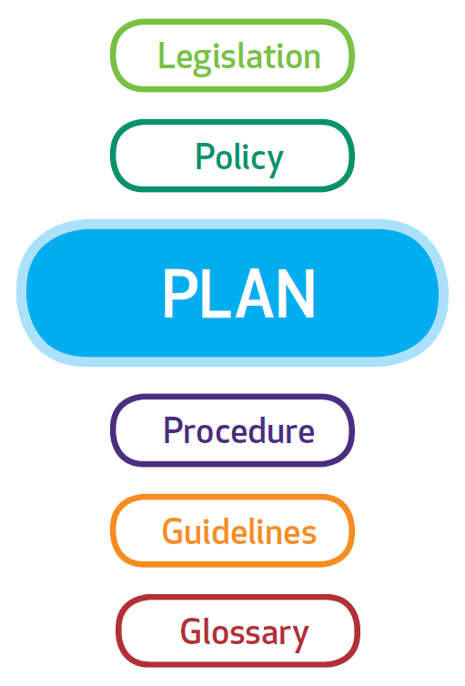
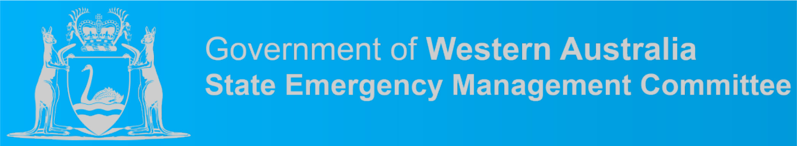
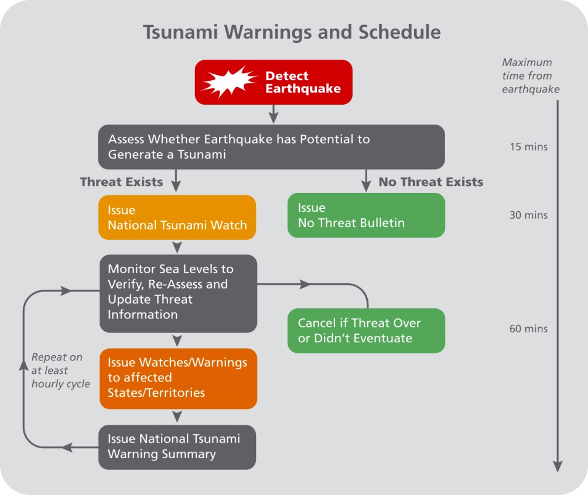

# Western Australia State Hazard Plan — Tsunami

> **Source**: WA SEMC
> **URL**: https://semc.wa.gov.au/Documents/Resources/LegislationPolicyPlansProcedureandGuidelines/Plans/StateHazardPlans/StateHazardPlanTsunami.pdf
> **Licence**: © Government of Western Australia; emergency-management practitioner reference
> **Retrieved**: 2026-05-07T23:42:30Z
> **SHA-256**: `097952d8d57841d32b0ca80b281c50ff1e538d14d67e723ee72e4037b6d39cda`
> **Archived copy**: Internet Archive Wayback Machine — `https://web.archive.org/web/20190315115759id_/https://semc.wa.gov.au/Documents/Resources/LegislationPolicyPlansProcedureandGuidelines/Plans/StateHazardPlans/StateHazardPlanTsunami.pdf`
> *(Live publisher URL no longer resolves; this archived snapshot was used for ingest. Cite the publisher URL above.)*
> *Converted from PDF to Markdown format.*

---
## Page 1

 
 
 
State Hazard Plan                  
Short plan name 
Page 1 of 27 
Note: This document contains information relating to the arrangements for 
managing emergencies resulting from the hazard of Tsunami. It must be read 
in conjunction with the State Emergency Management Plan, which contains 
the generic emergency management arrangements.  
STATE HAZARD PLAN 
 Tsunami 
Once printed, this is an uncontrolled version of the document. The current version is available on the State Emergency Management Committee Website:  www.semc.wa.gov.au 
 
Responsible Agency: 
Department of Fire and Emergency Services 
Approved by:  
State Emergency Management Committee 
Resolution Number: 
90/2018 
Version Number: 
V01.01 
Date of approval: 
07 December 2018 
Date of effect:  
21 December 2018 
Review date: 
 
August 2020

---
## Page 2

 
 
 
State Hazard Plan                  
TSUNAMI v 01.01 
Page i 
CONTACT OFFICER 
To provide comment on this Plan, contact: 
Department of Fire and Emergency Services  
20 Stockton Bend 
Cockburn Central WA 6164 
AMENDMENT TABLE 
Amendment 
Details 
Amended by: 
 
# 
Date 
1 
December 
2007 
Complete reissue. 
 
2 
September 
2010 
Complete review. 
 
3 
2015 
Complete review. 
 
4 
May 2016 
Statement of fact amendments. 
SEMC Secretariat 
5 
December 
2017 
New State Hazard Plan format, statement of fact changes, removal of duplication, 
inclusion of assurance activities, and Machinery of Government changes. 
DFES 
6 
December 
2018 
Version 01.01 – Statement of fact amendments. Refer also to the generic 
amendments to the suite of State EM documents as per amendments table v02.00 
approved by SEMC (Resolution Number 90/2018). 
SEMC Business Unit 
This State Hazard Plan is available on the State Emergency Management Committee website http://www.semc.wa.gov.au.

---
## Page 3

 
 
 
State Hazard Plan                  
TSUNAMI v 01.01 
Page ii 
CONTENTS 
Contact Officer ...................................................................................................................................................................................... i 
Amendment table .................................................................................................................................................................................. i 
Contents ............................................................................................................................................................................................... ii 
1 
Introduction ...................................................................................................................................................................................... 1 
1.1 
Background ................................................................................................................................................................................. 1 
1.2 
Scope .......................................................................................................................................................................................... 1 
1.3 
Hazard Definition ......................................................................................................................................................................... 2 
1.4 
Organisational Roles and Responsibilities .................................................................................................................................. 2 
1.4.1 
Australian Tsunami Advisory Group .................................................................................................................................. 2 
1.5 
Related Documents and Legislation ............................................................................................................................................ 3 
1.6 
Activities Informing the Assurance Process ................................................................................................................................ 3 
2 
Prevention and Mitigation ................................................................................................................................................................ 5 
2.1 
Responsibility for Prevention and/or Mitigation ........................................................................................................................... 5 
2.2 
Prevention and Mitigation Strategies ........................................................................................................................................... 5 
3 
Preparedness .................................................................................................................................................................................. 7 
3.1 
Responsibility for Preparedness .................................................................................................................................................. 7 
3.2 
Planning and Arrangements ........................................................................................................................................................ 7 
3.2.1 
The Western Australian Fire and Emergency Services (WAFES) Manual ........................................................................ 7 
3.2.2 
Resources ......................................................................................................................................................................... 7 
3.3 
Community Information and Education ....................................................................................................................................... 8 
3.4 
Assistance Arrangments with Other Jurisdictions ....................................................................................................................... 8 
4 
Response ....................................................................................................................................................................................... 10 
4.1 
Strategic Control Priorities ......................................................................................................................................................... 10 
4.2 
Responsibility for Response ...................................................................................................................................................... 10

---
## Page 4

 
 
 
State Hazard Plan                  
TSUNAMI v 01.01 
Page iii 
4.3 
Response Arrangements........................................................................................................................................................... 10 
4.4 
Notifications ............................................................................................................................................................................... 11 
4.4.1 
Distribution of Tsunami Bulletins and Warnings .............................................................................................................. 11 
4.5 
Types of Tsunami Warning system ........................................................................................................................................... 11 
4.5.1 
National No Threat Bulletin ............................................................................................................................................. 12 
4.5.2 
Tsunami Watch ............................................................................................................................................................... 12 
4.5.3 
Tsunami Warning ............................................................................................................................................................ 12 
4.5.4 
National Tsunami Warning Summary .............................................................................................................................. 12 
4.5.5 
Tsunami Watch/Warning Cancellation ............................................................................................................................ 13 
4.5.6 
Threat Levels within Tsunami Warnings .......................................................................................................................... 13 
4.5.7 
Emergency Alert .............................................................................................................................................................. 13 
4.5.8 
Standard Emergency Warning Signal (SEWS) ................................................................................................................ 13 
4.6 
Declaration of an Emergency Situation or State of Emergency ................................................................................................. 13 
4.7 
Evacuation Arrangements ......................................................................................................................................................... 14 
4.8 
Financial Arrangements ............................................................................................................................................................ 14 
5 
Recovery ........................................................................................................................................................................................ 15 
Appendix A: Distribution List .................................................................................................................................................................. 16 
Appendix B: Acronyms ........................................................................................................................................................................... 17 
Appendix C: Response Roles and Responsibilities ................................................................................................................................ 18

---
## Page 5

 
 
 
 
State Hazard Plan                  
TSUNAMI v 01.01 
Page 1 of 23 
1 
INTRODUCTION 
The State Hazard Plan for Tsunami (the Plan) provides an 
overview of arrangements for the management of tsunami in 
Western Australia and contains information on tsunami 
prevention, preparedness, response and initial recovery. 
The Plan refers to a range of existing plans and documents 
relating to tsunami but does not duplicate the information 
contained in these, instead providing directions to websites or 
other sources where further information can be obtained if 
required.  
The Fire and Emergency Services (FES) Commissioner is the 
Hazard Management Agency (HMA) for tsunami1. 
1.1 
BACKGROUND 
There have been a number of recorded incidents of tsunamis 
affecting the West Australian coastline since 1833.  Most of 
these tsunamis have resulted in dangerous rips and currents 
rather than land inundation.  The largest tsunami impacts in 
Australia have been recorded along the northwest coast of 
Western Australia2.  Research suggests that a tsunami 
originating from Indonesia could reach the WA coastline within 
two to four hours.  The impact of a tsunami hitting vulnerable, 
low-lying areas on the WA coast could be significant3. 
In a very rare4 and extreme tsunami it is possible for a number 
of residential and commercial properties in WA to be inundated 
                                            
1 Emergency Management Regulations 2006 s 17(2) 
2 BoM, Past tsunami events www.bom.gov.au/tsunami/history/index.shtml 
3 BoM, Tsunami frequently asked questions www.bom.gov.au/tsunami/info/faq.shtml  
and for adjoining roads and infrastructure to incur damage.  
Critical infrastructure such as gas, power and water supplies 
may also suffer extended outages in such a considerable 
tsunami. 
DFES and Geoscience Australia (GA) have worked, and 
continue to work in partnership to model a suite of tsunami 
impact scenarios for communities along the WA coast. 
Previous studies indicate that any one of the modelled events 
can impact the whole of the WA coastline with only a few hours 
of warning time available to the WA emergency management 
community.  This has implications for the management of a 
State wide response, and modelling worst-case tsunami events 
provides a valuable insight into evacuation planning5. 
1.2 
SCOPE 
This Plan covers emergency management arrangements within 
the geographic boundaries of WA, including adjacent waters, 
for the hazard of tsunami.  The Plan deals with risk reduction 
strategies, preparedness for, response to and initiation of 
recovery arrangements following the impact of a tsunami. 
 
 
4 average annual probability 0.01% 
5 Osuchowski, M. and Sexton, J., 2010, Tsunami Impact Scenarios for Mandurah, 
Western Australia. Geoscience Australia Professional Opinion. No.2010/03, p. 10.

---
## Page 6

 
 
 
 
State Hazard Plan                  
TSUNAMI v 01.01 
Page 2 of 23 
1.3 
HAZARD DEFINITION 
A tsunami is a natural phenomenon consisting of a series of 
waves generated when a large volume of water in the sea is 
rapidly displaced. Tsunamis are known for their capacity to 
inundate coastlines, causing property damage, injuries, and 
loss of life. The principal sources of tsunami are: 
• large submarine or coastal earthquakes, in which 
significant uplift or subsidence of the seafloor or coast 
occurs (this is the main source of tsunami); 
• underwater landslides, which may be triggered by an 
earthquake, or volcanic activity; 
• volcanic eruptions, such as underwater explosions or 
caldera collapse, pyroclastic flows and atmospheric 
pressure waves; and 
• meteor impact. 
Further detailed information on the tsunami hazard can be 
found at: 
Geoscience Australia (GA)  
 
http://www.ga.gov.au/scientific-topics/hazards/tsunami)  
Bureau of Meteorology (BoM)  
 
www.bom.gov.au/tsunami/?ref=ftr) 
 
                                            
6 Emergency Management Regulations 2006 s 17(2) 
1.4 ORGANISATIONAL ROLES AND RESPONSIBILITIES 
The FES Commissioner is the HMA for tsunami and is 
responsible for ensuring effective prevention, preparedness, 
response and recovery to this risk within the community6. 
The Department of Fire and Emergency Services (DFES) is 
responsible for the development, implementation and revision 
of this State Hazard Plan – Tsunami, in consultation with key 
stakeholders. 
It is recommended that each agency with a role or 
responsibility under this Plan has appropriate operational 
procedures detailing their response arrangements in 
accordance with this Plan. These arrangements should be 
complementary to the agency’s operational procedures 
detailing their roles and responsibilities under the State EM 
Plan. Additionally, agencies involved in tsunami response 
should maintain a Business Continuity Plan to ensure they 
maintain capabilities in the event of a major tsunami incident. 
A coordinated response to a tsunami requires emergency 
management agencies to undertake a variety of agreed and 
statutory responsibilities.  Information regarding the roles and 
responsibilities of relevant agencies under this Plan is detailed 
at Appendix B. 
1.4.1 Australian Tsunami Advisory Group 
The Australian Tsunami Advisory Group (ATAG) is a reference 
group of which DFES is a member.  Its membership comprises 
of emergency service representatives from each state and

---
## Page 7

 
 
 
 
State Hazard Plan                  
TSUNAMI v 01.01 
Page 3 of 23 
territory, Attorney-General’s Department, BoM, GA, and Surf 
Life Saving Australia. 
ATAG provides national leadership in programs and projects 
relating to tsunami response and recovery capability 
development aimed at enhancing community resilience and 
industry capability. It works as a consultative and coordinating 
forum to facilitate processes for effective national exchange of 
practice, research, information and knowledge management in 
relation to tsunami. 
1.5 
RELATED DOCUMENTS AND LEGISLATION 
This Plan is to be read in conjunction with the following 
documents: 
• Emergency Management Act 2005 (EM Act); 
• Emergency Management Regulation 2006 (EM 
Regulation); 
• Fire and Emergency Services Act and Regulations1998; 
• Local Government (Miscellaneous Provisions) Act 1960; 
• Occupational Safety & Health Act 1984;  
• Planning and Development Act 2005; 
• State Planning Policy 3.4 Natural Hazards and 
Disasters; 
• State Planning Policy 2.6 State Coastal Planning Policy; 
• the DFES Western Australian Fire and Emergency 
Services Manual; and 
• Local Emergency Management Arrangements. 
                                            
7 DFES Policy No 54: Operational Performance Assurance Policy, 2017 
1.6 
ACTIVITIES INFORMING THE ASSURANCE 
PROCESS 
The HMA ensures that aspects of operational performance are 
reviewed and that a consistent and structured approach is 
applied to all aspects of operational performance. This includes 
the implementation and evaluation of the outcomes (lessons 
identified, findings, recommendations, etc.) of such reviews7.  
Operational Performance Assurance activities identify and 
generate opportunities for improvement in operational 
performance to ensure that incident management and 
response capabilities are continuously improved to provide the 
most effective service to the community. The types of 
performance reviews conducted are: 
• Reactive operational performance reviews; 
• Live incident reviews; 
• Operational investigations; 
• Hot debrief; 
• Formal Operational Debrief; 
• Post Incident Analysis; 
• Major Incident Review; 
• External Reviews/Investigations; 
• Proactive Operational Performance reviews; 
• Post-Exercise Debrief; 
• Operational Readiness Review; and 
• External Agency Report Reviews. 
Information relating to two types of review (Post Incident 
Analysis (PIA) and Major Incident Reviews (MIR) conducted by

---
## Page 8

 
 
 
 
State Hazard Plan                  
TSUNAMI v 01.01 
Page 4 of 23 
DFES) is included in the DFES Annual Report; this is an 
essential component of external performance reporting to the 
Minister for Emergency Services, State Parliament and the 
wider community. This information also facilitates decision 
making affecting DFES operations8.  
Post Operation Reports shall be provided to SEMC in 
accordance with State EM Policy Section 5.11 and State EM 
Plan Section 5.7. 
 
 
                                            
8 DFES Directive – Operational Performance Assurance, 2017

---
## Page 9

 
 
 
 
State Hazard Plan                  
TSUNAMI v 01.01 
Page 5 of 23 
2 
PREVENTION AND MITIGATION 
2.1 
RESPONSIBILITY FOR PREVENTION AND/OR 
MITIGATION 
As the HMA, the FES Commissioner is responsible for 
undertaking prevention and/or mitigation activities in relation to 
the hazard of tsunami, within the limitations of its legislative 
powers9 and resource capabilities.   
LGs are responsible for planning in their local communities by 
ensuring appropriate local planning controls are consistent with 
the objectives and requirements set by the Western Australia 
Planning Commission (WAPC)10.  The WAPC is responsible for 
approving subdivision applications and has delegated powers 
for the determination of development applications to local 
governments and development assessment panels.  
2.2 
PREVENTION AND MITIGATION STRATEGIES 
The occurrence of tsunamis cannot be prevented, but risk 
treatment strategies contribute to the increased resilience and 
reduction in vulnerability of communities by proactively 
reducing the effects of hazardous events. 
Key strategies are employed to reduce the risks associated 
with tsunami emergencies.  These strategies are shown in 
Table 1.  
 
                                            
9 Emergency Management Act 2005, Fire and Emergency Services Act 1998 
Strategy 
Responsible Agency 
Tsunami inundation mapping.  
DFES, GA, Joint Australian 
Tsunami Warning Centre 
(JATWC) 
Application and enforcement of the 
Building Codes of Australia and 
informed land use planning for 
vulnerable areas.   
Local governments 
Participation in research and 
development programs directed 
towards identifying and implementing 
risk treatment strategies. 
DFES, ATAG, GA, and 
BoM 
Promoting an improved state of 
resilience within communities to 
improve the management of future 
risks. 
DFES 
Developing resilience in the 
community and minimising the 
vulnerability of communities to effects 
of tsunami. 
DFES in partnership with 
local governments 
Promotion of, and participation in, 
community awareness campaigns for 
‘at risk’ communities. 
Local governments 
assisted by DFES, BoM 
and WA Police Force 
Provision of tsunami advice to the 
community. 
DFES and JATWC 
10 WAPC State Planning Policy 3.4 Natural Hazards and Disasters, 
https://www.dplh.wa.gov.au/spp3-4

---
## Page 10

 
 
 
 
State Hazard Plan                  
TSUNAMI v 01.01 
Page 6 of 23 
Strategy 
Responsible Agency 
Participation in local and regional 
tsunami planning. 
Local government, BoM, 
DFES, DEMCs and LEMCs 
Ensuring the sustainability of service 
delivery of critical infrastructure 
through design and maintenance 
standards. 
Essential services and 
network operators 
Advising relevant agencies in relation 
to the construction/maintenance of 
critical infrastructure services and 
access in ‘at risk’ communities. 
Essential services and 
network operators 
Table 1 Tsunami Risk Reduction Strategies

---
## Page 11

 
 
 
 
State Hazard Plan                  
TSUNAMI v 01.01 
Page 7 of 23 
3 
PREPAREDNESS 
3.1 
RESPONSIBILITY FOR PREPAREDNESS 
As the HMA for tsunami, the FES Commissioner has 
responsibility for: 
• promoting resilience activities within communities to 
improve the management of future risks; and 
• promoting all emergency management activities related to 
tsunami preparedness is undertaken. 
3.2 
PLANNING AND ARRANGEMENTS 
Successful tsunami operations depend on sound planning, 
effective resource utilisation and a coordinated response which 
is timely, efficient and effective. 
The concept of this Plan is to employ and coordinate the 
resources of State and Australian Government departments, 
authorities and agencies; resources available to private 
industry; and resources available to volunteer groups, for 
tsunami operations.  This concept is based on: 
• availability of the DFES 24-hour State Operations Centre 
(SOC) for receipt of tsunami notification reports; 
• establishment of operational facilities at three levels 
(State, Regional and local), from which management of 
tsunami operations takes place; 
• deployment of emergency service personnel; 
• provision of expert technical advice on tsunami impact 
modelling by State and Australian Government agencies 
when requested by DFES; and 
• tasking of agencies in a coordinated manner in support of 
DFES.  Agency procedures are then employed to carry 
out tasks. 
3.2.1 The Western Australian Fire and Emergency 
Services (WAFES) Manual  
This Manual outlines the overall operational management 
structure and systems used by DFES for emergency 
preparedness and response throughout the State. It unites 
State Legislation, State Emergency Management Policies and 
Plans with the DFES's structures and its operational doctrine. It 
describes the FES Commissioner's intent for the role of DFES 
during emergencies in Western Australia. 
Where areas susceptible to tsunami are identified as a risk to 
the community DFES may develop Local and District tsunami 
plans to address the prevention, preparedness, response and 
recovery activities for tsunamis. 
3.2.2 Resources 
Resources used in tsunamis may be required at short notice 
and may include: urban search and rescue (USAR) resources, 
transport resources, earth moving machinery, cranes, shoring 
and tunneling equipment, signage, electricity generating plants, 
lighting, pumps, temporary toilet facilities, potable water, 
medical equipment and drugs.  
DFES is responsible for the overall provision and management 
of resources required to physically respond to an imminent or 
actual tsunami, including acquisition, pre-positioning and 
inventory management.  Emergency management agencies 
and support organisations are required to provide their own

---
## Page 12

 
 
 
 
State Hazard Plan                  
TSUNAMI v 01.01 
Page 8 of 23 
resources in the first instance and to make requests for 
additional resources to DFES as required. 
Whilst industry is required to have emergency plans in place, 
sometimes these plans have included additional preparedness 
provisions. Ideally, these will be made available via LEMAs on 
LG websites. 
In certain areas, some industry groups have established mutual 
aid agreements and/or systems that contribute to the reduction 
of the effects of an emergency through rapid response and 
improved response capability. 
The identification of appropriate and adequate resources and 
expertise is essential to preparedness for a tsunami.  Planning 
at all levels should reference resource management, inventory 
and acquisition arrangements. 
Where an operation is beyond the resources of the State, a 
request for assistance from other jurisdictions may be made in 
accordance with paragraph 3.4. 
3.3 
COMMUNITY INFORMATION AND EDUCATION 
DFES, BoM, GA, ATAG and local governments provide a 
contribution to education programs developed to inform and 
educate the public on tsunami notification, risk and 
management. 
During a tsunami, DFES will provide community information in 
a coordinated manner through the Incident Controller (IC) 
and/or Operational Area Manager (OAM).  
Media and public information strategies are reviewed annually 
by DFES to ensure appropriate communication of tsunami 
information to the community. 
3.4 ASSISTANCE ARRANGMENTS WITH OTHER 
JURISDICTIONS 
Should a tsunami event be beyond the resources of the State, 
support may be requested from the Australian Government, 
other States or overseas. 
Deployment will be managed by the agency employing the 
deployed personnel in accordance with individual agency policy 
and directives. DFES must be notified of any significant 
resources being committed to interstate deployments. The 
Minister responsible for DFES is to be notified before any 
interstate deployment of their respective personnel. 
Assistance to interstate, overseas and other jurisdictions for 
tsunami emergencies will be coordinated at a state level by 
DFES.  This will include determination of the process involved 
and recognition of pre-existing arrangements for inter-
jurisdictional assistance by other agencies where such 
arrangements exist. 
The Arrangements for Interstate Assistance (AIA) provides for 
mutual assistance between Australian emergency services. It is 
for domestic use within Australia, which may involve New 
Zealand resources. Strong partnerships, goodwill and 
cooperation across organisations and interstate boundaries are 
essential to this process.  
International arrangements are very similar to state 
arrangements however a rigorous checklist applies to support

---
## Page 13

 
 
 
 
State Hazard Plan                  
TSUNAMI v 01.01 
Page 9 of 23 
effective response as these are often for longer durations. The 
CCOSC and NRSC are primary contacts to support a 
deployment with Director General of EMA ultimately 
responsible for coordination of deployment requests interstate 
and internationally. 
All requests for Australian Government Physical Assistance are 
to be made in accordance with State EM Policy Section 5.10 
and State EM Plan Section 5.6.

---
## Page 14

 
 
 
 
State Hazard Plan                  
TSUNAMI v 01.01 
Page 10 of 23 
4 
RESPONSE 
This section reflects business as usual and highlights changes 
that occur in the event of an Emergency Situation or State of 
Emergency being declared. 
4.1 STRATEGIC CONTROL PRIORITIES 
The Strategic Control Priorities for tsunamis are: 
• Protection and Preservation of Life: This is the 
fundamental overarching priority for the State, and 
includes:  
o safety of emergency services personnel.  
o safety of community members including vulnerable 
community members and visitors/tourists located within 
the incident area.  
• Community warnings and information  
• Protection of critical infrastructure and community assets  
• Protection of residential property  
• Protection of assets supporting individual livelihood and 
community financial sustainability  
• Protection of environmental and heritage values.  
The above priorities are not hierarchical; however protection 
and preservation of life must be paramount when developing 
incident action plans that identify the priority roles and actions 
for the emergency management response, where there are 
concurrent risks or competing priorities11. 
                                            
11 The Strategic Control Priorities for Fire, SEMC Bulletin No. 1, October 2016.  
4.2 
RESPONSIBILITY FOR RESPONSE 
As the HMA, the FES Commissioner has responsibility for 
responding to emergencies in relation to tsunami. 
DFES is the Controlling Agency for tsunami emergencies in 
Western Australia and is responsible for activating and 
controlling the response to such an emergency. 
4.3 
RESPONSE ARRANGEMENTS 
DFES will undertake a range of pre-emptive activities prior to 
the onset of the hazard, during times of potential threat, or 
reactively post impact.  This may include a range of actions by 
regions, State Operation Centre (SOC), Metropolitan Operation 
Centre (MOC) or a Regional Operation Centre (ROC) to 
support operations12.  
DFES will promptly and deliberately instigate Incident 
Management Teams (IMTs) appropriate to the scale and 
requirements of the emergency in accordance with the State’s 
emergency management arrangements. Tsunamis can have 
large impact areas. Therefore a tsunami response may be 
managed by numerous IMTs working through multiple 
Operational Area Managers in a number of geographically 
diverse facilities. 
The level of implementation of plans and operational structures 
can vary considerably depending upon circumstances.  Factors 
which may influence the level of response include the degree of 
threat to a community, the number of DFES regions impacted 
12 DFES, Fire & Emergency Services Manual – Part Two, 2016, p. 5.

---
## Page 15

 
 
 
 
State Hazard Plan                  
TSUNAMI v 01.01 
Page 11 of 23 
by the tsunami and whether a multi-agency response is 
required. 
If the tsunami is likely to result in a significant event, which may 
have a large impact on WA attracting national attention, DFES 
will send Situation Reports to the Australian Government Crisis 
Coordination Centre (CCC) regarding actions taken for this 
event.  This will assist in providing Whole of Australian 
Government situational awareness. 
Should another hazard occur as a consequence of a tsunami 
emergency and, if DFES is not the HMA/Controlling Agency for 
the consequent hazard then the provisions of State EM Plan 
section 5.1.2 will apply. DFES shall remain responsible for the 
overall management of the tsunami emergency.  
4.4 
NOTIFICATIONS 
The Joint Australian Tsunami Warning Centre (JATWC) is run 
jointly by BoM and GA and operates 24 hours a day.  The 
JATWC detects, monitors, verifies and warns of any tsunami 
threat to the coastline of Australia and its offshore territories. It 
provides a comprehensive, independent tsunami warning 
service to advise the media, public and emergency authorities 
of any tsunami threat to Australia and its offshore territories. 
The JATWC issues Tsunami Watches and Tsunami Warnings 
(described below). These are used in BoM and DFES alerts to 
alert participants in State Hazard Plan – Tsunami.  The BoM 
Perth Regional Forecasting Centre (RFC) is the primary liaison 
point for DFES during a tsunami. 
4.4.1 Distribution of Tsunami Bulletins and Warnings 
Media organisations across WA work with DFES and BoM to 
inform the public in the case of a tsunami event.  Tsunami 
warning distribution lists are maintained at BoM Perth RFC.  
These distribution lists are used for both the National Bulletins 
and Regional Warnings and are all issued through JATWC.  In 
addition to the media, key agencies such as DFES, emergency 
services, local councils, port authorities, and police are 
included on these dissemination lists.  The bulletin and warning 
messages are also automatically uploaded to the BoM website 
and a phone advice line (1300 TSUNAMI or 1300 878 6264).  
4.5 
TYPES OF TSUNAMI WARNING SYSTEM 
If the tsunami has been generated by an earthquake, the 
Australian Government Crisis Coordination Centre (CCC) 
would have already notified DFES of the earthquake as per 
their Standard Operating Procedures. 
There are five different types of Tsunami Warning messages as 
described in the following paragraphs and in Figure 2 below.

---
## Page 16

 
 
 
 
State Hazard Plan                  
TSUNAMI v 01.01 
Page 12 of 23 
 
Figure 2 Tsunami Warnings and Schedule13 
4.5.1 National No Threat Bulletin 
Where JATWC have determined there has been an undersea 
earthquake, or other causal event, but there is no tsunami 
threat to Australia, the JATWC will issue a National No Threat 
Bulletin.  
                                            
13 www.bom.gov.au/tsunami/about/tsunami_warnings.shtml 
4.5.2 Tsunami Watch 
If JATWC advises that a Tsunami Watch is current off the WA 
coast, the CCC will notify DFES of the warning issued and 
advise them to monitor the BoM website. WA’s BoM’s Regional 
Offices will also be notified of the warnings by JATWC.  
Where JATWC determines there has been an undersea 
earthquake or other event which has potential to cause a 
tsunami threat to Australia, the JATWC will issue a National 
Tsunami Watch.  If a tsunami remains unconfirmed by sea level 
observations and any potential first point of impact on Australia 
is more than 90 minutes away (the minimum time criteria for 
warning), then the National Tsunami Watch may be reissued.  
A State-based watch may be issued if a ‘warning’ or ‘no threat’ 
exists for other parts of Australia. 
4.5.3 Tsunami Warning 
If sea level observations and further data confirm the tsunami 
threat, the JATWC will issue a Tsunami Warning through its 
warning system communication infrastructure.  Alternatively, 
even if sea level observations have not yet detected the 
tsunami, but the potential first point of impact is less than 90 
minutes away, then a Tsunami Warning will also be issued.  
4.5.4 National Tsunami Warning Summary 
When separate tsunami watches or warnings are being issued 
for individual States and Territories, a National Tsunami 
Warning Summary will also be issued listing all the watches,

---
## Page 17

 
 
 
 
State Hazard Plan                  
TSUNAMI v 01.01 
Page 13 of 23 
warnings and cancellations that are in effect for the current 
tsunami event. 
The BoM website (www.bom.gov.au/tsunami/?ref=ftr) will 
provide a complementary coastal threat graphic showing the 
regions currently under threat. 
4.5.5 Tsunami Watch/Warning Cancellation  
When the main threat has passed or if a tsunami does not 
eventuate, the JATWC will issue a Tsunami Watch 
Cancellation or Tsunami Warning Cancellation.  A National 
Tsunami Event Summary is then issued after the event.  
4.5.6 Threat Levels within Tsunami Warnings 
Tsunami threat levels are specified for each of the coastal 
areas used for routine BoM Coastal Waters Forecasts. 
Regional Tsunami Warnings are categorised into three levels 
with required community responses as follows: 
• No threat:  An undersea earthquake has been detected, 
however it has not generated a tsunami, or the tsunami 
poses no threat to Australia and its offshore territories. 
• Marine and immediate foreshore threat: Warning of 
potentially dangerous waves, strong ocean currents in the 
marine environment and the possibility of only some 
localised overflow onto the immediate foreshore. 
• Land inundation threat: Warning for low-lying coastal 
areas of major land inundation, flooding, dangerous 
waves and strong ocean currents.  
 
                                            
14 Fire and Emergency Services Act 1998 s 18B 
4.5.7 Emergency Alert 
Emergency Alert is a warning system that uses web technology 
to send alerts to home phones and mobiles. It is an additional 
public information tool that can be used for any emergency 
where there is an imminent threat, to alert people in a specific 
location. 
The IC or Public Information Officer can request an Emergency 
Alert by calling the DFES State Situation Analysis Officer.  
4.5.8 Standard Emergency Warning Signal (SEWS) 
The Standard Emergency Warning Signal (SEWS) is a 
distinctive siren sound to alert the community to the broadcast 
of an urgent safety message relating to a major emergency. 
SEWS is intended for use as an alert signal to be played on 
public media such as radio, television, or public address 
systems to draw listeners’ attention to the emergency warning 
that follows. SEWS should only be used when issuing 
Emergency Warnings as there is a need to warn people to take 
urgent and immediate action to reduce the potential for loss of 
life or property from emergency events. Note that it is not 
required for all Emergency Warnings. 
4.6 
DECLARATION OF AN EMERGENCY SITUATION 
OR STATE OF EMERGENCY 
The FES Commissioner has powers in relation to natural 
disasters under the Fire and Emergency Services Act 199814.  
These powers are wide-ranging and are normally adequate to 
respond to tsunami emergencies.  Should additional powers be 
required, the EM Act 2005 can be used to access emergency

---
## Page 18

 
 
 
 
State Hazard Plan                  
TSUNAMI v 01.01 
Page 14 of 23 
powers through the declaration of an ‘Emergency Situation’15 or 
a ‘State of Emergency’16. 
4.7 
EVACUATION ARRANGEMENTS 
Evacuation is a risk mitigation strategy that may be used to 
mitigate the effects of an emergency on a community. The 
decision to evacuate is complex and requires careful 
consideration to ensure residents are not placed at greater risk. 
Facilities and community groups ensure that appropriate 
actions are taken to ensure the best possible safety of the 
community. This may include the identification of refuges and 
safer places as required. DFES retains a list of evacuation 
centres provided by the Department of Communities and 
manages the sharing of centre activations and status through 
WebEOC. 
Refuge sites and evacuation centres should be identified in 
LEMAs17, and are identified and established in partnership with 
LG and Department of Communities. 
4.8 
FINANCIAL ARRANGEMENTS 
Where no additional arrangement has been made with DFES, 
only expenditure approved by the IC, OAM or DFES Duty 
Assistant Commissioner will be funded by DFES. 
The SEMC website details the criteria for a variety of funding 
situations and should be consulted tom determine the funding 
arrangements. 
                                            
15 Emergency Management Act 2005 s 50 
16 Emergency Management Act 2005 s 56 
 
 
17 State EM Policy Statement 5.7.4

---
## Page 19

 
 
 
 
State Hazard Plan                  
TSUNAMI v 01.01 
Page 15 of 23 
5 
RECOVERY 
The HMA or Controlling Agency has a role in initiating both 
relief and recovery during emergencies. It is the responsibility 
of the Controlling Agency to undertake an Initial Impact 
Assessment (IIA) during the response to an emergency 
incident and a Comprehensive Impact Assessment (CIA) prior 
to concluding response activities. Both the IIA and the CIA 
must be provided to the members of the Incident Support 
Group (ISG), Recovery Coordinators and the ROC/MOC and 
OAM.  
The Controlling Agency with responsibility for the response to 
an emergency will initiate recovery activity during the response 
to that emergency. To facilitate recovery it will: 
• liaise with the Local Recovery Coordinator/s where the 
emergency is occurring and include them in the incident 
management arrangements including the ISG and OASG; 
• undertake an initial impact assessment for the emergency 
and provide that assessment to the Local Recovery 
Coordinator and the State Recovery Coordinator; 
• coordinate completion of the CIA, prior to cessation of the 
response, in accordance with the approved procedure, 
and in consultation with the ISG, all affected local 
governments and the State Recovery Coordinator; and 
• Provide risk management advice to the affected 
community (in consultation with the HMA). 
                                            
18 DFES, WA Fire and Emergency Services Manual – Part One: Overview, 2017, p. 
20. 
The impacted local government is responsible for managing the 
community recovery process. 
During emergencies, the respective Controlling Agency will 
ensure that relief agencies are provided access to the affected 
community; however at all times will ensure that access to the 
affected area is limited to ensure community safety, security 
and welfare. The Controlling Agency will assist relief agencies 
to deliver essential services in safe and accessible community 
based locations18. 
Recovery activities will be undertaken in accordance with the 
State EM Policy Section 6, State EM Plan Section 6, and will 
commence during the response phase. As such, there needs to 
be high levels of understanding and cooperation between 
response and recovery organisations at each level (State, 
District, local).

---
## Page 20

 
 
 
 
State Hazard Plan                  
TSUNAMI v 01.01 
Page 16 of 23 
APPENDIX A: DISTRIBUTION LIST 
This State Hazard Plan for tsunami is available on the SEMC 
website (www.semc.wa.gov.au). The agencies below will be 
notified by the HMA (unless otherwise specified) when an 
updated version is published on this website. 
• All agencies and organisations with responsibilities under 
this Plan 
• Emergency Management Australia (SEMC Business Unit 
to notify) 
• Minister for Emergency Services (SEMC Business Unit to 
notify) 
• Minister for Planning  
• Minister for Police  
• State Emergency Management Committee 
(SEMC),SEMC subcommittee and SEMC reference group 
members (SEMC Business Unit to notify) 
• State Library of Western Australia (SEMC Business Unit 
to notify).

---
## Page 21

 
 
 
 
State Hazard Plan                  
TSUNAMI v 01.01 
Page 17 of 23 
APPENDIX B: ACRONYMS 
AIA 
 
Arrangements for Interstate Assistance 
ATAG  
Australian Tsunami Advisory Group 
CCC 
Australian Government Crisis Coordination 
Centre 
CCOSC 
Commissioners and Chief Officers Strategic 
Committee 
GA 
 
Geoscience Australia 
IIA 
 
Initial Impact Assessment 
JATWC 
Joint Australian Tsunami Warning Centre 
NRSC  
National Resource Sharing Centre 
RFC  
Regional Forecasting Centre 
SOCMET 
State Operation Meteorologist 
WAPC 
Western Australian Planning Commission

---
## Page 22

 
 
 
 
State Hazard Plan                  
TSUNAMI v 01.01 
Page 18 of 23 
APPENDIX C: RESPONSE ROLES AND RESPONSIBILITIES 
Introduction 
DFES, through the FES Commissioner as the HMA, has the primary role of coordinating the response to tsunami emergencies. 
However, DFES requires the support and assistance of other organisations to ensure an integrated community response occurs.  
Agency Responsibilities 
The following are the response roles and responsibilities of agencies under this Plan. Brief all-hazards information is also provided for 
agencies who may have a role under this Plan – full details of these roles and responsibilities can be found in the State Emergency 
Management (EM) Plan, Appendix E.   
Note: The capability and commitment of each local government to undertake the tasks and meet the responsibilities identified in this 
State Hazard Plan should be confirmed by the HMA and detailed in Local Emergency Management Arrangements.  This will ensure 
the varying capabilities of individual local governments are recognised. 
Organisation 
Response Responsibilities (see State EM Plan Appendix E for full all-hazards roles and 
responsibilities) 
Bureau of Meteorology 
 
a. Provide 24/7 tsunami warning services to Australia together with Geoscience Australia as JATWC. 
b. Provide a tsunami, interpretation and notification service when a tsunami warning is issued. 
c. Participate in research and development of tsunami models and techniques to improve tsunami 
notification. 
d. Establish and maintain data collection networks and monitor tsunami events.  
e. Contribute to the planning, installation and maintenance of new and improved tsunami notification 
systems. 
f. Participate in community awareness programs on tsunami warning systems. 
g. Provide a State Operations Centre Meteorologist (SOCMET) to DFES State Operations Centre, during 
normal working hours and/or after hours.  Alternative liaison officers are Regional Manager Severe 
Weather, Regional Forecasting Centre Operations Manager, Manager Weather Services or Regional 
Director as required. 
h. Provide a representative for SECG, if required.

---
## Page 23

 
 
 
 
State Hazard Plan                  
TSUNAMI v 01.01 
Page 19 of 23 
Organisation 
Response Responsibilities (see State EM Plan Appendix E for full all-hazards roles and 
responsibilities) 
Department of 
Communities 
a. Coordinate welfare services for those impacted by the incident including operating welfare centres and 
providing crisis support services (emergency accommodation, emergency clothing and personal 
requisites, personal services, financial assistance, emergency catering), as required. 
b. Coordinate and facilitate registration and reunification, including arranging for Register.Find.Reunite. to 
be activated via the Australian Red Cross, as required. 
c. In consultation with DFES, and consideration of available resources, determine the number and location 
of evacuation centres to be opened during a tsunami emergency. 
d. Provide a liaison officer to DFES SOC, if required. 
e. Provide a representative for SECG, if required. 
Department of Fire & 
Emergency Services  
 
a. Discharge the duties of HMA and Controlling Agency for tsunami emergencies, in accordance with the 
EM Act and State EM Policy Section 5 and State EM Plan Section 5. 
b. Ensure the development and maintenance of response and risk treatment plans specific to tsunamis. 
c. Recommend the adoption of risk treatment strategies to State, District and Local Emergency 
Management Committees. 
d. In cooperation with other agencies, provide communities with tsunami risk awareness, information and 
education. 
e. Raise, train and equip an emergency service capable of responding to the effects of a tsunami. 
f. Liaise with local government in the provision of incident control centres in tsunami susceptible areas of 
the State. 
g. Appoint emergency managers at all levels for a particular tsunami. 
h. Facilitate the provision of assistance as required. 
i. Request activation of a SECG if required.

---
## Page 24

 
 
 
 
State Hazard Plan                  
TSUNAMI v 01.01 
Page 20 of 23 
Organisation 
Response Responsibilities (see State EM Plan Appendix E for full all-hazards roles and 
responsibilities) 
Department of Health 
a. Coordinate the health response during a tsunami, including the activation of the State Health Emergency 
Response Plan if required.  
b. Advise DFES on all medical and health aspects in relation to a tsunami situation 
c. Through the hospital stream, provide acute medical care and relief to injured persons. 
d. Through the public health stream, provide environmental health, public health, mental health and 
communicable disease control services, as required. 
e. Maintain an awareness of the readiness of health service infrastructure including assessment of impact 
on clinical services, response and/or evacuation requirements. 
f. Provide health advice and support to the designated recovery committee.  
g. Provide acute health services, particularly to those persons within the affected community who have 
chronic medical conditions. 
h. Provide a liaison officer to DFES SOC, if required. 
i. Provide a representative for SECG, if required. 
Department of 
Planning, Lands and 
Heritage 
a. Incorporate tsunami risk treatment measures into state and local planning and development processes. 
b. Provide a liaison officer to DFES SOC, if required. 
c. Provide a representative for SECG, if required. 
Emergency 
Management Australia  
 
a. Notify DFES regarding seismic events magnitude 3.5 and above within WA.  
b. Notify DFES regarding a Tsunami Watch, warning messages and Tsunami Watch/Warning Cancellation.  
c. Activate COMDISPLAN if required to provide Australian Government non-financial assistance.  
d. Provide a Liaison Officer to DFES’s SOC if required.  
e. If required, develop an Australian Government Incident Brief.  
f. If required, develop Australian Government Talking Points.

---
## Page 25

 
 
 
 
State Hazard Plan                  
TSUNAMI v 01.01 
Page 21 of 23 
Organisation 
Response Responsibilities (see State EM Plan Appendix E for full all-hazards roles and 
responsibilities) 
Energy Suppliers and 
Network Managers 
 
a. Disconnect and restore energy services as prioritised by DFES or the designated recovery authority.  
Restoration priority will include consideration of other lifeline interdependence requirements. 
b. Provide technical advice to DFES in relation to energy supply, disconnection and restoration. 
c. Assist in the provision of emergency energy as requested by DFES or the designated recovery authority. 
d. Provide a liaison officer to DFES SOC, if required. 
e. Provide a representative for SECG, if required. 
Local governments 
 
a. Participate in community awareness programs on tsunami risks. 
b. Provide resources to assist DFES when requested. 
c. Make available suitable local government buildings to be used as evacuation centres. 
d. Close and open roads within their jurisdiction, when requested by DFES. 
e. Provide details on road conditions to DFES. 
f. Initiate and lead the local community through the recovery process. 
g. Inspect and declare buildings safe and fit for habitation. 
Main Roads WA 
 
a. Provide advice to DFES of the potential and actual impacts of tsunamis on the State road network.   
b. Close and open State roads when requested to do so by DFES.  This Plan recognises that the 
Commissioner of Main Roads (or delegated Officers) has the power to close or open roads under the 
Main Roads Act 1930. 
c. Assist in the recovery process through State road and State road infrastructure repair and 
reconstruction. 
d. Communicate road closures to the public. 
e. Provide a liaison officer to DFES SOC, if required. 
f. Provide a representative for SECG, if required.

---
## Page 26

 
 
 
 
State Hazard Plan                  
TSUNAMI v 01.01 
Page 22 of 23 
Organisation 
Response Responsibilities (see State EM Plan Appendix E for full all-hazards roles and 
responsibilities) 
Public Transport 
Authority 
 
a. Provide advice to DFES of the potential and actual impacts of a tsunami on the public transport system.   
b. Close and open transport services when requested by DFES.   
c. Assist in the recovery process through rail infrastructure repair and reconstruction. 
d. Communicate service closures to the public. 
e. Provide a liaison officer to DFES SOC, if required. 
f. Provide a representative for SECG, if required. 
Surf Life Saving WA 
a. Support DFES in conducting beach evacuations and warnings.  
b. Provide real time aerial surveillance through SLSWA Drone and Helicopter services. 
c. Assist in the recovery process through provision of assets for inshore rescue/recovery post impact.  
d. In the event of mass casualties provide on-scene first responders/first aiders. 
e. Provide a liaison officer to DFES SOC, if required. 
f. Provide access to SLSWA’s Beach Camera Surveillance Network 
Telstra 
 
a. Provide advice regarding the provision of emergency communications services. 
b. Give priority consideration to emergency communications requirements of authorities responsible for 
hazard and emergency management within WA.  Actual service provision and restoration priorities will 
depend on Telstra’s network configuration, the safety and availability of staff, material availability, local 
community issues and national and local security issues. 
c. Provide a liaison officer to DFES SOC, if required. 
Water Corporation WA 
a. Restore water supplies and sewerage systems as prioritised by DFES or the designated recovery 
coordinator. 
b. Ensure water quality delivered by the system meets appropriate health standards.  
c. Provide a liaison officer to DFES SOC, if required. 
d. Assist with the provision of potable water to affected communities until normal services are restored.

---
## Page 27

 
 
 
 
State Hazard Plan                  
TSUNAMI v 01.01 
Page 23 of 23 
Organisation 
Response Responsibilities (see State EM Plan Appendix E for full all-hazards roles and 
responsibilities) 
Western Australia 
Police Force 
a. Support DFES in conducting evacuations.  
b. Assist DFES with security of evacuated areas. 
c. In the event of mass casualties provide Disaster Victim Identification. 
d. Assist with the provision of road traffic management where appropriate. 
e. Provide a liaison officer to DFES SOC, if required. 
f. Provide an emergency coordinator to the IMT/ISG and/or OASG 
    Provide a representative for SECG, if required.

