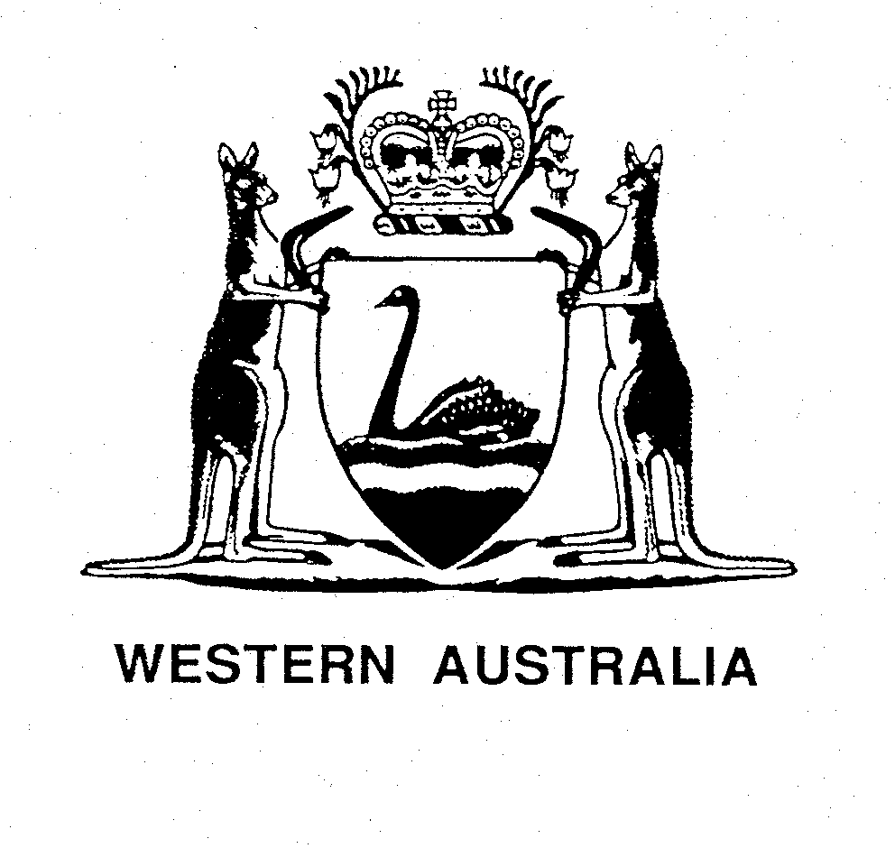
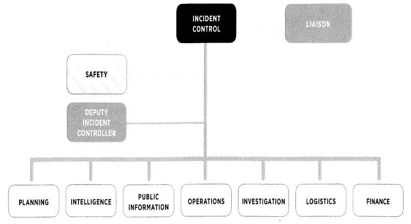
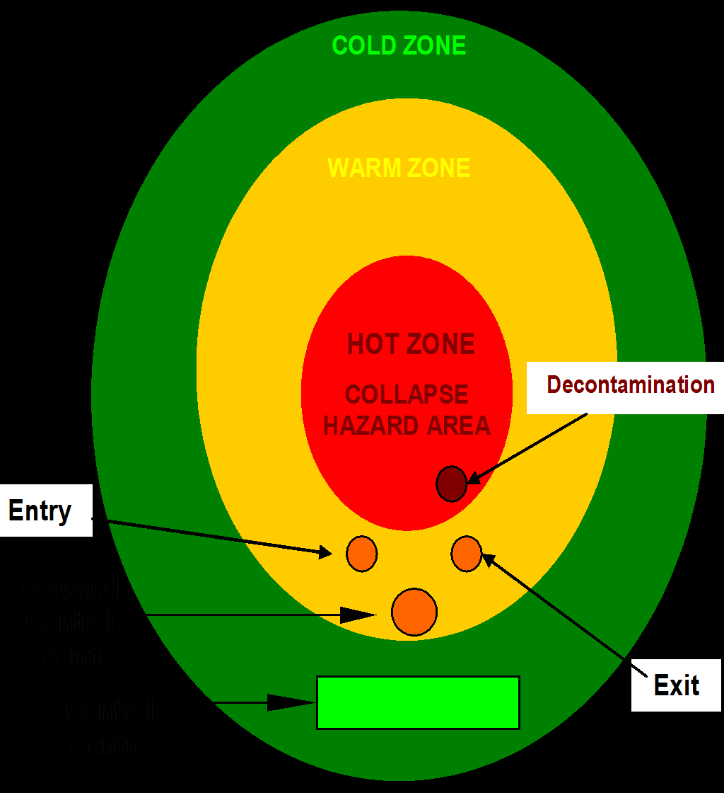

# Westplan — Collapse (SEMC approved 24 May 2016)

> **Source**: WA SEMC
> **URL**: https://semc.wa.gov.au/Documents/Resources/LegislationPolicyPlansProcedureandGuidelines/Plans/Westplans2016/WestplanCollapseSEMCapproved24052016.pdf
> **Licence**: © Government of Western Australia; emergency-management practitioner reference
> **Retrieved**: 2026-05-07T23:42:47Z
> **SHA-256**: `d652e53ebf3b8e820a373316b77a53b1d1363c4edd6f73c7f246458c2bb4f91e`
> **Archived copy**: Internet Archive Wayback Machine — `https://web.archive.org/web/20190315115616id_/https://semc.wa.gov.au/Documents/Resources/LegislationPolicyPlansProcedureandGuidelines/Plans/Westplans2016/WestplanCollapseSEMCapproved24052016.pdf`
> *(Live publisher URL no longer resolves; this archived snapshot was used for ingest. Cite the publisher URL above.)*
> *Converted from PDF to Markdown format.*

---
## Page 1

STATE HAZARD PLAN 
 
FOR 
 
THE MANAGEMENT OF EMERGENCIES 
ASSOCIATED WITH A  
COLLAPSE 
 
 
(WESTPLAN - COLLAPSE) 
 
Prepared by 
Department of Fire and Emergency Services 
 
 
 
 
APPROVED AT STATE EMERGENCY MANAGEMENT COMMITTEE  
MEETING: 
RESOLUTION NO:  
19/2016 
DATE OF APPROVAL: 
24 May 2016 
REVIEW DATE: 
 
October 2019

---
## Page 2

 
Contact Officer 
To provide comment on this plan, contact: 
Superintendent Special Operations Response 
Department of Fire and Emergency Services 
08 9395 9853 
 
 
Amendment List 
 
 
AMENDMENT 
DETAILS 
AMENDED BY 
NO. 
DATE 
 
INITIALS 
 
June 2008 
Initial issue. 
RC 
1 
June 2013 
Reviewed date amended to June 2018 
CURTIS 22883 
2 
December 
2013 
Schedule Review 
DFES 
3 
May 2016 
Statement of fact amendments 
SEMC 
Secretariat 
4 
August 2018 
Extension of review date granted by SEMC 
(resolution number 44/2018) 
DFES 
5 
 
 
 
6 
 
 
 
7 
 
 
 
8 
 
 
 
9 
 
 
 
10 
 
 
 
 
 
A copy of this Westplan is available at  
www.semc.wa.gov.au/resources/policies-and-plans/westplans

---
## Page 3

 
WESTPLAN – Collapse – May 2016 
2 
Table of Contents 
 
Amendment List ................................................................................................ 2 
PART 1 
INTRODUCTION .............................................................................. 4 
1.1 
Aim and Objectives ........................................................................... 4 
1.2 
Scope ................................................................................................ 4 
1.3 
Hazard definition ............................................................................... 5 
1.4 
Related documents ........................................................................... 5 
1.5 
Authority to plan ................................................................................ 6 
1.6 
Plan responsibilities........................................................................... 7 
1.7 
Exercise and review periods ............................................................. 7 
1.8 
Organisational roles and responsibilities ........................................... 8 
PART 2 
PREVENTION AND MITIGATION ................................................... 9 
2.1 
Responsibility for prevention and/or mitigation .................................. 9 
2.2 
Legislation and Codes ....................................................................... 9 
2.3 
Prevention strategies ......................................................................... 9 
2.4 
Mitigation strategies .......................................................................... 9 
PART 3 
PREPAREDNESS .......................................................................... 10 
3.1  
Responsibility for preparedness ....................................................... 10 
3.2 
Planning and arrangements ............................................................ 10 
3.3 
Community education ...................................................................... 11 
3.4 
Evacuation arrangements ............................................................... 11 
3.5 
Local emergency management arrangements ................................ 11 
3.6 
Western Australia border agreements ............................................. 12 
3.7 
Arrangement for assistance from other jurisdictions........................ 12 
3.8 
Arrangements for assistance to other jurisdictions .......................... 13 
PART 4 
RESPONSE ................................................................................... 14 
4.1 
Responsibility for response ............................................................. 14 
4.2 
Notification ...................................................................................... 14 
4.3 
Levels of response .......................................................................... 15 
4.4 
Activation of this plan ...................................................................... 16 
4.5 
Incident management system ......................................................... 16 
4.6 
Hazard management structure/arrangements ................................. 18 
4.7 
Evacuation arrangements ............................................................... 19

---
## Page 4

 
WESTPLAN – Collapse – May 2016 
3 
4.8 
Function support plans .................................................................... 20 
4.9 
Public information and media management .................................... 21 
4.10 
Activation of other WESTPLANS in support of this plan .................. 21 
4.11 
Financial arrangements for response .............................................. 21 
PART 5     RECOVERY .................................................................................. 22 
5.1 
Responsibility for recovery .............................................................. 22 
5.2 
Transition to recovery ...................................................................... 22 
5.3 
Impact assessment and needs assessments .................................. 23 
PART 6     STAND DOWN AND DEBRIEFS ................................................. 24 
6.1 
Stand down and debriefs ................................................................. 24 
6.2 
Post Incident analysis ...................................................................... 24 
APPENDIXES ................................................................................................. 25 
7.1 
Appendix A - Distribution list ........................................................... 25 
7.2 
Appendix B - Glossary of terms/acronyms ...................................... 26 
7.3 
Appendix C - Organisational roles and responsibilities ................... 27

---
## Page 5

 
WESTPLAN – Collapse – May 2016 
4 
PART 1 
INTRODUCTION 
Westplan - Collapse is the State’s emergency management plan activated 
when people have been trapped as a consequence of a collapse.  It is 
imperative that organisations assigned responsibility with this plan take the 
appropriate steps required to meet the requirements of WESTPLAN - 
COLLAPSE to ensure a rapid, coordinated and effective response to collapse 
emergencies. 
Westplan - Collapse outlines the roles and responsibilities of relevant 
government agencies and industry. They will be involved in a response to 
collapse emergency because of their legislative responsibility, mission, legal 
obligation or agreed responsibilities. 
1.1 Aim and Objectives 
1.1.1   Aim: 
The aim of WESTPLAN - Collapse is to detail the agreed 
emergency management arrangements for collapse emergencies 
throughout the State of Western Australia. 
1.1.2   Objectives.  
1. 
Promote existing, and identify and encourage the application 
of enhanced preparedness measures throughout the State; 
2. 
Establish the control arrangements and support systems 
appropriate for collapse emergencies, that are  in line with 
the Emergency Management Act 2005, the State EM Policy, 
State EM Plan, State EM Procedures, the legislative 
responsibilities of government agencies, and the obligations 
of industry; 
3.  
Identify the roles and responsibilities of all agencies that 
have a potential involvement at a collapse emergency; 
4. 
Establish a coordinated approach to preparedness and 
response by all agencies to collapse emergencies through 
prescribed lines of communication, identified resource 
inventories and agreed response procedures; 
5. 
Identify the available resources in terms of personnel, 
technical expertise and equipment for collapse emergencies;

---
## Page 6

 
WESTPLAN – Collapse – May 2016 
5 
6. 
Identify training and competency requirements for agencies 
that may become involved in a collapse emergency including 
an Urban Search and Rescue (USAR) response capability; 
and 
7. 
Monitor the performance of the Plan, and as required, 
implement improvements. 
1.2 Scope 
WESTPLAN – Collapse applies throughout Western Australia; and details 
the roles and responsibilities of State Government Departments and 
agencies required for a multiagency response to a collapse emergency 
that involves either a structure or landform. 
1.3 Hazard Definition 
In this document, the term ‘collapse’ covers emergencies caused by a 
landslide, or any collapse involving a trench, bridge, building or structure, in 
which people are trapped. It is also understood that minor or simple incidents 
of collapse will be managed by implementing local emergency response plans.  
A collapse emergency that is beyond the capability of local arrangements, will 
require the activation of a coordinated and multi discipline agency or a USAR 
response to locate, provide initial medical assistance and remove trapped 
persons. 
The stimulus for a collapse emergency may come from any number of sources 
such as earthquake, tsunami, excavation, flood, erosion, subsidence, 
terrorism, explosion, fire, collapse of a bridge, building or structure, as well as 
accidents involving public transport. Each will create unique collapse patterns 
that may require the Hazard Management Agency (HMA) to respond to and 
manage the collapse component of the emergency and safely extricate 
trapped people.  Where DFES is not the HMA for the initiating hazard, a 
handover may occur to DFES where the consequential collapse becomes the 
greater hazard (in accordance with State EM Plan Section 5, or it may provide 
support to another HMA as a Combat Agency. 
Notwithstanding this, incidents of collapse may include other hazards 
associated with chemicals, biological agents, sewage, electricity, gas, water 
and fire.  A collapse emergency response is focused on locating, treating and 
extricating casualties; other combat agencies will be required to assist in the 
mitigation of those other hazards and to support a USAR operation. 
1.4 Related Documents 
This document is to be read in conjunction with the following suite of State 
Emergency Management (EM) documents: 
 
 Emergency Management Act 2005 (EM Act); 
 Emergency Management Regulation 2006 (EM Regulation); 
 State Emergency Management Policy (State EM Policy); 
 State Emergency Management Plan (State EM Plan);

---
## Page 7

 
WESTPLAN – Collapse – May 2016 
6 
 Relevant State Hazard Specific Plans (Westplans); 
 State Emergency Management Procedures (State EM Procedures); 
 State Emergency Management Guidelines ( State EM Guidelines); and 
 State Emergency Management Glossary (State EM Glossary). 
 
It should be noted that the State EM Procedures are divided into Prevention, 
Preparedness, Response and Recovery sections, with individual procedures 
referred to as ‘State EM Prevention Procedure’, ‘State EM Preparedness 
Procedure’, ‘State EM Response Procedure’ and ‘State EM Recovery 
Procedure’, as applicable. 
Additionally, WESTPLAN - Collapse specifically relates to those hazards which 
affect people who are trapped as a consequence of a collapse. It is 
complementary to other Westplans, as well as other related documents.  
These include: 
 
Fire Brigades Act 1942 
 
Fire Brigades Regulations 1943 
 
Fire and Emergency Services Act 1998 
1.5 Authority to Plan 
The SEMC is responsible for arranging the preparation of Emergency 
Management Plans (Section 18(1) EM Act).  The Fire and Emergency Services 
(FES) Commissioner, as the prescribed HMA for the collapse of a structure or 
landform, is responsible for coordinating the development and maintenance of 
Westplan - Collapse (of a structure or landform) (Figure 1)1. 
                                            
1 State EM Policy Section 1.5.

---
## Page 8

 
WESTPLAN – Collapse – May 2016 
7 
MINISTER   FOR   EMERGENCY   SERVICES 
EMERGENCY 
MANAGEMENT 
ACT 2005 
STATE EMERGENCY 
MANAGEMENT 
COMMITTEE 
(SEMC) 
HAZARD MANAGEMENT 
AGENCY 
 
FIRE BRIGADES  
ACT 1942 
DEPARTMENT OF FIRE & 
EMERGENCY SERVICES  
WESTPLAN - Collapse  
PREPAREDNESS  
RESPONSE  
COLLAPSE 
EMERGENCIES 
 
 
Figure 1. – Planning Authority for Westplan - Collapse 
1.6 Plan Responsibilities 
The responsibility for preparation and maintenance of Westplan - 
Collapse rests with the Department of Fire and Emergency Services 
(DFES). 
1.6.1 Advisory Group – State Urban Search and Rescue Working 
Group (SUSARWG). 
Role.  To ensure the State is prepared to respond to and cope 
with all emergencies involving collapse. The SUSARWG has been 
established by the HMA to ensure that the State has the capability 
to respond to incidents and that equipment, training and 
preparedness is consistent with the national approach. 
a. 
Terms of Reference.  
1. 
Maintain Westplan - Collapse; 
2. 
Monitor the statewide implementation of Westplan - 
Collapse; 
3. 
Review 
post-incident 
reports 
on 
collapse 
emergencies 
with 
a 
view 
to 
amending 
the 
arrangements of the Plan, as required;

---
## Page 9

 
WESTPLAN – Collapse – May 2016 
8 
4. 
Make appropriate recommendations to DFES and 
SEMC to improve the State's preparedness to 
respond to and cope with collapse emergencies; and 
5. 
Conduct drills and exercises to test the State 
capability to respond to collapse emergencies. 
b. 
Composition. 
Includes the following representation; 
 
DFES (Special Operations Response) - Chair;  
 
DFES (Special Operations Response); 
 
Western Australia Police (WA Police) (Emergency  
Operations Unit);  
 
St John Ambulance Australia (Western Australia) Inc.; 
 
Department of Health; and 
 
Department of Defence. 
1.7 Exercise and Review Periods 
1.7.1 Exercising:  This Plan shall be exercised at least annually2. 
1.7.2 Review:  Westplan - Collapse shall be reviewed at least every 5 
years3.  A review of Westplan - Collapse can be linked to any 
activation of the response arrangements of the Plan. 
1.8 Organisational Roles and Responsibilities 
The Emergency Management Regulations 2006 Reg. 17(2) (a) cites that 
the FES Commissioner is the prescribed HMA for emergency 
management of collapse of a structure or landform for the whole of the 
State. 
The following organisations have responsibilities under this Plan: 
 
Department of Fire and Emergency Services 
 
Western Australian Police 
 
St John Ambulance Australia (Western Australia) Inc.  
 
Department of Health 
 
ChemCentre 
 
Department of Environment Regulation 
 
Main Roads Western Australia 
 
Local Government 
 
Water Corporation 
 
Industry Owner and Operators 
The responsibilities of these organisations are outlined in Section 7.3, 
Appendix C. 
                                            
2 State EM Policy Sections 4.8 and 4.9 and State EM Plan Section 4.7. 
3 State EM Policy Section 1.5.

---
## Page 10

 
WESTPLAN – Collapse – May 2016 
9 
PART 2 
PREVENTION AND MITIGATION 
2.1 Responsibility for prevention and/or mitigation 
The FES Commissioner is the designated HMA, with DFES as the operational 
arm (Controlling Agency), for collapse within the State of Western Australia.  
The HMA has the following responsibilities: 
 
Maintaining a proactive role in the identification, analysis and 
mitigation of collapse risks; 
 
Developing an improved state of resilience within communities to 
improve the management of future risks; 
 
Ensuring that all emergency management activities pertaining to the 
preparedness for a collapse are undertaken; and 
 
Preparing collapse emergency management plans at State level, on 
behalf of the State Emergency Management Committee (SEMC) 
where required. 
2.2 Legislation and Codes 
National Construction Code (Building Code of Australia (BCA)). Applicable 
Australian/New Zealand Standards (AUS/NZ) in relation to structural integrity. 
2.3 Prevention strategies 
Some of the stimuli for collapse (Cyclone, Earthquake, Flood, Tsunami and 
Storm) cannot be prevented. However their adverse effects on communities 
can be reduced by mitigation strategies. 
Other stimuli such as Road Crash Emergencies, Structure Collapse, Land Slip 
and Trench Collapse can have prevention strategies by adherence and 
enforcement of relevant building codes, codes of practice and standards 
together with education strategies in relation to road safety. 
2.4 Mitigation strategies 
Local governments shall include the risk of collapse in the management of 
risks process required in State EM Policy Section 3.2 and State EM Prevention 
Procedure 1 and apply the appropriate risk treatment to any risk assessed as 
high.

---
## Page 11

 
WESTPLAN – Collapse – May 2016 
10 
PART 3 
PREPAREDNESS 
3.1 Responsibility for preparedness 
DFES, together with the other agencies with roles and responsibilities in this 
Plan are responsible for the following preparedness activities within their 
jurisdiction: 
 Planning; 
 Facilities and equipment; 
 Interstate and International assistance; 
 Training; and 
 Community information and education. 
3.2 Planning and arrangements 
3.2.1  Planning Requirement.  Preparation for effectively managing 
collapse emergencies requires the joint efforts of numerous 
agencies.  Where supplementary plans are developed at local 
level, such plans should complement Westplan - Collapse.   
3.2.2 State Planning Responsibility.  At the State level, DFES is 
responsible for the preparation, promulgation and maintenance of 
the Plan. 
3.2.3 Government 
Agency 
Planning 
Responsibility. 
 
Where 
supplementary plans are required in support of this Plan by other 
agencies, these plans must be consistent with Westplan - 
Collapse.  
3.2.4 Provision and Maintenance of Facilities and Equipment. 
a. 
Responsibility.  Each agency is responsible for provision of 
vehicles, pagers, mobile phones, radios to enable their 
designated response personnel to fulfill their agreed 
functions. 
b. 
Collapse Response Teams.  DFES is responsible for 
establishing, equipping, training and maintaining a USAR 
Task Force.  Specialist equipment and vehicles required are 
to be stored in a safe location which provides ease of access 
but protection from damage in the event of an emergency, 
especially a collapse emergency. 
3.2.5 Resources.  Where supplementary local plans are established, 
each agency is responsible for establishing and maintaining a 
database of suppliers and contractors for equipment, machinery 
and supplies which could reasonably be expected to be needed in 
the event of an emergency specific to their tasking.

---
## Page 12

 
WESTPLAN – Collapse – May 2016 
11 
3.2.6 Training 
a. 
Training Responsibility.  To ensure Westplan – Collapse 
operates 
successfully, 
participating 
agencies 
should 
provide, or source training for all relevant personnel in their 
arrangements. 
b. 
Specific Training Needs.  The safe and coordinated 
response to a collapse emergency requires the application 
of 
specialised 
knowledge 
and 
specific 
operational 
techniques that are appropriate to each agency.  Individual 
organisations are responsible for training specific to their 
tasks. Organisations operating within the Hot Zone of a 
collapse emergency are required to have their personnel 
trained to USAR Category 1 qualification, as a minimum. 
c. 
Emergency Training Needs.  DFES may require further 
support of appropriate personnel from other agencies, 
either from within WA or interstate, who are not USAR 
qualified.  Under these conditions DFES must ensure they 
are provided with a thorough briefing to the allocated task 
within the Hot Zone.  The information provided must be 
equivalent to USAR Category 1 training for the allocated 
task. 
3.3 Community Education 
The community needs to be made aware that Westplan - Collapse is the 
State’s Plan to respond to any collapse.   
DFES will provide public education/advice as to what measures the public 
must take when emergency events may lead to a collapse.  For example, 
published advice such as earthquake awareness pamphlets should detail 
specific actions to be taken in the event of a building collapse as the result of 
an earthquake. 
During a collapse emergency DFES (as the Controlling Agency) will put in 
place arrangements to keep the affected community advised of the situation 
and informed of what to do. 
3.4 Evacuation Arrangements  
Evacuations shall be carried out in compliance with State EM Policy Section 
5.7 and State EM Plan Section 5.3.  Immediate evacuation may occur either 
on a voluntary basis by an affected population, or be initiated by first 
responding officers.  If required, larger precautionary evacuations will be 
carried out with WA Police assistance.

---
## Page 13

 
WESTPLAN – Collapse – May 2016 
12 
3.5 Local emergency management arrangements 
Local emergency management plans should include a provision for awareness 
training of structure collapse, including first response actions.  All Local 
Emergency Management Committee (LEMC) plans should include a detailed 
plan for the conduct of evacuation, the location and maintenance of evacuation 
centres and the means to support evacuees. 
3.6 Western Australia border agreements 
No formal Memoranda of Understanding (MOUs) exist between Western 
Australia, South Australia and Northern Territory in relation to USAR 
assistance. Refer to 3.7.1 Interstate Assistance. 
3.7 Arrangement for assistance from other jurisdictions 
It is understood that a complex or protracted collapse emergency may require 
the assistance of a USAR capability from outside Western Australia.  
 The National Urban Search and Rescue Arrangements, approved by the 
Australian Emergency Management Committee in April 2008, detail the 
national arrangements for requesting interstate and international assistance in 
an emergency or disaster.  
It is anticipated that an interstate USAR capability may not be available, on 
site, in Western Australia for at least 18-24 hours from activation.   
Accordingly, there are arrangements in place to source assistance if required. 
3.7.1 Interstate assistance. Requests for interstate USAR deployment 
support can be made by the FES Commissioner directly to the 
relevant jurisdiction, as required.  Deployment must be undertaken 
according to each agencies policy and directives.  The Minister 
must be notified of any deployment of any agency personnel. 
3.7.2 Australian Government assistance. Where a disaster is actually 
or potentially of such magnitude that the State resources are 
inadequate, unavailable, or cannot be mobilised quickly, the 
Australian Government accepts responsibility for providing support 
upon request. 
The provision of Australian Government physical assistance is 
dependent upon established criteria and the formal requesting 
arrangements. All requests for Commonwealth physical assistance 
are to be made in accordance with State EM Policy Section 5.10 
and State EM Plan Section 5.6. 
Australian Defence Assistance can be requested via the Defence 
Assistance to the Civilian Community (DACC) request system.  
This assistance is based on State Government being primarily 
responsible for combating disasters and emergencies using 
available 
State 
professional 
and 
volunteer 
services 
and 
commercially available resources.  Commonwealth Government

---
## Page 14

 
WESTPLAN – Collapse – May 2016 
13 
resources (including Defence assets) may be available in 
situations where State authorities are unable to react with 
sufficient speed, or lack the necessary resources or skills.  Refer 
to the DACC Policies and Procedures Guidelines. 
3.7.3 International assistance. The decision to accept international 
assistance will be on a case-by-case basis.  The decision to 
accept international assistance will be taken jointly by the 
Departments of Prime Minister and Cabinet, and Foreign Affairs 
and Trade. The AGD CCC will implement and coordinate the 
activation. 
 
 
3.8 Arrangements for assistance to other jurisdictions  
3.8.1 Assistance to other States/Territories.  DFES will consider 
requests for assistance from other jurisdictions via the DFES Sate 
Operations Centre. 
3.8.2  Assistance to overseas.  The decision to deploy WA USAR 
teams internationally in response to a major emergency will be 
considered on a case by case basis.  The decision to deploy for 
international assistance will be made jointly by the FES 
Commissioner, and the Departments of Prime Minister and 
Cabinet, Foreign Affairs and Trade, and the Attorney General’s 
Department.   The AGD CCC will implement and coordinate the 
activation.

---
## Page 15

 
WESTPLAN – Collapse – May 2016 
14 
PART 4 
RESPONSE 
4.1 Responsibility for response 
Response activities are those urgent actions taken during and immediately 
after the impact of an emergency or disaster by the Controlling Agency, 
Combat Agencies and Support Organisations.   These activities combat the 
effects of the event, provide emergency assistance for casualties, stabilise the 
event to help reduce further damage, render safe and ensure timely recovery 
operations.    
Response priorities will vary considerably but will be based upon the initial 
information obtained.  Reports of collapse will prompt an automatic response 
from DFES.  Upon arrival, the first arriving officer will need to assess the scene 
and classify the incident appropriately to the level of response needed.   
4.2 Notification 
All incidents involving collapse should be reported to DFES Communications 
Centre via ‘000’.  DFES Communications Centre will create an emergency 
incident report used as a permanent record of the event.   
4.2.1 Alerts.  Once an assessment has been undertaken on the 
magnitude and severity of an incident, DFES Communications 
Centre will notify other agencies according to the response level. 
The basic notification and call-out procedures are illustrated in 
Figure 2 below: 
PUBLIC
COMMERCIAL
INDUSTRY
 
DFES  MOBILISATION 
 
COLLAPSE INCIDENT 
SITE 
 
DIAL 000 
DFES  
COMMUNICATION 
CENTRE 
AGD CCC 
 
Interstate and 
International 
Disaster 
Assistance 
 
POLICE 
AMBULANCE 
HEALTH 
 
Figure 2.  Initial mobilisation process

---
## Page 16

 
WESTPLAN – Collapse – May 2016 
15 
4.3 Levels of response 
DFES will mobilise personnel and resources appropriate to the reported 
incident in accordance with its mobilising procedures (Figure 2). 
The responding DFES Officer will determine the collapse classification and 
level of response required.  Factors to be considered are: 
 Type, magnitude and complexity of the collapse(s); 
 Number of people (estimated) trapped;  
 Health and safety risks; 
 The location(s);  
 Potential for secondary collapse(s);  
 Capability and resources needed to combat the incident; and 
 Cause (e.g. subsidence, earthquake, flood, terrorist event [in 
this case refer para. 4.8.3]). 
The Incident Controller will determine the level of incident and appropriate 
response actions based on the principle of a graduated approach in 
accordance with State EM Response Procedure 2 and State EM Plan  
Section 5. 
4.3.1 Declaration of Emergency Situation.  When there is an 
identified need to access extraordinary emergency powers within 
Part 6 of the Emergency Management Act 2005, the HMA, or the 
State Emergency Coordinator, will declare an Emergency 
Situation in accordance with the State EM Response Procedure 5 
4.3.2 Declaration of a State of Emergency.  The Minister is 
responsible for declaring a State of Emergency, a declaration for 
this purpose will be conducted in accordance with section 56 of 
the Emergency Management Act 2005 and State EM Response 
Procedure 11. 
4.3.3 Hazard Management Officer/s.  In the case of an Emergency 
Situation, Hazard Management Officers will be appointed in 
accordance with State EM Response Procedure 6. 
4.3.4 Authorised Officers. In the case of a State of Emergency, 
Authorised Officers will be appointed in accordance with State EM 
Response Procedure 13.  Preapproval has already been given to 
WA Police to serve as Authorised Officers. 
4.4 Activation of this plan 
On notification of a collapse emergency, DFES will activate a graduated 
approach in accordance with State EM Policy Section 5 and State EM Plan 
Section 5.

---
## Page 17

 
WESTPLAN – Collapse – May 2016 
16 
The implementation of plans and operational structures will vary depending 
upon the incident level declared by the Incident Controller.  For a level 2/3 
collapse incident, DFES on behalf of the FES Commissioner will activate the 
response phase of Westplan – Collapse. 
4.5 Incident Management System 
DFES divisions operate under the Australasian Inter-service Incident 
Management System (AIIMS) structure (Figure 4) and therefore the Manager 
required under State EM Policy Section 5 and State EM Plan Section 5 will be 
known as the Incident Controller/ Operational Area Manager. Participating 
agencies are required to understand the AIIMS principles and structure.  
 
 
Figure 3: Full Incident Management Structure 
 
 
The Incident Controller will appoint an Incident Management Team (IMT).  A 
fully functional Team, once established, will be identified with tabards as 
follows: 
 Incident Controller; 
 Planning Officer; 
 Operations Officer;  
 Logistics Officer;  
 Public Information Officer; 
 Safety Officer; 
 Investigation; 
 Finance; and 
 Intelligence.

---
## Page 18

 
WESTPLAN – Collapse – May 2016 
17 
Combat Agencies and Support Organisations attending the collapse 
emergency may be requested to nominate a suitable person to become part of 
the IMT. In the absence of a DFES Officer, the most appropriate Police Officer 
present may assume the role of Controller until relieved by a DFES Officer. 
Interagency liaison will be considered during Level 3 incidents and/or incidents 
involving high numbers of fatalities. 
4.5.1 Site organisation 
a. 
Zones. Collapse site control is made possible by dividing the 
collapse area into three zones (Figure 5) that are called the 
Hot, Warm and Cold Zones.  Each zone should be clearly 
marked and all personnel should understand the purpose of 
each zone. 
b. 
Divisions/Sectors. Further site control is made possible by 
dividing 
the 
zones 
of 
the 
collapse 
incident 
into 
Divisions/Sectors 
managed 
by 
Divisional/Sector 
Commanders. 
c. 
Forward Control Point - A facility where the Operations 
Officer is located, at or near the scene of a collapse 
emergency to better facilitate the management and 
supervision of combating forces. 
d. 
Control Centre - An area for operational facilities required 
for the emergency management arrangements to function 
where the Incident Manager is located. It is the site for the 
control and management of collapse emergency operations. 
e. 
Assembly Area - Anybody required to attend a collapse 
emergency site should report to the assembly area and 
advise the Marshalling Officer of their arrival.  Their arrival 
time will be logged and forwarded to their respective 
agencies' Command Post for information. Allocations to 
zones/sectors will be conducted from the Assembly Area.

---
## Page 19

 
WESTPLAN – Collapse – May 2016 
18 
 
Figure: 4 – Site organisation 
4.6 Hazard Management Structure/Arrangements 
4.6.1 Multi Agency Management Groups and triggers for activation.  
To provide effective consequence management support DFES 
may establish its own team within its own State Operations Centre 
(SOC) and/or Regional Operations Centre (ROC). 
 
The activation and establishment of an operations support team 
within the SOC and/or ROC will be determined by the on-duty 
DFES Operational Director. 
4.6.2 Emergency Management Coordination structure.  The Incident 
Controller in consultation with the relevant Emergency Coordinator 
will assist in the provision of an appropriate coordinated response 
during an emergency. 
 
 
Assembly 
Area

---
## Page 20

 
WESTPLAN – Collapse – May 2016 
19 
Coordinators at the different levels (Figure 6) may be activated at 
the same time for a large or complex event such as a Level 3 
incident. In this situation the Coordinators and Support Groups will 
operate in conjunction with each other to ensure effective and 
coordinated support to the Controlling Agency at all levels. 
 
At the declaration of a Level 3 Incident DFES must contact the 
State Emergency Coordinator (SEC) to advise of the Level 3 
declaration, 
request 
activation 
of 
the 
State 
Emergency 
Coordination Group (SECG) in accordance with State EM 
Response Procedure 4 and discuss the potential for an emergency 
situation declaration. 
4.7 Evacuation arrangements 
The decision to evacuate people from areas impacted by a structure collapse 
emergency shall be the responsibility of the Incident Controller and conducted 
in accordance with State EM Policy Section 5.7 and State EM Plan Section 
5.3. 
4.7.1 Triggers for evacuation.  Evacuation may be required if: 
a. 
There is a direct threat to people within the incident area of 
the collapsed structure from further collapse. 
b. 
There is a direct threat to people within the incident area or 
adjacent areas from fire, explosion or Chemical, Biological, 
Radiological and Nuclear (CBRN) hazards. 
4.7.2 Purpose.  The purpose of evacuation is to remove people from 
the area threatened by an emergency.  The decision to evacuate 
an area will be made by the Incident Controller in consultation 
with other stakeholders. 
4.7.3 Activation of evacuation arrangements. The IC is responsible 
for notification of the affected community in accordance with 
State EM Policy Section 5.7 and State EM Plan Section 
5.3.2.  DFES may require assistance from WA Police in the 
conduct of any evacuations and from the Department for Child 
Protection and Family Support (CPFS) and Local Government to 
manage of the welfare of evacuees. 
 
Appropriate protective equipment will be available to all persons 
required to conduct an evacuation, however the requirement to 
use it will be at the discretion of the Incident Controller. 
Evacuation from high risk areas where specialised equipment is 
required will be carried out by DFES personnel with the 
appropriate competency and equipment.

---
## Page 21

 
WESTPLAN – Collapse – May 2016 
20 
4.8 Support plans 
4.8.1 Medical services. In the event that the emergency results in 
casualties beyond local capabilities, the Operational Area Manager 
is to notify the Department of Health on-call Duty Officer.  The 
Duty Officer liaises with the State Health Coordinator who may 
authorize the activation of the State Health Emergency Response 
Plan.  The response may include a medical and public health 
response utilising hospital and environmental health assets if 
required. 
 
The initial transport of medical resources and personnel will be 
coordinated at a local and district level wherever possible.  Where 
local transport resources are insufficient further transport are to be 
requested through the State Health Coordinator. 
 
The USAR Doctors are primarily responsible for the overall health 
and wellbeing of the USAR Task Force members. 
4.8.2 Telecommunications.  Each agency is responsible for the 
provision of equipment to enable communications between their 
on-site personnel and their management.  The Incident Controller 
and the senior on-site representatives of the participating agencies 
will be issued with handheld radios on a dedicated channel or talk 
group specific to the incident by the Controlling Agency.  
4.8.3 Terrorist act arrangements.  In the event of a terrorist act 
resulting in a collapse, WA Police will assume command and 
control of the terrorist emergency whilst DFES as the Combat 
Agency will manage the consequential collapse emergency.  The 
Commissioner of Police, as the HMA for a terrorist act, remains 
responsible for the overall management of the terrorist act 
emergency. 
 
Under these conditions DFES and WA Police are required to work 
in close consultation with respect to the collapse site taking into 
consideration Police specific issues (e.g. crime scene protocols, 
evidence collection and preservation, human remains, etc.). 
4.8.4. Disaster Victim Identification (DVI).  WA Police are responsible 
for identifying deceased persons to the State Coroner. It is 
essential that the recording, collecting and preservation of 
evidence are done by appropriately qualified personnel. Except in 
exceptional circumstances, all deceased remains and personal 
property shall be guarded and left in-situ until the arrival of 
Forensic Investigation and DVI teams. The scene will be 
photographed by WA Police, the position of all remains and 
personal effects will be recorded, labeled and recovered. 
Deceased will be transported to a mortuary.

---
## Page 22

 
WESTPLAN – Collapse – May 2016 
21 
Successful disaster victim identification in mass casualty events 
requires a multi-agency approach involving a number of 
disciplines. WA Police will work closely with medical and dental 
staff, Coroners and their staff, victim support groups, grief 
counselors and others.  
 
Disaster Victim Identification is carried out in accordance with the 
Australasian DVI Standards Manual. 
4.9 Public information and media management 
The HMA will ensure that appropriate public information is provided accurately 
and in a timely manner.  The Incident Controller will authorise appropriate 
media releases. 
4.10  Other Westplans and Support plans 
Other Westplans that complement Westplan - Collapse are: 
 
WESTPLAN – FIRE; and 
 
WESTPLAN - HAZMAT 
In addition, other plans that complement this plan are: 
 
the State Health Emergency Response Plan; 
 
the State Emergency Welfare Plan and its annexures on Reception 
and Registration and Reunification;  
 
the State Emergency Public Information Plan activated by the State 
Emergency Public Information Coordinator; and  
 
State Emergency Telecommunications Plan. 
 4.11 
  Financial arrangements for response 
Financial management arrangements are to comply with State EM Policy 
Section 5.12 and State EM Plan Section 5.4 by all participating organisations.

---
## Page 23

 
WESTPLAN – Collapse – May 2016 
22 
PART 5 
RECOVERY 
5.1 Responsibility for recovery 
Recovery includes all activities intended to return the community to normal, as 
soon as possible, following the impact of an emergency or disaster.   
Local Government are responsible for the coordination of community recovery 
at the local level. Where recovery activities are beyond the capacity of the local 
community, State support may be provided through the State Recovery 
Coordinator as detailed in the State EM Policy Section 6 and State EM Plan 
Section 6.  
A documented handover process may be applied to identify that the situation 
has passed from the response to the recovery phase and responsibility has 
passed from the HMA to those identified as responsible for recovery.  
5.2 Transition to recovery 
The recovery process covering both the affected site and the community is to 
commence as soon as practicable during the response to collapse.   
Site recovery activities will only commence once the associated risks are 
reduced to a point considered acceptable to the Incident Controller. The 
Incident Controller, on the advice of technical or local advisory groups, permit 
recognised contractors to commence clean-up operations. However, 
preservation of evidence must be considered prior to any restoration work 
commencing. The Controlling Agency remains the custodian of property until 
the owners or the Police arrive to take responsibility. 
As per Local Emergency Management Arrangements, supported by State EM 
Policy Section 6 and State EM Plan Section 6 ideally, the recovery process 
should be initiated during the response. The Controlling Agency should ensure 
all possible mitigating actions will be conducted in such a way to simplify and 
facilitate recovery. The Controlling Agency will assist those responsible for 
recovery during the response phase with information and by assembling 
resources to initiate recovery actions. Where operationally practicable, the 
HMA may permit recovery operations to commence during the response 
phase. 
A site is ‘safe for recovery’ when: 
 the emergency impacting the site no longer exists; 
 control of the situation has been established;  
 all trapped persons and the deceased or missing as far as 
practicable have been recovered; and 
 the site is safe for recovery by non-emergency services 
personnel using appropriate controls (e.g. work practices and 
personal protection). 
At this point a formal handover process will be applied from the Controlling 
Agency.

---
## Page 24

 
WESTPLAN – Collapse – May 2016 
23 
To initiate the recovery process for the community the Incident Controller and 
ensure that relevant information is provided to the local government in order to 
facilitate the transition from response to recovery activities. 
If the SECG has been convened during the response to the collapse then the 
State Emergency Coordinator (as Chair of the SECG), the Incident Controller 
and the relevant local government(s) are to consider recommending that the 
SECG continue during the recovery phase of the emergency. 
5.3 
Impact Assessment and Needs Assessment. 
The development of a recovery plan for the emergency by local government is 
dependent upon an assessment of the impact of the emergency. 
The controlling agency is to arrange for the communication of an initial impact 
assessment by way of either a regional, metropolitan or State situation report 
(sitrep), to the recovery coordinator appointed by the local government.  The 
range of impacts drawn from the sitrep includes, but is not limited to 
information about: 
 
Death and injuries 
 
Number of people displaced 
 
Damage to homes 
 
Damage to other buildings 
 
The availability of health services 
 
Damage to infrastructure and services (including electricity, gas, 
telephone, internet, water, sewage, road and rail) 
 
Food supply; and 
 
Environmental impacts and information about any hazardous 
materials. 
The local government is to prepare an initial needs assessment based on the 
DFES sitrep to help establish basic recovery services.  Other information and 
data from the impacted community and those working with them should also 
be incorporated.  The context in which recovery is undertaken is a rapidly and 
ever-changing environment, which require the frequent and continuing 
assessment of community need.

---
## Page 25

 
WESTPLAN – Collapse – May 2016 
24 
PART 6 
STAND DOWN AND DEBRIEFS 
6.1 Stand down and debriefs 
6.1.1  A “Hot” Debrief.  Before stand down, the HMA will arrange a 
debriefing of participating agencies. Responsibility for remaining 
tasks such as clean up, site monitoring, disposal and agency 
reports will be clarified at this stage. 
6.1.2 Stand-Down.  Stand-down does not occur until recovery 
arrangements are in place.  The HMA will determine when the 
emergency site has been rendered safe for recovery, so that 
stand-down may commence. 
6.1.3 An Incident Analysis.  Where an incident was complex, 
protracted or critical issues were identified during the ‘hot’ 
debrief, a ‘post operation’ debrief will be called by the HMA.  
Participating agencies will need to conduct internal agency 
debriefs prior to attending. 
 
6.2 Post Incident analysis 
6.2.1 Incident Reporting.  The level of Collapse Response/USAR 
preparedness in Western Australia will be ultimately determined 
by the collection and analysis of data on collapse emergencies 
and exercises. It is the responsibility of DFES to prepare reports 
for review by the State Urban Search and Rescue Working 
Group. 
6.2.2 Agency Reports.  Each participating agency, if requested, will 
provide a written report to DFES.  
6.2.3 Post Incident Analysis.  An Incident Analysis is an in-depth 
analysis of the incident to identify ways to improve the Plan. The 
person responsible for conducting the incident analysis will be a 
DFES nominated person under DFES’s policy.  
6.2.4 Post Operations Report.  A Post Operations Report may be 
required by SEMC according to State EM Policy Section 5.11 
and State EM Plan Section 5.7 for Collapse Response/USAR 
incidents where: 
  The incident was sufficiently complex and protracted; 
  The incident involved significant loss of life, injury or property 
damage;  
     The incident involved the establishment of the SECG; or 
  If requested by the Coroner, State Emergency Coordinator 
or SEMC.

---
## Page 26

 
WESTPLAN – Collapse – May 2016 
25 
APPENDIXES 
7.1 Appendix A - Distribution List  
 
Attorney General’s Department 
Crisis Coordination Centre 
Emergency Management Australia Institute Library (2 copies) 
 
State Government Ministers 
Minister for Emergency Services 
Minister for Police 
 
State Emergency Management Committee 
Chair 
All members 
SEMC Secretariat 
 
State Urban Search and Rescue Working Group 
 
Organisations with responsibilities in this plan 
 
ChemCentre (CCWA) 
 
Department for Child Protection and Family Support (CPFS) 
 
Department of Fire and Emergency Services (DFES) 
 
Department of Environment Regulation (DER) 
 
Department of Health (DOH) 
 
Industry Owners and Operators 
 
Local Government Association (WALGA) 
Main Roads Western Australia (MRWA) 
 
Water Corporation 
 
St John Ambulance Australia (Western Australia) Inc. (SJA) 
 
Western Australia Police (WA Police) 
 
 
Library Deposits 
National Library of Australia, Legal Deposit Unit (1 copy) 
State Library of Western Australia, Battye Library (4 copies)

---
## Page 27

 
WESTPLAN – Collapse – May 2016 
26 
7.2 Appendix B - Glossary of terms/acronyms 
 
ACTIVATION - USAR Teams are formally activated and call back/mobilisation  
CATEGORY OF USAR QUALIFICATIONS 
CAT 1: Training directed at all personnel involved with a collapse who would 
be in position from early stages of an incident as the first responders and who 
form a skilled, large scale back up.  CAT 1 is primarily directed at 
rescue/removal of surface casualties. 
CAT 2: USAR Teams members trained in specialist USAR operations for major 
collapse utilising specialised equipment and accessing voids and confined 
spaces.   
CAT 3: Command, Control and Management Level. 
COLD ZONE - The outermost zone area surrounding the incident site within 
which it is safe to operate unprotected. 
COLLAPSE - A collapse involving a structure or landform requiring a USAR 
response. 
CONTROL POINT - The point from which the Operations Officer directs 
operations toward combating the incident. 
FACILITY - All buildings, equipment, structures, and other stationary items 
which are located on a single site or on contiguous or adjacent sites and which 
are owned or operated by the same person. 
HOT ZONE - The area immediately surrounding the collapse site and potential 
secondary collapse where appropriately trained personnel and their equipment 
are employed to carry out search and rescue tasks. 
OPERATOR - The person or company who operates the facility. 
OWNER - The person, persons or company who own the facility. 
PREMISES - Any land, house, storehouse, storeship, warehouse, shop, 
factory, store, cellar, yard, building, or enclosed space, or any part thereof. 
TASK FORCE - A deployable USAR Team comprising of four search and 
rescue teams, one task force support team and task force management. 
TASK FORCE LEADER - USAR Category 3 qualified (desirable) person 
responsible for managing and supervising all search and rescue activities of a 
USAR Task Force during a mission assignment. 
TASK FORCE TEAM LEADER - 
USAR Category 2 qualified (minimum) 
person responsible for managing and supervising all search and rescue 
activities of a USAR team during a mission assignment. 
USAR (URBAN SEARCH & RESCUE) - Integrated Multi Agency Response 
which is beyond the capability of local rescue arrangements to locate and 
provide initial medical care and remove trapped persons from a collapse. 
WARM ZONE - The area surrounding the Hot Zone where personnel and 
equipment are assembled and prepared prior to entry to the Hot Zone.  The 
Warm Zone comprises the Site Control Centre, Forward Control Point Team 
staging area, Hazmat decontamination area, Rehabilitation area, Equipment 
point and First Aid point.  The Warm Zone may also be referred to as the 
Safety Zone.

---
## Page 28

 
WESTPLAN – Collapse – May 2016 
27 
7.3 Appendix C – Organisational Roles and Responsibilities 
 
Department of Fire and Emergency Services (DFES) 
Role: 
To be the Hazard Management Agency for collapse emergencies.    
DFES undertakes HMA responsibilities under the FESA Act 1998 and the 
Emergency Management Act 2005. 
1. 
Train and maintain sufficient operational personnel to USAR CAT 1 level; 
2. 
In coordination with other agencies, establish, equip, train and maintain 
two CAT 2 USAR Teams;  
3. 
Train and maintain sufficient USAR CAT 3 level personnel; 
4. 
Upon receipt of a potential collapse emergency determine the need to 
activate Westplan - Collapse;  
5. 
If necessary, notify all members of the Collapse Response/USAR Teams 
to assemble and mobilise DFES resources; 
6. 
Appoint an Incident Manager/Controller for each incident and, if 
necessary, an  Operational Area Manager to undertake those 
responsibilities; 
7. 
Establish an on-site Control Centre with an Incident Management Group 
and, if necessary, an Operational Area Support Group. Determine (in 
conjunction with another HMA as appropriate) the Hot, Warm & Cold 
Zones and Sectors; 
8. 
Develop and implement the Incident Action Plan; 
9. 
Provide prompt first strike action according to Standard Operating 
Procedures.  Actions may include: 
a. 
Reconnaissance and survey; 
b. 
Elimination of utilities; 
c. 
Primary surface casualty location and extrication; 
d. 
Exploration of all void spaces; 
e. 
Access by debris removal; 
f. 
General debris removal; 
g. 
Firefighting; and 
h. 
Hazmat; 
10. Task and coordinate participating agencies and execute the incident 
action plan; 
11. Maintain a record of activities; 
12. Provide assistance during cleanup of the site, where the use of Breathing 
Apparatus, protective clothing, specialist equipment, etc. is necessary; 
13. In consultation with the Emergency Coordinator, ensure the preparation 
and approval of media releases; 
14. Arrange a debriefing of participants following an emergency and 
preparation of a Post Operation Report in accordance with State EM 
Policy Section 5.11 and Section 5.7 
15. Chair the State Urban Search and Rescue Working Group (SUSARWG);  
16. Undertake Incident Analysis when required (in accordance with 
organizational policy); and 
17. When required, determine the activation of Interstate and International 
Disaster Assistance via AGD CCC.

---
## Page 29

 
WESTPLAN – Collapse – May 2016 
28 
Western Australia Police 
 
Role: 
To assist the HMA in a coordinated response to a collapse 
emergency. 
1. 
Appoint an Emergency Coordinator to assist the HMA in the provision of 
a coordinated response during the emergency; 
2. 
Provide a Liaison Officer to the Incident Support Group (ISG) and/or the 
Operational Area Support Group (OASG); 
3. 
Support the HMA in the evacuation process once the decision is made to 
conduct evacuations; 
4. 
In the event of mass casualties, provide Disaster Victim Identification 
(DVI); 
5 
Provide road traffic management where appropriate; 
6 
Maintain public order where required; 
7. 
Investigate the cause of the emergency together with other agencies as 
appropriate; 
8. 
Provide a written report and/or participate in post operation debriefs on 
the emergency as required. 
 
 
St John Ambulance Australia (Western Australia) Inc. (SJA) 
 
Role: 
To provide initial medical treatment and transportation of casualties 
resulting from a collapse emergency, and provide paramedic support to the 
USAR Task Force.  
1. 
To provide USAR Paramedic support to the USAR Teams, as follows; 
 
First - USAR Task Force personnel 
 
Second - Victims directly encountered by USAR Teams 
 
Third - Other persons as required 
2. 
Additional responsibilities may include; 
 
To provide paramedic support to the USAR Teams in accordance 
with the structure; 
 
To train, maintain and equip USAR paramedics to an agreed level,  
Category (CAT) II Urban Search and Rescue (USAR) desirable and 
CAT II Confined Space Rescue (CSR) desirable; 
 
To provide an on-site liaison officer to the Incident Manager or 
Operations Area Manager, where required. 
3. 
Provide and coordinate ambulance responses to emergencies as outlined 
in the State Health Emergency Response Plan

---
## Page 30

 
WESTPLAN – Collapse – May 2016 
29 
Department of Health  
Role: 
Responsible for the coordination of the overall health response in a 
disaster or major incident. 
1.  
Department of Health 
 
Medical care of the USAR Taskforce; 
 
Management of casualties in conjunction with St John Ambulance; 
 
Contribution to public information, particularly in Chemical, 
Biological, Radiological and Nuclear incidents; and 
 
Provision of a written report and/or participation in post operation 
debriefs as required. 
2. 
Public Health support 
 
To be contactable on a 24/7 basis via an on call Duty Officer; 
 
Provision of an on-site Liaison Officer to the Incident Controller/ 
Manager or Operational Area Manager as required; 
 
Provision of advice on the potential dangers to public health and 
actions to be taken to mitigate these effects as required; 
 
Provision of a written report and/or participation in post operation 
debriefs as required; and 
 
Undertake medical surveillance to gather information concerning 
infectious disease and other public health issues specific to the 
emergency area. 
3. 
Management of casualties (Hospital Response Teams) 
 
In conjunction with SJA, manage the care of casualties as outlined 
in the State Health Emergency Response Plan. 
 
ChemCentre  
Role: 
Provide chemical support as required for detection and identification 
and to provide advice with respect the properties of chemicals, their 
neutralisation, decontamination and environmental fate.  To assist the HMA 
and other agencies with forensic analysis and monitor site until danger has 
passed. 
1. 
Be contactable and available on a 24/7 basis; 
2. 
Provide a representative to the ISG/OASG as required; 
3. 
Provide and maintain trained personnel in the use of appropriate 
protective equipment provided by DFES for entry into the Hot zone; 
4. 
Sample and identify chemical substances including chemical CBRN 
agents; 
5. 
Sample for additional evaluation at Chemistry Centre and/or DSTO; 
6. 
Maintain chain of evidence and procedural protocols for forensics; 
7. 
Provide information on the hazard; 
8. 
Monitor until danger has passed; 
9. 
Provide backup radiation detection support if required; and 
10. Maintain specialised sampling and detection equipment, including by 
agreement, equipment provided by DFES.

---
## Page 31

 
WESTPLAN – Collapse – May 2016 
30 
Department of Environment Regulation (Pollution Response Unit) 
 
Role: 
To administer the pollution and waste management control 
provisions of the Environmental Protection Act 1986 and the provisions of the 
Contaminated Sites Act 2006. 
1. 
To be contactable and available on a 24/7 basis; 
2. 
Provide a representative to the ISG/OASG as required; 
3. 
Provide advice on potential dangers to the environment and preferred 
actions with respect to contamination control measures, decontamination 
(where required), neutralisation, clean up, minimisation of wastes, 
disposal of wastes, and other actions to minimise or mitigate 
environmental impact; 
4. 
Provide on-site representative for technical advice and other such 
assistance that may be appropriate and available when required 
byISG/OASG; 
5. 
Provide and co-ordinate environmental monitoring (such as particulates 
and dust, air toxics and contaminated water) during the emergency 
response and recovery phase for off-site impacts in the air or water using 
scientific instrumentation and/or sample collection as required; 
6. 
Determine the level of clean up, disposal and site restoration required, 
and advise of any residual environmental impacts; 
7. 
Provide a written report and/or participate in post operation debriefs on 
the emergency, as required; and 
8. 
Coordinate/monitor long term clean up, when required. 
 
Local Government 
 
Role: 
To assist the HMA at collapse emergencies with advice and 
resources to deal with the emergency and coordination of community recovery 
at a local level. 
1. 
Provide liaison officer with DFES; 
2. 
Act in accordance with the Local Emergency Management Arrangements 
in support of DFES; 
3. 
Provide advice on Local Authority drains, water and sewerage systems; 
4. 
Provide resources support; 
5. 
Provide advice by making the local Environmental Health Officer and 
Engineer available for collapse emergencies;  
6. 
Provide a written report and/or participate in post operation debriefs on 
the emergency, as may be required, by the HMA; 
7. 
Ensure management of risks process is applied to collapse in accordance 
with State EM Policy Section 3.2 and State EM Prevention Procedure 1 
8. 
Provide Recovery Coordinator to coordinate long term community 
recovery, in accordance with the Local Recovery Plan, as required; and 
9. 
Assist with the long term clean up, when required.

---
## Page 32

 
WESTPLAN – Collapse – May 2016 
31 
Main Roads Western Australia (MRWA) 
Role: 
To manage the Main Roads network and structures and provide 
engineering and technical advice and support to the HMA for structural 
collapse emergencies. 
1. 
To be contactable on a 24/7 basis; 
2. 
Provide engineering and technical advice with respect main roads 
infrastructure; 
3. 
Prepare and implement contingency traffic management plans arising 
from a collapse emergency; 
4. 
To be responsible for the restoration of the Main Roads Network, 
including clean up and construction of Bridge assets during recovery 
operations; and 
5. 
Participate in Post Operational Debriefs as required. 
 
Water Corporation 
Role: 
Protect and maintain the Corporation’s water supply, sewerage, and 
drainage and irrigation services and provide advice and support to the HMA on 
water pollution and hydraulic services aspects of collapse emergencies 
1. 
To be contactable on a 24/7 basis; 
2. 
Provide specialist/technical advice, personnel and equipment to the 
Incident Manager or Operational Area Manager, as required; 
3. 
Advise on non-local authority water supply, drainage sewerage and 
public irrigation systems; 
4. 
Advise on water pollution aspects of collapse; 
5. 
Where requested deal with containment, clean up and disposal of spills 
associated with the collapse; 
6. 
Provide a written report and/or participate in post operation debriefs on 
the emergency, as may be required, by the HMA; and 
7.  
Assist with the long term clean up, when required. 
 
Industry Owners and Operators 
Role:  
To assist the HMA with dealing with a collapse emergency. 
1. 
Immediately advise emergency services via 000 of any collapse 
emergencies;  
2. 
Assist the emergency services in coping with a collapse emergency at 
their facility by making available their own resources; 
3. 
Provide specialist/technical advice by telephone and/or by attending the 
scene of an emergency; 
4. 
Cooperate with their Local Emergency Management Committee by 
participating in the local planning process; 
5. 
Provide a written report and/or participate in post operation debriefs on 
the emergency, as may be required, by the HMA; and 
6. 
Assist with long term clean up, when required.

---
## Page 33

 
WESTPLAN – Collapse – May 2016 
32 
Other support organisations 
Role: 
Provide support to the HMA and meet their statutory obligations. 
1. 
Attend at the emergency site as requested; 
2. 
Provide technical advice; 
3. 
Assist with resource provision; 
4. 
Assist in clean-up operations; and 
5. 
Carry out statutory tasks.

