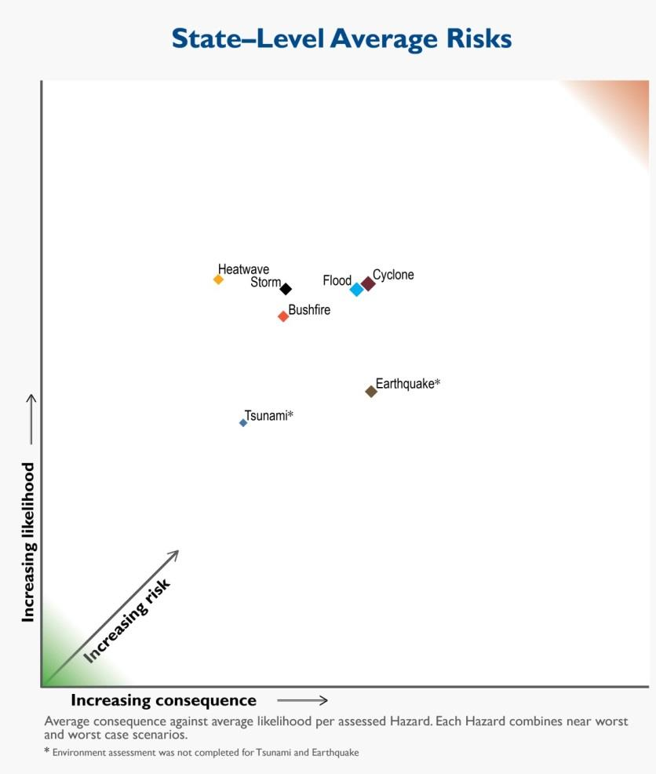

# Westplan — Cyclone (SEMC approved 24 May 2016)

> **Source**: WA SEMC
> **URL**: https://semc.wa.gov.au/Documents/Resources/LegislationPolicyPlansProcedureandGuidelines/Plans/Westplans2016/WestplanCycloneSEMCapproved24052016.pdf
> **Licence**: © Government of Western Australia; emergency-management practitioner reference
> **Retrieved**: 2026-05-07T23:42:48Z
> **SHA-256**: `401a79057bee8e3574f553a1caf4fffaf3574e0d3bc7da905585477094ac2c19`
> **Archived copy**: Internet Archive Wayback Machine — `https://web.archive.org/web/20190315115712id_/https://semc.wa.gov.au/Documents/Resources/LegislationPolicyPlansProcedureandGuidelines/Plans/Westplans2016/WestplanCycloneSEMCapproved24052016.pdf`
> *(Live publisher URL no longer resolves; this archived snapshot was used for ingest. Cite the publisher URL above.)*
> *Converted from PDF to Markdown format.*

---
## Page 1

 
 
 
 
 
STATE HAZARD PLAN 
 
FOR 
 
CYCLONE 
 
 
(WESTPLAN – CYCLONE) 
 
Prepared by 
 
APPROVED AT STATE EMERGENCY MANAGEMENT COMMITTEE 
MEETING 
RESOLUTION NO:  
19/2016 
DATE OF APPROVAL:  
24 May 2016 
 
REVIEW DATE:  
August 2020

---
## Page 2

 
WESTPLAN – Cyclone – May 2016 
UNCONTROLLED DOCUMENT WHEN PRINTED 
2 
Contact Details 
To provide comment on this plan, please contact: 
Manager Hazard Planning 
Department of Fire and Emergency Services  
20 Stockton Bend, Cockburn Central WA 6164 
 
Amendment List 
AMENDMENT 
DETAILS 
AMENDED 
BY: 
(INITIALS) 
NO. 
DATE 
1 
December 2007 
Complete reissue. 
 
2 
October 2014 
Interim revision. 
 
3 
21 November 2014 
Amendment to recovery section to 
align with updated SEMP 4.4 – 
Recovery Coordination. 
 
4 
2015 
Complete revision 
 
5 
May 2016 
Statement of fact amendments 
SEMC 
Secretariat 
6 
 
 
 
7 
 
 
 
8 
 
 
 
9 
 
 
 
10 
 
 
 
 
A copy of this Westplan is available on the SEMC internet site:  
 
www.semc.wa.gov.au/resources/policies-and-plans/westplans

---
## Page 3

 
WESTPLAN – Cyclone – May 2016 
UNCONTROLLED DOCUMENT WHEN PRINTED 
3 
Table of Contents 
1 
INTRODUCTION ............................................................................. 5 
1.1 AIM AND OBJECTIVES ........................................................................................................ 5 
1.2 SCOPE ............................................................................................................................ 5 
1.3 HAZARD DEFINITION ......................................................................................................... 6 
1.4 SPECIAL CONSIDERATIONS ................................................................................................. 6 
1.4.1 
Community Factors .................................................................................................... 6 
1.4.2 
Industry ...................................................................................................................... 6 
1.4.3 
Remote Aboriginal Communities................................................................................ 7 
1.4.4 
Evacuation/Sheltering ................................................................................................ 7 
1.5 RELATED DOCUMENTS ...................................................................................................... 7 
1.6 AUTHORITY TO PLAN ........................................................................................................ 8 
1.7 PLAN RESPONSIBILITIES ..................................................................................................... 8 
1.7.1 
Advisory Groups/Subcommittees ............................................................................... 8 
1.8 EXERCISE AND REVIEW PERIODS ......................................................................................... 9 
1.8.1 
Exercising ................................................................................................................... 9 
1.8.2 
Review ........................................................................................................................ 9 
1.9 ORGANISATIONAL ROLES AND RESPONSIBILITIES .................................................................... 9 
2 
RISK ASSESSMENT ........................................................................ 10 
3 
PREVENTION AND MITIGATION ..................................................... 11 
3.1 RESPONSIBILITY FOR PREVENTION AND MITIGATION ............................................................ 11 
3.2 LEGISLATION AND CODES ................................................................................................. 11 
3.3 RISK REDUCTION STRATEGIES ........................................................................................... 11 
4 
PREPAREDNESS ............................................................................ 14 
4.1 RESPONSIBILITY FOR PREPAREDNESS .................................................................................. 14 
4.2 PLANNING AND ARRANGEMENTS ...................................................................................... 14 
4.3 GROUPS WITH SPECIAL NEEDS .......................................................................................... 15 
4.4 RESOURCES ................................................................................................................... 15 
4.5 TRAINING ...................................................................................................................... 16 
4.6 COMMUNITY INFORMATION ............................................................................................ 16 
4.7 EVACUATION ARRANGEMENTS ......................................................................................... 16 
4.8 LOCAL AND DISTRICT HAZARD EMERGENCY MANAGEMENT PLANS ......................................... 17 
4.9 INTER-JURISDICTIONAL ASSISTANCE ARRANGEMENTS ........................................................... 17 
4.10 AUSTRALIAN GOVERNMENT PHYSICAL ASSISTANCE .............................................................. 17 
4.10.1 
Defence Assistance to the Civil Community ............................................................. 17 
5 
RESPONSE .................................................................................... 19 
5.1 PRINCIPLES .................................................................................................................... 19 
5.2 CYCLONE WARNING SYSTEM ............................................................................................ 19 
5.2.1 
Tropical Cyclone Services ......................................................................................... 20 
5.2.2 
Community Alerts ..................................................................................................... 20 
5.3 ALERT .......................................................................................................................... 21 
5.4 ACTIVATION .................................................................................................................. 21 
5.5 LEVELS OF RESPONSE ...................................................................................................... 22 
5.6 INCIDENT MANAGEMENT SYSTEM ..................................................................................... 22 
5.7 HAZARD MANAGEMENT STRUCTURE AND ARRANGEMENTS .................................................. 22 
5.7.1 
Incident Management .............................................................................................. 23 
5.7.2 
Liaison Officers ......................................................................................................... 23 
5.8 RESPONSE PRIORITIES ..................................................................................................... 23

---
## Page 4

 
WESTPLAN – Cyclone – May 2016 
UNCONTROLLED DOCUMENT WHEN PRINTED 
4 
5.9 MULTI AGENCY SUPPORT STRUCTURE AND ARRANGEMENTS ................................................. 23 
5.9.1 
Incident Support Group ............................................................................................ 23 
5.9.2 
Operational Area Support Group ............................................................................. 24 
5.9.3 
State Emergency Coordination Group ...................................................................... 24 
5.10 EMERGENCY POWERS ..................................................................................................... 25 
5.10.1 
Hazard Management Officers .................................................................................. 25 
5.10.2 
Authorised Officers ................................................................................................... 26 
5.11 RESOURCE MANAGEMENT ............................................................................................... 26 
5.12 TRANSPORT OF PASSENGERS AND CREW DURING CYCLONE EMERGENCIES .............................. 26 
5.13 EVACUATION ................................................................................................................. 27 
5.13.1 
Triggers for Evacuation ............................................................................................ 27 
5.13.2 
Facility Evacuation Plans .......................................................................................... 27 
5.13.3 
Notification of Evacuation Arrangements ................................................................ 27 
5.13.4 
Refusal to Evacuate .................................................................................................. 28 
5.13.5 
Return of Evacuees ................................................................................................... 28 
5.14 SUPPORT PLANS ............................................................................................................. 28 
5.14.1 
Health Response ....................................................................................................... 28 
5.14.2 
Incident Response Communications ......................................................................... 29 
5.14.3 
Public Information and Media Management ........................................................... 29 
5.15 FINANCIAL ARRANGEMENTS FOR RESPONSE........................................................................ 30 
5.16 STAND DOWN AND DEBRIEFING ....................................................................................... 30 
5.17 CONTACT ARRANGEMENTS .............................................................................................. 30 
6 
RECOVERY .................................................................................... 31 
6.1 RESPONSIBILITY FOR RECOVERY ........................................................................................ 31 
7 
INCIDENT ANALYSIS / REVIEW ...................................................... 32 
7.1 INVESTIGATION AND ASSESSMENT ..................................................................................... 32 
7.2 IDENTIFYING RISK TREATMENT STRATEGIES ........................................................................ 32 
8 
APPENDICES ................................................................................. 33 
APPENDIX A - DISTRIBUTION .................................................................................................. 33 
APPENDIX B - ROLES AND RESPONSIBILITIES OF ORGANISATIONS .................................................. 34 
APPENDIX C - OPERATIONAL SEQUENCE GUIDE – CYCLONE ......................................................... 38

---
## Page 5

 
WESTPLAN – Cyclone – May 2016 
UNCONTROLLED DOCUMENT WHEN PRINTED 
5 
1 
INTRODUCTION 
 
Tropical cyclones have been identified as one of the major risks for Western 
Australia (WA)1.  The coastline between Broome and Exmouth is the most 
cyclone-prone region of Australia, having the highest frequency of coastal 
crossings.  On average five tropical cyclones occur during each tropical 
cyclone season over the warm ocean waters off the northwest coast.  On 
average two cyclones cross the coast, one of which is severe2.  WA has 
experienced very destructive winds from these events together with very 
heavy rain, storm surge, flooding, coastal inundation and dangerous seas. 
This Westplan has been prepared to meet the State Emergency 
Management 
Committee 
(SEMC) 
planning 
requirements 
under the 
Emergency Management Act 2005 (EM Act 2005 
The Fire and Emergency Services (FES) Commissioner, is the Hazard 
Management Agency (HMA) for cyclone3. 
 
1.1 
Aim and Objectives 
The aim of Westplan – Cyclone is to detail the emergency management 
arrangements for tropical cyclone in WA. 
Objectives:  
 
ensure WA has effective emergency management arrangements in 
place for a cyclone emergency; 
 
define the responsibilities of DFES, Australian Government 
agencies, 
State 
Government 
agencies, 
local 
government, 
emergency management agencies and support organisations in the 
event of a cyclone emergency; 
 
detail arrangements in relation to the control and coordination of, 
response to, and recovery from a cyclone emergency; 
 
provide guidance for cyclone emergency management plans at 
district and local level; and 
 
detail arrangements for the review of planning at all levels. 
 
1.2 
Scope 
Westplan – Cyclone covers emergency management cyclone planning within 
the geographic boundaries of WA, including adjacent waters.  The plan deals 
with risk reduction strategies, preparedness for cyclone, response to cyclone 
and initiation of recovery arrangements following the impact of a tropical 
cyclone. 
                                            
1 SEMC (2013) Western Australian State-Level Risk Assessment, p. 2. 
2 Bureau of Meteorology, Climatology of Tropical Cyclones in Western Australia 
<www.bom.gov.au/cyclone/climatology/wa.shtml > 
3 Emergency Management Regulations 2006 s 17(2)

---
## Page 6

 
WESTPLAN – Cyclone – May 2016 
UNCONTROLLED DOCUMENT WHEN PRINTED 
6 
1.3 
Hazard Definition 
A cyclone emergency is defined as the occurrence or imminent occurrence of 
a tropical cyclone which is of such a nature or magnitude that it requires a 
significant and coordinated response. 
Tropical cyclones are low pressure systems that form over warm tropical 
waters and have gale force winds (sustained winds of 63km/h or greater and 
gusts in excess of 90 km/h near the centre).  
Although they occur infrequently over the southwest of WA, cyclones have 
arguably been the most significant weather hazard in the region, often as a 
pre-cursor to other hazards such as bushfire and flood. 
Potentially, the most destructive phenomenon associated with tropical 
cyclones that make landfall is the storm surge.  Storm surge is a raised dome 
of water about 60 to 80 km across and typically about 2 to 5 m higher than 
the normal tide level. If the surge occurs at the same time as a high tide then 
the area inundated can be quite extensive, particularly along low-lying 
coastlines. 
For further information on the cyclone hazard refer to the Bureau of 
Meteorology (BoM) website (http://www.bom.gov.au/cyclone/?ref=ftr).  
 
1.4 
Special Considerations 
1.4.1 Community Factors 
Society is increasingly dependent on services and infrastructure such 
as energy supply, transportation, water, sewerage and drainage 
systems, and communication networks.  This vital and critical 
infrastructure can be vulnerable in a cyclone emergency.  Restoration 
may take significant time and prolonged outages may create 
secondary effects in the community. 
Some facilities such as power, communication and transportation 
networks are particularly susceptible to the effects of tropical cyclones. 
As 
communities 
become 
more 
connected 
through 
modern 
telecommunications, 
increasing 
expectations 
are 
placed 
on 
emergency management agencies to respond sooner, over wider 
areas and in ways that are more sophisticated.  There is also a 
growing need for public information. 
A number of people within the community have special-needs and 
require particular consideration in state, district and local level plans.  
Section 4.3 identifies these special-needs groups. 
1.4.2 Industry 
WA has oil, gas and mining industries that significantly contribute to 
the national economy.  A notable component of these industries is the 
fly-in fly-out (FIFO) workforce.

---
## Page 7

 
WESTPLAN – Cyclone – May 2016 
UNCONTROLLED DOCUMENT WHEN PRINTED 
7 
While industry is required to comply with a range of legislation and 
instructions such as the Occupational Safety and Health Act 1984, 
consideration should also be given to factors such as isolation, 
evacuation or re-supply of industry based communities as a result of a 
cyclone emergency.  
Temporary and portable structures on construction sites are 
particularly susceptible to the tropical cyclone hazard. 
Where a risk analysis identifies a reduced level of individual or 
community resilience due to the transient nature of the work force, 
DFES strongly encourages industry to develop specific risk treatment 
and preparedness measures in partnership with the local community. 
1.4.3 Remote Aboriginal Communities 
Several hundred Remote Aboriginal Communities (RACs) exist in WA 
and the majority of these communities are located in cyclone-prone 
areas.  Aboriginal communities have a unique culture that must be 
considered when planning for hazards and English is often the second 
or third language spoken. 
The relationship with, and between land and tradition, are important 
considerations when a RAC decides where it will be located.  This 
often results in the establishment of communities in isolated areas and 
regions considered at higher-risk in terms of cyclone impact.  Their 
isolation increases response times in the event of an emergency. 
1.4.4 Evacuation/Sheltering 
The cyclone prone areas of WA are characterised by isolation and 
long distances between communities with many locations having a 
small resource base to support initial emergency measures.  These 
characteristics present considerable challenges for emergency 
managers when conducting evacuations.  
Fortunately, the cyclone prone areas have stronger construction 
standards than other areas of the State and this enables the 
promotion of a sheltering philosophy as the key emergency 
management strategy. 
This philosophy enables emergency managers to concentrate 
evacuation resources in the small number of areas and in the limited 
circumstances for which evacuation is required.  
 
1.5 
Related Documents 
 
This document is to be read in conjunction with the following suite of 
State Emergency Management (EM) documents: 
 
 Emergency Management Act 2005 (EM Act); 
 Emergency Management Regulation 2006 (EM Regulation); 
 State Emergency Management Policy (State EM Policy);

---
## Page 8

 
WESTPLAN – Cyclone – May 2016 
UNCONTROLLED DOCUMENT WHEN PRINTED 
8 
 State Emergency Management Plan (State EM Plan); 
 Relevant State Hazard Specific Plans (Westplans); 
 State Emergency Management Procedures (State EM 
Procedures); 
 State Emergency Management Guidelines ( State EM Guidelines); 
and 
 State Emergency Management Glossary (State EM Glossary). 
 
It should be noted that the State EM Procedures are divided into 
Prevention, Preparedness, Response and Recovery sections, with 
individual procedures referred to as ‘State EM Prevention Procedure’, 
‘State EM Preparedness Procedure’, ‘State EM Response Procedure’ 
and ‘State EM Recovery Procedure’, as applicable. 
 
Other related documents include:  
 
Fire and Emergency Services Act and Regulations1998; 
 
Occupational Safety & Health Act 1984;  
 
Meteorology Act 1955 (Cwlth); 
 
Westplan - Flood 
 
Westplan - Electricity Supply Disruption; and  
 
Local Emergency Management Arrangements. 
 
1.6 
Authority to Plan 
The SEMC is responsible for arranging the preparation of State emergency 
management plans (Westplans)4.  The FES Commissioner, as the prescribed 
HMA, is responsible for coordinating the development and maintenance of 
Westplan – Cyclone5 in accordance with State EM Policy Section 1.5. 
 
1.7 
Plan Responsibilities 
The development, implementation and revision of Westplan – Cyclone is the 
responsibility of DFES in consultation with key stakeholders, emergency 
management agencies and other support organisations6. 
1.7.1 Advisory Groups/Subcommittees 
There are no formal advisory groups or subcommittees for cyclone 
planning; however, DFES maintains regular liaison with BoM which 
has considerable expertise in cyclones and legal responsibility for 
provision of tropical cyclone warning services. 
                                            
4 EM Act 2005 s 18(1) 
5 State EM Policy Section 1.5 
6State EM Policy Section 1.5.

---
## Page 9

 
WESTPLAN – Cyclone – May 2016 
UNCONTROLLED DOCUMENT WHEN PRINTED 
9 
Where required, DFES may establish advisory groups, working groups 
or committees at state, regional/district or local level to examine and 
advise on various aspects of cyclone planning. 
 
1.8 
Exercise and Review Periods 
1.8.1 Exercising 
The response elements of Westplan – Cyclone will be exercised 
annually at the State and Regional level in accordance with State EM 
Policy Section 4.8 and State EM Plan Section 4.7.  The activation of 
this Westplan counts as an exercise, if the post incident report is 
completed. 
1.8.2 Review 
Westplan – Cyclone will be reviewed by DFES annually, with a major 
review every five years. 
 
1.9 
Organisational Roles and Responsibilities 
This Westplan details organisational responsibilities at a State-level and 
requires that participating organisations support planning at district and local 
level. 
As the HMA for cyclones, the FES Commissioner is responsible for ensuring 
effective preparedness and response to this risk within the community. 
A coordinated response to a cyclone requires emergency management 
agencies and support organisations to undertake a variety of agreed and 
statutory responsibilities.  These responsibilities are outlined at Appendix B.

---
## Page 10

 
WESTPLAN – Cyclone – May 2016 
UNCONTROLLED DOCUMENT WHEN PRINTED 
10 
2 
RISK ASSESSMENT 
 
In 2013, the SEMC coordinated risk assessment workshops to analyse the 
risks from cyclones, earthquakes, floods, storms, tsunamis, bushfires and 
heatwaves to six key areas fundamental to the wellbeing of the State, namely 
the potential impacts to the People, Economy, Social Setting, Governance, 
Infrastructure and Environment of Western Australia7. 
The State’s top risks are identified as stemming from an extreme to severe 
cyclone event in the north.  In particular the State’s highest risks are to the 
Social Setting and People categories in the case of cyclone8. 
 
Figure 1 – Average consequence against average likelihood per hazard. Each hazard combines worst 
and near-worst case scenarios.9 
 
                                            
7 SEMC, Western Australian State-level Risk Assessment, 2013, p. 2. 
8 SEMC, p. 19. 
9 Adapted from: State Emergency Management Committee, 2014. Emergency Preparedness 
Report 2014. State Emergency Management Committee, Perth.

---
## Page 11

 
WESTPLAN – Cyclone – May 2016 
UNCONTROLLED DOCUMENT WHEN PRINTED 
11 
3 
PREVENTION AND MITIGATION 
 
3.1 
Responsibility for Prevention and Mitigation 
DFES has overall responsibility for risk reduction aspects of cyclones, within 
the limitations of its legislative powers, the EM Act 2005 and resource 
capabilities. State EM Policy Section 1.5 also requires DFES to coordinate 
the development and maintenance of Westplan – Cyclone, including impact 
reduction aspects.  
Local governments are responsible for planning in their local communities by 
ensuring appropriate local planning controls, which need to be consistent 
with objectives and requirements set by the Western Australia Planning 
Commission (WAPC).  The WAPC is responsible for approving subdivision 
applications and has delegated powers for the determination of development 
applications to local governments and development assessment panels.  
Building construction standards are set by the State, usually by reference to 
the National Construction Code of Australia.  Local governments, together 
with registered building surveyors, have responsibility for ensuring adherence 
to building construction standards.  
 
3.2 
Legislation and Codes 
Legislation is one of the key initiatives to ensure that risk reduction strategies 
are consistent and enforceable.  Legislation applicable to managing the 
tropical cyclone risk includes: 
 
Building Act 2011; 
 
Building Regulations 2012;  
 
Emergency Management Act 2005; 
 
Emergency Management Regulations 2006; 
 
Fire and Emergency Services Act and Regulations 1998; 
 
Local Government (Miscellaneous Provisions) Act 1960; 
 
Local Government Act 1995; 
 
Mine Safety and Inspection Act 1994; 
 
National Construction Code of Australia; 
 
Occupational Safety & Health Act 1984;  
 
Planning and Development Act 2005; and 
 
Meteorology Act 1955 (Cwlth). 
 
3.3 
Risk Reduction Strategies 
The occurrence of cyclones cannot be prevented, but strategies to reduce 
their impacts on communities can include: engineering solutions, such as

---
## Page 12

 
WESTPLAN – Cyclone – May 2016 
UNCONTROLLED DOCUMENT WHEN PRINTED 
12 
hardening buildings; social solutions, such as community education; and 
enforcement of legislative requirements, such as building restrictions in areas 
identified as being at risk from tropical cyclone.  
Risk reduction strategies contribute to the increased resilience and reduction 
in vulnerability of communities by proactively reducing the effects of 
hazardous events. 
Key strategies are employed to reduce the risks associated with cyclone 
emergencies.  These strategies are shown in Table 1.  
Strategy 
Responsible Organisations 
Cyclone risk identification and mapping. DFES, Bureau of Meteorology 
(BoM), Geoscience Australia (GA) 
Application and enforcement of 
National Construction Code of Australia 
and informed land use planning for 
vulnerable areas. 
Local governments 
Participation in research and 
development programs directed 
towards risk treatment strategies. 
DFES, BoM, GA 
Promoting an improved state of 
resilience within communities to 
improve the management of future 
risks. 
DFES, local governments 
Developing resilience in the community 
and minimising the vulnerability of 
communities to effects of tropical 
cyclone. 
DFES in partnership with local 
governments 
Promotion of and participation in 
community awareness campaigns for 
‘at risk’ communities. 
Local governments assisted by 
DFES  
 
Provision of support to voluntary 
emergency organisations. 
DFES, local governments 
Provision of tropical cyclone advice to 
the community. 
DFES, BoM 
Identification of suitable buildings for 
designation as evacuation centres. 
Department for Child Protection 
and Family Support (CPFS) in 
consultation with local 
governments 
Maintenance of a register of potential 
evacuation centres. 
CPFS in consultation with Local 
Emergency Management 
Committee 
Participation on local and 
regional/district tropical cyclone 
planning committees (where 
practicable). 
Local governments,  DFES, Main 
Roads Western Australia 
(MRWA), Western Australia 
Police, CPFS 
Ensuring the sustainability of service 
delivery of critical infrastructure through 
design and maintenance standards. 
 
MRWA, network operators

---
## Page 13

 
WESTPLAN – Cyclone – May 2016 
UNCONTROLLED DOCUMENT WHEN PRINTED 
13 
Providing advice in relation to the 
design and maintenance status of 
critical infrastructure services and 
access routes in ‘at risk’ communities. 
MRWA, network operators 
Structurally retrofit, where necessary, 
public buildings which provide essential 
services following any tropical cyclone 
event.  These facilities should be 
examined by suitably qualified 
engineers on a site-by-site basis to 
assess their expected performance 
under tropical cyclone loadings. 
All relevant agencies 
Participate in research in social 
vulnerability models as they apply to 
cyclones. 
Relevant agencies and local 
governments 
 
Table 1 Cyclone Risk Reduction Strategies

---
## Page 14

 
WESTPLAN – Cyclone – May 2016 
UNCONTROLLED DOCUMENT WHEN PRINTED 
14 
4 
PREPAREDNESS 
 
4.1 
Responsibility for Preparedness 
Preparedness activities focus on developing systems to ensure the delivery 
of essential emergency response capabilities when an emergency occurs.  
These systems include development of plans and procedures, design of 
organisational structures, implementation of training, development of 
resource management systems, and community education related to 
preparation and response.  
This section of the Westplan outlines measures to be taken in preparation for 
cyclone emergencies together with relevant responsibilities.  Most of these 
activities commence well before the cyclone season, often years before, and 
regular maintenance, testing and checking of these measures should be 
undertaken to retain confidence in their performance during emergencies.  
As the HMA for cyclone, the FES Commissioner has responsibility for: 
 
promoting resilience activities within communities to improve the 
management of future risks; and 
 
ensuring that all emergency management activities related to 
tropical cyclone preparedness are undertaken. 
 
4.2 
Planning and Arrangements 
Emergency management plans are to be developed and based on: 
 
best practice principles; 
 
technical and scientific knowledge; 
 
research, including historical data and post incident analysis; and 
 
local knowledge and experience. 
Successful cyclone operations depend on sound planning, effective resource 
utilisation and a coordinated response which is timely, efficient and effective. 
The concept of this Westplan is to employ and coordinate the resources of 
State and Australian Government departments, authorities and agencies; 
resources available to private industry; and resources available to volunteer 
groups, for cyclone operations.  This concept is based on: 
 
availability of the DFES 24-hour State Operations Centre (SOC) for 
receipt of cyclone notification reports; 
 
establishment of operational facilities at three levels (State, 
Regional and local), from which management of tropical cyclone 
operations takes place; 
 
deployment of emergency service personnel; 
 
provision of expert technical advice on cyclone impact modelling by 
State and Australian Government agencies when requested by 
DFES;

---
## Page 15

 
WESTPLAN – Cyclone – May 2016 
UNCONTROLLED DOCUMENT WHEN PRINTED 
15 
 
provision of expert technical advice on roadways and transport 
routes by the Main Roads WA (MRWA), when requested by DFES; 
and 
 
tasking of agencies in a coordinated manner in support of DFES.  
Agency procedures are then employed to carry out tasks. 
Local government is responsible for the development of local emergency 
management arrangements10.  The Local Emergency Management 
Committee (LEMC) is to provide advice to local government in this regard. 
 
4.3 
Groups with Special Needs  
Special needs groups include individuals and groups of people within the 
community for whom special consideration must be given in state, district and 
local level plans.  These groups may require unique arrangements in regard 
to resources, mobility, timings, support or communications when responding 
to an emergency. 
State EM Policy Section 4.6 and State EM Plan Section 4.6.1 outline the 
individuals and groups whose circumstances require special consideration in 
emergency management planning.  
Groups to be considered may include: 
 
Remote communities; 
 
Tourists; 
 
Culturally and linguistically diverse groups, including Aboriginal 
communities; 
 
Persons with physical, medical or mental conditions (including 
persons using assistance animals); 
 
Aged Care;  
 
Schools and day care centres; and 
 
Persons without means of transport. 
Special needs groups should be included in the development of local risk 
plans for inclusion in Local Emergency Management Arrangements. 
 
4.4 
Resources 
The identification of appropriate and adequate resources and expertise is 
essential to preparedness for a cyclone emergency.  Planning at all levels 
should 
reference 
resource 
management, 
inventory 
and 
acquisition 
arrangements. 
Resources used in cyclone emergencies may be required at short notice and 
may include: urban search and rescue (USAR) resources, transport 
resources, earth moving machinery, cranes, shoring and tunneling 
                                            
10 EM Act 2005 s 41(1)

---
## Page 16

 
WESTPLAN – Cyclone – May 2016 
UNCONTROLLED DOCUMENT WHEN PRINTED 
16 
equipment, signage, electricity generating plants, lighting, pumps, temporary 
toilet facilities, potable water, medical equipment and drugs.  
DFES is responsible for the overall provision and management of resources 
required to physically respond to an imminent or actual cyclone emergency, 
including 
acquisition, 
pre-positioning 
and 
inventory 
management.  
Emergency management agencies and support organisations are required to 
provide their own resources in the first instance and to make requests for 
additional resources to DFES as required. 
Where an operation is beyond the resources of the State, a request for 
assistance from other jurisdictions may be made in accordance with 
paragraph 4.9 and 4.10.  
 
4.5 
Training 
DFES is responsible for training and equipping an emergency service 
capable of assisting the community to manage the effects of a tropical 
cyclone. 
Emergency management and support agencies are also expected to provide 
trained and equipped personnel.  DFES is responsible for conducting multi-
agency exercises for the relevant level of emergency management, thereby 
ensuring all agency personnel are aware of their role in the organised 
response. 
 
4.6 
Community Information 
DFES, local governments, and BoM provide a contribution to education 
programs developed to inform and educate the public on cyclone notification, 
cyclone risk and cyclone management. 
As part of this education, DFES aims to make the community aware that the 
risk of storm surge is excluded by many general insurance policies in 
Australia and encourage the community to ensure they are familiar with their 
policy and are aware of what risks their policy will not respond to11. 
During cyclone events, DFES will provide community information in a 
coordinated manner through the Incident Controller and/or Operational Area 
Manager (OAM).  This is detailed in sections 4.2 and 5.14. 
Media and public information strategies are reviewed annually by DFES to 
ensure appropriate communication of tropical cyclone information to the 
community. 
 
4.7 
Evacuation Arrangements 
Evacuation arrangements are addressed in section 5.13 Evacuation in the 
response section of this plan. 
                                            
11 http://www.insurancecouncil.com.au/issues-submissions/industry-in-focus/coastal-
vulnerability-risks

---
## Page 17

 
WESTPLAN – Cyclone – May 2016 
UNCONTROLLED DOCUMENT WHEN PRINTED 
17 
 
4.8 
Local and District Hazard Emergency Management Plans 
Where areas susceptible to cyclones are identified as a risk to the community 
DFES may develop Local and District Cyclone Plans to coordinate activities 
for cyclone emergencies. 
 
4.9 
Inter-Jurisdictional Assistance Arrangements 
Should a cyclone emergency be beyond the resources of the State, support 
may be requested from the Australian Government, other States or overseas. 
Assistance to interstate, overseas and other jurisdictions for cyclone 
emergencies will be coordinated by DFES.  This will include determination of 
the process involved and recognition of pre-existing arrangements for inter-
jurisdictional assistance by other agencies where such arrangements exist. 
DFES is a signatory to the ‘Arrangements for Interstate Assistance (Fire and 
Emergency Services)’ which have been developed to provide for the timely 
and meaningful exchange of capability between Australian states and 
territories during significant incidents12. 
The Minister must be notified before any assistance is provided to other 
jurisdictions. 
 
4.10 Australian Government Physical Assistance  
When the total resources (government, community and commercial) of the 
State cannot reasonably cope with the needs of the situation the State 
Emergency Coordinator can seek non-financial assistance13 from the 
Australian Government, through Emergency Management Australia (EMA), 
under 
the 
Australian 
Government 
Disaster 
Response 
Plan 
(COMDISPLAN)14.  COMDISPLAN outlines the coordination arrangements 
for the provision of Australian Government non-financial assistance in the 
event of a disaster or emergency within Australia or its offshore territories.  
All requests for physical assistance are to be made in accordance with State 
EM Policy Section 5.10 and State EM Plan Section 5.6. 
4.10.1 Defence Assistance to the Civil Community 
Defence Assistance to the Civil Community (DACC) can be provided 
in a number of ways which are defined as categories of assistance in 
State EM Response Procedure 20. 
Category 1 DACC is emergency assistance for a specific task(s) 
provided by a Local ADF Commander/Administrator from within their 
own resources, in localised emergency situations when: 
                                            
12 EMA, Arrangements for Interstate Assistance (Fire and Emergency Services), v1, 2014. 
13 The term ‘non- financial assistance’ refers, but is not limited to: planning expertise, 
provision of mapping services, counselling, advice, management of external resources and 
physical assistance. 
14 Attorney-General’s Department, COMDISPLAN, 2014, p. 16.

---
## Page 18

 
WESTPLAN – Cyclone – May 2016 
UNCONTROLLED DOCUMENT WHEN PRINTED 
18 
a. immediate action is necessary to save human life, alleviate 
suffering, prevent extensive loss of animal life, or prevent 
widespread loss/damage to property; and 
b. local civilian resources are inadequate, unavailable or cannot be 
mobilised in time. 
Requests for Category 1 DACC assistance are coordinated through 
the Manager Joint Operations Support Staff (MJOSS), or their Liaison 
Officer (LO), who will liaise directly with the Local Australian Defence 
Force (ADF) Commander to provide assistance.  Availability of these 
resources should be identified in Local Emergency Management 
Arrangements. 
Other categories of DACC Assistance may be provided at the 
discretion of the Australian Government where the State requests 
Australian Government physical assistance.  In these circumstances 
the initial resource request should be made through DFES, who will 
coordinate with the MJOSS or their LO in accordance with State EM 
Plan Section 5.6.1.

---
## Page 19

 
WESTPLAN – Cyclone – May 2016 
UNCONTROLLED DOCUMENT WHEN PRINTED 
19 
5 
RESPONSE 
 
5.1 
Principles 
The management of a cyclone emergency is based on a graduated approach 
using the following guiding principles: 
 
The FES Commissioner is the HMA for cyclone emergencies in WA; 
 
DFES is the Controlling Agency for cyclone emergencies in WA in 
accordance with State EM Policy Section 5 and State EM Plan 
Section 5; 
 
DFES is responsible for activating and controlling the response to a 
cyclone emergency within WA; 
 
DFES will use arrangements which employ identified emergency 
management agencies and support organisations (refer to 
Appendix B) to provide an effective and coordinated response; 
 
A cyclone emergency in WA will be managed using the emergency 
management and operational principles detailed in State EM Policy 
Section 5 and State EM Plan Section 5; 
 
Should another hazard occur as a consequence of a cyclone 
emergency and, if DFES is not the HMA/Controlling Agency for the 
consequent hazard, then the provisions of State EM Plan Section 
5.1.2 will apply.  DFES shall remain responsible for the overall 
management of the cyclone emergency; 
 
Responsibility for resourcing and responding to an emergency 
initially rests with the Incident Controller at the local level; 
 
An emergency beyond the capability of local resources will receive 
support from district resources.  State resources will be provided if 
district resources are inadequate; and 
 
Communication between local, district, State and Australian 
Government authorities is essential to ensure intelligent and timely 
application of resources to manage the emergency. 
 
5.2 
Cyclone Warning System 
The BoM has responsibility for the issue of warnings of gales, storms and 
other weather conditions likely to endanger life or property15. 
The BoM Tropical Cyclone Warning Centres (TCWC) at Perth and Darwin 
issue forecasts and warnings for tropical cyclone as shown below and 
detailed on the BoM website.  
                                            
15 Meteorology Act 1955 s 6.

---
## Page 20

 
WESTPLAN – Cyclone – May 2016 
UNCONTROLLED DOCUMENT WHEN PRINTED 
20 
5.2.1 Tropical Cyclone Services 
 
Tropical cyclone seasonal outlook. Issued at the beginning of the 
season to provide an estimate of the level of tropical cyclone 
activity in the coming season. 
 
Tropical cyclone outlook. Issued daily throughout the tropical 
cyclone season. They provide a forecast up to three days in 
advance of the probability of cyclone development in the seas 
around Australia.  
 
Tropical cyclone information bulletin. Issued when a cyclone is 
active in the Australian region, but is not expected to impact land-
based communities within 48 hours.  
 
Tropical cyclone watch. Issued if a cyclone is expected to affect 
coastal communities within 48 hours, but not expected within 
24 hours.  
 
Tropical cyclone warning. Issued if a cyclone is affecting or is 
expected to affect coastal communities within 24 hours.  
 
Technical bulletin. The Tropical Cyclone Technical Bulletin 
provides technical details about the cyclone.  
 
Tropical cyclone forecast track map. Issued with tropical cyclone 
advices to give a graphical representation of the cyclone's past 
track forecast movement and its threat area.  
 
Marine warnings. Marine warnings are issued for high seas and 
coastal waters threatened by cyclones16.  
 
Other specialised services are provided to key stakeholders.  
These generally provide detailed technical information to assist 
these organisations in planning disaster mitigation strategies. 
5.2.2 Community Alerts 
DFES has developed a Community Alert System for use throughout 
the State where cyclones are an unacceptable risk to the community.  
The DFES Community Alert System (Blue, Yellow, Red and All Clear 
with Caution) complements the BoM Advices and related warnings to 
encourage those at risk to take action.  
The aim is to warn the community of danger and provide safety advice 
at various stages during the approach of a cyclone.  Community Alerts 
are issued in four stages and are issued by the appointed Incident 
Controller in consultation with the Incident Support Group (ISG) and 
the appointed DFES OAM.  Further detail of DFES Community Alert 
System is at Table 2. 
 
                                            
16 BoM Tropical Cyclone Warning Services, <www.bom.gov.au/cyclone/about/warnings/>

---
## Page 21

 
WESTPLAN – Cyclone – May 2016 
UNCONTROLLED DOCUMENT WHEN PRINTED 
21 
Alert 
Meaning 
Keyword 
HMA Usage 
BLUE 
The community is 
advised to take 
precautions in 
preparation for cyclonic 
weather. 
PRECAUTION 
Used when a cyclone may produce 
gales within 48 hours (eg when first 
BoM Cyclone Watch is issued).. 
YELLOW 
The community is 
advised to take action to 
prepare for the arrival of 
cyclonic weather and 
move to shelter. 
ACTION 
Used when a cyclone has moved 
closer and there is a significant risk 
of destructive winds. 
RED 
The community is 
advised to remain 
sheltering. 
SHELTER 
Considered for use when a cyclone is 
likely to produce destructive winds.  
Only Emergency Services as 
identified by DFES in consultation 
with the LEMC should remain 
functional. 
ALL 
CLEAR 
Wind and storm surge 
dangers have passed 
but care should be taken 
to avoid dangers caused 
by damage. 
CAUTION  
 
Used when the wind and any storm 
surge danger from a cyclone has 
passed.  However, ground hazards 
such as fallen power lines, structural 
debris and road hazards may exist.  
Table 2 Cyclone Community Alerts 
5.3 
Alert 
When meteorological conditions have the potential to generate a cyclone, 
BoM will provide DFES with information about the tropical cyclone.  DFES 
may also receive initial information about tropical cyclone impact from other 
agencies or from the community. 
Upon receipt of initial information about the tropical cyclone, DFES will 
assess whether a cyclone emergency exists and may place some or all 
emergency management agencies and support organisations on alert.  
Organisations placed on ‘alert’ should prepare to respond if needed and 
await DFES instructions before ‘activating’ significant resources. 
 
5.4 
Activation 
When DFES assesses that the cyclone emergency will require a significant 
response, it shall ‘activate’ emergency resources, emergency management 
agencies and support organisations which are appropriate to the intensity 
and location of the tropical cyclone.  This may include activation of relevant 
emergency personnel and local or district plans as required. 
The level of implementation of plans and operational structures can vary 
considerably depending upon circumstances.  Factors which may influence 
the level of response include the degree of threat to a community, the 
number of DFES districts impacted by the tropical cyclone and whether a 
multi-agency response is required. 
More detail of the sequence of activation is shown in the ALERT and 
CALLOUT phases of Appendix C.

---
## Page 22

 
WESTPLAN – Cyclone – May 2016 
UNCONTROLLED DOCUMENT WHEN PRINTED 
22 
5.5 
Levels of Response 
Sound emergency management requires a graduated approach which is 
appropriate to the circumstances of the emergency. 
State EM Response Procedure 2 describes the process for making an 
appropriate incident level declaration and associated responsibilities. The 
declaration of an incident level is a critical component of emergency 
management in terms of triggering the responsibilities and actions of 
emergency management stakeholders to ensure a response in which the 
size of both the Incident Management Team (IMT) and the coordination 
structure are proportional to the size of the cyclone emergency.  State EM 
Response Procedure 2 enables one of three operational levels to be selected 
depending upon the characteristic ‘factors’ of the emergency.  This procedure 
is aligned with, State EM Plan Section 5.1.5 and the DFES WA Fire and 
Emergency Management Services Manual.  The descriptors are provided as 
guidance to DFES Operational Managers and are used for all of DFES’s 
HMA and Emergency Management Agency responsibilities (refer Appendix 
B). 
 
5.6 
Incident Management System 
During all emergencies, DFES will use the Australasian Inter-service Incident 
Management System (AIIMS).  All agencies with agreed responsibilities 
under this plan are encouraged to ensure their personnel are familiar with 
and able to work within the AIIMS structure.  Further information on incident 
management is detailed in State EM Policy Section 5 and State EM Plan 
Section 5.  
 
5.7 
Hazard Management Structure and Arrangements 
In assessing a cyclone emergency, DFES may determine that the response 
requires a level two or level three incident management structure as per 
State EM Response Procedure 2.  When such management structures are 
required, DFES (as the HMA) shall appoint an OAM(s).  The OAM will 
assume overall management of the cyclone emergency within their defined 
operational area. 
Cyclones can have large impact areas.  Therefore a cyclone response may 
be managed by numerous Incident Management Teams (IMT) working 
through more than one OAM in a number of geographically diverse facilities.  
DFES has a SOC available 24/7 and Regional Operations Centres (ROC) 
around the State to: 
 
provide a robust facility from which to oversee the coordination of 
emergencies; 
 
facilitate coordination with other emergency service agencies and 
emergency management agencies; 
 
coordinate State and regional/district response to tropical cyclone 
and other emergencies for which DFES has responsibility;

---
## Page 23

 
WESTPLAN – Cyclone – May 2016 
UNCONTROLLED DOCUMENT WHEN PRINTED 
23 
 
manage the dissemination of information to the community; and 
 
provide appropriate advice to all levels of government. 
5.7.1 Incident Management 
DFES, through the OAM, will appoint the IC(s) responsible for the 
overall management and control of an incident within specific localised 
communities or geographical areas. 
5.7.2 Liaison Officers 
All agencies are requested to provide a Liaison Officer (LO) upon 
activation of the response section of Westplan – Cyclone.  The LO 
must possess sufficient experience and seniority to assist DFES.  LOs 
may be the representatives on the relevant ISG or Operational Area 
Support Group (OASG).  Some agencies may nominate their Agency 
Commander as the LO. 
 
5.8 
Response Priorities 
The response to a cyclone emergency shall be based on the priorities of:  
1. Life; 
2. Critical infrastructure; 
3. Property; and 
4. Environment. 
The safety of personnel tasked to the incident will be the fundamental priority 
in all phases of incident management. 
Priorities for Incident Action Planning (IAP) are: 
 
The first priority will address the protection of community members 
and measures to keep them informed; 
 
The protection of property, critical infrastructure and community assets 
will be the next priority; and 
 
Protection of conservation and environmental values are to be 
factored into IAPs as the subsequent priority. 
 
5.9 
Multi Agency Support Structure and Arrangements 
State EM Policy Section 5 and State EM Plan Section 5 detail the multi-
agency support structure used for different levels of emergency.  The 
following paragraphs elaborate on how this policy will be applied during 
tropical cyclone emergencies. 
5.9.1 Incident Support Group 
The ISG(s) consist of the Local Emergency Coordinator and LOs from 
local agencies/organisations involved in the response to and recovery 
from an incident.  Its purpose is to assist the IC through the provision

---
## Page 24

 
WESTPLAN – Cyclone – May 2016 
UNCONTROLLED DOCUMENT WHEN PRINTED 
24 
of information, expert advice, support and resources relevant to each 
organisation. 
DFES (as the Controlling Agency) shall appoint the Chair of the ISG 
and determine membership of the ISG.  The IC shall activate the ISG 
when an incident requires the coordination of multiple agencies. 
5.9.2 Operational Area Support Group 
When the FES Commissioner (as the HMA) identifies that multiple 
agencies need to be coordinated at a district level or multiple incidents 
are occurring simultaneously in one Operational Area, it may activate 
the OASG. 
Membership of the OASG will be the OAM (appointed by the HMA) 
who will also be the Chair, the District Emergency Coordinator and 
members (liaison officers) from the key agencies involved in the 
response to and recovery from an incident. Minimum membership of 
an OASG for a cyclone emergency is: 
 
DFES (Chair) 
 
Department for Child Protection and Family Support (CPFS) 
 
Department of Parks and Wildlife (P&W) 
 
Department of Education 
 
Department of Health 
 
Department of Agriculture and Food WA (DAFWA) 
 
Essential services as appropriate 
 
Local government representative 
 
Main Roads WA 
 
Western Australia Police 
5.9.3 State Emergency Coordination Group 
A State Emergency Coordination Group (SECG) is established during 
a state of emergency, or may be established where an emergency 
occurs or is imminent, at the request of the FES Commissioner (as the 
HMA), or on the initiative of the State Emergency Coordinator (SEC), 
to assist in the provision of a strategic, coordinated multi-agency 
response to and recovery from the emergency. In addition, if a Level 3 
incident occurs, the HMA must consult with the SEC to determine if a 
SECG should be established.  
The SECG is established in accordance with State EM Policy 
Statement 5.4.7, State EM Plan Section 5.2.3 and State EM Response 
Procedure 4.  
Triggers for the activation of a SECG may include, but are not limited 
to: 
 
a cyclone has had, or likely to have a significant impact on a major 
community;

---
## Page 25

 
WESTPLAN – Cyclone – May 2016 
UNCONTROLLED DOCUMENT WHEN PRINTED 
25 
 
widespread cyclone damage to residential areas or a large 
geographical area containing communities or assets at risk; and/or 
 
significant risk to critical infrastructure. 
The requirements for membership of the SECG are outlined in section 
26(3) of the EM Act 2005.  In the case of a cyclone emergency, it is 
recommended, in consultation with the State Emergency Coordinator 
(SEC) that the SECG Membership should include, as required: 
Core Group 
 
State Emergency Coordinator (Chair) 
 
DFES 
 
Western Australia Police 
 
Local government representation 
 
MRWA 
 
BoM 
 
Department of the Premier and Cabinet 
 
CPFS 
 
Department of Health 
 
Department of Education 
 
DAFWA 
 
Public Utilities Office, Department of Finance 
 
Any other representatives as considered necessary by the SEC. 
 
5.10 Emergency Powers 
The FES Commissioner has powers in relation to natural disasters under the 
Fire and Emergency Services Act 199817.  These powers are wide-ranging 
and are normally adequate to respond to a cyclone emergencies.  Should 
additional powers be required, the EM Act 2005 can be used to access 
emergency powers through the declaration of an ‘Emergency Situation’18 or a 
‘State of Emergency’19. 
5.10.1 Hazard Management Officers 
In the case of an Emergency Situation Declaration, Hazard 
Management Officers will be appointed in accordance with State EM 
Response Procedure 5. 
                                            
17 FES Act 1998 s 18B. 
18 EM Act 2005 s 50 
19 EM Act 2005 s 56

---
## Page 26

 
WESTPLAN – Cyclone – May 2016 
UNCONTROLLED DOCUMENT WHEN PRINTED 
26 
5.10.2 Authorised Officers 
Authorised Officers will be appointed by the SEC in accordance with 
State EM Response Procedure 13. Authorised Officers shall comply 
with all limitations and directions as per Section 61 of the EM Act.  
 
5.11 Resource Management 
The identification of appropriate and adequate resources and expertise is 
essential to preparedness for a cyclone emergency.  Planning at all levels 
should 
reference 
resource 
management, 
inventory 
and 
acquisition 
arrangements. 
DFES is responsible for the overall provision and management of resources 
required to physically respond to a potential or actual cyclone emergency, 
including 
acquisition, 
pre-positioning 
and 
inventory 
management.  
Emergency management and support agencies are required to provide their 
own resources in the first instance and to make requests for additional 
resources to DFES as required. 
Local and district emergency plans should incorporate the use of community 
and industry resources, especially in relation to accommodation and welfare.   
Where an operation is beyond the resources of the State, a request for 
assistance from other jurisdictions may be made in accordance with section 
4.9 and 4.10. 
 
5.12 Transport of Passengers and Crew During Cyclone 
Emergencies 
An operator of a transport service is to have plans and procedures in place 
which enable the person in charge of a vehicle, vessel, aircraft or train to be 
aware of and frequently updated on the conditions, warnings and alerts 
applicable to their destination. 
When DFES declares a community Yellow Alert for a cyclone in the vicinity of 
a destination port, town, or city, the person in charge of the vehicle, vessel, 
aircraft, or train should ensure that they have sufficient journey time to permit 
passengers and crew to be conveyed to a place of safety after reaching their 
destination port and prior to the likely declaration of a Red Alert.  
Should insufficient journey time remain, it should be considered whether the 
vehicle, vessel, aircraft, or train could be diverted to an alternative safe port, 
town, or city of destination. 
An operator of an airport, located in an area for which a Yellow Alert has 
been declared, should arrange for issue of a ‘Notice to Airman’ (NOTAMS) 
which advises of the Yellow Alert as soon as possible after declaration of the 
Yellow Alert.

---
## Page 27

 
WESTPLAN – Cyclone – May 2016 
UNCONTROLLED DOCUMENT WHEN PRINTED 
27 
 
5.13 Evacuation 
The decision to evacuate residents from areas pre or post impact is the 
responsibility of the OAM, if appointed, or the IC.  The decision will normally 
be taken in consultation with key stakeholders. 
The responsibility for implementing the evacuation rests with DFES, which 
may require support from other agencies, particularly WA Police and CPFS. 
DFES is responsible for arranging transport requirements for the evacuation 
from the emergency area.  Local and district resources should be used 
wherever possible.  
Refer to State EM Policy Section 5.7 and State EM Plan Section 5.3 for 
further guidance on evacuation. 
5.13.1 Triggers for Evacuation 
During a Cyclone Emergency, DFES may evacuate residents in risk 
prone areas due to factors such as: 
 
Structural Collapse – Buildings that are at risk of structural collapse 
as a result of tropical cyclone damage should be evacuated.  
 
Cyclone affecting properties – Evacuation may occur if it is deemed 
likely that properties could be at risk from the effects of a tropical 
cyclone. 
 
Storm surge inundation. 
 
Isolation of properties – Persons who are not prepared for isolation 
or unsuited due to medical conditions, disabilities, age, etc. should 
be encouraged to evacuate. 
 
Failure of essential services – Failure of essential services such as 
sewerage, power, telecommunications and water pose significant 
health risks to the community.  In the event of any or all of these 
systems failing, evacuation of individuals, families and the 
community may be necessary. 
5.13.2 Facility Evacuation Plans 
Local industry may have site specific evacuation plans which form part 
of their Occupational Safety and Health strategies.  Additionally, 
schools, hospitals, detention centres, prisons, shopping centres and 
public buildings may also have site or building evacuation plans.  
These plans should be developed in consultation with the LEMC to 
ensure they are realistic in terms of resource availability, timeliness 
and the risks created by the hazard. 
5.13.3 Notification of Evacuation Arrangements 
When authorised by the OAM and/or IC(s), DFES may use an 
emergency warning system, local radio stations, television stations or 
other means of its choosing to warn the public of danger and provide 
safety advice, including evacuation advice.

---
## Page 28

 
WESTPLAN – Cyclone – May 2016 
UNCONTROLLED DOCUMENT WHEN PRINTED 
28 
5.13.4 Refusal to Evacuate 
Sometimes community members refuse to comply with a decision to 
evacuate an area.  Management of such situations by the IC(s) should 
include: 
 
provision of clear direction to persons conducting an evacuation 
with respect to what action should be taken where a person refuses 
to evacuate; 
 
ensuring, as far as practical, that those who refuse to evacuate 
understand the risks of remaining and are capable of making an 
informed decision; 
 
arranging recording of the refusal to comply with any evacuation 
direction under the EM Act 2005 during an ‘Emergency Situation’ or 
in a declared ‘State of Emergency’; 
 
where possible, implement plans to track the welfare of remaining 
(i.e. non-evacuated) residents. 
5.13.5 Return of Evacuees 
DFES is responsible for managing the return of persons evacuated as 
a result of tropical cyclone.  The return of evacuees should follow 
consultation with relevant emergency management agencies to ensure 
appropriate response and recovery activities have been completed.  
Additionally, the return should be scheduled to ensure that returning 
evacuees will not create a subsequent hazard for the community. 
5.14 Activation of Other Plans 
Should additional support be required during a cyclone emergency, it will 
initially be sourced through the appropriate LO.  Where additional support 
requires a more coordinated approach, the following plans  may be activated:  
 
State Health  Emergency Response Plan 
 
State Emergency Welfare Plan and its annexures on Reception and 
Registration and Reunification 
 
State Emergency Public Information Plan  activated by the State 
Emergency Public Information Coordinator 
 
State Emergency Telecommunication Plan 
 
   
The following paragraphs contain additional advice about triggers and 
processes for some of the support arrangements. 
5.14.1 Health Response 
The coordination of a state-wide WA Health response to a major 
disaster is through the State Health Coordinator (SHC) who has 
overall control and coordination of the health response.  
The initial coordination of Health Services resources will be at a local 
level; this can be escalated to a district then state level.  Should a 
Cyclone Emergency result in numbers of casualties beyond the

---
## Page 29

 
WESTPLAN – Cyclone – May 2016 
UNCONTROLLED DOCUMENT WHEN PRINTED 
29 
capabilities of local health services, the Department of Health’s State 
Health Emergency Response Plan  can be activated to provide further 
support.  
Activation of the Department of Health’s State Health Emergency 
Response Plan will be managed from the State Health Incident 
Coordination Centre (SHICC).  The SHICC will be in direct contact 
with DFES and will liaise with Regional Health Coordinators and health 
stakeholders.  The overall operational management, preparation and 
assessment of casualties in a major emergency will be managed by 
the SHICC.  
5.14.2 Incident Response Communications 
The provision of communications for emergency response measures 
under Westplan – Cyclone are based on the use of normal day to day 
communication facilities of participating organisations as far as 
practicable.  DFES has a public emergency assistance line (132500), 
which complements the triple zero (000) service to facilitate requests 
for and the provision of emergency assistance to the community. This 
is distinct from the recorded emergency phone line (13 DFES or 
13 3337), which only provides information to the community. 
If communication with a community at risk has not been established, 
DFES may dispatch a reconnaissance team including medical, 
community liaison and communication responders at the first available 
opportunity. 
5.14.3 Public Information and Media Management 
State EM Policy Section 5.6 and State EM Plan Section 5.3.1 detail 
the emergency management arrangements for the provision of 
emergency public information (EPI) and the responsibilities of the 
Controlling Agency and other Emergency Management Agencies in 
providing timely, accurate and consistent EPI to communities at risk. 
DFES has arrangements to ensure the community of Western 
Australia is informed of cyclone emergencies. 
The DFES Public Information Operational Plan (PIOP) provides a 
framework for DFES communication to the community, media and 
other stakeholders in a timely, consistent and accurate way during a 
cyclone emergency.  
The PIOP addresses all aspects of the provision and coordination of 
EPI during a cyclone emergency including the Statewide function 
(under AIIMS), of Information and Warnings, Media Liaison and 
Community Liaison. 
The IC, OAM or DFES Duty Assistant Commissioner (DAC) have 
overall responsibility for the issuing of information to the community at 
a local, regional and state level, with their Public Information Sections 
(at local, regional and state level) delegated this function during an 
incident.

---
## Page 30

 
WESTPLAN – Cyclone – May 2016 
UNCONTROLLED DOCUMENT WHEN PRINTED 
30 
 
5.15 Financial Arrangements for Response 
The SEMC website details the criteria for a variety of funding situations and 
should be consulted to determine the funding arrangements.  
Where no additional arrangement has been made with DFES, only 
expenditure approved by the IC, OAM or DFES DAC will be funded by DFES. 
 
5.16 Stand Down and Debriefing 
The response element of this Plan may be stood-down (de-activated) when: 
 
the SECG (if activated) is stood down;  
 
the IC identifies that there is no longer a requirement for the plan to 
remain active; and 
 
A final comprehensive impact assessment has been provided to a 
Local Recovery Coordinator in accordance with State EM Policy 
Section 6 and State EM Plan Section 6. 
 
5.17 Contact Arrangements 
The key organisations participating in this plan are shown at Appendix B.  
Ongoing contact with these organisations shall be through LOs appointed by 
each organisation.  
Detailed contact arrangements for activation of Westplan – Cyclone and for 
communication with LOs are held by DFES.

---
## Page 31

 
WESTPLAN – Cyclone – May 2016 
UNCONTROLLED DOCUMENT WHEN PRINTED 
31 
6 
RECOVERY 
Recovery management is the coordinated process of supporting emergency 
affected communities in the reconstruction and restoration of physical 
infrastructure, the environment and community, psychosocial, and economic 
wellbeing. 
 
6.1 
Responsibility for Recovery 
It is a function of local government to manage recovery following an 
emergency affecting the community in its district20. 
DFES, as the Controlling Agency with responsibility for the response to an 
emergency must initiate recovery activity during the response to that 
emergency.  
DFES is to ensure timely notification of the emergency, liaison and 
appropriate inclusion of those with recovery responsibilities in the incident 
management arrangements.  
DFES is responsible for ensuring that in combating the effects of the 
emergency, activities have regard for the need to facilitate recovery.  
DFES is also responsible for the coordination of assessment of all impacts 
relating to all recovery environments prior to cessation of the response, 
including a risk assessment and treatment plan to provide for safe community 
access to the affected area.  
The decision point from when the agreed handover will occur from DFES to 
the local government to effect recovery will occur when the following 
circumstances arise: 
 The community is no longer at risk from the hazard. 
 Operational response activities are being managed, or able to be 
managed, at a local level. 
 No further requirement for the HMA to provide leadership or 
coordination for the event and the leadership and coordination role 
becomes predominantly recovery focused. 
 The remaining activities are mainly reconstruction and restoration of 
physical infrastructure, the environment and community, psychosocial, 
and economic wellbeing of the community. 
 The final comprehensive impact assessment has been provided to a 
Local Recovery Coordinator. 
Once the agreed handover is complete DFES may still assist in the recovery 
effort. 
For further detail refer to State EM Policy Section 6 and State EM Plan 
Section 6 and DFES Standard Administrative Procedure 3.1.I – Recovery 
Management. 
                                            
20 EM Act 2005 s 36(b)

---
## Page 32

 
WESTPLAN – Cyclone – May 2016 
UNCONTROLLED DOCUMENT WHEN PRINTED 
32 
7 
INCIDENT ANALYSIS / REVIEW 
 
DFES conducts three levels of post incident analysis following operational 
incidents. These are: 
 
Operational Debrief 
 
Post Incident Analysis 
 
Major Incident Review 
The level of analysis required will be determined by the DFES Deputy 
Commissioner in accordance with DFES Policy Statement No. 54 - Incident 
Analysis Policy.  The OAM/IC will ensure that all agencies involved in a multi-
agency emergency are provided with the opportunity to submit input into any 
post operational analysis.  Upon acceptance of recommendations an 
implementation schedule is to be developed and monitored for timely 
completion. 
Post Operation Reports shall be provided to SEMC in accordance with State 
EM Policy Section 5.11 and State EM Plan Section 5.7. 
 
7.1 
Investigation and Assessment 
Where DFES identifies any issue which has, or is reasonably believed to 
have contributed to unnecessary consequences of the emergency upon the 
community, an investigation may be conducted into that cause.  The purpose 
of the investigation shall be to determine the issues leading to the event, with 
the intent of developing risk treatment strategies to reduce the associated 
risk to the community. 
 
7.2 
Identifying Risk Treatment Strategies 
During the recovery process there is an opportunity to identify future risk 
treatment strategies and often an opportunity to implement such strategies.  
DFES will identify key areas in the community infrastructure that failed during 
the cyclone and will promote actions and/or studies designed to minimise the 
effects of cyclones on the community in the future.  Examples of potential 
strategies include increasing building construction standards, improving land-
use management, and disaster-hardening of key community facilities and 
utilities.

---
## Page 33

 
WESTPLAN – Cyclone – May 2016 
UNCONTROLLED DOCUMENT WHEN PRINTED 
33 
8 
APPENDICES 
APPENDIX A - Distribution 
Westplan – Cyclone is available in electronic form on the SEMC Secretariat 
website.  Addressees on this list will be notified when a new or amended 
version of the Westplan is posted on the SEMC Secretariat website via the 
means shown below. 
Organisation 
Addressees 
State Government Ministers 
Minister for Emergency Services 
Minister for Police 
Minister for Planning 
State Emergency Management 
Committee 
All Members 
All Subcommittee Members 
SEMC Secretariat  
Department of Fire & Emergency 
Services  
All staff  
Emergency Management / Support 
Organisations 
All agencies and organisations with 
responsibilities under this plan. 
Community 
Web search 
Australian Government Attorney 
General’s Department 
Australian Government Crisis 
Coordination Centre 
Library Deposits  
National Library Of Australia, Legal 
Deposits Unit 
State Library Of Western Australia, 
Battye Library 
 
Table 3 Distribution List

---
## Page 34

 
WESTPLAN – Cyclone – May 2016 
UNCONTROLLED DOCUMENT WHEN PRINTED 
34 
APPENDIX B - Roles and Responsibilities of Organisations 
Introduction 
DFES, through the FES Commissioner as the HMA, has the primary responsibility for 
managing tropical cyclone effects in WA.  However, DFES requires the support and 
assistance of other organisations to ensure an integrated community response 
occurs. 
Agency Responsibilities 
The agencies will undertake the agreed responsibilities, as detailed below.  All the 
agencies are to maintain appropriate internal plans and procedures in relation to the 
specific agency responsibilities. 
Note: The capability and commitment of each Local Government to undertake the 
tasks and meet the responsibilities identified in this State Plan should be confirmed 
by the HMA and detailed in Local Emergency Management Arrangements.  This will 
ensure the varying capabilities of individual Local Governments are recognised.  
 
Organisation 
Responsibilities 
Bureau of 
Meteorology 
 
a. Participate in research and development of tropical cyclone models 
and techniques to improve tropical cyclone forecasting /notification. 
b. Provide a tropical cyclone prediction, interpretation and notification 
service. 
c. Establish and maintain data collection networks and monitor tropical 
cyclone events.  
d. Store and provide historical tropical cyclone intelligence data and 
information. 
e. Contribute to the planning, installation and maintenance of new and 
improved tropical cyclone warning/notification systems. 
f. Participate in community awareness programs on tropical cyclone 
warning systems. 
g. Provide a State Operations Centre Meteorologist (SOCMET) to 
DFES State Operations Centre, during normal working hours and/or 
after hours. Alternative liaison officers are Regional Manager Severe 
Weather, Regional Forecasting Centre Operations Manager, 
Manager Weather Services or Regional Director as required. 
h. Provide a representative for SECG, if required. 
Department for 
Child Protection 
and Family 
Support 
 
a. Management of services under the State Emergency Welfare Plan 
and its annexures on Reception and Registration and Reunification 
as required. 
b. Provide a representative on local and regional/district tropical 
cyclone planning committees. 
c. In consultation with DFES, and consideration of available resources, 
determine the number and location of evacuation centres to be 
opened during the cyclone emergency. 
d. In consultation with the Local Emergency Management Committee, 
determine a register of potential evacuation centres. 
e. Staff Welfare/Evacuations centres. 
f. Facilitate evacuee registrations. 
g. Participate in the emergency recovery arrangements for people 
affected by cyclones. 
h. Provide a liaison officer to DFES SOC, if required.

---
## Page 35

 
WESTPLAN – Cyclone – May 2016 
UNCONTROLLED DOCUMENT WHEN PRINTED 
35 
i. Provide a representative for SECG, if required. 
Department of 
Fire & 
Emergency 
Services  
 
a. Discharge the duties of HMA and Controlling Agency for Cyclone 
Emergencies, in accordance with the EM Act and State EM Policy 
Section 5 and State EM Plan Section 5. 
b. Liaise with other Controlling Agencies to ensure response operations 
are coordinated. 
c. Ensure the development and maintenance of response and risk 
treatment plans specific to cyclones. 
d. Periodically test and validate local, regional/district and State tropical 
cyclone plans. 
e. Recommend the adoption of risk treatment strategies to State, 
District and Local Emergency Management Committees. 
f. In cooperation with other agencies, provide communities with tropical 
cyclone risk awareness, information and education. 
g. Raise, train and equip an emergency service capable of responding 
to the effects of a tropical cyclone. 
h. Liaise with local government in the provision of incident control 
centres in tropical cyclone susceptible areas of the State. 
i. Appoint emergency managers at all levels for a particular tropical 
cyclone. 
j. Facilitate the provision of assistance as required. 
k. Request activation of a SECG and provide a representative for 
SECG, if required.  
Department of 
Health 
a. Coordinate the health response in a tropical cyclone situation, 
including the activation of  the State Health Emergency Response 
Plan if required.  
b. Advise DFES on all medical and health aspects in relation to a 
tropical cyclone situation 
c. Through the hospital stream, provide acute medical care and relief to 
injured persons. 
d. Through the public health stream, provide environmental health, 
public health, mental health and communicable disease control 
services, as required. 
e. Maintain an awareness of the readiness of health service 
infrastructure including assessment of impact on clinical services, 
response and/or evacuation requirements. 
f. Provide health advice and support to the designated recovery 
committee.  
g. Provide acute health services, particularly to those persons within 
the affected community who have chronic medical conditions. 
h. Provide a liaison officer to DFES SOC, if required. 
i. Provide a representative for SECG, if required. 
Department of 
Parks and 
Wildlife 
a. Notify DFES of impacts on native wildlife and P&W managed lands. 
b. Provide chainsaw teams to support DFES (where possible). 
c. Provide a liaison officer to DFES SOC, if required. 
d. Provide a representative for SECG, if required. 
Department of 
Planning 
a. Incorporate tropical cyclone risk treatment measures into state and 
local planning and development processes. 
b. Provide representatives on the local and regional/district tropical 
cyclone planning committees, where practicable. 
c. Provide a liaison officer to DFES SOC, if required. 
d. Provide a representative for SECG, if required. 
Department of 
Water 
a. Provide representatives on the local and regional/district tropical 
cyclone planning committees, where practicable.

---
## Page 36

 
WESTPLAN – Cyclone – May 2016 
UNCONTROLLED DOCUMENT WHEN PRINTED 
36 
b. Ensure tropical cyclone mitigation and management measures are 
incorporated into the water infrastructure.     
c. Provide a liaison officer to DFES SOC, if required. 
d. Provide a representative for SECG, if required. 
Energy 
Suppliers and 
Network 
Managers 
 
a. Disconnect and restore energy services as prioritised by DFES or 
the designated recovery authority.  Restoration priority will include 
consideration of other lifeline interdependence requirements. 
b. Provide technical advice to DFES in relation to energy supply, 
disconnection and restoration. 
c. Assist in the provision of emergency energy as requested by DFES 
or the designated recovery authority. 
d. Provide a representative on local and regional/district tropical 
cyclone planning committees. 
e. Provide a liaison officer to DFES SOC, if required. 
f. Provide a representative for SECG, if required. 
Local 
governments 
 
a. Participate in community awareness programs on tropical cyclone 
risks. 
b. Provide resources to assist DFES when requested. 
c. Make available suitable local government buildings to be used as 
evacuation centres. 
d. Issue closure notices for airports and airfields when necessary. 
e. Close and open roads within their jurisdiction, when requested by 
DFES. 
f. Provide details on road conditions to DFES. 
g. Initiate and lead the local community through the recovery process. 
h. Inspect and declare tropical cyclone affected properties fit for 
habitation. 
Main Roads WA 
 
a. Provide advice to DFES of the potential and actual impacts of 
tropical cyclone on the State road network.   
b. Provide a representative on local and regional/district tropical 
cyclone planning committees (where practicable). 
c. Close and open State roads when requested to do so by DFES.  
This Plan recognises that the Commissioner of Main Roads (or 
delegated Officers) has the power to close or open roads under the 
Main Roads Act 1930. 
d. Assist in the recovery process through State road and State road 
infrastructure repair and reconstruction. 
e. Communicate road closures to the public. 
f. Provide a liaison officer to DFES SOC, if required. 
g. Provide a representative for SECG, if required. 
Public 
Transport 
Authority 
 
a. Provide advice to DFES of the potential and actual impacts of 
tropical cyclone on the public transport system.   
b. Provide a representative on local and regional/district tropical 
cyclone planning committees (where practicable). 
c. Close and open transport services when requested by DFES.   
d. Assist in the recovery process through rail infrastructure repair and 
reconstruction. 
e. Communicate service closures to the public. 
f. Provide a liaison officer to DFES SOC, if required. 
g. Provide a representative for SECG, if required.

---
## Page 37

 
WESTPLAN – Cyclone – May 2016 
UNCONTROLLED DOCUMENT WHEN PRINTED 
37 
Telstra 
 
a. Provide 
advice 
regarding 
the 
provision 
of 
emergency 
communications services. 
b. Give 
priority 
consideration 
to 
emergency 
communications 
requirements of authorities responsible for hazard and emergency 
management within WA.  Actual service provision and restoration 
priorities will depend on Telstra’s network configuration, the safety 
and availability of staff, material availability, local community issues 
and national and local security issues. 
c. Provide a liaison officer to DFES SOC, if required. 
d. Provide a representative for SECG, if required. 
Water 
Corporation WA 
a. Restore water supplies and sewerage systems as prioritised by 
DFES or the designated recovery coordinator. 
b. Ensure water quality delivered by the system meets appropriate 
health standards.  
c. Provide a representative on local and regional/district tropical 
cyclone planning committees (where practicable). 
d. Provide a liaison officer to DFES SOC, if required. 
e. Assist with the provision of potable water to affected communities 
until normal services are restored. 
f. Provide a representative for SECG, if required. 
Western 
Australia Police 
a. Support DFES in conducting evacuations.  
b. Assist DFES with security of evacuated areas. 
c. In the event of mass casualties provide Disaster Victim Identification. 
d. Assist with the provision of road traffic management where 
appropriate. 
e. Provide representation on local and regional/district tropical cyclone 
planning committees. 
f. Provide an emergency coordinator to the IMT/ISG and/or OASG 
g. Provide a liaison officer to DFES SOC, if required. 
h. Provide a representative for SECG, if required.

---
## Page 38

 
WESTPLAN – Cyclone – May 2016 
UNCONTROLLED DOCUMENT WHEN PRINTED 
38 
APPENDIX C - Operational Sequence Guide – Cyclone 
 
Operational Sequence Guide - Cyclone 
Phase 1 ALERT (Notification that a tropical cyclone response operation is pending.) 
# 
BoM Warning 
Message 
ACTIONS 
DFES 
Emergency Management 
Agencies and Support 
Organisations 
1.1 
“Heads Up” 
Telephone advice from the 
Bureau of Meteorology 
Regional Forecasting 
Centre (BoM-RFC) that 
cyclonic weather may 
occur. Alternatively, advice 
may be received from the 
BoM Meteorologist 
embedded in the SOC 
(SOCMET). 
a. On receipt of advice from BoM, DFES will notify appropriate 
DFES personnel. 
b. Arrange timely and appropriate teleconferences with the 
DFES duty personnel and BoM-RFC. 
c. Activate to the necessary level of readiness and alert all 
involved agencies. 
d. Consider 
activating 
appropriate 
arrangements 
under 
Westplan – Cyclone and notifying relevant agencies with 
roles and responsibilities under the Plan. 
a. Receive 
operational 
information 
on 
the 
situation and distribute it 
within their organisation.  
b. Ensure 
relevant 
equipment and staff are 
available for deployment.  
c. Ensure 
the 
ongoing 
availability of LOs.

---
## Page 39

 
WESTPLAN – Cyclone – May 2016 
UNCONTROLLED DOCUMENT WHEN PRINTED 
39 
Operational Sequence Guide – Cyclone (continued) 
Phase 2 CALL OUT (Mobilisation of the tropical cyclone response operation.) 
# 
BoM Warning Message 
ACTIONS 
DFES 
Emergency Management 
Agencies and Support 
Organisations 
2.1 
CYCLONE WATCH and/or 
CYCLONE WARNING 
Blue Alert 
Yellow Alert 
Red Alert 
a. Initiate 
appropriate 
teleconferences 
with 
DFES 
Duty 
Personnel, Incident Controllers (where appointed) and BoM – 
Tropical Cyclone Warning Centre (BoM – TCWC). 
b. Activate to the necessary level of readiness and alert all 
involved agencies. 
c. Obtain and disseminate up-to-date information from BoM – 
TCWC to DFES duty personnel. 
d. Arrange appropriate community information messages. 
e. Appoint Operational Area Manager/s for identified areas. 
f. Appoint Incident Controller/s, responsible for the overall 
management and control of an allocated incident and the 
tasking of agencies in accordance with the situation. 
g. Facilitate ongoing liaison with Agency LOs. 
h. Determine the requirement for State assistance and activate  
the Department of Health’s State Health Emergency Response 
Plan, the Department of Child Protection and Family Support’s 
State Emergency Welfare Plan and its annexures on 
Reception and Registration and Reunification and Reception 
and the State Emergency Public Information Plan and State 
procedures as required. 
i. Consider establishing ISG, OASG and SECG. 
a. Provide 
LOs 
to 
relevant 
Support/Coordination 
groups 
(if activated).  
b. Deploy personnel as required.  
c. Fulfill role and responsibilities 
as outlined in Westplan – 
Cyclone 
d.  Provide assistance requested 
by DFES. 
e. Maintain liaison with DFES.

---
## Page 40

 
WESTPLAN – Cyclone – May 2016 
UNCONTROLLED DOCUMENT WHEN PRINTED 
40 
Operational Sequence Guide – Cyclone (continued) 
Phase 3 STAND DOWN (Completion of the tropical cyclone response operation) 
# 
BoM Warning Message 
ACTIONS 
DFES 
Emergency Management 
Agencies and Support 
Organisations 
3.1 
CANCELLATION OF  
CYCLONE WARNING/ 
ALL CLEAR 
 
 
a. Distribute the cancellation to DFES duty personnel. 
b. Inform participating agencies and hand over to State Recovery 
Coordinator when the following conditions have been met: 
 all rescues have been accomplished; 
 all injured have been attended to; 
 all the displaced people have been provided with shelter; 
 the essential public services, such as water and power, 
have been restored; 
 temporary repairs have been made to designated buildings; 
and 
 physical and electronic communications have been largely 
restored. 
 Organisations are stood down 
in accordance with relevant 
procedures 
for 
each 
organisation. 
 Recovery 
activities 
in 
accordance with associated 
plans continue

