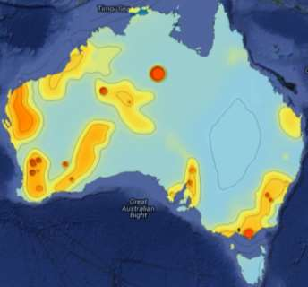
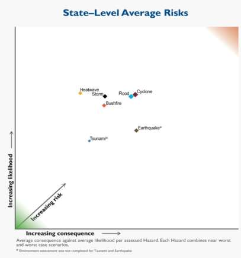

# Westplan — Earthquake (SEMC approved 2 August 2016)

> **Source**: WA SEMC
> **URL**: https://semc.wa.gov.au/Documents/Resources/LegislationPolicyPlansProcedureandGuidelines/Plans/Westplans2016/WestplanEarthquakeSEMCapproved%2002082016.pdf
> **Licence**: © Government of Western Australia; emergency-management practitioner reference
> **Retrieved**: 2026-05-07T23:42:50Z
> **SHA-256**: `3f0c8b5ed714f30621f6509f84c0ca142af184744b27919fba74dd9cd9b9b0c7`
> **Archived copy**: Internet Archive Wayback Machine — `https://web.archive.org/web/20190315115745id_/https://semc.wa.gov.au/Documents/Resources/LegislationPolicyPlansProcedureandGuidelines/Plans/Westplans2016/WestplanEarthquakeSEMCapproved%2002082016.pdf`
> *(Live publisher URL no longer resolves; this archived snapshot was used for ingest. Cite the publisher URL above.)*
> *Converted from PDF to Markdown format.*

---
## Page 1

 
 
 
 
STATE EMERGENCY MANAGEMENT PLAN 
 
FOR 
 
EARTHQUAKE 
 
 
(WESTPLAN – EARTHQUAKE) 
 
Prepared by 
 
APPROVED AT SEMC MEETING 
RESOLUTION NO: 33/2016 
DATE OF APPROVAL: 2 August 2016 
 
REVIEW DATE: August 2021

---
## Page 2

 
UNCONTROLLED DOCUMENT WHEN PRINTED 
2 
Contact Details 
For copies of this plan, or to provide comment, please contact: 
Manager Hazard Planning 
Department of Fire and Emergency Services  
20 Stockton Bend, Cockburn Central WA 6164 
 
Amendment List 
AMENDMENT 
DETAILS 
AMENDED 
BY: 
(INITIALS) 
NO. 
DATE 
1 
September 
2004 
Review and re-write of 1999 version. 
 
2 
September 
2006 
Amend 2004 version, congruous with the 
provisions of the Emergency 
Management Act 2005. 
 
3 
May 2011 
Complete revision. 
 
4 
May 2016 
Complete revision including statement of 
fact amendments 
DFES 
and 
SEMC 
Secretariat 
5 
 
 
 
6 
 
 
 
7 
 
 
 
8 
 
 
 
9 
 
 
 
10 
 
 
 
 
A copy of this Westplan is available at www.semc.wa.gov.au/

---
## Page 3

 
UNCONTROLLED DOCUMENT WHEN PRINTED 
3 
Table of Contents 
1 
INTRODUCTION ............................................................................. 5 
1.1 AIM AND OBJECTIVES ........................................................................................................ 5 
1.2 SCOPE ............................................................................................................................ 6 
1.3 HAZARD DEFINITION ......................................................................................................... 6 
1.4 SPECIAL CONSIDERATIONS ................................................................................................. 6 
1.5 RELATED DOCUMENTS ...................................................................................................... 6 
1.6 AUTHORITY TO PLAN ........................................................................................................ 7 
1.7 PLAN RESPONSIBILITIES ..................................................................................................... 7 
1.7.1 
Advisory Groups/Subcommittees ............................................................................... 7 
1.8 EXERCISE AND REVIEW PERIODS ......................................................................................... 7 
1.9 ORGANISATIONAL ROLES AND RESPONSIBILITIES .................................................................... 7 
2 
RISK ASSESSMENT ......................................................................... 9 
3 
PREVENTION AND MITIGATION ..................................................... 11 
3.1 RESPONSIBILITY FOR PREVENTION AND/OR MITIGATION ....................................................... 11 
3.2 LEGISLATION AND CODES ................................................................................................. 11 
3.3 RISK REDUCTION STRATEGIES ........................................................................................... 11 
4 
PREPAREDNESS ............................................................................ 14 
4.1 RESPONSIBILITY FOR PREPAREDNESS .................................................................................. 14 
4.2 PLANNING AND ARRANGEMENTS ...................................................................................... 14 
4.3 GROUPS WITH SPECIAL NEEDS .......................................................................................... 15 
4.4 RESOURCES ................................................................................................................... 15 
4.5 TRAINING ...................................................................................................................... 15 
4.6 COMMUNITY INFORMATION ............................................................................................ 16 
4.7 EVACUATION ARRANGEMENTS ......................................................................................... 16 
4.8 LOCAL AND DISTRICT HAZARD EMERGENCY MANAGEMENT PLANS ......................................... 16 
4.9 INTER-JURISDICTIONAL ASSISTANCE ARRANGEMENTS ........................................................... 16 
4.10 AUSTRALIAN GOVERNMENT PHYSICAL ASSISTANCE .............................................................. 16 
4.10.1 
Defence Assistance to the Civil Community ............................................................. 17 
5 
RESPONSE .................................................................................... 17 
5.1 PRINCIPLES .................................................................................................................... 17 
5.2 EARTHQUAKE WARNING SYSTEM ...................................................................................... 18 
5.2.1 
Earthquake Services ................................................................................................. 18 
5.2.2 
Distribution of Earthquake Notifications.................................................................. 18 
5.3 ALERT .......................................................................................................................... 19 
5.4 ACTIVATION .................................................................................................................. 19 
5.5 LEVELS OF RESPONSE ...................................................................................................... 19 
5.6 INCIDENT MANAGEMENT SYSTEM ..................................................................................... 19 
5.7 HAZARD MANAGEMENT STRUCTURE/ARRANGEMENTS ........................................................ 20 
5.7.1 
Incident Management .............................................................................................. 20 
5.7.2 
Liaison Officers ......................................................................................................... 20 
5.8 RESPONSE PRIORITIES ..................................................................................................... 20 
5.9 MULTI AGENCY SUPPORT STRUCTURE AND ARRANGEMENTS ................................................. 21 
5.9.1 
Incident Support Group ............................................................................................ 21 
5.9.2 
Operational Area Support Group ............................................................................. 21 
5.9.3 
State Emergency Coordination Group ...................................................................... 21 
5.10 EMERGENCY POWERS ..................................................................................................... 22 
5.10.1 
Hazard Management Officers .................................................................................. 22

---
## Page 4

 
UNCONTROLLED DOCUMENT WHEN PRINTED 
4 
5.10.2 
Authorised Officers ................................................................................................... 22 
5.11 RESOURCE MANAGEMENT ............................................................................................... 22 
5.12 EVACUATION ................................................................................................................. 23 
5.12.1 
Triggers for Evacuation ............................................................................................ 23 
5.12.2 
Notification of Evacuation Arrangements ................................................................ 23 
5.12.3 
Refusal to Evacuate .................................................................................................. 24 
5.13 SUPPORT PLANS ............................................................................................................. 24 
5.13.1 
Health Response ....................................................................................................... 24 
5.13.2 
Incident Response Communications ......................................................................... 25 
5.13.3 
Public Emergency Information and Media Management ........................................ 25 
5.14 FINANCIAL ARRANGEMENTS FOR RESPONSE........................................................................ 25 
5.15 STAND DOWN AND DEBRIEFING ....................................................................................... 25 
5.16 CONTACT ARRANGEMENTS .............................................................................................. 26 
6 
RECOVERY .................................................................................... 27 
6.1 RESPONSIBILITY FOR RECOVERY ........................................................................................ 27 
7 
INCIDENT ANALYSIS / REVIEW ...................................................... 28 
7.1 INVESTIGATION/ASSESSMENT........................................................................................... 28 
7.2 IDENTIFYING RISK TREATMENT STRATEGIES ........................................................................ 28 
8 
APPENDICES ................................................................................. 29 
APPENDIX A - DISTRIBUTION .................................................................................................. 29 
APPENDIX B - ROLES AND RESPONSIBILITIES OF ORGANISATIONS .................................................. 30

---
## Page 5

 
UNCONTROLLED DOCUMENT WHEN PRINTED 
5 
1 INTRODUCTION 
Western Australia has high levels of seismic activity compared with most 
other regions of Australia1.  Between 2005 and 2015, WA experienced a total 
of 2252 earthquakes of varying magnitudes2.  WA has experienced 
Australia’s second strongest earthquake at Meckering in 1968 (magnitude 
6.5) resulting in major damage and Cadoux in 1979 (magnitude 6.1).  WA 
continues to receive reminders of the earthquake threat in the form of minor 
structural damage such as that which occurred in Burakin in 2001 and 
Kalgoorlie in 2010 (magnitude 5.0)3. 
This Westplan has been prepared to meet the State Emergency 
Management 
Committee 
(SEMC) 
planning 
requirements 
under the 
Emergency Management Act 2005 (EM Act 2005). It is to be read in 
conjunction with the following suite of State Emergency Management (EM) 
documents: 
 the State Emergency Management Policy (State EM Policy); 
 the State Emergency Management Plan (State EM Plan); 
 relevant State Hazard Specific Plans (Westplans); 
 the 
State 
Emergency 
Management 
Procedures 
(State 
EM 
Procedures); 
 the State Emergency Management Guidelines (State EM Guidelines); 
and 
 the State Emergency Management Glossary (State EM Glossary). 
The Fire and Emergency Services (FES) Commissioner, is the Hazard 
Management Agency (HMA) for earthquake4. 
1.1 Aim and Objectives 
The aim of Westplan – Earthquake is to detail the emergency management 
arrangements for earthquakes in WA. 
Objectives:  
 ensure WA has effective emergency management arrangements in 
place for an earthquake emergency; 
 define the responsibilities of DFES, Australian Government agencies, 
State Government agencies, local government, and emergency 
management agencies in the event of an earthquake emergency; 
 detail arrangements in relation to the preparedness for, control, 
coordination of, response to, and recovery from, an earthquake 
emergency; 
                                            
1 T. Jones, et al, Natural Hazard Risk in Perth Western Australia, 2005, Geoscience 
Australia, p. 12. 
2  Geoscience Australia, Historic earthquakes of Australia  
3 T. Maqsood, et al., Seismic vulnerability functions for Australian buildings by using GEM 
empirical vulnerability assessment guidelines, 2016, Natural Hazards 80, p. 1628. 
4 Emergency Management Regulations 2006 s 17(2)

---
## Page 6

 
UNCONTROLLED DOCUMENT WHEN PRINTED 
6 
 provide guidance for earthquake emergency management plans at 
district and local level; and 
 detail arrangements for the review of planning at all levels. 
1.2 Scope 
Westplan – Earthquake covers emergency management earthquake 
planning within the geographic boundaries of WA.  The plan deals with risk 
treatment strategies, preparedness for earthquake, response to an 
earthquake beyond a normal emergency services response and initiation of 
recovery arrangements following the impact of an earthquake.  
1.3 Hazard Definition 
An earthquake emergency is defined as the occurrence of an earthquake 
which is of such a nature or magnitude that it requires a significant and 
coordinated response. 
Earthquakes are the vibrations caused by rocks breaking under stress.  The 
underground surface along which the rock breaks and moves is called a fault 
plane.  Earthquakes in Australia are usually caused by movements along 
faults as a result of compression in the Earth’s crust5. 
For further information on the earthquake hazard refer to the Geoscience 
Australia website (www.ga.gov.au/earthquakes/).  
1.4 Special Considerations 
Society is increasingly dependent on services and infrastructure such as 
energy supply, transportation, water, sewerage and drainage systems, and 
communication networks.  This vital and critical infrastructure can be 
vulnerable in an earthquake emergency.  Restoration may take significant 
time and prolonged outages may create secondary effects in the community. 
Some facilities such as power, communication and transportation networks 
are particularly susceptible to the effects of earthquakes. 
As 
communities 
become 
more 
connected 
through 
modern 
telecommunications, increasing expectations are placed on emergency 
management agencies to respond sooner, over wider areas and in ways that 
are more sophisticated.  There is also a growing need for public information. 
A number of people within the community have special-needs and require 
particular consideration in state, district and local level plans.  Section 4.3 
identifies these special-needs groups. 
1.5 Related Documents 
 Emergency Management Act 2005 (the EM Act); 
 Emergency Management Regulations 2006; 
 Fire and Emergency Services Act and Regulations1998; 
 Fire Brigades Act 1942; 
                                            
5 Geoscience Australia, What is an Earthquake?

---
## Page 7

 
UNCONTROLLED DOCUMENT WHEN PRINTED 
7 
 Occupational Safety & Health Act 1984;  
 State EM Policy; 
 State EM Plan; 
 Relevant State Hazard Specific Plans (Westplans); 
 Westplan – Collapse; 
 State EM Procedures; 
 State EM Guidelines; 
 State EM Glossary; 
 State Health Emergency Response Plan; 
 State Emergency Welfare Plan; 
 State Emergency Public Information Plan; and 
 Local Emergency Management Arrangements. 
1.6 Authority to Plan 
The SEMC has delegated responsibility for coordinating the development, 
maintenance, exercise and review of Westplan – Earthquake to the FES 
Commissioner, as the prescribed HMA 6. 
1.7 Plan Responsibilities 
The development, implementation and revision of Westplan – Earthquake is 
the responsibility of DFES in consultation with key stakeholders and 
emergency management agencies7. 
1.7.1 
Advisory Groups/Subcommittees 
There are no formal advisory groups or subcommittees for earthquake 
planning; however, DFES maintains regular liaison with Geoscience 
Australia (GA) which conducts earthquake research, has considerable 
expertise in earthquakes and provides earthquake notifications. 
1.8 Exercise and Review Periods 
The response elements of Westplan – Earthquake will be exercised annually 
at the State and Regional level in accordance with State EM Policy Section 
4.8 and State EM Plan Section 4.7.  The activation of this Westplan counts 
as an exercise, if the post incident report is completed. 
Westplan – Earthquake will be reviewed by DFES, annually, with a major 
review every five years. 
1.9 Organisational Roles and Responsibilities 
This Westplan details organisational responsibilities at a State-level and 
requires that participating organisations support planning at district and local 
level. 
                                            
6 State EM Policy Section 1.5. 
7 State EM Policy Section 1.5.

---
## Page 8

 
UNCONTROLLED DOCUMENT WHEN PRINTED 
8 
As the HMA for earthquakes, the FES Commissioner is responsible for 
ensuring effective preparedness and response to this risk within the 
community. 
Agencies that may be involved in response to an earthquake should have a 
Business Continuity Plan to ensure their continued ability to respond in the 
event of a serious earthquake.  Organisations that have roles and 
responsibilities for providing essential services to the community should also 
have business continuity plans so they can function to the best of their ability 
post-impact. 
A coordinated response to an earthquake requires emergency management 
agencies to undertake a variety of agreed and statutory responsibilities.  
These responsibilities are outlined at Appendix B.

---
## Page 9

 
UNCONTROLLED DOCUMENT WHEN PRINTED 
9 
2 RISK ASSESSMENT 
Earthquakes have the potential to cause catastrophic losses.  Although 
Australia is considered to have a low earthquake risk, a major earthquake 
could still occur in a heavily developed and populated area in WA.  The 
impact of such an earthquake could have widespread consequences 
throughout Perth and surrounds.  While there is a low probability that this 
event will occur in the future, it is important to recognise the potential for such 
catastrophic events. 
 
Figure 1 – Earthquake hazard map 20128. 
 
 
Figure 2 – Earthquakes in WA 2005 - 20159 
                                            
8 Geoscience Australia, Earthquake Basics 
9 Geoscience Australia, Earthquake Database 
0
50
100
150
200
250
2005 2006 2007 2008 2009 2010 2011 2012 2013 2014 2015
Number of Earthquakes 
Years 
Mag 1
Mag 2
Mag 3
Mag 4
Mag 5

---
## Page 10

 
UNCONTROLLED DOCUMENT WHEN PRINTED 
10 
In 2013, the SEMC coordinated risk assessment workshops to analyse the 
risks from natural hazards to six key areas fundamental to the wellbeing of 
the State, namely the potential impacts to the People, Economy, Social 
Setting, Governance, Infrastructure and Environment of Western Australia10. 
With WA containing a number of seismic zones, particularly in the South 
West and Pilbara, the earthquake data plots significantly in the area of low 
likelihood and high consequence.  This reflects the relatively low likelihood of 
a major event (for example, 7.1 magnitude) taking place near to a population 
centre.  However if it did take place the nature of destruction would generate 
a particularly high consequence11. 
 
Figure 3 – Average consequence against average likelihood per hazard. Each hazard 
combines worst and near-worst case scenarios.12 
 
 
                                            
10 SEMC, Western Australian State-level Risk Assessment, 2013, p. 2. 
11 SEMC, p. 19. 
12 Adapted from: State Emergency Management Committee, 2014. 
Emergency 
Preparedness Report 2014. State Emergency Management Committee, Perth.

---
## Page 11

 
UNCONTROLLED DOCUMENT WHEN PRINTED 
11 
3 PREVENTION AND MITIGATION 
3.1 Responsibility for Prevention and/or Mitigation 
DFES has limited responsibility for risk reduction aspects of earthquakes, 
within the limitations of its legislative powers, the EM Act 2005 and resource 
capabilities. State EM Policy Section 1.5 requires DFES to coordinate the 
development and maintenance of Westplan – Earthquake, including impact 
reduction aspects.  
Local government has the main responsibility for risk treatment strategies for 
earthquake emergencies within WA, principally through application and 
enforcement of the building codes.  
Building construction standards are set by the State, usually by reference to 
the National Construction Code of Australia.  Local governments, together 
with registered building surveyors, have responsibility for ensuring adherence 
to building construction standards.  
3.2 Legislation and Codes 
Legislation is one of the key initiatives to ensure that risk reduction strategies 
are consistent and enforceable.  Legislation applicable to managing the 
earthquake risk includes: 
 Building Act 2011; 
 Building Regulations 2012;  
 Emergency Management Act 2005; 
 Emergency Management Regulations 2006; 
 Fire and Emergency Services Act and Regulations 1998; 
 Fire Brigades Act 1942; 
 Local Government (Miscellaneous Provisions) Act 1960; 
 Local Government Act 1995; 
 Occupational Safety & Health Act 1984; 
 Planning and Development Act 2005; 
 National Construction Code of Australia; and 
 AS1170.4 - 2007 Earthquake Actions in Australia. 
3.3 Risk Reduction Strategies 
The occurrence of earthquakes cannot be prevented, but strategies to reduce 
their impacts on communities can include: engineering solutions, such as 
hardening buildings; or social solutions, such as community education in 
areas identified as being at risk from earthquake.  
Risk reduction strategies contribute to the increased resilience and reduction 
in vulnerability of communities by proactively reducing the effects of 
hazardous events.

---
## Page 12

 
UNCONTROLLED DOCUMENT WHEN PRINTED 
12 
Key strategies are employed to reduce the risks associated with earthquake 
emergencies.  These strategies are shown in Table 1.  
Strategy 
Responsible Organisations 
Earthquake risk mapping.  
DFES and Geoscience Australia 
(GA) 
Application and enforcement of the Building Codes 
of Australia and informed land use planning for 
vulnerable areas.  
Local governments (LG) 
Participation in research and development 
programs directed towards risk treatment 
strategies. 
DFES and GA 
Promoting an improved state of resilience within 
communities to improve the management of future 
risks. 
DFES and Insurance Council of 
Australia 
Developing resilience in the community and 
minimising the vulnerability of communities to 
effects of earthquake. 
DFES in partnership with LG 
Promote the uptake and maintenance of adequate 
insurance against earthquakes. 
DFES 
Promotion of, and participation in, community 
awareness campaigns for ‘at risk’ communities. 
DFES assisted by LG 
Provision of support to voluntary emergency 
organisations. 
DFES and LG 
Provision of earthquake advice to the community. 
GA and DFES  
Identification of suitable buildings for designation 
as Welfare/Evacuation Centres. 
Department for Child Protection 
and Family Support (CPFS) in 
consultation with LG  
Maintenance of a register of potential evacuation 
centres. 
CPFS in consultation with Local 
Emergency Management 
Committee 
Ensuring the sustainability of service delivery of 
critical infrastructure through design and 
maintenance standards. 
Essential services 
Providing advice in relation to the design and 
maintenance status of critical infrastructure 
services and access routes in ‘at risk’ 
communities. 
Essential services 
Structurally retrofit, where necessary, facilities, 
which provide essential services following any 
earthquake event.  These facilities should be 
examined by suitably qualified engineers on a site-
by-site basis to assess their expected performance 
under earthquake loadings.  This recommendation 
is pertinent for Wheatbelt communities in or near 
the South West Seismic Zone. 
All relevant agencies

---
## Page 13

 
UNCONTROLLED DOCUMENT WHEN PRINTED 
13 
Table 1 Earthquake Mitigation Strategies 
 
 
Participate in research in social vulnerability 
models as they apply to sudden impacts of 
hazards. 
Relevant agencies and LG.

---
## Page 14

 
UNCONTROLLED DOCUMENT WHEN PRINTED 
14 
4 PREPAREDNESS 
4.1 Responsibility for Preparedness 
This section outlines measures to be taken in preparation for earthquake 
emergencies together with relevant responsibilities.  Most of these activities 
commence well before the earthquake emergency, often years before, and 
regular maintenance, testing and checking of these measures should be 
undertaken to retain confidence in their performance during emergencies.  
As the HMA for earthquake, the FES Commissioner has responsibility for: 
 promoting resilience activities within communities to improve the 
management of future risks; and 
 ensuring that emergency management activities related to earthquake 
preparedness are undertaken. 
4.2 Planning and Arrangements 
Emergency management plans are to be developed and based on: 
 best practice principles; 
 technical and scientific knowledge; 
 research, including historical data and post incident analysis; and 
 Local knowledge and experience. 
Successful earthquake operations depend on good planning, effective 
resource utilisation and a coordinated response which is timely, efficient and 
effective. 
The concept of this Westplan is to employ and coordinate the resources of 
local, State and Australian Government departments, authorities and 
agencies; resources available to private industry; and resources available to 
volunteer groups, for earthquake operations.  This concept is based on: 
 availability of the DFES 24-hour State Operations Centre (SOC) for 
receipt of earthquake notification reports; 
 establishment of operational facilities at three levels (State, Regional 
and local), from which management of earthquake operations takes 
place; 
 deployment of emergency service personnel; 
 provision of expert technical advice on earthquake modelling by State 
and Australian Government agencies when requested by DFES; 
 provision of expert technical advice on essential services when 
requested by DFES; and 
 tasking of agencies in a coordinated manner in support of DFES.  
Agency procedures are then employed to carry out tasks.

---
## Page 15

 
UNCONTROLLED DOCUMENT WHEN PRINTED 
15 
Local government is responsible for the development of local emergency 
management arrangements13.  The Local Emergency Management 
Committee (LEMC) is to provide advice to local government in this 
regard. 
4.3 Groups with Special Needs  
Special needs groups include individuals and groups of people within the 
community for whom special consideration must be given in state, district and 
local level plans.  These groups may require unique arrangements in regard 
to resources, mobility, timings, support or communications when responding 
to an emergency. 
State EM Policy Section 4.6 and State EM Plan Section 4.6.1 outline the 
individuals and groups whose circumstances require special consideration in 
emergency management planning. 
Special needs groups should be included in the development of local risk 
plans for inclusion in Local Emergency Management Arrangements. 
4.4 Resources 
The identification of appropriate and adequate resources and expertise is 
essential to preparedness for an earthquake emergency.  Planning at all 
levels should reference resource management, inventory and acquisition 
arrangements. 
Resources used in earthquake emergencies may be required at short notice 
and may include: Urban Search and Rescue (USAR) resources, transport 
resources, earth moving machinery, cranes, shoring and tunneling 
equipment, signage, electricity generating plants, lighting, pumps, temporary 
toilet facilities, tents, bedding, water or water purification systems, food and 
catering facilities, medical equipment and drugs.  
DFES is responsible for the overall provision and management of resources 
required to physically respond to a potential or actual earthquake emergency, 
including 
acquisition, 
pre-positioning 
and 
inventory 
management.  
Emergency management agencies are required to provide their own 
resources in the first instance and to make requests for additional resources 
to DFES as required. 
Local and district emergency plans should incorporate the use of community 
and industry resources.  Such plans should also identify methods, such as 
resource registers, to acquire community resources during an earthquake 
emergency. 
Where an operation is beyond the resources of the State, a request for 
assistance from other jurisdictions may be made in accordance with 
paragraphs 4.9 and 4.10.  
4.5 Training 
DFES is responsible for training and equipping an emergency service 
capable of assisting the community to manage the effects of an earthquake. 
                                            
13 EM Act 2005 s 41(1)

---
## Page 16

 
UNCONTROLLED DOCUMENT WHEN PRINTED 
16 
Emergency management agencies are also expected to provide trained and 
equipped personnel.  DFES is responsible for conducting multi-agency 
exercises for the relevant level of emergency management, thereby ensuring 
all agency personnel are aware of their role in the organised response. 
4.6 Community Information 
DFES, local governments, and GA provide a contribution to education 
programmes developed to inform and educate the public on earthquake 
notification, earthquake risk and earthquake management. 
During earthquake events, DFES will provide community information in a 
coordinated manner through the Incident Controller and/or Operational Area 
Manager (OAM).  This is detailed in sections 5.13.3. 
Media and public information strategies are reviewed annually by DFES to 
ensure appropriate communication of earthquake information to the 
community. 
4.7 Evacuation Arrangements 
Evacuation arrangements are addressed in section 5.12 Evacuation in the 
response section of this plan. 
4.8 Local and District Hazard Emergency Management Plans 
Where earthquake prone areas are identified as a risk to the community, 
DFES may develop relevant local earthquake plans.  DFES may develop 
Regional/District Earthquake Plans to coordinate activities during earthquake 
emergencies in addition to, or in place of, local earthquake plans. 
4.9 Inter-Jurisdictional Assistance Arrangements 
Should an earthquake emergency be beyond the resources of the State, 
support may be requested from the Australian Government, other States or 
overseas. 
Assistance to interstate and overseas for earthquake emergencies will be 
coordinated by DFES.  This will include determination of the process involved 
and 
recognition 
of 
pre-existing 
arrangements 
for 
inter-jurisdictional 
assistance by other agencies where such arrangements exist. 
DFES is a signatory to the ‘Arrangements for Interstate Assistance (Fire and 
Emergency Services)’ which have been developed to provide for the timely 
and meaningful exchange of capability between Australian states and 
territories during significant incidents14.  The Minister must be notified before 
any assistance is provided to other jurisdictions. 
4.10 Australian Government Physical Assistance  
When the total resources (government, community and commercial) of the 
State cannot reasonably cope with the needs of the situation the State 
Emergency Coordinator can seek non-financial assistance15 from the 
Australian Government under the Australian Government Disaster Response 
                                            
14 EMA, Arrangements for Interstate Assistance (Fire and Emergency Services), v1, 2014. 
15 The term ‘non- financial assistance’ refers, but is not limited to: planning expertise, 
provision of mapping services, counselling, advice, management of external resources and 
physical assistance.

---
## Page 17

 
UNCONTROLLED DOCUMENT WHEN PRINTED 
17 
Plan 
(COMDISPLAN)16. 
 
COMDISPLAN 
outlines 
the 
coordination 
arrangements for the provision of Australian Government non-financial 
assistance in the event of a disaster or emergency within Australia or its 
offshore territories.  All requests for physical assistance are to be made in 
accordance with State EM Policy Section 5.10 and State EM Plan Section 
5.6. 
4.10.1 
Defence Assistance to the Civil Community 
Defence Assistance to the Civil Community (DACC) can be provided in 
a number of ways which are defined as categories of assistance in 
State EM Response Procedure 20. 
Category 1 DACC is emergency assistance for a specific task(s) 
provided by a Local ADF Commander/Administrator from within their 
own resources, in localised emergency situations when: 
a. immediate action is necessary to save human life, alleviate 
suffering, prevent extensive loss of animal life, or prevent 
widespread loss/damage to property; and 
b. local civilian resources are inadequate, unavailable or cannot be 
mobilised in time. 
Requests for Category 1 DACC assistance are coordinated through 
the Manager Joint Operations Support Staff (MJOSS), or their Liaison 
Officer (LO), who will liaise directly with the Local Australian Defence 
Force (ADF) Commander to provide assistance.  Availability of these 
resources should be identified in Local Emergency Management 
Arrangements.  DACC 1 is only for local resources and limited to 48 
hours.  Requests for Assistance that are beyond the local resources or 
are likely to extend beyond 48 hours should be formalised as Request 
for Australian Government Assistance under the auspice of 
COMDISPLAN. 
Other categories of DACC Assistance may be provided at the 
discretion of the Australian Government where the State requests 
Australian Government physical assistance.  In these circumstances 
the initial resource request should be made through DFES, who will 
coordinate with the MJOSS or their LO in accordance with State EM 
Plan Section 5.6.1. 
5 RESPONSE 
5.1 Principles 
The management of an earthquake emergency is based on a graduated 
approach using the following guiding principles: 
 The FES Commissioner is the HMA for earthquake emergencies in 
WA; 
                                            
16 Attorney-General’s Department, COMDISPLAN, 2014, p. 16.

---
## Page 18

 
UNCONTROLLED DOCUMENT WHEN PRINTED 
18 
 DFES is the Controlling Agency for earthquake  emergencies in WA in 
accordance with State EM Policy Section 5 and State EM Plan Section 
5; 
 DFES is responsible for coordinating the response to an earthquake 
emergency within WA; 
 DFES will use arrangements which employ identified emergency 
management agencies (refer to Appendix B) to provide an effective 
and coordinated response; 
 An earthquake emergency in WA will be managed using the 
emergency management and operational principles detailed in State 
EM Policy Section 5 and State EM Plan Section 5; 
 Should another hazard occur as a consequence of an earthquake 
emergency and, if DFES is not the HMA/Controlling Agency for the 
consequent hazard, then the provisions of State EM Plan Section 
5.1.2 will apply.  DFES shall remain responsible for the overall 
management of the earthquake emergency; 
 Responsibility for resourcing and responding to an emergency initially 
rests with the Incident Controller at the local level; 
 An emergency beyond the capability of local resources will receive 
support from district resources.  State resources will be provided if 
district resources are inadequate; and 
 Communication 
between 
local, 
district, 
State 
and 
Australian 
Government authorities is essential to ensure intelligent and timely 
application of resources to manage the emergency. 
5.2 Earthquake Warning System 
Geoscience Australia (GA) is responsible for the notification of earthquake 
occurrences.  GA has a series of remote sensing stations which enable the 
determination of the severity and location of an earthquake.  The sensor 
network is connected to alarms and instruments in Canberra which alert GA 
who interpret the seismic activity and pass relevant information to Australian 
Government Crisis Coordination Centre (CCC).  The notification system 
provides coverage 24 hours per day 7 days per week. 
5.2.1 
Earthquake Services 
GA will send an email to DFES for all earthquakes.  Emergency 
Management Australia (EMA) will advise DFES when an earthquake 
of 4.5 magnitude or less if it occurs within or near heavily populated 
areas or if there have been reports of damage or felt reports.  EMA will 
advise DFES of earthquakes 4.5 magnitude or greater for any area in 
WA.  
5.2.2 
Distribution of Earthquake Notifications 
DFES will distribute earthquake notification messages to key 
stakeholders and responders.

---
## Page 19

 
UNCONTROLLED DOCUMENT WHEN PRINTED 
19 
5.3 Alert 
Unlike most other natural hazards, earthquake prediction and warning is not 
possible.  The earthquake response phase commences as a result of the 
impact of an earthquake and the alert is initiated by DFES as the result of 
either community reports or notification from GA or the CCC.  
Upon receipt of initial information about the earthquake, DFES will assess 
whether an earthquake emergency exists and may place some or all 
emergency management agencies on alert.  Organisations placed on ‘alert’ 
should prepare to respond if needed and await DFES instructions before 
‘activating’ significant resources. 
5.4 Activation 
When DFES assesses that the earthquake emergency will require a 
significant response, it shall ‘activate’ emergency resources and emergency 
management agencies which are appropriate to the magnitude and location 
of the earthquake.  This may include activation of relevant emergency 
personnel and local or district plans as required. 
The level of implementation of plans and operational structures can vary 
considerably depending upon circumstances.  Factors which may influence 
the level of response include the degree of threat to a community or whether 
a multi-agency response is required. 
5.5 Levels of Response 
Sound emergency management requires a graduated approach which is 
appropriate to the circumstances of the emergency. 
State EM Response Procedure 2 describes the process for making an 
appropriate incident level declaration and associated responsibilities. The 
declaration of an incident level is a critical component of emergency 
management in terms of triggering the responsibilities and actions of 
emergency management stakeholders to ensure a response in which the 
size of both the Incident Management Team (IMT) and the coordination 
structure are proportional to the size of the earthquake emergency.  State EM 
Response Procedure 2 enables one of three operational levels to be selected 
depending upon the characteristic ‘factors’ of the emergency.  This procedure 
is aligned with State EM Plan Section 5.1.5 and the DFES WA Fire and 
Emergency Services Manual.  The descriptors are guidance for DFES 
Operational Managers and are used for all of DFES’s HMA and Emergency 
Management Agency responsibilities (refer Appendix B). 
 
5.6 Incident Management System 
During all emergencies, DFES will use the Australasian Inter-service Incident 
Management System (AIIMS).  All agencies with agreed responsibilities 
under this plan are encouraged to ensure their personnel are familiar with 
and able to work within the AIIMS structure.  Further information on incident 
management is detailed in State EM Policy Section 5 and State EM Plan 
Section 5.

---
## Page 20

 
UNCONTROLLED DOCUMENT WHEN PRINTED 
20 
5.7 Hazard Management Structure/Arrangements 
In assessing an earthquake emergency, DFES may determine that the 
response requires a level two or level three management structure as per 
State EM Response Procedure 2.  When such management structures are 
required, DFES (as the HMA) should appoint an Operational Area Manager 
(OAM).  The OAM will assume overall management of the earthquake 
emergency within their defined operational area. 
DFES has a State Operations Centre (SOC) available 24/7 and Regional 
Operations Centres (ROC) around the State to: 
 provide a robust facility from which to oversee the coordination of 
emergencies; 
 facilitate coordination with other emergency service agencies and 
emergency management agencies; 
 coordinate State and regional/district response to earthquakes and 
other emergencies for which DFES has responsibility; 
 manage the dissemination of information to the community; and 
 provide appropriate advice to all levels of government. 
5.7.1 
Incident Management 
DFES, through the OAM, will appoint the IC(s) responsible for the 
overall management and control of an incident within specific localised 
communities or geographical areas. 
5.7.2 
Liaison Officers 
All agencies involved in the response are requested to provide a 
Liaison Officer (LO) upon activation of the response section of 
Westplan – Earthquake.  The LO must possess sufficient experience 
and seniority to assist DFES.  LOs may be the representatives on the 
relevant Incident Support Group (ISG), Operational Area Support 
Group (OASG) or at an emergency operation centre.  Some agencies 
may nominate their Agency Commander as the LO. 
5.8 Response Priorities 
The response to an earthquake emergency shall be based on the priorities 
of:  
1. Life; 
2. Critical infrastructure; 
3. Property; and 
4. Environment. 
The safety of personnel tasked to the incident will be the fundamental priority 
in all phases of incident management. 
Priorities for Incident Action Planning (IAP) are: 
 The first priority will address the protection of community members 
and measures to keep them informed;

---
## Page 21

 
UNCONTROLLED DOCUMENT WHEN PRINTED 
21 
 The protection of property, critical infrastructure and community assets 
will be the next priority; and 
 Protection of conservation and environmental values are to be 
factored into IAPs as the subsequent priority. 
5.9 Multi Agency Support Structure and Arrangements 
State EM Policy Section 5 and State EM Plan Section 5 detail the multi-
agency support structure used for different levels of emergency.  The 
following paragraphs elaborate on how this policy will be applied during 
earthquake emergencies. 
5.9.1 
Incident Support Group 
The Incident Support Group/s (ISG) consist of the Local Emergency 
Coordinator and LOs from local agencies/organisations involved in the 
response to and recovery from the incident.  Its purpose is to assist 
the IC through the provision of information, expert advice, support and 
resources relevant to each organisation. 
DFES (as Controlling Agency) shall appoint the Chair of the ISG and 
determine its membership.  The IC shall activate the ISG when an 
incident requires the coordination of multiple agencies. 
5.9.2 
Operational Area Support Group 
When the FES Commissioner (as the HMA) identifies that multiple 
agencies need to be coordinated at a district level or multiple incidents 
are occurring simultaneously in one Operational Area, they may 
activate the OASG, which will be convened by the OAM. . 
Membership of the OASG will be the OAM appointed by the HMA 
(who will also be the Chair), the District Emergency Coordinator and 
members (liaison officers from the key agencies involved in the 
response to and recovery from the incident). 
5.9.3 
State Emergency Coordination Group 
A State Emergency Coordination Group (SECG) is established during a state 
of emergency, or may be established where an emergency occurs or is 
imminent, at the request of the FES Commissioner (as the HMA), or on the 
initiative of the State Emergency Coordinator (SEC), to assist in the provision 
of a strategic, coordinated multi-agency response to and recovery from the 
emergency. In addition, if a Level 3 incident occurs, the HMA must consult 
with the SEC to determine if a SECG should be established.  
The SECG is established in accordance with State EM Policy Statement 
5.4.7, State EM Plan Section 5.2.3 and State EM Response Procedure 4.  
Triggers for activation of a SECG include, but are not limited to: 
 
an earthquake has had a significant impact on a major community; 
 
widespread damage to residential areas or a large geographical 
area containing communities or assets at risk; and 
 
significant risk to critical infrastructure.

---
## Page 22

 
UNCONTROLLED DOCUMENT WHEN PRINTED 
22 
The requirements for membership of the SECG are outlined in section 26(3) 
of the EM Act 2005 and State EM Response Procedure 4. 
The EM Act 2005 requires that the membership of a SECG include: 
 
the SEC, who is also the Chair; 
 
the Chair and Executive Officer of the SEMC; 
 
a representative of the HMA (FES Commissioner); 
 
a representative of the local governments in the emergency area 
or in the area where the emergency is occurring or imminent, as 
the case requires, nominated by the SEC; and 
 
any other members the SEC considers are necessary. 
 
5.10 Emergency Powers 
The FES Commissioner has powers in relation to natural disasters under the 
Fire and Emergency Services Act 199817.  These powers are wide-ranging 
and are normally adequate to respond to earthquake emergencies.  Should 
additional powers be required, the EM Act 2005 can be used to access 
emergency powers through the declaration of an ‘Emergency Situation’18 or a 
‘State of Emergency’19. 
5.10.1 
Hazard Management Officers 
In the case of an Emergency Situation Declaration, Hazard 
Management Officers may be appointed in accordance with State EM 
Response Procedure 6. 
5.10.2 
Authorised Officers 
In the case of a State of Emergency being declared, Authorised 
Officers may be appointed by the SEC in accordance with State EM 
Response Procedure 13. Authorised Officers shall comply with all 
limitations and directions as per Section 61 of the EM Act.  
5.11 Resource Management 
The identification of appropriate and adequate resources and expertise is 
essential to preparedness for an earthquake emergency.  Planning at all 
levels should reference resource management, inventory and acquisition 
arrangements. 
DFES is responsible for the overall provision and management of resources 
required to physically respond to an earthquake emergency, including 
acquisition, pre-positioning and inventory management.  Emergency 
management agencies are required to provide their own resources in the first 
instance and to make requests for additional resources to DFES as required. 
                                            
17 FES Act 1998 s 18B. 
18 EM Act 2005 s 50 
19 EM Act 2005 s 56

---
## Page 23

 
UNCONTROLLED DOCUMENT WHEN PRINTED 
23 
Local and district emergency plans should incorporate the use of community 
and industry resources, especially in relation to accommodation and welfare.   
Where an operation is beyond the resources of the State, a request for 
assistance from other jurisdictions may be made in accordance with section 
4.9 and 4.10. 
5.12 Evacuation 
The decision to evacuate residents from areas after impact is the 
responsibility of the IC.  The decision will normally be taken in consultation 
with key stakeholders. 
The responsibility for implementing the evacuation rests with DFES (as the 
Controlling Agency), which may require support from other agencies, 
particularly WA Police and the Department for Child Protection and Family 
Support. 
DFES is responsible for arranging transport requirements for the evacuation 
from the emergency site.  Local and district resources should be used 
wherever possible.  
Refer to State EM Policy Section 5.7 and State EM Plan Section 5.3.2 for 
further guidance on evacuation. 
5.12.1 
Triggers for Evacuation 
During an earthquake emergency, DFES may evacuate residents in 
risk prone areas due to factors such as: 
 Structural Collapse – Buildings that are at risk of structural 
collapse as a result of earthquake damage should be evacuated.  
 Earthquake affecting properties – Evacuation may occur if it is 
deemed likely that properties could be at risk from the effects of an 
earthquake. 
 Isolation of properties – Persons who are not prepared for 
isolation or unsuited due to medical conditions, disabilities, age, 
etc. should be encouraged to evacuate. 
 Failure of essential services – Failure of essential services such 
as sewerage, power, telecommunications and/or water pose 
significant health risks to the community.  In the event of any or all 
of these systems failing, evacuation of individuals, families and the 
community may be necessary. 
5.12.2 
Notification of Evacuation Arrangements 
The IC is responsible for ensuring the accuracy of the Emergency 
Public Information, approving its release in coordination with the 
relevant agencies and terminating its broadcast. The Standard 
Emergency Warning Signal must only be used under strict instruction 
as advised by the HMA (the FES Commissioner) during an 
emergency, as defined by the EM Act, in circumstances when it is 
necessary for the community to take some action to prevent or 
minimize the loss of life or prejudice to the safety or harm to the health

---
## Page 24

 
UNCONTROLLED DOCUMENT WHEN PRINTED 
24 
of persons or animals or destruction of or damage to property or any 
part of the environment. 
5.12.3 
Refusal to Evacuate 
Sometimes community members refuse to comply with a decision to 
evacuate an area.  Management of such situations by the Controlling 
Agency (DFES) must include: 
 provision of clear instructions to persons conducting an 
evacuation with respect to what action should be taken where a 
person refuses to evacuate; 
 ensuring, as far as practical, that those who refuse to evacuate 
understand the risks of remaining and are capable of making an 
informed decision; 
 where practicable, develop procedures to track the remaining 
(i.e. non-evacuated) residents’ wellbeing. 
5.13 Support Plans 
Should additional support be required during an earthquake emergency, it 
will initially be sourced through the appropriate LO.  Where additional support 
requires a more coordinated approach, the following plans may be activated:  
 State Health Emergency Response Plan; 
 State Emergency Public Information Plan; and 
 State Emergency Welfare Plan. 
In addition, the recovery provisions outlined in Section 6 of this Westplan 
may be activated.  
The following paragraphs contain additional advice about triggers and 
processes for some of the support arrangements. 
5.13.1 
Health Response 
The coordination of a state-wide WA Health response to a major 
disaster is through the State Health Coordinator (SHC) who has 
overall control and coordination of the health response.  
The initial coordination of Health Services resources will be at a local 
level; this can be escalated to a district then state level.  Should an 
earthquake emergency result in numbers of casualties beyond the 
capabilities of local health services, the State Health Emergency 
Response Plan and relevant sub plans can be activated to provide 
further support.  
Activations of State Health Emergency Response Plan will be 
managed from the State Health Incident Coordination Centre (SHICC).  
The SHICC will be in direct contact with DFES and will liaise with 
Regional Health Coordinators and health stakeholders.  The overall 
operational management, preparation and assessment of casualties in 
a major emergency will be managed by the SHICC.

---
## Page 25

 
UNCONTROLLED DOCUMENT WHEN PRINTED 
25 
5.13.2 
Incident Response Communications 
The provision of communications for emergency response measures 
under Westplan – Earthquake are based on the use of normal day to 
day communication facilities of participating organisations as far as 
practicable.  DFES has a public emergency assistance line (132500), 
which complements the triple zero (000) service to facilitate requests 
for and the provision of emergency assistance to the community. The 
triple zero (000) service is used for life threatening situations only.  
This is distinct from the recorded emergency phone line (13 DFES or 
13 3337), which only provides information to the community. 
If communication with a community at risk has not been established, 
DFES may dispatch a USAR reconnaissance team including medical, 
community liaison and communication responders at the first available 
opportunity. 
5.13.3 
Public 
Emergency 
Information 
and 
Media 
Management 
State EM Policy Section 5.6, State EM Plan Section 5.3.1 and the 
State Emergency Public Information Plan details the emergency 
management arrangements for the provision of emergency public 
information 
(EPI), 
the 
responsibilities 
of 
the 
HMA 
(FES 
Commissioner), Controlling Agency (DFES) and other emergency 
management agencies in providing timely, accurate and consistent 
EPI to communities at risk. 
DFES has arrangements to ensure the community of WA is informed 
of earthquake emergencies. 
The DFES Public Information Operational Plan (PIOP) provides a 
framework for DFES communication to the community, media and 
other stakeholders in a timely, consistent and accurate way during an 
earthquake emergency.  
The PIOP addresses all aspects of the provision and coordination of 
EPI during an earthquake emergency including the Statewide function 
(under AIIMS), of Information and Warnings, Media Liaison and 
Community Liaison. 
The DFES IC has overall responsibility for the issuing of information to 
the community at a local, district and state level, with relevant Public 
Information Sections (at local, regional and state level) delegated this 
function during an incident. 
5.14 Financial Arrangements for Response 
The SEMC website details the criteria for a variety of funding situations and 
should be consulted to determine the funding arrangements.  
Where no prior arrangement has been made with DFES, only expenditure 
approved by the IC, OAM or DFES DAC will be funded by DFES. 
5.15 Stand Down and Debriefing 
The response element of this Plan may be stood-down (de-activated) when:

---
## Page 26

 
UNCONTROLLED DOCUMENT WHEN PRINTED 
26 
 the SECG (if activated) is stood down;  
 the IC or OAM identifies that there is no longer a requirement for the 
plan to remain active; and 
 A final comprehensive impact assessment has been provided to a 
Local Recovery Coordinator in accordance with State EM Plan Section 
6. 
5.16 Contact Arrangements 
The key organisations participating in this plan are shown at Appendix B.  
Ongoing contact with these organisations shall be through LOs appointed by 
each organisation. 
Detailed contact arrangements for activation of Westplan - Earthquake and 
for communication with LOs are held by DFES.

---
## Page 27

 
UNCONTROLLED DOCUMENT WHEN PRINTED 
27 
6 RECOVERY 
Recovery management is the coordinated process of supporting emergency 
affected communities in the reconstruction and restoration of physical 
infrastructure, the environment and community, psychosocial, and economic 
wellbeing. 
6.1 Responsibility for Recovery 
It is a function of local government to manage recovery following an 
emergency affecting the community in its district20. 
DFES, as the Controlling Agency with responsibility for the response to an 
emergency must initiate recovery activity during the response to that 
emergency.  
DFES is to ensure timely notification of the emergency, liaison and 
appropriate inclusion of those with recovery responsibilities in the incident 
management arrangements.  
DFES is responsible for ensuring that in combating the effects of the 
emergency, activities have regard for the need to facilitate recovery.  
DFES is also responsible for the coordination of assessment of all impacts 
relating to all recovery environments prior to cessation of the response, 
including a risk assessment and treatment plan to provide for safe community 
access to the affected area.  
The decision point from when handover will occur from DFES to the local 
government to effect recovery will occur when the following circumstances 
arise: 
 The community is no longer at risk from the hazard. 
 Operational response activities are being managed, or able to be 
managed, at a local level. 
 No further requirement for the HMA to provide leadership or 
coordination for the event and the leadership and coordination role 
becomes predominantly recovery focused. 
 The remaining activities are mainly reconstruction and restoration of 
physical infrastructure, the environment and community, psychosocial, 
and economic wellbeing of the community. 
 The final comprehensive impact assessment has been provided to a 
Local Recovery Coordinator. 
Once the handover is complete DFES may still assist in the recovery effort. 
For further detail refer to State EM Policy Section 6 and State EM Plan 
Section 6 and DFES Standard Administrative Procedure 3.1.I – Recovery 
Management. 
                                            
20 EM Act 2005 s 36(b)

---
## Page 28

 
UNCONTROLLED DOCUMENT WHEN PRINTED 
28 
7 INCIDENT ANALYSIS / REVIEW 
DFES conducts three levels of post incident analysis following operational 
incidents. These are: 
 Operational Debrief 
 Post Incident Analysis 
 Major Incident Review 
The level of analysis required will be determined by the DFES Deputy 
Commissioner in accordance with DFES Policy Statement No. 54 - Incident 
Analysis Policy.  The OAM/IC will ensure that all agencies involved in a multi-
agency emergency are provided with the opportunity to submit input into any 
post operational analysis.  Upon acceptance of recommendations an 
implementation schedule is to be developed and monitored for timely 
completion. 
Post Operation Reports shall be provided to SEMC in accordance with State 
EM Policy Section 5.11 and State EM Plan Section 5.7. 
7.1 Investigation/Assessment 
Where DFES identifies any issue which has, or is reasonably believed to 
have contributed to the impact of the emergency upon the community, an 
investigation may be conducted into that cause.  The purpose of the 
investigation shall be to determine the issues leading to the event, with the 
intent of developing mitigation prevention strategies to reduce the associated 
risk to the community. 
7.2 
Identifying Risk Treatment Strategies 
During the recovery process there is an opportunity to identify future risk 
treatment strategies and often an opportunity to implement such strategies.  
DFES will identify key areas in the community infrastructure that failed during 
the earthquake and will promote actions and/or studies designed to minimise 
the effects of earthquakes on the community in the future.  Examples of 
potential strategies include increasing building construction standards, 
improving land-use management, and disaster-hardening of key community 
facilities and utilities.

---
## Page 29

 
UNCONTROLLED DOCUMENT WHEN PRINTED 
29 
8 APPENDICES 
APPENDIX A - Distribution 
Westplan – Earthquake is available in electronic form on the SEMC website 
(semc.wa.gov.au).  Addressees on this list will be notified when a new or 
amended version of the Westplan is posted on the SEMC website 
(semc.wa.gov.au) via the means shown below. 
Organisation 
Addressees 
State Government Ministers 
Minister for Emergency Services 
Minister for Police 
Minister for Planning 
SEMC 
All Members 
All Subcommittee Members 
SEMC Executive Officer 
DFES  
All staff  
Emergency Management / 
Support Organisations 
All agencies and organisations with responsibilities 
under this plan. 
Community 
Web search 
Australian Government  
Australian Government Crisis Coordination Centre 
Geoscience Australia 
Library Deposits  
National Library Of Australia, Legal Deposits Unit 
State Library Of Western Australia, Battye Library 
Table 2 Distribution List

---
## Page 30

 
UNCONTROLLED DOCUMENT WHEN PRINTED 
30 
APPENDIX B - Roles and Responsibilities of Organisations 
Introduction 
DFES, through the FES Commissioner as the HMA, has the primary responsibility for 
managing earthquake effects in WA.  However, DFES requires the support and 
assistance of other organisations to ensure an integrated community response 
occurs. 
Agency Responsibilities 
The agencies will undertake the agreed responsibilities, as detailed below.  All the 
agencies are to maintain appropriate internal plans and procedures in relation to the 
specific agency responsibilities. 
Note: The capability and commitment of each Local Government to undertake the 
tasks and meet the responsibilities identified in this State Plan should be confirmed 
by the HMA and detailed in the Local Hazard Emergency Plan and/or Local 
Emergency Management Arrangements.  This will ensure the varying capabilities of 
individual Local Governments are recognised.  
 
Organisation 
Responsibilities 
Department for 
Child Protection 
and Family 
Support 
a. Management of services under State Emergency Welfare Plan and 
its annexures on Reception and Registration and Reunification as 
required. 
b. In consultation with DFES, and consideration of available resources, 
determine the number and location of welfare / evacuation centres to 
be opened during the earthquake emergency. 
c. In consultation with the Local Emergency Management Committee, 
determine a register of potential welfare / evacuation centres. 
d. Staff welfare / evacuation centres. 
e. Facilitate evacuee registrations. 
f. Participate in the emergency recovery arrangements for people 
affected by earthquakes. 
g. Provide a liaison officer to DFES SOC, if required. 
h. Provide a representative for SECG, if required. 
Department of 
Fire & 
Emergency 
Services  
a. Discharge the duties of HMA and Controlling Agency for earthquake 
Emergencies, in accordance with the EM Act and Section 5 of the 
State EM Policy and Section 5 of the State EM Plan. 
b. Liaise with other Controlling Agencies to ensure response operations 
are coordinated. 
c. Ensure the development and maintenance of response and risk 
treatment plans specific to earthquakes. 
d. Periodically test and validate local, regional/district and State 
earthquake plans. 
e. Recommend the adoption of risk treatment strategies to State, 
District and Local Emergency Management Committees. 
f. In cooperation with other agencies, provide communities with 
earthquake risk awareness, information and education. 
g. Raise, train and equip an emergency service, especially USAR, 
capable of responding to the effects of an earthquake. 
h. Liaise with local government in the provision of incident control 
centres in earthquake susceptible areas of the State. 
i. Appoint emergency managers at all levels for a particular

---
## Page 31

 
UNCONTROLLED DOCUMENT WHEN PRINTED 
31 
earthquake. 
j. Facilitate the provision of assistance as required. 
k. Request activation of a SECG and provide a representative for 
SECG, if required.  
Department of 
Health 
a. Coordinate the health response in an earthquake situation, including 
the activation of State Health Emergency Response Plan if required.  
b. Advise DFES on all medical and health aspects in relation to an 
earthquake situation 
c. Through the hospital stream, provide acute medical care and relief to 
injured persons. 
d. Through the public health stream, provide environmental health, 
public health, mental health, radiation health and communicable 
disease control services, as required. 
e. Maintain an awareness of the readiness of health service 
infrastructure including assessment of impact on clinical services, 
response and/or evacuation requirements. 
f. Provide health advice and support to the designated recovery 
committee.  
g. Provide acute health services, particularly to those persons within 
the affected community who have chronic medical conditions. 
h. Provide a liaison officer to DFES SOC, if required. 
i. Provide a representative for SECG, if required. 
Department of 
Parks and 
Wildlife 
a. Notify DFES of impacts on native wildlife and DPaW managed lands. 
b. Provide chainsaw teams to support DFES (where possible). 
c. Provide a liaison officer to DFES SOC, if required. 
d. Provide a representative for SECG, if required. 
Department of 
Planning 
a. Incorporate earthquake risk treatment measures into state and local 
planning and development processes. 
b. Provide representatives on the local and regional/district earthquake 
planning committees, where practicable. 
c. Provide an LO to DFES SOC, if required. 
d. Provide a representative for SECG, if required. 
Emergency 
Management 
Australia 
a. Notify DFES regarding seismic events magnitude 3.5 and above 
within WA. 
b. Activate COMDISPLAN if required to provide Australian Government 
non-financial assistance. 
c. Provide an LO to DFES’s SOC if required. 
d. If required, develop an Australian Government Incident Brief and/or 
Australian Government Talking Points. 
Energy 
Suppliers and 
Network 
Managers 
 
a. Disconnect and restore energy services as prioritised by DFES or 
the designated recovery authority.  Restoration priority will include 
consideration of other lifeline interdependence requirements. 
b. Provide technical advice to DFES in relation to energy supply, 
disconnection and restoration. 
c. Assist in the provision of emergency energy as requested by DFES 
or the designated recovery authority. 
d. Provide a representative on local and regional/district earthquake 
planning committees. 
e. Provide an LO to DFES SOC, if required. 
f. Provide a representative for SECG, if required.

---
## Page 32

 
UNCONTROLLED DOCUMENT WHEN PRINTED 
32 
Geoscience 
Australia 
a. Participate in research and development of earthquake models and 
techniques to improve earthquake forecasting /notification. 
b. Provide an earthquake prediction, interpretation and notification 
service. 
c. Establish and maintain data collection networks and monitor 
earthquake events.  
d. Store and provide historical earthquake intelligence data and 
information. 
e. Contribute to the planning, installation and maintenance of new and 
improved earthquake warning/notification systems. 
f. Participate in community awareness programs on earthquake 
warning systems. 
g. Provide advice to DFES’s SOC, if required. 
Local 
governments 
 
a. Participate in community awareness programs on earthquake risks. 
b. Provide resources to assist DFES when requested. 
c. Make available suitable local government buildings to be used as 
welfare / evacuation centres. 
d. Issue closure notices for airports and airfields when necessary. 
e. Close and open roads within their jurisdiction, when requested by 
DFES. 
f. Provide details on road conditions to DFES. 
g. Initiate and lead the local community through the recovery process. 
h. Inspect and declare earthquake affected properties fit for habitation. 
Main Roads WA 
 
a. Provide advice to DFES of the potential and actual impacts of an 
earthquake on the State road network.   
b. Close and open State roads when requested to do so by DFES.  
This Plan recognises that the Commissioner of Main Roads (or 
delegated Officers) has the power to close or open roads under the 
Main Roads Act 1930. 
c. Assist in the recovery process through State road and State road 
infrastructure repair and reconstruction. 
d. Communicate road closures to the public. 
e. Provide a liaison officer to DFES SOC, if required. 
f. Provide a representative for SECG, if required. 
Public 
Transport 
Authority 
 
a. Provide advice to DFES of the potential and actual impacts of 
earthquake on the public transport system.   
b. Provide a representative on local and regional/district earthquake 
planning committees (where practicable). 
c. Close and open transport services when requested by DFES.   
d. Assist in the recovery process through rail infrastructure repair and 
reconstruction. 
e. Communicate service closures to the public. 
f. Provide an LO to DFES SOC, if required. 
g. Provide a representative for SECG, if required. 
Telstra 
 
a. Provide 
advice 
regarding 
the 
provision 
of 
emergency 
communications services. 
b. Give 
priority 
consideration 
to 
emergency 
communications 
requirements of authorities responsible for hazard and emergency 
management within WA.  Actual service provision and restoration 
priorities will depend on Telstra’s network configuration, the safety 
and availability of staff, material availability, local community issues 
and national and local security issues. 
c. Provide an LO to DFES SOC, if required. 
d. Provide a representative for SECG, if required.

---
## Page 33

 
UNCONTROLLED DOCUMENT WHEN PRINTED 
33 
Water 
Corporation WA 
a. Restore water supplies and sewerage systems as prioritised by 
DFES or the designated recovery coordinator. 
b. Ensure water quality delivered by the system meets appropriate 
health standards.  
c. Assist with the provision of potable water to affected communities 
until normal services are restored. 
d. Provide a representative on local and regional/district earthquake 
planning committees (where practicable). 
e. Provide an LO to DFES SOC, if required. 
f. Provide a representative for SECG, if required. 
Western 
Australia Police 
a. Support DFES in conducting evacuations.  
b. Assist DFES with security of evacuated areas. 
c. In the event of mass casualties provide Disaster Victim Identification. 
d. Assist with the provision of road traffic management where 
appropriate. 
e. Provide an emergency coordinator to the IMT/ISG and/or OASG 
f. Provide a liaison officer to DFES SOC, if required. 
g. Provide a representative for SECG, if required.

