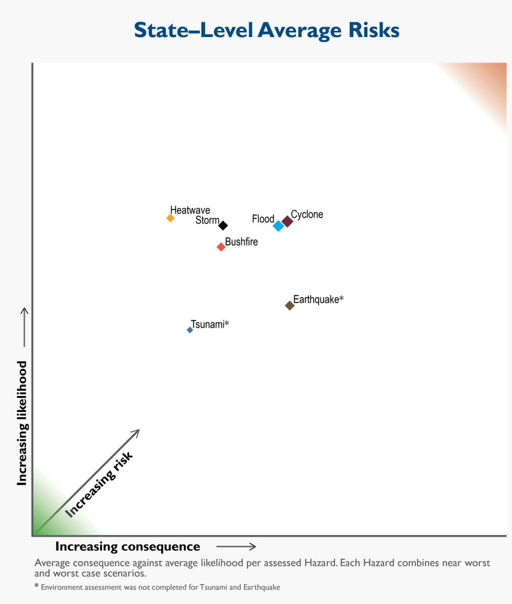

# Westplan — Flood (SEMC approved 24 May 2016)

> **Source**: WA SEMC
> **URL**: https://semc.wa.gov.au/Documents/Resources/LegislationPolicyPlansProcedureandGuidelines/Plans/Westplans2016/WestplanFloodSEMCapproved24052016.pdf
> **Licence**: © Government of Western Australia; emergency-management practitioner reference
> **Retrieved**: 2026-05-07T23:42:53Z
> **SHA-256**: `8926455e9f0808c6381befcc5b423577e3de9878e699fcf4b5753684808dde14`
> **Archived copy**: Internet Archive Wayback Machine — `https://web.archive.org/web/20190315115842id_/https://semc.wa.gov.au/Documents/Resources/LegislationPolicyPlansProcedureandGuidelines/Plans/Westplans2016/WestplanFloodSEMCapproved24052016.pdf`
> *(Live publisher URL no longer resolves; this archived snapshot was used for ingest. Cite the publisher URL above.)*
> *Converted from PDF to Markdown format.*

---
## Page 1

 
   
 
 
STATE HAZARD PLAN 
 
FOR 
 
FLOOD 
 
 
(WESTPLAN - FLOOD) 
 
Prepared by 
 
APPROVED AT STATE EMERGENCY MANAGEMENT COMMITTEE  
MEETING 
RESOLUTION NO:  
19/2016 
DATE OF APPROVAL:  
24 May 2016 
 
REVIEW DATE:   August 2020

---
## Page 2

 
WESTPLAN – Flood – May 2016 
UNCONTROLLED DOCUMENT WHEN PRINTED 
2 
Contact Details 
To provide comment on this plan, please contact: 
 
Manager Hazard Planning 
Department of Fire and Emergency Services  
20 Stockton Bend, Cockburn Central WA 6164 
 
Amendment List 
AMENDMENT 
DETAILS 
AMENDED 
BY: 
(INITIALS) 
NO. 
DATE 
 
09/04 
Review and re-write of 1999 version. 
 
1 
09/06 
Amend 2004 version, congruous with the 
provisions of the Emergency Management Act 
2005. 
 
2 
09/10 
Complete Revision. 
 
3 
2015 
Complete Revision 
 
4 
May 2016 
Statement of fact amendments 
SEMC 
Secretariat 
5 
 
 
 
6 
 
 
 
7 
 
 
 
8 
 
 
 
9 
 
 
 
10 
 
 
 
 
A copy of this Westplan is available on the State Emergency Management 
Committee (SEMC) internet site: 
www.semc.wa.gov.au/resources/policies-and-plans/westplans

---
## Page 3

 
WESTPLAN – Flood – May 2016 
UNCONTROLLED DOCUMENT WHEN PRINTED 
3 
Table of Contents 
1 
INTRODUCTION ............................................................................. 5 
1.1 AIM AND OBJECTIVES ........................................................................................................ 5 
1.2 SCOPE ............................................................................................................................ 5 
1.3 HAZARD DEFINITION ......................................................................................................... 6 
1.4 SPECIAL CONSIDERATIONS ................................................................................................. 6 
1.4.1 
Community Factors .................................................................................................... 6 
1.4.2 
Industry ...................................................................................................................... 6 
1.4.3 
Remote Aboriginal Communities................................................................................ 7 
1.4.4 
Isolation...................................................................................................................... 7 
1.5 RELATED DOCUMENTS ...................................................................................................... 7 
1.6 AUTHORITY TO PLAN ........................................................................................................ 8 
1.7 PLAN RESPONSIBILITIES ..................................................................................................... 8 
1.7.1 
Advisory Groups/Subcommittees ............................................................................... 9 
1.8 EXERCISE AND REVIEW PERIODS ......................................................................................... 9 
1.8.1 
Exercising ................................................................................................................... 9 
1.8.2 
Review ........................................................................................................................ 9 
1.9 ORGANISATIONAL ROLES AND RESPONSIBILITIES .................................................................... 9 
2 
RISK ASSESSMENT ........................................................................ 11 
3 
PREVENTION AND MITIGATION ..................................................... 12 
3.1 RESPONSIBILITY FOR PREVENTION AND MITIGATION ............................................................ 12 
3.2 LEGISLATION AND CODES ................................................................................................. 12 
3.3 RISK TREATMENT STRATEGIES .......................................................................................... 12 
4 
PREPAREDNESS ............................................................................ 15 
4.1 RESPONSIBILITY FOR PREPAREDNESS .................................................................................. 15 
4.2 PLANNING AND ARRANGEMENTS ...................................................................................... 15 
4.3 GROUPS WITH SPECIAL NEEDS .......................................................................................... 16 
4.4 RESOURCES ................................................................................................................... 16 
4.5 TRAINING ...................................................................................................................... 16 
4.6 COMMUNITY INFORMATION ............................................................................................ 17 
4.7 EVACUATION ARRANGEMENTS ......................................................................................... 17 
4.8 LOCAL AND DISTRICT HAZARD EMERGENCY MANAGEMENT PLANS ......................................... 17 
4.9 INTER JURISDICTIONAL ASSISTANCE ARRANGEMENTS ........................................................... 17 
4.10 AUSTRALIAN GOVERNMENT PHYSICAL ASSISTANCE .............................................................. 18 
4.10.1 
Defence Assistance to the Civil Community ............................................................. 18 
5 
RESPONSE .................................................................................... 20 
5.1 PRINCIPLES .................................................................................................................... 20 
5.2 ALERT .......................................................................................................................... 20 
5.3 FLOOD WARNING SYSTEM ............................................................................................... 21 
5.3.1 
Flood Watch ............................................................................................................. 21 
5.3.2 
Flood Warning .......................................................................................................... 21 
5.3.3 
Distribution of Warnings .......................................................................................... 21 
5.4 ACTIVATION .................................................................................................................. 22 
5.5 LEVELS OF RESPONSE ...................................................................................................... 22 
5.6 INCIDENT MANAGEMENT SYSTEM ..................................................................................... 23 
5.7 RESPONSE PRIORITIES ..................................................................................................... 23 
5.8 HAZARD MANAGEMENT STRUCTURE AND ARRANGEMENTS .................................................. 23 
5.8.1 
Liaison Officers ......................................................................................................... 24

---
## Page 4

 
WESTPLAN – Flood – May 2016 
UNCONTROLLED DOCUMENT WHEN PRINTED 
4 
5.9 MULTI AGENCY SUPPORT STRUCTURE AND ARRANGEMENTS ................................................. 24 
5.9.1 
Incident Support Group (ISG) ................................................................................... 24 
5.9.2 
Operational Area Support Group (OASG) ................................................................. 24 
5.9.3 
State Emergency Coordination Group ...................................................................... 24 
5.10 EMERGENCY POWERS ..................................................................................................... 26 
5.10.1 
Hazard Management Officers .................................................................................. 26 
5.10.2 
Authorised Officers ................................................................................................... 26 
5.11 EVACUATION ................................................................................................................. 26 
5.11.1 
Triggers for Evacuation ............................................................................................ 26 
5.11.2 
Facility Evacuation Plans .......................................................................................... 27 
5.11.3 
Notification of Evacuation Arrangements ................................................................ 27 
5.11.4 
Refusal to Evacuate .................................................................................................. 27 
5.11.5 
Return of Evacuees ................................................................................................... 27 
5.12 SUPPORT PLANS ............................................................................................................. 28 
5.12.1 
Health Response ....................................................................................................... 28 
5.12.2 
Incident Response Communications ......................................................................... 28 
5.12.3 
Public Information and Media Management ........................................................... 29 
5.13 FINANCIAL ARRANGEMENTS FOR RESPONSE........................................................................ 29 
5.14 STAND DOWN AND DEBRIEFING ....................................................................................... 29 
5.15 CONTACT ARRANGEMENTS .............................................................................................. 30 
6 
RECOVERY .................................................................................... 31 
6.1 RESPONSIBILITY FOR RECOVERY ........................................................................................ 31 
7 
INCIDENT ANALYSIS AND REVIEW ................................................. 32 
7.1 INVESTIGATION AND ASSESSMENT ..................................................................................... 32 
7.2 IDENTIFYING RISK TREATMENT STRATEGIES ........................................................................ 32 
8 
APPENDICES ................................................................................. 33 
APPENDIX A - DISTRIBUTION .................................................................................................. 33 
APPENDIX B - ROLES AND RESPONSIBILITIES OF ORGANISATIONS .................................................. 34 
APPENDIX C - OPERATIONAL SEQUENCE GUIDE – FLOOD ............................................................ 38

---
## Page 5

 
WESTPLAN – Flood – May 2016 
UNCONTROLLED DOCUMENT WHEN PRINTED 
5 
1 INTRODUCTION 
The flooding of rivers, lakes and basins following heavy rainfall is the most 
common form of flooding in Western Australia (WA).  Flooding of rivers in 
inland areas can spread for thousands of square kilometres and may last for 
months.  In contrast, hilly areas often contain smaller catchments with 
steeper rivers which flood with less than a day’s warning and drain within a 
few days.  Very high tides may also cause or exacerbate flooding in coastal 
areas.  Intense bursts of rainfall often from thunderstorms may cause flash 
flooding which can become serious in small streams and in urban areas 
where drainage systems may not cope.  
In severe floods it is possible for several hundred WA properties to be 
inundated and for adjoining roads and infrastructure to incur damage.  In 
extreme events, it is not unheard of for whole communities to be relocated for 
weeks. 
This Westplan has been prepared to meet the State Emergency 
Management 
Committee 
(SEMC) 
planning 
requirements 
under the 
Emergency Management Act 2005 (EM Act 2005). 
 
The Fire and Emergency Services (FES) Commissioner, is the Hazard 
Management Agency (HMA) for flood1. 
1.1 Aim and Objectives 
The aim of Westplan – Flood is to detail the emergency management 
arrangements for potential or actual floods in WA.  
The objectives of this plan are to: 
 ensure WA has effective emergency management arrangements in 
place for potential and actual flood emergencies; 
 define the responsibilities of DFES, Australian Government agencies, 
State Government agencies, local government, and emergency 
management agencies in the event of a flood emergency; 
 detail arrangements in relation to the control, coordination of, 
response to, and recovery of potential or actual flood emergencies; 
and 
 provide guidance for flood emergency management plans at all levels. 
1.2 Scope 
Westplan – Flood covers emergency management flood planning within the 
geographic boundaries of WA.  The plan deals with risk treatment strategies, 
preparedness for flood, response to flood and initiation of recovery 
arrangements following the impact of a flood.  
Westplan – Flood is designed to account for all flood magnitudes and 
generation mechanisms, except the following: 
                                            
1 Emergency Management Regulations 2006 s 17(2)

---
## Page 6

 
WESTPLAN – Flood – May 2016 
UNCONTROLLED DOCUMENT WHEN PRINTED 
6 
 Normal minor floodway flooding; 
 Flash flood and similar localised events (refer to Westplan – Storm); 
 Cyclonic storm surge (refer to Westplan – Cyclone); or 
 Tsunami inundation (refer to Westplan – Tsunami). 
1.3 Hazard Definition 
A flood emergency is defined as a potential or actual flood event that requires 
a coordinated multi-agency response and the use of multi-agency resources. 
In WA, flooding can be caused by a number of different mechanisms 
including heavy rainfall, storm surge, tsunamis and failure of engineered 
structures. The most common and significant threats to the social and 
economic well-being of flood prone communities arise from heavy rainfall and 
storm surges.  
For further information on the flood hazard refer to the Bureau of Meteorology 
(BoM) website (www.bom.gov.au).  
1.4 Special Considerations 
1.4.1 
Community Factors 
Society is increasingly dependent on services and infrastructure such 
as energy supply, transportation, water, sewerage and drainage 
systems, and communication networks.  This vital and critical 
infrastructure can be vulnerable in a flood emergency.  Restoration 
may take significant time and prolonged outages may create 
secondary effects in the community. 
As communities become more interconnected through modern 
telecommunications, 
increasing 
expectations 
are 
placed 
on 
emergency management agencies to respond sooner, over wider 
areas and in more sophisticated ways.  Emergency management 
agencies recognise that putting out credible and timely information is 
as important as responding to an emergency in the rapidly 
transforming information age2. 
A number of people within the community have special-needs and 
require particular consideration in state, district and local level plans.  
Paragraph 4.3 broadly identifies these special-needs groups. 
1.4.2 
Industry 
WA has oil, gas and mining industries that significantly contribute to 
the national economy.  A notable component of these industries is the 
fly-in fly-out (FIFO) workforce.  
                                            
2 AFAC, Strategic Directions for Fire and Emergency Services in Australia and New Zealand 
2014 – 2016, 2013, p. 6.

---
## Page 7

 
WESTPLAN – Flood – May 2016 
UNCONTROLLED DOCUMENT WHEN PRINTED 
7 
While industry is required to comply with a range of regulations and 
instructions such as the Occupational Safety and Health Act 1984, 
consideration should also be given to factors such as isolation, 
evacuation or re-supply of industry based communities as a result of a 
flood emergency.  
Where a risk analysis identifies a reduced level of individual or 
community resilience due to the transient nature of the work force, 
DFES strongly encourages industry to develop specific risk treatment 
and preparedness measures in partnership with the local community. 
1.4.3 
Remote Aboriginal Communities 
Several hundred remote Aboriginal communities (RACs) exist in WA 
and the majority of these communities are located in flood prone 
areas.  Aboriginal communities have a unique culture that must be 
considered when planning for hazards and English is often the second 
or third language spoken. 
The relationship with, and between land and tradition, are important 
considerations when a RAC decides where it will be located.  This may 
result in the establishment of communities in isolated areas and in 
regions considered at higher-risk in terms of flood impact.  Their 
isolation increases response times in the event of an emergency. 
1.4.4 
Isolation 
The geographic dispersion of WA’s communities can cause whole 
communities to become isolated during flooding.  Ingress to and 
egress from such communities by normal transport may be restricted 
for long periods, possibly several months in extreme cases. The need 
for emergency re-supply of communities should be considered in flood 
planning.  
1.5 Related Documents 
 
This document is to be read in conjunction with the following suite of State 
Emergency Management (EM) documents: 
 
 Emergency Management Act 2005 (EM Act); 
 Emergency Management Regulation 2006 (EM Regulation); 
 State Emergency Management Policy (State EM Policy); 
 State Emergency Management Plan (State EM Plan); 
 Relevant State Hazard Specific Plans (Westplans); 
 State Emergency Management Procedures (State EM Procedures); 
 State Emergency Management Guidelines ( State EM Guidelines); 
and 
 State Emergency Management Glossary (State EM Glossary). 
 
It should be noted that the State EM Procedures are divided into 
Prevention, Preparedness, Response and Recovery sections, with

---
## Page 8

 
WESTPLAN – Flood – May 2016 
UNCONTROLLED DOCUMENT WHEN PRINTED 
8 
individual procedures referred to as ‘State EM Prevention Procedure’, 
‘State EM Preparedness Procedure’, ‘State EM Response Procedure’ and 
‘State EM Recovery Procedure’, as applicable. 
 
In addition, the following documents relate to this Westplan:  
 Fire and Emergency Services Act and Regulations1998; 
 Land Drainage Act 1925; 
 Main Roads Act 1930; 
 Metropolitan Water Authority Act 1982; 
 Metropolitan Water Supply, Sewerage, and Drainage Act 1909; 
 Planning and Development Act 2005 
 Meteorology Act 1955 (Cwlth); 
 Water Agencies (Powers) Act 1984; 
 Water Supply; Sewerage, and Drainage Amendment and Validation 
Act 1981; 
 the State Health Emergency Response Plan; 
 the State Emergency Welfare Plan and its annexures on Reception 
and Registration and Reunification;  
 The State Emergency Telecommunication Plan;  
 The State Emergency Public Information Plan; and 
 Local Emergency Management Arrangements. 
1.6 Authority to Plan 
The SEMC is responsible for arranging the preparation of State emergency 
management plans (Westplans)3.  The FES Commissioner, as the prescribed 
HMA, is responsible for coordinating the development and maintenance of 
Westplan – Flood4. 
The Minister for Water Resources has the function of developing plans for 
and providing advice on flood management5. 
1.7 Plan Responsibilities 
The development, implementation and revision of Westplan - Flood is the 
responsibility of DFES in consultation with key stakeholders, emergency 
management agencies and other support organisations6. 
In order to ensure that the plan is consistent with flood planning 
responsibilities under the Water Agencies (Powers) Act 1984, the 
                                            
3 Emergency Management (EM) Act 2005 s 18(1) 
4 State EM Policy Section 1.5. 
5 Water Agencies (Powers) Act 1984 s 9 
6 State EM Policy Section 1.5

---
## Page 9

 
WESTPLAN – Flood – May 2016 
UNCONTROLLED DOCUMENT WHEN PRINTED 
9 
Department of Water (DoW) has been consulted during the preparation of the 
plan. 
1.7.1 
Advisory Groups/Subcommittees 
1.7.1.1 
Flood Warning Consultative Committee. 
The Flood Warning Consultative Committee (FWCC) serves as a 
collaborative forum for Federal and State Government agencies to: 
 undertake 
planning 
for 
warning 
systems 
and 
process 
improvements; 
 establish requirements for new and upgraded flood forecasting 
and warning systems that are based on best practice; and 
 provide strategic guidance on the overall development of flood 
warning services in WA.  
The FWCC also promotes close liaison and effective coordination 
between meteorological and hydrological forecasting groups to create 
an environment in which the formulation and presentation of warnings 
are based on the best available technical and scientific knowledge. 
The FWCC comprises of representatives from: BoM (Chair), DFES, 
DoW, Main Roads WA, Water Corporation, Western Australian Local 
Government Association, and other agencies as seconded by the 
Chair. 
The FWCC meets at least two times per year, with additional meetings 
scheduled as considered necessary.  The FWCC does not have an 
operational role. 
1.8 Exercise and Review Periods 
1.8.1 
Exercising 
The Response elements of Westplan – Flood will be exercised 
annually at the State and Regional level7.  The activation of this 
Westplan counts as an exercise, if the post incident report is 
completed. 
1.8.2 
Review 
Westplan – Flood will be reviewed by DFES annually, with a major 
review every five years. 
1.9 Organisational Roles and Responsibilities 
This Westplan details organisational responsibilities at a State-level and 
requires that participating organisations support planning at district and local 
level. 
                                            
7 State EM Policy Section 4.8 and State EM Plan Section 4.7.

---
## Page 10

 
WESTPLAN – Flood – May 2016 
UNCONTROLLED DOCUMENT WHEN PRINTED 
10 
As the HMA for flood emergencies, the FES Commissioner is responsible for 
ensuring effective preparedness and response to this risk within the 
community. 
A coordinated response to a flood emergency requires emergency 
management agencies and support organisations to undertake a variety of 
agreed and statutory responsibilities.  These responsibilities are outlined at 
Appendix B.

---
## Page 11

 
WESTPLAN – Flood – May 2016 
UNCONTROLLED DOCUMENT WHEN PRINTED 
11 
2 Risk Assessment 
In 2013, the SEMC coordinated risk assessment workshops to analyse the 
risks from cyclones, earthquakes, floods, storms, tsunamis, bushfires and 
heatwaves to six key areas fundamental to the wellbeing of the State, namely 
the potential impacts to the People, Economy, Social Setting, Governance, 
Infrastructure and Environment of Western Australia8. 
Major flooding and storm events yielded higher order risks to the People, 
Social Setting and Infrastructure of the State. 
The flood workshops investigated the impacts from two scenarios: a wide-
spread flood event across the South West and a monsoon low event that 
generates flood conditions in the Kimberley, Pilbara and Goldfields.  The 
analysis showed the Economy could be significantly affected under such 
circumstances due to the disruption to the resources sector, including the 
transport networks, potentially slowing the State’s productive capacity9. 
 
Figure 1 – Average consequence against average likelihood per hazard. Each hazard 
combines worst and near-worst case scenarios.10 
                                            
8 SEMC, Western Australian State-level Risk Assessment, 2013, p. 2. 
9 SEMC, p. 19. 
10 Adapted from: State Emergency Management Committee, 2014. 
Emergency 
Preparedness Report 2014. State Emergency Management Committee, Perth.

---
## Page 12

 
WESTPLAN – Flood – May 2016 
UNCONTROLLED DOCUMENT WHEN PRINTED 
12 
3 PREVENTION AND MITIGATION 
3.1 Responsibility for Prevention and Mitigation 
Risk treatment strategies for flood emergencies within WA rely heavily on 
land use planning and the built environment.  Responsibilities in these areas 
are divided between some State agencies and local government.  
Local government has the responsibility for development and implementing 
prevention strategies for flood emergencies within WA.  DFES also has 
limited responsibility for coordinating the risk treatment aspects of flood within 
the limitations of its legislative powers and resource capabilities.  
DoW also has risk treatment responsibilities related to the development of 
floodplain management strategies which are empowered by the Water 
Agencies (Powers) Act 1984. 
3.2 Legislation and Codes 
Legislation is one of the key initiatives to ensure that risk treatment strategies 
are consistent and enforceable.  Legislation applicable to managing the flood 
risk includes: 
 Building Code of Australia (updated annually); 
 Building Act 2011; 
 Building Regulations 1989; 
 Emergency Management Act 2005; 
 Emergency Management Regulations 2006;  
 Fire and Emergency Services Act and Regulations 1998; 
 Local Government (Miscellaneous Provisions) Act 1960; 
 Local Government Act 1995; 
 Main Roads Act 1930; 
 Meteorology Act 1955 (Cwlth); 
 Metropolitan Water Authority Act 1982; 
 Metropolitan Water Supply, Sewerage, and Drainage Act 1909; 
 Occupational Safety & Health Act 1984; 
 Planning and Development Act 2005; and 
 Water Agencies (Powers) Act 1984. 
3.3 Risk Treatment Strategies 
Strategies to reduce the impact of floods on communities can include 
engineering solutions, such as the building of levees; social solutions, such 
as community education; and enforcement of legislative requirements, such 
as building restrictions in flood prone areas.

---
## Page 13

 
WESTPLAN – Flood – May 2016 
UNCONTROLLED DOCUMENT WHEN PRINTED 
13 
DFES conducts a series of community engagement programs and 
campaigns focused on providing knowledge, skills and behaviour change to 
achieve a greater level of community capacity and preparedness to respond 
to an emergency.  These programs are generally conducted at a particular 
time of the year and while they have a state wide focus they encourage staff 
and volunteers to deliver content relevant to the local community where 
possible.   
The Flood Smart Program works with volunteer and operational personnel to 
build the community's skills and knowledge to prepare their families and 
properties to respond to a flood event. The program is a Statewide initiative 
with a particular focus on the North West during the cyclone season.  
Risk treatment strategies contribute to the increased resilience and reduction 
in vulnerability of our communities by proactively reducing or minimising the 
effects of hazardous events.  
Key strategies are employed to mitigate the risks associated with flood, 
emergencies.  These strategies are shown in Table 1.  
Strategy 
Responsible Organisations 
Promotion 
of, 
and 
participation 
in, 
community 
awareness 
campaigns 
or 
programs for ‘at risk’ communities. 
Local governments (LGs) 
assisted by DFES  
 
Application 
and 
enforcement 
of 
The 
Building Codes of Australia and informed 
land use planning for vulnerable areas.  
Building design to elevate floor or pad 
levels.  
LGs supported by Department of 
Water (DoW) 
Developing resilience in the community 
and 
minimising 
the 
vulnerability 
of 
communities to effects of flood. 
LG 
Encourage the relocation of structures to 
areas outside of the floodplain.  
LG 
Participation in research and development 
programs directed towards risk treatment. 
DFES 
Liaison with industry groups to promote 
and assist with mitigation planning for 
transient workforce populations 
DFES 
Provision 
of 
support 
to 
voluntary 
emergency organisations. 
DFES, LG 
Monitoring weather patterns to identify 
potential and or actual floods and issue 
warnings to the community. 
BoM assisted by Flood Warning 
Operational Group and DFES 
Provision of advice to the community in the 
form of Flood Information Bulletins, Flood 
Watch and Warning Messages. 
BoM 
Flood mapping.  
DoW  
Provision 
of 
advice 
on 
floodplain 
management. 
DoW

---
## Page 14

 
WESTPLAN – Flood – May 2016 
UNCONTROLLED DOCUMENT WHEN PRINTED 
14 
Table 1 Flood Risk Treatment Strategies 
 
 
Identification of suitable buildings for 
designation 
as 
Welfare/Evacuation 
Centre’s. 
Department for Child Protection 
and Family Support (CPFS) in 
consultation with LGs  
Maintenance of a register of potential 
welfare/evacuation centres. 
CPFS  in consultation with Local 
Emergency Management 
Committee 
Participation 
in 
the 
Flood 
Warning 
Consultative Committee. 
BoM (Chair), DFES, DoW,  
Main Roads Western Australia 
(MRWA), Water Corporation, 
WALGA 
Ensuring the sustainability of service 
delivery of critical infrastructure through 
design and maintenance standards. 
MRWA, Network operators 
Providing advice to agencies related to 
sustainability 
of 
critical 
infrastructure 
services 
and 
access 
in 
‘at 
risk’ 
communities. 
MRWA, Network operators

---
## Page 15

 
WESTPLAN – Flood – May 2016 
UNCONTROLLED DOCUMENT WHEN PRINTED 
15 
4 PREPAREDNESS 
4.1 Responsibility for Preparedness 
Preparedness activities focus on developing systems to ensure the delivery 
of essential emergency response capabilities when an emergency occurs.  
These systems include development of plans and procedures, design of 
organisational structures, implementation of training, development of 
resource management systems, and community education related to 
preparation and response. 
This section outlines measures to be taken to prepare for flood emergencies 
together with relevant responsibilities.  Most of these activities commence 
well before the emergency.  Exercising of these measures should be 
undertaken to retain confidence in their performance during emergencies.  
As the HMA for flood the FES Commissioner has responsibility for: 
 promoting an improved state of resilience within communities to 
improve the management of future risks; and 
 ensuring all emergency management activities related to flood 
preparedness are undertaken. 
4.2 Planning and Arrangements 
Emergency management plans are to be developed and based on: 
1. best practice principles; 
2. technical and scientific knowledge; 
3. historical data and information; and 
4. local knowledge and experience. 
Successful flood operations depend on good planning, effective use of 
resources and a coordinated response which is timely, efficient, effective, 
and sustainable. 
The concept of this Westplan is to employ and coordinate the resources of 
State and Australian Government departments, authorities and agencies; 
resources available to private industry; and resources available to volunteer 
groups, for flood operations.  This concept is based on: 
 availability of the DFES 24/7 State Operations Centre (SOC) for 
receipt of flood notification reports; 
 establishment of operational facilities at three levels (State, Regional 
and local), from which management of flood takes place; 
 deployment of emergency service personnel; 
 provision of expert technical advice on flood modelling by State and 
Australian Government agencies when requested by DFES; and 
 tasking of agencies in a coordinated manner in support of DFES.  
Agency procedures are then employed to carry out tasks.

---
## Page 16

 
WESTPLAN – Flood – May 2016 
UNCONTROLLED DOCUMENT WHEN PRINTED 
16 
Local government is responsible for the development of local emergency 
management arrangements (LEMA)11.  The Local Emergency Management 
Committee (LEMC) is to provide advice to local government in this regard. 
4.3 Groups with Special Needs 
Special-needs groups include individuals and groups of people within the 
community for whom special consideration must be given in state, district and 
local level plans.  These groups may require unique arrangements in regard 
to resources, mobility, timings, support or communications when responding 
to an emergency. 
State EM Policy Section 4.6 and State EM Plan Section 4.6.1 outline the 
individuals and groups whose circumstances require special consideration in 
emergency management planning. 
Special-needs groups should be included in the development of local risk 
plans for inclusion in LEMAs. 
4.4 Resources 
The identification of appropriate and adequate resources and expertise is 
essential to preparedness for a flood emergency.  Planning at all levels 
should 
reference 
resource 
management, 
inventory 
and 
acquisition 
arrangements. 
Resources that are used in flood emergencies may be required at short 
notice and may include: urban search and rescue (USAR) resources, 
transport resources, earth moving machinery, signage, generators, lighting, 
pumps, temporary toilet facilities, potable water, and medical equipment.  
DFES is responsible for the overall provision, coordination and management 
of resources required to respond to a potential or actual flood emergency, 
including 
acquisition, 
pre-positioning 
and 
inventory 
management.  
Emergency management and support agencies are required to provide their 
own resources in the first instance and to make requests for additional 
resources to DFES as required. 
LEMAs and district emergency plans should incorporate the use of 
community and industry resources, especially in relation to accommodation 
and welfare.  
Where an operation is beyond the resources of the State, a request for 
assistance from other jurisdictions may be made in accordance with section 
4.9 and 4.10 of this Westplan. 
4.5 Training 
DFES is responsible for training and equipping an emergency service 
capable of assisting the community to manage the effects of a flood. 
Emergency management and support agencies are also expected to provide 
trained and equipped personnel.  DFES is responsible for conducting multi-
agency exercises for the relevant level of emergency management, thereby 
                                            
11 EM Act 2005 s 41

---
## Page 17

 
WESTPLAN – Flood – May 2016 
UNCONTROLLED DOCUMENT WHEN PRINTED 
17 
ensuring all agency personnel are aware of their role in the organised 
response. 
4.6 Community Information 
DFES, BoM, and local governments provide a contribution to education 
programs developed to inform and educate the public on flood notification, 
risk and management. 
In the months leading into, and during the cyclone and flood season DFES 
releases monthly preparedness Fact Sheets or Themes through an extensive 
email network established in the Midwest-Gascoyne, Pilbara and Kimberley.  
The Fact Sheets or Themes are distributed by the people on the email 
network to their social, work or interest groups.  They are also used by local 
newsletters to provide preparedness information.  These Fact Sheets or 
Themes provide easy to access information on the basis of preparedness 
and can drive readers to more complex information when they are prepared 
to take on more difficult messages. 
DFES also completes distribution of flood information through its regional 
offices and other distribution points in affected regions.  Further staff and 
volunteers in affected regions are provided with support from the Community 
Engagement 
Directorate 
to 
implement 
their 
own 
local 
community 
engagement activities relating to flood preparedness. 
Prior to the expected commencement of the wet season, DFES coordinates a 
visit to communities by representatives from DFES, BoM, local government 
and CPFS.  Representatives are available to discuss the cyclone and flood 
seasonal outlook, community safety and welfare.  These visits are combined 
with appropriate targeted information on the importance of preparedness and 
personal responsibility in making the necessary preparations. 
During flood events, DFES will provide community information in a 
coordinated manner through the Incident Controller and/or Operational Area 
Manager (OAM). This is detailed in sections 5.3 and 5.12 of this plan. 
Media and public information strategies are reviewed annually by DFES to 
ensure appropriate communication of flood information to the community. 
4.7 Evacuation Arrangements 
Evacuation arrangements are addressed in section 5.11 of this plan. 
4.8 Local and District Hazard Emergency Management Plans 
Where areas susceptible to flooding are identified as a risk to the community 
DFES may develop Local and District Flood Plans to address the prevention, 
preparedness, response and recovery activities for flood. 
4.9 Inter Jurisdictional Assistance Arrangements 
Should a flood emergency be beyond the resources of the State, support 
may be requested from the Australian Government, other States or overseas. 
Assistance to interstate, overseas and other jurisdictions for flood 
emergencies will be coordinated by DFES.  This will include determination of

---
## Page 18

 
WESTPLAN – Flood – May 2016 
UNCONTROLLED DOCUMENT WHEN PRINTED 
18 
the process involved and recognition of pre-existing arrangements for inter-
jurisdictional assistance by other agencies where such arrangements exist. 
DFES is a signatory to the Arrangements for Interstate Assistance (Fire and 
Emergency Services) which have been developed to provide for the timely 
and meaningful exchange of capability between Australian states and 
territories during significant incidents12. 
The Minister must be notified before any assistance is provided to other 
jurisdictions. 
4.10 Australian Government Physical Assistance 
When the resources (government, community and commercial) of the State 
cannot reasonably cope with the needs of the situation the nominated official 
can seek non-financial assistance13 from the Australian Government, through 
Emergency Management Australia (EMA), under the Australian Government 
Disaster Response Plan (COMDISPLAN)14.  COMDISPLAN outlines the 
coordination arrangements for the provision of Australian Government non-
financial assistance in the event of a disaster or emergency within Australia 
or its offshore territories.  All requests for physical assistance are to be made 
in accordance with State EM Policy Section 5.10 and State EM Plan Section 
5.6. 
4.10.1 Defence Assistance to the Civil Community 
Defence Assistance to the Civil Community (DACC) can be provided 
in a number of ways which are defined as categories of assistance in 
State EM Response Procedure 20. 
Category 1 DACC is emergency assistance for a specific task(s) 
provided by a Local ADF Commander/Administrator from within their 
own resources, in localised emergency situations when: 
a. immediate action is necessary to save human life, alleviate 
suffering, prevent extensive loss of animal life, or prevent 
widespread loss/damage to property; and 
b. local civilian resources are inadequate, unavailable or cannot be 
mobilised in time15. 
Requests for Category 1 DACC assistance are coordinated through 
the Manager Joint Operations Support Staff (MJOSS), or their Liaison 
Officer (LO), who will liaise directly with the Local Australian Defence 
Force (ADF) Commander to provide assistance.  Availability of these 
resources should be identified in LEMAs. 
                                            
12 EMA, Arrangements for Interstate Assistance (Fire and Emergency Services), v1, 2014. 
13 The term ‘non- financial assistance’ refers, but is not limited to: planning expertise, 
provision of mapping services, counselling, advice, management of external resources and 
physical assistance. 
14 Attorney-General’s Department, COMDISPLAN, 2014, p. 16. 
15 Department of Defence, DACC Manual, 2014.

---
## Page 19

 
WESTPLAN – Flood – May 2016 
UNCONTROLLED DOCUMENT WHEN PRINTED 
19 
Other categories of DACC Assistance may be provided at the 
discretion of the Australian Government where the State requests 
Australian Government physical assistance.  In these circumstances 
the initial resource request should be made through DFES, who will 
coordinate with the MJOSS or their LO in accordance with State EM 
Plan Section 5.6.1.

---
## Page 20

 
WESTPLAN – Flood – May 2016 
UNCONTROLLED DOCUMENT WHEN PRINTED 
20 
5 RESPONSE 
5.1 Principles 
The management of a flood emergency is based on a graduated approach 
using the following guiding principles: 
 The FES Commissioner is the HMA for flood emergency in WA; 
 DFES is the Controlling Agency for flood emergencies in WA in 
accordance with State EM Policy Section 5 and State EM Plan Section 
5; 
 DFES is responsible for activating and controlling the response to a 
flood emergency within WA; 
 DFES will use arrangements which employ identified emergency 
management agencies and support organisations to provide an 
effective and coordinated response (refer to Appendix B); 
 A flood emergency in WA will be managed using the emergency 
management and operational principles detailed in State EM Policy 
Section 5 and State EM Plan Section 5; 
 Should another hazard occur as a consequence of a flood emergency 
and, if DFES is not the HMA/Controlling Agency for the consequent 
hazard, then the provisions of State EM Plan Section 5.1.2 will apply.  
DFES shall remain responsible for the overall management of the 
flood emergency; 
 Responsibility for resourcing and responding to an emergency initially 
rests with the Incident Controller at the local level; 
 An emergency beyond the capability of local resources will receive 
support from district resources.  State resources will be provided if 
district resources are inadequate; and 
 Communication between local, district and State authorities is 
essential to ensure intelligent and timely application of resources to 
manage the emergency. 
5.2 Alert 
In the event of a potential or actual flood emergency, the BoM Flood Warning 
Centre (FWC) will be activated and will provide DFES with information about 
the potential or actual flood.  
Alternatively, initial information regarding a potential or actual flood impact 
can often originate from a local or agency source.  Such sources and 
agencies should notify DFES.

---
## Page 21

 
WESTPLAN – Flood – May 2016 
UNCONTROLLED DOCUMENT WHEN PRINTED 
21 
5.3 Flood Warning System 
The BoM has a responsibility for flood forecasting in WA16.  The BoM 
exercises this responsibility through the FWC which has extensive data, but 
may require additional information and resources from WA Government 
agencies when developing forecasts.  In order to assist flood forecasting, the 
FWC may consult with Flood Warning Operational Group (FWOG) members 
or activate the FWOG as it deems appropriate. 
The FWOG comprises of representatives from BoM (Chair), Main Roads WA, 
DoW, Water Corporation, and other agencies selected by the Chair. 
The duration of FWOG meetings will vary with the level and immediacy of the 
emergency and the requirements of DFES.  Agencies may be requested to 
provide personnel to cover multiple shifts within the constraints of each 
agency’s available resources and commitments. 
Flood watch and flood warning information issued by the FWC is described in 
the following paragraphs. 
5.3.1 
Flood Watch 
Flood Watch provides information to generate early awareness of 
developing hydro meteorological conditions, which may lead to 
possible or likely flooding in a particular district during the next 24 to 
72 hours.  Messages will make short generalised statements about the 
developing weather situation, including forecast rainfall totals, the 
current state of the catchments and an indication of the rivers at risk 
from flooding.  Enabling people and the community to take action to 
increase safety and reduce the costs associated with flooding. 
5.3.2 
Flood Warning 
Flood Warning provides information to enable timely appropriate 
action to be taken when flooding is anticipated or occurring.  
Messages are issued for specific river basins and, where possible, will 
provide forecast rainfall and river levels.  A Flood Warning aims to 
provide sufficient information to explain what is happening, where it is 
happening, how it will affect the recipient of the message and what 
possible evasive actions could be employed. 
5.3.3 
Distribution of Warnings 
BoM issues warnings through media outlets, email, internet, marine 
communications and aircraft communications. 
Flood information and flood predictions developed by agency 
representatives should be used to support the issue of consolidated 
Flood Watches or Flood Warnings by the FWC. The nature of flooding 
in WA can lead to flood information being obtained locally and where 
this information is relevant to forecasting it should be referred to the 
FWC at the first available opportunity. 
                                            
16 Meteorology Act 1955 (Cwlth) s 6(b)(c).

---
## Page 22

 
WESTPLAN – Flood – May 2016 
UNCONTROLLED DOCUMENT WHEN PRINTED 
22 
All agencies may independently distribute the flood warnings and 
predictions after they have been endorsed by the FWC.   
Should additional support be required to issue warnings or information 
in a particular emergency, DFES may call upon the State Emergency 
Public Information Coordinator (SEPIC) to activate the State 
Emergency Public Information Plan. 
5.4 Activation 
When DFES assesses that a potential or actual flood emergency will require 
a significant response, it shall ‘activate’ emergency resources and 
emergency management agencies which are appropriate to the intensity and 
location of the flood.  This may include activation of relevant emergency 
personnel and local or district plans as required. 
DFES will undertake a range of pre-emptive activities prior to the onset of the 
hazard, during times of potential threat, or reactively post impact.  This may 
include a range of actions by regions, SOC, Metropolitan Operation Centre 
(MOC) or a Regional Operation Centre (ROC) to support operations17.  
DFES will promptly and deliberately instigate Incident Management Teams 
(IMTs) appropriate to the scale and requirements of the emergency in 
accordance with the State’s emergency management arrangements18. 
The level of implementation of plans and operational structures can vary 
considerably depending upon circumstances.  Factors which may influence 
the level of response include the degree of threat to a community, the 
number of DFES districts impacted by the flood and whether a multi-agency 
response is required. 
If the flood event is likely to result in a significant event, which may have a 
large impact on WA attracting national attention, DFES should send Situation 
Reports to the Australian Government Crisis Coordination Centre (CCC) 
regarding actions taken for this event.  This will assist in providing Whole of 
Australian Government situational awareness. 
More detail of the sequence of activation for the respective hazards is shown 
in the ALERT and CALLOUT phases of Appendix C. 
5.5 Levels of Response 
Sound emergency management requires a graduated approach which is 
appropriate to the circumstances of the emergency. 
State EM Response Procedure 2 describes the process for making an 
appropriate incident level declaration and associated responsibilities. The 
declaration of an incident level is a critical component of emergency 
management in terms of triggering the responsibilities and actions of 
emergency management stakeholders to ensure a response in which the 
size of both the Incident Management Team (IMT) and the coordination 
structure are proportional to the size of the flood emergency.  State EM 
                                            
17 DFES, Fire & Emergency Services Manual – Part Two, 2014, p. 5. 
18 DFES, p. 5.

---
## Page 23

 
WESTPLAN – Flood – May 2016 
UNCONTROLLED DOCUMENT WHEN PRINTED 
23 
Response Procedure 2 enables one of three operational levels to be selected 
depending upon the characteristic ‘factors’ of the emergency.  This procedure 
is aligned with State EM Plan Section 5.1.5  and the DFES WA Fire and 
Emergency Management Services Manual.  The descriptors are guidance for 
DFES Operational Managers and are used for all of DFES’s HMA and 
Emergency Management Agency responsibilities (refer Appendix C). 
5.6 Incident Management System 
During all emergencies, DFES will use the Australasian Inter-service Incident 
Management System (AIIMS).  All agencies with agreed responsibilities 
under this plan are encouraged to ensure their personnel are familiar with 
and able to work within the AIIMS structure.  Further information on incident 
management is detailed in State EM Policy Section 5 and State EM Plan 
Section 5.   
5.7 Response Priorities 
The response to a flood emergency shall be based on the priorities of:  
1. Life; 
2. Critical infrastructure; 
3. Property; and 
4. Environment. 
The safety of personnel tasked to the incident will be the fundamental priority 
in all phases of incident management. 
Priorities for Incident Action Planning (IAP) are: 
 The first priority will address the protection of community members 
and measures to keep them informed; 
 The protection of property, critical infrastructure and community assets 
will be the next priority; and 
 Protection of conservation and environmental values are to be 
factored into IAPs as the subsequent priority. 
5.8 Hazard Management Structure and Arrangements 
In assessing a flood emergency, DFES may determine that the response 
requires a level two or level three incident management structure as per 
State EM Response Procedure 2.  When such management structures are 
required, DFES (as the HMA) shall appoint an OAM.  The OAM will assume 
overall management of the flood emergency within their defined operational 
area. 
Floods can have large impact areas.  Therefore a flood response may be 
managed by numerous Incident Management Teams (IMT) working through 
more than one OAM in a number of geographically diverse facilities.  
DFES has a SOC available 24/7 and Regional Operations Centres (ROC) 
around the State to: 
 provide a robust facility from which to oversee the coordination of 
emergencies;

---
## Page 24

 
WESTPLAN – Flood – May 2016 
UNCONTROLLED DOCUMENT WHEN PRINTED 
24 
 facilitate coordination with other emergency service agencies and 
emergency management agencies; 
 coordinate State and regional/district response to any emergency for 
which DFES has responsibility; 
 manage the dissemination of information to the community; and 
 provide appropriate advice to all levels of government. 
5.8.1 
Liaison Officers 
All agencies are requested to provide a Liaison Officer (LO) upon 
activation of the response section of Westplan –Flood.  The LO must 
possess sufficient experience and seniority to assist DFES.  LOs may 
be the representatives on the relevant Incident Support Group (ISG) or 
Operational Area Support Group (OASG).  Some agencies may 
nominate their Agency Commander as the LO. 
5.9 Multi Agency Support Structure and Arrangements 
State EM Policy Section 5 and State EM Plan Section 5 detail the multi-
agency support structure used for different levels of emergency.  The 
following paragraphs elaborate on how this policy will be applied during flood 
emergencies. 
5.9.1 
Incident Support Group (ISG) 
The ISG(s) consist of the Local Emergency Coordinator and LOs from 
local agencies/organisations involved in the response and recovery 
from the incident.  Its purpose is to assist the IC through the provision 
of information, expert advice, support and resources relevant to each 
organisation. 
DFES, as controlling agency, shall appoint the Chair of the ISG and 
determine membership of the ISG.  The IC shall activate the ISG when 
an incident requires the coordination of multiple agencies. 
5.9.2 
Operational Area Support Group (OASG) 
When the FES Commissioner (as the HMA) identifies that multiple 
agencies need to be coordinated at a district level or multiple incidents 
are occurring simultaneously in one Operational Area, it may activate 
the OASG, which will be convened by the OAM. . 
Membership of the OASG will be the OAM, appointed by the HMA 
(who will also be the Chair), the District Emergency Coordinator and 
members (liaison officers from the key agencies involved in the 
response to and recovery from the incident). 
5.9.3 
State Emergency Coordination Group 
A State Emergency Coordination Group (SECG) is established during 
a state of emergency, or may be established where an emergency 
occurs or is imminent, at the request of the FES Commissioner (as the 
HMA), or on the initiative of the State Emergency Coordinator (SEC),

---
## Page 25

 
WESTPLAN – Flood – May 2016 
UNCONTROLLED DOCUMENT WHEN PRINTED 
25 
to assist in the provision of a strategic, coordinated multi-agency 
response to and recovery from the emergency. In addition, if a Level 3 
incident occurs, the HMA must consult with the SEC to determine if a 
SECG should be established.  
The SECG is established in accordance with State EM Policy 
Statement 5.4.7, State EM Plan Section 5.2.3 and State EM Response 
Procedure 4.  
 
Triggers for the activation of a SECG may include, but are not limited 
to: 
 
a potential or actual flood threatening a major community; 
 
widespread flooding of significant residential areas or a large 
geographical area containing communities or assets at risk; or 
 
significant risk to critical infrastructure. 
 
The requirements for membership of the SECG are outlined in the EM 
Act 200519, which requires that the membership include: 
 
the SEC, who is also the Chair; 
 
the Chair and Executive Officer of the SEMC; 
 
a representative of the HMA (FES Commissioner); 
 
a representative of the local governments in the emergency area 
or in the area where the emergency is occurring or imminent, as 
the case requires, nominated by the SEC; and 
 
any other members the SEC considers are necessary. 
In the case of an emergency, it is recommended, in consultation with 
the State Emergency Coordinator (SEC) that the SECG Membership 
should also include, as required: 
 
Western Australia Police 
 
Main Roads WA 
 
Bureau of Meteorology 
 
Department of the Premier and Cabinet 
 
State Recovery Coordinator 
 
Department for Child Protection and Family Support 
 
Department of Education 
 
Department of Health 
 
Any other representatives as considered necessary by the SEC. 
                                            
19 EM Act 2005 s 26(3).

---
## Page 26

 
WESTPLAN – Flood – May 2016 
UNCONTROLLED DOCUMENT WHEN PRINTED 
26 
5.10 Emergency Powers 
The FES Commissioner has powers in relation to natural disasters under the 
Fire and Emergency Services Act 199820.  These powers are wide-ranging 
and are normally adequate to respond to flood emergencies.  Should 
additional powers be required, the EM Act 2005 can be used to access 
emergency powers through the declaration of an ‘Emergency Situation’21 or a 
‘State of Emergency’22. 
5.10.1 Hazard Management Officers 
In the case of an Emergency Situation Declaration, Hazard 
Management Officers will be appointed in accordance with State EM 
Response Procedure 6. 
5.10.2 Authorised Officers 
In the case of a State of Emergency being declared, Authorised 
Officers may be appointed by the SEC in accordance with State EM 
Response Procedure 13. Authorised Officers shall comply with all 
limitations and directions as per Section 61 of the EM Act.  
5.11 Evacuation 
The decision to evacuate residents from areas pre or post impact is the 
responsibility of the IC.  The decision will normally be taken in consultation 
with key stakeholders. 
The responsibility for implementing the evacuation rests with DFES (as the 
Controlling Agency), which may require support from other agencies, 
particularly WA Police and CPFS. 
DFES is responsible for arranging transport requirements for the evacuation 
from the emergency area.  Local and district resources should be used 
wherever possible.  
Refer to State EM Policy Section 5.7 and State EM Plan Section 5.3.2 for 
further guidance on evacuation. 
5.11.1 Triggers for Evacuation 
During a flood emergency, DFES may evacuate residents in risk prone 
areas due to factors such as: 
 
Structural Collapse – Buildings that are at risk of structural 
collapse as a result of flood damage should be evacuated.  
 
Hazard affecting properties – Evacuation may occur if it is deemed 
likely that properties could be at risk from the effects of a flood. 
 
Isolation of properties – Persons who are not prepared for isolation 
or unsuited due to medical conditions, disabilities, age, etc. should 
be encouraged to evacuate. 
                                            
20 FES Act 1998 s 18B. 
21 EM Act 2005 s 50 
22 EM Act 2005 s 56

---
## Page 27

 
WESTPLAN – Flood – May 2016 
UNCONTROLLED DOCUMENT WHEN PRINTED 
27 
 
Food supplies run out. 
 
Failure of essential services – Failure of essential services such as 
sewerage, power, telecommunications and water pose significant 
health risks to the community.  In the event of any or all of these 
systems failing, evacuation of individuals, families and the 
community may be necessary. 
5.11.2 Facility Evacuation Plans 
Local industry may have site specific evacuation plans which form part 
of their Occupational Safety and Health Strategies.  Additionally, 
schools, hospitals, detention centres, prisons, shopping centres and 
public buildings may also have site or building evacuation plans.  
These plans should be developed in consultation with the LEMC to 
ensure they are realistic in terms of resource availability, timeliness 
and the risks created by the hazard. 
5.11.3 Notification of Evacuation Arrangements 
The IC is responsible for ensuring the accuracy of the Emergency 
Public Information, approving its release in coordination with the 
relevant agencies and terminating its broadcast. The Standard 
Emergency Warning Signal must only be used under strict instruction 
as advised by the HMA (the FES Commissioner) during an 
emergency, as defined by the EM Act, in circumstances when it is 
necessary for the community to take some action to prevent or 
minimize the loss of life or prejudice to the safety or harm to the health 
of persons or animals or destruction of or damage to property or any 
part of the environment.   
5.11.4 Refusal to Evacuate 
Sometimes community members refuse to comply with a decision to 
evacuate an area.  Management of such situations by the Controlling 
Agency (DFES) must include: 
 
provision of clear instructions to persons conducting an evacuation 
with respect to what action should be taken where a person 
refuses to evacuate; 
 
ensuring, as far as practical, that those who refuse to evacuate 
understand the risks of remaining and are capable of making an 
informed decision; 
 
where practicable, develop procedures to track the remaining (i.e. 
non-evacuated) residents’ well-being. 
5.11.5 Return of Evacuees 
DFES (as the Controlling Agency) is responsible for managing the 
return of persons evacuated as a result of a flood.  It should be 
ensured that there is an effective plan in place for returning the 
displaced community, including provision for people with special 
needs. The return phase of evacuation may be executed in stages and

---
## Page 28

 
WESTPLAN – Flood – May 2016 
UNCONTROLLED DOCUMENT WHEN PRINTED 
28 
should be subject to planning. This should include issues such as 
community safety, restoration of essential services and provision of 
welfare support services. 
 
5.12 Support Plans 
Should additional support be required during a flood emergency, it will initially 
be sourced through the appropriate LO.  Where additional support requires a 
more coordinated approach, the following plans may be activated:  
 State Health Emergency Response Plan; 
 the State Emergency Public Information Plan; and 
 State Emergency Welfare Plan and its annexures on Reception and 
Registration and Reunification. 
 
In addition, the recovery provisions outlined in Section 6 of this Westplan 
may be activated. 
The following paragraphs contain additional advice about triggers and 
processes for some of the support arrangements. 
5.12.1 Health Response 
The coordination of a state-wide WA Health response to a major 
disaster is through the State Health Coordinator (SHC) who has 
overall control and coordination of the health response.  
The initial coordination of Health Services resources will be at a local 
level; this can be escalated to a district then state level.  Should a 
flood emergency result in numbers of casualties beyond the 
capabilities of local health services, the State Health Emergency 
Response Plan can be activated to provide further support.  
Activations of the State Health Emergency Response Plan will be 
managed from the State Health Incident Coordination Centre (SHICC).  
The SHICC will be in direct contact with DFES and will liaise with 
Regional Health Coordinators and health stakeholders.  The overall 
operational management, preparation and assessment of casualties in 
a major emergency will be managed by the SHICC.  
5.12.2 Incident Response Communications 
The provision of communications for emergency response measures 
under Westplan – Flood are based on the use of normal day to day 
communication facilities of participating organisations as far as 
practicable.  
The DFES has a public emergency assistance line (132500), which 
complements the triple zero (000) service to facilitate requests for and 
the provision of emergency assistance to the community. This is 
distinct from the recorded emergency phone line (13 DFES or 13 
3337), which only provides information to the community.

---
## Page 29

 
WESTPLAN – Flood – May 2016 
UNCONTROLLED DOCUMENT WHEN PRINTED 
29 
If communication with a community at risk has not been established, 
DFES may dispatch a reconnaissance team including medical, 
community liaison and communication responders at the first available 
opportunity. 
5.12.3 Public Information and Media Management 
State EM Policy Section 5.6, State EM Plan Section 5.3.1 and the 
State Emergency Public Information Plan detail the emergency 
management arrangements for provision of emergency public 
information 
(EPI), 
the 
responsibilities 
of 
the 
HMA 
(FES 
Commissioner), Controlling Agency (DFES) and other Emergency 
Management Agencies in providing timely, accurate and consistent 
EPI to communities at risk. 
DFES has arrangements to ensure the community of Western 
Australia is informed of emergencies. 
The DFES Public Information Operational Plan (PIOP) provides a 
framework for DFES communication to the community, media and 
other stakeholders in a timely, consistent and accurate way during an 
emergency.  
The PIOP addresses all aspects of the provision and coordination of 
EPI during a flood emergency including the Statewide functions (under 
AIIMS) of Information and Warnings, Media Liaison and Community 
Liaison. 
For a flood emergency the DFES IC has overall responsibility for the 
issuing of information to the community at a local, regional and state 
level, with relevant Public Information Sections (at local, regional and 
state level) delegated this function during an incident. 
5.13 Financial Arrangements for Response 
State EM Policy Section 5.12, State EM Plan Section 5.4, and The SEMC 
website details the criteria for a variety of funding situations and should be 
consulted to determine the funding arrangements.  
Where no additional arrangement has been made with DFES, only 
expenditure approved by the IC, OAM or DFES DAC will be funded by DFES. 
5.14 Stand Down and Debriefing 
The response element of this Plan may be stood-down (de-activated) when: 
 
the SECG (if activated) is stood down;  
 
the IC identifies that there is no longer a requirement for the plan to 
remain active; and 
 
A final comprehensive impact assessment has been provided to a 
Local Recovery Coordinator in accordance with the State EM Plan 
Section 6.

---
## Page 30

 
WESTPLAN – Flood – May 2016 
UNCONTROLLED DOCUMENT WHEN PRINTED 
30 
5.15  Contact Arrangements 
The key organisations participating in this plan are shown at Appendix B.  
Ongoing contact with these organisations shall be through LOs appointed by 
each organisation. 
Detailed contact arrangements for activation of Westplan - Flood and for 
communication with LOs are held by DFES.

---
## Page 31

 
WESTPLAN – Flood – May 2016 
UNCONTROLLED DOCUMENT WHEN PRINTED 
31 
6 RECOVERY 
Recovery management is the coordinated process of supporting emergency 
affected communities in the reconstruction and restoration of physical 
infrastructure, the environment and community, psychosocial, and economic 
wellbeing. 
6.1 
Responsibility for Recovery 
It is a function of local government to manage recovery following an 
emergency affecting the community in its district23. 
DFES, as the Controlling Agency with responsibility for the response to an 
emergency must initiate recovery activity during the response to that 
emergency.  
DFES is to ensure timely notification of the emergency, liaison and 
appropriate inclusion of those with recovery responsibilities in the incident 
management arrangements.  
DFES is responsible for ensuring that in combating the effects of the 
emergency, activities have regard for the need to facilitate recovery.  
DFES is also responsible for the coordination of assessment of all impacts 
relating to all recovery environments prior to cessation of the response, 
including a risk assessment and treatment plan to provide for safe community 
access to the affected area.  
The decision point from when the agreed handover will occur from DFES to 
the local government to effect recovery will occur when the following 
circumstances arise: 
 The community is no longer at risk from the hazard. 
 Operational response activities are being managed, or able to be 
managed, at a local level. 
 No further requirement for the HMA to provide leadership or 
coordination for the event and the leadership and coordination role 
becomes predominantly recovery focused. 
 The remaining activities are mainly reconstruction and restoration of 
physical infrastructure, the environment and community, psychosocial, 
and economic wellbeing of the community. 
 The final comprehensive impact assessment has been provided to a 
Local Recovery Coordinator. 
Once the agreed handover is complete DFES may still assist in the recovery 
effort. 
For further detail refer to State EM Policy Section 6, State EM Plan Section 6, 
and 
DFES 
Standard 
Administrative 
Procedure 
3.1.I 
– 
Recovery 
Management. 
                                            
23 EM Act 2005 s 36(b)

---
## Page 32

 
WESTPLAN – Flood – May 2016 
UNCONTROLLED DOCUMENT WHEN PRINTED 
32 
7 
INCIDENT ANALYSIS AND REVIEW 
DFES conducts three levels of post incident analysis following operational 
incidents. These are: 
 Operational Debrief 
 Post Incident Analysis 
 Major Incident Review 
The level of analysis required will be determined by the DFES Deputy 
Commissioner in accordance with DFES Policy Statement No. 54 - Incident 
Analysis Policy.  The OAM/IC will ensure that all agencies involved in a multi-
agency emergency are provided with the opportunity to submit input into any 
post operational analysis.  Upon acceptance of recommendations an 
implementation schedule is to be developed and monitored for timely 
completion. 
Post Operation Reports shall be provided to SEMC in accordance with State 
EM Policy Section 5.11 and State EM Plan Section 5.7. 
7.1 Investigation and Assessment 
Where DFES identifies any issue which has, or is reasonably believed to 
have contributed to the unnecessary consequences of the emergency upon 
the community, an investigation may be conducted into that cause.  The 
purpose of the investigation shall be to determine the issues leading to the 
event, with the intent of developing mitigation prevention strategies to reduce 
the associated risk to the community. 
7.2 Identifying Risk Treatment Strategies 
During the recovery process there is an opportunity to identify future risk 
treatment strategies and often an opportunity to implement such strategies.  
DFES will identify key areas in the community infrastructure that failed during 
the emergency and will promote actions and/or studies designed to minimise 
the effects on the community in the future.  Examples of potential strategies 
include increasing building construction standards, improving land-use 
management, and disaster-hardening of key community facilities and utilities.

---
## Page 33

 
WESTPLAN – Flood – May 2016 
UNCONTROLLED DOCUMENT WHEN PRINTED 
33 
8 APPENDICES 
APPENDIX A - Distribution 
Westplan – Flood is available on the SEMC website (www.semc.wa.gov.au).  
Addressees on this list will be notified when a new or amended version of the 
Westplan is posted on the SEMC Secretariat website via the means shown 
below. 
Organisation 
Addressees 
State Government Ministers 
Minister for Emergency Services 
Minister for Police 
Minister for Planning 
State Emergency Management 
Committee 
All Members 
All Subcommittee Members 
SEMC Secretariat 
Department of Fire & Emergency 
Services  
All staff  
Emergency Management / Support 
Organisations 
All agencies and organisations with 
responsibilities under this plan. 
Community 
Web search 
Australian Government Attorney 
General’s Department 
Australian Government Crisis 
Coordination Centre 
Library Deposits  
National Library Of Australia, Legal 
Deposits Unit 
State Library Of Western Australia, 
Battye Library 
 
Table 2 Distribution List

---
## Page 34

 
WESTPLAN – Flood – May 2016 
UNCONTROLLED DOCUMENT WHEN PRINTED 
34 
APPENDIX B - Roles and Responsibilities of Organisations 
Introduction 
DFES, through the FES Commissioner as the HMA, has the primary responsibility for 
managing storm effects in WA.  However, DFES requires the support and assistance 
of other organisations to ensure an integrated community response occurs. 
Agency Responsibilities 
The agencies will undertake the agreed responsibilities, as detailed below.  All the 
agencies are to maintain appropriate internal plans and procedures in relation to the 
specific agency responsibilities. 
Note: The capability and commitment of each Local Government to undertake the 
tasks and meet the responsibilities identified in this State Plan should be confirmed 
by the HMA and detailed in Local Emergency Management Arrangements.  This will 
ensure the varying capabilities of individual Local Governments are recognised.  
 
Organisation 
Responsibilities 
Bureau of 
Meteorology 
 
a. 
Chair the Flood Warning Consultative Committee (FWCC). 
b. 
Lead and maintain the Flood Warning Operational Group 
(FWOG). 
c. 
Provide a flood prediction and interpretation service including 
advice and outlooks on meteorological forecasts, catchment 
conditions, rainfall and quantitative precipitation forecasts.  
Issue Flood Watch and Flood Warning messages. 
d. 
Participate in research and development of flood forecasting 
models and techniques to improve flood forecasts. 
e. 
Establish and maintain real-time rainfall data collection networks 
and monitoring and dissemination systems to meet the needs of 
the FWOG. 
f. 
Store and provide historical water and flood intelligence data 
and information. 
g. 
Contribute to the planning, installation and maintenance of new 
and improved flood warning systems. 
h. 
Participate in community awareness programs on total flood 
warning systems. 
i. 
Maintain the operational infrastructure and systems of the BoM 
and meet the full costs of dissemination of Flood Watch and 
Warning messages. 
j. 
Provide a State Operations Centre Meteorologist (SOCMET) to 
DFES State Operations Centre, during normal working hours 
and/or after hours.  Alternative liaison officers are Regional 
Manager Severe Weather, Regional Forecasting Centre 
Operations Manager, Manager Weather Services or Regional 
Director as required. 
Department for 
Child 
Protection and 
Family Support 
a. 
Management of services under State Emergency Welfare Plan 
and its annexures on Reception and Registration and 
Reunification, as required. 
b. 
In consultation with DFES, and consideration of available

---
## Page 35

 
WESTPLAN – Flood – May 2016 
UNCONTROLLED DOCUMENT WHEN PRINTED 
35 
 
department resources, determine the number and location of 
welfare centres to be opened during the emergency flood. 
c. 
In consultation with the Local Emergency Management 
Committee, determine a register of potential welfare centres. 
d. 
Staff Welfare/Evacuations centres. 
e. 
Register evacuees. 
f. 
Participate in the emergency recovery arrangements for people 
affected by floods. 
g. 
Provide a LO to the DFES SOC, if requested. 
Department of 
Fire & 
Emergency 
Services  
a. 
Discharge the duties of a HMA, as per the Emergency 
Management Act 2005, and liaise with other HMAs to ensure 
response operations are coordinated. 
b. 
Ensure the development and maintenance of response and risk 
treatment plans specific to floods. 
c. 
Periodically test and validate local, regional and State flood plans. 
d. 
Recommend the adoption of risk treatment strategies to State, 
Regional and Local Emergency Management Committees. 
e. 
In cooperation with other agencies, provide communities with 
flood risk awareness, information and education. 
f. 
Raise, train and equip an emergency service capable of 
responding to the effects of a flood. 
g. 
Appoint emergency managers at all levels for a particular flood. 
h. 
Assist with the dissemination of Flood Watch and Flood Warning 
information and flood advice to the community. 
i. 
Provide an appropriate representative on the FWCC.   
j. 
Chair regional flood planning committees. 
k. 
Assist with the relocation of those made homeless by flooding. 
l. 
Assist communities in the recovery process. 
Department of 
Health 
a. 
Coordinate the health response in a flood situation, including the 
activation of the State Health Emergency Response Plan if 
required.  
b. 
Advise DFES on all medical and health aspects in relation to a 
flood situation 
c. 
Through the hospital stream, provide acute medical care and 
relief to injured persons. 
d. 
Through the public health stream, provide environmental health, 
public health, mental health, radiation health and communicable 
disease control services, as required. 
e. 
Provide acute health services, particularly to those persons within 
the affected community who have chronic medical conditions. 
f. 
Provide health advice and support to the designated recovery 
committee. 
g. 
Maintain awareness of the readiness of health service 
infrastructure including assessment of impact on clinical services 
response and / or evacuation requirements. 
h. 
Provide representative to SECG if required. 
i. 
Provide a LO to the DFES SOC, if requested.

---
## Page 36

 
WESTPLAN – Flood – May 2016 
UNCONTROLLED DOCUMENT WHEN PRINTED 
36 
Department of 
Water 
a. 
Provide an appropriate representative on the FWCC. 
b. 
Provide a qualified representative on the FWOG (where 
practicable). 
c. 
Collect river level data and provide to the FWOG (where 
practicable). 
d. 
Maintain real-time river level monitoring systems. 
e. 
Store and provide historical river flood information.  
f. 
Contribute to the planning, installation and maintenance of new 
and improved flood warning systems. 
g. 
Participate in community awareness programs on total flood 
warning systems.  
h. 
Provide a LO to the DFES SOC, if requested. 
Emergency 
Management 
Australia 
a. 
Activate COMDISPLAN if required to provide Australian 
Government non-financial assistance. 
b. 
Provide a Liaison Officer to DFES’s SOC if required. 
c. 
If required, develop an Australian Government Incident Brief. 
d. If required, develop Australian Government Talking Points. 
Energy 
Suppliers and 
Network 
Managers 
 
a. 
Disconnect and restore energy services as prioritised by DFES or 
the designated recovery authority.  Restoration priority will also 
be determined on other lifeline interdependence requirements. 
b. 
Provide technical advice to DFES in relation to energy supply, 
disconnection and restoration. 
c. 
Assist in the provision of emergency energy as requested by 
DFES or the designated recovery authority. 
d. 
Provide a LO to the DFES SOC, if requested. 
Local 
government 
 
a. 
Provide an appropriate representative on the FWCC.   
b. 
Provide resources to assist DFES when requested. 
c. 
Make available suitable local government buildings to be used as 
evacuation shelters. 
d. 
Issue closure notices for airports and airfields when necessary. 
e. 
Close and open roads within their jurisdiction, when requested by 
the appropriate authority. 
f. 
Provide details on road conditions to DFES. 
g. 
Lead the community recovery process. 
h. 
Participate in improving flood warning systems to communities 
(as required). 
i. 
Inspect flood affected properties and ascertain fitness for 
habitation. 
Main Roads 
WA 
 
a. 
Provide an appropriate representative on the FWCC. 
b. 
Provide a qualified representative on the FWOG (where 
practicable). 
c. 
Provide advice to DFES and the FWOG on the potential and 
actual flooding impacts on the State road network.  This includes 
details on road conditions, including alternative routes when 
major routes have been cut by flooding or are likely to be cut by 
flooding. 
d. 
Close and open State roads when requested to do so by DFES.  
This Plan recognises that the Commissioner of Main Roads (or 
delegated Officers) has the power to close or open roads under

---
## Page 37

 
WESTPLAN – Flood – May 2016 
UNCONTROLLED DOCUMENT WHEN PRINTED 
37 
the Main Roads Act 1930. 
e. 
Assist in the recovery process through road infrastructure repair 
and reconstruction. 
f. 
Communicate State road closures to the public. 
g. 
Provide a LO to the DFES SOC, if requested. 
Telstra 
 
a. 
Provide 
advice 
regarding 
the 
provision 
of 
emergency 
communications services. 
b. 
Provide a Telstra Liaison Officer/s and other trained staff to 
operations/coordination centres, as requested and appropriate. 
c. 
Take 
into 
consideration 
the 
emergency 
communications 
requirements and priorities of authorities responsible for hazard 
and emergency management within WA.  Actual service provision 
and restoration priorities will depend on Telstra’s network 
configuration, the safety and availability of staff, material 
availability, local community issues and national and local 
security issues. 
d. 
Provide a LO to the DFES SOC, if requested. 
Western 
Australia 
Police 
a. 
Support DFES in conducting evacuations.  
b. 
Assist DFES with security of evacuated areas. 
c. 
In the event of mass casualties, provide Disaster Victim 
Identification. 
d. 
Assist with the provision of road traffic management where 
appropriate. 
e. 
Provide representation on local and regional/district flood 
planning committees. 
f. 
Provide an LO to DFES SOC, if required. 
g. 
Through the SEC activate the SECG. 
h. 
Provide an emergency coordinator to the IMT/ISG and/or OASG. 
Water 
Corporation 
WA 
a. 
Provide an appropriate representative on the FWCC (where 
practicable). 
b. 
Provide a qualified representative on the FWOG (where 
practicable). 
c. 
Restore water supplies and sewerage systems as prioritised by 
DFES or the designated recovery agency. 
d. 
Ensure water quality delivered by the system meets appropriate 
health standards. 
e. 
Provide a LO to the DFES SOC, if requested. 
f. 
Assist with the provision of potable water supplies where 
required.

---
## Page 38

 
WESTPLAN – Flood – May 2016 
UNCONTROLLED DOCUMENT WHEN PRINTED 
38 
APPENDIX C - Operational Sequence Guide – Flood 
 
Phase 
1 
ALERT (Notification that a flood response operation is pending.) 
# 
BoM Warning Message 
ACTIONS 
DFES 
Combat and Support Organisations 
1.1 
Flood Watch 
Flood Watch provides information 
to generate early awareness of 
developing hydro meteorological 
conditions, which may lead to 
possible or likely flooding in a 
particular district during the next 24 
to 72 hours.   
 
Messages 
will 
make 
short 
generalised statements about the 
developing 
weather 
situation, 
including forecast rainfall totals, the 
current state of the catchments and 
an indication of the rivers at risk 
from flooding.   
 
Flood Watch enables people and 
the community to take action to 
increase safety and reduce the 
costs associated with flooding. 
 
a. On receipt of advice from FWC and, where it is 
assessed that the level of response to an 
emergency may involve State level resources, 
DFES will notify appropriate DFES personnel in 
accordance 
with 
the 
DFES 
Emergency 
Management Coordination Guidelines. 
b. Should DFES receive advice of a flood from a 
source other than the FWC, then DFES will ensure 
the FWC is aware of the event and will continue to 
obtain and disseminate up-to-date information from 
the FWC. 
c. DFES may activate appropriate arrangements 
under Westplan - Flood and will notify relevant 
agencies with roles and responsibilities under the 
Plan. 
a. Receive operational information 
on the situation and distribute it 
within their organisation.  
b. Ensure relevant equipment and 
staff is available for deployment.  
c. Ensure ongoing availability of 
Liaison Officers (LOs).

---
## Page 39

 
WESTPLAN – Flood – May 2016 
UNCONTROLLED DOCUMENT WHEN PRINTED 
39 
Operational Sequence Guide – Flood (continued) 
Phase 
2 
CALL OUT (Mobilisation of the flood response operation.) 
# 
BoM Warning Message 
ACTIONS 
DFES 
Combat and Support Organisations 
2.1 
Flood Warning 
Flood Warning provides information 
to enable timely appropriate action 
to be taken when flooding is 
anticipated or occurring. 
 
Messages are issued for specific 
river basins and, where possible, 
will provide forecast rainfall and 
river levels.   
 
A Flood Warning aims to provide 
sufficient information to explain 
what is happening, where it is 
happening, how it will affect the 
recipient of the message and what 
possible evasive actions could be 
employed. 
 
a. Should it appear likely that the flood will become a 
level 2 or level 3 event, DFES will: 
 
brief appropriate DFES Staff 
 
appoint an Operational Area Manager(s) 
responsible for the overall management of 
the flood operation area and the provision 
of strategic direction to both agencies and 
the Incident Controller(s).  
 
ensure that an assessment of the recovery 
and restoration requirements is conducted 
as soon as possible after the impact of the 
event; and  
 
maintain liaison with Agency LOs. 
b. Operational Area Manager(s) will appoint an 
Incident Controller(s), responsible for the overall 
management and control of an incident and the 
tasking of agencies in accordance with the 
situation. 
 
The 
Incident 
Controller(s) 
is 
responsible to the Operational Area Manager.  
c. DFES shall determine the requirement for state 
assistance and activate State Support Plans as 
required. 
a. Provide LOs as required.  
b. Deploy personnel as required.  
c. Fulfill role and responsibilities as 
outlined in Westplan - Flood. 
d. Maintain liaison with DFES.

---
## Page 40

 
WESTPLAN – Flood – May 2016 
UNCONTROLLED DOCUMENT WHEN PRINTED 
40 
Operational Sequence Guide – Flood (continued) 
 
Phase 
3 
STAND DOWN (Completion of the flood response operation) 
# 
BoM Warning Message 
ACTIONS 
DFES 
Combat and Support Organisations 
3.1 
N/A 
a. 
DFES shall inform participating agencies and hand 
over to the State / Local Recovery Coordinator 
when the following conditions have been met: 
 
all rescues have been accomplished; 
 
all injured have been attended to; 
 
all the displaced people have 
been 
provided with shelter; 
 
the essential public services, such as water 
and power, have been restored; 
 
temporary repairs have been made to 
designated buildings; and 
 
physical and electronic communications 
have been largely restored. 
a. Organisations are stood down in 
accordance 
with 
relevant 
procedures for each organisation. 
b. Recovery activities in accordance 
with associated plans continue.

