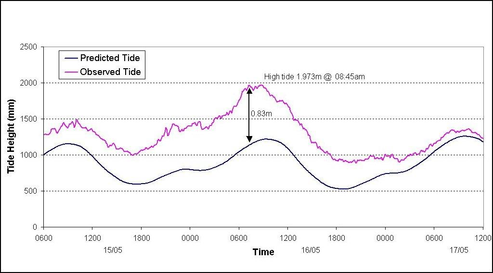

# Westplan — Storm (SEMC approved 24 May 2016)

> **Source**: WA SEMC
> **URL**: https://semc.wa.gov.au/Documents/Resources/LegislationPolicyPlansProcedureandGuidelines/Plans/Westplans2016/WestplanStormSEMCapproved24052016.pdf
> **Licence**: © Government of Western Australia; emergency-management practitioner reference
> **Retrieved**: 2026-05-07T23:42:57Z
> **SHA-256**: `35cea1c749c5fcb17678224cdd7ec414163e202eeaa7abc12d8911dd509417a4`
> **Archived copy**: Internet Archive Wayback Machine — `https://web.archive.org/web/20190315115727id_/https://semc.wa.gov.au/Documents/Resources/LegislationPolicyPlansProcedureandGuidelines/Plans/Westplans2016/WestplanStormSEMCapproved24052016.pdf`
> *(Live publisher URL no longer resolves; this archived snapshot was used for ingest. Cite the publisher URL above.)*
> *Converted from PDF to Markdown format.*

---
## Page 1

 
 
 
STATE HAZARD PLAN 
 
FOR 
 
STORM 
 
 
 
 
(WESTPLAN – STORM) 
 
 
Prepared by 
 
   
APPROVED AT STATE EMERGENCY MANAGEMENT COMMITTEE  MEETING 
RESOLUTION NO:  
19/2016 
DATE OF APPROVAL:  
24 May 2016 
 
REVIEW DATE:       
December 2019

---
## Page 2

 
WESTPLAN – Storm – May 2016 
Page 2 
 
Contact Details 
To provide comment on this plan, please contact: 
Manager Hazard Planning 
Department of Fire and Emergency Services  
20 Stockton Bend, Cockburn Central Western Australia WA 6164 
 
 
Amendment List 
AMENDMENT 
DETAILS 
AMENDED BY: 
(INITIALS) 
NO. 
DATE 
1 
September 
2004 
Review and re-write 1999 version. 
 
2 
September 
2006 
Amend 2004 version, congruous with the 
provisions 
of 
the 
Emergency 
Management Act 2005. 
 
3 
October 2014 
Complete Revision. 
 
4 
May 2016 
Statement of fact changes 
SEMC 
Secretariat 
5 
 
 
 
6 
 
 
 
7 
 
 
 
8 
 
 
 
9 
 
 
 
10 
 
 
 
 
A copy of this Westplan is available on the State Emergency Management 
Committee (SEMC) internet site: 
www.semc.wa.gov.au/resources/policies-and-plans/westplans

---
## Page 3

 
WESTPLAN – Storm – May 2016 
Page 3 
 
Table of Contents 
PART 1  
INTRODUCTION ................................................................................ 5 
1.1 AIM AND OBJECTIVES ................................................................................................................... 5 
1.2 SCOPE ........................................................................................................................................ 5 
1.3 HAZARD DEFINITION ..................................................................................................................... 5 
1.4 THE STORM HAZARD .................................................................................................................... 6 
1.5 SPECIAL PLANNING CONSIDERATIONS .............................................................................................. 6 
1.5.1 
Community Factors .................................................................................................................. 6 
1.6 RELATED DOCUMENTS .................................................................................................................. 7 
1.7 AUTHORITY TO PLAN .................................................................................................................... 7 
1.8 PLAN RESPONSIBILITIES ................................................................................................................. 8 
1.9 EXERCISE AND REVIEW PERIODS ..................................................................................................... 8 
1.9.1 
Exercising ................................................................................................................................. 8 
1.9.2 
Review ...................................................................................................................................... 8 
1.10 ORGANISATIONAL ROLES AND RESPONSIBILITIES ............................................................................... 8 
PART 2 
PREVENTION AND MITIGATION ......................................................... 9 
2.1 RESPONSIBILITY FOR PREVENTION AND/OR MITIGATION ..................................................................... 9 
2.2 LEGISLATION AND CODES .............................................................................................................. 9 
2.3 PREVENTION STRATEGIES .............................................................................................................. 9 
2.4 MITIGATION STRATEGIES ............................................................................................................. 10 
PART 3 
PREPAREDNESS .............................................................................. 11 
3.1 RESPONSIBILITY FOR PREPAREDNESS ............................................................................................. 11 
3.2 PLANNING AND ARRANGEMENTS .................................................................................................. 11 
3.2.1 
Groups with Special Needs ..................................................................................................... 12 
3.2.2 
Resources ............................................................................................................................... 12 
3.2.3 
Training .................................................................................................................................. 12 
3.3 COMMUNITY INFORMATION ........................................................................................................ 13 
3.4 EVACUATION ARRANGEMENTS ..................................................................................................... 13 
3.5 LOCAL AND DISTRICT HAZARD EMERGENCY MANAGEMENT PLANS ..................................................... 13 
3.6 WESTERN AUSTRALIA BORDER AGREEMENTS ................................................................................. 14 
3.7 ARRANGEMENTS FOR ASSISTANCE FROM OTHER JURISDICTIONS ........................................................ 14 
3.7.1 
Australian Government Physical Assistance .......................................................................... 14 
3.7.2 
Defence Assistance to the Civil Community (DACC) ............................................................... 14 
3.7.3 
Interstate Assistance .............................................................................................................. 14 
3.8 ARRANGEMENTS FOR ASSISTANCE TO OTHER JURISDICTIONS ............................................................. 15 
PART 4 
RESPONSE ...................................................................................... 16 
4.1 PRINCIPLES ............................................................................................................................... 16 
4.2 STORM WARNING SYSTEM .......................................................................................................... 16 
4.3 SEVERE WEATHER WARNINGS ..................................................................................................... 17 
4.3.1 
Issue of Severe Weather Warnings ........................................................................................ 17 
4.3.2 
Contents of Severe Weather Warnings .................................................................................. 17 
4.4 SEVERE THUNDERSTORM WARNINGS ............................................................................................ 18 
4.4.1 
Issue of Severe Thunderstorm Warnings ............................................................................... 18 
4.4.2 
Contents of Severe Thunderstorm Warnings ......................................................................... 18 
4.4.3 
Distribution of Warnings ........................................................................................................ 18 
4.5 ALERT ...................................................................................................................................... 19 
4.6 ACTIVATION .............................................................................................................................. 19 
4.7 LEVELS OF RESPONSE .................................................................................................................. 19 
4.8 INCIDENT MANAGEMENT SYSTEM................................................................................................. 20

---
## Page 4

 
WESTPLAN – Storm – May 2016 
Page 4 
 
4.9 SITE ORGANISATION ................................................................................................................... 20 
4.10 HAZARD MANAGEMENT STRUCTURE AND ARRANGEMENTS .............................................................. 20 
4.10.1 
Incident Management ............................................................................................................ 20 
4.10.2 
Liaison Officers ....................................................................................................................... 20 
4.11 RESPONSE PRIORITIES ................................................................................................................. 21 
4.12 MULTI AGENCY SUPPORT STRUCTURE AND ARRANGEMENTS ............................................................. 21 
4.12.1 
Incident Support Group (ISG) ................................................................................................. 21 
4.12.2 
Operational Area Support Group (OASG) ............................................................................... 21 
4.12.3 
State Emergency Coordination Group (SECG) ........................................................................ 22 
4.13 EMERGENCY POWERS ................................................................................................................. 23 
4.14 EVACUATION ............................................................................................................................. 23 
4.14.1 
Triggers for Evacuation .......................................................................................................... 24 
4.14.2 
Facility Evacuation Plans ........................................................................................................ 24 
4.14.3 
Notification of Evacuation Arrangements .............................................................................. 24 
4.14.4 
Evacuation of Pets .................................................................................................................. 24 
4.14.5 
Refusal to Evacuate ................................................................................................................ 25 
4.14.6 
Return of Evacuees ................................................................................................................. 25 
4.15 SUPPORT PLANS ........................................................................................................................ 25 
4.15.1 
Health Response..................................................................................................................... 26 
4.15.2 
Communications .................................................................................................................... 26 
4.15.3 
Public Information and Media Management ......................................................................... 26 
4.16 FINANCIAL ARRANGEMENTS FOR RESPONSE ................................................................................... 28 
4.17 STAND DOWN AND DEBRIEFING ................................................................................................... 28 
4.18 CONTACT ARRANGEMENTS .......................................................................................................... 28 
PART 6 
RECOVERY ...................................................................................... 29 
6.1  RESPONSIBILITY FOR RECOVERY ...................................................................................................... 29 
PART 7 
INCIDENT ANALYSIS / REVIEW ........................................................ 30 
7.1 INCIDENT ANALYSIS / REVIEW ...................................................................................................... 30 
7.1.1    Investigation/Assessment ......................................................................................................... 30 
7.1.2    Identifying Mitigation Strategies .............................................................................................. 30 
APPENDICES.................................................................................................... 31 
APPENDIX A – DISTRIBUTION ............................................................................................................. 31 
APPENDIX B – THE STORM HAZARD .................................................................................................... 32 
APPENDIX C - ROLES AND RESPONSIBILITIES OF ORGANISATIONS.............................................................. 36 
APPENDIX D - OPERATIONAL SEQUENCE GUIDE - STORM ........................................................................ 40

---
## Page 5

 
WESTPLAN – Storm – May 2016 
Page 5 
 
PART 1  
INTRODUCTION 
The highest insurance losses in Western Australia in the last forty years have been 
from severe storms accompanied by extreme wind, rain and hail.  Between 1970 
and 2013 insurance costs were 1.2 billion dollars.  These storms can occur 
anywhere in the State, but the majority of insurance losses have been associated 
with cool season storms in southwest areas1. 
This Westplan has been prepared to meet the State Emergency Management 
Committee (SEMC) planning requirements under the Emergency Management Act 
2005 (EM Act 2005).  
The Department of Fire and Emergency Services (DFES), through the Fire and 
Emergency Services (FES) Commissioner, is the Hazard Management Agency for 
storm [Section 17(2) Emergency Management Regulations 2006]. 
 
1.1 Aim and Objectives 
The aim of Westplan - Storm is to detail the emergency management arrangements 
for storm in Western Australia. 
The objectives of this Westplan - Storm are to: 
 ensure Western Australia has effective emergency management 
arrangements in place for a storm emergency; 
 define the responsibilities of DFES, Australian Government agencies, 
State Government agencies, local government, combat agencies and 
support organisations in the event of a storm emergency; 
 detail arrangements in relation to the control and coordination of, and 
response to, a storm emergency; 
 provide guidance for storm emergency management plans at district 
and local level; and 
 detail arrangements for the review of planning at all levels. 
 
1.2 Scope 
Westplan - Storm covers emergency management storm planning within the 
geographic boundaries of Western Australia, including adjacent waters but 
excluding high seas, Australian waters, Cocos (Keeling) Islands and Christmas 
Island.  The plan deals with mitigation strategies, preparedness for storm, response 
to storm and initiation of recovery arrangements following the impact of a storm. 
1.3 Hazard Definition 
A thunderstorm is a sudden electrical discharges manifested by a flash of light 
(lightning) and a sharp or rumbling sound (thunder). Thunderstorms are associated 
with convective clouds (Cumulonimbus) and are, more often, accompanied by 
precipitation in the form of rain showers or hail.  
                                            
1 Productivity Commission (2014) Natural Disaster Funding Arrangements. Draft Report, Vol. 1, p. 5.

---
## Page 6

 
WESTPLAN – Storm – May 2016 
Page 6 
 
A severe thunderstorm produces one or more of the following: 
 Wind gusts of 90 km/h or more; 
 Very heavy rainfall that may lead to flash flooding; 
 Hail with a diameter of 2cm or more; and 
 Tornadoes 
The term 'storm' is used to describe thunderstorms but also cold fronts and troughs 
which produce significant or severe weather. 
A storm emergency is an “emergency” as defined in the Emergency Management 
Act 2005, as the result of a storm or potential storm. 
 
1.4 The Storm Hazard 
Western Australia has a history of being impacted by severe storms.  These storms 
have caused damage from lightning, wind, rain, hail, flash flooding, severe sea 
conditions, storm surge flooding and coastal erosion.  Their effects impact on 
residential, commercial, industrial and service sectors of our community.  They 
disrupt lifelines, burden emergency services with an increased work load and can 
cause injury and death. 
Severe storms can occur at any time of the year, but tend to follow two distinct 
patterns, one for the warm season (generally October to April) and one for the cool 
season(generally May to September). 
A more detailed description of the storm hazard and its effects is at Appendix B. 
 
1.5 Special Planning Considerations 
1.5.1 
Community Factors 
Society is increasingly dependent on services and infrastructure such as 
energy supply, transportation, water, sewerage and drainage systems, and 
communication networks.  This vital and critical infrastructure can be 
vulnerable in a storm emergency.  Restoration may take significant time and 
prolonged outages may create secondary effects in the community. 
Some facilities such as power, communication and transportation networks 
are particularly susceptible to the effects of storms. 
 
As 
communities 
become 
more 
connected 
through 
modern 
telecommunications, increasing expectations are placed on emergency 
management agencies to respond sooner, over wider areas and in ways that 
are more sophisticated.  There is also a growing need for public information. 
A number of people within the community have special-needs and require 
particular consideration in state, district and local level plans.  Paragraph 
3.2.1 identifies these special-needs groups.

---
## Page 7

 
WESTPLAN – Storm – May 2016 
Page 7 
 
The need for a sound level of storm planning is increasingly important in 
areas of the State where storms are a threat to human life, activities, property 
and community lifelines. 
1.6 Related Documents 
This document is to be read in conjunction with the following suite of State 
Emergency Management (EM) documents: 
 
 Emergency Management Act 2005 (EM Act); 
 Emergency Management Regulation 2006 (EM Regulation); 
 State Emergency Management Policy (State EM Policy); 
 State Emergency Management Plan (State EM Plan); 
 Relevant State Hazard Specific Plans (Westplans); 
 State Emergency Management Procedures (State EM Procedures); 
 State Emergency Management Guidelines ( State EM Guidelines); and 
 State Emergency Management Glossary (State EM Glossary). 
 
It should be noted that the State EM Procedures are divided into Prevention, 
Preparedness, Response and Recovery sections, with individual procedures 
referred to as ‘State EM Prevention Procedure’, ‘State EM Preparedness 
Procedure’, ‘State EM Response Procedure’ and ‘State EM Recovery 
Procedure’, as applicable. 
 
In addition, the following documents are applicable to this plan:  
 Fire and Emergency Services Act 199; 
 Fire and Emergency Services Regulations 1998; 
 Planning and Development Act 2005; 
 Westplan – Flood; 
 State Health Emergency Response Plan; 
 State Emergency Welfare Plan and its annexures on Reception and 
Registration and Reunification; 
 State Telecommunications Plan;  
 State Emergency Public Information Plan; and 
 Local Emergency Management Arrangements. 
  
1.7 Authority to Plan 
The SEMC is responsible for arranging the preparation of State emergency 
management plans [Section 18(1) EM Act 2005].  The Fire and Emergency 
Services (FES) Commissioner, as the prescribed Hazard Management Agency

---
## Page 8

 
WESTPLAN – Storm – May 2016 
Page 8 
 
(HMA) for storm, is responsible for coordinating the development and maintenance 
of Westplan - Storms2. 
1.8 Plan Responsibilities 
The development, implementation and revision of Westplan - Storm is the 
responsibility of DFES in consultation with key stakeholders, emergency 
management agencies and other support organisations in accordance with State 
EM Policy 1.5. 
 
1.9 Exercise and Review Periods 
1.9.1 
Exercising 
Westplan - Storm will be exercised annually at the State and regional level in 
accordance3. The activation of this Westplan counts as an exercise, if the 
post incident/exercise report is completed. 
1.9.2 
Review 
Westplan - Storm will be reviewed by DFES, annually, with a major review 
every five years. 
1.10 Organisational Roles and Responsibilities 
This Plan details organisational responsibilities at a State level and requires that 
participating organisations support planning at district and local level. 
As the HMA for storm emergencies in Western Australia, DFES is responsible for 
ensuring effective preparedness and response to this risk within the community. 
A coordinated response to a storm emergency requires emergency management 
agencies and support organisations to undertake a variety of agreed and statutory 
responsibilities.  These responsibilities are outlined at Appendix C. 
 
 
                                            
2 State EM Policy Section 1.5. 
3 State EM Policy Section 4.8 and State EM Plan Section 4.7.

---
## Page 9

 
WESTPLAN – Storm – May 2016 
Page 9 
 
PART 2 
PREVENTION AND MITIGATION 
2.1 Responsibility for Prevention and/or Mitigation 
Prevention and mitigation strategies for storm emergencies within WA rely heavily 
on the management of development (land use planning) and the built environment. 
Responsibilities in these areas are divided between some State agencies and local 
government.  
DFES has overall responsibility for prevention and mitigation aspects of storms, 
within the limitations of its legislative powers and resource capabilities. DFES is 
also required4 to coordinate the development and maintenance of Westplan - 
Storm, including prevention aspects.  
 
2.2 Legislation and Codes 
Legislation is one of the key initiatives to ensure that prevention and mitigation 
strategies are consistent and enforceable.  Legislation applicable to managing the 
storm risk includes: 
 Building Act 2011; 
 Building Regulations 2012;  
 Emergency Management Act 2005; 
 Emergency Management Regulations 2006; 
 Fire and Emergency Services Act 1998; 
 Fire and Emergency Services Regulations 1998; 
 Local Government (Miscellaneous Provisions) Act 1960; 
 Local Government Act 1995; 
 National Construction Code of Australia; 
 Occupational Safety & Health Act 1984;  
 Planning and Development Act 2005; and 
 Meteorology Act 1955. 
 
2.3 Prevention Strategies 
It is impossible to prevent storms from occurring, but strategies to mitigate storm 
impacts on communities can include: 
 engineering solutions, such as hardening buildings;  
 social solutions, such as community education; and  
 enforcement of legislative requirements, such as building restrictions 
in areas identified as being at risk from storm.  
                                            
4 State EM Policy Section 1.5.

---
## Page 10

 
WESTPLAN – Storm – May 2016 
Page 10 
 
2.4 Mitigation Strategies 
Mitigation strategies contribute to the increased resilience and reduction in 
vulnerability of our communities by proactively reducing or minimising the effects of 
hazardous events. 
Key strategies are employed to mitigate the risks associated with storm 
emergencies.  These strategies are shown in Table 1.  
 
Table 1: Storm Mitigation Strategies 
Strategy 
Responsible Organisations 
Storm risk identification and mapping. 
DFES, BoM, Geoscience Australia 
Application and enforcement of National Construction Code of 
Australia and informed land use planning for vulnerable areas. 
Local governments 
Participation in research and development programs directed 
towards increased mitigation, improved community awareness 
and better information dissemination. 
DFES/BoM 
Promoting an improved state of resilience within communities 
to improve the management of future risks. 
DFES 
Developing resilience in the community and minimising the 
vulnerability of communities to effects of storm. 
DFES in partnership with local governments 
Promote the uptake and maintenance of adequate insurance 
against storms. 
DFES, insurance industry 
Promotion of and participation in community awareness 
campaigns for ‘at risk’ communities. 
Local governments assisted by DFES  
 
Provision of support to voluntary emergency organisations. 
DFES, local governments 
Provision of storm advice to the community. 
DFES, BoM 
Identification of suitable buildings for designation as 
Welfare/Evacuation Centre’s. 
Department for Child Protection and Family Support 
(DCPFS) in consultation with local governments 
Maintenance of a register of potential welfare/evacuation 
centres. 
DCPFS in consultation with Local Emergency 
Management Committee 
Participation on local and regional/district storm planning 
committees (where practicable). 
Local governments,  DFES, Main Roads Western 
Australia (MRWA), Western Australia Police, DCPFS 
Ensuring the sustainability of service delivery of critical 
infrastructure through design and maintenance standards. 
MRWA, utility providers 
Providing advice in relation to the design and maintenance 
status of critical infrastructure services and access routes in ‘at 
risk’ communities. 
MRWA, utility providers 
Structurally retrofit, where necessary, public buildings which 
provide essential services following any storm event.  These 
facilities should be examined by suitably qualified engineers on 
a site-by-site basis to assess their expected performance 
under storm loadings. 
All relevant agencies 
Participate in research in social vulnerability models as they 
apply to storms. 
Relevant agencies and local governments 
 
 
Table 1 Storm Mitigation Strategies

---
## Page 11

 
WESTPLAN – Storm – May 2016 
Page 11 
 
PART 3 
PREPAREDNESS 
 
3.1 Responsibility for Preparedness 
Preparedness activities focus on developing systems to ensure the delivery of 
essential emergency response capabilities when an emergency occurs.  These 
systems include development of plans and procedures, design of organisational 
structures, implementation of training, development of resource management 
systems, and community education related to preparation and response.   
This section of the Plan outlines measures to be taken in preparation for storm 
emergencies together with relevant responsibilities.  Most of these activities 
commence well before the storm emergency, often years before, and regular 
maintenance, testing and checking of these measures should be undertaken to 
retain confidence in their performance during emergencies.   
As the HMA for storm, the FES Commissioner has responsibility for: 
 promoting an improved state of resilience within communities to 
improve the management of future risks; and 
 ensuring that all emergency management activities related to storm 
preparedness are undertaken. 
 
3.2 Planning and Arrangements 
Emergency management plans are to be developed and based on: 
 best practice principles; 
 technical and scientific knowledge; 
 historical data and information; and 
 local knowledge and experience. 
Successful storm operations depend on good planning, effective resource utilisation 
and a coordinated response which is timely, efficient and effective. 
The concept of this Plan is to employ and coordinate the resources of State and 
Australian Government departments, authorities and agencies; resources available 
to private industry; and resources available to volunteer groups, for storm 
operations.  This concept is based on: 
 availability of the DFES 24/7 State Operations Centre (SOC) for 
receipt of storm notification reports; 
 establishment of operational facilities at three levels, from which 
management of storm operations takes place; 
 deployment of emergency service personnel; 
 provision of expert technical advice on storm modelling by State and 
Australian Government agencies when requested by DFES; 
 provision of expert technical advice on roadways and transport routes 
by the Main Roads WA, when requested by DFES; and

---
## Page 12

 
WESTPLAN – Storm – May 2016 
Page 12 
 
 tasking of agencies in a coordinated manner in support of DFES.  
Agency procedures are then employed to carry out tasks. 
In accordance with the EM Act 2005, local government is responsible for the 
development of local emergency management arrangements.  The Local 
Emergency Management Committee (LEMC) is to provide advice to local 
government in this regard. 
3.2.1 
Groups with Special Needs  
Special-needs groups include individuals and groups of people within the 
community for whom special consideration must be given in state, district 
and local level plans.  These groups may require unique arrangements in 
regard to resources, mobility, timings, support or communications when 
responding to an emergency. 
State EM Policy Section 4.6 and State EM Plan Section 4.6.1 outline the 
individuals and groups whose circumstances require special consideration in 
emergency management planning. 
Special-needs groups should be included in the development of local risk 
plans for inclusion in Local Emergency Management Arrangements. 
3.2.2 
Resources 
The identification of appropriate and adequate resources and expertise is 
essential to preparedness for a storm emergency.  Planning at all levels 
should 
reference 
resource 
management, 
inventory 
and 
acquisition 
arrangements. 
Resources that are used in storm emergencies may be required at short 
notice and may include: urban search and rescue (USAR) resources, 
transport resources, earth moving machinery, cranes, shoring and tunneling 
equipment, signage, electricity generating plants, lighting, pumps, temporary 
toilet facilities, medical equipment and drugs.  
DFES is responsible for the overall provision and management of resources 
required to physically respond to a potential or actual storm emergency, 
including acquisition, pre-positioning and inventory management.  Combat 
agencies and support organisations are required to provide their own 
resources in the first instance and to make requests for additional resources 
to DFES as required. 
Local and district emergency plans should incorporate the use of community 
and industry resources, especially in relation to accommodation and welfare.  
Such plans should also identify methods, such as resource registers, to 
acquire community resources during a storm emergency. 
Where an operation is beyond the resources of the State, a request for 
assistance from other jurisdictions may be made in accordance with section 
3.7. 
3.2.3 
Training 
DFES is responsible for training and equipping an emergency service 
capable of assisting the community to manage the effects of a storm.

---
## Page 13

 
WESTPLAN – Storm – May 2016 
Page 13 
 
Emergency management and support agencies are also expected to provide 
trained and equipped personnel.  DFES is responsible for conducting multi-
agency exercises for the relevant level of emergency management, thereby 
ensuring all agency personnel are aware of their role in the organised 
response. 
 
3.3 Community Information 
DFES, local governments, and BoM provide a contribution to education programs 
developed to inform and educate the public on storm notification, storm risk and 
storm management. 
During storm events, DFES will provide community information in a coordinated 
manner through the Incident Controller and/or Operational Area Manager. 
Media and public information strategies are reviewed annually by DFES to ensure 
appropriate communication of storm information to the community. 
 
3.4 Evacuation Arrangements 
Evacuation arrangements are addressed in section 4.14 Evacuation in the response 
section of this plan. 
 
3.5 Local and District Hazard Emergency Management Plans 
Where storm prone areas are identified as a risk to the community, DFES may 
develop relevant local storm plans which should consider: 
 Transfer of information from storm risk maps to LEMC district based 
maps; 
 Analysis and confirmation of damage projections;  
 Development of map overlays or other data modelling for: 
o Critical facilities 
o Special needs facilities 
o Special needs populations 
o Transportation lifelines 
o Hazmat sites and facilities 
 Determination of areas where damage is likely to occur and 
identification of areas where the population is exposed to greatest risk; 
 Ascertain demographics for at-risk populations;  
 Implementation of steps to reduce likely effects; and 
 Resource management, inventory and acquisition arrangements.  
 
DFES may develop Regional or District Storm Plans to coordinate activities during 
storm emergencies in addition to, or in place of, local storm plans.

---
## Page 14

 
WESTPLAN – Storm – May 2016 
Page 14 
 
3.6 Western Australia Border Agreements 
Currently, Western Australia is not a party to any border agreements in relation to 
storm emergencies.  Requests for assistance will be treated on an individual basis 
between State/Territory Governments. 
 
3.7 Arrangements for Assistance from Other Jurisdictions 
Should a storm emergency be beyond the resources of the State, support may be 
requested from the Australian Government, other States or overseas. 
3.7.1 
Australian Government Physical Assistance 
The provision of Australian Government physical assistance is dependent 
upon established criteria and requesting arrangements.  All requests for 
physical assistance are to be made in accordance with State EM Policy 5.10 
and State EM Plan 5.6. 
3.7.2 
Defence Assistance to the Civil Community (DACC)  
Defence Assistance to the Civil Community (DACC) can be provided in a 
number of ways, which are defined as categories of assistance in State EM 
Response Procedure 20. 
Requests for Category 1 DACC assistance are coordinated through the 
Manager Joint Operations Support Staff (MJOSS), or their Liaison Officer 
(LO), who will liaise directly with the Local Australian Defence Force (ADF) 
Commander to provide assistance. Availability of these resources should be 
identified in Local Emergency Management Arrangements. 
Category 1 DACC is emergency assistance for a specific task(s) provided by 
a Local ADF Commander/Administrator from within their own resources, in 
localised emergency situations when: 
a. immediate action is necessary to save human life, alleviate 
suffering, prevent extensive loss of animal life, or prevent 
widespread loss/damage to property; and 
b. local civilian resources are inadequate, unavailable or cannot be 
mobilised in time. 
Other categories of DACC Assistance may be provided at the discretion of 
the Australian Government where the State requests Australian Government 
physical assistance.  In these circumstances the initial resource request 
should be made through DFES, who will coordinate with the MJOSS or their 
LO in accordance with State EM Plan Section 5.6.1 and State EM Response 
Procedure 20. 
3.7.3 
Interstate Assistance 
Assistance from other jurisdictions, and the process involved, will be 
determined by DFES in accordance with the conditions prevailing at the time.

---
## Page 15

 
WESTPLAN – Storm – May 2016 
Page 15 
 
3.8 Arrangements for Assistance to Other Jurisdictions 
Assistance to interstate, overseas and other jurisdictions for storm emergencies will 
be coordinated by DFES.  This will include determination of the process involved 
and recognition of pre-existing arrangements for inter-jurisdictional assistance by 
other agencies where such arrangements exist.

---
## Page 16

 
WESTPLAN – Storm – May 2016 
Page 16 
 
PART 4 
RESPONSE 
 
4.1 Principles 
The management of a storm emergency is based on a graduated approach using 
the following guiding principles: 
 DFES is the Controlling Agency for storm emergencies in WA5; 
 DFES is responsible for activating and controlling the response to a 
storm emergency within WA; 
 DFES will use arrangements which employ identified emergency 
management agencies and support organisations (refer to Appendix 
C) to provide an effective and coordinated response; 
 A storm emergency in WA will be managed using the emergency 
management and operational principles detailed in State EM Policy 
Section 5 and State EM Plan Section 5; 
 Should another hazard occur as a consequence of a storm emergency 
and, if DFES is not the HMA/Controlling Agency for the consequential 
hazard, then the provisions of State EM Plan 5 will apply.  DFES shall 
remain responsible for the overall management of the storm 
emergency; 
 Responsibility for resourcing and responding to an emergency initially 
rests with the Incident Controller at the local level; 
 An emergency beyond the capability of local resources will receive 
support from district resources.  State resources will be provided if 
district resources are inadequate; and 
 Communication between local, district and State authorities is 
essential to ensure intelligent and timely application of resources to 
manage the emergency. 
 
4.2 Storm Warning System 
Under Section 6 of the Australian Government Meteorology Act 1955, the Bureau of 
Meteorology (BoM) has a responsibility for the issue of warnings of gales, storms 
and other weather conditions likely to endanger life or property. 
The Perth Regional Office of the Bureau of Meteorology (BoM) issues warnings for 
severe storms. Severe Weather Warnings will be issued for most cool season 
events and Severe Thunderstorm Warnings when the main threat is from 
thunderstorms and during the warm season.  
 
                                            
5 In accordance with State EM Policy Section 5 and State EM Plan Section 5.

---
## Page 17

 
WESTPLAN – Storm – May 2016 
Page 17 
 
4.3 Severe Weather Warnings 
These provide a single type of warning that will advise the community on the threat 
of severe weather that is not covered by bushfire, cyclone or severe thunderstorm 
warning services.  Severe Weather Warnings allow one warning to cover a 
multitude of phenomena caused by one weather pattern.  
4.3.1 
Issue of Severe Weather Warnings 
Severe Weather Warnings can be issued up to 30 hours in advance for 
particularly strong systems that are likely to produce widespread severe 
weather. Generally, shorter lead times of 6 to 12 hours are provided.  The 
warnings are updated at least 6 hourly but can be issued more often as 
necessary, particularly when severe weather is approaching Perth. 
The following phenomena are warning for: 
 Damaging winds (wind gusts 90-125 km/h) 
 Destructive winds (wind gusts in excess of 125 km/h) 
 Heavy rainfall, that may lead to flash flooding 
 Abnormally high tides. 
 
Large swells and/or dangerous surf conditions are not warned for specifically 
but can be mentioned in the body of a Severe Weather Warning.  
4.3.2 
Contents of Severe Weather Warnings 
Severe Weather Warnings consists of the following information: 
 The title of the warning. It will take the form of: 'Severe Weather 
Warning 
for' 
…damaging 
wind/destructive 
wind, 
heavy 
rainfall/abnormally high tides. 
 Weather districts affected. 
 Time of issue. 
 Area affected using well-known towns. 
 Description of the weather situation. 
 Description of the expected phenomena, expected time of occurrence 
and duration of event. 
 Reports/observations when available. 
 A statement reflecting the frequency of occurrence of the expected 
phenomena. 
 A DFES action statement. 
 The time at which the next warning will be issued.

---
## Page 18

 
WESTPLAN – Storm – May 2016 
Page 18 
 
4.4 Severe Thunderstorm Warnings 
Warnings are not issued for every thunderstorm. A Severe Thunderstorm Warning 
will be issued when one or more of the criteria are observed or forecast. Warnings 
will be issued for the Kimberley and Pilbara in the event of an organised squall line 
that is expected to produce gusts in excess of 90 kilometres per hour. Due to their 
high frequency and relatively small impact area of each storm, warnings will not be 
issued in the Kimberley and Pilbara for thunderstorms causing flash flooding and/or 
severe wind gusts unless they are in the form of a long-lived, organised squall line.  
4.4.1 
Issue of Severe Thunderstorm Warnings 
A Severe Thunderstorm Warning will be issued when: 
 An existing thunderstorm exhibits severe characteristics, particularly 
on radar or when a report of severe thunderstorms has been 
received. 
 Thunderstorms have developed in an environment conducive for 
severe thunderstorms, a severe thunderstorm is reported, or there is 
strong evidence of an impending severe thunderstorm, and it is 
expected to persist or when existing thunderstorms are likely to 
develop into a severe thunderstorm. 
The lead-time for initial warnings will be about 6 hours and warnings will be 
updated every three hours or immediately on receipt of observations 
confirming severity. If severe thunderstorms are observed on radar and are 
threatening a major population centre, then warnings will be issued more 
frequently. 
4.4.2 
Contents of Severe Thunderstorm Warnings 
Severe Thunderstorm Warnings can contain the following information: 
 Expected phenomena (large hail, damaging/destructive winds, heavy 
rainfall) 
 Weather districts affected 
 Time of issue 
 Localities affected using agreed set of major and minor towns 
 Description of weather situation and the expected or observed 
phenomena and lively movement. 
 Description of recent recorded events relevant to the warning. 
 Statement on how frequent this type of weather and severity is 
experienced. 
 DFES action statements.  
 Time of next issue. 
4.4.3 
Distribution of Warnings 
BoM issues warnings through media outlets, email, internet, marine 
communications and aircraft communications.

---
## Page 19

 
WESTPLAN – Storm – May 2016 
Page 19 
 
Should additional support be required to issue warnings or information in a 
particular emergency, DFES may call upon the State Emergency Public 
Information Coordinator (SEPIC) to activate the State Emergency Public 
Information arrangements6. 
4.5 Alert 
When meteorological conditions have potential to generate a storm emergency, 
BoM will provide DFES with information about the storm and may issue Severe 
Weather or Severe Thunderstorm Warnings.  DFES may also receive initial 
information about storm impact from agencies or from the community. 
Upon receipt of initial information about the storm, DFES will assess whether a 
storm emergency exists and may place some or all combat agencies and support 
organisations on alert.  Organisations placed on “alert” should prepare to respond if 
needed and await DFES instructions before “activating” significant resources. 
 
4.6 Activation 
When DFES assesses that the storm emergency will require a significant response, 
it shall “activate” emergency resources, combat agencies and support organisations 
which are appropriate to the intensity and location of the storm.  This may include 
activation of relevant emergency personnel and local or district plans as required. 
The level of implementation of plans and operational structures can vary 
considerably depending upon circumstances.  Factors which may influence the 
level of response include the degree of threat to a community, the number of DFES 
districts impacted by the storm and whether a multi-agency response is required. 
More detail of the sequence of activation is shown in the ALERT and CALLOUT 
phases of Appendix D. 
 
4.7 Levels of Response 
Sound emergency management requires a graduated approach which is 
appropriate to the circumstances of the emergency. 
State EM Response Procedure 2 describes the process for making an appropriate 
incident level declaration and associated responsibilities. The declaration of an 
incident level is a critical component of emergency management in terms of 
triggering the responsibilities and actions of emergency management stakeholders 
to ensure a response in which the size of both the Incident Management Team 
(IMT) and the coordination structure are proportional to the size of the storm 
emergency.  State EM Response Procedure 2 enables one of three operational 
levels to be selected depending upon the characteristic “factors” of the emergency. 
This procedure is aligned with State EM Plan Section 5.1.5.  The descriptors are 
provided as guidance to DFES Operational Managers and are used for all of 
DFES’s HMA and Emergency Management Agency responsibilities (refer Appendix 
C). 
                                            
6 State EM Policy Section 5.6, State EM Plan Section 5.3.1 and the State Emergency Public 
Information Plan.

---
## Page 20

 
WESTPLAN – Storm – May 2016 
Page 20 
 
4.8 Incident Management System 
During all emergencies, DFES will use the Australasian Inter-service Incident 
Management System (AIIMS).  All agencies with agreed responsibilities under this 
plan are encouraged to ensure their personnel are familiar with and able to work 
within the AIIMS structure. Further information on incident management is detailed 
in State EM Plan Section 5.  
 
4.9 Site Organisation 
DFES has a State Operations Centre (SOC) available 24/7 and a number of 
Regional Operations Centres (ROC) around the State to: 
 provide a robust facility from which to oversee the coordination of 
emergencies; 
 facilitate coordination with other emergency service agencies and 
emergency management agencies; 
 coordinate State and regional/district response to storms and other 
emergencies for which DFES has responsibility; 
 manage the dissemination of information to the community; and 
 provide appropriate advice to all levels of government. 
 
4.10 Hazard Management Structure and Arrangements 
In assessing a storm emergency, DFES may determine that the response requires 
a level two or level three management structure as per table 3.  When such 
management structures are required, DFES (as the HMA) shall appoint an 
Operational Area Manager(s) (OAM).  The OAM will assume overall management 
of the storm emergency within their defined operational area. 
4.10.1 
Incident Management 
DFES, through the OAM, will appoint the IC(s) responsible for the overall 
management and control of an incident within specific localised communities 
or geographical areas. 
4.10.2 
Liaison Officers 
All agencies are requested to provide a Liaison Officer (LO) upon activation 
of the response section of Westplan - Storm.  The LO must possess 
sufficient experience and seniority to assist DFES.  LOs may be the 
representatives on the relevant Incident Support Group (ISG) or Operational 
Area Support Group (OASG).  Some agencies may nominate their Agency 
Commander as the LO.

---
## Page 21

 
WESTPLAN – Storm – May 2016 
Page 21 
 
4.11 Response Priorities 
The response to a storm emergency shall be based on the priorities of:  
 Life; 
 Critical infrastructure; 
 Property; and; and 
 Environment. 
The safety of personnel tasked to the incident will be the fundamental priority in all 
phases of incident management. 
Priorities for Incident Action Planning (IAP) are: 
 The first priority will address the protection of community members 
and measures to keep them informed; 
 The protection of property, critical infrastructure and community 
assets will be the next priority; and 
 Protection of conservation and environmental values are to be 
factored into IAPs as the subsequent priority. 
 
4.12 Multi Agency Support Structure and Arrangements 
State EM Policy Section 5 and State EM Plan Section 5 detail the multi-agency 
support structure used for different levels of emergency.  The following paragraphs 
elaborate on how this policy will be applied during storm emergencies. 
4.12.1 
Incident Support Group (ISG) 
The Incident Support Group/s consist of the Local Emergency Coordinator 
and Liaison Officers from local agencies/organisations involved in the 
response to and recovery from an incident.  Its purpose is to assist the 
Incident Controller through the provision of information, expert advice, 
support and resources relevant to each organisation. 
DFES (as the Controlling Agency) shall appoint the Chair of the ISG and 
determine membership of the ISG.  The Incident Controller shall activate the 
ISG when an incident requires the coordination of multiple agencies. 
4.12.2 
Operational Area Support Group (OASG) 
When the FES Commissioner (as the HMA) identifies that multiple agencies 
need to be coordinated at a district level or multiple incidents are occurring 
simultaneously in one Operational Area, it may activate the OASG, which will 
be convened by the OAM. 
Membership of the OASG will be the OAM appointed by the HMA, the District 
Emergency Coordinator and members (liaison officers from the key agencies 
involved in the response to and recovery from the incident).  The OAM will be 
the Chair of the OASG.

---
## Page 22

 
WESTPLAN – Storm – May 2016 
Page 22 
 
Minimum membership of an OASG for a storm emergency is: 
 DFES (Chair) 
 Department for Child Protection and Family Support (CPFS) 
 Department of Parks and Wildlife 
 Department of Planning 
 Department of Health (WA Health) 
 Lifelines agencies as appropriate 
 Local government representative 
 Main Roads WA 
 WA Police 
4.12.3 
State Emergency Coordination Group (SECG) 
A State Emergency Coordination Group (SECG) is established during a state 
of emergency, or may be established where an emergency occurs or is 
imminent, at the request of the FES Commissioner (as the HMA), or on the 
initiative of the State Emergency Coordinator (SEC), to assist in the provision 
of a strategic, coordinated multi-agency response to and recovery from the 
emergency. In addition, if a Level 3 incident occurs, the HMA must consult 
with the SEC to determine if a SECG should be established.  
The SECG is established in accordance with State EM Policy Statement 
5.4.7, State EM Plan Section 5.2.3 and State EM Response Procedure 4.  
Triggers for activation of a SECG may include, but are not limited to: 
 a storm has had a significant impact on a major community; 
 a widespread storm damage to residential areas or a large 
geographical area containing communities or assets at risk; or 
 a significant risk to critical infrastructure. 
 
The requirements for membership of the SECG are outlined in Section 26 (3) 
of the EM Act 2005, which requires that the membership include: 
 the SEC, who is also the Chair; 
 the Chair and Executive Officer of the SEMC; 
 a representative of the HMA (FES Commissioner); 
 a representative of the local governments in the emergency area or in 
the area where the emergency is occurring or imminent, as the case 
requires, nominated by the SEC; and 
 any other members the SEC considers are necessary.

---
## Page 23

 
WESTPLAN – Storm – May 2016 
Page 23 
 
In the case of a storm emergency, it is recommended, in consultation with 
the State Emergency Coordinator (SEC) that the SECG Membership should 
also include, as required: 
 W A Police 
 Main Roads WA 
 Bureau of Meteorology 
 Department of the Premier and Cabinet (State Recovery Coordinator) 
 CPFS 
 WA Health 
 Department of Water 
 Department of Education 
 Department of Parks and Wildlife 
 Department of Aboriginal Affairs 
 Department of Food and Agriculture WA 
 Department of Planning 
 Industry representatives 
 Telstra 
 Office of Energy 
 Water Corporation 
 Western Power 
 Brookfield Rail 
 Any other representatives as considered necessary by the SEC. 
 
4.13 Emergency Powers 
The FES Commissioner has powers in relation to natural disasters under the FES 
Act 1998. These powers are wide-ranging and are normally adequate to respond to 
storm emergencies. Should additional powers be required, the EM Act 2005 can be 
used to invoke emergency powers through the declaration of an ‘Emergency 
Situation’ or a ‘State of Emergency’. 
 
4.14 Evacuation 
The decision to evacuate residents from areas after impact is the responsibility of 
the IC.  The decision will normally be taken in consultation with key stakeholders. 
The responsibility for implementing the evacuation rests with DFES (as the 
Controlling Agency), which may require support from other agencies, particularly 
WA Police and the CPFS.

---
## Page 24

 
WESTPLAN – Storm – May 2016 
Page 24 
 
DFES is responsible for arranging transport requirements for the evacuation from 
the emergency site.  Local and district resources should be used wherever possible.  
Refer to State EM Policy Section 5.7 and State EM Plan Section 5.3.2 for further 
guidance on evacuation. 
4.14.1 
Triggers for Evacuation 
During a Storm Emergency, DFES may evacuate residents in risk prone 
areas due to factors such as: 
 Structural Collapse – Buildings that are at risk of structural collapse 
as a result of storm damage should be evacuated.  
 Storm affecting properties – Evacuation may occur if it is deemed 
likely that properties could be at risk from the effects of a storm. 
 Isolation of properties – Persons who are not prepared for isolation 
or unsuited due to medical conditions, disabilities, age, etc. should be 
encouraged to evacuate. 
 Failure of essential services – Failure of lifelines such as sewerage, 
power, telecommunications and water pose significant health risks to 
the community.  In the event of any or all of these systems failing, 
evacuation of individuals, families and the community may be 
necessary. 
4.14.2 
Facility Evacuation Plans 
Local industry may have site specific evacuation plans which form part of 
their Occupational Safety and Health strategies.  Additionally, schools, 
hospitals, detention centres, prisons, shopping centres and public buildings 
may also have site or building evacuation plans.  These plans should be 
developed in consultation with the LEMC to ensure they are realistic in terms 
of resource availability, timeliness and the risks created by the hazard. 
4.14.3 
Notification of Evacuation Arrangements 
The IC is responsible for ensuring the accuracy of the Emergency Public 
Information, approving its release in coordination with the relevant agencies 
and terminating its broadcast. The Standard Emergency Warning Signal 
must only be used under strict instruction as advised by the HMA (the FES 
Commissioner) during an emergency, as defined by the EM Act, in 
circumstances when it is necessary for the community to take some action to 
prevent or minimize the loss of life or prejudice to the safety or harm to the 
health of persons or animals or destruction of or damage to property or any 
part of the environment. 
4.14.4 
Evacuation of Pets 
Evacuation of pets will be conducted at the discretion of DFES subject to 
operational circumstances. 
Due to safety restrictions, it may not be possible to allow pets to accompany 
their owners when transported via aircraft or boats.

---
## Page 25

 
WESTPLAN – Storm – May 2016 
Page 25 
 
Assistance animals (guide dogs, diabetic dogs, etc.) will remain in the care of 
their owners throughout the evacuation.  This includes transport and access 
into evacuation centres.  
4.14.5 
Refusal to Evacuate 
Sometimes community members refuse to comply with a decision to 
evacuate an area.  Management of such situations by the Controlling Agency 
(DFES) must include: 
 provision of clear instructions to persons conducting an evacuation 
with respect to what action should be taken where a person refuses to 
evacuate; 
 ensuring, as far as practical, that those who refuse to evacuate 
understand the risks of remaining and are capable of making an 
informed decision; 
 where possible, implement plans to track the welfare of remaining (i.e. 
non-evacuated) residents. 
4.14.6 
Return of Evacuees 
DFES (as the Controlling Agency) is responsible for managing the return of 
persons evacuated as a result of a storm.   It should be ensured that there is 
an effective plan in place for returning the displaced community, including 
provision for people with special needs. The return phase of evacuation may 
be executed in stages and should be subject to planning. This should include 
issues such as community safety, restoration of essential services and 
provision of welfare support services. 
 
4.15 Support Plans 
Should additional support be required during a storm emergency, it will 
initially be sourced through the appropriate liaison officer.  Where the need 
for additional support requires a more coordinated approach, the following 
plans may be activated: 
 State Health Emergency Response Plan; 
 State Emergency Public Information Plan;  
 State Emergency Telecommunications Plan; and 
 State Emergency Welfare Plan and its annexures on Reception and 
Registration and Reunification. 
 
In addition, the recovery provisions outlined in Section 6 of this Westplan may be 
activated. 
The following paragraphs contain additional advice about triggers and processes for 
some of the support arrangements.

---
## Page 26

 
WESTPLAN – Storm – May 2016 
Page 26 
 
4.15.1 
Health Response 
The coordination of a state-wide WA Health response to a major disaster is 
through the State Health Coordinator (SHC) who has overall control and 
coordination of the health response.   
The initial coordination of Health Services resources will be at a local level; 
this can be escalated to a district then state level. Should a Storm 
Emergency result in numbers of casualties beyond the capabilities of local 
health services, the State Health Emergency Response Plan can be 
activated to provide further support.  
Activations of State Health Emergency Response Plan will be managed from 
the State Health Incident Coordination Centre (SHICC). The SHICC will be in 
direct contact with DFES and will liaise with Regional Health Coordinators 
and health stakeholders.  The overall operational management, preparation 
and assessment of casualties in a major emergency will be managed by the 
SHICC.   
4.15.2 
Communications 
The provision of communications for emergency response measures under 
Westplan - Storm are based on the use of normal day to day communication 
facilities of participating organisations as far as practicable.  Should these 
services be inadequate, additional resources may be sought in accordance 
with the State Emergency Telecommunications Plan. 
The DFES has a public emergency assistance line (132500) to facilitate the 
provision of emergency assistance to the community. 
If communication with a community at risk has not been established, DFES 
may dispatch a reconnaissance team including medical and communication 
responders at the first available opportunity. 
4.15.3 
Public Information and Media Management 
State EM Policy Section 5.6, State EM Plan Section 5.3.1 and the State 
Emergency Public Information Plan detail the emergency management 
arrangements for provision of emergency public information (EPI).  State EM 
Policy Section 5.6 and State EM Plan Section 5.3.1 detail the responsibilities 
and requirements for HMAs, Emergency Management Agencies and Support 
Organisations in providing timely, accurate and consistent EPI to 
communities at risk. 
DFES has arrangements to ensure the community of Western Australia is 
informed of Storm Emergencies. 
DFES Public Information Operational Plan (PIOP) is designed to provide a 
framework for DFES communication to the community, media and other 
stakeholders in a timely, consistent and accurate way during a Storm 
Emergency.  
The PIOP addresses operational, resourcing and strategic considerations 
which could arise during an emergency.  It takes into account internal and 
external stakeholders and includes media liaison, internal communication

---
## Page 27

 
WESTPLAN – Storm – May 2016 
Page 27 
 
and public information alerts.  Hazard specific public information 
requirements are included in the PIOP. 
4.15.3.1 
Approval of Information 
DFES only comments on matters within its jurisdiction and all information is 
approved prior to release. 
During an emergency public information talking points about the storm 
response will be gathered by the DFES Public Information Officer (PIO), who 
may form part of the: 
 Incident Management Team (IMT) 
 Regional Operations Centre (ROC), or 
 State Operations Centre (SOC). 
Information is gathered by the PIO from the IMT, ROC or SOC and key 
stakeholders and used to develop talking points.  
The talking points will be authorised by the DFES IC, DFES OAM or DFES 
Duty Assistant Commissioner (DAC) and used to complete media alert 
templates which are then distributed by DFES’ Media and Public Affairs 
(MPA) team. 
4.15.3.2 
Delivery Methods 
After information is approved, it will be distributed by the MPA team using 
some or all of the following: 
 Media and Web Alerts:  Templates of media alerts are filled in by 
MPA using the talking points provided from the PIO.  This information 
is sent to all media outlets, used in media interviews and press 
conferences and posted to the alerts page of the DFES website, which 
can be linked via Rich Site Summary (RSS) feed and social media. 
 Emergency Broadcasts:  ABC radio broadcasts emergency 
information at quarter to and quarter past the hour during a major 
emergency.  Where there is imminent danger, they will break into 
programming.  DFES endeavours, through the Media Liaison Officer 
(MLO), to provide a very brief interview at ten minutes past the hour to 
lead into the quarter past update.  Alerts provided by DFES are read 
out word for word. 
 DFES Information Line – 13 3337:  The telephone number that the 
public can call to listen to recorded information about an emergency 
incident is 13 3337.  This will be updated as soon as new information 
is available and/or at regular intervals. 
 DFES Call Centre:  DFES call-takers answer telephone queries from 
the public.  (When this number is not staffed, it is diverted to the 
information line). 
 TV Crawler:  Television crawlers will be used for major emergencies 
only.

---
## Page 28

 
WESTPLAN – Storm – May 2016 
Page 28 
 
 Emergency Alert:  Emergency Alert delivers critical public information 
to people in a specific location who are facing an imminent threat.  It 
utilises the public (telephone) network and can only be authorised by 
the DFES Duty Assistant Commissioner or delegate. 
 Media Releases:  General information about an incident prepared for 
the media and placed on the DFES website news page and sent to all 
media outlets.  It is updated and disseminated regularly to satisfy 
mainstream media requirements, usually morning and afternoon, or as 
required. 
 Public Information Teleconference:  This is an opt-in service for 
media and public affairs decision makers in other emergency 
management and support agencies.  A teleconference may be offered 
to keep other responders and incident participants up-to-date about 
communications activities and to identify emerging issues. 
 
4.16 Financial Arrangements for Response 
The SEMC website at www.semc.wa.gov.au/ details the criteria for a variety of 
funding situations and should be consulted to determine the funding arrangements.  
Where no prior arrangement has been made with DFES, only expenditure approved 
by the IC, OAM or DFES Duty Assistant Commissioner will be funded by DFES. 
 
4.17 Stand Down and Debriefing 
The response element of this Plan may be stood-down (de-activated) when: 
 the SECG (if activated) is stood down;  
 the IC identifies that there is no longer a requirement for the plan to 
remain active; and 
 There has been a handover to a Local Recovery Coordinator in 
accordance with State EM Plan Section 6. 
  
4.18 Contact Arrangements 
The key organisations participating in this plan are shown at Appendix C.  Ongoing 
contact with these organisations shall be through Liaison Officers appointed by 
each organisation. 
Detailed contact arrangements for activation of Westplan - Storm and for 
communication with Liaison Officers are held by DFES.

---
## Page 29

 
WESTPLAN – Storm – May 2016 
Page 29 
 
PART 6 
RECOVERY 
 
Recovery management is the coordinated process of supporting emergency 
affected communities in the reconstruction and restoration of physical infrastructure, 
the environment and community, psychosocial, and economic wellbeing. 
 
6.1  Responsibility for Recovery 
It is a function of local government to manage recovery following an emergency 
affecting the community in its district7. 
DFES, as the Controlling Agency with responsibility for the response to an 
emergency must initiate recovery activity during the response to that emergency.  
DFES is to ensure timely notification of the emergency, liaison and appropriate 
inclusion of those with recovery responsibilities in the incident management 
arrangements.  
DFES is responsible for ensuring that in combating the effects of the emergency, 
activities have regard for the need to facilitate recovery.  
DFES is also responsible for the coordination of assessment of all impacts relating 
to all recovery environments prior to cessation of the response, including a risk 
assessment and treatment plan to provide for safe community access to the 
affected area.  
The decision point from when the handover will occur from DFES to the local 
government to effect recovery will occur when the following circumstances arise: 
 The community is no longer at risk from the hazard. 
 Operational response activities are being managed, or able to be managed, 
at a local level. 
 No further requirement for the HMA to provide leadership or coordination for 
the event and the leadership and coordination role becomes predominantly 
recovery focused. 
 The remaining activities are reconstruction and restoration of physical 
infrastructure, the environment and community, psychosocial, and economic 
wellbeing of the community. 
 Handover documentation is prepared. 
 Once the handover is complete DFES may still assist in the recovery effort. 
For further details refer to State EM Policy Section 6 and State EM Plan Section 6. 
 
 
                                            
7 EM Act 2005 s 36(b)

---
## Page 30

 
WESTPLAN – Storm – May 2016 
Page 30 
 
PART 7 
INCIDENT ANALYSIS / REVIEW 
 
Recovery management is the coordinated process of supporting emergency 
affected communities in the reconstruction and restoration of physical infrastructure, 
the environment and community, psychosocial, and economic wellbeing. 
7.1 Incident Analysis / Review 
DFES conducts three levels of post incident analysis following operational incidents. 
These are: 
 Operational Debrief 
 Post Incident Analysis 
 Major Incident Review 
The level of analysis required will be determined by the DFES Deputy 
Commissioner in accordance with DFES Policy Statement No. 54 - Incident 
Analysis Policy.  The OAM/IC will ensure that all agencies involved in a multi-
agency emergency are provided with the opportunity to submit input into any post 
operational analysis.  Upon acceptance of recommendations an implementation 
schedule is to be developed and monitored for timely completion. 
Post Operation Reports shall be provided to SEMC in accordance with State EM 
Policy Section 5.11 and State EM Plan Section 5.7. 
7.1.1    Investigation/Assessment 
Where DFES identifies any issue which has, or is reasonably believed to 
have contributed to the impact of the emergency upon the community, an 
investigation may be conducted into that cause.  The purpose of the 
investigation shall be to determine the issues leading to the event, with the 
intent of developing mitigation prevention strategies to reduce the associated 
risk to the community. 
7.1.2    Identifying Mitigation Strategies 
During the recovery process there is an opportunity to identify future 
mitigation and preventative strategies and often an opportunity to implement 
such strategies.  DFES will identify key areas in the community infrastructure 
that failed during the storm and will promote actions and/or studies designed 
to minimise the effects of storms on the community in the future.  Examples 
of potential strategies include increasing building construction standards, 
improving land-use management, and disaster-hardening of key community 
facilities and utilities.

---
## Page 31

 
WESTPLAN – Storm – May 2016 
Page 31 
 
APPENDICES 
APPENDIX A – Distribution 
 
Westplan - Storm is available in electronic form on the SEMC Secretariat website.  
Addressees on this list will be notified when a new or amended version of the 
Westplan is posted on the SEMC Secretariat website via the means shown below. 
 
Organisation 
Addressees 
Notification Process 
State Government 
Ministers 
Minister for Emergency 
Services; Corrective Services; 
Small Business; Veterans 
SEMC Secretariat 
Minister for Police; Tourism; 
Road Safety; Women's 
Interests 
SEMC Secretariat 
Minister For Planning; Culture 
and the Arts 
SEMC Secretariat 
State Emergency 
Management 
Committee 
All Members 
SEMC Secretariat 
All Subcommittee Members 
SEMC Executive Officer 
Department of Fire & 
Emergency Services  
All staff  
DFES General Circular 
Emergency 
Management / Support 
Organisations 
All agencies and organisations 
with responsibilities under this 
plan. 
email 
Local government 
All local governments 
WALGA newsletter 
Community 
Web search 
SEMC Secretariat website 
Australian Government 
Attorney General’s 
Department 
Australian Government Crisis 
Coordination Centre 
email 
Library Deposits  
National Library Of Australia, 
Legal Deposits Unit 
email 
State Library Of Western 
Australia, Battye Library 
email 
 
Table 4 Distribution List

---
## Page 32

 
WESTPLAN – Storm – May 2016 
Page 32 
 
APPENDIX B – The Storm Hazard 
 
Introduction 
Western Australia is subject to a range of storm related hazards but has two distinct 
storm patterns.  These are cool season storms and warm season storms which are 
described in the following paragraphs. 
 
Cool Season Storms 
Cool season storms occur more frequently and usually have greater economic 
impact than warm-season storms.  Two general types of storm cause severe winds 
during the cooler months: 
 Widespread severe winds – Strong fronts and intense lows that cause 
sustained gale-force winds and severe gusts over a widespread area. 
 Severe Local Wind Storms (SLWS) – Fronts that cause localised 
severe winds, including tornadoes. 
Widespread Severe Winds 
Strong fronts cause winds of gale-force intensity near the coastal fringe of the 
southwest producing mostly minor damage over a wide area.  More intense events 
can: 
 produce widespread wind damage, power outages and traffic 
disruption; 
 cause widespread vegetation damage and property damage; 
 be strong enough to un-roof houses in small areas; 
 produce an increase in tidal levels known as a storm surge; 
 combine with large waves to cause coastal erosion; 
 produce heavy rainfall; 
 spawn severe localised winds including tornadoes; and 
 pose a major threat to shipping activities. 
A characteristic of major westerly events is the strong winds accompanying showers 
and thunderstorms.  These winds cause severe squalls typically between 90 km/h 
and 125 km/h.  Gusts may be quite localised, becoming more widespread if 
associated with showers on a front or pre-frontal line.  Events which have strong 
westerlies continuing for extended periods (sometimes 36 hours) may make a 
greater contribution to damage. 
On average, there are three storm events per year with wind gusts over about 90 
km/h and one major event every five years. Most events occur during the months of 
June, July, August and September, with some records as early as April and as late 
as November.

---
## Page 33

 
WESTPLAN – Storm – May 2016 
Page 33 
 
Severe Local Wind Storm (SLWS) 
The most severe winds that occur in Western Australia are localised, typically 
causing a swathe of damage just tens of metres in width.  SLWS may consist of 
tornadoes or downbursts, both having similar damage patterns. Significant damage 
usually indicates destructive winds in excess of 125 km/h caused by a tornado. 
Apart from the strong fronts, systems that are more moderate can also produce a 
SLWS, making these events particularly difficult to forecast. 
SLWS are typically short-lived and move at speeds of up to 80 km/h with narrow 
widths and typical path lengths of 5km.  The intensity of most events rate F0 (62-117 
km/h) or F1 (118-178 km/h) on the Fujita tornado scale.  Some reach F2 category 
(179-250 km/h) such as the Collie tornado in 1960. 
Severe winds move unevenly over the ground, especially in varying terrain.  Exposed 
elevated areas are more vulnerable to severe winds than sheltered parts on the 
leeward side of hills.  Fronts may spawn more than one tornado at a time. 
Cool season tornadoes are very different from those associated with severe 
thunderstorms in the warmer months.  Funnel clouds are rarely reported and visibility 
is typically very low, usually due to heavy rain.  Many people have reported hearing a 
sound similar to an approaching freight train. 
Although many SLWS are not reported, occurrences have been recorded from 
Geraldton to Southern Cross and near Esperance. Most have occurred in coastal 
areas between Perth and Albany, notably along the coastal strip between Perth and 
Busselton. A high proportion of reports are from the Mandurah and Rockingham 
areas. 
There is a theoretical likelihood of tornadoes on nine days per year, but recent 
evidence suggests a realistic annual figure of about half this amount. 
Coastal suburbs are more likely to experience SLWS than those further inland.   
SLWS have been reported between April and October, most commonly in June. They 
can occur at any time of the day. 
Storm Surge 
One of the consequences of sustained gale-force winds about the lower west coast is 
storm surge.  Storm surge is a rise in the normal water level caused by strong 
onshore winds and reduced air pressure.  The impact is greatest if the storm surge 
peaks near the time of high tide.  This can result in the inundation of foreshore areas 
on low lying coastal areas and in rivers and estuaries.  A storm surge also 
exacerbates flooding on the coastal plain by not allowing the river water to escape 
out to sea.  A worst case scenario therefore is to have the peak in the gale-force 
winds coincide with a high tide, along with riverine floodwaters coming downstream. 
Coastal Erosion 
Coastal erosion results when the pounding of large wind-generated waves combine 
with a storm surge.  Historic events have damaged Fremantle North Mole and eroded 
beaches up to 25 meters in width between South Beach and Sorrento. Wave action 
may cause significant coastal erosion regardless of the normal tide level.

---
## Page 34

 
WESTPLAN – Storm – May 2016 
Page 34 
 
 
Figure 1. Actual tide above the predicted tide at Fremantle, 15-16 May 2003 
 
Showing the impact of a storm surge during a cool season westerly storm 
(Data provided courtesy of the Department of Planning and Infrastructure, Western Australia) 
 
Warm Season Storms 
Storms in the warmer months are much less common in Perth than in most other 
Australian cities, but hailstorms causing over a billion dollars in damage have 
occurred.  
There are several different types of severe warm season thunderstorms that affect 
Western Australia.  The infrequent super cell type storms are capable of producing 
large hail, heavy rain, severe wind gusts and even tornadoes that can maintain an 
intense state for several hours, moving in different directions to normal 
thunderstorms.  Super cells forming to the north of Perth are of particular concern 
when they move to the west of the typical south-easterly track and stay near the 
coast rather than moving inland.  Such an event occurred on 22 March 2010 when 
severe super cell storms moved through the Perth Metropolitan Area causing large 
hail, heavy rain and severe winds which resulted in record levels of damage. 
Most storm events are highly localised with individual thunderstorms typically 
extending over an area less than 10 km, moving at speeds of 20-40 km/h and lasting 
only a few hours.  Multiple thunderstorm cells often form and affect a greater area. 
Frequency of Thunderstorms 
Between October and April, thunderstorms occur in Perth on average five to six times 
but few of these pose a serious threat to the community.  Storms are more frequent 
to the north and east of Perth with eastern hills areas such as Chittering and 
Gidgegannup having a higher incidence of warm season storms than other areas. 
Common Storm Effects 
Rainfall

---
## Page 35

 
WESTPLAN – Storm – May 2016 
Page 35 
 
Although cool-season storms can have periods of heavy rain, they do not represent 
the strongest rainfall producing events.  Cold fronts that generate slow moving cloud 
bands extending into the tropics typically cause the heaviest cumulative rainfall. 
While most warm season thunderstorms are capable of producing heavy rain for a 
period during their mature phase, the amount of moisture in the lower levels of the 
atmosphere is usually a constraining factor for storms near the west coast. 
Flash Flooding 
Flash flooding is flooding that occurs within six hours of the precipitating weather 
event, and often involves rapid water level changes and high water velocity.  The 
definition excludes flooding caused by dam failure, storm surge or tsunami although 
similar emergency management principles may apply to these events. 
Flash flooding can have significant consequences for both the natural and the built 
environments.  Unfortunately, many communities have inherited the legacy of land 
use planning decisions that have not allowed for the warning lead time required for a 
comprehensive response.  Specific issues include: 
 Inadequate access or egress roads 
 Poorly designed or maintained drainage systems leading to exacerbation of 
the flood hazard (depth, velocity, duration) 
 Building design with entry or exit through high hazard areas. 
Flash flooding poses a significant risk to life and areas at risk of flash flooding are not 
well researched or documented in Western Australia.  There are few warning 
systems developed specifically for flash flooding. 
Hail 
During the winter months, hail can occur in the cold air mass following the passage of 
a front.  Winter hail is much less likely than summer hail and the size is generally less 
than one centimetre which rarely causes damage, but can block drains and cause 
water inundation of properties. 
Larger hail is more common in spring and the warmer months.  Hailstones up to six 
centimetres in diameter have been sighted but hailstones larger than two centimetres 
diameter are infrequent and are usually associated with super cell type storms. 
Lightning 
A minority of cool season events actually cause thunderstorms and lightning.  In 
Perth, there are an average of two thunderstorms per month from May to July and 
one per month for the remainder of the year.  The electrification process is weaker in 
cool season thunderstorms than those in the warmer months, so the number of 
lightning strikes is considerably less from May to July than in the months of January 
to March. 
A significant consequence of summer thunderstorms is lightning which may cause 
damage to electrical equipment and lightning-ignited bushfires. Lightning caused 
deaths are infrequent in Western Australia, with only one death over the last decade.  
Sources:  
Bureau of Meteorology

---
## Page 36

 
WESTPLAN – Storm – May 2016 
Page 36 
 
APPENDIX C - Roles and Responsibilities of Organisations 
Introduction 
DFES, through the FES Commissioner as the HMA, has the primary responsibility for 
managing storm effects in WA.  However, DFES requires the support and assistance 
of other organisations to ensure an integrated community response occurs. 
Agency Responsibilities 
The agencies will undertake the agreed responsibilities, as detailed below.  All the 
agencies are to maintain appropriate internal plans and procedures in relation to the 
specific agency responsibilities. 
Note: The capability and commitment of each Local Government to undertake the 
tasks and meet the responsibilities identified in this State Plan should be confirmed 
by the HMA and detailed in the Local Hazard Emergency Plan and/or Local 
Emergency Management Arrangements.  This will ensure the varying capabilities of 
individual Local Governments are recognised.   
Organisation 
Responsibilities 
Bureau of 
Meteorology 
 
a. 
Participate in research and development of storm models and 
techniques to improve storm forecasting /notification. 
b. 
Provide a storm prediction, interpretation and notification service. 
c. 
Establish and maintain data collection networks and monitor storm 
events.  
d. 
Store and provide historical storm intelligence data and information. 
e. 
Contribute to the planning, installation and maintenance of new and 
improved storm warning/notification systems. 
f. 
Participate in community awareness programs on storm warning 
systems. 
g. 
Provide a State Operations Centre Meteorologist (SOCMET) to 
DFES State Operations Centre, during normal working hours 
and/or after hours. Alternative liaison officers are Regional 
Manager Severe Weather, Manager Weather Services or Regional 
Director as required. 
h. 
Provide a representative for SECG, if required. 
Department for 
Child Protection 
and Family 
Support (CPFS) 
 
a. 
Management of services under the State Emergency Welfare Plan 
and its annexures on Reception and Registration and Reunification 
as required. 
b. 
Provide a representative on local and regional/district storm 
planning committees. 
c. 
In consultation with DFES, and consideration of available 
resources, determine the number and location of welfare centres to 
be opened during the storm emergency. 
d. 
In consultation with the Local Emergency Management Committee, 
determine a register of potential welfare centres. 
e. 
Staff Welfare/Evacuations centres. 
f. 
Facilitate evacuee registrations 
g. 
Participate in the emergency recovery arrangements for people 
affected by storms. 
h. 
Provide a liaison officer to DFES State Operations Centre, if 
required. 
i. 
Provide a representative for SECG, if required.

---
## Page 37

 
WESTPLAN – Storm – May 2016 
Page 37 
 
Department of 
Health 
a. 
Coordinate the health response in a storm situation, including the 
activation of the State Health Emergency Response Plan if 
required.  
b. 
Advise DFES on all health aspects in relation to a storm situation 
c. 
Through the hospital stream, provide acute medical care and relief 
to injured persons. 
d. 
Through the public health stream, provide environmental health, 
public health, mental health, radiation health and communicable 
disease control services, as required. 
e. 
Maintain an awareness of the readiness of health service 
infrastructure including assessment of impact on clinical services, 
response and/or evacuation requirements. 
f. 
Provide health advice and support to the designated recovery 
committee.  
g. 
Provide a liaison officer to DFES State Operations Centre, if 
required. 
h. 
Provide a representative for SECG, if required. 
Department 
of 
Planning 
a. 
Incorporate storm mitigation measures into state and local planning 
and development processes. 
b. 
Provide representatives on the local and regional/district storm 
planning committees, where practicable. 
c. 
Provide a liaison officer to DFES State Operations Centre, if 
required. 
d. 
Provide a representative for SECG, if required. 
Department 
of 
Water 
a. 
Provide representatives on the local and regional/district storm 
planning committees, where practicable. 
b. 
Ensure 
storm 
mitigation 
and 
management 
measures 
are 
incorporated into the water infrastructure.     
c. 
Provide a liaison officer to DFES State Operations Centre, if 
required. 
d. 
Provide a representative for SECG, if required. 
Energy 
Suppliers 
and 
Network 
Managers 
 
a. 
Disconnect and restore energy services as prioritised by DFES or 
the designated recovery authority.  Restoration priority will include 
consideration of other lifeline interdependence requirements. 
b. 
Provide technical advice to DFES in relation to energy supply, 
disconnection and restoration. 
c. 
Assist in the provision of emergency energy as requested by DFES 
or the designated recovery authority. 
d. 
Provide a representative on local and regional/district storm 
planning committees. 
e. 
Provide a liaison officer to DFES State Operations Centre, if 
required. 
f. 
Provide a representative for SECG, if required. 
Department of 
Fire & 
Emergency 
Services  
 
a. 
Discharge the duties of HMA and Controlling Agency for Storm 
Emergencies, in accordance with the Emergency Management Act 
2005 and State EM Policy Section 5 and State EM Plan Section 5. 
b. 
Liaise with other Controlling Agencies to ensure response 
operations are coordinated. 
c. 
Ensure the development and maintenance of response and 
mitigation plans specific to storms. 
d. 
Periodically test and validate local, regional/district and State storm 
plans.

---
## Page 38

 
WESTPLAN – Storm – May 2016 
Page 38 
 
e. 
Recommend the adoption of mitigation strategies to State, District 
and Local Emergency Management Committees. 
f. 
In cooperation with other agencies, provide communities with storm 
risk awareness, information and education. 
g. 
Raise, train and equip an emergency service capable of responding 
to the effects of a storm. 
h. 
Liaise with local government in the provision of incident control 
centres in storm susceptible areas of the State. 
i. 
Appoint emergency managers at all levels for a particular storm. 
j. 
Chair regional/district storm planning committees. 
k. 
Facilitate the provision of assistance as required. 
l. 
Request the activation of, and provide a representative for SECG, if 
required.  
Department of 
Parks and 
Wildlife 
a. 
Notify DFES of environmental damage. 
b. 
Provide chainsaw teams to support DFES. 
c. 
Provide a representative for SECG, if required. 
Local 
governments 
a. 
Participate in community awareness programs on storm risks. 
b. 
Provide resources to assist DFES when requested. 
c. 
Make available suitable local government buildings to be used as 
welfare shelters. 
d. 
Issue closure notices for airports and airfields when necessary. 
e. 
Close and open roads within their jurisdiction, when requested by 
DFES. 
f. 
Provide details on road conditions to DFES. 
g. 
Initiate and lead the local community through the recovery process. 
h. 
Inspect and declare storm affected properties fit for habitation. 
Main Roads WA 
a. 
Provide advice to DFES of the potential and actual impacts of 
storm on the road system.   
b. 
Provide a representative on local and regional/district storm 
planning committees (where practicable). 
c. 
Close and open roads when requested to do so by DFES.  This 
Plan recognises that the Commissioner of Main Roads (or 
delegated Officers) has the power to close or open roads under the 
Main Roads Act 1930. 
d. 
Assist in the recovery process through road and road infrastructure 
repair and reconstruction. 
e. 
Communicate road closures to the public. 
f. 
Provide a liaison officer to DFES State Operations Centre, if 
required. 
g. 
Provide a representative for SECG, if required. 
Public 
Transport 
Authority 
 
a. 
Provide advice to DFES of the potential and actual impacts of 
storm on the public transport system.   
b. 
Provide a representative on local and regional/district storm 
planning committees (where practicable). 
c. 
Close and open transport services when requested by DFES.   
d. 
Assist in the recovery process through rail infrastructure repair and 
reconstruction. 
e. 
Communicate service closures to the public. 
f. 
Provide a liaison officer to DFES State Operations Centre, if 
required. 
g. 
Provide a representative for SECG, if required. 
Telstra 
 
a. 
Provide 
advice 
regarding 
the 
provision 
of 
emergency 
communications services. 
b. 
Give 
priority 
consideration 
to 
emergency 
communications

---
## Page 39

 
WESTPLAN – Storm – May 2016 
Page 39 
 
requirements of authorities responsible for hazard and emergency 
management within WA.  Actual service provision and restoration 
priorities will depend on Telstra’s network configuration, the safety 
and availability of staff, material availability, local community issues 
and national and local security issues. 
c. 
Provide a Telstra liaison officer/s and other trained staff to 
operations/coordination centres, as requested and appropriate. 
d. 
Provide a representative for SECG, if required. 
Western 
Australia Police 
a. 
Support DFES in conducting evacuations.  
b. 
Assist DFES with security of evacuated areas. 
c. 
In the event of mass casualties, provide Disaster Victim 
Identification. 
d. 
Assist with the provision of road traffic management where 
appropriate. 
e. 
Maintain law and order.  
f. 
Provide representation on local and regional/district storm planning 
committees. 
g. 
Provide a liaison officer to DFES State Operations Centre, if 
required. 
h. 
Through the SEC activate the SECG. 
Brookfield Rail 
 
a. 
Provide advice to DFES of the potential and actual impacts of 
storm on the rail system.   
b. 
Provide a representative on local and regional/district storm 
planning committees (where practicable). 
c. 
Close and open rail services when requested to do so by DFES.   
d. 
Assist in the recovery process through rail infrastructure repair and 
reconstruction. 
e. 
Communicate service closures to the public. 
f. 
Provide a liaison officer to DFES State Operations Centre, if 
required. 
g. 
Provide a representative for SECG, if required. 
WA Water 
Corporation 
a. 
Restore water supplies and sewerage systems as prioritised by 
DFES or the designated recovery coordinator. 
b. 
Ensure water quality delivered by the system meets appropriate 
health standards.  
c. 
Provide a representative on local and regional/district storm 
planning committees (where practicable). 
d. 
Provide a liaison officer to DFES State Operations Centre, if 
required. 
e. 
Assist with the provision of potable water to affected communities 
until normal services are restored. 
f. 
Provide a representative for SECG, if required.

---
## Page 40

 
WESTPLAN – Storm – May 2016 
Page 40 
 
APPENDIX D - Operational Sequence Guide - Storm 
 
 
TABLE 8 Operational Sequence Guide - Storm 
Phase 1 ALERT (Notification that a severe storm response operation is pending.) 
# 
BoM Warning 
Message 
ACTIONS 
DFES 
Emergency Management 
Agencies and Support 
Organisations 
1.1 
“Heads Up” 
Telephone advice from the 
Bureau of Meteorology Regional 
Forecasting Centre (BoM-RFC) 
that severe weather may occur. 
Alternatively, advice may be 
received 
from 
the 
BoM 
Meteorologist embedded in the 
SOC. 
a. On receipt of advice from BoM, DFES will notify appropriate DFES 
personnel. 
b. Arrange timely and appropriate teleconferences with the DFES duty 
personnel and Bureau of Meteorology Regional Forecasting Centre (BoM-
RFC) / SOCMET. 
c. Activate to the necessary level of readiness and alert all involved agencies. 
d. Consider activating appropriate arrangements under Westplan - Storm and 
notifying relevant agencies with roles and responsibilities under the Plan. 
a. Receive operational information on 
the situation and distribute it within 
their organisation.  
b. Ensure relevant equipment and 
staff are available for deployment.  
c. Ensure the ongoing availability of 
Liaison Officers.

---
## Page 41

 
WESTPLAN – Storm – May 2016 
Page 41 
 
Operational Sequence Guide – Storm (continued) 
Phase 2 CALL OUT (Mobilisation of the severe storm response operation.) 
# 
BoM Warning Message 
ACTIONS 
DFES 
Combat and Support 
Organisations 
2.1 
SEVERE WEATHER WARNING 
or SEVERE THUNDERSTORM 
WARNING 
 
a. Initiate appropriate teleconferences with DFES duty personnel and BoM-
RFC / SOCMET. 
b. Activate to the necessary level of readiness and alert all involved agencies. 
c. Obtain and disseminate up-to-date information from BoM-RFC / SOCMET to 
DFES duty personnel. 
d. Arrange appropriate community information messages. 
e. Appoint Operational Area Manager/s for identified areas. 
f. Appoint Incident Controller(s), responsible for the overall management and 
control of an allocated incident and the tasking of agencies in accordance 
with the situation. 
g. Facilitate ongoing liaison with Agency Liaison Officers. 
h. Determine the requirement for State assistance and activate support 
services, relevant agencies’ operational plans/arrangements and State EM 
Procedures as required. 
i. Consider establishing ISG, OASG and SECG. 
a. Provide Liaison Officers to relevant 
Support/Coordination 
groups 
(if 
activated).  
b. Deploy personnel as required.  
c. Fulfill role and responsibilities as 
outlined in Westplan – Storm 
d.  Provide assistance requested by 
DFES. 
e. Maintain liaison with DFES. 
Phase 3 STAND DOWN (Completion of the severe storm response operation) 
# 
BoM Warning Message 
ACTIONS 
DFES 
Combat and Support 
Organisations 
3.1 
CANCELLATION OF SEVERE 
WEATHER WARNING or 
SEVERE THUNDERSTORM 
WARNING 
a. Distribute the cancellation to DFES duty personnel. 
b. Inform participating agencies and hand over to Local State Recovery 
Coordinator in accordance with State EM Plan Section 6. 
a. Organisations are stood down in 
accordance with relevant procedures 
for each organisation. 
b. Recovery activities in accordance 
with associated plans continue

---
## Page 42

 
WESTPLAN – Storm – May 2016 
Page 42

