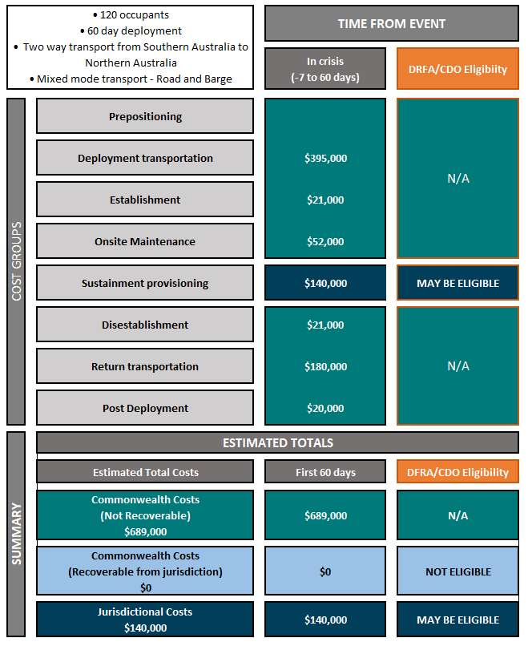
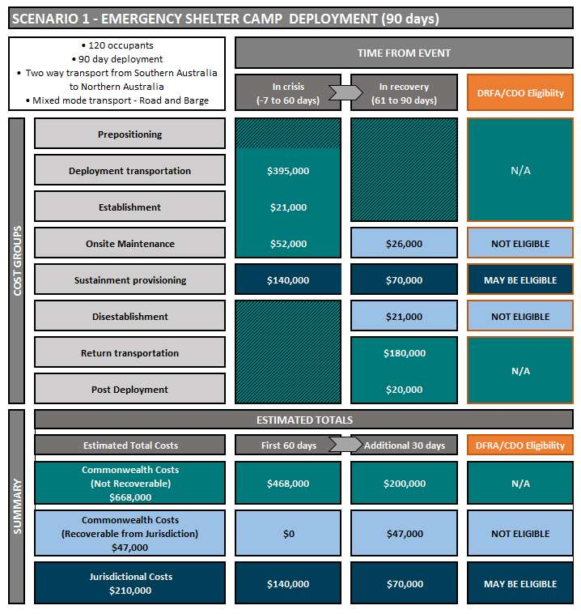
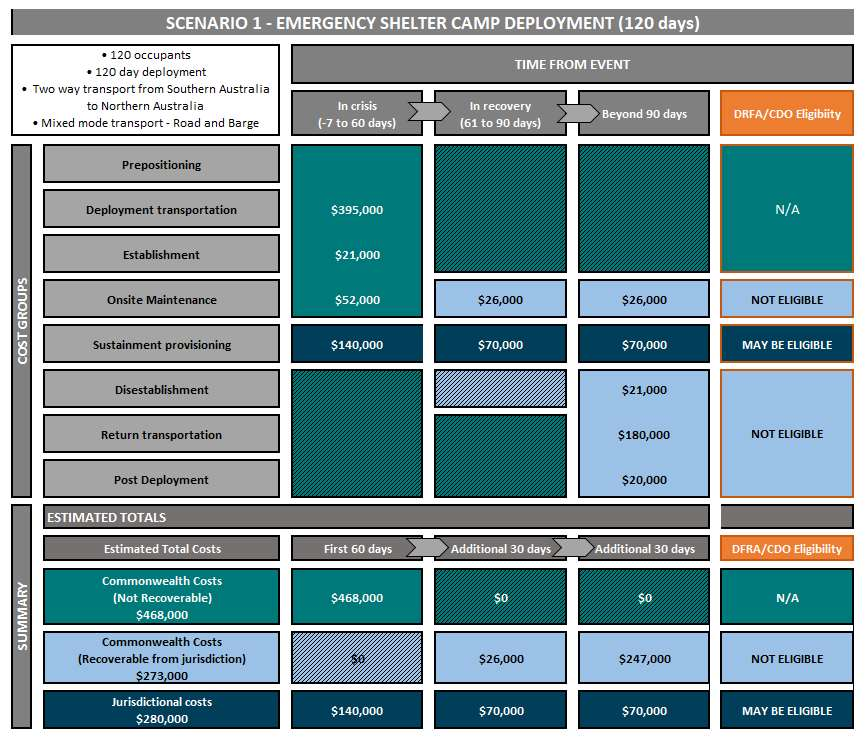
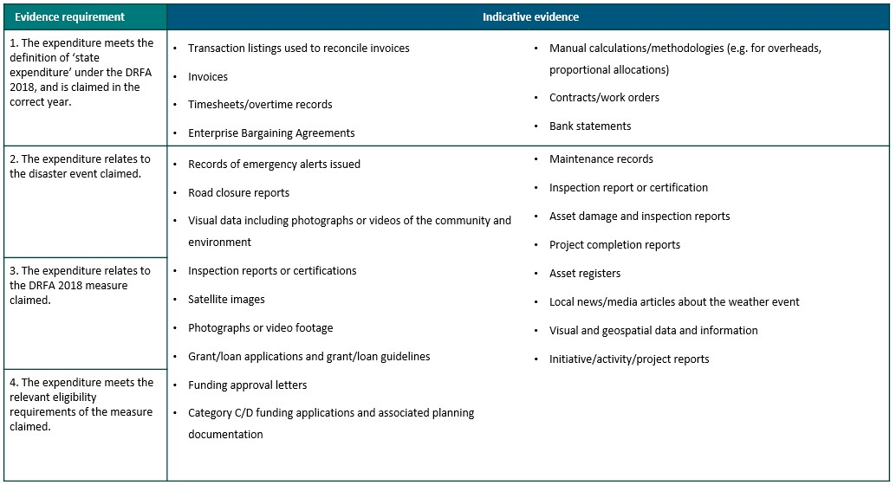
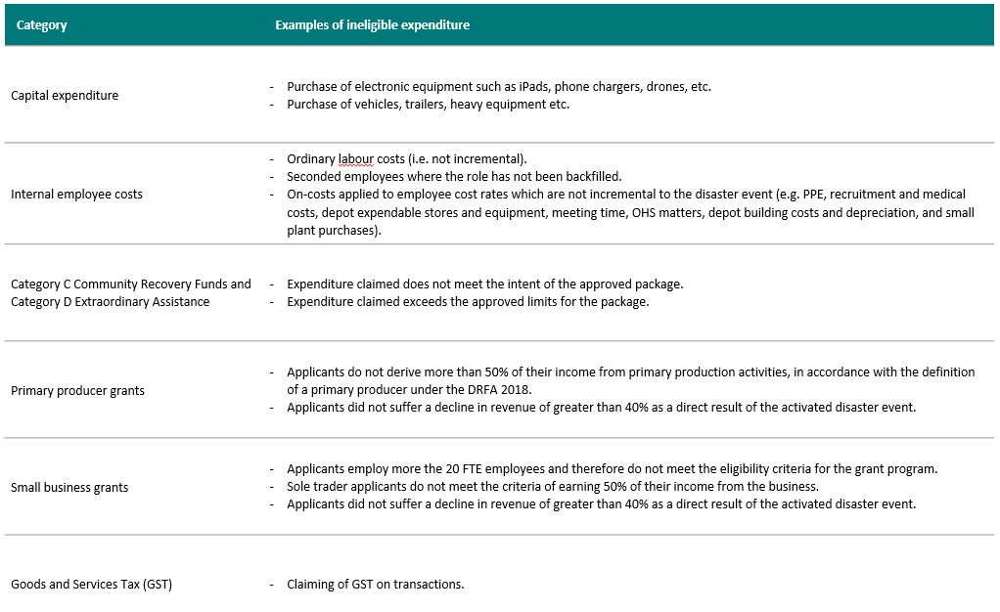
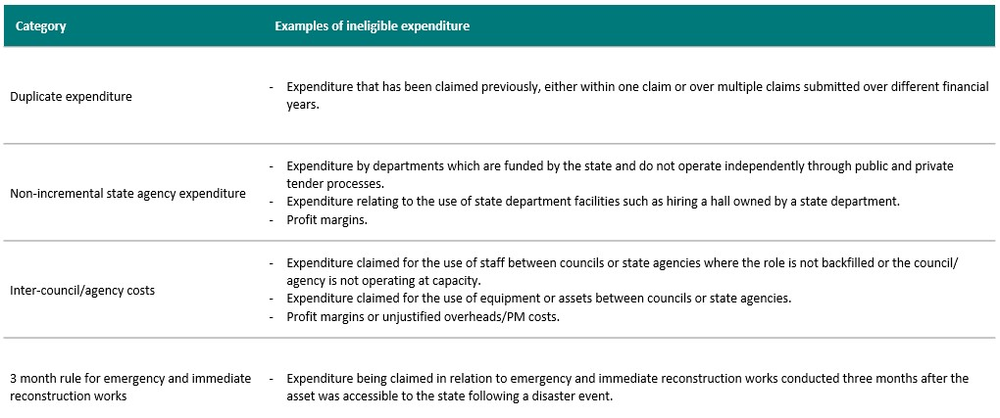

# DRFA National Advisory — Emergency and temporary accommodation

> **Source**: Australian Government — National Emergency Management Agency (NEMA)
> **URL**: https://nema.gov.au/sites/default/files/2025-02/DRFA%20national%20advisory%20-%20Emergency%20and%20temporary%20accommodation.pdf
> **Licence**: CC BY 4.0
> **Retrieved**: 2026-05-07T13:48:15Z
> **SHA-256**: `3f37d0a2e97a66a3d261a0eed7ba18b58f9bab5f58ddc22fd72444c342bcf912`
> *Converted from PDF to Markdown format.*

---
## Page 1

 
Disaster Recovery Funding Arrangements (DRFA) – National advisory  
Emergency and temporary accommodation 
DRFA national advisories provide additional information to support state, territory and local 
government recovery practitioners to plan for and deliver specific types/forms of relief and recovery 
assistance to disaster-affected communities. Where appropriate they include advice on DRFA eligible 
activities and evidentiary requirements for audit, assurance and claiming purposes. National 
advisories may be updated from time to time. 
Context 
Disasters often result in the displacement of individuals and families from their homes for prolonged 
periods. Evacuation centres and short-stay accommodation solutions can support displaced 
individuals and families in the immediate to short-term, however, medium and longer-term 
accommodation solutions may also be needed where there has been significant damage to homes 
and/or essential services that support residential areas.  
State, territory and local governments are responsible for identifying and delivering appropriate 
emergency and temporary accommodation solutions for disaster-displaced individuals and families.  
Through the DRFA Determination 2018 (DRFA 2018), Commonwealth funding is available to help 
state and territory governments deliver appropriate emergency and temporary accommodation 
solutions to disaster-displaced individuals and families (“displaced persons”) until they can safely 
return home or find other suitable ongoing living arrangements.  
This paper clarifies the range of options available under the DRFA 2018 for providing emergency and 
temporary accommodation to support displaced persons with their immediate through to longer-
term housing needs. 
Relevant DRFA category and clause 
The intention of Category A assistance measures is to provide emergency or hardship assistance for 
individuals and families impacted by disasters. The level of Commonwealth reimbursement for 
Category A measures under the DRFA is dependent on the state or territory exceeding pre-
determined, state or territory-specific financial year thresholds that are revised each year to reflect 
the state or territory budget and a range of other factors. Emergency and temporary 
accommodation costs eligible for reimbursement are outlined in Category A, clause 4.2.2 a) 
Emergency food, clothing or temporary accommodation (see Schedule A of the DRFA 2018).  
Where emergency or temporary accommodation solutions being considered by a state or territory 
after a disaster are outside the established scope of Category A, a state or territory may seek 
Commonwealth support for exceptional assistance under Category C, as part of a Community 
Recovery Fund.  
Emergency and temporary accommodation options 
The DRFA provides flexibility for state, territory and local governments to determine how best to 
provide emergency and temporary accommodation assistance to displaced persons. This ensures 
that emergency and temporary accommodation solutions can be tailored to meet the specific needs

---
## Page 2

 
and circumstances of impacted communities, rather than imposing a ‘one-size-fits-all’ model. This 
includes accommodation for the elderly, people with disability and others with specific needs. 
DRFA emergency and temporary accommodation solutions should be ‘fit-for-purpose’ and provide 
displaced persons with an acceptable standard of living so they can go about their lives with dignity 
and purpose. Attachment A provides a range of specifications to consider when determining 
appropriate emergency or temporary accommodation solutions. 
A range of different emergency and temporary accommodation solutions may be utilised under the 
DRFA, including (but not limited to):  
 
evacuation centres; 
 
existing accommodation facilities or service providers, such as rental properties, hotels, motels 
and caravan parks; and 
 
newly established temporary accommodation facilities using mobile housing units, such as 
caravans, huts, dongas, pods or tents. 
As displaced persons transition through immediate, short, medium and longer-term phases after a 
disaster, it may be appropriate to adjust the type of accommodation being provided (the DRFA 2018 
allows for these changes).  
Under the DRFA 2018, the Category A principles (Schedule A) state that Category A assistance is 
generally only available for 12 months. However, these assistance measures may be available for a 
longer period, up to 24 months (clause 4.2.1), depending on the nature and severity of the disaster. 
Delivery of emergency and temporary accommodation assistance beyond 12 months should be 
discussed with the National Emergency Management Agency (NEMA). The period for 
Commonwealth assistance may be extended in extraordinary circumstances, subject to prior 
approval by the Commonwealth, but the basic premise of the DRFA is that the states/territories bear 
the primary responsibility and will continue to provide accommodation for displaced persons for as 
long as appropriate.  
States, territories and local governments can claim costs that are directly associated with delivering 
emergency and temporary accommodation. These include transportation, establishment, operation 
and decommission costs. The storage of mobile accommodation and housing material between 
disasters is ineligible for Commonwealth support because the costs are not directly related to the 
eligible disaster and do not relate directly to the delivery of assistance.  
State and territory governments should work with the Commonwealth and local governments to 
plan for the delivery of emergency and temporary accommodation in a timely and effective manner. 
This includes: 
 
establishing adequate systems and processes; 
 
examining potential accommodation options and making arrangements with service providers; 
 
providing regular training and education programs to key personnel; 
 
making an appropriate level of resources (human, capital and financial) available and accessible 
to deliver the assistance; and 
 
putting in place arrangements to manage the psychological and mental health impacts on 
displaced persons and communities receiving assistance.

---
## Page 3

 
State and territory governments should have appropriate arrangements in place to ensure that 
displaced persons utilise, and exhaust, any existing insurance provisions prior to seeking assistance 
for temporary accommodation. States and territories should prepare for the transition from 
emergency and temporary accommodation to standard government supported accommodation 
arrangements when the term for cost-shared assistance expires, unless willing to continue to solely 
fund the existing accommodation arrangements.  
Use of the National Emergency Management Stockpile (NEMS) Capability 
The NEMS Capability is an emergency response and relief mechanism that allows NEMA to help 
Australian states and territories to access reliable, readily deployable life sustaining resources and 
services in times of crisis. This includes an emergency shelter capability that has been designed to 
provide transitional shelter support (up to 60 days) for disaster displaced people, or to provide short 
term worker accommodation to disaster response and relief workers.  
The camps provide a safe, climate controlled place for people to sleep and seek respite from the 
elements when they do not have access to any other options. They do not meet all of the minimum 
requirements for consideration as temporary and emergency accommodation under the DRFA 2018 
(as per Attachment A). Instead they are intended to give state, territory and local governments time 
to source more suitable medium to longer term accommodation options.  
NEMS resources are provided by the Commonwealth. Any costs covered by the Commonwealth and 
then recovered from a jurisdiction will not be eligible for cost-sharing under the DRFA. This includes 
costs associated with Counter Disaster Operations (CDO). However, costs directly incurred by a 
jurisdiction for goods and services to operationally sustain a NEMS capability (such as fuel, water, 
camp management, waste management etc.) may be eligible under the DRFA, including CDO, where 
DRFA eligibility requirements are met.  
Principles for activating temporary accommodation 
Before activating temporary accommodation assistance, consideration must be given to the 
following:  
 
There is a genuine need for emergency and/or temporary accommodation as a direct result of a 
relevant DRFA eligible disaster. This may be demonstrated through the provision of an 
emergency declaration and/or impact assessments.  
 
A range of options have been considered and the emergency and/or temporary accommodation 
solution proposed is cost-effective, fit-for-purpose and appropriate to meet the specific needs 
and circumstances of displaced persons. 
 
States and territories have appropriate processes in place to ensure that displaced persons 
utilise, and exhaust, existing insurance provisions prior to seeking government assistance for 
temporary accommodation under the DRFA.  
Requirements for audit and assurance 
The state/territory government must record and keep appropriate evidence and documentation to 
support Commonwealth audit and assurance activities to ensure amounts being claimed are eligible 
for reimbursement under the DRFA.

---
## Page 4

 
For assurance purposes, state/territory agencies and the Commonwealth may, at any time, request 
documentation from funding recipients and state/territory government agencies to evidence 
compliance under the DRFA and other applicable laws, policies, guidelines and regulations. 
Further information about DRFA audit and assurance requirements is available at Attachment B. 
Establishing the eligible cost – options for claiming  
Before claiming temporary accommodation assistance, consideration must be given to the following:  
 
The state/territory has satisfied the definition of an eligible disaster under the DRFA 2018 and 
has activated the relevant measure (Clause 4.2.2 a) in each LGA where there is a need for 
emergency and temporary accommodation solutions. 
 
The costs being claimed under the DRFA relate specifically to the disaster and to the provision of 
emergency and temporary accommodation for displaced persons. 
 
The emergency or temporary accommodation solution was only used by eligible displaced 
persons following an eligible disaster event. 
 
Any amounts relating to emergency and temporary accommodation that are recoverable from 
other sources (for example, through fees, charges, subsidies and insurance) have been deducted 
from the amount being claimed from the Commonwealth under the DRFA by the state or 
territory.

---
## Page 5

 
Case Study 1: Emergency Accommodation 
Situation 
A bushfire in State A has resulted in residents being evacuated from their homes. The fires have 
caused significant damage in Town Z and the whole town has been evacuated. While damage 
assessments are ongoing, it is estimated approximately 80% of residents’ homes are damaged or 
destroyed. It is likely that the majority of the town will require emergency accommodation beyond 
the initial evacuation period.  
Given the situation in Town Z, State A has established emergency accommodation at the local state-
owned events centre to accommodate people who are unable to return to their homes. The 
accommodation, comprising 80 caravan pods, 12 two-room self-contained units and 12 three-room 
self-contained units, is being established and managed by a contractor. This assistance will be 
available for a maximum of three months until impacted residents can be transitioned to other 
accommodation (i.e. temporary accommodation) or long-term options.  
State A is querying what costs will be eligible for reimbursement under the DRFA. Specifically 
whether: 
 
costs of the managing contractor are claimable; and 
 
costs directly related to the establishment of the temporary accommodation are claimable. 
State A is also querying whether the costs directly related to the day-to-day accommodation services 
at the site would be eligible, such as: 
 
general services – site presence and logistics support; 
 
grounds maintenance; 
 
waste management; 
 
cleaning services, including laundry services and 
 
food services.  
Eligibility Advice 
Based on the information above, operating costs associated with the provision of emergency 
accommodation directly attributable to establishing and maintaining the site would be eligible under 
Category A of the DRFA.  
Operational costs, including costs incurred through the engagement of a managing contractor, are 
eligible for the period the facility is operating as an emergency accommodation facility. State A must 
be able to provide evidence that the costs incurred relate to provision of services within the event 
centre and are directly related to meeting the needs of impacted individuals as part of the 
emergency accommodation support.  
Where an existing state, territory or local government owned venue is being used for the purposes 
of providing emergency accommodation, any costs relating to the hire of the venue or any lost 
revenue due to cancellations while the venue is being used as emergency accommodation are not 
eligible.  
For the purpose of audit and assurance activities, State A will need to demonstrate, with an 
appropriate level of evidence/documentation, costs that are being claimed are directly attributable 
to the provision of emergency accommodation assistance to meet the needs of impacted individuals.

---
## Page 6

 
 
Case Study 2: Temporary Accommodation 
Situation 
A flood in State B has resulted in many residents being displaced. Rapid damage assessments have 
identified around 50 houses are uninhabitable or destroyed. While emergency accommodation is 
being provided, the state is considering a temporary accommodation program that will allow 
impacted residents to live on or near their property while they rebuild. The state intends to use 
existing stock (i.e. mobile pods, caravans or dongas) for a period of up to 12 months for residents 
who had their primary residence assessed to be uninhabitable or destroyed by the flood event.  
State B has raised the following eligibility enquiries with NEMA: 
 
Would the accommodation program be eligible under Category A?  
 
Would the costs relating to the transportation, installation and removal of the temporary 
accommodation be eligible under Category A?  
 
Can the period that the assistance is being provided be extended beyond 12 months, if required, 
and be claimed under Category A? 
Eligibility advice 
Costs directly associated with delivering temporary accommodation, including the use of mobile 
pods, caravans, dongas or similar would be eligible under Category A. While eligibility under the 
DRFA is assessed on a case-by-case basis, costs that may be eligible include, but are not limited to:  
 
hiring temporary accommodation (i.e. pods, caravans, dongas) if existing stock is not available; 
 
transportation to/from the residential sites; and 
 
operational costs directly related to establishing and removing temporary accommodation, 
including: 
o installation costs, including connection to essential services (i.e. water, electricity). 
o demobilisation costs, including site remediation.  
Costs that would not be considered eligible under Category A, include, but are not limited to: 
 
the purchase of temporary accommodation, unless there has been prior agreement by NEMA; 
 
costs associated with the ongoing storage of the temporary accommodation between events; 
 
costs recovered by tenants; 
 
ongoing essential services costs; 
 
costs claimed under an insurance policy held by the applicant or state/territory; and 
 
salvage costs at end of the useful life of the accommodation. 
Where a state/territory is considering delivering a temporary accommodation solution under the 
principles of Category A assistance (Schedule A – clause 1), measures are generally only available for 
12 months following an eligible disaster, but the state/territory may be able to claim costs (related

---
## Page 7

 
 
to eligible costs above) for up to 24 months from the end of the financial year the disaster occurred, 
if required. If temporary accommodation under Category A is likely to be required beyond 12 
months, states/territories should advise NEMA prior to the end of the initial 12 month period to 
discuss. 
For the purpose of audit and assurance activities, State B will need to demonstrate, with an 
appropriate level of evidence/documentation, that the costs that it is seeking to claim are directly 
attributable to the provision of emergency accommodation assistance. 
Case Study 3: Emergency Shelter to displaced community members 
Situation 
A bushfire in State C has resulted in residents being evacuated from their homes. The fires have 
caused significant damage in Town Y. While damage assessments are ongoing, it is estimated 
approximately 70-80% of residents’ homes are damaged or destroyed. It is likely that 120 people will 
require emergency accommodation beyond the initial evacuation period.  
Given the remote location and the severe structural impacts caused by the event, State C has 
determined that it will take approximately two to three months to source suitable medium to longer 
term housing for the displaced persons in the affected community.  
Request for assistance 
The Australian Government Disaster Response Plan (COMDISPLAN) has been activated for this event. 
State C submits a Request for Assistance (RFA) to NEMA to provide 100 people with emergency short 
term shelter with basic cooking facilities for up to two months. They have already identified and 
secured a suitable location within the community to set up an emergency shelter camp. NEMA offers 
State C an emergency shelter camp capability, with a non-commercial field kitchen from the National 
Emergency Management Stockpile (NEMS).  
State C accepts the request, as it will enable those displaced persons to stay in the region, and remain 
connected.  This will result in improved social recovery outcomes. It will also support local economic 
recovery, because the displaced people are able to stay local and buy local. 
NEMS capability 
The NEMS emergency shelter offered can be run completely off-grid and comprises: 
 
32 climate controlled, secure and powered huts that can comfortably sleep 4 people in each hut 
(of the 32 huts, 4 are disability accessible); 
 
6 communal bathroom facilities, each with 2 showers with hot water, 2 flushing toilets and 2 
hand basins; 
 
one accessible ablutions and laundry facility with a shower commode and lifting hoist and slings, 
is connected to the 4 disability accessible huts;  
 
a communal non-commercial field kitchen, containing a refrigerator, 2 stove tops, 1 microwave, 
2 ovens and dishwasher is added to the camp as an optional extra;

---
## Page 8

 
 
 
a field kitchen including an adjoining laundry, providing a total of 6 non-commercial washers and 
dryers; and 
 
community canopies, providing shade and shelter for outdoor activities and community meetings. 
Deployment duration 
This assistance will be made available for a maximum of 60 days, until such time that impacted 
residents can be transitioned to other accommodation (i.e. temporary accommodation) or longer-
term options.  
For the first 30 days the emergency shelter accommodation will be used at full capacity, and as other 
options start to become available, displaced people will transition into temporary accommodation in 
order of priority and the greatest need.  
During the next 30 days, there will be 30 community members remaining in the emergency shelter 
camp, with the remaining capacity of the emergency shelter capability being used to accommodate 
relief and reconstruction personnel, thus helping to take the pressure off local, alternative 
accommodation options, that are already stretched. 
Responsibility for costs 
For a 60 day deployment, responsibility for the following costs would apply to each entity: 
Commonwealth - Provision of Infrastructure  
State C - Operational Sustainment  
 
Deployment* to and from location  
 
Establishment of the camp 
 
Onsite superintendent (first 60 days only)  
 
Disestablishment of the camp 
 
Post-deployment cleaning, restoration of 
standard wear and tear 
 
Camp management - of occupants  
 
Diesel fuel supply for generators  
 
Potable water supply  
 
Waste water (sewerage) management and 
disposal Grounds maintenance  
 
Catering and food services  
 
Linen and hygiene products  
 
Waste management 
 
Cleaning services, including laundering 
services 
 
Public liability and property insurance 
*If the deployment extends beyond 60 days post 
event, some of the Commonwealth’s costs will be 
subject to cost recovery based on the duration of 
the deployment 
Deployment extensions  
90 days: If State C needed to extend the deployment period for an additional 30 days to equal a 
90 day deployment, the Commonwealth’s costs to disestablish the camp, plus the additional 30 days 
for the onsite superintendent, would be subject to cost recovery from the receiving state.  
120 days: If State C sought to extend the deployment for a further 30 days, to equal a 120 day 
deployment, further costs would be subject to cost recovery from the receiving state/territory.  
These costs would include all transport costs, disestablishment and post deployment cleaning and 
restoration of standard wear and tear.

---
## Page 9

 
 
DRFA eligibility advice 
A core principle of the DRFA is that state and territory governments have the primary responsibility 
for providing assistance to impacted communities. As such, Commonwealth support through the 
DRFA is not intended to fund core disaster response and recovery activities that are the 
responsibility of the state/territory.  
In line with this principle, when NEMS resources are provided by the Commonwealth, any costs 
covered by the Commonwealth and then recovered from a jurisdiction will not be eligible for cost-
sharing under the DRFA. This includes costs associated with Counter Disaster Operations (CDO).   
However, costs directly incurred by a jurisdiction for goods and services to operationally sustain a 
NEMS camp (such as fuel, water, camp management, waste management etc.) may be eligible under 
the DRFA, including CDO, where DRFA eligibility requirements are met.   
An example cost recovery and responsibilities calculator for a 60 day, 90 day and 120 day 
deployment is provided in Figures 1 - 3 below. Please note the cost recovery arrangements for NEMS 
is subject to approval by the Prime Minister, in consultation with the Minister for Finance and the 
Treasurer.

---
## Page 10

 
 
Figure 1: 60 day deployment

---
## Page 11

 
 
Figure 2: 90 day deployment

---
## Page 12

 
 
Figure 3: 120 day deployment

---
## Page 13

 
 
Attachment A 
Emergency and temporary accommodation specifications for consideration 
by recovery practitioners following disasters 
Displacement following a disaster can be incredibly stressful and traumatic for impacted individuals, 
families and communities. For most people, a home is more than just a structure where they live and 
the loss is more than just monetary. Adhering to basic minimum standards when providing 
emergency and temporary accommodation to displaced persons provides dignity and may reduce 
suffering. 
It is important to recognise that differing circumstances affect how a person is impacted by a 
disaster. There are a number of cohorts who should be afforded specific consideration, particularly 
in relation to appropriate accommodation solutions. Such cohorts include, but are not limited to: 
youth, elderly, women, First Nations people, culturally and linguistically diverse and people with 
disability.  
Engagement with communities to be housed in temporary accommodation, and with surrounding 
communities, is essential to ensure solutions effectively meet their needs. 
Emergency and temporary accommodation provided under the DRFA must meet basic standards. 
Therefore, at a minimum, the emergency and temporary accommodation must: 
 
Be safe, clean and in good condition. 
 
Be established in an appropriate and disaster safe location, taking into consideration factors 
such as drainage, topography, soil and vegetation conditions, fire safety and land ownership. 
 
Be able to provide for various different family types and sizes (e.g. singles, couples and families 
with children and pets). 
 
Be weatherproof. 
 
Be secure and be able to be locked from the inside. 
 
Take measures to prevent gender-based violence, including family violence. 
 
Have at least one functioning smoke alarm per level (refer to requirements under relevant 
state/territory legislation). 
 
Have appropriate bathroom, toilet, kitchen (fridge, hotplate and microwave), laundry and 
storage facilities. 
 
Have adequate waste disposal facilities (e.g. sewerage, rubbish and sanitary disposal). 
 
Have access to adequate potable water. 
 
Have appropriate heating and cooling systems. 
 
Have appropriate lighting and ventilation. 
 
Be able to provide a reasonable level of privacy (e.g. window furnishings, etc.). 
 
Be able to support displaced individuals and families to remain connected to their local 
community (e.g. by proximity or other opportunities for communication).

---
## Page 14

 
 
 
Be accessible to people with disability, the elderly or those with other access requirements. 
 
Take into consideration cultural factors for First Nations, as well as other culturally diverse 
people. 
As much as possible, emergency and temporary accommodation should: 
 
Be able to be established/located as individual or multiple units on different types of land (e.g. 
parking lots, caravan sites and grass ovals). 
 
Be able to function/operate as standalone or multiple units. 
 
Be transportable as individual or multiple units, including to remote and regional locations (e.g. 
on trucks or by aircraft).  
 
Be able to be quickly dissembled, packed and reconstructed. 
 
Have low maintenance and operational costs.  
 
Be able to be easily stored at suitable locations when not in use. 
 
Have on-grid and/or off-grid capability (i.e. include the ability to connect to mains and adjoin 
portable power, water and sewerage systems, etc.). 
 
Have flyscreens and an appropriate number of electrical socket outlets (power points). 
 
Be able to accommodate displaced people over the longer-term while rebuilding occurs (e.g. for 
up to two to three years).  
 
Be able to cater for a range of different family types, including pets.

---
## Page 15

 
 
Attachment B 
DRFA Audit and Assurance Fact Sheet 
Overview  
Disasters or terrorist events (eligible disasters) may result in large-scale expenditure by state and territory 
governments in the form of disaster relief and recovery payments and infrastructure reconstruction. To 
assist with this burden, the Commonwealth has made arrangements to provide financial assistance to 
states/territories in certain circumstances. These arrangements are governed by the Disaster Recovery 
Funding Arrangements (the Arrangements), which identifies the relief and recovery assistance to which 
the Commonwealth will financially contribute, and the requirements for such contributions. The 
effectiveness of these arrangement depends on robust and reliable assurance activities at both the 
Commonwealth and state/territory level.  
Under the Arrangements, states/territories must submit a claim to NEMA by 31 March each year, which 
includes expenditure for eligible events incurred in the previous financial year. The submitted claim must 
be audited by a state/territory appointed auditor to gain certification of the accuracy of the claim prior to 
being submitted. 
Collaborative assurance program 
Under the Commonwealth’s Collaborative Assurance Program (the Program), NEMA engages an external 
assurance provider to undertake assurance activities over a state/territory claim. Throughout the 
assurance process the external assurance provider will collaborate with states/territories to gather the 
documentary evidence to make a determination about the eligibility of expenditure within a claim and 
will also provide the overall findings of these assurance activities to both the state/territory and NEMA 
The external assurance provider coordinates with the state/territory and NEMA to undertake risk-based 
assurance activities for the DRFA claim. Depending on the risk assessment over the claim this may include 
enquiry and walkthrough procedures, targeted sampling, random sampling, and/or other procedures to 
address specific risks identified. The DRFA requires information to be provided within one month of 
request.  
The purpose of the Commonwealth’s collaborative assurance program (the program) is for the 
Commonwealth to obtain a high level of confidence that expenditure claimed includes only eligible 
expenditure and therefore complies with DRFA and importantly meets the obligations of the Public 
Governance, Performance and Accountability Act 2013 (PGPA Act).  
General requirements 
Under the Arrangements, for any of the relief and recovery measures to be an eligible measure they must 
be carried out to alleviate damage or distress arising as a direct result of an eligible disaster. When a 
natural disaster occurs and the relevant state/territory knows, or expects, the natural disaster to be an 
eligible disaster, the state/territory must notify NEMA of the fact within three months. 
An eligible disaster is defined as a natural disaster or terrorist act for which:  
 
a coordinated multi-agency response was required, and  
 
state expenditure exceeds the small disaster criterion ($240,000). 
States/territories have 24 months from the end of the financial year in which the relevant disaster 
occurred to incur state expenditure for Category A, B, C and D measures. A state/territory can only claim 
expenditure for a measure if they have formally activated under the DRFA activation process (note: some 
measures have specific timelines outside of this).

---
## Page 16

 
 
Evidence requirements  
Consistent with the minimum evidentiary requirements outlined in clause 10.4 of the Arrangements, and for audit and assurance purposes, NEMA may, at any time, 
request documentation from a state/territory to provide evidence of the state/territory’s compliance with any aspect of the Arrangements. Therefore, appropriate 
evidence/documentation must be kept to demonstrate the direct relationship between the disaster and the damage that has occurred to be deemed as eligible 
expenditure under the DRFA. Evidence requirements could include, but are not limited to:

---
## Page 17

 
 
Examples of ineligible expenditure

---
## Page 18

