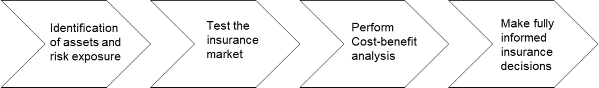

# DRFA Guideline 4 — Insurance Arrangements

> **Source**: Australian Government — National Emergency Management Agency (NEMA)
> **URL**: https://nema.gov.au/sites/default/files/2024-08/drfa-2018-guideline-4-insurance-arrangements.pdf
> **Licence**: CC BY 4.0
> **Retrieved**: 2026-05-07T13:48:09Z
> **SHA-256**: `bf62acfae95da68558c9770102a0a70956396c1f2b944507f2934532441af749`
> *Converted from PDF to Markdown format.*

---
## Page 1

 
  
  
  
 
 
 
Disaster Recovery Funding Arrangements 
2018 
Guideline 4 – Insurance arrangements 
Insurance arrangements 
1. 
States have a responsibility to put in place insurance arrangements which are cost effective for 
the state and the Commonwealth—clause 3.1.5 of the Disaster Recovery Funding Arrangements 
2018 (the arrangements) refer. 
2. 
A state may find it appropriate to adopt a qualitative benchmark based on a best practice 
approach, as was established in the 2012 Natural Disaster Relief and Recovery Arrangements’ 
insurance review1.  This approach reflects the obligation on states to identify their risk exposures 
and fully inform their decisions with respect to financing potential losses. 
3. 
The qualitative benchmark process is illustrated below: 
 
4. 
A state’s access to adequate capital may be demonstrated by referencing the state’s policies to 
access internal funds, such as deferral of capital expenditure, access to insurance and/or the 
state’s ability or willingness to borrow. 
 
                                                     
 
1 Commonwealth of Australia, Department of Finance and Deregulation. Review of Insurance Arrangements of State and 
Territory Governments under the Natural Disaster Relief and Recovery Arrangements Determination 2011. NDRRA Phase 2 
Report. September 2012.

