# REDiPlan — Australian Red Cross Household Preparedness Guide (Comprehensive)

> **Source**: Australian Red Cross
> **URL**: https://www.redcross.org.au/contentassets/cdd5b2675ae944d8852aba02397fc8ee/rediplan-comprehensive.pdf
> **Licence**: Australian Red Cross — practitioner & community use; cite source
> **Retrieved**: 2026-05-07T13:47:56Z
> **SHA-256**: `05cbe28db82b8a1da6169e11f548d662288404440d9ebaf0eb506c3efecc5564`
> *Converted from PDF to Markdown format.*

---
## Page 1

COMPREHENSIVE 
GUIDE
redcross.org.au/prepare
EMERGENCIES HAPPEN:
protect  
what  
matters  
most

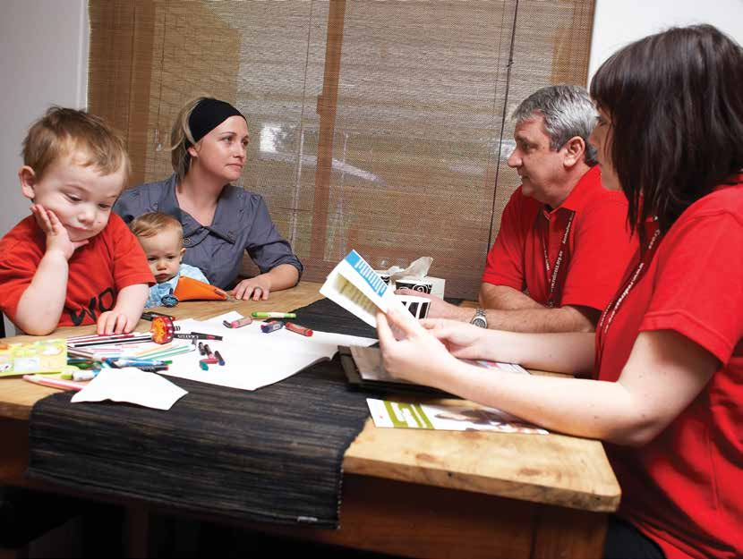

---
## Page 2

Emergencies don’t just include major natural 
disasters like bushfires, earthquakes or 
floods. A fall in the home that results in an 
unexpected hospital stay, a car accident, 
or serious illness can also cause significant 
disruption and add stress to your life. 
You can reduce the impact of emergencies,  
big and small, by being prepared.
Prepare for  
what life  
throws at you,  
big or small
redcross.org.au/prepare

---
## Page 3

RediPlan® is a registered Australian Red Cross trademark: 
© Australian Red Cross Society 
This document may not be used, copied, reproduced or disseminated by or to any other  
person except with the express written permission of Australian Red Cross Society, which  
may be given subject to conditions. 
Cover image: Australian Red Cross/Tim Lofthouse
Introducing RediPlan	
04
Prepare your mind	
06
for an emergency
STEP 1: GET IN THE KNOW  
Think	
10
Act	
14
Share	
16
Personal assessment	
18 – 21
STEP 2: GET CONNECTED 
Think	
24
Act	
26
Share	
30
STEP 3: GET ORGANISED
Think	
34
Act	
38
Share	
44
STEP 4: GET PACKING
Think	
48
Act	
50
Share	
54
Your RediPlan	
55 – 60
Other recommended  	
61 
references
Additional resources	
66 – 72 
Your RediPlan 
Contents:

---
## Page 4

4  RediPlan | Section Details
One in three Australians will 
experience an emergency or 
the threat of an emergency  
in their lifetime.1
More than one in five  
families will be impacted  
by an insurable event in 
their working lives.3
1 IN 3
AUSTRALIANS
MORE THAN
1 IN 5
MORE THAN
80%
65%
EXPERIENCE
TRAUMA
65 per cent of people will 
experience a traumatic  
event in their lifetimes.2 
(vehicle accident,  
violent assault,  
workplace accident)
After an emergency,  
more than 80 per cent 
of people affected will 
recover well without 
prolonged distress 
and without the event 
significantly impacting  
on their mental health.4
EMERGENCIES 
DON’T 
DISCRIMINATE
1 Reser, J, Bradley, G, Glendon, A, Ellul, M, 
Callaghan, R 2012, Public Risk Perceptions, 
Understandings, and Responses to Climate 
Change and Natural Disasters in Australia  
and Great Britain
3 Kelly, S and Vu, Q N (2010) Understanding the 
Social and Economic Cost of Underinsuance 
The Lifewise/NATSEM Report
2 Australian Centre for Post Traumatic  
Mental Health (2007) Acute Stress  
Disorder and Post Traumatic Stress  
Disorder: a Practitioner’s Guide
4 Mark van Ommeren, Shekhar Saxena, 
& Benedetto Saraceno, (2005), Mental 
and social health during and after acute 
emergencies: emerging consensus? Bulletin 
of the World Health Organisation 2005; 
83:pp71-76.
redcross.org.au/prepare

---
## Page 5

5
Emergencies. Not something we 
think about every day. Yet still they 
affect hundreds of thousands of 
people across Australia every year.
Emergencies can strike at any time. They can damage  
and destroy homes and valuables, they often have 
negative effects on health, they upset routines, and in 
many cases they can lead to significant financial burden. 
Some of us feel the effects of an emergency for a long 
time. For some, lives will never return to the way they  
were before.
While emergency services do all they can to help,  
the person most responsible for your wellbeing before, 
during and after an emergency is you. And the people 
most likely to help you will be those you know.
Thankfully, there are things you can do now to help  
you and your loved ones to be prepared and cope  
better should an emergency occur.
Your RediPlan has been designed to provide an easy-to-follow set of actions to  
help you plan for emergencies, grouped into four simple steps:
GET IN THE KNOW
1
GET CONNECTED
2
GET ORGANISED
3
GET PACKING
4
Australian Red Cross/Rodney Dekker

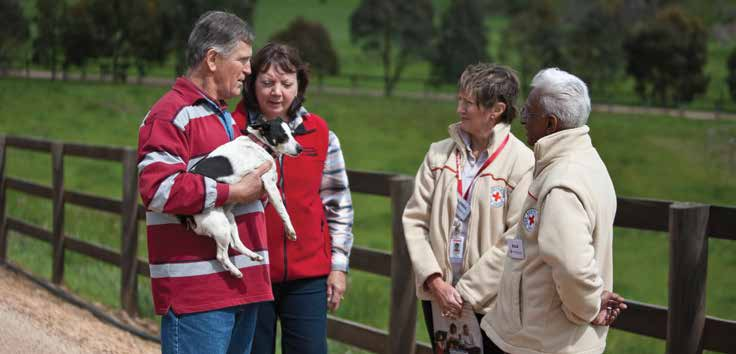

---
## Page 6

6  RediPlan | Introduction
First things 
First: prepare 
your mind
As you work through your RediPlan, it’s  
really important to think about how to 
prepare both practically and psychologically 
for an emergency.
Face it, emergencies are scary and stressful. And most people under a lot of 
stress don’t think as clearly as usual, affecting decisions and reactions. So the 
first step to help you cope with your responses and those of others is to be 
able to anticipate, identify and manage beforehand how you and your family 
are likely to feel, think and respond in an emergency. 
Here are some useful tips to help do just that:

---
## Page 7

7
ANTICIPATE – it’s going to get stressful
•	 How do you think you will react to the stress? How do you usually react 
to highly stressful situations? Think about how you might feel during an 
emergency and what you and others might be thinking. Common feelings 
include anxiety, fear, general stress, uncertainty and helplessness.  
Although these reactions are very natural, they may stop you from  
preparing or acting so it’s important to acknowledge them and manage  
them better when they happen. 
IDENTIFY – your feelings and thoughts  
•	 How you feel in highly stressful situations is strongly affected by the way  
you cope with the physical signs of anxiety and the thoughts running  
through your head
•	 We experience anxiety in a variety of ways, including upset stomach, 
irritability, headaches, shortness of breath and tightness in the chest.  
For children it might include anxious behaviour, such as excessive clinging
•	 Try to also identify any frightening and negative thoughts you might have.  
Do those thoughts help or hinder? Some typical, but unhelpful thoughts 
include things like: “I can’t cope,” “I’m so scared,” “We’re all going to die,”  
“I don’t know what to do”
•	 Some unhelpful thoughts might also be ones that try to minimise the threat, 
like: “this happened last year so it can’t possibly happen again this year”.  
Not thinking about a threatening possibility or denying the need to prepare 
can actually make us more anxious—and far less prepared—in the event of  
an official warning situation.
MANAGE – your feelings and thoughts with simple  
breathing and self-talk 
Use familiar techniques to help manage your feelings or try the following:
•	 Practise calming techniques, such as deep, relaxed breathing or mindfulness 
(use a smart phone app such as Smiling Mind to help you get started)
•	 Replace frightening thoughts with more helpful ones like: “Breathe calmly,”  
“I can handle this,” “I’m coping”.
Try not to focus on the bad things that might happen, but instead tell yourself 
that the calmer you are, the better you’ll be at managing exactly what needs  
to be done.
Complete the worksheet at the end of this book to help prepare your mind.
This section was written with the assistance of the Australian Psychological Society.

---
## Page 8

8  RediPlan | Section Details
Preparation
is a family
affair.
STEP
GET IN THE KNOW
1
Australian Red Cross/Rodney Dekker

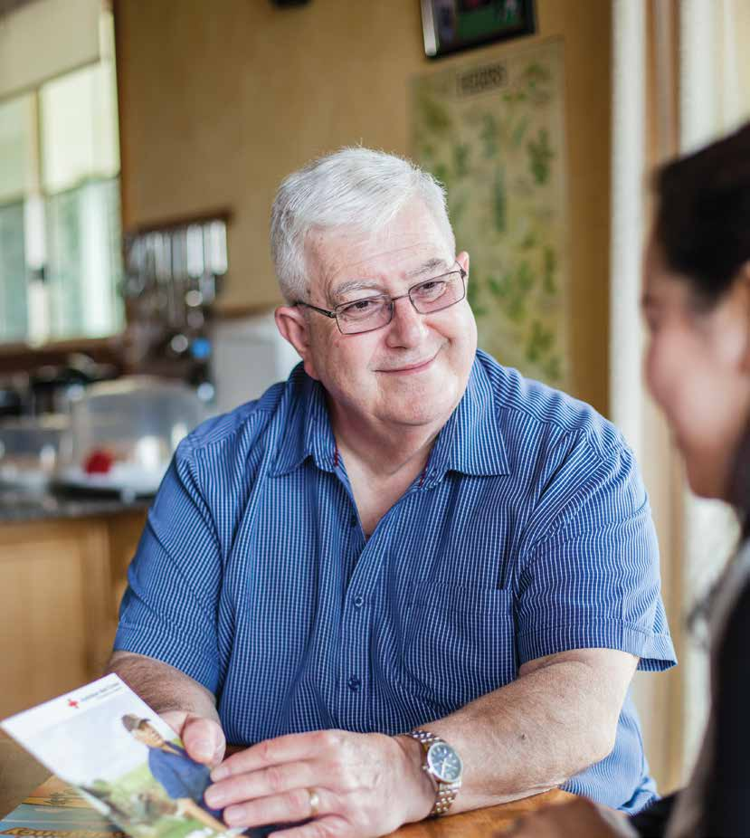

---
## Page 9

9
Getting in the know is your vital first step towards 
being prepared for an emergency. You need to  
know the risks you face, how your life might be 
disrupted and who can help, before you can act.
Emergencies can happen anywhere, any time:
•	 At or near home
•	 At work
•	 At school or childcare
•	 On holiday
•	 While out and about.
Knowing how life could change for you in the hours, days, months and sometimes years 
after an emergency will help you work out what you can do now to make your world a  
less stressful place should an emergency occur.
THINK
→  Know which emergencies  
are more likely to affect you
→  Think through how each 
emergency might affect 
you and your family in the 
short- and long-term, both 
practically and psychologically
→  Find useful sources of local 
and expert information 
that can help you deal with 
potentially fatal threats 
before, during and after  
an emergency.
SHARE
→  Share what you’ve learned 
and help others to get in  
the know.
ACT
→  Identify what you can do to 
help yourself and what you 
might need help with during  
an emergency
→  Learn about emergencies 
from people in your 
community and whether 
there are emergency plans 
that you need to know about.
This section will help you to:

---
## Page 10

10  RediPlan | Step 1 - Get in the know
Think about the types of 
emergencies that could happen in 
these places and the different events 
that might cause a disruption to your 
life. There are the obvious ones like 
fires, cyclones, storms and floods. 
But what else could happen?
Think about how your needs and 
abilities might change. Moving to 
a different area, working different 
hours, starting a family. Change is a 
part of life and how we prepare for 
emergencies should reflect this.
Think broadly. Industrial disasters, 
transport accidents, or chemical 
spills. Drought, disease, or utility 
outages. They can all disrupt your  
life as readily as an unexpected visit 
to hospital, a debilitating injury, or  
a car accident. 
Remember: being prepared for small 
events can help you be prepared for  
big events. 
THINK
Think of all the different places you frequent.  
Emergencies don’t only happen at home.

---
## Page 11

11
Think long-term. What happens if: 
•	 you or someone you love is injured or dies
•	 your children can no longer attend their school or childcare centre
•	 you or someone in your family is no longer able to work because their business  
is destroyed or an injury prevents them from working
•	 your property and all your valuables are destroyed
•	 you are separated from your animals
•	 local services are disrupted and unavailable for a period of time
•	 many of your friends move away from the area because of the emergency?
Think short-term: 
•	 where will you go if you have to leave home quickly or weren’t able to go home? 
•	 what will you take with you?
•	 what will you do if you have to stay in your home while the emergency passes  
and services are restored?
•	 what happens if you’re separated from loved ones and can’t get in touch - 
where would you meet and how would you stay in touch?
•	 what will your kids do if they’re home alone?
•	 what happens to your pets if you’re not at home?
•	 what will you do if your usual ways of getting groceries, petrol or medical supplies 
are disrupted for several days?
Australian Red Cross/Tim Lofthouse

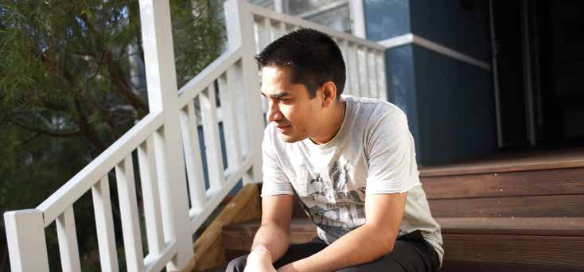

---
## Page 12

12  RediPlan | Step 1 - Get in the know
Expect the unexpected
Emergencies can have unexpected impacts  
on our lives. It’s important to think about 
what you can do now to avoid or reduce those 
impacts. Just knowing what might happen  
will help.
Your ability to think
Really stressful events can affect the 
way our brains work. Many people 
talk about experiencing memory 
loss, losing the ability to concentrate, 
and finding it hard to read and retain 
information after an emergency. This 
is common. For most people, such 
impacts fade over time.
Your relationships
Focusing on the practical things after 
an emergency, like cleaning up or 
rebuilding, is a given. But what about 
the things even closer to home: 
your relationships? Your wellbeing 
and your relationships with loved 
ones are the most important things 
in helping you to recover after an 
emergency. Think about the possible 
impacts an emergency may have on 
these relationships and talk about 
them with your loved ones.  
Your children
Emergencies impact children and 
infants just as much as adults. Most 
parents worry about these impacts, 
and often see changes in behaviour 
after an emergency. For most kids, 
the way their parents cope will be 
the strongest indication of how they 
will cope. Red Cross has included 
common reactions that children have 
after a disaster in its Parents’ Guide. 
See the reference section to find out 
how to get a copy.
Your safety
Unfortunately, research and 
experience tell us that family 
violence increases in the often 
chaotic circumstances after an 
emergency, as living arrangements 
and support networks are disrupted. 
Family violence can include physical, 
sexual, emotional, verbal, social and/
or spiritual violence. Think about 
how you and others might manage 
challenging situations—such as 
pre-existing apprehended violence 
orders and custody arrangements—
after an emergency. 
If you’re worried about family 
violence occurring after an 
emergency, talking to your personal 
support network, family violence 
services or the police can be helpful 
to make plans.
Family violence is never OK.

---
## Page 13

13
Know your strengths 
and limitations
Think about what you’ll be able to do for yourself 
and any help you may need before, during and  
after an emergency.
There are people who can and will help you prepare for an emergency, but the person in 
the best position to do so is you. You have the best understanding of your own abilities 
and possible needs. So be honest with yourself, and plan accordingly.
Australian Red Cross/Rodney Dekker

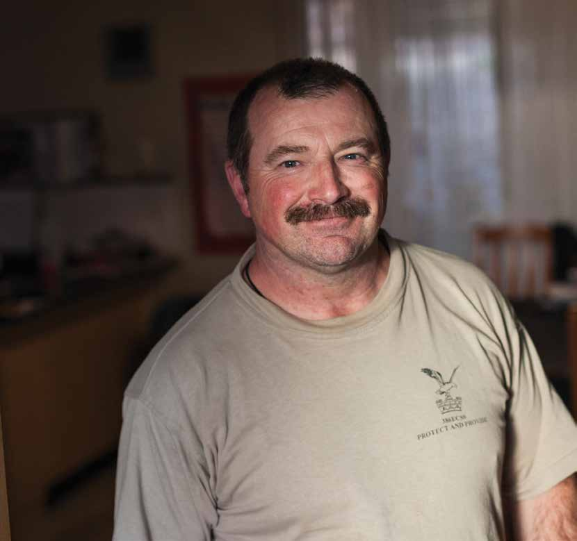

---
## Page 14

14  RediPlan | Step 1 - Get in the know
Write down what you can do on 
your own and what you might 
need help with.
Fill in the personal assessment worksheet at the end of 
this section. It will help you and others better understand 
what you can do for yourself and what you’ll need help 
with during an emergency.
Learn about local emergency risks and impacts 
Get in touch with: 
•	 your local council or the council where  
you plan to stay
•	 your library or historical society to find  
out about past emergencies in the area
• 	 local indigenous organisations 
•	 people who have lived in your area a  
long time
•	 your local fire service for house or  
bushfire information
•	 state or territory emergency services  
(e.g. the SES) for flood, storm, cyclone, 
tsunami and earthquake information.
Ask about: 
•	 local risks
•	 ‘hazard seasons’—when they start and  
finish in your area
• 	 indigenous weather knowledge and history 
that might apply to hazards
•	 how to make a hazard-specific plan
•	 past emergencies in your area and how 
they’ve affected the community
•	 who is responsible for managing emergency 
responses, community recovery activities, 
and which agencies provide emergency 
information during emergencies.
ACT
People die in emergencies 
Australia’s fire services and state/territory 
emergency services have well-tested planning 
guides for bushfires, cyclones, floods, storms, 
earthquakes and tsunamis. 
These guides help you make decisions  
about how you might manage potentially  
life-threatening situations. Seek advice from 
the experts to plan for these events.

---
## Page 15

15
Download an emergency preparedness app. There are 
many great apps created by a number of emergency 
agencies available for smart phones. You’ll find a list in  
the reference section at the back of this book.
Find out about existing local emergency plans
Talk to your: 
•	 local council
•	 workplace
•	 children’s school, kindergarten or  
childcare facility
•	 relevant aged care facility
•	 your preferred cattery or kennel
•	 family and friends.
Ask whether plans exist and how  
you might access them. Find out:
•	 how they plan to respond to a  
particular emergency
•	 how information will be passed on to you  
during and after an emergency 
•	 what, if anything, is expected of you  
during an emergency
•	 what services might be available after  
an emergency
•	 how services might be disrupted by  
an emergency.
•	 Call 000 for police, fire or ambulance  
ONLY in a life-threatening situation.  
Do not use this number to get general 
information. This number must stay  
clear for emergency calls
•	 If you are hearing impaired and  
rely on TTY, use 106 to send a  
text message
•	 Contact the SES or Territory Emergency 
Services on 132 500 if you have urgent 
storm damage or are threatened by floods
•	 Keep emergency telephone numbers  
handy, including electricity, gas, water, 
council, local doctor/hospital/vet and  
school/childcare.
Getting help in an emergency
Tune in to important information sources
Local radio is a good source of information before, during 
and after an emergency. It provides information about 
warnings, what is happening, what the authorities want 
you to do, and support services available. ABC Local 
Radio will interrupt normal broadcasting to bring you 
information. Know your local ABC frequency. 
Though social media sites such as Twitter and Facebook 
can be good sources of current information, they can also 
be inaccurate, which may cause stress. Rely on sites of 
reputable sources, such as police or emergency services 
agencies. Follow these sites ahead of time through 
Twitter and Facebook feeds.

---
## Page 16

16  RediPlan | Step 1 - Get in the know
Prepare and share
•	 Talk to others in your community about what you’ve 
learned about the risks you face in your local area  
and the impacts emergencies might have on your  
(and their) life. Encourage them to do the same with 
their friends
•	 Help others to identify the emergencies that might 
affect them and to find the resources they need to 
help them prepare. In particular, do you know people 
who might need special assistance in an emergency? 
Offer to help them think through the emergencies 
that might affect them, who might be able to help 
them, and where they can get information to suit 
their special needs
•	 Share your story. The experience of an emergency 
or a loved one experiencing an emergency are two 
of the most common reasons people give for their 
own emergency preparedness. If you or a loved one 
has experienced an emergency, share the story with 
others. Let them know the impacts it had on your life, 
what you did beforehand that helped, and what you’d 
do next time to lessen the impacts.
SHARE
Do you know:
□  Emergencies that might affect your  
local area?
□  Where to get information about an 
emergency from?
□  When ‘hazard seasons’ start and finish  
in your area (e.g. bushfire season)?
□  How your life could change as a  
result of an emergency, including 
unexpected impacts?
□  What emergency plans are in place 
in your area, what they include, and what 
is expected of you in these plans?
□  Your local ABC and commercial  
radio frequencies?
□  Facebook/Twitter feeds of emergency 
services agencies?
□  How to share what you know with others 
and to help others get in the know?
GET IN THE KNOW  
CHECKLIST

---
## Page 17

17
Australian Red Cross/Renae Droop

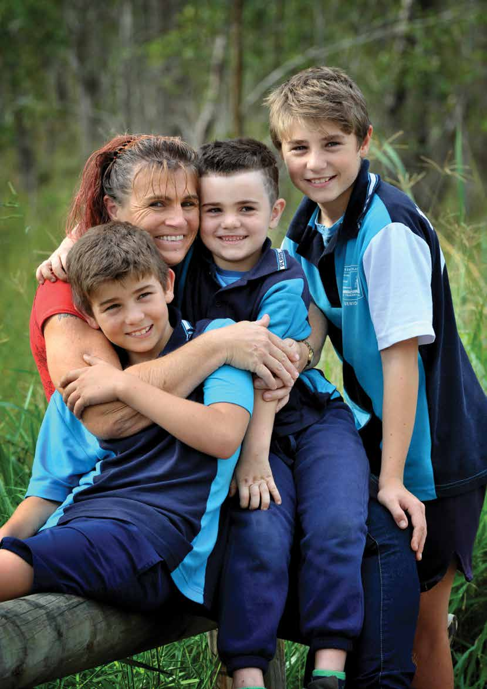

---
## Page 18

This worksheet will help you and others 
better understand what you can do for 
yourself and what you’ll need help with 
during an emergency. 
Share this with your personal support 
network and remember to update it at least 
annually to reflect changes in your life.
PERSONAL 
ASSESSMENT
WORKSHEET
WHAT YOU KNOW
Y
N
NOTES
TIP
Do you know what 
emergencies might  
affect you?
□□
Remember to think about 
emergencies that might affect you  
in all the important places in your 
life, not just at home.  
See page 10
Do you know where to  
get information about  
an emergency?
□□
There are many ways to get 
information about emergencies.  
See page 14
Can you access  
this information?
□□
Emergency agencies have 
information and resources available 
on their websites and can send 
you information upon request. 
There might even be emergency 
preparedness sessions you can 
attend in your local area.  
See page 15
Can you understand  
this information?
□□
Some emergency information can 
be complex. Ask a friend, family 
member or colleague to help 
explain information to you.
Is your ability to 
communicate with others 
affected by any of the 
following?
•	 Language
•	 Literacy level
•	 Disability
□□
Talk to your personal support 
network about getting information 
delivered to you in a way that 
addresses your needs.

---
## Page 19

YOUR WELLBEING
Y
N
NOTES
TIP
Are you in good health?
□□
Think physical and emotional 
health. It’s important that you are 
as healthy as you can be before an 
emergency occurs. Your wellbeing 
now will have an impact on how you 
recover from an emergency. 
Are you actively 
managing any physical or 
mental health conditions?
□□
It’s really important that you are 
actively managing any illnesses 
or health conditions you have 
that may impact on your recovery 
from an emergency. These might 
be physical, emotional or mental 
health conditions. List medications 
or medical assistance of any kind 
you currently rely on in your medical 
plan and include in your kit.  
See page 51
Have you had any major 
life changes in the last  
six months?
□□
Major changes in our lives, like 
moving house, having a baby, a 
relationship breakup, or changing/
losing a job can affect our ability to 
cope. Think about ways to manage 
the impacts major changes may 
have on your life. See the section 
First things first: prepare your mind 
(page 6) for more information.
Are you able to cope with 
stressful situations?
□□
Almost everyone affected by 
an emergency will experience 
varying degrees of stress at some 
point during and after the event. 
Anticipating, monitoring and 
understanding your own and your 
loved ones’ reactions will really  
help you during an emergency. 
See the section First things first: 
prepare your mind (page 7) 
for more information.
Is your ability to 
communicate with others 
affected when you are 
under stress?
□□
Inform your support network and 
talk to them about what assistance 
they can provide to help you to 
communicate during an emergency. 
See page 26

---
## Page 20

YOUR WELLBEING
Y
N
NOTES
TIP
Do you suffer  
from anxiety?
□□
Think about what you do or need 
to seek relief from anxiety. List this 
in your medical plan and let your 
personal network know that you’ve 
done so. See page 66
Are you able to manage 
your daily routine 
without assistance?
□□
For those who need assistance with 
things like personal care, getting 
around, or preparing or eating food, 
think about how an emergency 
might affect any assistance you 
receive. Work with your support 
network to ensure you have a plan 
should assistance be disrupted 
or should you be required to stay 
somewhere else. See page 44
Are you reliant upon any 
medical equipment?
□□
Make sure you include medical 
equipment in your RediPlan and kit 
and that you have talked to your 
support network about assistance 
you might need. Remember that 
medical equipment that requires 
electricity might be affected if the 
power is cut. See page 51
Are you reliant upon  
a caregiver?
□□
Include your caregiver when
planning for an emergency. They
should be a part of your personal
support network and they can help 
you put your RediPlan together.
Include in your RediPlan what
happens if your carer is unable to
visit you. See page 26
YOUR NETWORK
Y
N
NOTES
TIP
Do you feel well-
supported? Support 
may come from family, 
friends, your community 
and/or care services.
□□
It is really helpful to identify your 
own personal support network or to 
become a part of a support network 
for someone you know. See page 26
Are you part of a club,  
a group or a service?
□□
The connections you have with 
people in your community will help 
you in many really important ways 
after an emergency. See page 24

---
## Page 21

YOUR NETWORK
Y
N
NOTES
TIP
Would you know how to 
get involved in a club, a 
group or a service if you 
were interested in  
doing so?
□□
Think about who is missing from 
your network. If you feel like you are 
not part of a community or could 
benefit from expanding your existing 
network, think about how you might 
do this. See page 25
Do you know the names 
of people in your street?
□□
Write these names (and phone 
numbers if you have them) down in 
your RediPlan. See page 27
YOUR SECURITY
Y
N
NOTES
TIP
Do you have a reliable 
source of income?
□□
Emergencies can be really expensive 
and financial matters can become a 
significant burden that causes a lot 
of stress to people. Think about how 
you can plan to cover financial losses 
caused by an emergency and in 
doing so avoid the stressful burden 
that accessing money can become. 
See page 39
Have you financially 
protected your assets  
and livelihood  
(i.e. insurance)?
□□
Get insurance, review your current 
insurance policies, and/or make 
a financial plan. Insurance is an 
important step in protecting your 
property and your income. Make 
sure your household and income 
protection insurance policy covers 
you for all types of emergencies.  
See page 39
Is your home  
disaster resilient? 
□□
Talk to your local council about 
existing building codes, planning 
zones and any criteria for disaster 
resilient homes in your area. Talk to 
your local emergency services for 
tips to protecting your home and 
property from an emergency.  
See page 34
Do you feel safe in your 
home or neighbourhood? □□
Feeling insecure in your home or 
neighbourhood can affect your 
ability to cope with stressful 
situations. Talk to your personal 
support network if you do not feel 
safe in your home. See page 26

---
## Page 22

22  RediPlan | Section Details
“Getting to know your neighbours 
is essential as they are the ones that you will rely on.” 
 
Resident, Parkerville fire, Western Australia
STEP    
GET CONNECTED
2
Australian Red Cross / Lisa Fitzgerald

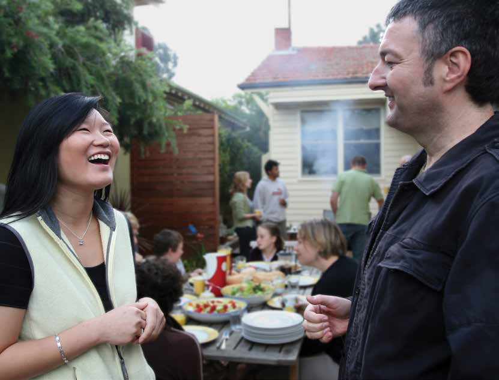

---
## Page 23

23
Being connected to your community means you can 
help each other in an emergency and, if you need it, 
in the long recovery journey afterwards.
People who receive positive support from their community (i.e. family members,  
friends, co-workers, neighbours) after an emergency tend to recover better than  
those who don’t. 
Consider this:
•	 It’s most likely to be your 
neighbour or a passer-by,  
not emergency services, who 
will help you to survive during  
an emergency
•	 Your friends, family and 
neighbours will probably be the 
ones who provide most of the 
general, practical and emotional 
support you’ll need before and 
after an emergency. Things like 
helping to secure and clean 
up your property, helping with 
child minding or the school run, 
providing meals, working through 
admin, or just being there to talk 
to or share the experience 
•	 Your community networks will 
most likely provide you with the 
information you need to know 
about recovery services and 
activities relevant to you after  
an emergency.
THINK
→  Identify and strengthen  
existing connections
→  Consider how you might help 
others to prepare.
ACT
→  Identify a personal  
support network
→  Create new connections.
SHARE
→  Start the conversation  
about emergencies within  
your network.
This section will help you to:

---
## Page 24

24  RediPlan | Step 2 - Get connected
THINK
Think about your existing connections.  
Who do you consider to be in your 
community? Who do you already know? 
A community is more than the geographic area you live  
in. It may also include others who share something in 
common with you, such as language, culture, religion, 
interest or hobby. 
Think:
•	 work relationships
•	 neighbourhood networks
•	 relationships through local shops and services like banks or the post office
•	 your social networks, such as friendships, local schools, your religious 
belief or sports/interest groups
•	 the relationships within your family.  
Now think about who’s missing from your network. If you feel like you’re not 
part of a community or could benefit from expanding your existing network, 
think about how you might do this. Who would you like to get to know?  
Which groups would you like to be a part of? 
Think about how an emergency might affect your networks. A common 
impact of an emergency is the disappearance of what was considered 
routine. This might include the communication network you’re familiar with, 
or the conversations you have with familiar faces while walking down the 
street or visiting the shops.

---
## Page 25

25
Staying cool, calm and connected
Being separated from family and friends is one of the  
most stressful things a person can experience during  
and immediately after an emergency. 
It can also affect long-term health. Emergencies often occur during the day 
when household members are at work or school. If access to home is cut off, 
or telecommunications are affected, it’s all too easy to become separated. 
Think about what each of you will do if household members are separated  
by an emergency and how you’ll get back in touch.
Connection works two ways
Think about those around you. Some people will need more  
help than others in an emergency—help you can provide.
Think about how you might be able to help someone you know  
during and after an emergency.
If you become separated from loved ones  
during an emergency
Red Cross manages Register.Find.Reunite., a national registration and 
enquiry service for people affected by an emergency. The aim of the 
service is to reduce distress in communities and families separated by 
an emergency by connecting loved ones. When it is operating, you can 
register yourself and your family or enquire about a loved one during 
and after an emergency at an evacuation, relief, or recovery centre,  
or online at redcross.org.au 
•	 older adults living at home  
	
by themselves
•	 people with physical or 	
	
	
intellectual disabilities
•	 people with mental illness
•	 single parents with  
	
young children
•	 families where one  
partner regularly works  
away from home
•	 large families
•	 people recently arrived  
to the area
•	 people recently arrived to the 
country, including refugees or 
newly arrived immigrants.
These people might include:

---
## Page 26

26  RediPlan | Step 2 - Get connected
Don’t depend on only one person. Remember that 
people in your network could also be affected by  
the emergency and may not be able to help you when 
you need them. Three trusted people in your network  
is a minimum.
It’s good to know you probably won’t have to build 
a network from scratch. You probably already have a 
personal support network—within your household, 
family, or friendship group—but you just haven’t  
thought of these people in this way.
ACT
Typically, it includes people who can help you get the 
resources you’ll need. They should be available to check 
in on you regularly and help you when required. Your 
personal support network could be your immediate 
family, your neighbours, a group of friends, more 
formalised support service staff, such as carers, or any 
combination of these.
Your network should:
•	 be made up of people you trust
•	 understand what you can and can’t do on your  
own and know when you need assistance
•	 be able to provide (or organise) help within minutes.
Once you’ve identified  your network:
•	 ask them to help you plan for an emergency  
(use the household emergency plan template  
to help do this)
•	 talk through your plan with your network  
and provide copies. Make sure everyone 
understands what to do in an emergency 
•	 show your network your personal assessment 
worksheet or ask them to work through it with 
you so they understand what they might need  
to help you with
•	 become part of a support network for someone  
you know.
If you know of someone who might need help in an 
emergency, talk to them about emergency planning.  
With their agreement, write their names, addresses 
and contact numbers in your RediPlan. If they’re happy 
to talk to you (remember that some people value 
their privacy) find out if they have family members or 
organisations that help them to live independently. 
Offer to help them prepare their own RediPlan and 
encourage them to share their plan with the people  
who help them.
Identify a personal support network 
A personal support network sounds great at any time,  
but having one is essential during and after an emergency.

---
## Page 27

27
Use the template at the end of this 
section to write down the numbers  
of important people or organisations 
in your life. Be as thorough as you 
can. You need to write them down, 
because your phone may not be 
operating in an emergency.
Super-size your community networks 
Start small. Family and friends first. Then knock on neighbours’ doors where 
you feel comfortable doing so. Introduce yourself and leave your contact 
details, or maybe pop a contact card in their letterbox.  Beyond that, there’s 
plenty you can do to expand your community.
•	 Get to know your local service 
providers; café staff, hairdresser, 
florist, grocers, etc. 
•	 Organise a street party
•	 Hold a communal garage sale
•	 Organise a neighbourhood  
clean-up
•	 Talk to your local council about 
community-building initiatives  
or community groups that they 
may have running or might like  
to support
•	 Join or start an online community 
through Facebook, Twitter, 
LinkedIn or Instagram
•	 Get involved in a local cause.
Working together for a common 
goal can be a great way to build 
your community.
Record before you ring

---
## Page 28

28  RediPlan | Step 2 - Get connected
Let’s talk about roles and responsibilities 
before an event occurs; who’ll do what, 
when and how.
I’d like to share thoughts on identifying 
people in our community who may need  
help and what we as a group can do to 
provide that help.
Let’s work together to identify any gaps in 
our preparation that could pose a problem 
if an emergency occurs.
Preparedness:  
Start the conversation
Let’s talk about how an emergency might 
affect our community and what we can do 
as a group to prepare.
I’d like to discuss our community’s strengths 
and how we can use them to help each 
other during and after an emergency.

---
## Page 29

29
Australian Red Cross/Renae Droop

---
## Page 30

30  RediPlan | Step 2 - Get connected
Are you  
connected?
•	 Start some conversations about emergencies with 
people you know: your local school or childcare  
facility, your children’s local sporting group, your 
parents, a hobby group, or any of the groups or 
networks of people you consider to be a part of your 
community. You might even talk about what the group 
can do to help prepare others in your community
•	 Arrange to have emergency services workers talk to 
a group you belong to about how to prepare for an 
emergency. All agencies run sessions, usually for free. 
Contact Red Cross in your state or territory if you’d like 
to hear from a trained Red Cross presenter
•	 Join an emergency or community service organisation. 
Red Cross has emergency services teams across the 
country. These teams help people with a range of 
services including supporting people to prepare for 
emergencies and responding to people’s needs during 
and after an emergency. More information is available  
at redcross.org.au
SHARE

---
## Page 31

31
Have you:
□  Identified and strengthened  
existing connections?
□  Recorded where you’ll go in the case of 
an emergency and told members of your 
personal support network where you 
plan to go and how you’ll get there?
□  Written down important phone numbers 
including the contact details of your  
out-of-town contact?
□  Created new connections in  
your community?
□  Started the conversation about 
emergencies within your network?
GET CONNECTED  
CHECKLIST

---
## Page 32

32  RediPlan | Section Details
Footer / Section Details
STEP    
GET ORGANISED
3
You’ve thought about the impact emergencies  
may have on you and your community. You’ve 
strengthened your community links. You’re well  
on the road to having an emergency plan. 
Now it’s time to get organised.
Australian Red Cross / Michael Torres

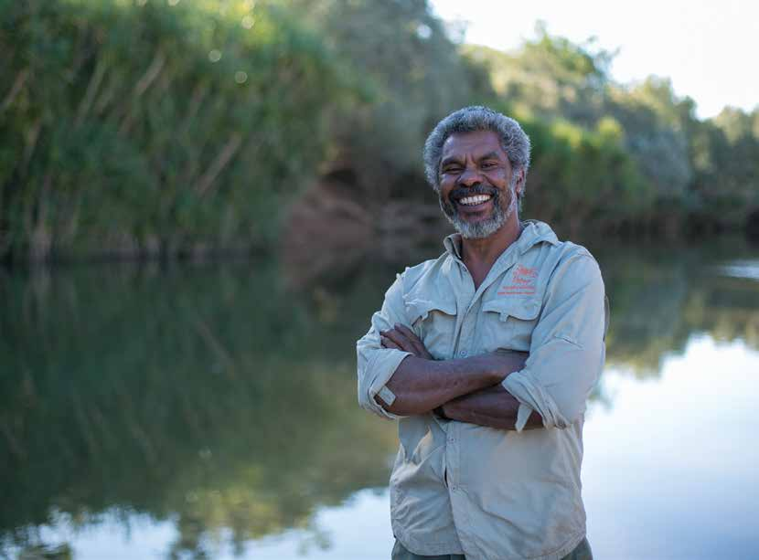

---
## Page 33

33
Organising the things 
that will help you gain a 
sense of control after an 
emergency is the next step 
to being prepared.  
Getting organised means:
•	 Thinking through what might 
happen to you during and after  
an emergency
•	 Taking action to protect the 
important things in your life  
before an emergency occurs.
This section will help you to:
THINK
→  Consider whether you’ll  
stay or go if threatened by  
a major emergency
→  Understand the importance 
of protecting the things that 
will help you recover faster 
after an emergency.
ACT
→  Document a plan to protect:
    •  You, your household 
members, and your pets  
and animals
    •  Things and places that are 
important to you 
     •  Your financial situation.
SHARE
→  Talk through your plan with 
your networks
→  Help others to develop their 
own plan/s.
Getting organised will reduce stress and 
save you precious time as you recover. 
The two most important things to think 
about: planning to survive and planning  
to recover. 
 
•	 Planning to survive means taking action that  
will protect your life and assets as an emergency  
is happening
•	 Planning to recover means taking action to make 
sure that the impact on you and your family/
household is kept to a minimum.
Local businesses are a vital part of a healthy, thriving 
community. Ensuring that businesses are able to 
withstand and recover quickly from an emergency 
has an impact not only on the immediate lives of 
owners and employees, but the entire community. 
Planning to reduce the impacts an emergency might 
have on your business will make a huge difference.  
And it doesn’t have to be hard, with many tools 
available to help you to create a business emergency 
plan. See the list of references at the back of the book 
to help you get started.
The business of survival and the survival of business

---
## Page 34

34  RediPlan | Step 3 - Get organised
THINK
The possibility of mandatory evacuation (where you are  
told by authorities to leave your home) is always real, so 
you may not have a choice. Think about where you might 
go if you were to leave home or weren’t able to go home 
during an emergency, and how you would get there.  
It’s critical to know in advance.
Many people plan for their family to separate during 
disasters. For example, one adult stays to look after the 
house, while another leaves. We see time and again that 
being separated from loved ones during an emergency  
can be very traumatic and stressful and can have long-
term mental health impacts. While you can’t always plan 
for where you’ll be during an emergency, think about  
the impacts that deliberately separating may have on  
your household.
Emergency authorities may set up a centre for people  
to shelter while the worst of the emergency passes. 
These centres are known by different names in each 
state and territory (e.g. evacuation centre, emergency 
relief centre, welfare centre). These shelters only offer 
very basic support—in some cases just a roof over your 
head—and tend to be crowded and noisy.
There are plenty of helpful resources to assist you  
when planning to survive an emergency. Your local 
fire service can provide you with advice on planning 
evacuation routes and contingency plans, reducing  
your risk of house fire, and making a bushfire safety  
plan. And your local state/territory emergency services 
can provide information about how to stay cyclone-, 
storm- and flood-safe.
What are the important things  
in your life that you can take  
action to protect now in order  
to reduce the disruption an 
emergency might cause? 
Remember to think people, animals, objects, 
places, networks and routines.
Everyone’s different, so we all value different 
things in different ways. On page 34 are some 
suggestions for you to think about when 
getting yourself organised.
Planning to survive 
Think about whether you will stay or  
leave your home during an emergency.  
The circumstances will depend upon the  
hazard and your own capacity to manage.

---
## Page 35

35
iStockphoto/Juan Monino
Planning to recover 
Planning to recover is about protecting  
the life you’ve been living. 
Protect the bottom line
Emergencies can be really expensive. And financial 
matters can become a significant long-term burden  
that causes a lot of stress. Think about how your ability 
to earn an income might be affected by an emergency. 
Lost property might need replacing, your workplace 
might close down due to damage, cleaning up damaged 
property may require time off work, and sometimes 
you’ll need to take sick leave for illness or injury  
suffered as a result of the emergency.
Think about how you can protect your income or ensure 
that your finances are safeguarded. Think about life 
insurance or income protection insurance to protect  
your family if the main income earner in the household  
is affected by an emergency. 
While there might be financial assistance available from 
governments and other agencies after an emergency, it’s 
usually small and targeted at immediate needs. It won’t 
be enough to replace your home or valuables. Thinking 
about how you can cover financial losses caused by an 
emergency will save you a lot of stress and burden.
Loss of life
While no one likes to talk about it, emergencies can 
cause loss of life. Think about the impact that the death 
of a family member would have on your life and what 
impact your own death would have on those around you. 
Think not only about the emotional impacts, but also the 
practical ones. If you haven’t already, consider preparing 
a will and organising life insurance.

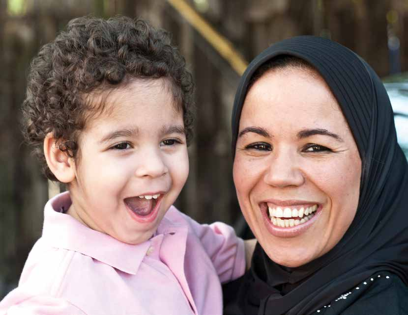

---
## Page 36

36  RediPlan | Step 3 - Get organised
Irreplaceable items
Objects can shape our identity. 
Saving precious items and keepsakes 
can speed up the recovery process 
because it protects the links we 
have with the past and can bring 
significant comfort if we’ve lost 
property and/or loved ones.
Think about all the important 
items in your life that might cause 
distress if they were lost. Protection 
of life should always be the first 
consideration for people during an 
emergency, but ensuring you protect 
the things that carry significant 
meaning for you, that connect you 
with your past and who you are, will 
help you recover.
Animal instincts
Don’t forget pets and animals when 
getting organised. Knowing they are 
safe and well during and after an 
emergency can be a great comfort 
in a stressful situation. Think about 
what you would do with them during 
an emergency. Consider how you’d 
find alternative accommodation. 
Some vets and boarding facilities 
may be able to assist. Check that 
these facilities have emergency  
plans too.
Planning to move large animals such 
as horses or alpacas takes time and 
preparation. Identify a safe place 
where they can be relocated during 
the emergency and include details  
in your RediPlan about how you’ll  
move them.  
Remember, you may not be at  
home when an emergency occurs,  
so make sure you plan for this 
scenario as well.

---
## Page 37

37
Landmarks and landscapes
Places can provide us with a sense 
of who we are and a connection to 
our community, with landscapes 
and landmarks making our world 
familiar. Loss of or damage to these 
can have profound effects on people, 
both practically, in terms of physical 
disorientation, and in terms of 
impacting links to people’s pasts  
and their identities.
Think about the important 
landmarks or landscapes that have 
meaning for you. There’s often not a 
lot we can do to protect them in an 
emergency because it’s outside of 
our control. 
However, it’s still important to 
acknowledge the places that are of 
importance to us, as it helps prepare 
for the reactions you might have 
after an emergency if important 
landmarks or landscapes are 
destroyed or damaged. It might also 
give you ideas about ways that you 
can contribute to or advocate for 
measures that might go some way to 
protecting these important places.
“Physically, there was no choice: you just get in there and do as much 
as you can. Emotionally it’s been so hard. My parents, they built that 
house. It’s been the only house they’ve ever lived in. They had to chuck 
all their furniture on the street. One minute we’re all home and the 
next minute you’re chucking your whole life on the street.” 
Ashley, Brisbane, Brisbane Floods 2010/11

---
## Page 38

38  RediPlan | Step 3 - Get organised
“I forgot my medication and that made it pretty difficult. 
We just grabbed a few things and hoped for the best.” 
Ashley, Brisbane, Brisbane Floods 2010/11
ACT
Your RediPlan should reflect your 
life and the things that matter 
to you. Every RediPlan will be 
different, depending on the 
person. Nevertheless, here are 
some suggestions to help you 
when thinking about what you’ll 
need to organise.
A healthy habit 
Write down and regularly update in your 
RediPlan any medical conditions you have, 
medications you take, as well as emergency 
contact details for your medical providers.
 
For wheelchair or walking frame users, make sure you 
can easily access escape routes and your chair or frame is 
in a designated place so they can be found quickly.
Teach your support network how to operate necessary 
equipment. Label and attach laminated instructions.
Never assume that an evacuation/relief centre will be  
able to meet your medical needs. Plan accordingly.
A RediPlan is more than  
a piece of paper
Talking through and creating 
your RediPlan with others in your 
household will ensure that you 
all include the things that are 
important to you and that you all 
understand what you will need to 
do in the case of an emergency.

---
## Page 39

39
Plan well and prosper 
At any time, it makes good sense to have  
a financial plan. 
It helps you understand where your money goes and 
which items are essential as opposed to being little 
luxuries that can be dropped under financial stress.  
 
It’s also worth writing into your RediPlan how you might 
access emergency cash, up to $2,000 in a hurry should 
you need to. See the reference section at the back of the 
book for resources to help with financial planning.
The assurance of insurance 
A simple truth: many people don’t have 
adequate home insurance as they are often 
covered only against theft, not damage  
from disasters.
If you haven’t got insurance, get it, and if you have, 
review your current policies. Make sure your household 
and income protection insurance policies cover you for 
all types of emergencies. In some cases, policies don’t 
cover flooding or acts of terrorism. Check that your 
household cover includes rental assistance and how long 
this assistance lasts should you be forced to move out of 
your home. Also think about life insurance. 
For small business owners, ensure that you have business 
interruption insurance. 
Review your insurance on an annual basis to make sure 
that your cover keeps up with rising costs. And of course, 
record all insurance details in your RediPlan.
Utility Tip
You may be advised by authorities to 
turn off your electricity, water and gas 
in an emergency. Find out where the 
meters and shut-off valves are and talk 
to your providers about how these can 
be turned off if need be.

---
## Page 40

40  RediPlan | Step 3 - Get organised
Minimise the stress of property loss
Navigating a partial or complete rebuild if an emergency 
damages your property can be really stressful, 
particularly if new building codes have come in since 
your property was built. Talk to your local council about 
existing building codes, planning zones, and any criteria 
for disaster-resilient homes in your area. While new 
codes may be introduced after the emergency, it’s good 
to know what the existing codes are so you know what 
you might be facing, including increased costs associated 
with bringing your property up to the new standard.  
 
The impact of the emergency might also challenge 
whether you want to live in an area. 
Identify a power of attorney 
Easily overlooked is the need to identify who you  
want to have enduring power of attorney should you  
find yourself in circumstances that will need someone  
to make decisions for you. The Office of the Public 
Advocate in your state or territory can provide more 
information on this topic.
Identify a next of kin
Your next of kin will be informed in case something 
serious happens to you. Tell your next of kin that you 
expect them to communicate with other members of 
your family, and friends. If circumstances prevent this 
from happening (e.g. strained family relationships),  
think about other people you wish to keep informed 
about your situation in the case of your death, an 
accident or serious illness.
Make a will
Every adult should have a will. It’s a sensible action that 
lets your family know exactly what should take place 
should the unforseen happen. This might relate to 
financial matters, as well as guardianship of children and 
pets. Wills can bring peace of mind and reduce stress 
for loved ones. Make a will by contacting your solicitor, a 
public trustee, or getting a will pack from the post office.
“A recurring theme in conversations I had with people who were 
bereaved by the Bali Bombings and Black Saturday Bushfires was 
the stress of having to deal with people’s estate, and trying to 
second guess their wishes. So often I heard ‘If only I knew what  
they wanted…”
John Richardson, Red Cross

---
## Page 41

Prepare a list of important items that 
you can’t easily replace. Do this with 
family, neighbours or friends. It’ll be a 
good topic of conversation, as each item 
will have a story. Think practically:
•	 Are these items easy to gather and move from 
the house if you had to leave quickly? 
•	 Are they fragile and would they need packing?
•	 Do you have a bag/box of the right size in which 
to take them all?
•	 Would you have enough space in a car to  
take items?
•	 Are these items that you could copy and store 
in another place, e.g. photos, letters, children’s 
art, videos? For example, can you have original 
photos located on a bookshelf in the living room 
and a copy of these photos saved on a computer 
with a relative and in the office?  
•	 Would these items be safe from flood waters if 
they were up high or in waterproof containers?
•	 Do these items need to be protected from fire, 
e.g. in a fireproof safe?
In a rush it’s easy to forget things. So write in your 
RediPlan how you will protect your important items. 
Think about making a map of your home, and mark  
the items on it. Doing so will also help others locate  
the items if you’re not home during an emergency.
 
Nothing can replace the irreplaceable
Include items considered important by each member 
of your household. Everyone will have different items 
that they consider irreplaceable, so make the whole 
household aware of them.
“One couple in their 70s came in. They worked all their lives to 
build a beautiful home and business. And it’s all gone. Insurance 
might rebuild your house, but it can’t rebuild your life.”
Carolyn, Red Cross volunteer, 2013 Blue Mountains fires. 
41

---
## Page 42

42  RediPlan | Step 3 - Get organised
Photograph important landmarks  
and landscapes
Take photos of your important places and document why 
it’s important to you. If an important public building is 
damaged during an emergency, talk to your local council 
to find out if you can contribute to its rebuild through a 
public consultation process.
RediPlan: get it in writing 
Talk to your support network if you need help to write 
down your RediPlan. If you rely on community support 
services to live in your home, you should talk to the 
coordinator or your case manager about what would 
happen if an emergency occurred in your area. See  
Step 2 to better understand what a support network  
is and how you can establish your own. 
Use the RediPlan template at the end of Step 4 to  
record your plan.
It’s important stuff
Your RediPlan may contain confidential information  
such as personal financial and medical details. Ensure 
you don’t include any details that will allow people to 
access your finances, or, if you do include it, store your 
RediPlan in a secure location and share it only with  
those you trust.
It’s a date: review your 
RediPlan annually
It’s important that your RediPlan is kept up-to-date 
and even more important that it remains at the back of 
everyone’s minds. Practise it as regularly as you can.  
Red Cross recommends that you practise your plan at  
least once a year.
Lock in October 13 as your annual reminder to review 
and practise your plan to coincide with the United 
Nations International Day for Disaster Reduction.

---
## Page 43

43
Your RediPlan review
•	 Check your plan is up-to-date  
and phone numbers are still valid
•	 Confirm your out-of-town contact 
is still happy to be your contact 
and that everyone in your plan 
remembers what you have agreed  
to do should you be separated  
during an emergency
•	 Check your insurance policies and 
make sure your cover is adequate 
•	 Check the contents of your Survive 
and Recover Kit (see Step 4) and 
replace perishable items and 
batteries as needed
•	 If you live in an area prone to 
bushfire, flood, earthquake, storm 
or cyclone, talk to your local fire 
or emergency services about how 
to prepare your home before the 
season starts.
Australian Red Cross/Michael Torres

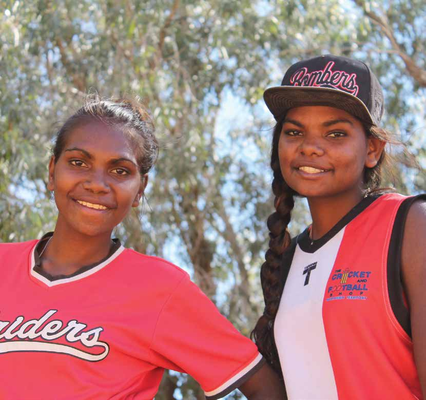

---
## Page 44

44  RediPlan | Step 3 - Get organised
□  Do you know where your gas, power and 
water meters and shut-off valves are?
□  Have you checked your insurance cover?
□  Have you put together a medical 
information list?
□  Have you developed a household 
financial plan?
□  Have you listed your irreplaceable items 
and written a plan to protect them?
□  Have you thought about and 
photographed all the places that are 
important to you that you would miss  
if they were gone?
□  Have you helped others to get organised?
GET ORGANISED  
CHECKLIST
SHARE
Spreading the word
•	 Once you’ve completed your RediPlan, keep a copy 
securely at work, in the cloud, or with a trusted friend 
or personal support network member
•	 Get together with everyone in your support network 
or sit down with everyone in your household, 
including children, and have a conversation about 
your plan and the things you’ve organised as part of 
it. Make sure everyone understands it and knows 
what to do if an emergency occurs. Any plan is useless 
unless everyone involved understands their role  
and responsibilities. 
“Don’t think it won’t happen to you—
it can and DOES! Don’t skimp on your 
insurance. Get a good company and 
be prepared to pay a bit more to get 
good cover with people who will honour 
the policy correctly. When you leave 
your house before a fire, take your pin 
numbers, account numbers, tax numbers, 
address books and your phone charger. 
Those things cause great loss of time 
and energy just to sort out. If you are IT 
literate, put everything in the cloud!”
Owner of destroyed Parkerville home,  
Stoneville Mt Helena Fire 2014

---
## Page 45

45
Australian Red Cross/Rodney Dekker

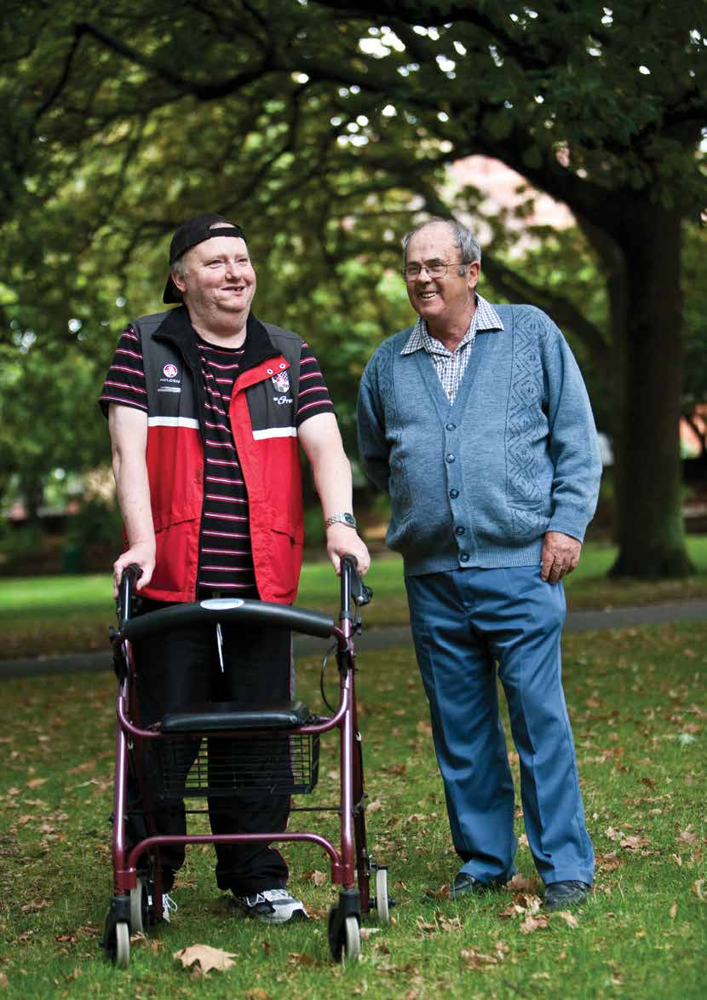

---
## Page 46

46  RediPlan | Section Details
4
STEP    
GET PACKING
Australian Red Cross/Lisa Fitzgerald

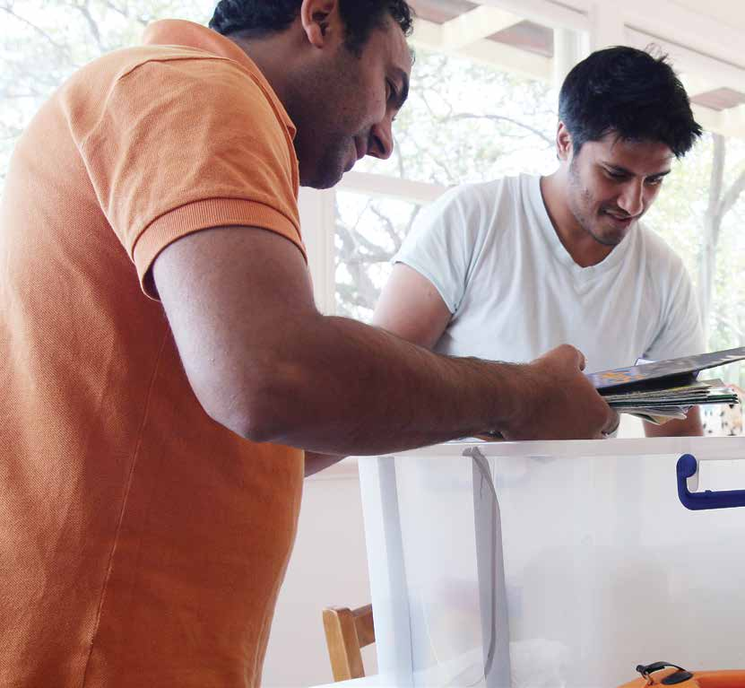

---
## Page 47

47
So, you know your local risks and their 
impacts, you’ve connected more to your 
community, and you’ve begun the process  
of getting organised.  
Now it’s time to get  
really practical.
Packing a kit of items that will help you during and after  
an emergency is an important way to prepare practically  
for an emergency.
ACT
→  Pack a survive and recover kit
→  Store and review your kit.
SHARE
→  Help others to pack a kit
→  Identify items that could 
be shared within your 
community that will help  
you during and after  
an emergency.
→  Understand why you should 
think about your survival and 
recovery when packing a kit
→  Identify items for your kit.
THINK
This section will help you to:

---
## Page 48

48  RediPlan | Step 4 - Get packing
THINK
When thinking about recovery items 
to pack in your kit, think about how 
you will:
•	 identify yourself if your wallet and/or your 
house and its contents are destroyed
•	 access money if banks are closed and ATMs 
are not working
•	 provide details of your insurance cover and 
contents for insurance claims if you don’t 
have access to the original paperwork
•	 occupy/comfort your children if they’re 
unable to return home for extended periods 
due to property damage
•	 care for your pets and animals during an 
emergency and afterwards
•	 prove ownership of your home/car. 
Survival items
Think about the essential things you’d need to get 
through a few days without basic services. In some 
emergencies you might choose or be advised to stay  
at home, while in others you might choose or be told  
to leave.
 
When thinking about survival items to pack in your  
kit, consider:
•	 what things would you take if you needed to leave  
home in a hurry
•	 what would you like to have with you if you had to 
unexpectedly stay somewhere else
•	 what will you need to provide food, water, warmth  
and light if essential services have been cut off?
On page 50 you’ll find suggestions for standard 
survival items. For detailed emergency kit lists and 
recommendations, talk to your local fire services and 
state and territory emergency services agencies.
•	 Survival items — things that will 
help if you have to evacuate your 
home quickly or if you have to 
stay in your home when essential 
services have been cut off
•	 Recovery items — things that  
will help limit the disruption to 
your life after the emergency  
has passed. These will be much  
more personal to your own  
needs and situation.
Think about the practical things you’ll need during and after an 
emergency. There are two types of items you should think about:
Recovery items
Thinking about the days and months after an emergency 
is an important part of putting an emergency kit together. 
There are a number of items that Red Cross recommends 
you include in your kit. There’ll also be many more 
personal items that you might decide to include.

---
## Page 49

49
iStockphoto.com/Barotsz Hadyniak

---
## Page 50

50  RediPlan | Step 4 - Get packing
Get your essentials 
together 
Packing your survive and recover kit can 
be satisfying and fun, especially for the 
kids. So get together with everyone in 
your household or your personal support 
network to make a list of what you’ll need.
Chances are you’ll already have many necessary items in 
the house. If you need to buy anything, remember you 
don’t have to do it all at once. You can stagger it over 
weeks or months—a few items each time you shop.
ACT
Suggested survival items:
Water
NOTE! 
Never drink tap water 
after an emergency 
until authorities have 
advised it is safe. Water 
can be stored for up to 
12 months in airtight 
containers. Label when 
water was last changed.
Food
NOTE! 
Remember the needs 
of everyone in your 
household, including 
babies, children and pets. 
Have at least three days’ 
worth of food (meals, 
drinks and snacks) ready 
in case you need to leave 
home. If staying home, 
you will need food high in 
energy with a long shelf 
life that’s easy to prepare.
Light
NOTE! 
Don’t leave batteries 
in the torch, and check 
them every six months. 
Consider wind-up  
torches that don’t need 
batteries. Red Cross  
sells them online at  
redcross.org.au
Cash
NOTE! 
Many people do not  
carry large sums of cash. 
ATMs and banks may not 
be operating in the early 
stages of any emergency. 
Having some cash will  
help meet basic and 
urgent needs.

---
## Page 51

51
Take your medicine 
Medical needs are an important 
consideration for everyone when 
packing a Survive and Recover Kit. 
Plan to have 14 days’ worth of any 
medications you might need.  
Radio
NOTE! 
Radio is often the best 
source of information  
in an emergency. 
Mark on the dial the 
frequencies of your ABC 
Local Radio and any 
other local radio services. 
Red Cross sells wind-up 
emergency radios online 
at redcross.org.au
Protective 
clothing / 
blankets
NOTE! 
Consider clothes made 
from natural fibres,  
keep seasons in mind, 
and try to pack sturdy 
shoes or boots and 
heavy-duty gloves. 
Remember sunscreen, 
insect repellent, and 
wide-brimmed hats.
Chargers
NOTE! 
Have a charger or 
charged battery pack 
for your phone. Also 
consider, keeping an 
older landline phone 
that is not reliant on 
power—your telephone 
exchange may still 
operate even if the 
power is out.
Most of the things you need will be at a supermarket, 
hardware store or even the $2 shop.  Remember you 
may already have useful items around the home, such 
as camping equipment.
First Aid Kit
NOTE! 
As well as buying a  
Red Cross household  
or car first aid kit, it’s  
also a good idea to do 
first aid training.
Pet essentials
NOTE! 
Factor your pet into 
water needs, and 
make sure your dog or 
cat is registered and 
microchipped.
Toiletries
NOTE! 
Having toiletries can  
help keep you refreshed 
and give you a sense  
of routine—even when 
you are unable to wash 
or shower.
NOTE! 
Consider what 
medications or supplies 
you might need and 
include these, alongside 
a list with their title, 
dosage and copies of 
your prescriptions. 
Special medical  
supplies or equipment

---
## Page 52

52  RediPlan | Step 4 - Get packing
Suggested recovery items:
Scans or 
photocopies 
of important 
documents
NOTE! 
Check functionality regularly, and use 
waterproof or fireproof containers if 
necessary. It’s a good idea to have a  
back-up copy of documents securely 
stored in an alternative place to 
home, perhaps in a locked drawer at 
work, with a family member, or stored 
in the cloud. 
•	 Passports
•	 Wills 
•	 Driver’s licences
•	 Marriage and birth certificates
•	 Land titles
•	 Mortgage papers
•	 Insurance papers
•	 Prescriptions
•	 Medical histories
•	 Child immunisation books. 
Store your scans or copies so that they can be  
grabbed quickly and easily if you have to leave. 
The same care taken with your important documents  
can be applied to your personal videos and photos.
Take photos of any important household items, 
particularly those that are insured. Store the photos  
in a secure place, with copies in your kit, to assist  
with any insurance claims after the emergency.
Map where your valuable items are stored in your  
home in case you have to collect them quickly.
Make sure valuable items are stored 
well above ground level, or use  
waterproof containers.
Consider purchasing a fireproof safe for 
valuables. Keep some sturdy garbage bags  
for putting other items of sentimental value in,  
in case you have time to collect them in  
an emergency. 
Copies of videos and photos
Photographs of valuable 
household items

---
## Page 53

53
Store and review your kit 
As you can see, you’ll need more than a 
simple shoulder bag to hold your survive  
and recover kit. 
You’ll need a sturdy container, preferably waterproof.  
Think about a box with wheels or handles and a 
watertight seal. Alternatively you can use a large sports 
bag or a suitcase with wheels. Arrange your container 
last so you’ll know what size it needs to be. 
Store your survive and recover kit where it’s easy to 
access—close to an escape route in your house, or in 
a shed. Mark your kit clearly, and put some reflective 
tape on it so it can be seen easily in darkness. Make sure 
everyone in your household and personal safety network 
knows where it is.
Set an annual reminder in your phone  
and/or calendar to check your survive  
and recover kit.
Make a note of any perishables and rotate them through 
your bathroom and pantry. Your kit should be updated 
to reflect changes in your life, such as the addition of 
children or pets, changes to relationships, location 
changes, and so on.
Children will need familiar things to 
help comfort them in a stressful and 
uncertain situation. Talk to your kids 
about what’s important to them.  
This is likely to be different to what 
you think is important to them.
Entertainment
Comfort the kids

---
## Page 54

54  RediPlan | Step 4 - Get packing
Remember, a 
conversation is where 
an action begins.
Don’t underestimate the power of talking  
to others about emergencies and what we 
can all do to prepare. 
•	 Talk to your support network about your survive  
and recover kit. Make sure everyone is clear on  
its contents and where it’s stored
•	 Help someone else put together a survive and  
recover kit
•	 There are many items that will assist you after an 
emergency that could be of benefit to others in your 
networks and vice versa. Talk to your network about 
your survive and recover kit, as well as about what 
you might need/have to help you clean up after an 
emergency. For example, a lawnmower or other 
gardening equipment, power tools, etc, will be really 
helpful when preparing or cleaning up property.
SHARE
Have you:
□  Packed a stock of items to help provide 
food, water, warmth and light if essential 
services have been cut off?
□  Packed your valuables (or identified 
a plan to pack them in the case of an 
emergency, including mementos  
and keepsakes)?
□  Scanned all your important documents 
and packed the copies in your survive  
and recover kit and in a second  
safe place?
□  Shown your survive and recover kit  
to your personal support network?
□  Helped others to pack their own  
survive and recover kit?
□  Talked to your local network about 
resources you might be able to share  
in the event of an emergency?
GET PACKING  
CHECKLIST
Sharing resources with others 
will help you immensely after an 
emergency, both in terms of being 
able to undertake any clean up 
work without having to purchase 
new equipment, but also in terms 
of strengthening the bonds and 
capacity within your community.
Share and share alike

---
## Page 55

’S RediPlan.
YOUR RediPlan
MY EMERGENCY INFORMATION
Name of 
household 
member
Medicare  
number
Centrelink  
number
Passport  
number
Tax file  
number
Driver 
Licence  
number
Car  
registration
MY IMPORTANT NUMBERS
Name
Relationship 
Phone
Address
Member of support network
Member of support network
Member of support network
Out-of-town contact #1
Out-of-town contact #2
Other:
redcross.org.au/prepare

---
## Page 56

MY IMPORTANT SERVICES
Company
Account number
Contact details
Electricity
Gas
Water
Internet
Phone
Roadside assistance
Other:
MY ALTERNATIVE PLACE TO STAY IN AN EMERGENCY
Name
Phone
Address
MY LOCAL ABC FREQUENCY:  
MY AGREED MEETING PLACE:
See Step 2 for more information about staying connected during an emergency, including 
identifying an out-of-town contact, an agreed meeting place, and an alternative place to  
stay in an emergency.

---
## Page 57

Consider getting a medical alert system that can easily call for help if you are immobilised in an 
emergency. Most alert systems require a working phone line, so have a back-up plan, such as a 
mobile phone or pager, in case landlines are disrupted. 
MY MEDICAL PLAN
Medical  
support list
Name
Phone
Out of hours 
contact
Address
Doctor
Local hospital 
with 24-hour 
emergency
Chemist
Optometrist
Dentist
Other: 
MEDICAL CONDITIONS
Y
N
Plan to manage condition during and after an emergency 
Heart disease
□□
Diabetes
□□
Asthma
□□
Migraines
□□
Fainting spells
□□
Anxiety
□□
Epilepsy
□□
High blood pressure
□□
Thyroid problems
□□
Dizziness
□□
Other: 
□□

---
## Page 58

Plan to have all the things you’d need with you for a week or two. This includes any 
medications you take regularly or specialised equipment (wheelchair, glasses, hearing aid) and 
supplies (patch kit for a wheelchair tyre or extra batteries). See Step 4 for more information 
about packing a survival and recovery kit.
CURRENT MEDICATIONS
Medical 
condition
Medication
Dosage
Times  
taken
Prescribing doctor 
(include contact 
details)
Location of 
medication  
in the home
Current medications
 
Write down below any medication you are currently taking. 
Remember to attach copies of concession cards, health insurance cards and 
prescriptions to this plan. You may also want to identify where you keep the 
medication in your home in case you have to evacuate quickly or someone 
needs to get it for you.
MEDICAL AIDS
Y
N
Details
Plan to manage equipment in 
the case of an emergency
Do you use any equipment 
to assist you
□□
Style and serial numbers of 
medical devices
Allergies and/or 
sensitivities (food, 
medication etc)
Blood type

---
## Page 59

DISABILITY
Y
How my disability might affect my  
ability to respond to an emergency  
Support plan
Intellectual
□
Learning
□
Speech-related
□
Sensory
□
Physical
□
Neurological
□
Other:
□
See Step 3 for more information about insurance cover.
MY INSURANCE
Insurer
Contact details
Policy number
Home and contents
Health
Car
Life
Income protection
Business
MY WILL
Solicitor/s
Address
Phone
Location of my Will
MY POWER OF ATTORNEY:  
Consider your particular needs and how your support network might best assist you during 
an emergency. If you require help to evacuate, include written instructions and ensure your 
support network is aware of your plan. For example, “I am diabetic. Please take my insulin 
from the regrigerator”, “My service animal may legally remain with me”.

---
## Page 60

MY ANIMAL PLAN
Animal name
Breed
Microchip 
number 
Vet/Kennel 
contact details
Emergency 
safe place
Equipment 
required
Plan 
MY IMPORTANT ITEMS LIST AND PLAN
Item
Location
Plan for protection 
See Step 3 for more information about how to identify and protect important items.
In planning for emergencies you’ll also need to think about your pets and animals and what 
they would need over the course of a week or more, including food, identification, medication, 
transport and accommodation.

---
## Page 61

OTHER  
RECOMMENDED 
REFERENCES
Australian Red Cross/Tim Lofthouse

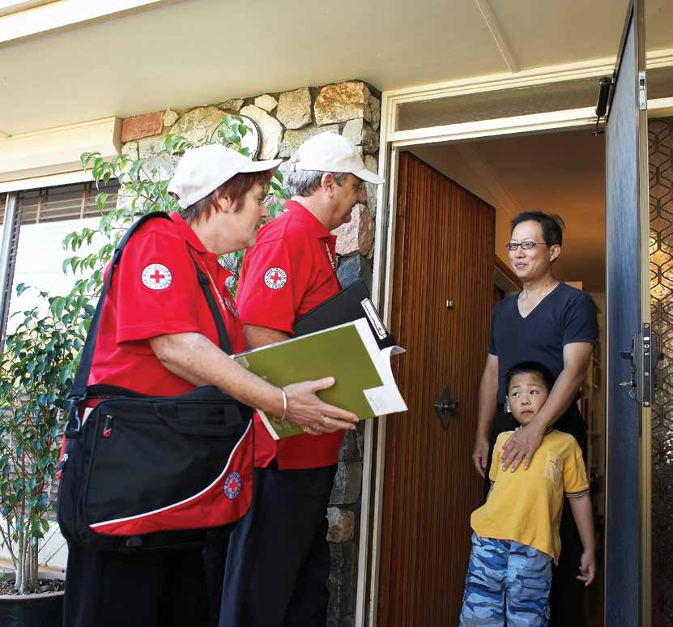

---
## Page 62

62  RediPlan | Resources
Emergency management mobile apps
A number of mobile apps are available to give you 
practical advice and real-time information about 
emergencies, including:
Disaster Watch: news and information about  
disaster events in Australia. 
Disaster Alert: a mobile multi-hazard monitoring 
application with real-time global data.
Fires Near Me: bushfire and fire ban information from 
the fire agencies in the Australian states and territories.
FireReady: the official warnings and information app 
from the Victorian Government.
ReadyQLD/NSW/ACT: information to help  
communities prepare for disasters.
Before the Storm: Let children learn about emergency 
preparedness and resilience in this educational game.
Emergency+: provides emergency services with your 
exact location using you phone’s GPS coordinates.
Emergency App Aus: Find and share your location with 
emergency services and contact essential businesses in 
your area.
Know Risk: Lets you store all your insurance policies  
and keep a record of your valuables online.
For up-to-date information, call the Australian 
Government Emergency Information Line on  
180 2266.
In the case of a major emergency, check the  
Australian GovernmentDisaster Assist website for 
information about Australian Government recovery 
assistance and links to other relevant information.
disasterassist.gov.au
To understand how the Australian Government is  
working to plan and respond to emergencies, visit  
the Emergency Management Australia website,
ag.gov.au/EmergencyManagement
Information from the Australian Government
Resources include information for seniors,  
materials for parents and teachers to assist  
children prepare and recover and advice on  
how to cope in the aftermath of a disaster.
redcross.org.au/emergency-services.aspx
Red Cross also has After the Emergency, a  
website dedicated to young people affected by 
emergencies that gives you a wealth of information  
and the opportunity to share your own stories.
aftertheemergency.redcross.org.au
PrepareCenter.org is the website of the Red Cross Red 
Crescent Global Disaster Preparedness Center. It offers 
knowledge and resources on preparedness programs, 
tools and experiences for communities  across the globe.
preparecenter.org
Red Cross has a range of emergency preparedness 
products including wind up torch radios and first aid kits. 
To purchase, visit shop.redcross.org.au
Red Cross preparedness resources
Red Cross has a suite of further preparedness and recovery 
resources that can help you better prepare for an emergency, 
understand what you may experience when recovering from  
an emergency and what you can do to help yourself through  
this difficult time.

---
## Page 63

63
Warnings and weather conditions
Visit the Bureau of Meteorology’s website to learn about emergency warnings for 
extreme weather conditions like floods, cyclones and tsunamis and to familiarise yourself 
with local warnings in the state/territory section relevant to you. You can also listen to 
the Standard Emergency Warning Signal (SEWS), a distinctive sound used by emergency 
services to alert the community when an urgent safety message is about to be played on 
radio, television, public address systems or mobile sirens. 
bom.gov.au
Local radio
Find your local ABC frequency for the latest emergency information. 
abc.net.au
Getting to know neighbours
Neighbour Day is an annual celebration of community promoted by Relationships 
Australia. Visit their website to find out how you can get involved or ask your local  
council if they have programs to help neighbours get to know each other.
neighbourday.org
Insurance
The Insurance Council of Australia has a guide to help you choose household insurance.
insurancecouncil.com.au
KnowRisk is a community education program designed by the Australian and New Zealand 
Institute of Insurance and Finance (ANZIIF) to improve our understanding of insurance and 
how it relates to managing the many risks we all face in life.
knowrisk.com.au
Financial
The Australian Government has a website to assist with information on a whole range  
of financial matters including preparing a household budget.
moneysmart.gov.au
For more information about financial planning, contact a Centrelink Financial Information 
Officer on 13 2300.
Business preparedness
The Australian Government’s business planning website has a number of emergency 
management and recovery plan templates to download.
business.gov.au
Check the websites of your state or territory emergency services and fire authorities  
as many of these also include information and tools to help businesses prepare.

---
## Page 64

64  RediPlan | Resources
Psychological preparedness 
Visit the Australian Psychological Society website to  
learn more about psychological preparedness. 
psychology.org.au
Telephone support
There are a range of telephone support services  
that help with a range of issues people may face:
Lifeline: 13 11 14
Mensline Australia: 1300 78 99 78
Suicide Call Back Service: 1300 659 467
Kids Helpline: 1800 55 1800
Relationships Australia: 1300 364 277 
Carers Australia: 1800 242 636 
SANE Australia: 1800 18 7263
National Sexual Assault, Domestic and Family Violence 
Counselling Service for people living in Australia:  
1800 RESPECT
Coping with trauma stress
Phoenix Australia – Centre for Posttraumatic Mental 
Health provides information on coping with trauma, 
including factsheets and advice for adults, children  
and parents on taking care of yourself after a disaster.
acpmh.unimelb.edu.au
The Australian Child and Adolescent Trauma, Loss  
and Grief Network provides information, tips and  
links to other organisations for everyone involved in  
the care of children or youth who have experienced 
trauma, loss and grief.
earlytraumagrief.anu.edu.au
Coping with depression and anxiety
Beyondblue: the national depression initiative  
provides information about depression, anxiety  
and related disorders and where to get help.  
youthbeyondblue.com is beyondblue’s website  
for young people with information on depression,  
anxiety and other problems young people may 
experience growing up: 1300 22 4636
beyondblue.org.au and youthbeyondblue.com
The Black Dog Institute provides a range of fact sheets  
on coping with depression and bipolar disorders. 
blackdoginstitute.org.au
Support for young people 
ReachOut.com provides 24 hour support for  
young people facing a range of challenges. 
reachout.com
Headspace provides mental health and wellbeing 
support, information and services for young
headspace.org.au people and their families.
Support for relationships 
Relationships Australia is a leading provider of 
relationship support services for individuals,  
families and communities.
relationships.org.au
Coping with grief and bereavement
The Australian Centre for Grief and Bereavement 
provides bereavement counselling and support 
programs, information, and referral assistance to 
members of the general public: 1800 642 066
Bereavement Information and Referral Service
1300 664 786
grief.org.au
The Compassionate Friends provides a 24-hour 
telephone information, referral and service for
parents who have lost a child, or people who have  
lost a brother or sister: 1800 641 091
compassionatefriendsvictoria.org.au
GriefLink is an information portal on death-related  
grief for the community and professionals.
grieflink.asn.au
The Sue Evans Fund for Families developed two  
guides on Surviving Traumatic Grief, documenting  
the experiences of those who had lost loved ones  
in the Black Saturday Bushfires in Victoria.
sueevans.com.au
Psychological resources and support services

---
## Page 65

Australian Red Cross/Marlon Dalton

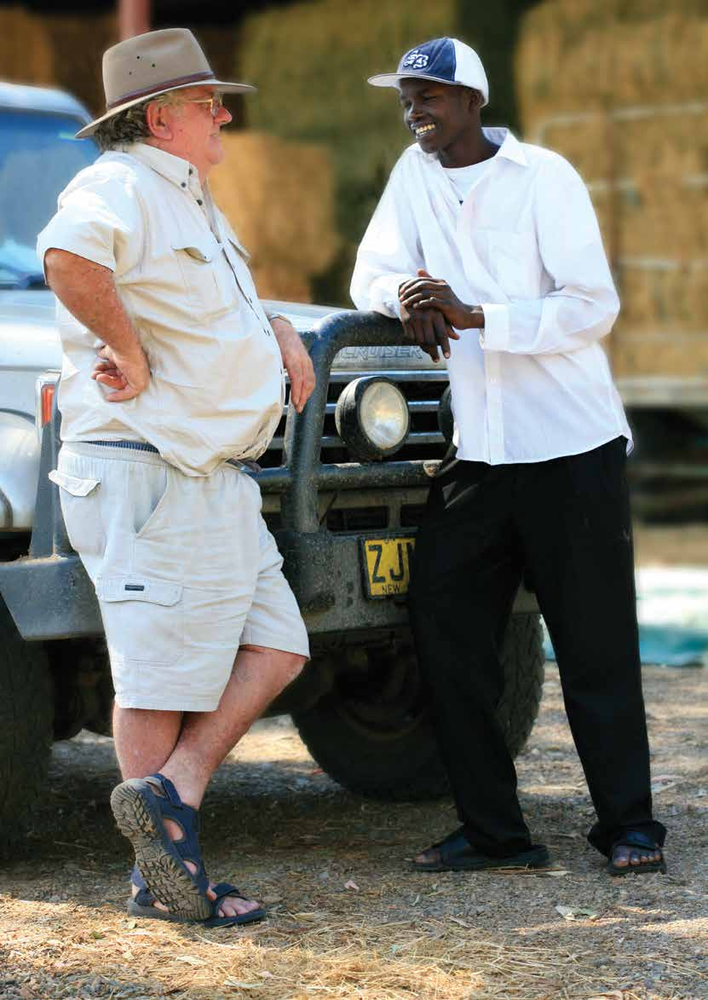

---
## Page 66

66  RediPlan | Preparing Your Mind
This worksheet helps you to identify  
your anticipated stressors, the feelings  
and thoughts they may provoke, and 
prompt you to think about how you  
can invest in your wellbeing.
PreparE  
your mind
WORKSHEET
Anticipate:  
My stress triggers: e.g. tiredness,  
being pulled in too many directions.
* Aspirational. 
Identify:
How I know I am experiencing  
negative stress:
MY PLAN TO COUNTER NEGATIVE STRESS AND INVEST IN MY WELLBEING:
In an ideal day* I will:
Connect
Be active
Take notice
Keep learning
Give

---
## Page 67

67
Manage: 
These five actions are identified as helping  you feel good and function well: connect, be 
active, take notice, keep learning, and give.1 Invest in your wellbeing by incorporating these 
actions into your day to day life: 
My rule for when I will seek further help  
e.g three consecutive nights of disrupted sleep.
1 New Economics Foundation (2008): Five Ways to Wellbeing  
neweconomics.org

---
## Page 68

Australian Red Cross/Michael Torres

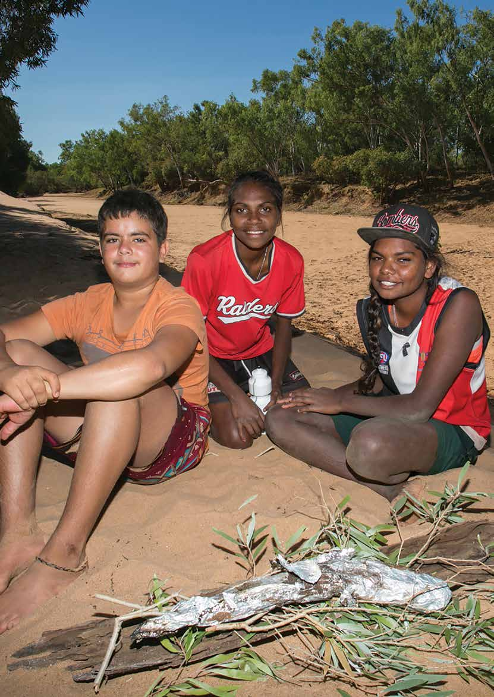

---
## Page 69

MY IMPORTANT 
NUMBERS
EMERGENCIES
Police Fire Ambulance
 000
SES
132 500
Poisons Info Line
13 11 26
Lifeline
13 11 14
BeyondBlue
1300 22 46 36
MY IMPORTANT CONTACTS
Doctor
Home Care Agency
Dentist
Local Radio Frequencies 
ABC
Vet
Local Radio Frequencies 
Other
Solicitor
Out-of-Town Contact
Council
Power of Attorney
Gas
Insurer
Telco
Bank
Power
Roadside Assistance
Water
redcross.org.au/prepare

---
## Page 70

MY HOUSEHOLD NUMBERS
Name
Work
School
Mobile
MY NEIGHBOURS / PERSONAL CARE NETWORK NUMBERS
Name
Work
Mobile
Tip:  
Store these numbers in your phone and take a picture of the card so you will have all your 
important details available in one place. You may also want to send a copy to friends or  
relatives to have on file in case of an emergency.
MY IMPORTANT 
NUMBERS
OTHER IMPORTANT NUMBERS
Name
Work
Mobile

---
## Page 71

CONNECTING TO  
THE SOCIAL GRID
Tear out these handy postcards and leave in your neighbour’s letterbox.
Besides being fulfilling in many other ways, 
being a part of a community will help you 
in an emergency.
redcross.org.au/prepare
Besides being fulfilling in many other ways, 
being a part of a community will help you 
in an emergency.
redcross.org.au/prepare

---
## Page 72

CONNECTING TO  
THE SOCIAL GRID
Need more? Download a PDF and print your own from: redcross.org.au/prepare
Did you know it’s most likely to be your neighbour  
or a passer-by, not emergency services, who will help 
you survive during an emergency? Neighbours can 
also provide practical and emotional support after an 
emergency, as well as important information about 
recovery services. 
Hello! My name is:
I live :
□ Next door 
□ Over the road at
□ Up the street at
My/our details are:
Name
Phone
Email
We are also good for: 
□ Putting out the bins  
□ Collecting mail 
□ Watering the garden  
□ Feeding pets  
□ Cup of sugar
Did you know it’s most likely to be your neighbour  
or a passer-by, not emergency services, who will help 
you survive during an emergency? Neighbours can 
also provide practical and emotional support after an 
emergency, as well as important information about 
recovery services. 
Hello! My name is:
I live :
□ Next door 
□ Over the road at
□ Up the street at
My/our details are:
Name
Phone
Email
We are also good for: 
□ Putting out the bins  
□ Collecting mail 
□ Watering the garden  
□ Feeding pets  
□ Cup of sugar

---
## Page 73

REd cross
Emergency
RediPlan
Your Emergency RediPlan has been proudly supported by 
Land Rover, Medibank Private and the First National Foundation. 
Red Cross has been helping people  
prepare for, cope with and recover  
from emergencies since 1914.   
Emergency RediPlan is an award winning 
and internationally recognised disaster 
preparedness guide, designed to assist 
individuals and households create their 
own personalised emergency plan and 
prepare themselves for the longer-term 
psychosocial impacts of an emergency. 
 
Red Cross supports people to be better prepared, 
better connected and more resilient to the psychosocial 
impacts of emergencies. We recognise that the 
impacts of emergencies extend beyond the physical, to 
people’s psychological and social wellbeing. In all of our 
preparedness activities, Red Cross takes a non-hazard 
specific approach, meaning that we help individuals and 
communities to prepare for any type of emergency —
natural or man-made, big or small. Our work has been 
designed to complement the work of other emergency 
services agencies, such as fire and rescue. 
 
To learn more about preparing for an emergency or  
to complete an online version of RediPlan visit  
redcross.org.au/prepare

---
## Page 74

ACT 
3 Dann Cl
Garran ACT 2605
T +61 2 6234 7600
NSW
St Andrews House
Level 4, 464 Kent St
Sydney NSW 2000
T 1800 812 028 (free call)
NT
Level 1, 13 CASCOM Centre
Scaturchio Street
Casuarina NT 0810
T +61 8 8924 3900
QLD
49 Park Rd
Milton QLD 4064
T +61 7 3367 7222
November 2016
SA
212 Pirie St
Adelaide SA 5000
T +61 8 8100 4500
TAS
40 Melville St
Hobart TAS 7000
T +61 3 6235 6077
VIC
23-47 Villiers St
North Melbourne VIC 3051
T 1800 810 710 (free call)
WA
110 Goderich St
East Perth WA 6004
T +61 8 9225 8888
National Office 
155 Pelham St
Carlton VIC 3053
T +61 3 9345 1800
Supporter Services Centre 
GPO Box 2957
Melbourne VIC 8060
T 1800 811 700 (free call)
F 1800 855 240
E donorinfo@redcross.org.au
How can I become a supporter? 
Red Cross relies on committed volunteers, 
members and donors. 
You can support Red Cross by:
1.	 giving monthly, leaving a bequest in your will or making  
a one-off donation to Disaster Relief and Recovery
2.	 visiting your local Red Cross store
3.	 donating blood
redcross.org.au or call 1800 811 700
facebook.com/AustralianRedCross
@redcrossau
youtube.com/AustralianRedCross
linkedin.com/company/australian-red-cross
redcross.org.au

