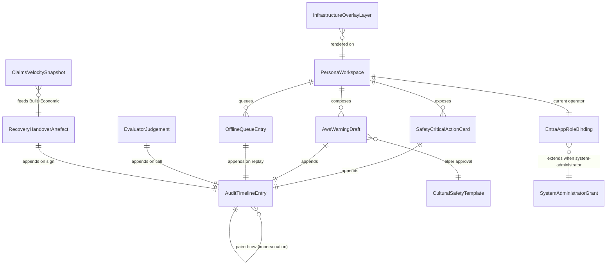

# Phase 1 Data Model — Web Application Capstone Closure (spec-035)

**Spec**: [`specs/035-webapp-capstone-closure/spec.md`](./spec.md)
**Plan**: [`specs/035-webapp-capstone-closure/plan.md`](./plan.md)
**Research**: [`specs/035-webapp-capstone-closure/research.md`](./research.md)
**Date**: 2026-05-05

This document derives entities, fields, validation rules, and state transitions from [`spec.md` § Key Entities](./spec.md#key-entities-include-if-feature-involves-data) and the 10 clarifications. Field types are written in TypeScript-flavoured shorthand; the canonical contracts live in [`contracts/`](./contracts/) and [`packages/schemas/`](../../packages/schemas/).

---

## 1. PersonaWorkspace

**Surface**: web only (no backing storage row beyond persona registry).

| Field | Type | Source | Notes |
|---|---|---|---|
| `personaId` | `string` (one of 68) | persona registry | Resolved from URL path param |
| `personaName` | `string` | persona registry | |
| `aiimsFunction` | `enum` | persona registry | One of 10 AIIMS functions ([Clarifications Q1](./spec.md#clarifications)) |
| `panels` | `PersonaPanel[]` | spec-034 depth-profile YAML | Persona-specific safety-critical workflow cards |
| `language` | `enum` | request session | `en` ‖ community-language code |
| `offlineMode` | `boolean` | client SW state | Drives the degraded-mode banner |

**Relationships**: 1:N → `SafetyCriticalActionCard`, 1:1 → `EntraAppRoleBinding` (current operator).

**Validation**: `personaId` MUST resolve in the existing 68-persona registry ([OOS-001](./spec.md#out-of-scope)).

---

## 2. SafetyCriticalActionCard

Operator-facing card capturing the IC approval gate ([FR-001](./spec.md#functional-requirements)).

| Field | Type | Notes |
|---|---|---|
| `cardId` | `string` (uuid) | |
| `personaId` | `string` | Owning persona |
| `transition` | `enum` | `approve` ‖ `decline` ‖ `allocate` ‖ `publish` |
| `rationale` | `string` (max 2 000 chars) | Required (FR-001) |
| `sourceRefs` | `string[]` | URI list to evidence |
| `confidence` | `decimal` (0.0–1.0) | Required (FR-001) |
| `approverIdentity` | `string` (Entra OID) | Resolved from `entra_auth` middleware |
| `correlationId` | `string` (uuid) | Joins to `AuditTimelineEntry` |
| `createdAt` | `timestamp` | |

**Validation**: All fields required; the API returns `422 schema_invalid` (per [Clarifications Q10](./spec.md#clarifications) error envelope) if any field is null/empty.

**State**: append-only — once submitted, the card is immutable.

---

## 3. AwsWarningDraft

Pre-publish AWS-compliant warning ([FR-002](./spec.md#functional-requirements)).

| Field | Type | Notes |
|---|---|---|
| `draftId` | `string` (uuid) | |
| `personaId` | `string` | Public-Information-Officer persona |
| `awsLevel` | `enum` | `advice` ‖ `watch_and_act` ‖ `emergency_warning` |
| `hazardType` | `string` | |
| `location` | `GeoFeature` | |
| `actionStatement` | `string` | |
| `nestedModelFields` | `Record<string, string>` | AWS-compliant nested model |
| `languageVariants` | `LanguageVariant[]` | At least one community-language variant when persona's jurisdiction has one |
| `culturalSafetyState` | `enum` | `pending_elder` ‖ `approved` ‖ `declined` ‖ `timeout_lifesafety_override` ‖ `timeout_blocked` |
| `culturalSafetyConfirmer` | `string?` | IC OID if `timeout_lifesafety_override` |
| `approvalState` | `enum` | `draft` ‖ `pending_ic` ‖ `approved` ‖ `published` ‖ `withdrawn` |
| `correlationId` | `string` | |

**State transitions**: `draft → pending_ic → approved → published`. From `pending_ic` the IC may transition to `withdrawn`. `culturalSafetyState` transitions per [R-010](./research.md#r-010--cultural-safety-subsystem) and [Clarifications Q5](./spec.md#clarifications).

**Validation**:

- `awsLevel = emergency_warning` AND `culturalSafetyState = pending_elder` for > 90 s permits IC override (timeout_lifesafety_override) only with `culturalSafetyConfirmer` set.
- `awsLevel ∈ {advice, watch_and_act}` blocks publish until `culturalSafetyState ∈ {approved, timeout_blocked}` resolved (where `timeout_blocked` means held).

---

## 4. AuditTimelineEntry

Append-only audit row ([FR-003](./spec.md#functional-requirements), [FR-013](./spec.md#functional-requirements), [Constitution NN-2](../../.specify/memory/constitution.md)).

| Field | Type | Notes |
|---|---|---|
| `auditId` | `string` (uuid) | Cosmos `id` |
| `correlationId` | `string` (uuid) | Cosmos partition key |
| `timestamp` | `timestamp` | Server-side, monotonic |
| `outcome` | `enum` | See **Outcome enum** below |
| `personaId` | `string` (target persona; `*` for system-administrator direct actions) | |
| `appRole` | `enum` | One of 11 from [Clarifications Q1](./spec.md#clarifications) |
| `operatorIdentity` | `string` (Entra OID) | |
| `impersonatedPersonaId` | `string?` | Set when `X-Impersonate-Persona` was present (Q9); `null` otherwise |
| `impersonatedBy` | `string?` (Entra OID) | Set on the *paired* normal-outcome row when admin override was in flight |
| `route` | `string` | API route (or web route emitting the audit) |
| `scId` | `string?` | E.g., `sc-001`..`sc-011` when applicable |
| `requestHash` | `string` (sha-256) | Of canonicalised payload |
| `responseHash` | `string?` (sha-256) | Of response body where present |
| `extensionEnvelope` | `Object?` | The Q10 error envelope when `outcome ∈ error states` |
| `classifierLayer` | `enum?` | `1`..`5` per ADR-033, set on classifier_* outcomes |
| `contentClass` | `enum?` | `pspf` ‖ `pii` ‖ `pspf+pii` ‖ `clean` |
| `maskedFieldCount` | `integer?` | Set on `classifier_mask` |
| `tier` | `enum?` | `life_safety` ‖ `routine` for offline-replay outcomes |
| `displaced` | `boolean?` | Set on offline overflow outcomes |

**Outcome enum** (closed set):

```text
approved | denied | published | allocate
admin_override
classifier_deny | classifier_mask | classifier_failed
queue_overflow | queue_displaced
activation_mutex_violation
rate_limited
auth_unauthorized | auth_forbidden | sovereignty_denied
schema_invalid | seed_not_ready | evaluator_not_routable
cultural_safety_timeout_override | cultural_safety_held
```

**Append-only invariant**: backed by Cosmos DB container with `accessPolicies = read+append`; see [ASM-009](./spec.md#assumptions). UI MUST NOT expose any update/delete affordance.

**Paired-row rule** (Q9): when `X-Impersonate-Persona` is present, the API MUST emit two rows in a single `TransactionalBatch` keyed by `correlationId`:

1. `outcome=admin_override`, `personaId=*`, `impersonatedPersonaId=<target>`, `operatorIdentity=<admin>`
2. The normal-outcome row, `personaId=<target>`, `impersonatedBy=<admin>`

Direct admin actions (no header) MUST emit a single `outcome=admin_override` row with `impersonatedPersonaId=null`.

---

## 5. EvaluatorJudgement

Response of `POST /api/outcomes/sc-{001..005|006|007|008|009|010|011}/evaluate` ([FR-009](./spec.md#functional-requirements)). **Spec-034 contract preserved verbatim** ([OOS-006](./spec.md#out-of-scope)).

| Field | Type | Notes |
|---|---|---|
| `status` | `enum` | `pass` ‖ `fail` ‖ `inconclusive` |
| `evidenceRefs` | `string[]` | Audit-id list |
| `metricValue` | `number?` | |
| `threshold` | `number?` | |
| `auditId` | `string` | The row this evaluation appended |

The Q10 extension envelope is applied **only on error responses**; success body is untouched.

---

## 6. EntraAppRoleBinding

Mapping between an Entra ID AppRole, AIIMS function, and `persona_id` scoping claim ([FR-011](./spec.md#functional-requirements), [Clarifications Q1](./spec.md#clarifications)).

| Field | Type | Notes |
|---|---|---|
| `appRole` | `enum` | `incident-commander` ‖ `operations-officer` ‖ `logistics-officer` ‖ `planning-officer` ‖ `public-information-officer` ‖ `field-coordinator` ‖ `observer-auditor` ‖ `risk-manager` ‖ `resilience-planner` ‖ `executive-leader` ‖ `system-administrator` |
| `aiimsFunction` | `enum?` | `null` for `system-administrator` |
| `allowedPersonaIds` | `string[]` ‖ `["*"]` | `["*"]` only for `system-administrator` |
| `allowedRoutes` | `string[]` ‖ `["*"]` | RBAC matrix |

**Invariant**: the inventory is fixed at 11 roles; PR adding a 12th is blocked by ASM-001 / [Clarifications Q1](./spec.md#clarifications).

---

## 7. SystemAdministratorGrant

Administrative grant carried by the `system-administrator` AppRole ([Clarifications Q9](./spec.md#clarifications)).

| Field | Type | Notes |
|---|---|---|
| `principalOid` | `string` | Entra OID |
| `grantedAt` | `timestamp` | |
| `grantedBy` | `string` | Approver OID |
| `reviewBy` | `timestamp` | 90-day review window per [SC-011](./spec.md#measurable-outcomes) parallel pattern |

**Invariants**:

- Impersonation is **per-request via `X-Impersonate-Persona`**; sticky sessions are forbidden.
- PSPF/PII gateway controls (FR-027) NEVER bypassed by admin role.

---

## 8. OfflineQueueEntry

Service-Worker-captured queued action ([FR-006](./spec.md#functional-requirements), [Clarifications Q4 + Q7](./spec.md#clarifications)).

| Field | Type | Notes |
|---|---|---|
| `clientCorrelationId` | `string` (uuid) | Unique per logical attempt |
| `personaId` | `string` | |
| `capturedTs` | `timestamp` | Original client-side timestamp; preserved on replay (SC-007) |
| `operatorIdentity` | `string` | |
| `route` | `string` | |
| `payloadHash` | `string` (sha-256) | |
| `payloadCipher` | `bytes` | Encrypted at rest in IndexedDB (subtle-crypto) |
| `queuePosition` | `integer` | |
| `tier` | `enum` | `life_safety` ‖ `routine` |
| `replayStatus` | `enum` | `queued` ‖ `replaying` ‖ `replayed` ‖ `displaced` ‖ `overflowed` |
| `displaced` | `boolean` | True if displaced by life-safety insertion |

**Cap**: 500 entries per `personaId`. **Insertion rules** (Q7):

1. If queue size < 500 → append.
2. Else if incoming entry is `life_safety` AND queue contains routine entries → displace **oldest routine** (mark `replayStatus=displaced`, `displaced=true`); append. UI surfaces ≥ 80% utilisation warning.
3. Else (queue full and incoming is routine, OR queue full of life-safety) → reject; UI surfaces overflow; on next reconnect a synthetic `outcome: queue_overflow` audit row is appended.

**Replay rules** (Q7): on reconnect, drain `life_safety` first (single batch ≤ 50), then `routine` in 50-entry batches; tiered SLOs per [SC-007](./spec.md#measurable-outcomes); idempotent dedupe by `(personaId, clientCorrelationId)`.

---

## 9. CulturalSafetyTemplate

Jurisdiction-aware messaging template ([FR-016](./spec.md#functional-requirements), [Clarifications Q5](./spec.md#clarifications)).

| Field | Type | Notes |
|---|---|---|
| `templateId` | `string` | |
| `jurisdiction` | `enum` | `nt` ‖ `wa` ‖ `tas` ‖ `sa` ‖ … |
| `languagePack` | `string` | Kimberley/Pilbara, palawa, Yolŋu Matha, Pitjantjatjara, Warlpiri, … |
| `elderRoutingTarget` | `string` | Service Bus queue or principal OID |
| `timeoutSeconds` | `integer` | 90 (default, App Configuration override) |
| `awsLevelOutcomePolicy` | `Record<AwsLevel, TimeoutOutcome>` | See below |
| `fallbackChain` | `string[]` | E.g., `["en", "yolngu_matha", "en"]` |

**AWS-level-conditional outcome policy** (Q5):

```json
{
  "emergency_warning": "approved | timeout_lifesafety_override | declined",
  "watch_and_act":     "approved | timeout_blocked | declined",
  "advice":            "approved | timeout_blocked | declined"
}
```

`timeout_lifesafety_override` requires an IC `culturalSafetyConfirmer`.

---

## 10. RecoveryHandoverArtefact

Digitally signed PDF emitted by the Resilience-Planner composer ([FR-007](./spec.md#functional-requirements), [Clarifications Q2](./spec.md#clarifications)).

| Field | Type | Notes |
|---|---|---|
| `artefactId` | `string` | |
| `artefactHash` | `string` (sha-256) | |
| `signingIdentity` | `string` | Managed-identity OID + cert thumbprint |
| `blobUri` | `string` | Immutable Blob container |
| `gapAnalysis` | `string` (markdown) | |
| `frameworkModelling` | `Object` | Gap → framework mapping |
| `lessonsIntegration` | `string` | |
| `baselineLoss` | `decimal` | AUD |
| `projectedLoss` | `decimal` | AUD |
| `sendaiRatio` | `decimal` | `(baselineLoss − projectedLoss) / baselineLoss`; ≥ 0.30 ([SC-008](./spec.md#measurable-outcomes)) |
| `correlationId` | `string` | |

**Out of scope**: machine-ingestible JSON/sidecars per [OOS-011](./spec.md#out-of-scope).

---

## 11. InfrastructureOverlayLayer

Iron-ore / maritime / federal-precinct overlay rendered on the COP ([FR-017](./spec.md#functional-requirements), [FR-018](./spec.md#functional-requirements)).

| Field | Type | Notes |
|---|---|---|
| `layerId` | `string` | |
| `layerType` | `enum` | `iron_ore_haul_road` ‖ `port_critical` ‖ `island_logistics` ‖ `federal_precinct` |
| `featureCollection` | `GeoJSON.FeatureCollection` | |
| `priorityClass` | `enum` | `lifeline` ‖ `economic` ‖ `cultural` |

---

## 12. ClaimsVelocitySnapshot

ICA liaison data informing recovery-funding handoff ([FR-022](./spec.md#functional-requirements)).

| Field | Type | Notes |
|---|---|---|
| `snapshotId` | `string` | |
| `eventId` | `string` | |
| `claimsLodged` | `integer` | |
| `claimsClosed` | `integer` | |
| `dollarsLodged` | `decimal` | AUD |
| `dollarsPaid` | `decimal` | AUD |
| `lgaBreakdown` | `Record<string, ClaimsRow>` | LGA → row |
| `capturedAt` | `timestamp` | |

---

## Relationships diagram (Mermaid)



---

## Validation summary

| Rule | Source |
|---|---|
| `correlationId` is the primary join key across all entities | [FR-013](./spec.md#functional-requirements) |
| Audit append is < 2 s p95 | [SC-009](./spec.md#measurable-outcomes) |
| 500-entry offline cap with tiered displacement | [Clarifications Q7](./spec.md#clarifications) |
| Paired-row impersonation in single transaction | [Clarifications Q9](./spec.md#clarifications) |
| PSPF→deny / PII→mask / fail→deny gateway | [Clarifications Q6](./spec.md#clarifications) |
| Sendai ratio ≥ 0.30 | [SC-008](./spec.md#measurable-outcomes) |
| 11-role inventory only | [Clarifications Q1](./spec.md#clarifications) |
| Signed-PDF only (no JSON sidecar) | [Clarifications Q2](./spec.md#clarifications) / [OOS-011](./spec.md#out-of-scope) |
| Cultural-safety AWS-level-conditional outcomes | [Clarifications Q5](./spec.md#clarifications) |
| Activation mutex violations append before exit | [Clarifications Q8](./spec.md#clarifications) |
| Q10 extension envelope error-only | [Clarifications Q10](./spec.md#clarifications) |
