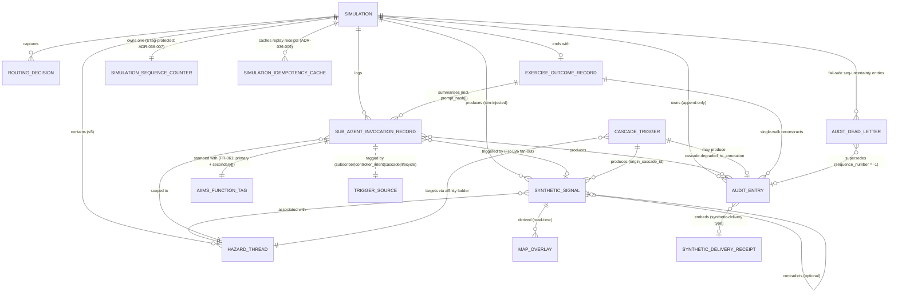

# Data Model: Real Sub-Agent Invocation & Simulation Telemetry-Injection Agent

**Spec**: [`spec.md`](./spec.md) · **Plan**: [`plan.md`](./plan.md) · **Research**: [`research.md`](./research.md) · **Date**: 2026-05-08

This document concretises the **6 Key Entities** from the spec into Cosmos DB containers, Pydantic v2 models (`packages/domain/src/domain/models/`), and JSON Schemas (`packages/schemas/`). It also records partition keys, consistency levels, append-only constraints, and how each entity relates to the existing schemas already in the repo (e.g. `signal-envelope.schema.json`).

---

## 1. Cosmos DB Containers

| Container | Partition key | Consistency | TTL | Append-only | RU/s | Existing or NEW |
|---|---|---|---|---|---|---|
| `simulation_synthetic_signals` | `/simulation_id` | **Session** (escalated from account `Consistent-Prefix` via ADR-036-001) | 72 h | No (replace allowed for `stale` flag updates) | Autoscale 400–4000 | **NEW** |
| `sub_agent_invocation_records` | `/simulation_id` | **Strong** (no escalation needed for single-region; account default applies) | None | **YES** — RBAC excludes `delete`/`replace` for the API Managed Identity (write-only via change-feed) | Autoscale 400–4000 | **NEW** |
| `simulation_threads` | `/simulation_id` (one document per sim) | Account default (Consistent-Prefix) — ETag concurrency provides the atomic guarantee | None | No (document is mutated under ETag concurrency) | Fixed 400 RU/s | **NEW** |
| `exercise_outcome_index` | `/simulation_id` | Account default | None | No (replace allowed on `generation_seq` increment) | Fixed 400 RU/s | **NEW** |
| `simulation_audit_entries` | `/simulation_id` (existing — extends spec 024) | Account default | None | **YES** — RBAC enforces no-delete/no-replace; monotonic `sequence_number` per `simulation_id` for gap detection | Autoscale shared with existing | **EXISTING** (extended) |
| `routing_decisions` | `/simulation_id` | Account default | 30 d | No | Fixed 400 RU/s | **NEW** (split out from audit for queryability) |

**Append-only enforcement model**: For `sub_agent_invocation_records` and `simulation_audit_entries`, the API Container App's Managed Identity is granted `Cosmos DB Data Contributor` *only on writes*; a custom Cosmos role definition denies `replace` and `delete` operations on these containers. The change feed produces an immutable Blob archive (existing spec-024 pattern). Gap-free guarantee: each write includes a monotonic `sequence_number = max(prior) + 1` per `simulation_id`, asserted by a server-side trigger or by reading the prior max + ETag-conditioning the new write.

---

## 2. The 6 Key Entities

### 2.1 — Synthetic Signal

**Pydantic model**: `packages/domain/src/domain/models/synthetic_signal.py` — extends the existing live-tenant `SignalEnvelope` with a required `simulation` provenance block.

**Cosmos container**: `simulation_synthetic_signals`.

**JSON Schema**: extends [`packages/schemas/signal-envelope.schema.json`](../../packages/schemas/signal-envelope.schema.json) with the `simulation` block below.

**Lifecycle**: `injected` → `published-to-pipeline` → `consumed-by-subscribed-sub-agents` → `flagged-stale` (computed at read time per category freshness window).

**Required fields** (provenance block; rejected at ingest if any is missing):

```json
{
  "$schema": "https://json-schema.org/draft/2020-12/schema",
  "$id": "https://platform/schemas/signal-envelope-simulation.schema.json",
  "type": "object",
  "title": "SignalEnvelope simulation extension (FR-009)",
  "description": "Extension applied when source = sim-injected. The base SignalEnvelope schema (signal-envelope.schema.json) is unchanged for live signals.",
  "properties": {
    "simulation": {
      "type": "object",
      "required": ["source", "simulation_id", "injecting_user_id", "timestamp", "confidence", "injection_correlation_id"],
      "additionalProperties": false,
      "properties": {
        "source": {"const": "sim-injected"},
        "simulation_id": {"type": "string", "format": "uuid"},
        "injecting_user_id": {"type": "string", "description": "Entra ID object ID of the SimulationCoordinator user"},
        "timestamp": {"type": "string", "format": "date-time", "description": "Wall-clock UTC; the moment the signal landed on the pipeline"},
        "confidence": {"type": "string", "enum": ["high", "medium", "low"]},
        "injection_correlation_id": {"type": "string", "format": "uuid", "description": "Shared across all signals derived from the same chat turn"},
        "contradicts": {"type": "string", "format": "uuid", "description": "Optional — prior_signal_id this signal contradicts within freshness window"},
        "stale": {"type": "boolean", "description": "Computed at read time from category freshness window; not stored"},
        "origin_cascade_id": {"type": "string", "format": "uuid", "description": "Optional — set on cascade-derived signals; non-transitive (per A12)"},
        "category": {"type": "string", "enum": ["weather","fire-behaviour","hydrology","geohazard","utility","transport","evacuation","resource","comms-channel-state"]},
        "category_life_safety": {"type": "boolean", "description": "Single source of truth — true for weather/fire-behaviour/hydrology/geohazard/evacuation; false for utility/transport/comms-channel-state/resource. Drives FR-010 hybrid gate."},
        "gps": {
          "type": "object",
          "properties": {
            "lat": {"type": "number", "minimum": -90, "maximum": 90},
            "lng": {"type": "number", "minimum": -180, "maximum": 180}
          },
          "required": ["lat", "lng"]
        },
        "parameters": {
          "type": "object",
          "description": "Category-specific typed parameters (wind speed, river height, TC category, outage zone, etc.)",
          "additionalProperties": true
        }
      }
    }
  }
}
```

**Pydantic v2 validation** (sketch):

```python
# packages/domain/src/domain/models/synthetic_signal.py
from datetime import datetime
from enum import Enum
from typing import Literal
from pydantic import BaseModel, Field, model_validator
from uuid import UUID

class SignalCategory(str, Enum):
    weather = "weather"
    fire_behaviour = "fire-behaviour"
    hydrology = "hydrology"
    geohazard = "geohazard"
    utility = "utility"
    transport = "transport"
    evacuation = "evacuation"
    resource = "resource"
    comms_channel_state = "comms-channel-state"

LIFE_SAFETY_CATEGORIES: frozenset[SignalCategory] = frozenset({
    SignalCategory.weather,
    SignalCategory.fire_behaviour,
    SignalCategory.hydrology,
    SignalCategory.geohazard,
    SignalCategory.evacuation,
})

class GPS(BaseModel):
    lat: float = Field(ge=-90, le=90)
    lng: float = Field(ge=-180, le=180)

class SyntheticSignal(BaseModel):
    source: Literal["sim-injected"] = "sim-injected"
    simulation_id: UUID
    injecting_user_id: str  # Entra OID
    timestamp: datetime
    confidence: Literal["high", "medium", "low"]
    injection_correlation_id: UUID
    contradicts: UUID | None = None
    stale: bool = False  # computed
    origin_cascade_id: UUID | None = None
    category: SignalCategory
    category_life_safety: bool  # derived in validator
    gps: GPS | None = None
    parameters: dict[str, object]

    @model_validator(mode="before")
    @classmethod
    def _derive_life_safety(cls, data: dict) -> dict:
        cat = data.get("category")
        if cat:
            data["category_life_safety"] = SignalCategory(cat) in LIFE_SAFETY_CATEGORIES
        return data
```

**Validation rules** (FR-009 / FR-010 / FR-013 / FR-014):

- All provenance fields are required at ingest. Missing fields → reject with `injection.refused` audit entry, reason `missing_provenance`.
- `confidence: low` for life-safety category → reject (`injection.refused`, reason `life_safety_low_confidence`); FR-009 budget NOT consumed.
- Contradiction detection: read last N signals of same category within freshness window (Cosmos query) before write; tag `contradicts: <prior_signal_id>` if value differs materially.
- `stale` is computed at read time: `now() - timestamp > FRESHNESS_WINDOWS[category]`.

**Relationship to existing schema**: `signal-envelope.schema.json` (live-tenant) is **unchanged** for live signals. The `simulation` block is **only present** when `source = sim-injected`. This preserves spec 007 / 028 backward compatibility.

---

### 2.2 — Sub-Agent Invocation Record

**Pydantic model**: `packages/domain/src/domain/models/sub_agent_invocation_record.py`.

**Cosmos container**: `sub_agent_invocation_records` (append-only).

**JSON Schema**:

```json
{
  "$schema": "https://json-schema.org/draft/2020-12/schema",
  "$id": "https://platform/schemas/sub-agent-invocation-record.schema.json",
  "type": "object",
  "title": "Sub-Agent Invocation Record (FR-005, FR-060)",
  "required": [
    "id", "correlation_id", "sub_agent", "tenant_id", "simulation_id",
    "request_payload", "started_at", "_partitionKey", "sequence_number"
  ],
  "additionalProperties": false,
  "properties": {
    "id": {"type": "string", "format": "uuid"},
    "_partitionKey": {"type": "string", "description": "= simulation_id"},
    "sequence_number": {"type": "integer", "minimum": 1, "description": "Monotonic per simulation_id; gap-free per FR-048"},
    "correlation_id": {"type": "string", "format": "uuid"},
    "triggering_chat_turn_id": {"type": "string", "format": "uuid"},
    "triggering_signal_id": {"type": "string", "format": "uuid", "description": "Mutually exclusive with triggering_chat_turn_id when invocation is signal-driven (FR-026 fan-out)"},
    "sub_agent": {"type": "string", "enum": ["monitoring","planning","resource-allocation","communication","evacuation","risk-assessment","simulation-telemetry-injection"]},
    "tenant_id": {"type": "string", "description": "Always a simulation tenant; never a live tenant"},
    "simulation_id": {"type": "string", "format": "uuid"},
    "request_payload": {"type": "object", "description": "Sanitised — PII redacted by pre-LLM Content Safety pass (FR-051 / Privacy)"},
    "prompt_hash": {
      "type": ["string", "null"],
      "pattern": "^[a-f0-9]{64}$",
      "description": "sha256 over canonical prompt (system_prompt + user_payload + tool_schemas snapshot). Required for LLM-bearing sub-agents (Risk Assessment, Communications, Planning, Evacuation, Resource Allocation, Simulation Telemetry-Injection); null for non-LLM-bearing sub-agents. Per FR-060."
    },
    "model_deployment": {"type": "string", "description": "e.g. 'gpt-4o-mini-australiaeast' or 'gpt-4o-eastus2-carve-out' — names the Foundry endpoint actually invoked"},
    "response_payload": {"type": "object"},
    "citations": {"type": "array", "items": {"type": "string"}, "description": "Each must resolve to a sim-tenant resource; tenant-isolation check enforced server-side per FR-007"},
    "degraded": {"type": "boolean", "default": false},
    "error": {"type": ["string", "null"]},
    "timeout": {"type": ["boolean", "null"]},
    "started_at": {"type": "string", "format": "date-time"},
    "completed_at": {"type": ["string", "null"], "format": "date-time"},
    "audit_envelope_turn_id": {"type": "string", "format": "uuid", "description": "Same turn_id used by Telemetry-Injection-then-Sub-Agent FR-008 single audit envelope"}
  },
  "oneOf": [
    {"required": ["triggering_chat_turn_id"]},
    {"required": ["triggering_signal_id"]}
  ]
}
```

**Lifecycle**: `invoked` → `streaming` → terminal (`complete` | `timeout` | `error` | `cancelled`).

**`prompt_hash` computation** (`apps/agents/common/llm_mixin.py`):

```python
import hashlib, json

def compute_prompt_hash(system_prompt: str, user_payload: str, tool_schemas: list[dict]) -> str:
    canonical = json.dumps({
        "system": system_prompt,
        "user": user_payload,
        "tools": tool_schemas,
    }, sort_keys=True, separators=(",", ":"))
    return hashlib.sha256(canonical.encode("utf-8")).hexdigest()
```

**Append-only constraint**: Cosmos custom role denies `replace`/`delete`. Change feed → Blob archive at `audit-archive/sub-agent-invocations/{sim_id}/...`.

---

### 2.3 — Cascade Trigger (a.k.a. Cascade Event)

A `CascadeTrigger` is a transient orchestration object handled by `CascadeOrchestrator` in `apps/api/app/services/simulation/cascade_orchestrator.py`. It is **not persisted as its own document** — its observable artefacts are (a) the cascade-derived signal in `simulation_synthetic_signals` (with `origin_cascade_id`) and (b) up to one `cascade.degraded_to_annotation` audit entry in `simulation_audit_entries`.

**Pydantic model** (transient):

```python
# apps/api/app/services/simulation/cascade_orchestrator.py
class CascadeTrigger(BaseModel):
    id: UUID  # the origin_cascade_id stamped on derived signals
    triggering_signal_id: UUID
    triggering_thread_id: UUID
    triggering_jurisdiction: str | None
    triggering_hazard_class: str | None
    cascade_targets: list[Literal["health", "communication", "transport", "resource-allocation", "evacuation"]]
    depth: Literal[1] = 1  # A12 hard cap
    issued_at: datetime
```

**JSON Schema** (for the audit entry tag):

```json
{
  "$schema": "https://json-schema.org/draft/2020-12/schema",
  "$id": "https://platform/schemas/cascade-trigger.schema.json",
  "title": "Cascade Trigger (transient; persisted via origin_cascade_id stamp on derived signals/invocations and via cascade.degraded_to_annotation audit entries)",
  "type": "object",
  "required": ["id", "triggering_signal_id", "triggering_thread_id", "cascade_targets", "depth", "issued_at"],
  "properties": {
    "id": {"type": "string", "format": "uuid"},
    "triggering_signal_id": {"type": "string", "format": "uuid"},
    "triggering_thread_id": {"type": "string", "format": "uuid"},
    "triggering_jurisdiction": {"type": ["string", "null"]},
    "triggering_hazard_class": {"type": ["string", "null"]},
    "cascade_targets": {
      "type": "array",
      "items": {"type": "string", "enum": ["health", "communication", "transport", "resource-allocation", "evacuation"]}
    },
    "depth": {"const": 1, "description": "A12 hard cap; non-transitive across hops"},
    "issued_at": {"type": "string", "format": "date-time"}
  }
}
```

**Affinity ladder enforcement**: `CascadeOrchestrator.resolve_target_thread()` is a **pure function** (no I/O, no LLM, no random). Property-based tests (`hypothesis`) verify byte-determinism across all permutations.

```python
# apps/api/app/services/simulation/cascade_orchestrator.py — affinity ladder (pure)
def resolve_target_thread(threads: list[HazardThread], cascade: CascadeTrigger) -> HazardThread:
    # Step 1: jurisdiction match
    if cascade.triggering_jurisdiction:
        cs = [t for t in threads if t.jurisdiction == cascade.triggering_jurisdiction]
        if cs: threads = cs
    # Step 2: hazard-class match
    if cascade.triggering_hazard_class:
        cs = [t for t in threads if t.hazard_class == cascade.triggering_hazard_class]
        if cs: threads = cs
    # Step 3: cascade-origin-thread preference
    cs = [t for t in threads if t.id == cascade.triggering_thread_id]
    if cs: return cs[0]
    # Step 4: most-recent mutation wins
    threads = sorted(threads, key=lambda t: t.last_mutation_at, reverse=True)
    top_ts = threads[0].last_mutation_at
    threads = [t for t in threads if t.last_mutation_at == top_ts]
    if len(threads) == 1: return threads[0]
    # Step 5: lowest thread-creation-id wins
    return min(threads, key=lambda t: t.creation_id)
```

---

### 2.4 — Hazard Thread

**Pydantic model**: `packages/domain/src/domain/models/hazard_thread.py`.

**Cosmos container**: `simulation_threads` (one document per simulation; the `threads[]` array is the live thread list).

**Schema**:

```json
{
  "$schema": "https://json-schema.org/draft/2020-12/schema",
  "$id": "https://platform/schemas/simulation-thread-document.schema.json",
  "type": "object",
  "required": ["id", "simulation_id", "thread_count", "version", "threads", "_partitionKey"],
  "additionalProperties": false,
  "properties": {
    "id": {"type": "string", "description": "= simulation_id (one doc per sim)"},
    "_partitionKey": {"type": "string", "description": "= simulation_id"},
    "simulation_id": {"type": "string", "format": "uuid"},
    "thread_count": {"type": "integer", "minimum": 0, "maximum": 5, "description": "FR-052 / A10 hard cap"},
    "version": {"type": "integer", "minimum": 0, "description": "Increments on every mutation; provides additional optimistic-concurrency signal beyond ETag"},
    "threads": {
      "type": "array",
      "maxItems": 5,
      "items": {
        "type": "object",
        "required": ["id", "creation_id", "hazard_class", "created_at", "last_mutation_at"],
        "properties": {
          "id": {"type": "string", "format": "uuid"},
          "creation_id": {"type": "integer", "description": "Monotonic; lowest = oldest. Used in FR-057 step 5 tie-break."},
          "hazard_class": {"type": "string", "enum": ["bushfire", "flood", "cyclone", "earthquake", "tsunami", "storm", "extreme-heat", "pandemic", "casualty", "evacuation", "utility-outage", "structural-fire", "marine"]},
          "jurisdiction": {"type": ["string", "null"], "description": "ISO state/territory code or null for sim-wide"},
          "combat_agency": {"type": "string"},
          "control_agency": {"type": ["string", "null"]},
          "created_at": {"type": "string", "format": "date-time"},
          "last_mutation_at": {"type": "string", "format": "date-time", "description": "Used in FR-057 step 4 tie-break"},
          "annotations": {
            "type": "array",
            "description": "FR-057 cascade-degraded-to-annotation entries hosted under the absorbing thread",
            "items": {
              "type": "object",
              "required": ["origin_cascade_id", "absorbed_at", "affinity_step"],
              "properties": {
                "origin_cascade_id": {"type": "string", "format": "uuid"},
                "absorbed_at": {"type": "string", "format": "date-time"},
                "affinity_step": {"type": "integer", "minimum": 1, "maximum": 5},
                "suppressed_proposal": {"type": "object", "description": "The would-be-new-thread that was suppressed"}
              }
            }
          }
        }
      }
    }
  }
}
```

**Atomic enforcement** (FR-052): the entire document is replaced with `If-Match: <etag>` per [research.md §1.6](./research.md#16--fr-052-thread-cap-atomic-enforcement). Retry up to 5 times with 50 ms exponential backoff + jitter.

---

### 2.5 — Exercise Outcome Record

**Pydantic model**: `packages/domain/src/domain/models/exercise_outcome_record.py`.

**Storage**: Blob WORM `exercise-outcome-records/{sim_id}/v{generation_seq}.json` (primary, immutable, 7-y retention) + Cosmos `exercise_outcome_index` (queryable metadata).

**JSON Schema**:

```json
{
  "$schema": "https://json-schema.org/draft/2020-12/schema",
  "$id": "https://platform/schemas/exercise-outcome-record.schema.json",
  "title": "Exercise Outcome Record (FR-054, AIDR-compatible)",
  "type": "object",
  "required": ["simulation_id", "generation_seq", "generated_at", "aidr_schema_version", "sections"],
  "additionalProperties": false,
  "properties": {
    "simulation_id": {"type": "string", "format": "uuid"},
    "generation_seq": {"type": "integer", "minimum": 1},
    "generated_at": {"type": "string", "format": "date-time"},
    "generated_by_user_id": {"type": "string"},
    "aidr_schema_version": {"type": "string", "description": "e.g. '2026.1' — points to AIDR Lessons Management Handbook schema revision"},
    "sections": {
      "type": "object",
      "required": ["timeline", "agent_responses", "ic_decisions", "identified_gaps", "lessons_identified"],
      "additionalProperties": false,
      "properties": {
        "timeline": {
          "type": "array",
          "description": "Chat turns + injections + sub-agent invocations + state changes, sorted by timestamp; single-walk per thread per FR-054",
          "items": {
            "type": "object",
            "required": ["timestamp", "thread_id", "kind", "summary"],
            "properties": {
              "timestamp": {"type": "string", "format": "date-time"},
              "thread_id": {"type": "string", "format": "uuid"},
              "kind": {"type": "string", "enum": ["chat_turn", "injection", "sub_agent_invocation", "state_change", "cascade", "lifecycle"]},
              "summary": {"type": "string"},
              "details_ref": {"type": "string", "description": "Pointer into audit subtree by correlation_id or invocation_id"},
              "origin_cascade_id": {"type": ["string", "null"]}
            }
          }
        },
        "agent_responses": {
          "type": "array",
          "items": {
            "type": "object",
            "required": ["sub_agent", "invocation_count", "average_latency_ms", "degraded_count", "prompt_hashes"],
            "properties": {
              "sub_agent": {"type": "string"},
              "invocation_count": {"type": "integer"},
              "average_latency_ms": {"type": "number"},
              "degraded_count": {"type": "integer"},
              "prompt_hashes": {"type": "array", "items": {"type": "string", "pattern": "^[a-f0-9]{64}$"}, "description": "FR-060 — surfaces all prompt_hash values for forensic replay"}
            }
          }
        },
        "ic_decisions": {
          "type": "array",
          "items": {
            "type": "object",
            "required": ["decision_id", "timestamp", "ic_user_id", "decision", "rationale"],
            "properties": {
              "decision_id": {"type": "string", "format": "uuid"},
              "timestamp": {"type": "string", "format": "date-time"},
              "ic_user_id": {"type": "string"},
              "decision": {"type": "string"},
              "rationale": {"type": "string"}
            }
          }
        },
        "identified_gaps": {
          "type": "array",
          "items": {"type": "object", "required": ["gap_id", "category", "severity", "description"]}
        },
        "lessons_identified": {
          "type": "array",
          "description": "Free-form annotation section for human authors post-exercise",
          "items": {"type": "object"}
        }
      }
    }
  }
}
```

**Idempotency** (FR-055): Generation reads the audit subtree for the simulation and produces the record deterministically. Re-running with the same audit input → byte-identical blob. `generation_seq` increments only when audit changes after the first generation. Blob ETag is recorded in the index document for verification.

**Single-walk reconstruction** (FR-054 + FR-057): Cascade-derived signals/invocations carry `origin_cascade_id` and live under the **target thread's** audit subtree per FR-057. Therefore the timeline reconstruction walks each thread's audit subtree exactly once and surfaces every cascade that touched it. No cross-thread JOIN.

---

### 2.6 — Telemetry-Injection Audit Entry

**Pydantic model**: `packages/domain/src/domain/models/telemetry_injection_audit_entry.py`.

**Cosmos container**: `simulation_audit_entries` (existing, extended with new typed entries).

**Discriminator**: the `entry_type` field. The full set of typed audit entries is enumerated in [contracts/audit-envelope.md](./contracts/audit-envelope.md). The Telemetry-Injection-specific entries are:

| `entry_type` | When written | Required fields |
|---|---|---|
| `injection.attempted` | Every parse attempt (success or refused) — drives FR-009 circuit-breaker accounting | `chat_turn_id`, `user_id`, `simulation_id`, `original_text_hash`, `parse_started_at` |
| `injection.success` | Successful signal write — counts toward FR-009 30/min budget | `chat_turn_id`, `injection_correlation_id`, `signal_ids[]`, `categories[]`, `confidences[]` |
| `injection.refused` | Refused at any gate (provenance, life-safety low-conf, unknown-category, malformed) | `chat_turn_id`, `reason` (enum: `missing_provenance` / `life_safety_low_confidence` / `unknown_category` / `malformed_input` / `pii_detected`), `original_text_hash`, `parsed_category` (optional), `inferred_confidence` (optional) |
| `injection.circuit_open` | Parse-attempt circuit-breaker tripped (FR-009 hand-off) | `user_id`, `simulation_id`, `attempts_in_window`, `threshold`, `window_seconds` |
| `routing.viewport_hint_mismatch` | Client viewport hint disagrees with server-computed jurisdiction (FR-021 step 3) | `chat_turn_id`, `client_hint`, `server_computed`, `viewport_centroid_lat`, `viewport_centroid_lng` |
| `routing.jurisdiction_ambiguous` | FR-021 step 5 reached | `chat_turn_id`, `inference_step_attempted`, `candidates[]` |
| `routing.ambiguous` | FR-020 ambiguous sub-agent routing | `chat_turn_id`, `candidate_agents[]` |
| `cascade.degraded_to_annotation` | FR-057 cascade absorbed into existing thread | `origin_cascade_id`, `triggering_thread_id`, `target_thread_id`, `affinity_step`, `suppressed_proposal` |
| `thread.cap_exceeded` | FR-052 6th-thread refusal | `simulation_id`, `proposed_thread`, `current_thread_count` (= 5) |
| `lifecycle.paused` | Refused chat turn or sub-agent invocation while sim is `paused` (FR-059) | `simulation_id`, `attempted_action`, `coordinator_user_id` |
| `audit.watermark.locale_missing` | Translation table miss (text variant) | `artefact_id`, `locale`, `pathway: text` |
| `audit.watermark.locale_missing` (audio variant) | Audio-prefix table miss | `artefact_id`, `locale`, `pathway: audio` |
| `synthetic-delivery` | Every blocked outbound communication (FR-038) | `channel`, `audience`, `message_id`, `sim_timestamp`, `block_reason`, `payload_hash`, `watermark_applied: true` |
| `sub_agent.timeout` | Hard timeout per FR-006 | `correlation_id`, `sub_agent`, `timeout_seconds` |
| `sub_agent.cancel` | In-flight invocation cancelled (FR-059 abort) | `correlation_id`, `sub_agent`, `cancellation_reason: aborted | paused_clean_shutdown` |

Full schema in [contracts/audit-envelope.md](./contracts/audit-envelope.md).

---

## 3. Routing Decision (supporting entity)

**Pydantic model**: `packages/domain/src/domain/models/routing_decision.py`.

**Cosmos container**: `routing_decisions` (separate from audit for queryability; 30 d TTL).

**Schema**:

```json
{
  "$schema": "https://json-schema.org/draft/2020-12/schema",
  "$id": "https://platform/schemas/routing-decision.schema.json",
  "title": "Routing Decision (FR-021)",
  "type": "object",
  "required": ["id", "chat_turn_id", "simulation_id", "selected_sub_agents", "_partitionKey"],
  "properties": {
    "id": {"type": "string", "format": "uuid"},
    "_partitionKey": {"type": "string"},
    "chat_turn_id": {"type": "string", "format": "uuid"},
    "simulation_id": {"type": "string", "format": "uuid"},
    "inferred_intent": {"type": "string"},
    "selected_sub_agents": {"type": "array", "items": {"type": "string"}},
    "jurisdiction": {"type": ["string", "null"]},
    "jurisdiction_inference_step": {"type": "integer", "minimum": 1, "maximum": 5, "description": "FR-021 step that produced the resolution"},
    "location": {"type": ["string", "null"]},
    "hazard_class": {"type": ["string", "null"]},
    "confidence": {"type": "number", "minimum": 0, "maximum": 1},
    "ambiguous": {"type": "boolean", "default": false},
    "clarification_required": {"type": "boolean", "default": false},
    "explicit_naming_used": {"type": "boolean", "default": false, "description": "FR-019 — explicit naming wins over inferred routing"},
    "viewport_hint_used": {"type": "boolean", "default": false},
    "viewport_hint_mismatch": {"type": "boolean", "default": false}
  }
}
```

---

## 4. Map Overlay Layer (sim-telemetry-overlay)

**Pydantic model**: `packages/domain/src/domain/models/map_overlay_layer.py`.

**Storage**: NOT persisted as its own document. Map overlays are **derived projections** of `simulation_synthetic_signals` for read-time rendering. Each overlay is keyed by `signal_id` and re-derived when the signal's `stale` flag flips or when the signal is replaced.

**Closed set of layer types** (FR-027) — see [contracts/sse-map-overlay.md](./contracts/sse-map-overlay.md):

```text
sim-telemetry-overlay/
├── wind-arrow                         (← weather)
├── hazard-perimeter                   (← fire-behaviour)
├── evacuation-route                   (← evacuation)
├── resource-pin                       (← resource)
├── evac-centre-pin                    (← evacuation)
├── utility-outage-zone                (← utility)
├── tc-track-and-cone                  (← weather subset)
├── road-closure-and-alt-route         (← transport)
├── vessel-or-aircraft-position        (← resource subset)
├── airspace-restriction               (← transport subset)
├── maritime-exclusion                 (← transport subset)
├── hospital-surge                     (← resource cascade)
├── remote-community-access            (← transport subset)
├── volunteer-staging                  (← resource subset)
├── geohazard-zone                     (← geohazard)
└── flood-polygon                      (← hydrology)
```

Each overlay rendered as a GeoJSON `Feature` with the following extension properties (always present):

```json
{
  "type": "Feature",
  "geometry": { "...standard GeoJSON..." },
  "properties": {
    "signal_id": "<uuid>",
    "layer_type": "wind-arrow",
    "sim_badge": true,
    "visual_modifier": "striped",
    "stale": false,
    "stale_since": null,
    "thread_id": "<uuid>",
    "thread_color_index": 2,
    "category": "weather",
    "confidence": "high",
    "cluster_count": null,
    "label": "80 km/h gust 110"
  }
}
```

---

## 5. Synthetic-Delivery Receipt

**Pydantic model**: `packages/domain/src/domain/models/synthetic_delivery_receipt.py`.

**Storage**: Persisted as a typed audit entry (`entry_type: synthetic-delivery`) in `simulation_audit_entries` (FR-038), and surfaced to the chat pane as the rendered receipt body (FR-035, FR-036).

**Schema**:

```json
{
  "$schema": "https://json-schema.org/draft/2020-12/schema",
  "$id": "https://platform/schemas/synthetic-delivery-receipt.schema.json",
  "title": "Synthetic Delivery Receipt (FR-035, FR-036, FR-038)",
  "type": "object",
  "required": ["channel", "audience", "message_id", "sim_timestamp", "block_reason", "payload_hash", "watermark_applied"],
  "properties": {
    "channel": {"type": "string", "description": "e.g. 'Emergency Alert + SMS + ABC Local Radio'"},
    "audience": {"type": "string", "description": "e.g. 'Lismore CBD residents (est. 8,400)'"},
    "message_id": {"type": "string", "pattern": "^sim-msg-[a-f0-9]{4,}$"},
    "sim_timestamp": {"type": "string", "format": "date-time"},
    "block_reason": {"type": "string", "enum": ["simulation_tenant_egress_blocked", "publication_service_refusal", "http_wrapper_refusal"]},
    "payload_hash": {"type": "string", "pattern": "^[a-f0-9]{64}$"},
    "watermark_applied": {"const": true},
    "aws_tier": {"type": "string", "enum": ["advice", "watch_and_act", "emergency_warning"], "description": "Constitution V-A AWS tier"},
    "rendered_chat_text": {"type": "string", "description": "Always begins with literal '[SIMULATION] '"}
  }
}
```

The Communication agent always assembles the rendered chat text in this exact order: `[SIMULATION] ` + AWS tier label + hazard icon glyph + body.

---

## 6. Reference: Existing Schemas Extended

| File | Change | Reason |
|---|---|---|
| `packages/schemas/signal-envelope.schema.json` | Add optional `simulation` block (per [§2.1](#21--synthetic-signal)) | FR-009 provenance enforcement at ingest |
| `packages/schemas/openapi.yaml` | Add `/api/simulations/{simId}/abort` endpoint; add SSE event type definitions | FR-059 + FR-027 / FR-028 / FR-029 |
| `infra/policies/tenant-isolation.rego` | Add `simulation-telemetry-injection` to allowed agent set; add citation tenant-isolation rules covering new sim-injection paths | FR-007 / FR-016 / FR-050 |
| `infra/foundry-carve-out-registry.yml` | NEW file — registry of permitted non-AU model deployments | Constitution v1.2.0 §Non-Negotiable #2 |

---

## 7. Append-only / gap-free guarantees

| Container / store | Constraint | Enforcement |
|---|---|---|
| `sub_agent_invocation_records` | Append-only; gap-free monotonic `sequence_number` per `simulation_id` | Custom Cosmos role denies replace/delete; on insert, query `MAX(sequence_number)` and conditional-write with `If-Match` |
| `simulation_audit_entries` | Append-only; gap-free monotonic `sequence_number` per `simulation_id` | **Updated for amendment cycle**: per-sim `simulation_audit_sequence_counter/{sim_id}` document in NEW container `simulation_audit_sequence_counters` provides the cross-replica gap-free guarantee via Cosmos ETag conditional replace (see §9.1 + ADR-036-007). Custom Cosmos role denies replace/delete on the `simulation_audit_entries` container. |
| `exercise-outcome-records` Blob | Time-based 7-year immutable | Azure Blob Storage immutable storage policy (compliance ADR-036-006); no override possible without admin escalation |
| `tts-audio-artefacts` Blob | No immutability; signed-URL access only; auto-deletion on simulation end | Lifecycle policy: delete blobs older than 30 days |
| `simulation_idempotency_cache` | TTL-bounded; Cosmos native `ttl=86400`s anchored on `_ts`; replays do NOT extend TTL | NEW container; see §9.2 + ADR-036-009 |
| `simulation_audit_dlq` | Append-only fail-safe queue; entries with `sequence_number = -1` flagged as evidence-integrity warnings | NEW container; see §9.3 + ADR-036-007 |

---

## 8. Amendment-cycle additions (Step 8 cross-cohort review, 2026-05-08)

The Step 8 cross-cohort review (85 personas) added **6 new functional requirements** (FR-061 → FR-066), strengthened **12 existing FRs**, and expanded the cascade matrix. This section records the data-model deltas required to implement those amendments. The original 6 Key Entities (§ 2) and supporting entities (§§ 3–5) are preserved; this section is **additive**.

### 8.1 Cascade matrix expansion (Amendment N)

The cascade matrix is the canonical declaration of which downstream sub-agents the Telemetry-Injection Agent and `cascade_orchestrator.fan_out` MUST notify on each source-signal category. Spec amendment N (see `spec.md` § "Cascade matrix (canonical) — [Step 8 Amendment N]") expanded the matrix; this data-model section pins the implementation contract:

| Source signal | Cascade targets | Implementation note |
|---|---|---|
| `utility` (outage / restoration / degradation) | Health, Communication (Comms), Transport, Resource Allocation | 4-target fan-out; each target receives a derived signal stamped `origin_cascade_id` |
| `hydrology` (river gauge / flood watch / dam release) | Risk Assessment, Evacuation, Communication (Comms), Resource Allocation | 4-target fan-out |
| `transport` (road closure / route impassability) | Evacuation, Communication (Comms), Resource Allocation | 3-target fan-out |
| `evacuation-centre` (open / capacity / closed) | Planning, Evacuation, Resource Allocation | 3-target fan-out; surfaces as a sub-category of `evacuation` source signals with `parameters.evacuation_centre_event ∈ {open, capacity, closed}` |
| `geohazard` (earthquake / tsunami / landslide / volcanic / ground movement) | Risk Assessment, Evacuation, Resource Allocation | 3-target fan-out |
| `comms-channel-state` (degraded / blackout / restored) | Communication | 1-target fan-out |
| `resource` (volunteer surge / fatigue / depletion) | Resource Allocation | 1-target fan-out |

**Pydantic enumeration**: `packages/domain/src/domain/cascade_matrix.py` (NEW) exports a frozen `dict[SignalCategory, frozenset[CascadeTargetSubAgent]]` consumed by `cascade_orchestrator.fan_out` and asserted by `tests/contract/test_cascade_matrix_canonical.py`.

**Latency bounds**: each fan-out target MUST observe the cascade-derived signal within the FR-043..FR-047 latency budget (≤ 30 s for utility, ≤ 15 s for transport/evacuation-centre/hydrology, ≤ 10 s for comms-channel-state). `cascade.degraded_to_annotation` is recorded if the FR-052 5-thread cap would be exceeded by a fan-out target attempting to spawn a new top-level thread.

**Non-transitive `origin_cascade_id`**: per A12 / FR-043, the `origin_cascade_id` set on a depth-1 derived signal does NOT propagate transitively to its downstream consequences. Any signal arising as a downstream consequence of a depth-1 cascade-derived signal MUST be re-injected as a fresh top-level Telemetry-Injection turn.

### 8.2 NEW entity: SimulationIdempotencyCache (FR-066 / Amendment S)

**Pydantic model**: `packages/domain/src/domain/models/simulation_idempotency_cache.py` (NEW).

**Cosmos container**: `simulation_idempotency_cache` (NEW), partition `/simulation_id`, TTL 86 400 s anchored on `_ts`, Session consistency, autoscale 400–4000 RU/s.

**JSON Schema**:

```json
{
  "$schema": "https://json-schema.org/draft/2020-12/schema",
  "$id": "https://platform/schemas/simulation-idempotency-cache.schema.json",
  "title": "SimulationIdempotencyCache (FR-066, Step 8 Amendment S)",
  "type": "object",
  "required": [
    "id", "_partitionKey", "sim_id", "idempotency_key", "verb", "route",
    "body_hash", "response_status", "response_body",
    "request_correlation_id", "rbac_subject_id", "created_at", "ttl"
  ],
  "additionalProperties": false,
  "properties": {
    "id": {"type": "string", "description": "= `{sim_id}/{verb}/{route}/{idempotency_key}`"},
    "_partitionKey": {"type": "string", "description": "= simulation_id (matches the SimulationIdempotencyCache.sim_id domain field; partition path is /simulation_id per Cosmos container declaration in idempotency-cache.md and ADR-036-009)"},
    "sim_id": {"type": "string", "format": "uuid"},
    "idempotency_key": {"type": "string", "minLength": 1, "maxLength": 256, "description": "Client-supplied; MUST be unique per (sim_id, verb, route) within the 24h window"},
    "verb": {"type": "string", "enum": ["POST"]},
    "route": {"type": "string", "description": "e.g. `/api/simulations/{simId}/pause`"},
    "body_hash": {"type": "string", "pattern": "^[a-f0-9]{64}$", "description": "sha256 over RFC-8785 JCS canonicalisation of the request body (per ADR-036-009)"},
    "response_status": {"type": "integer", "minimum": 100, "maximum": 599},
    "response_body": {"type": "object"},
    "response_headers_subset": {"type": "object", "description": "Headers required for replay fidelity (content-type, x-idempotency-replay)"},
    "request_correlation_id": {"type": "string", "format": "uuid"},
    "rbac_subject_id": {"type": "string", "description": "Entra OID; cross-user replay attempts produce SEV-2 audit-only event"},
    "created_at": {"type": "string", "format": "date-time"},
    "ttl": {"type": "integer", "const": 86400, "description": "Cosmos native TTL field; anchored on _ts at insert"}
  }
}
```

**Lifecycle**: `inserted` (after side effect commits) → `replayed` (on subsequent matching request) → `evicted` (Cosmos auto-evicts after 24 h).

**Conflict semantics** (per ADR-036-009 + spec amendment pass 1 Q3):

- Same `id` + same `body_hash` → **replay** (return cached response, set `x-idempotency-replay: true` header).
- Same `id` + DIFFERENT `body_hash` → **HTTP 422** RFC-9457 `idempotency-key-conflict`.
- Lifecycle state-machine consumption mismatch (e.g. `pause→resume→pause` second pause replay) → **HTTP 409** RFC-9457 `lifecycle-state-conflict`.
- 503 fail-closed responses (per ADR-036-007) ARE cached for the full 24 h window so retried requests do not double-attempt the underlying Cosmos operation.
- `audit.lifecycle.refused_while_paused` 409 responses are NOT cached (per pass 2 Q7) so a fresh request body is serviced cleanly on resume.

### 8.3 NEW entity: AiimsFunctionTag (FR-061 / Amendment A; pass 1 Q4)

**Pydantic enum + dataclass**: `packages/domain/src/domain/aiims_mapping.py` (NEW).

**JSON Schema**:

```json
{
  "$schema": "https://json-schema.org/draft/2020-12/schema",
  "$id": "https://platform/schemas/aiims-function-tag.schema.json",
  "title": "AiimsFunctionTag (FR-061, Step 8 Amendment A)",
  "type": "object",
  "required": ["primary_function", "secondary_functions", "sub_agent_id"],
  "additionalProperties": false,
  "properties": {
    "primary_function": {
      "type": "string",
      "enum": ["Control", "Operations", "Logistics", "Intelligence", "Planning", "Public Information"],
      "description": "Single-valued primary AIIMS function (per pass 1 Q4)"
    },
    "secondary_functions": {
      "type": "array",
      "maxItems": 2,
      "items": {
        "type": "string",
        "enum": ["Control", "Operations", "Logistics", "Intelligence", "Planning", "Public Information"]
      },
      "description": "Up to 2 additional AIIMS functions (per pass 1 Q4)"
    },
    "sub_agent_id": {
      "type": "string",
      "enum": ["monitoring", "planning", "resource-allocation", "communication", "evacuation", "risk-assessment", "simulation-telemetry-injection"],
      "description": "Sub-agent registry foreign key"
    }
  }
}
```

**Canonical mapping table** (per pass 1 Q4 of spec amendment):

| `sub_agent_id` | `primary_function` | `secondary_functions` |
|---|---|---|
| `communication` | `Public Information` | `["Operations"]` |
| `resource-allocation` | `Logistics` | `["Operations"]` |
| `risk-assessment` | `Intelligence` | `["Planning"]` |
| `evacuation` | `Operations` | `["Public Information"]` |
| `monitoring` | `Intelligence` | `[]` |
| `planning` | `Planning` | `[]` |
| `simulation-telemetry-injection` | `Intelligence` | `[]` |

**Persistence**: written into every `SubAgentInvocationRecord.aiims_function` (single value) + `secondary_aiims_tags` (array max 2). Used by FR-054 lessons-capture deterministic ordering and FR-048 audit envelope.

### 8.4 NEW entity: SimulationSequenceCounter (FR-048 / Amendment D)

**Pydantic model**: `packages/domain/src/domain/models/simulation_sequence_counter.py` (NEW).

**Cosmos container**: `simulation_audit_sequence_counters` (NEW), partition `/simulation_id`, fixed 400 RU/s, document-id `simulation_audit_sequence_counter/{simulation_id}` (one document per sim).

**JSON Schema**:

```json
{
  "$schema": "https://json-schema.org/draft/2020-12/schema",
  "$id": "https://platform/schemas/simulation-sequence-counter.schema.json",
  "title": "SimulationSequenceCounter (FR-048, Step 8 Amendment D)",
  "type": "object",
  "required": ["id", "_partitionKey", "simulation_id", "current_sequence", "last_writer_replica_id", "updated_at"],
  "additionalProperties": false,
  "properties": {
    "id": {"type": "string", "description": "= `simulation_audit_sequence_counter/{simulation_id}`"},
    "_partitionKey": {"type": "string", "description": "= simulation_id"},
    "simulation_id": {"type": "string", "format": "uuid"},
    "current_sequence": {"type": "integer", "minimum": 0, "description": "Latest allocated sequence number; replicas advance via ETag conditional replace"},
    "last_writer_replica_id": {"type": "string", "description": "Container Apps revision + replica id of the last successful writer; for forensic debugging"},
    "updated_at": {"type": "string", "format": "date-time"}
  }
}
```

**Atomic enforcement**: ETag conditional replace per ADR-036-007 — read counter with `_etag`, increment in memory, replace with `If-Match: <etag>`. 5 retries × 50 ms exponential back-off + jitter. Bounded retry budget ≈ 1.55 s. On exhaustion: HTTP 503 + dead-letter to `simulation_audit_dlq` (see §8.5).

### 8.5 NEW entity: AuditDeadLetter (FR-048 fail-closed / Amendment D + pass 1 Q2)

**Pydantic model**: `packages/domain/src/domain/models/audit_dead_letter.py` (NEW).

**Cosmos container**: `simulation_audit_dlq` (NEW), partition `/simulation_id`, fixed 400 RU/s, no TTL.

**JSON Schema**:

```json
{
  "$schema": "https://json-schema.org/draft/2020-12/schema",
  "$id": "https://platform/schemas/audit-dead-letter.schema.json",
  "title": "AuditDeadLetter (FR-048 fail-closed, Step 8 amendment pass 1 Q2)",
  "type": "object",
  "required": ["id", "_partitionKey", "sim_id", "original_correlation_id", "uncertainty_reason", "sequence_number", "fallback_audit_envelope", "queued_at"],
  "additionalProperties": false,
  "properties": {
    "id": {"type": "string", "format": "uuid"},
    "_partitionKey": {"type": "string", "description": "= sim_id"},
    "sim_id": {"type": "string", "format": "uuid"},
    "original_correlation_id": {"type": "string", "format": "uuid", "description": "The correlation_id of the request that failed sequence allocation"},
    "uncertainty_reason": {
      "type": "string",
      "enum": ["etag_exhausted", "counter_unreachable", "replica_partition"],
      "description": "Per Step 8 amendment pass 1 Q2"
    },
    "sequence_number": {"type": "integer", "const": -1, "description": "Sentinel value indicating evidence-integrity warning"},
    "fallback_audit_envelope": {"type": "object", "description": "Best-effort copy of the audit entry that would have been written; preserves the request payload for post-hoc reconstruction"},
    "queued_at": {"type": "string", "format": "date-time"},
    "idempotency_key": {"type": ["string", "null"], "description": "If the originating request had an Idempotency-Key, recorded here for cross-replay traceability"}
  }
}
```

**Detection by readers**: FR-049 audit export, FR-054 lessons-capture, and the FR-066 idempotency-cache replay path MUST detect `sequence_number = -1` entries and surface them as **evidence-integrity warnings** via RFC-9457 `type: "evidence-integrity-warning"` (warning header on 200/2xx responses). Failure to detect = bug.

**Operational alert**: Action Group `ag-sim-sre-prod` fires SEV-2 PagerDuty on ≥ 1 DLQ entry per hour per sim. Runbook: `docs/disaster-response-hub/audit-sequence-dlq-runbook.md` (NEW; created at task time).

### 8.6 Entity updates — SyntheticSignal (FR-065 / Amendment R)

**Field additions** to `packages/domain/src/domain/models/synthetic_signal.py`:

- `prompt_hash: str | None` — sha256 hex; required for LLM-bearing parses (existing per FR-060) and refusal/fallback paths (NEW per FR-065 / Amendment R).
- **`prompt_hash_source: PromptHashSource` (NEW enum)** with three values:
  - `"raw_user_input"` — pre-LLM refusal paths (RBAC failure, malformed input, `thread.cap_exceeded`, missing-provenance, idempotency conflict); `prompt_hash = sha256(raw_chat_text_utf8_bytes)`
  - `"canonical_llm_prompt"` — post-LLM paths (parse success, parse failure with LLM invocation, fallback extractor invoked); `prompt_hash = sha256(RFC-8785-canonicalised assembled-prompt JSON)`
  - `"system_only"` — paths where no user prompt exists (e.g. scheduled cascade injection); `prompt_hash = sha256(system_prompt_canonical_bytes)`

The `prompt_hash_source` enum is **REQUIRED whenever `prompt_hash` is present** per spec pass 1 Q5. The audit-envelope schema (§ 8.8 below) carries the same field on all 24 typed audit entries that may carry `prompt_hash`.

### 8.7 Entity updates — SubAgentInvocationRecord (FR-061 + FR-026 dedup / Amendments A + C)

**Field additions** to `packages/domain/src/domain/models/sub_agent_invocation_record.py`:

- `aiims_function: AiimsFunction` (NEW; single-valued; per FR-061 / Amendment A; per pass 1 Q4 — drives FR-054 deterministic ordering).
- `secondary_aiims_tags: list[AiimsFunction]` with `maxItems: 2` (NEW; per FR-061 / pass 1 Q4).
- **`trigger_source: TriggerSource` (NEW enum)** with values:
  - `"subscriber"` — invocation by `signal_pipeline_orchestrator.fan_out` because the sub-agent is registered as an Event Hubs consumer for the parsed signal type (per FR-026 + plan-decision 20).
  - `"controller_intent"` — invocation by Controller after intent classification because the chat-turn carried a substantive request that maps to this sub-agent and the sub-agent was NOT already invoked as a subscriber on this turn (per pass 1 Q1 dedup).
  - `"cascade"` — invocation due to a depth-1 cascade fan-out (per FR-057).
  - `"lifecycle"` — invocation triggered by a lifecycle verb (e.g. abort triggering lessons-capture).

Dedup invariant: a sub-agent that is BOTH a subscriber AND chat-intent-inferred MUST be invoked **exactly once** per chat turn (by the orchestrator with `trigger_source: "subscriber"`); the Controller intent-aggregation reply propagates the result via shared `injection_correlation_id`.

### 8.8 Entity updates — AuditEnvelope (Amendments C + D + Q + R + pass 2 Q6/Q7)

**Field additions** to the audit envelope (see `contracts/audit-envelope.md` updates):

- `delivery_channel ∈ {audio, text-live-log, both}` on `audit.watermark.applied` entries (per pass 2 Q6 — links FR-058 audio-prefix to FR-064 accessible live-log via the shared `sim_locale_table.json`).
- `idempotency_key: str | null` AND `request_correlation_id: uuid` on every lifecycle entry — `audit.lifecycle.pause_requested`, `audit.lifecycle.paused`, `audit.lifecycle.resume_requested`, `audit.lifecycle.resumed`, `audit.lifecycle.refused_while_paused` (NEW), `audit.lifecycle.aborted` (per FR-066 / pass 2 Q7 cross-replay traceability).
- `prompt_hash_source ∈ {raw_user_input, canonical_llm_prompt, system_only}` sibling to `prompt_hash` on every entry that carries it (per FR-065 / pass 1 Q5).
- `sequence_number: int = -1` sentinel on dead-letter entries (per FR-048 / pass 1 Q2).
- NEW typed entry **`audit.lifecycle.refused_while_paused`** — written when a write request (chat turn, telemetry injection, sub-agent invocation) is refused with HTTP 409 because the simulation is `paused` (per FR-059 / Amendment F / pass 2 Q7). Carries `attempted_action`, `coordinator_user_id`, `idempotency_key`, `request_correlation_id`. The 409 refusal itself is NOT cached in the FR-066 idempotency cache (per pass 2 Q7).

The audit-envelope `entry_type` enumeration grows from **19 to 24 typed entries** (5 amendment-cycle additions; see audit-envelope.md §6.1) with the addition of `audit.lifecycle.refused_while_paused` (and four further amendment-cycle additions enumerated in the canonical source). Existing 19 entries remain (renamed where the spec amendment redirected — see `contracts/audit-envelope.md`).

---

## 9. Cosmos containers — amendment cycle additions (summary)

| Container | Partition | Consistency | TTL | RU/s | Notes |
|---|---|---|---|---|---|
| `simulation_audit_sequence_counters` | `/simulation_id` | account default | none | 400 fixed | One doc per sim; ETag conditional replace allocator (ADR-036-007) |
| `simulation_idempotency_cache` | `/simulation_id` | Session | **86 400 s** anchored on `_ts` | 400–4000 autoscale | FR-066 replay receipts (ADR-036-009) |
| `simulation_audit_dlq` | `/simulation_id` | account default | none | 400 fixed | Fail-safe DLQ for sequence-uncertainty (ADR-036-007) |

All three containers added to `infra/bicep/modules/cosmos-simulation-containers.bicep` in the amendment cycle's task list. RU/s totals are within the existing Cosmos account autoscale envelope; estimated marginal cost AU$25/month.

---

## 10. Entity Relationship Diagram



---

## 11. Cycle 2 — Data Model Delta (post Step 8i amendments, 2026-05-09)

This section appends the **Cycle 2** data-model deltas applied per the Cycle 2 amendments (A2-01 through A2-08) and the ten Cycle 2 clarification Q→A entries (pass-1 Q1–Q5 + pass-2 Q1–Q5). Cycle 1 sections §§ 1–10 above remain **byte-identical**; Cycle 2 changes are additive (with one explicitly-flagged BREAKING change to the `TelemetryInjectionAck` Pydantic shape that requires an OpenAPI v0.3.0 bump).

### 11.1 `TelemetryInjectionAck` — BREAKING shape change

**Site**: `apps/api/app/api/routes/simulations_036.py:106-111` (`TelemetryInjectionAck` Pydantic model)
**Source amendments**: Cycle 2 A2-01 (FR-067 degraded_dispatch flag), A2-04 (FR-069 byte-equality between body and audit), A2-07 (FR-070 PascalCase enum); Cycle 2 pass-1 Q1 (body+audit byte-equality with full `{sub_agent, trigger_source, correlation_id, dispatch_status}` shape), pass-1 Q4 (per-subscriber dispatch UUID + lexicographic ordering), pass-2 Q1 (3-value `dispatch_status` enum + 5 s `DISPATCH_ACK_TIMEOUT_SECONDS`), pass-2 Q2 (`degraded_dispatch` always-present invariant).

**Cycle 1 shape (current)**:

```python
class TelemetryInjectionAck(BaseModel):
    model_config = ConfigDict(extra="forbid")
    injection_correlation_id: str
    signals: list[dict[str, Any]] = Field(default_factory=list)
    refusals: list[InjectionRefusal] = Field(default_factory=list)
    triggered_sub_agents: list[str] = Field(default_factory=list)  # was list of strings
```

**Cycle 2 shape (NEW — BREAKING; requires OpenAPI v0.3.0 bump)**:

```python
class TelemetryInjectionAck(BaseModel):
    """HTTP 202 response body for POST /api/simulations/{sim_id}/inject-telemetry.

    Cycle 2 BREAKING change vs Cycle 1:
    - ``triggered_sub_agents`` is now ``list[TriggeredSubAgent]`` (full struct
      per FR-069 byte-equality), NOT ``list[str]``.
    - ``degraded_dispatch: bool = False`` is **always present** (per Cycle 2
      pass-2 Q2 stable-shape invariant).
    """

    model_config = ConfigDict(extra="forbid")
    injection_correlation_id: str
    signals: list[dict[str, Any]] = Field(default_factory=list)
    refusals: list[InjectionRefusal] = Field(default_factory=list)
    triggered_sub_agents: list[TriggeredSubAgent] = Field(default_factory=list)
    degraded_dispatch: bool = False  # Cycle 2 pass-2 Q2 — ALWAYS present (NOT Optional[bool])
```

**Stable-shape invariant** (per Cycle 2 pass-2 Q2): `degraded_dispatch` is **always present** on every HTTP 202 response (defaulting to `False`). Pydantic JSON serialisation produces `"degraded_dispatch": false` deterministically; clients can switch on a single boolean (`if response.degraded_dispatch: warn_user()`) without nullable defensive code.

**Source-of-truth invariant** (per Cycle 2 pass-2 Q2): `degraded_dispatch == true` ⇔ exactly one `signal_pipeline.dispatch_failed` audit envelope exists for this `injection_correlation_id`.

### 11.2 `TriggeredSubAgent` — NEW Pydantic model

**Site**: `apps/api/app/api/routes/simulations_036.py` (alongside `TelemetryInjectionAck`)
**Source amendments**: Cycle 2 A2-04 / FR-069 + pass-1 Q1, Q4 + pass-2 Q1.

```python
from typing import Literal
from uuid import UUID
from pydantic import BaseModel, ConfigDict

# Cycle 2 Amendment A2-07 / FR-070 — canonical 9-member PascalCase Literal.
SubAgent = Literal[
    "Comms", "Evac", "Health", "Intel", "Logistics",
    "Operations", "Planning", "Resource", "Risk",
]

# Cycle 2 pass-1 Q4 — narrowed pair for Cycle 2 dispatch entries.
TriggerSource = Literal["primary", "cascade"]

# Cycle 2 pass-2 Q1 — 3-value transport-layer outcome (rate-limit and
# circuit-open subsumed into "failed" with exception_class on the
# signal_pipeline.dispatch_failed envelope carrying granularity).
DispatchStatus = Literal["acknowledged", "failed", "timed_out"]


class TriggeredSubAgent(BaseModel):
    """Per-subscriber dispatch outcome carried in HTTP 202 response body
    AND in the ``signal_pipeline.dispatch_failed`` audit envelope's
    ``triggered_sub_agents`` array (Cycle 2 pass-1 Q1 byte-equality
    invariant).
    """

    model_config = ConfigDict(extra="forbid")

    sub_agent: SubAgent
    """Cycle 2 Amendment A2-07 / FR-070 — PascalCase per
    ``packages/domain/src/domain/models/aiims_mapping.py:51-61``."""

    trigger_source: TriggerSource
    """Cycle 2 pass-1 Q4 — ``primary`` for direct subscriber dispatch,
    ``cascade`` for depth-1 cascade fan-out edges."""

    correlation_id: UUID
    """Cycle 2 pass-1 Q4 — per-subscriber dispatch UUID generated by the
    orchestrator at fan-out time, ONE per subscriber edge, DIFFERENT from
    the parent ``injection_correlation_id``. Reused as the
    ``correlation_id`` on any subsequent ``sub_agent.timeout``,
    ``sub_agent.cancel``, or ``sub_agent.degraded`` envelope raised
    against the same fan-out edge."""

    dispatch_status: DispatchStatus
    """Cycle 2 pass-2 Q1 — outcome of the per-subscriber transport
    attempt. ``acknowledged``: subscriber acked within
    ``DISPATCH_ACK_TIMEOUT_SECONDS = 5.0`` s; ``failed``: orchestrator
    raised before/at publish (rate-limit / circuit-open subsumed here);
    ``timed_out``: no ack within 5 s."""
```

**Array ordering invariant** (per Cycle 2 pass-1 Q4): the `triggered_sub_agents` array MUST be ordered **lexicographically ascending** by the PascalCase `sub_agent` enum value (`Comms < Evac < Health < Intel < Logistics < Operations < Planning < Resource < Risk`). Ties are impossible by construction (each subscriber appears at most once per injection); a deterministic order makes the Cycle 2 pass-1 Q1 byte-equality assertion a one-line test.

**Byte-equality test** (per Cycle 2 pass-1 Q1):

```python
import json

def assert_body_audit_byte_equality(response_body: dict, audit_envelope: dict) -> None:
    """Cycle 2 pass-1 Q1 — RFC 8785 JCS canonicalisation invariant."""
    body_array = response_body["triggered_sub_agents"]
    audit_array = audit_envelope["details"]["triggered_sub_agents"]
    assert json.dumps(body_array, sort_keys=True) == json.dumps(audit_array, sort_keys=True)
```

### 11.3 `signal_pipeline.dispatch_failed` audit envelope schema

**Site**: `contracts/audit-envelope.md` § 3.25 (NEW Cycle 2 typed entry — see audit-envelope.md for the full JSON-Schema).

**Source amendments**: Cycle 2 A2-01 / A2-08 / FR-067 + pass-1 Q1 + pass-2 Q1, Q2, Q3.

**Top-level fields** (excerpt — see audit-envelope.md § 3.25 for the complete schema):

| Field | Type | Source | Notes |
|---|---|---|---|
| `injection_correlation_id` | `UUID` | Cycle 2 pass-2 Q3 | Equals top-level `envelope.correlation_id`; matches OTel span attribute `customDimensions["injection_correlation_id"]` and W3C TraceContext `trace_id`. |
| `exception_class` | `str` | Cycle 2 pass-2 Q1 | Fully-qualified Python class (e.g. `azure.eventhub.exceptions.EventHubError`, `RateLimitError`, `CircuitOpenError`); carries the granularity that the 3-value `dispatch_status` enum subsumes. |
| `exception_message` | `str` (≤ 1000 chars) | — | PII-scrubbed before write. |
| `triggered_sub_agents` | `list[TriggeredSubAgent]` | Cycle 2 pass-1 Q1 + Q4 | Byte-equal (RFC 8785 JCS) to HTTP 202 response body's array; lexicographically ordered by PascalCase `sub_agent`. |
| `partial_successful_subset` | `list[SubAgent]` | derivable view | Subset where `dispatch_status == "acknowledged"`. Retained for forensic-export ergonomics. |
| `failed_subscriber_list` | `list[SubAgent]` | derivable view | Subset where `dispatch_status ∈ {"failed", "timed_out"}`. |
| `prompt_hash` | `sha256 hex` | FR-065 | Same source bytes as paired `injection.attempted` / `injection.success` entry. |
| `prompt_hash_source` | `Literal[...]` | FR-065 / pass-1 Q5 | Typically `"canonical_llm_prompt"` for orchestrator-failure paths reached after LLM classification. |
| `degraded_dispatch_flag` | `bool` (const `True`) | Cycle 2 pass-2 Q2 | Source-of-truth invariant — the HTTP 202 body's `degraded_dispatch` field MUST equal `true` whenever this audit entry is written. |
| `dispatch_ack_timeout_seconds` | `float` (const `5.0`) | Cycle 2 pass-2 Q1 | Captures `DISPATCH_ACK_TIMEOUT_SECONDS: Final[float] = 5.0` for forensic-replay determinism. |
| `idempotency_key` | `str | None` | FR-066 / pass-2 Q7 | Replay returns the cached degraded-dispatch response unchanged. |
| `request_correlation_id` | `UUID` | FR-066 / pass-2 Q7 | Cross-replay traceability. |

**Hybrid OTel + customDimensions correlation propagation** (per Cycle 2 pass-2 Q3):

1. Orchestrator opens a parent OTel span at `dispatch()` entry (`signal_pipeline_orchestrator.py:131-144`); sets `injection_correlation_id` as both `customDimensions["injection_correlation_id"]` AND propagates it as the W3C TraceContext `trace_id` (16-byte hex form derived from `uuid.UUID(injection_correlation_id).bytes`).
2. Each per-subscriber dispatch (`for subscriber in subscribers:` loop at line 186) opens a CHILD span; `span_id` derived from per-subscriber `correlation_id` (8-byte hex form: `uuid.UUID(correlation_id).bytes[:8].hex()`); sets `customDimensions["correlation_id"]` to the full UUID string.
3. The `signal_pipeline.dispatch_failed` envelope's top-level `correlation_id` equals the parent `injection_correlation_id`; each per-subscriber entry's `correlation_id` equals the corresponding child-span's `customDimensions["correlation_id"]`.
4. W3C `traceparent` header propagation is automatic via OTel's FastAPI / HTTPX / Cosmos SDK instrumentation — downstream sub-agent invocations and Cosmos audit writes inherit the trace context without extra code.

### 11.4 `cascade.depth2_refused` placeholder removal

**Site**: `apps/api/app/services/simulation/cascade_orchestrator.py:225-235` (the `"sequence_number": 1` literal at line 227)
**Source amendment**: Cycle 2 A2-06 / FR-048 STRENGTHEN.

**Change**: the placeholder `"sequence_number": 1` literal is **REMOVED** from the `cascade.depth2_refused` audit details dict. The audit writer's gap-free sequence allocator (Cycle 1 Amendment D / FR-048 / ADR-036-007) is the **single source of truth** for `sequence_number`; any caller-supplied value is rejected (or ignored with a warning log) by the writer.

The `cascade.depth2_refused` envelope schema (audit-envelope.md § 3.9) is unchanged at the schema level — `sequence_number` remains a required field on the top-level `AuditEnvelope` (§ 1) populated by the allocator. The Cycle 2 change is to the **caller-side details dict** in `cascade_orchestrator.py`, not the envelope contract.

### 11.5 `SyntheticSignal` and `SubAgentInvocationRecord` — Cycle 2 trigger_source narrowing

**Site**: data-model.md § 8.7 (Cycle 1 `trigger_source` enum — `subscriber | controller_intent | cascade | lifecycle`)
**Source amendments**: Cycle 2 pass-1 Q4 (Cycle 2 dispatch entries narrow to `{primary, cascade}` for the new HTTP body / audit byte-equality surface).

The Cycle 1 four-value `trigger_source` enum (`subscriber | controller_intent | cascade | lifecycle`) is **retained unchanged** for `SubAgentInvocationRecord.trigger_source` (FR-026 dedup) and for the `injection.success` audit envelope's `triggered_sub_agents[].trigger_source`. Cycle 2 introduces a **narrowed two-value enum** (`primary | cascade`) for the NEW `signal_pipeline.dispatch_failed` envelope's `triggered_sub_agents[].trigger_source`, where:

- `"primary"` corresponds to a direct subscriber dispatch (Cycle 1's `subscriber` or `controller_intent`).
- `"cascade"` corresponds to a depth-1 cascade fan-out edge (Cycle 1's `cascade`).
- Cycle 1's `"lifecycle"` does NOT appear in Cycle 2 dispatch entries (lifecycle invocations don't fan out through `SignalPipelineOrchestrator.dispatch()`).

Both enums coexist; the narrower pair applies only to the NEW dispatch entries — the broader four-value enum remains authoritative on `SubAgentInvocationRecord` and the `injection.success` envelope.

### 11.6 OpenAPI version bump (BREAKING)

The `TelemetryInjectionAck` shape change (§ 11.1) is a **BREAKING change** to the public OpenAPI surface (`contracts/openapi-simulation.yaml`):

- `triggered_sub_agents` items change from `string` to `#/components/schemas/TriggeredSubAgent` (full struct).
- `degraded_dispatch: bool` is added as a top-level field with default `false`.
- New schema component `TriggeredSubAgent` declared with `sub_agent | trigger_source | correlation_id | dispatch_status` properties.
- New schema component `SignalPipelineDispatchFailedAuditDetails` declared (audit-export FR-049 surface).

**Version bump required**: `openapi-simulation.yaml` MUST be bumped from `0.2.x` → **`0.3.0`** to signal the BREAKING change. All SDK generators, Schemathesis fuzz tests, contract tests, and downstream consumers MUST be updated in the same Cycle 2 implementation wave (see plan.md § C2.4 Wave A).

### 11.7 Cosmos containers — Cycle 2 additions

**No new Cosmos containers introduced in Cycle 2.** All Cycle 2 changes are additive within existing `simulation_audit_entries` (the new `signal_pipeline.dispatch_failed` typed entry uses the same partition key, append-only RBAC, and gap-free sequence-number allocator as Cycle 1 entries). Cycle 1's three additions (`simulation_audit_sequence_counters`, `simulation_idempotency_cache`, `simulation_audit_dlq`) remain authoritative.

---

*Cycle 2 data model delta complete 2026-05-09 (post Step 8i amendments). Closes Cycle 2 Amendments A2-01, A2-04, A2-06, A2-07; Cycle 2 pass-1 Q1, Q4; Cycle 2 pass-2 Q1, Q2, Q3. BREAKING change flagged at § 11.1 / § 11.6 — OpenAPI v0.3.0 bump required.*

---

*Data model complete 2026-05-08 (original 6 Key Entities + supporting routing decision, hazard thread, synthetic-delivery receipt, map-overlay projection). Updated 2026-05-08 amendment cycle (Step 8 cross-cohort review): cascade matrix expansion (§ 8.1), 4 NEW entities (`SimulationIdempotencyCache`, `AiimsFunctionTag`, `SimulationSequenceCounter`, `AuditDeadLetter` — §§ 8.2–8.5), and field updates on 3 existing entities (`SyntheticSignal`, `SubAgentInvocationRecord`, `AuditEnvelope` — §§ 8.6–8.8). Append-only/gap-free guarantees re-stated in § 7. Cosmos container additions summarised in § 9.*
