# Implementation Plan: Real Sub-Agent Invocation & Simulation Telemetry-Injection Agent

**Branch**: `036-sim-agent-extend` | **Date**: 2026-05-08 | **Spec**: [`specs/036-sim-agent-extend/spec.md`](./spec.md)
**Constitution**: v1.2.0 (2026-04-26 — Foundry carve-out under Non-Negotiable #2)
**Cohort input**: 17 technical personas (8 architecture/AI + 9 QSOI) consolidated 2026-05-08.

---

## Summary

This feature replaces the six stub sub-agent adapters in `apps/api/app/services/simulation/sub_agent_invoker.py` with real invocations of the Monitoring, Planning, Resource Allocation, Communication, Evacuation, and Risk Assessment sub-agents already living under `apps/agents/`, and introduces a new **Simulation Telemetry-Injection Agent** (`simulation-telemetry-injection`) that converts free-text coordinator chat into typed synthetic signals across 9 categories (`weather`, `fire-behaviour`, `hydrology`, `geohazard`, `utility`, `transport`, `evacuation`, `resource`, `comms-channel-state`). Signals flow through the existing tenant-scoped Event Hubs signal pipeline (spec 007 + 024 inheritance) so all downstream sub-agents react automatically, the Risk Assessment fan-out fires on every hazard-telemetry change (FR-026), the Disaster Map (spec 020) gains 16 new `sim-telemetry-overlay` layer types streamed via SSE, and the Communication agent emits `[SIMULATION] ` chat receipts that mimic real delivery envelopes whilst remaining hard-blocked from any real channel by defence-in-depth at the `PublicationService` and HTTP-client wrapper layers.

The technical approach is **additive and bundled** wherever possible — no fourth Container App is introduced (the constitutional 3-project cap is honoured), the new agent is a sibling Python module in `apps/agents/simulation_telemetry_injection/`, and real sub-agent adapters call into the existing agent modules via direct Python imports inside the same agents Container App. New Azure resources are limited to additive Cosmos DB containers, Event Hubs consumer groups, Blob containers, two Azure OpenAI model deployments, and one Azure AI Speech Services + one Azure AI Content Safety deployment — all in `australiaeast` with a bounded Foundry carve-out for model endpoints only (Constitution v1.2.0 §Non-Negotiable #2).

The plan resolves the **12 open trade-offs** flagged by the architecture and QSOI cohorts (see [Decisions on Open Trade-Offs](#decisions-on-open-trade-offs) below) and commits to specific Azure SKUs, AVM module versions, and consistency-level / Foundry carve-out ADRs in [research.md](./research.md).

---

## Technical Context

| Attribute | Value |
|---|---|
| **Language / Version** | Python 3.12 (backend, agents); TypeScript 5.6 + React 19 + Next.js 15 (App Router, RSC where viable) |
| **Primary Dependencies** | FastAPI 0.115 (HTTP + SSE), Pydantic v2 (`model_validator`), `httpx` 0.28 (`AsyncClient` with explicit pool), `tenacity` (existing pattern for LLM retries), `azure-cosmos` 4.7 (Session token propagation), `azure-eventhub` 5.13 (consumer-group fan-out), `azure-storage-blob` 12.23 (WORM + signed URLs), `azure-ai-contentsafety` 1.0, `azure-ai-cognitiveservices-speech` 1.40 (TTS), `openai` SDK ≥ 1.50 (Azure OpenAI `json_schema` strict mode), `shapely` 2.0 + `rtree` 1.3 (jurisdiction-boundary STRtree spatial index), `hashlib.sha256` (stdlib — `prompt_hash`), `hypothesis` (property-based affinity-ladder tests), `pytest-asyncio` 0.24, `respx` 0.21 (HTTP mocks in CI), Locust 2.31 (load tests). Frontend: TanStack Query 5, MapLibre GL JS / Azure Maps Web SDK (existing `simulation-map.tsx`), Tailwind CSS, `@axe-core/playwright` |
| **Storage** | Azure Cosmos DB for NoSQL — three new containers (`simulation_synthetic_signals` Session-consistency / TTL 72 h, `sub_agent_invocation_records` Strong / append-only RBAC, `exercise_outcome_index` low-RU; existing `simulation_threads` doc-per-sim with ETag concurrency). Azure Blob Storage WORM (`exercise-outcome-records` 7-y immutability), versioned blobs (`jurisdiction-boundaries`), private signed-URL blobs (`tts-audio-artefacts`). Azure Event Hubs Standard — 4 new consumer groups (`sim-risk-assessment`, `sim-evacuation`, `sim-resource-allocation`, `sim-monitoring`) on the existing `synthetic-signals-{tenant}` topic with partition key `simulation_id`. Azure Cache for Redis Standard C1 (existing — used as token-bucket store for in-process circuit-breaker). |
| **Testing** | `pytest` + `pytest-asyncio` (unit, contract, integration); `hypothesis` (FR-057 affinity-ladder determinism); `respx` (HTTP mocks); Playwright + `@axe-core/playwright` (e2e + a11y); Locust (`tests/load/simulation_injection_load.py` — 200-injection sample for SC-001/009/010); OPA (`opa test infra/policies/`); contract sweeps (`tests/contract/test_no_stub_string.py`, `test_audit_schemas.py`, `test_egress_block.py`). Hard CI gates: `simulation-stub-sweep` (FR-002), `simulation-egress-sweep` (SC-006/SC-008), `opa-test`, `axe-core` AA. Live load test triggered via `simulation-load-test.yml` `workflow_dispatch`. |
| **Target Platform** | Azure Container Apps (Dedicated workload profile, VNET-injected) running on a single Container Apps Environment in Australia East. Three Container App projects (constitutional cap) — `apps/api` (Controller + REST + SSE), `apps/agents` (the 6 substantive sub-agents **and** the new `simulation_telemetry_injection` module — bundled as siblings), `apps/ingest` (signal pipeline workers). The Next.js web frontend is served from the existing `apps/web` Static Web App / Container App per the existing topology — no change. |
| **Project Type** | Multi-runtime Web platform (Python backend, TypeScript Next.js frontend, Bicep IaC, Cosmos + Event Hubs + Blob data plane). |
| **Performance Goals** | Telemetry-injection parse-to-pipeline ≤ 5 s p95 (so substantive sub-agents run within the SC-001 ≤15 s window); first SSE delta ≤ 1 s (FR-003); map overlay update ≤ 15 s (hazard / evacuation / resource — FR-028) and ≤ 10 s (weather / geohazard — FR-029); cascade fan-out completion ≤ 30 s (FR-043); Risk-Assessment auto-fan-out ≤ 15 s in ≥ 95 % of a 200-sample run (SC-001). All targets are wall-clock at warp = 1× (A6). |
| **Constraints** | Constitutional: AU residency for **all data-plane** resources (Cosmos, Blob, Event Hubs, Application Insights, Log Analytics, Key Vault, ACR — Australia East only); Azure OpenAI / Speech / Content Safety model endpoints **may** sit in non-AU regions only via the Foundry carve-out registry; AAD-only auth (Entra ID app roles `Simulation.Coordinator`, `Simulation.Observer`); AVM Bicep modules for every new resource; **3-project Container App cap** (no 4th Container App in this feature); no commits during plan phase. Operational: zero outbound to real channels (SC-006 — SEV-0); no LLM-translated watermark on **either** text or audio pathways (FR-039 / FR-058); cascade depth = 1 (A12); 5-thread cap (A10). |
| **Scale / Scope** | Up to 3 concurrent simulations per tenant × 5 hazard threads × 6 sub-agents = peak **90 concurrent LLM calls per tenant**. Multi-tenant scaling: TPM quota sized for 3 active tenants concurrently (270 LLM calls peak — see TPM sizing below). 200-injection sample per SLO measurement. Up to 16 `sim-telemetry-overlay` sub-types active per sim. Exercise Outcome Records up to ~50 MB per multi-hour exercise. |

---

## Constitution Check

*GATE: PASS for both Phase 0 and post-Phase-1 design (re-checked after data-model + contracts).*

### Non-negotiables

| # | Non-negotiable | Status | Evidence |
|---|---|---|---|
| 1 | **Human-in-the-loop** | ✅ PASS | FR-010 life-safety low-confidence refuse-and-clarify gate (server-side, never accepts a life-safety `low` injection without coordinator clarification); FR-037 hard-block at PublicationService + HTTP-client wrapper; FR-039 watermark applied **before** any IC approval step; FR-059 `abort` is a direct REST endpoint bypassing the LLM tool-loop (immune to jailbreak); ADR-036-002 documents this. |
| 2 | **Data sovereignty (AU residency)** | ✅ PASS with bounded Foundry carve-out | All **data-plane** resources (Cosmos, Blob WORM, Event Hubs, Application Insights, Log Analytics, Key Vault, ACR, Azure Cache for Redis) are pinned to `australiaeast` (validated by Azure Policy `enforce-au-region`). Foundry carve-out applies **only** to model-hosting endpoints (Azure OpenAI, Speech Services, Content Safety); each entry is registered in `infra/foundry-carve-out-registry.yml` with model name, region, business justification, approver identity, and review date. PII scrubber (Azure AI Content Safety + rule-based pre-pass) runs **before** any LLM call so PII never traverses a non-AU endpoint. ADR-036-003 documents the carve-out. |
| 3 | **Privacy by design (Privacy Act 1988 / APPs)** | ✅ PASS | Azure AI Content Safety PII redaction runs as a pre-processing step on every chat-turn payload **before** the Telemetry-Injection Agent's LLM classification call (and before audit write); redacted text is written to audit; coordinator is notified via the `InjectionRefusalCard` UI. PSPF classification statement: simulation exercise records are `OFFICIAL` by default, escalating to `OFFICIAL:Sensitive` if coordinator inputs include incident personnel data (Compliance ADR-036-004). |
| 4 | **Interoperability (CAP, EDXL, GeoJSON, OpenAPI)** | ✅ PASS | New SSE event types added to `packages/schemas/openapi.yaml`; map overlays serialized as GeoJSON `Feature` objects; warning artefacts produced by Communication agent already use CAP/EDXL envelopes (spec 024 inheritance, unchanged here); RFC 7807 Problem Details for all `injection.refused` HTTP responses. |
| 5 | **Graceful degradation** | ✅ PASS | Telemetry-Injection LLM unavailability falls back to a rule-based regex extractor at `confidence: low` (life-safety `low` still triggers refuse-and-clarify — never silently accepted, FR-010); sub-agent timeout produces typed `sub_agent.timeout` audit entry + `working on it` ack (FR-006); cascade depth = 1 ceiling preserves predictable failure (A12); Cosmos partition split is mitigated by retry-with-backoff on the Session-token write path. |

### Core principles (selected)

| Principle | Status | Evidence |
|---|---|---|
| **I. Primacy of Life and Harm Reduction** | ✅ | FR-010 hybrid gate refuses life-safety low-confidence; FR-037/FR-058 hard-block on every channel; SC-006 SEV-0 alert wires to PagerDuty; FR-059 `abort` is a coordinator override surface that bypasses LLM. |
| **II-A. AIIMS Functional Alignment** | ✅ | FR-022 combat-vs-control role tagging in static `agent-routing-table.yaml` (per jurisdiction × class × agency); FR-021 deterministic 5-step jurisdiction inference ladder (LLM classifies intent only, deterministic table resolves agent — no LLM combat-agency selection); FR-023 ACT AFP routing; FR-025 NSW IC escalation restriction. |
| **III. Multi-Hazard, Multi-Agency Design** | ✅ | FR-052 supports 5 concurrent hazard threads; jurisdiction parity for all 8 states/territories; FR-024 distinguishes medical service brand per jurisdiction. |
| **IV. Transparency and Auditability** | ✅ | FR-005 + FR-060 add `prompt_hash` (sha256 over canonical LLM input) to every `SubAgentInvocationRecord` for all 7 LLM-bearing agents (6 sub-agents + Telemetry-Injection); FR-048 append-only gap-free typed audit with monotonic per-simulation sequence number; FR-049 machine-exportable. |
| **V. Australian Warning System (AWS)** | ✅ | Communication agent receipt rendering order: AWS tier label + hazard icon + `[SIMULATION] ` prefix + content (FR-035, FR-039, FR-040). Bilingual watermark (text via FR-039 / audio via FR-058) governed by version-controlled translation + audio-prefix tables; LLM translation never permitted. |
| **VIII. Cloud Platform and Infrastructure** | ✅ | All new resources in Bicep AVM modules (versions pinned in [research.md](./research.md)); CI/CD via existing GitHub Actions; `infra/bicep/main.bicep` updated incrementally — no new top-level Bicep file. |

**Non-negotiable Foundry carve-out tracking** is a hard requirement of Constitution v1.2.0 §Non-Negotiable #2. The plan adds three rows to the Foundry carve-out registry (canonical file: [`data/governance/foundry_carveout_registry.json`](../../data/governance/foundry_carveout_registry.json); schema: [`infra/foundry/carveout-registry.schema.json`](../../infra/foundry/carveout-registry.schema.json); CI gate: [`.github/workflows/foundry-carveout-review.yml`](../../.github/workflows/foundry-carveout-review.yml)):

| Model deployment | Region | Business justification | Approver | Review date |
|---|---|---|---|---|
| `gpt-4o-mini` (Telemetry-Injection, Comms, Planning, Resource Allocation, Monitoring) | `australiaeast` (preferred) → fallback `eastus2` only if AU TPM quota < 150K | AU East TPM quota for `gpt-4o-mini` historically sufficient; carve-out is contingency for peak-load TPM exhaustion. | Solution Architect + Security Engineer | 2026-11-08 (6 months) |
| `gpt-4o` (Risk Assessment, Evacuation) | `australiaeast` (preferred) → fallback `eastus2` only if AU TPM quota < 100K | AU East `gpt-4o` quota constrained at peak; complex multi-factor reasoning requires `gpt-4o`. | Solution Architect + Security Engineer | 2026-11-08 |
| Azure AI Speech Services (TTS, FR-058 audio prefixes) | `australiaeast` | Available in AU; no carve-out invoked. Listed for completeness only — endpoint stays in AU. | Solution Architect | 2026-11-08 |

**ADR-036-001 — Cosmos consistency exception**: The `simulation_synthetic_signals` container is escalated from the account default `Consistent-Prefix` to `Session` consistency to satisfy FR-015 read-your-own-write within a single Controller turn. Session is at-most as strong as account default for cross-region reads (no observable user impact); session-token propagation between `TelemetryInjectionService.write_signal()` and `ControllerService.dispatch_substantive_agents()` is the enforcement mechanism. Approved by Solution Architect; reviewed by Compliance Auditor (no audit-trail implication — Cosmos change feed is unaffected). See [research.md](./research.md).

### Quality gates

| Gate | Status | Evidence |
|---|---|---|
| Linting / unit / integration on every PR | ✅ | Existing CI; new test modules added under `tests/contract/`, `tests/integration/`, `tests/simulation/`. |
| Infra What-If / Plan review | ✅ | Bicep changes are additive (new containers, consumer groups, blob containers, OAI deployments) — `az deployment group what-if` runs on the IaC PR per existing convention. |
| Public-facing outputs reviewed by human operator | ✅ | FR-039 watermark applied before IC approval step; spec 024 IC approval workflow inherits unchanged. |
| Lessons management | ✅ | FR-054 / FR-055 idempotent Exercise Outcome Record; AIDR-compatible schema in [data-model.md](./data-model.md). |

**Constitution Check result**: ✅ **PASS** — no violations, no complexity entries required.

---

## Project Structure

### Documentation (this feature)

```text
specs/036-sim-agent-extend/
├── plan.md                                # this file
├── research.md                            # Phase 0 — all 12 trade-offs resolved with Azure SKU + cost
├── data-model.md                          # Phase 1 — 6 entities + Cosmos partitions + JSON schemas
├── quickstart.md                          # Phase 1 — 5-min dev quickstart
├── contracts/
│   ├── openapi-simulation.yaml            # extended OpenAPI for new/modified endpoints
│   ├── sse-map-overlay.md                 # closed set of SSE event types for map deltas
│   ├── audit-envelope.md                  # 11+ typed audit entry schemas
│   ├── sub-agent-adapter.md               # SubAgentFn interface contract
│   └── telemetry-injection-llm.md         # Azure OpenAI json_schema for the injection LLM
├── checklists/
│   ├── requirements.md                    # bumped to iteration 5 (no count change)
│   ├── audit-and-provenance.md
│   ├── safety-and-life-primacy.md
│   ├── accessibility-and-cald.md
│   ├── integration-and-test-coverage.md
│   └── graceful-degradation.md
└── spec.md
```

### Source code (repository root) — what this feature touches

```text
apps/
├── api/
│   ├── app/
│   │   ├── services/
│   │   │   └── simulation/
│   │   │       ├── controller_service.py          # MODIFY — sequential telemetry-injection-then-fan-out per FR-008/FR-015
│   │   │       ├── controller_tools.py            # MODIFY — add inject_telemetry tool; add abort to ALLOW_LIST (also direct REST)
│   │   │       ├── sub_agent_invoker.py           # MODIFY — production_invoker() factory; remove stub strings (FR-002)
│   │   │       ├── sub_agents/                    # NEW — 6 real adapters
│   │   │       │   ├── monitoring_adapter.py
│   │   │       │   ├── planning_adapter.py
│   │   │       │   ├── risk_assessment_adapter.py
│   │   │       │   ├── communication_adapter.py
│   │   │       │   ├── evacuation_adapter.py
│   │   │       │   └── resource_allocation_adapter.py
│   │   │       ├── cascade_orchestrator.py        # NEW — depth-1 enforcement, deterministic affinity ladder (FR-057)
│   │   │       ├── jurisdiction_boundary_service.py  # NEW — STRtree-based server-side viewport-revalidation (FR-021 step 3)
│   │   │       ├── parse_attempt_circuit_breaker.py  # NEW — in-process token bucket on Redis (defence in depth)
│   │   │       ├── thread_cap_service.py          # NEW — Cosmos ETag optimistic concurrency for FR-052 / A10 cap
│   │   │       ├── synthetic_delivery_service.py  # MODIFY — receipt envelope per FR-036
│   │   │       └── rate_limiter.py                # MODIFY — count successful injections only (FR-009)
│   │   ├── routes/
│   │   │   └── simulation.py                      # MODIFY — add /api/simulations/{simId}/abort direct REST endpoint
│   │   └── config/
│   │       └── signal_freshness.py                # NEW — per-category freshness windows (single source of truth)
│   └── tests/
│       └── ...                                    # see Test pyramid below
├── agents/
│   ├── simulation_telemetry_injection/            # NEW — sibling module, NOT a new Container App
│   │   ├── __init__.py
│   │   ├── handler.py                             # async handle_chat_turn(payload) → SyntheticSignalBatch
│   │   ├── prompt.md                              # versioned system prompt (drives prompt_hash)
│   │   ├── llm_client.py                          # Azure OpenAI json_schema strict-mode call
│   │   ├── fallback_extractor.py                  # rule-based regex extractor for LLM-unavailable degraded mode
│   │   └── pii_scrubber.py                        # Azure AI Content Safety pre-LLM redaction
│   ├── common/
│   │   └── llm_mixin.py                           # MODIFY — add compute_prompt_hash() shared method
│   ├── monitoring/
│   ├── planning/
│   ├── risk_assessment/                           # MODIFY — expose handle_signal_event() entry point for FR-026 fan-out
│   ├── communication/                             # MODIFY — emit [SIMULATION] receipt envelope; bilingual watermark
│   ├── evacuation/
│   ├── resource_allocation/
│   └── Dockerfile                                 # MODIFY — add named build stage `agents` (shared base, includes new module)
├── web/
│   └── src/
│       ├── components/
│       │   ├── simulation-map.tsx                 # MODIFY — handle map.overlay.* SSE event types
│       │   ├── simulation-chat-pane.tsx           # MODIFY — render [SIMULATION] badge + InjectionConfirmCard
│       │   └── ...
│       └── types/                                 # MODIFY — SimMapOverlayEvent, SimTelemetryInjectionAckEvent
└── ingest/                                         # NO CHANGE in this feature

packages/
├── domain/src/domain/models/
│   ├── synthetic_signal.py                        # NEW — Pydantic v2 with model_validator(mode='before')
│   ├── sub_agent_invocation_record.py             # NEW — includes prompt_hash: str | None
│   ├── synthetic_delivery_receipt.py              # NEW — FR-036 envelope
│   ├── routing_decision.py                        # NEW — jurisdiction_inference_step
│   ├── exercise_outcome_record.py                 # NEW — 5-section AIDR-compatible
│   └── telemetry_injection_audit_entry.py         # NEW — FR-009 / FR-010 typed audit
├── schemas/
│   ├── openapi.yaml                               # MODIFY — see contracts/openapi-simulation.yaml
│   └── signal-envelope.schema.json                # MODIFY — add `simulation` block per FR-009
└── ui/
    ├── SimulationReceiptBadge.tsx                 # NEW — [SIMULATION] prefix component
    ├── SimBadge.tsx                               # NEW — map-overlay SIM badge
    ├── StaleBadge.tsx                             # NEW — stale signal indicator
    ├── InjectionConfirmCard.tsx                   # NEW — successful injection card
    └── InjectionRefusalCard.tsx                   # NEW — refused injection card

infra/
├── bicep/
│   ├── main.bicep                                 # MODIFY — wire new modules
│   └── modules/
│       ├── cosmos-simulation-containers.bicep     # NEW — 3 new containers
│       ├── eventhub-simulation-consumer-groups.bicep  # NEW — 4 consumer groups
│       ├── lessons-capture-storage.bicep          # NEW — WORM blob container
│       ├── jurisdiction-boundaries-storage.bicep  # NEW — versioned blob container
│       ├── tts-audio-storage.bicep                # NEW — private blob, signed URL
│       ├── azure-openai-deployments.bicep         # NEW — gpt-4o-mini + gpt-4o + Speech + Content Safety
│       ├── apim-policies.bicep                    # MODIFY — rate-limit-by-key parse-attempt circuit-breaker
│       └── container-apps-scaling.bicep           # MODIFY — minReplicas 1, maxReplicas 3, KEDA HTTP scaler
├── policies/
│   └── tenant-isolation.rego                      # MODIFY — extend for new sim-injection citation checks
└── foundry-carve-out-registry.yml                 # NEW — Constitution v1.2.0 §Non-Negotiable #2 registry

data/
└── scenario-library/                              # NEW — initial 5 Git-tracked scenarios
    ├── bushfire-nsw.yaml
    ├── flood-nsw.yaml
    ├── cyclone-nt.yaml
    ├── multi-hazard-3-thread.yaml
    └── multi-hazard-5-thread.yaml

tests/
├── contract/
│   ├── test_no_stub_string.py                     # NEW — FR-002 trip-wire (in addition to CI grep step)
│   ├── test_audit_schemas.py                      # NEW — every typed audit entry schema (11+)
│   ├── test_egress_block.py                       # NEW — SC-006 / SC-008 hard CI gate
│   ├── test_signal_envelope_simulation.py         # NEW — FR-009 provenance enforcement
│   └── test_telemetry_injection_llm_schema.py     # NEW — json_schema strict mode contract
├── integration/
│   ├── test_jurisdiction_ladder.py                # NEW — FR-021 5-step BDD
│   ├── test_inject_then_fanout.py                 # NEW — FR-008/FR-015 sequential read-your-own-write
│   └── test_thread_cap_concurrency.py             # NEW — FR-052 ETag optimistic concurrency under contention
├── simulation/
│   └── test_cascade_affinity_determinism.py       # NEW — hypothesis property-based, FR-057 byte-determinism
└── load/
    └── simulation_injection_load.py               # NEW — Locust 200-injection sample for SC-001/009/010

docs/disaster-response-hub/
└── simulation-thread-cap-runbook.md               # NEW — SRE runbook for FR-052 5-thread cap

.github/workflows/
├── ci.yml                                          # MODIFY — add simulation-stub-sweep step
└── simulation-load-test.yml                       # NEW — workflow_dispatch Locust runner
```

**Structure decision**: This feature stays inside the existing 3-Container-App topology (`apps/api`, `apps/agents`, `apps/ingest`) — the new `simulation_telemetry_injection` module is bundled as a Python sibling to the existing 6 sub-agents inside `apps/agents`. The constitutional 3-project cap is honoured. No fourth Container App is introduced; no constitutional exception is needed.

---

## Architecture Diagram

```mermaid
flowchart TB
    Coord[Coordinator chat turn<br/>via Next.js simulation page]
    APIM[Azure API Management<br/>rate-limit-by-key on sub claim<br/>60 parse-attempts/min/user]
    
    subgraph CA_API["Container App: apps/api"]
        Ctrl[Controller Service<br/>controller_service.py]
        Tools[controller_tools.py<br/>+ inject_telemetry tool<br/>+ abort REST endpoint]
        Invoker[SubAgentInvoker<br/>+ production_invoker factory]
        CB[ParseAttemptCircuitBreaker<br/>defence-in-depth]
        TC[ThreadCapService<br/>Cosmos ETag concurrency]
        JB[JurisdictionBoundaryService<br/>STRtree spatial index]
        CO[CascadeOrchestrator<br/>depth-1 + affinity ladder]
        SDS[SyntheticDeliveryService<br/>SIMULATION receipt envelope]
    end
    
    subgraph CA_Agents["Container App: apps/agents (bundled, 3-project cap)"]
        STI[simulation_telemetry_injection<br/>handler.py — Azure OpenAI gpt-4o-mini<br/>json_schema strict mode]
        PII[pii_scrubber<br/>Azure AI Content Safety]
        FBE[fallback_extractor<br/>regex-based degraded mode]
        Mon[monitoring/]
        Plan[planning/]
        RA[risk_assessment/<br/>+ handle_signal_event for FR-026]
        Comm[communication/<br/>SIMULATION watermark]
        Evac[evacuation/]
        ResA[resource_allocation/]
    end
    
    subgraph CA_Ingest["Container App: apps/ingest"]
        Pipe[Signal Pipeline Worker<br/>partition key=simulation_id]
    end
    
    subgraph DataPlane["Data plane (all australiaeast)"]
        EH[(Event Hubs Standard<br/>4 new consumer groups:<br/>sim-risk-assessment<br/>sim-evacuation<br/>sim-resource-allocation<br/>sim-monitoring)]
        SS[(Cosmos: simulation_synthetic_signals<br/>Session consistency<br/>partition /simulation_id<br/>TTL 72h)]
        IR[(Cosmos: sub_agent_invocation_records<br/>Strong consistency<br/>append-only RBAC<br/>prompt_hash field)]
        TH[(Cosmos: simulation_threads<br/>per-sim ETag concurrency<br/>FR-052 thread cap)]
        EOI[(Cosmos: exercise_outcome_index<br/>metadata only)]
        EOR[Blob WORM:<br/>exercise-outcome-records<br/>7-yr immutable]
        JBD[Blob versioned:<br/>jurisdiction-boundaries<br/>vN.geojson]
        TTS[Blob private:<br/>tts-audio-artefacts<br/>signed URL]
        Redis[(Azure Cache for Redis<br/>token-bucket store)]
    end
    
    subgraph ModelPlane["Model plane (Foundry carve-out registered)"]
        OAImini[Azure OpenAI gpt-4o-mini<br/>150K TPM<br/>australiaeast preferred]
        OAIfull[Azure OpenAI gpt-4o<br/>100K TPM<br/>australiaeast preferred]
        Speech[Azure AI Speech Services<br/>australiaeast<br/>FR-058 TTS prefixes]
        ContSafe[Azure AI Content Safety<br/>australiaeast<br/>PII pre-pass]
    end
    
    Web_SSE[Web client:<br/>simulation-map.tsx<br/>SSE map.overlay.* events]
    
    Coord -->|HTTPS + AAD JWT| APIM
    APIM -->|"throttle on 60/min/user"| Ctrl
    Ctrl --> CB
    CB --> Redis
    Ctrl -->|"Step 1: classify intent"| Tools
    Tools -->|"Step 2: inject_telemetry<br/>(if telemetry detected)"| STI
    STI --> PII
    PII --> ContSafe
    STI -->|"json_schema strict"| OAImini
    STI -.->|"degraded fallback"| FBE
    STI -->|"write signal<br/>session_token"| SS
    SS --> EH
    EH -->|consumer-group fan-out| RA
    EH --> Evac
    EH --> ResA
    EH --> Mon
    Ctrl -->|"Step 3: dispatch<br/>(passes session_token)"| Invoker
    Invoker -->|"direct Python imports"| RA
    Invoker --> Plan
    Invoker --> Mon
    Invoker --> Comm
    Invoker --> Evac
    Invoker --> ResA
    RA -->|"gpt-4o reasoning"| OAIfull
    Evac -->|"gpt-4o"| OAIfull
    Plan -->|"gpt-4o-mini"| OAImini
    Comm -->|"gpt-4o-mini + watermark table"| OAImini
    Comm --> Speech
    Speech --> TTS
    Mon -->|"gpt-4o-mini"| OAImini
    ResA -->|"gpt-4o-mini"| OAImini
    Tools -->|"viewport revalidation"| JB
    JB --> JBD
    Tools -->|"thread create"| TC
    TC --> TH
    Tools -->|"cascade events"| CO
    CO --> SS
    CO --> EH
    Comm --> SDS
    SDS -.->|"hard-blocked at<br/>PublicationService<br/>+ HTTP wrapper"| BlockedEgress[/Real channels<br/>BLOCKED/]
    Invoker -->|"prompt_hash + envelope"| IR
    Ctrl -->|"SSE chat + overlay deltas"| Web_SSE
    
    classDef blocked fill:#ffcccc,stroke:#cc0000,stroke-width:2px
    class BlockedEgress blocked
```



**Sequencing invariant** (FR-008 + FR-015): For any chat turn that contains telemetry, the Controller executes:

1. **Classify intent** — Controller LLM (`gpt-4o`) classifies whether the turn contains telemetry (using the inferred-intent step in `controller_tools.py`).
2. **Inject** — `simulation-telemetry-injection` writes typed signals to `simulation_synthetic_signals` Cosmos container; the Cosmos client returns a session token captured by the Controller. Event Hubs publishes signals to per-subscriber consumer groups (asynchronous fan-out).
3. **Read-your-own-write barrier** — Controller awaits Cosmos session-token consistency on the read path before dispatching substantive sub-agents. (For Event Hubs–driven Risk-Assessment auto-fan-out, the consumer group's at-least-once delivery semantics + `simulation_id` partition key ordering guarantee that Risk Assessment's signal handler observes the new signal in monotonic order.)
4. **Dispatch substantive sub-agents** — Controller calls `query_sub_agent` with the captured session token; each adapter passes the token to its Cosmos read calls so the sub-agent's own LLM observes the freshly-injected signal.
5. **Aggregate replies** — Controller streams partial output via SSE (≤ 1 s first delta, FR-003) and aggregates into a single Controller reply visibly attributing each sub-agent (FR-004).

**Single audit envelope**: All five steps are tagged with the same `turn_id` and a single `injection_correlation_id`; the audit subtree under that `turn_id` lists `simulation-telemetry-injection` first, then each substantive sub-agent invocation, each carrying its own `prompt_hash` (FR-060).

---

## Decisions on Open Trade-Offs

The 12 open trade-offs flagged by both cohorts are resolved below. Detailed rationale and Azure SKU/region details are in [research.md](./research.md).

| # | Trade-off | Decision | Rationale (one-line) |
|---|---|---|---|
| 1 | **`simulation-telemetry-injection` Container App topology** | **Bundled** as `apps/agents/simulation_telemetry_injection/` Python module — sibling to existing 6 sub-agents | 3-project constitutional cap; architecture cohort strong consensus; QSOI infra concern about scaling addressed by KEDA HTTP scaler on shared `apps/agents` Container App (`maxReplicas: 3`) |
| 2 | **Sub-agent adapter deployment model** | Adapter modules in `apps/api/.../sub_agents/` call `apps/agents/<name>/handler.py` over async HTTP via a shared `httpx.AsyncClient` pool; sub-agents within `apps/agents` are sibling Python modules (3-Container-App cap honoured). | Honours the 3-Container-App constitutional cap by keeping all 6 sub-agents + telemetry-injection co-located in `apps/agents`; the `apps/api` → `apps/agents` boundary is crossed via async HTTP (per `contracts/sub-agent-adapter.md §2.2`) so each Container App scales independently while `prompt_hash` and FR-008 single-audit-envelope invariants propagate via the shared correlation-id header. |
| 3 | **FR-015 read-your-own-write mechanism** | **Cosmos DB Session consistency** on `simulation_synthetic_signals` + session-token propagation | Zero new infrastructure; ADR-036-001 escalates from `Consistent-Prefix` → `Session`; for Risk-Assessment auto-fan-out, Event Hubs consumer-group ordering on `simulation_id` partition key guarantees fan-out subscribers see the signal in monotonic order. Redis pub/sub deferred to post-MVP if multi-Container-App-instance coordination becomes a bottleneck. |
| 4 | **FR-009 parse-attempt circuit-breaker** | **Two-layer: APIM `rate-limit-by-key` (primary) + in-process `ParseAttemptCircuitBreaker` (defence in depth)** at **60 parse-attempts/min/user, 10/sec burst** (configurable in App Config) | Security cohort strong: APIM is tamper-resistant. Architecture cohort: in-process is faster fallback. Both: defence-in-depth wins. Threshold = 2× the FR-009 30-injections-min budget to leave headroom for refused parses. |
| 5 | **FR-021 jurisdiction-boundary dataset** | **Platform jurisdiction registry (preferred) → ABS Statistical Areas Level 4 (fallback)**, hosted as versioned GeoJSON in Blob `jurisdiction-boundaries/v{N}.geojson`, loaded into in-memory STRtree at Container App startup | Internal-controlled dataset preferred for governance; ABS-SA4 is a stable public fallback when the registry is incomplete. STRtree gives O(log n) point-in-polygon. Versioned by SemVer; bumped via PR. |
| 6 | **FR-052 thread-cap atomic enforcement** | **Cosmos DB ETag optimistic concurrency** on a `simulation_threads` per-sim document with `{thread_count, version}`; conditional update with `If-Match: <etag>`; **5 retries with 50 ms exponential backoff + jitter** | Avoids dual-source-of-truth that a Redis lock would introduce. Retries handle realistic concurrent-coordinator contention (≤ 3 coordinators per sim per spec 007). Lock TTL not needed (ETag is stateless). |
| 7 | **Exercise Outcome Record (FR-054) storage** | **Azure Blob Storage WORM** primary record at `exercise-outcome-records/{sim_id}/v{generation_seq}.json` (LRS, AU East, **time-based 7-year immutable** retention policy) + **Cosmos DB `exercise_outcome_index`** for queryable metadata | Compliance: 7-y retention per state records legislation. Blob avoids Cosmos's 2 MB document limit (multi-hour exercises ≤ ~50 MB). Idempotency (FR-055) enforced by deterministic blob path. |
| 8 | **FR-059 `abort` verb surface** | **Direct REST endpoint `POST /api/simulations/{simId}/abort`** bypassing the LLM tool-loop. `pause` / `resume` exposed both as TOOL_SCHEMAS entries (LLM-accessible for ergonomic flow) AND direct REST (for UI use) | Architecture cohort strong: safety-critical override must not be subject to LLM jailbreak or confusion. Direct endpoint enables immediate `asyncio.Task.cancel()` on stored task references; `pause`/`resume` are reversible so LLM access is acceptable. |
| 9 | **Signal freshness windows per category** | Defined in `apps/api/app/config/signal_freshness.py` — single source of truth for both Cosmos TTL hint and computed `stale` flag. Per-category: `weather` 5 min, `fire-behaviour` 5 min, `hydrology` 10 min, `geohazard` 5 min, `utility` 15 min, `transport` 15 min, `evacuation` 10 min, `resource` 30 min, `comms-channel-state` 10 min | Aligned with FR-028 (15 s map overlay SLA for hazard/evacuation/resource) and FR-029 (10 s for weather/geohazard); freshness window = 30× SLA target gives one stale tick per overlay even under SLA-edge conditions. |
| 10 | **FR-058 audio rendering surface** | **Azure AI Speech Services TTS** (AU East, no carve-out) → MP3 blob in private `tts-audio-artefacts` Blob container → user-agent plays via signed-URL `<audio controls>` element wired through Web Audio API in the warning preview component. Audio-prefix locale strings are **pre-rendered offline** (built once per locale, stored as static MP3s in the audio-prefix table) — never LLM-generated TTS at request time | Closes FR-058 surface: no LLM TTS of LLM-translated strings (zero-drift); accessibility cohort can validate with NVDA/VoiceOver; signed URLs respect tenant scoping. |
| 11 | **Azure OpenAI TPM quota sizing** | `gpt-4o-mini`: **150K TPM** in AU East (preferred) with carve-out fallback `eastus2`. `gpt-4o`: **100K TPM** AU East with carve-out fallback `eastus2`. Worst-case peak 90 calls/tenant × 3 tenants = 270 LLM calls peak; with avg 1.5K input + 500 output tokens, ~540K tokens/min → split across two model deployments fits within quotas with 30 % headroom | SRE cohort sizing model. Per-deployment 429 monitoring + circuit-breaker → degrade to FR-053 `degraded` reply tag (Constitution V graceful degradation) rather than fail-fast. |
| 12 | **Sub-agent LLM models** | Telemetry-Injection: **`gpt-4o-mini`** with Azure OpenAI `response_format: json_schema` strict mode; Risk Assessment: **`gpt-4o`**; Evacuation: **`gpt-4o`**; Communication / Planning / Resource Allocation / Monitoring: **`gpt-4o-mini`** | Strong consensus across both cohorts. `gpt-4o-mini` cost-effective + bounded structured output; `gpt-4o` reserved for complex multi-factor reasoning (Risk + Evac geographic). |

---

## Phasing & MVP Boundary

| Phase | User stories | Includes | Excludes (deferred) |
|---|---|---|---|
| **P1 (MVP)** | US1–US5 | Real sub-agent adapters; `inject_telemetry` tool + `simulation-telemetry-injection` agent; auto-routing by intent; real-time map overlays; `[SIMULATION] ` receipts. **All 5 P1 stories ship together — they are mutually dependent.** | Multi-hazard concurrency under load (US6 partial — single thread MVP supported, 5-thread cap enforced); cascading signals under load (US7 partial — single-hop cascade enforced but not all 5 cascade categories optimised); degraded-mode injection (US8); post-exercise lessons capture (US9). |
| **P2** | US6 + US7 | Multi-hazard concurrency at the FR-052 5-thread cap; cascading signal effects (utility → Health/Comms/Transport/Resource); deterministic affinity ladder (FR-057). | Degraded-mode injection (US8); post-exercise lessons capture (US9). |
| **P3** | US8 + US9 | Degraded-mode injection (`comms-blackout`, `sub-agent-unavailable`, `network-partition`); post-exercise AIDR-compatible Exercise Outcome Record (FR-054 + FR-055 idempotent generation). |  |

**MVP gate (per PO/BA cohort)**: P2 (US6 + US7) is included in the **stretch MVP** because the cohort identified multi-hazard simultaneity and cascade fan-out as the most common exercise use case. P3 (US8 + US9) is genuinely deferred — the live exercise still works without lessons capture; lessons capture lights up at the post-MVP gate. All phases must ship within the constitutional 3-Container-App cap.

---

## Migration Plan: Removing the FR-002 Stub-String Trip-Wire

The literal string `"simulated reply (no data source wired in this environment)"` in `apps/api/app/services/simulation/sub_agent_invoker.py` is the migration trip-wire. Removal happens in 4 ordered steps:

1. **Land production adapters first** — under feature flag `SIM_CONTROLLER_MODE=production` (default still `stub`). PR includes the 6 new adapter modules + the `production_invoker()` factory + `default_invoker()` left intact for offline/test mode.
2. **Add CI grep step** (`simulation-stub-sweep` in `ci.yml`) **before** flipping the flag. The grep step is *informational* at this stage (won't fail the build) so we can confirm the new code path doesn't accidentally re-introduce the stub string.
3. **Flip the feature flag** in staging via `infra/bicep/main.bicep` parameter `simControllerMode = 'production'`. Run the SC-001 / SC-006 / SC-008 / SC-009 / SC-010 sweep in staging. Land the load test (`simulation-load-test.yml`) and confirm green.
4. **Remove the stub strings from `sub_agent_invoker.py`** in a follow-up PR. **In the same PR**, promote the `simulation-stub-sweep` CI step to a hard CI gate (fails the build if the string is found anywhere in `apps/api/app/services/simulation/sub_agent_invoker.py`). Land the contract test `tests/contract/test_no_stub_string.py` (FR-002 trip-wire) at the same time. After this PR merges, any reintroduction of the string blocks CI.

**Roll-back**: If the production adapters fail in staging, flip `simControllerMode` back to `stub`. The stub string remains in code until step 4, so no stub-removal PR has merged yet — clean revert.

**Verification**:

```pwsh
# Confirm the trip-wire is in place
grep -r "simulated reply (no data source wired in this environment)" apps/api/app/services/simulation/sub_agent_invoker.py
# Expected: zero matches after step 4
```

---

## Test pyramid

| Layer | What | Target |
|---|---|---|
| **Unit** | All 9 signal categories × {high, medium, low} confidence × {life-safety, non-life-safety} gate logic; Pydantic v2 `model_validator(mode='before')` provenance enforcement on `SyntheticSignal`; `compute_prompt_hash()` hashing; per-category freshness-window math; `[SIMULATION] ` receipt envelope assembly | All in `apps/api/tests/unit/`, `apps/agents/tests/unit/`, `packages/domain/tests/unit/` |
| **Property-based (hypothesis)** | FR-057 affinity ladder byte-determinism (5-step, all permutations of jurisdiction × hazard class × cascade origin × mutation timestamp × thread-creation-id); SC-011 reproducibility | `tests/simulation/test_cascade_affinity_determinism.py` |
| **Contract** | FR-002 stub-string trip-wire; all 11+ typed audit entry schemas; `signal-envelope.schema.json` extension; SC-006/SC-008 egress-block (network-trace mock); telemetry-injection LLM `json_schema` strict mode; OpenAPI map-overlay SSE event types | `tests/contract/` — all hard CI gates |
| **Integration** | FR-021 5-step jurisdiction ladder (incl. step-3 viewport hint mismatch audit); FR-008/FR-015 inject-then-fan-out read-your-own-write; FR-052 thread-cap ETag concurrency under contention; OPA tenant-isolation policy | `tests/integration/` |
| **e2e + a11y** | `[SIMULATION] ` badge announced by NVDA/VoiceOver; map overlay SIM badge announced; bilingual TTS prefix; high-contrast / forced-colours mode | Playwright + `@axe-core/playwright`, `tests/e2e/` |
| **Load (Locust, on-demand)** | 200-injection sample for SC-001 (Risk-Assessment fan-out ≤ 15 s @ ≥ 95 %), SC-009 (auto-routing coverage 100 %), SC-010 (map overlay update ≤ 15s/10s @ 100 %); cascade fan-out completion ≤ 30 s | `tests/load/simulation_injection_load.py` via `.github/workflows/simulation-load-test.yml` `workflow_dispatch` |
| **Chaos** | Sub-agent timeout per agent (CX-036-001..006); Cosmos partition split mid-cascade (CX-036-007); SSE disconnect mid-cascade (CX-036-008); parser flood (CX-036-009); pause + network-partition mid-cascade (CX-036-010); Level-3 NEMA throttle (CX-036-011) | Azure Chaos Studio + feature-flag fault injection; runbook in `docs/disaster-response-hub/` |

---

## Operational SLIs / SLOs (new)

Per SRE cohort:

| SLI | Target | Burn-rate alert | Action group |
|---|---|---|---|
| Telemetry-injection parse-to-pipeline latency | ≤ 5 s p95 | 1 h fast-burn at 4× | SEV-2 |
| Risk-Assessment auto-fan-out latency | ≤ 15 s p95 (200-sample) | 1 h fast-burn at 4× | SEV-2 |
| Cascade fan-out completion latency (FR-043) | ≤ 30 s p95 | 1 h fast-burn at 4× | SEV-2 |
| Map overlay update latency | ≤ 15 s p95 (hazard) / ≤ 10 s p95 (weather) | p95 > 20 s | SEV-3 |
| **SC-006 zero-real-comms** | **0 violations** | Any single violation | **SEV-0 (immediate page)** |

All SLIs surfaced as Azure Monitor custom metrics; Application Insights distributed tracing carries an OpenTelemetry `traceparent` through the cascade fan-out so each hop is attributable.

---

## Risk register (top 5)

See [research.md](./research.md) §Risk Register for the full register with mitigations.

| # | Risk | Severity | Mitigation |
|---|---|---|---|
| 1 | Cosmos `Consistent-Prefix` default fails FR-015 read-your-own-write under high concurrency | High | ADR-036-001 escalates `simulation_synthetic_signals` to Session consistency + session-token propagation; integration test `tests/integration/test_inject_then_fanout.py` |
| 2 | LLM hallucinated agent name routes to non-existent sub-agent | High | Server-side ALLOW_LIST in `controller_tools.py`; refusal recorded in audit; static `agent-routing-table.yaml` (no LLM combat-agency selection) |
| 3 | Foundry carve-out region exhausts model TPM quota at peak load | Medium | TPM headroom 30 %; per-deployment 429 monitoring → degrade to `degraded` reply tag (FR-053); both regions registered in carve-out registry |
| 4 | Cascade depth-2 silently propagates and blows the FR-052 thread cap | Medium | `CascadeOrchestrator` enforces depth-1 ceiling at the source; `origin_cascade_id` is non-transitive; integration test asserts depth-2 attempts are refused with typed audit |
| 5 | Bilingual watermark drift on a missing locale (LLM fallback) breaks SC-006 byte-match | High | Hard-coded server-side guard rejects any watermark string produced via an LLM endpoint; missing-locale falls back to English-only + `audit.watermark.locale_missing` (text + audio variants); contract test `tests/contract/test_audit_schemas.py` |

---

## Complexity Tracking

> No constitutional violations. No 4th Container App. No new top-level Bicep file. AVM modules used for every new Azure resource.

| Violation | Why Needed | Simpler Alternative Rejected Because |
|---|---|---|
| *(none)* | — | — |

---

## Phase 0 (research) — output: [research.md](./research.md)

✅ Complete — all 12 trade-offs resolved with Azure SKU, region, AVM module version, and rough cost; ADR-036-001 (Cosmos Session consistency), ADR-036-002 (`abort` direct REST), ADR-036-003 (Foundry carve-out), ADR-036-004 (PSPF classification) are documented.

## Phase 1 (design + contracts) — outputs

✅ [data-model.md](./data-model.md) — 6 entities + Cosmos partitions + JSON schemas
✅ [contracts/openapi-simulation.yaml](./contracts/openapi-simulation.yaml) — extended OpenAPI
✅ [contracts/sse-map-overlay.md](./contracts/sse-map-overlay.md) — closed SSE event-type set
✅ [contracts/audit-envelope.md](./contracts/audit-envelope.md) — 11+ typed audit entry schemas
✅ [contracts/sub-agent-adapter.md](./contracts/sub-agent-adapter.md) — `SubAgentFn` interface
✅ [contracts/telemetry-injection-llm.md](./contracts/telemetry-injection-llm.md) — `json_schema` strict-mode contract
✅ [quickstart.md](./quickstart.md) — 5-min dev quickstart
✅ Agent context updated via `.specify/scripts/powershell/update-agent-context.ps1 -AgentType copilot`

## Phase 2 (tasks)

⏭ Run `/speckit.tasks` next.

---

*Plan generated 2026-05-08 by `/speckit.plan`. No commits. Phase-2 tasks must follow.*

---

## Cycle 3 Plan Decisions (Step 8y, 2026-05-10)

*Per Cycle 3 amendment cycle (Step 8s cohort re-review of Cycle 2's own
deliverables). Six merit-validated findings (A3-01..A3-06 — `spec.md:237-358`),
three new functional requirements (FR-071 / FR-072 / FR-073 — `spec.md:3625-3677`),
one new success criterion (SC-014 — `spec.md:3784-3795`), and one new typed
audit envelope (`staging_promotion.refused`, `audit-envelope.md` §3.26 —
`spec.md:1308-1387`). Pass-1 (`spec.md:812-1278`) and Pass-2
(`spec.md:1280-1605`) clarifications resolved 8 Q→A entries between them. This
section appends three plan-decision rows (PD-C3-01..PD-C3-03) that bind the
technical plan to the Pass-1 / Pass-2 outcomes. No prior plan-decision rows
are amended; the existing "Decisions on Open Trade-Offs" register (rows 1-12)
and the inline narrative remain unchanged. (No prior Cycle 1 PD-C1-NN or
Cycle 2 PD-C2-NN sections exist on this plan; the Cycle 3 PD-C3-NN format
proposed below is the canonical pattern for any future cycle delta.)*

### PD-C3-01 — Strict-string-after-normalisation governs the FR-073 SLI KQL canonicalisation contract

- **Decision**: Adopt **strict-string-after-normalisation** as the
  canonicalisation algorithm for the FR-073 KQL contract test. A new helper
  `tests/contract/_kql_canonicaliser.py::canonicalise_kql(text: str) -> str`
  applies a deterministic six-step normalisation pipeline — (1) strip line
  comments (`// …` to end-of-line) and block comments (`/* … */`); (2)
  collapse runs of ASCII whitespace to a single space, while preserving exactly
  one newline before each pipe (`|`) operator (so the canonical form remains
  diffable line-by-line in PR review); (3) lowercase all Kusto reserved
  keywords (`extend`, `where`, `summarize`, `by`, `project`, `let`, `and`,
  `or`, `in`, `between`, `ascending`, `descending`); (4) sort each `by`
  clause's column list lexicographically; (5) sort each `summarize`
  aggregate-expression list by left-hand-side alias lexicographically; (6)
  strip redundant outer parentheses around `extend` target expressions. The
  FR-073 contract test (`tests/contract/test_sli_kql_canonical_match.py`,
  new in Step 8z) asserts byte-equality between
  `canonicalise_kql(impl_kql)` and
  `canonicalise_kql(canonical_kql_for_sli(sli_id))` for every declared SLI
  (Z1-Z7). The canonicaliser is pure-Python (no Kusto runtime dependency),
  runs in <1 ms per SLI, is deterministic, and is idempotent
  (`canonicalise_kql(canonicalise_kql(x)) == canonicalise_kql(x)`).
  **Kusto-AST equivalence is explicitly rejected.**
- **Rationale (three-step rejection of Kusto-AST equivalence)**:
  - **(i) Cross-runtime fragility** — AST equivalence would require either
    bridging the managed `Microsoft.Azure.Kusto.Language` .NET parser into
    a Python contract test (cross-runtime fragility — incompatible with the
    AU-resident, Linux-based GitHub-hosted runners the staging-promotion
    gate uses) OR shelling to a `kustopreview` CLI (Windows-only —
    incompatible with the same runners). Different parser versions can
    produce different ASTs for the same source — non-determinism is
    unacceptable for a contract gate.
  - **(ii) PR-diffability lost** — AST equivalence collapses to a binary
    "match / no-match" verdict that hides where the drift sits, AND would
    accept arbitrary whitespace, comment, parameter-order, and stylistic
    changes that human reviewers MUST see in code review. Strict-string
    canonical form renders side-by-side identically in PR diff view; AST
    equivalence does not.
  - **(iii) Deterministic byte-equality is the simplest verifiable
    contract** — surface-form byte-equality is the same precedent that
    Cycle 1 Pass-1 Q3 (`spec.md:383`) and Cycle 2 Pass-1 Q1
    (`spec.md:397-400`) chose for RFC 8785 JCS canonicalisation in
    `audit-envelope.md`. Reusing the precedent at the SLI contract layer
    minimises cohort drift between adjacent contract surfaces. The defects
    A3-05 / A3-06 are all surface-form deltas (`extend sub_agent` clause
    dropped, `where env == "staging"` dropped,
    `by sub_agent, model_deployment` collapsed to `by model_deployment`,
    `delivery_ms` substituted for `client_received_ms - server_emit_ms`,
    `breach_pct=99.5` substituted for `99.0`) — every one is detectable at
    the surface layer; AST-equivalence buys nothing for the cohort-validated
    defect surface.
- **Forward-compat note**: FR-073's existing spec text (`spec.md:3665`)
  already permits future tightening of the canonicalisation algorithm. If a
  future cohort surfaces a defect that strict-string canonicalisation cannot
  catch (e.g. semantically-equivalent but stylistically divergent KQL such as
  `summarize p = percentile(x, 95)` vs
  `summarize p = todouble(percentile(x, 95))`), the decision is revisited at
  that point — not pre-emptively now.
- **Authority**: Constitution Principle IV (Transparency and Auditability —
  single source of truth between contracts and implementation). Cycle 1
  Pass-1 Q3 RFC 8785 JCS precedent (`spec.md:383`); Cycle 2 Pass-1 Q1
  reaffirmation (`spec.md:397-400`). ADR-036-008
  (`docs/aidr/decisions/ADR-036-008-sli-thresholds-rationale.md`) pins
  `contracts/sli-thresholds.md` as the canonical KQL surface; canonicalisation
  is the contract-test mechanism that binds it to
  `infra/observability/sli-kql.json`.
- **Authoritative citation**: `spec.md:838-925` (Cycle 3 Pass-1 Q1, full
  six-step pipeline + four-part rejection rationale + propagation queue).
- **Cross-references**: ADR-036-011 § "Sub-decision (i): strict-string
  canonicalisation over Kusto-AST equivalence" (`docs/aidr/decisions/ADR-036-011-cycle-3-amendment-cycle.md`).
  FR-073 acceptance criteria (`spec.md:3660-3677`). Step 8z test obligations:
  `_kql_canonicaliser.py`, `test_kql_canonicaliser_unit.py`,
  `test_sli_kql_canonical_match.py`. Public Python surface pinned by
  Pass-2 Q2 (`spec.md:1388-1483`).

### PD-C3-02 — Z1-Z5 alignment audit co-merges with the canonicaliser PR (single Step 8z PR)

- **Decision**: The Cycle 3 Step 8z PR that lands
  `tests/contract/_kql_canonicaliser.py`,
  `tests/contract/test_kql_canonicaliser_unit.py`, and
  `tests/contract/test_sli_kql_canonical_match.py` (the parametric
  over-all-7-SLIs contract test) MUST also contain — in the **same PR** —
  any Z1-Z5 alignment fixes that the parametric test surfaces during PR
  review (whether to `infra/observability/sli-kql.json` implementation KQL,
  or to the canonical KQL fenced blocks in `contracts/sli-thresholds.md`,
  depending on which form is the source-of-truth defect). The contract test
  MUST be green at PR-merge time; it MUST NOT be merged behind a
  `pytest.mark.xfail`, a `@pytest.mark.skip`, or a hard-coded subset of
  SLIs. **Sequential blocking (audit-first PR, then a follow-up
  contract-test PR) is explicitly rejected.**
- **Three-outcome rubric** at PR review:
  - **(i) Green on first run** — all 5 SLIs (Z1-Z5)
    byte-equal-after-canonicalisation; the PR is the contract-test PR alone
    with a "no drift surfaced" line in the description. This is the
    expected outcome (Cycle 2 A2-02 reviewed Z1-Z5 alignment as part of
    the Z6 + Z7 staging-gate work — see Pass-1 Q5 at `spec.md:1206-1210`).
  - **(ii) Drift fixed inline (preferred)** — drift surfaced on one or
    more of Z1-Z5; the same PR fixes the canonical or implementation form
    (per the source-of-truth determination at PR review), and the PR
    description records the drift in a "Drift fixed inline" sub-bullet.
    Drift fixes are typically ≤ 5 LoC per drift.
  - **(iii) Plan-touch fall-through (judged unlikely)** — drift surfaced
    that requires plan-level decision (e.g. ambiguity over which form is
    canonical). The PR description records the drift, opens a tracking
    issue, and pins the canonicalisation test against the agreed canonical
    form before merge (the test MUST still be green at merge); a thin
    Cycle 4 specify pass is dispatched, OR the question is folded into a
    follow-on PR with a recorded `(plan-touch)` outcome. Outcome (iii) is
    judged unlikely (Pass-1 Q5 + ADR-036-008 already pin
    `contracts/sli-thresholds.md` as canonical for ALL declared SLIs) but
    is the explicit fall-through.
- **Why co-merge over sequential**: (a) the canonicalisation function
  (`_canonicalise_kql_string`, ~50 LoC) plus the parametric contract test
  (~30 LoC) plus any Z1-Z5 drift fixes (≤ 5 LoC per drift, presumed-zero
  per Pass-1 Q5) all fit comfortably in one PR's review surface;
  (b) **Cycle 2 A2-02 precedent** — the Z6 + Z7 introduction at
  `contracts/sli-thresholds.md:210-303` and `infra/observability/sli-kql.json`
  was landed in a single PR, NOT split across an audit + contract-test
  pair; (c) Constitution Principle IV (single source of truth) is
  honoured by ensuring the contract test is canonical-form-aligned on
  day-one for every declared SLI — a sequential approach would leave
  SLI-Z1–Z5 unaudited under the new contract until the second PR landed
  (a partial-enforcement window, exactly what Pass-1 Q5 explicitly
  rejected per `spec.md:1219-1222`); (d) Cycle 1 Pass-2 Q2
  deterministic-fixture precedent (`spec.md:1413` — single-shot
  deterministic landing) is the spec's established "drift fix" pattern.
- **Authority**: Constitution Principle IV (Transparency and Auditability
  — uniform enforcement across all declared SLIs from day-one;
  partial-enforcement windows are anti-patterns). Pass-1 Q5
  (`spec.md:1206-1227` — universal contract surface; Z1-Z5 presumed
  aligned per Cycle 2 A2-02). Cycle 2 A2-02 co-merge precedent. Cycle 1
  Pass-2 Q2 deterministic-fixture precedent.
- **Authoritative citation**: `spec.md:1484-1606` (Cycle 3 Pass-2 Q3,
  full three-outcome rubric + sequential-rejection rationale + workflow
  ordering note).
- **Cross-references**: ADR-036-011 § "Sub-decision (ii): Z1-Z5
  alignment audit co-merges with canonicaliser PR".
  `checklists/quality.md` row mandating parametric coverage of all 7 SLIs
  at merge-time.

### PD-C3-03 — Cycle 3 explicit non-application of ADR-031's `AZURE_CREDENTIALS` fallback to the staging-promotion smoke-injection job

- **Decision**: ADR-031's MVP-time-bound deviation to a long-lived
  `AZURE_CREDENTIALS` JSON secret
  (`docs/corpus/aidr/decisions/adr-031-azure-credentials-mvp.md`) does
  **NOT** apply to `.github/workflows/staging-promotion.yml`. The
  smoke-injection job (FR-072 / Amendment A3-02) MUST acquire a
  **short-lived OIDC-derived bearer access token** at job start via
  `azure/login@v2` (federated credential, already wired at
  `staging-promotion.yml:31, 61-64, 135-140`) followed by
  `az account get-access-token --resource <staging-api-app-id-uri>`. The
  bearer is held in memory for the duration of the job step and is
  discarded when the GitHub-hosted runner is recycled (≤ 1 h after job
  end). **No long-lived `SMOKE_TOKEN` secret is permitted** — no GitHub
  repository or environment secret named `SMOKE_TOKEN`, no Key Vault entry,
  no manual rotation cadence. Rotation cadence is **"per workflow run" and
  is automatic.** The current FR-072 spec text's `SMOKE_TOKEN` reference
  (`spec.md:3651-3652`) is recognised as an interim shorthand and is
  propagated to "short-lived OIDC-derived bearer" wording in Step 8x.
- **Five `tnt-stg-smoke` isolation guarantees** (codified, all enforced
  by automated contract tests):
  1. **Data residency** — all `tnt-stg-smoke` Cosmos containers, Event Hub
     partitions, and Application Insights `customEvents` rows reside in
     `australiaeast` (Constitution clause NN-2 "Data sovereignty").
  2. **Sole-tenant scope** — the smoke-injection job MUST refuse any
     payload whose `tenant_id` field is not the literal string
     `"tnt-stg-smoke"`; asserted by
     `tests/integration/test_smoke_injection_no_prod_pollution.py:34-48`
     (forbidden-literal list including `"tnt-prod"` and `"tnt-au-"`).
  3. **Posture parity with production** — `tnt-stg-smoke` is provisioned
     via the same `infra/bicep/modules/cosmos-simulation-containers.bicep`
     template (private endpoint, customer-managed key on `tnt-stg-smoke`
     storage, Cosmos soft-delete with 7-day retention). Posture parity
     means the smoke tenant is indistinguishable in security control
     surface from a production tenant; only the tenant ID and the absence
     of production data differ.
  4. **KQL filtering** — canonical SLI-Z6 / SLI-Z7 KQL queries
     (`contracts/sli-thresholds.md:230-244, 276-289`) are amended (Step 8x)
     to add `where tenant_id == "tnt-stg-smoke"` so smoke-injected events
     are visible to the staging-promotion gate but provably never
     contaminate production-tenant SLI evaluation — the same KQL run
     against the production workspace returns zero rows.
  5. **Least-privilege test identity** — the `Simulation.Coordinator` test
     identity used by the smoke-injection job is provisioned as an Entra
     ID enterprise app with role assignment scoped exclusively to
     `tnt-stg-smoke` (Cosmos data-plane RBAC entry
     `Simulation.Coordinator` → `tnt-stg-smoke`-scoped read/write; no
     production-tenant role assignment exists for this identity); a
     contract test (`tests/contract/test_smoke_tenant_isolation.py`, new
     in Step 8z) asserts the role assignment list emitted by
     `infra/bicep/modules/cosmos-simulation-containers.bicep` contains
     exactly one entry referencing `Simulation.Coordinator`, scoped to
     `tnt-stg-smoke`.
- **Why ADR-031 fallback does NOT apply**: (a) `staging-promotion.yml`
  has reverted to OIDC, observable at
  `staging-promotion.yml:31, 61-64, 135-140` — the workflow already uses
  federated credentials despite ADR-031, so the ADR's MVP exception is
  not invoked here; (b) ADR-031 was scoped to the `azd` deploy path (the
  MVP cd workflow); the staging-promotion gate is a separate path with
  stricter posture; (c) introducing a long-lived `SMOKE_TOKEN` secret in
  2026 — when the workflow already has working federated identity —
  would be a regression on Constitution Principle IV (least-privilege
  identity, single-tenant scoping) and Constitution clause NN-2 (data
  sovereignty — long-lived secrets stored outside Australia East would
  cross the residency boundary); (d) per Cycle 3 Pass-1 Q2, the FR-072
  shorthand is being corrected to OIDC bearer wording in Step 8x —
  reading the shorthand as licence for ADR-031 fallback is a misread
  that PD-C3-03 explicitly forecloses.
- **Authority**: Constitution clause NN-2 (Data sovereignty —
  `australiaeast` residency for `tnt-stg-smoke` and for any token
  material). Constitution Principle IV (Transparency and Auditability —
  least-privilege identity, single-tenant scoping for the test identity).
  Existing OIDC plumbing at `staging-promotion.yml:31, 61-64, 135-140`
  (the workflow already uses federated credentials despite ADR-031;
  extend that pattern, not the ADR-031 fallback). Existing
  tenant-isolation contract at
  `tests/integration/test_smoke_injection_no_prod_pollution.py:34-48`.
- **Authoritative citation**: `spec.md:926-1015` (Cycle 3 Pass-1 Q2,
  full OIDC bearer mandate + five isolation guarantees + propagation
  queue).
- **Cross-references**: ADR-036-011 § "Sub-decision (iii): Cycle 3
  explicit non-application of ADR-031's `AZURE_CREDENTIALS` fallback".
  ADR-031 (`docs/corpus/aidr/decisions/adr-031-azure-credentials-mvp.md`) —
  explicit non-application. FR-072 acceptance criteria
  (`spec.md:3643-3658`).

### Step 8z dependency-edge note

**Step 8z is a single co-merge unit** (per PD-C3-02 above) with a
sequential **dependency edge on Step 8x**: the `audit-envelope.md` §3.26
schema for `staging_promotion.refused` (per Cycle 3 Pass-2 Q1,
`spec.md:1308-1387`) AND the `contracts/sli-thresholds.md` §"KQL
canonicalisation contract" subsection (per Cycle 3 Pass-1 Q1,
`spec.md:903-924`) MUST land in **Step 8x before Step 8z opens**, because
the Step 8z parametric contract test
(`tests/contract/test_sli_kql_canonical_match.py`) and synthetic-canary
integration test
(`tests/e2e/test_staging_promotion_gates.py::test_synthetic_canary_refused_red_sli_row`)
assert against those contract surfaces. Step 8x → Step 8z is sequential
by artefact dependency; the Step 8z PR itself is the single co-merge
unit for the canonicaliser + parametric test + synthetic-canary integration
test + any Z1-Z5 drift fixes. Authoritative citation: `spec.md:1532-1541`
(Cycle 3 Pass-2 Q3 workflow ordering note).

---

*Cycle 3 plan delta appended 2026-05-10 by `/speckit.plan` (Step 8y). See
`docs/aidr/decisions/ADR-036-011-cycle-3-amendment-cycle.md` for the
cross-cutting decision record. No commits. Phase-2 (tasks) re-execution
must follow as Step 8z (`/speckit.tasks`).*

---

## Cycle 4 Plan Decisions (Step 8ad / 8ae, 2026-05-11)

*Per Cycle 4 amendment cycle (Step 8ac cohort re-review of Cycle 3's *own*
deliverables — distinct from Cycle 3 which targeted Cycle 2's deliverables).
**Two** merit-validated findings (A4-01 / A4-02 — `spec.md:3866-3915`),
**0 new functional requirements**, **0 new success criteria**, **1 FR
strengthened in place** (FR-073 gains an author-time KQL column-resolution
sub-bullet via A4-01 — `spec.md:3886, 3922-3934`), and **1 self-documentation
supersession** (Cycle 3 Pass 1 Q2 item (v) wording at `spec.md:961-966` is
superseded by A4-02's binding corrected wording at `spec.md:3906`). Pass 1
(`spec.md:3969-4385`, five Q→A) and Pass 2 (`spec.md:4387-4866`, four Q→A)
clarifications resolved nine Q→A entries between them. This section appends
**two** plan-decision rows (PD-C4-01..PD-C4-02) that bind the technical plan
to the Pass 1 / Pass 2 outcomes. The Cycle 1 / Cycle 2 / Cycle 3 plan-decision
rows (1-12 inline + PD-C3-01..PD-C3-03 above) are unchanged. Cycle 4 follows
the PD-CN-NN cycle-tagged format introduced for Cycle 3.

The cohort-source provenance for the two findings is recorded inside the
Cycle 4 amendment log (`spec.md:3830-3967`). Ground-truth review reports are
`step-8ac-rereview-operational.md` (§ "F-OPS-3-01" — KQL author-time validity,
Operations Officer + Field Coordinator HIGH cohort) and
`step-8ac-rereview-technical.md` (§ "data-engineer — Finding — HIGH: Z7 KQL
groups by `model_deployment` without first extending it from `customDimensions`"
and § "Cross-finding — RBAC scope wording misrepresents Bicep reality (4
personas)"), both held in the session workspace
`C:\Users\prbillir\.copilot\session-state\ddfe017a-c801-4ecd-b4ba-986fe32d7afd\files\`
per `spec.md:3837`.

Cycle 4 is **narrower in scope** than Cycle 3 (`spec.md:3838-3841`) — both
plan-decisions below are corrections of Cycle 3 implementation artefacts,
not new architectural decisions. No new ADR is filed; ADR-036-011 is revised
in place per Pass 1 Q5 (`spec.md:4288-4351`) with a new "Cycle 4 amendment"
sub-section. PD-C4-02 below also binds the post-Cycle-4-implement test count
to the Pass 2 Q1 / Q4 corrected math (3391 baseline → **3399** minimal
posture / **3400** full posture; the Pass 1 "3392" figure is superseded —
`spec.md:4427-4505, 4767-4790`).*

### PD-C4-01 — Symmetric Z7 KQL `extend model_deployment` correction + new lightweight runtime-validity contract test

- **Decision**: Adopt **A4-01** (`spec.md:3875-3895`) en bloc — apply the
  symmetric Z7 KQL `extend model_deployment` fix to **both**
  `infra/observability/sli-kql.json:91` AND
  `specs/036-sim-agent-extend/contracts/sli-thresholds.md` §6b (line 293
  inside the L280-296 block) so the post-fix files remain
  byte-equal-after-canonicalisation, AND introduce a **new lightweight
  regex/lexer parametric contract test**
  `tests/contract/test_sli_kql_runtime_validity.py` over Z1–Z7 that
  enforces the FR-073 author-time column-resolution discipline (a)–(c)
  per `spec.md:3886, 3922-3934`. The runtime-validity walker consumes
  canonical KQL via the existing `tests/contract/_kql_canonicaliser.py`
  helpers (`canonicalise_kql(text)` at L274 and `canonical_kql_for_sli(...)`
  at L290 — `spec.md:4000-4002`); **no edit to `_kql_canonicaliser.py`
  is required** (the canonicaliser is a stable contract surface from
  Cycle 3 Step 8z). The walker tracks `let`-bound, `extend`-bound, and
  `summarize`-aggregate-LHS symbols top-down (Pass 1 Q4 — `spec.md:4221-4239`)
  and asserts every bare column reference resolves via (a) the static
  base-table allowlist (`requests`, `customEvents`, `customMetrics`,
  `traces`); (b) an in-scope `let`/`extend`/`summarize`-LHS symbol; or
  (c) a `customDimensions["..."]` lookup expression. `union`
  cross-table resolutions are **explicitly out-of-scope** for Cycle 4
  with a fail-fast error message (`spec.md:4240-4255`); zero current
  SLIs use `union` (verified at `spec.md:4244-4246`). A full Kusto AST
  parser dependency is **explicitly rejected** for the same three
  reasons Cycle 3 PD-C3-01 rejected AST equivalence at the
  canonicaliser layer (cross-runtime fragility, supply-chain expansion,
  surface-form sufficiency for the cohort-validated defect surface) —
  see `spec.md:4003-4019` for the full per-(a)/(b)/(c) reasoning. The
  existing parametric `tests/contract/test_sli_kql_canonical_match.py`
  (Cycle 3 Step 8z) MUST continue to pass byte-equality across all
  seven SLIs after the symmetric Z7 fix is applied to both source-of-
  truth files (`spec.md:3891`).
- **Rationale (defect surface and contract gap)**: A4-01's defect
  provenance is asymmetric — the Z6 KQL at `infra/observability/sli-kql.json:76`
  correctly extends `model_deployment` from `customDimensions`, but the
  Z7 KQL at `infra/observability/sli-kql.json:91` (introduced by Cycle 3
  A3-06 / T-AA34 per `spec.md:3880`) groups `by model_deployment` and
  projects `model_deployment` without first introducing it via `extend`.
  At AppInsights query-time the Z7 KQL emits `SemanticError: Failed to
  resolve column reference 'model_deployment'`; the staging-promotion
  workflow's `proc.returncode != 0` branch fires before
  `assert_sli_thresholds()` is invoked, so **no `staging_promotion.refused`
  envelope is written** — breaking the Cycle 3 Pass 1 Q3 always-write-
  envelope-on-refusal invariant and rendering SC-010 unenforceable on
  this code path (`spec.md:3882`). The existing byte-equality contract
  test (`test_sli_kql_canonical_match.py`) MISSED the defect because
  both `sli-kql.json` and `contracts/sli-thresholds.md` drifted in
  lock-step — symmetric drift defeats byte-equality by construction
  (`spec.md:3881`). The runtime-validity test closes this contract gap:
  byte-equality is necessary; column-resolution makes it sufficient
  against symmetric drift. The two contract tests are **complementary
  surfaces** (`spec.md:4040-4042`).
- **Spec impact** (which FRs / SCs / clarifications are bound):
  - **FR-073** (`spec.md:3625-3677` Cycle 3 anchor) — strengthened with
    the (a)–(c) author-time column-resolution sub-bullet
    (`spec.md:3886, 3922-3934`); the strengthening is folded into
    FR-073's acceptance text at Step 8ad (Pass 1 Q1 propagation
    `spec.md:4072-4077`).
  - **SC-010** (overlay-drift gate enforceability) — restored on the
    Z7 code path by the symmetric fix (`spec.md:3882`); A4-01 is the
    binding fix.
  - **Cycle 4 Pass 1 Q1** (`spec.md:3997-4081`) — pins lightweight
    regex/lexer over canonical KQL; rejects Kusto AST parser
    dependency; pins (i)–(iv) walker discipline at `spec.md:4020-4036`.
  - **Cycle 4 Pass 1 Q4** (`spec.md:4219-4286`) — pins `let` /
    `extend` / `summarize`-aggregate-LHS in-scope tracking; defers
    `union` with fail-fast error message verbatim at
    `spec.md:4274-4277`.
  - **Cycle 4 Pass 2 Q1** (`spec.md:4427-4505`) — supersedes the
    Pass 1 "3392 tests" figure with **3398** (3391 + 7 parametric
    ids per pytest `--collect-only` verification at `spec.md:4441-4444`);
    PD-C4-02 below further supersedes 3398 with **3399** / **3400**
    per the smoke-tenant-isolation extension delta.
  - **Cycle 4 Pass 2 Q4** (`spec.md:4679-4814`) — confirms the new
    `test_sli_kql_runtime_validity.py` contributes 7 parametric ids
    (one per SLI Z1–Z7), structurally guaranteed by mirroring
    `tests/contract/test_sli_kql_canonical_match.py:37-40`'s
    `@pytest.mark.parametrize("sli_id", [s["id"] for s in
    _SLI_DOC["slis"]])` decorator.
- **Test impact** (post-Cycle-4-implement count):
  - **Cycle 3 baseline**: 3391 tests pass / 0 fail (`spec.md:3829`).
  - **A4-01 contribution**: +7 parametric ids from
    `tests/contract/test_sli_kql_runtime_validity.py` (one per SLI
    Z1–Z7; `spec.md:4429-4450`) → **3398**.
  - **A4-02 contribution** (recorded inside PD-C4-02 below; the two
    decisions roll up to a single binding count): +1 required new
    `def test_smoke_role_assignment_scope_is_database_level` →
    **3399** (minimal Step 8ae posture; comment-block assertion NOT
    taken); +1 OPTIONAL new `def test_bicep_comment_block_documents_compensating_control`
    → **3400** (full Step 8ae posture; comment-block assertion taken
    per Pass 2 Q4 — `spec.md:4720-4742`).
  - **Binding post-Cycle-4-implement total**: **3399** (minimal) or
    **3400** (full); the choice is recorded at Step 8ae implementation
    time in `tasks.md` per Pass 2 Q4 propagation at
    `spec.md:4791-4795`. Step 8ad's CI-gate assertion MUST cite
    3399 / 3400 (NOT the superseded 3392 figure).
- **Affected files** (file:line citations):
  - `infra/observability/sli-kql.json:91` — insert
    `| extend model_deployment = tostring(customDimensions["model_deployment"])`
    after the existing `extend tenant_id` line (currently at L87)
    and before `where env == "staging"` (currently at L88); ordering
    and quoting MUST be byte-identical to the corresponding Z6 line
    at `infra/observability/sli-kql.json:75` (`spec.md:3884, 3889`).
  - `specs/036-sim-agent-extend/contracts/sli-thresholds.md:280-296`
    (§6b Z7 KQL block) — symmetric position inside the §6b block:
    insert the same `extend model_deployment` line after `extend
    tenant_id` and before `where env == "staging"`; the contract
    block MUST remain byte-equal-after-canonicalisation to the JSON
    so `test_sli_kql_canonical_match.py` continues to pass
    (`spec.md:3885, 3890`).
  - `tests/contract/test_sli_kql_runtime_validity.py` (NEW; Step 8ad)
    — parametric over Z1–Z7 per the (i)–(iv) walker discipline at
    `spec.md:4020-4036`; module-level static base-table allowlist
    for `requests` / `customEvents` / `customMetrics` / `traces`;
    explicit `union`-fail-fast message *"union is not yet supported
    by the runtime validity walker — extend
    test_sli_kql_runtime_validity.py to support multi-table column
    resolution"* (`spec.md:4274-4277`); failure message exactly
    `KQL Zn references undefined column '<name>' at line N — must
    extend from customDimensions first` (`spec.md:3892, 4031-4036`).
  - `tests/contract/_kql_canonicaliser.py` (RE-USED; no edit) — the
    new test consumes from the existing `canonicalise_kql` (L274)
    and `canonical_kql_for_sli` (L290) public surface
    (`spec.md:4000-4002, 4055-4057`). The canonicaliser is a stable
    Cycle 3 Step 8z contract surface; Cycle 4 introduces a NEW
    consumer, not a modified producer.
  - `tests/contract/test_sli_kql_canonical_match.py` (no edit;
    verify-only) — MUST continue to pass byte-equality across all
    seven SLIs after the symmetric Z7 fix is applied to both source-
    of-truth files (`spec.md:3891, 4078-4081`).
  - `specs/036-sim-agent-extend/spec.md` (FR-073 in-place text fold-in,
    Step 8ad) — fold the (a)–(c) column-resolution sub-bullet
    (`spec.md:3886, 3922-3934`) into FR-073's acceptance text so
    column-resolution is FR-073's binding contract surface, not just
    an amendment-log entry (Pass 1 Q1 propagation
    `spec.md:4072-4077`).
- **Why lightweight regex/lexer over Kusto AST** (rejection-rationale,
  three-step):
  - **(i) Cohort-validated defect surface is purely surface-form** —
    the missing `extend model_deployment` line is detectable by
    walking canonical text; AST equivalence buys nothing for the
    A4-01 / A4-02 defect surface (`spec.md:4006-4007`). This mirrors
    Cycle 3 PD-C3-01's rejection of AST equivalence at the
    canonicaliser layer for the same surface-form-sufficiency
    rationale.
  - **(ii) Lean dependency convention** — `pyproject.toml` and the
    existing contract-test layout pin minimal third-party imports;
    adding a Kusto parser (`pykusto`, `kusto-parser-py`, or shelling
    to `kustopreview`) to the contract-test surface would be the
    first breach of that convention (`spec.md:4012-4014`). Every
    candidate parser introduces either cross-runtime fragility
    (Microsoft.Azure.Kusto.Language is .NET-only — incompatible with
    the Linux GitHub-hosted runners the staging-promotion gate uses)
    or supply-chain expansion via PyPI packages with shallow
    maintainership (`spec.md:4007-4011`).
  - **(iii) Parity with Cycle 3 canonicaliser shape** — a regex/lexer
    walker is the same shape as the canonicalisation walker already
    in `_kql_canonicaliser.py:84-272` (six-step pipeline of
    deterministic regex passes — `spec.md:4019`); the runtime-
    validity test inherits this shape, preserving the Cycle 3
    Pass 1 Q1 "pure-Python, no Kusto runtime dependency,
    deterministic, idempotent" precedent at `spec.md:861-877`.
- **Authority**: Constitution Principle IV (Transparency and
  Auditability — single source of truth between contracts and
  implementation; the canonical KQL surface in `_kql_canonicaliser.py`
  IS that source). Constitution Principle V (Graceful Degradation —
  predictable failure with explicit machine-readable indicator: an
  author-time KQL semantic-error surfaced at contract-test time
  prevents the runtime gate from being silenced by an undefined-column
  error, restoring SC-010 enforceability — A4-01 provenance at
  `spec.md:3882`). Cycle 3 Pass 1 Q1 strict-string canonicalisation
  precedent at `spec.md:861-877` (the runtime-validity test follows
  the same shape). Cycle 3 PD-C3-01 (`plan.md:498-571`) — the
  precedent for rejecting Kusto-AST dependencies in favour of
  pure-Python deterministic walkers.
- **Authoritative citation**: `spec.md:3875-3895` (A4-01 detail);
  `spec.md:3997-4081` (Cycle 4 Pass 1 Q1, full lightweight-regex/lexer
  resolution + four-part rejection rationale + propagation queue);
  `spec.md:4219-4286` (Cycle 4 Pass 1 Q4, `let`/`union` walker
  resolution); `spec.md:4427-4505` (Cycle 4 Pass 2 Q1, test-count
  3392 → 3398 supersession with live pytest-collect-only
  verification); `spec.md:4679-4814` (Cycle 4 Pass 2 Q4, smoke-
  tenant-isolation extension scope + 3398 → 3399 / 3400 further
  supersession).
- **Cross-references**: ADR-036-011 § "Cycle 4 amendment" sub-section
  (`docs/aidr/decisions/ADR-036-011-cycle-3-amendment-cycle.md`).
  Cycle 4 amendment log (`spec.md:3830-3967`). FR-073 acceptance
  criteria (`spec.md:3660-3677` Cycle 3 anchor + `spec.md:3922-3934`
  Cycle 4 strengthening). Step 8ad test obligations:
  `tests/contract/test_sli_kql_runtime_validity.py` (NEW),
  `tests/contract/_kql_canonicaliser.py` (re-used, no edit),
  `tests/contract/test_sli_kql_canonical_match.py` (verify-only).
  Cycle 3 PD-C3-01 (`plan.md:498-571`) — sibling decision at the
  canonicaliser layer; PD-C4-01 extends the same shape to runtime
  validity.
- **Acceptance criteria mirror** (mirrors `spec.md:3888-3894`):
  1. `infra/observability/sli-kql.json:91` Z7 KQL contains
     `extend model_deployment = tostring(customDimensions["model_deployment"])`
     between the existing `extend tenant_id` line and the `where env
     == "staging"` line; ordering and quoting byte-identical to the
     Z6 line at `sli-kql.json:75`.
  2. `specs/036-sim-agent-extend/contracts/sli-thresholds.md:280-296`
     §6b Z7 block contains the same `extend` line in the symmetric
     position, byte-equal-after-canonicalisation to the JSON.
  3. `tests/contract/test_sli_kql_canonical_match.py` continues to
     pass byte-equality across all seven SLIs (Z1–Z7) after the
     symmetric fix.
  4. `tests/contract/test_sli_kql_runtime_validity.py` (new)
     parametric over Z1–Z7 asserts every column reference resolves
     via the (a)–(c) discipline; fails with the explicit `KQL Zn
     references undefined column '<name>' at line N — must extend
     from customDimensions first` message if the defect (or any
     sibling) is reintroduced; emits the deferred `union` fail-fast
     message verbatim if a future SLI introduces `union`.
  5. The Cycle 3 baseline of 3391 tests pass / 0 fail is preserved;
     post-A4-01 implementation contributes +7 parametric ids
     (3391 → 3398). The PD-C4-02 smoke-tenant-isolation extension
     contributes +1 / +2 on top → binding final total **3399**
     (minimal posture) or **3400** (full posture), recorded at
     Step 8ae implementation time per Pass 2 Q4.

### PD-C4-02 — ADR-036-011 in-place revision (Cycle 4 sub-section) + smoke-tenant-isolation contract test extension + spec mirror correction

- **Decision**: Adopt **A4-02** (`spec.md:3896-3915`) en bloc — revise
  ADR-036-011 **in place** (NOT file a new ADR-036-012 — Pass 1 Q5
  binding decision at `spec.md:4288-4351`) by appending a "Cycle 4
  amendment" sub-section near the end of
  `docs/aidr/decisions/ADR-036-011-cycle-3-amendment-cycle.md`,
  rewriting the misrepresented RBAC-scope wording at L172-173 in the
  same revision, extending
  `tests/contract/test_smoke_tenant_isolation.py` with one **REQUIRED**
  new assertion (scope-string verification) and one **OPTIONAL** new
  assertion (Bicep comment-block content verification — Pass 2 Q4
  `spec.md:4681-4742`), and re-rendering the superseded Cycle 3
  Pass 1 Q2 item (v) wording in the spec body at `spec.md:961-966`
  with a forward-link to the A4-02 binding wording at `spec.md:3906`
  (Cycle 3 narrative preserved verbatim per the within-cycle
  immutability discipline at `spec.md:3905, 3947-3950`). The Cycle 4
  amendment sub-section MUST: (i) cite the Cycle 4 trigger (Step 8ac
  findings F-OPS-3-01 + technical-cohort-cross — `spec.md:3877,
  3898`); (ii) document A4-01 effects on the existing Cycle 3
  narrative (FR-073 column-resolution sub-bullet, Z7 KQL fix, new
  runtime-validity test) with cross-references to the Cycle 4 Pass 1
  Q1 / Q4 markers at `spec.md:3894` and the Cycle 4 Pass 2 Q1 / Q4
  test-count math; (iii) document A4-02 effects (RBAC scope wording
  correction with the binding three-clause acknowledgement from
  `spec.md:3904-3906`); (iv) record the multi-cycle Status convergence
  rule from Pass 2 Q3 (`spec.md:4595-4677`) — Status remains
  `Proposed` until a cohort re-review (Step 8al or any subsequent
  re-review) returns `0 OBJECT votes AND 0 NEW merit-validated
  findings against ADR-036-011`, then flips to `Accepted` in the
  same close commit; recursive across Cycle 5 / Cycle 6 / ...; no
  time-bound auto-flip; no revert once Accepted; (v) record the
  CHANGELOG.md grouped sub-section format from Pass 2 Q2
  (`spec.md:4507-4593`) — `### Added (spec 036 — Cycle 4 amendment
  cycle)` + `### Changed (spec 036 — Cycle 4 amendment cycle)` under
  the existing `## [Unreleased]` heading, mirroring the Cycle 2
  precedent at `CHANGELOG.md:7-31`; no `### Breaking changes`
  sub-section because A4-01 and A4-02 are non-breaking; (vi) reference
  the GitHub backlog issue from Pass 1 Q3 (`spec.md:4159-4217`) for
  the Cosmos data-plane RBAC API 2024-08-15 partition-key-scope
  blocker — using placeholder `[backlog issue: TBD]` if the issue id
  is not yet known at plan time. **Bicep is NOT changed**:
  `infra/bicep/modules/cosmos-simulation-containers.bicep` is correct
  as-is per A4-02 finding (`spec.md:3907`) — the comment block at
  L305-315 already documents the database-level scope and the
  query-time `where tenant_id == "tnt-stg-smoke"` compensating
  defence-in-depth control honestly. Step 8ae MAY rewrite the
  comment block to use the canonical phrase and add a backlog
  issue id citation; this rewrite is **OPTIONAL** (`spec.md:4796-4803`)
  and gated on whether the Pass 2 Q4 optional assertion (h) is
  taken.
- **Rationale (defect surface and revision pathway)**: A4-02's defect
  is purely a wording / spec misrepresentation. ADR-036-011:172-173
  and Cycle 3 Pass 1 Q2 item (v) at `spec.md:961-966` both state the
  `Simulation.Coordinator` role assignment is *"scoped exclusively to
  `tnt-stg-smoke`"*. The actual Bicep scope at
  `infra/bicep/modules/cosmos-simulation-containers.bicep:316` is
  database-level (`scope: '${account.id}/dbs/${databaseName}'`); the
  Bicep author's comment block at L305-315 already documents this
  honestly, identifying the query-time `where tenant_id ==
  "tnt-stg-smoke"` filter on the Z6 / Z7 KQL bodies (per FR-073) as
  the actual compensating defence-in-depth control. Cosmos data-plane
  RBAC API version 2024-08-15 does **not** officially support
  per-partition-key-value scoping in `az rest` deploys
  (`spec.md:3902, 4093-4096`); strengthening to true partition-level
  isolation is deferred to a backlog issue with the API-version
  constraint cited as the explicit blocker. The Pass 1 Q5 binding
  decision (`spec.md:4288-4351`) rejects two alternative pathways:
  (a) creating a new ADR-036-012 — rejected because filing a separate
  ADR creates forward-reference ambiguity (auditors reading
  ADR-036-011 in isolation would miss the correction) and inflates
  the ADR inventory for what is fundamentally a correction-in-place;
  (b) revising ADR-036-011 in place WITHOUT a "Cycle 4 amendment"
  sub-section — rejected because it would obscure the corrective
  nature of Cycle 4 from future auditors traversing the ADR; the
  correction MUST be visible, not silent (Constitution Principle IV).
- **Spec impact** (which FRs / SCs / clarifications are bound):
  - **FR-073** (`spec.md:3625-3677` Cycle 3 anchor) — no FR change;
    A4-02 is documents-only. The query-time `where tenant_id ==
    "tnt-stg-smoke"` filter on Z6 / Z7 KQL bodies (already
    canonical per FR-073) is RE-CITED as the compensating defence-
    in-depth control mechanism in the corrected ADR wording.
  - **No new SC** — A4-02 makes no SC commitment. SC-013 / SC-014
    enforceability is unchanged.
  - **Cycle 3 Pass 1 Q2 item (v)** (`spec.md:961-966`) — explicitly
    superseded by A4-02's binding corrected wording at
    `spec.md:3906` (per the Cycle 2 Q1 supersession precedent at
    `spec.md:389-392`); the original Cycle 3 narrative is preserved
    verbatim per the immutability discipline at
    `spec.md:3905, 3947-3950`. Step 8ae re-renders the corrected
    wording in the spec body alongside the original (preserved
    verbatim) and links to the A4-02 anchor (Pass 1 Q2 propagation
    `spec.md:4140-4145`).
  - **Cycle 4 Pass 1 Q2** (`spec.md:4083-4157`) — pins **both**
    *"compensating defence-in-depth control"* AND inline backlog-
    issue citation as the corrected A4-02 wording; ratifies the
    binding text at `spec.md:3906`. The single-token *"documented
    mitigation with deferred remediation"* phrasing is rejected
    (`spec.md:4101-4108`) because it elides the security-pattern
    name and is weaker than "compensating control" in PCI-DSS /
    SOC 2 audit contexts.
  - **Cycle 4 Pass 1 Q3** (`spec.md:4159-4217`) — pins **GitHub
    issue only** as the deferred Cosmos-RBAC partition-scope
    remediation tracking artefact; no `docs/backlog/` markdown
    entry (neither convention is currently established in this
    codebase per the live repository scan at `spec.md:4163-4166`).
    Issue title prefix `[backlog]`; body cites A4-02 acceptance
    criterion + Bicep site + API-version constraint; label
    `backlog` IF the repo's labels inventory already contains it
    (do NOT create a new label as a side-effect — `spec.md:4181-4183`).
    Inline issue-URL citations from: (1) corrected ADR-036-011
    wording (Pass 1 Q2 propagation); (2) ADR-036-011 Alternative #6
    row (A4-02 acceptance line `spec.md:3912`); (3) optional
    forward-reference comment in Bicep L305-315 (Pass 1 Q2 optional
    addition).
  - **Cycle 4 Pass 1 Q5** (`spec.md:4288-4351`) — pins **revise
    ADR-036-011 in place** (NOT a new ADR-036-012); pins the
    Cycle 4 amendment sub-section structure (i)–(iii) at
    `spec.md:4300-4311`.
  - **Cycle 4 Pass 2 Q2** (`spec.md:4507-4593`) — pins **grouped
    sub-section CHANGELOG.md format** mirroring the Cycle 2
    precedent at `CHANGELOG.md:7-31`; rejects the orchestrator-
    suggested single-bullet `- A4-XX <summary>` format as having
    zero in-repo precedent (`Select-String` zero-match verification
    at `spec.md:4513-4516`).
  - **Cycle 4 Pass 2 Q3** (`spec.md:4595-4677`) — pins the
    multi-cycle `Proposed → Accepted` convergence rule for
    ADR-036-011 (recorded inline within the Cycle 4 amendment
    sub-section per Pass 2 Q3 propagation `spec.md:4660-4668`).
  - **Cycle 4 Pass 2 Q4** (`spec.md:4679-4814`) — pins **one
    required + one optional** new assertion for the
    `tests/contract/test_smoke_tenant_isolation.py` extension and
    further supersedes the Pass 2 Q1 "3398" figure with **3399**
    (minimal) or **3400** (full).
- **Test impact** (post-Cycle-4-implement count, rolled up with PD-C4-01):
  - **Cycle 3 baseline**: 3391 tests pass / 0 fail (`spec.md:3829`).
  - **A4-01 contribution**: +7 parametric ids → 3398 (PD-C4-01 above).
  - **A4-02 required contribution**: +1 new
    `def test_smoke_role_assignment_scope_is_database_level` →
    **3399** (minimal Step 8ae posture). The new assertion verifies
    the literal scope-string regex
    `scope:\s*'\$\{account\.id\}/dbs/\$\{databaseName\}'` within the
    `sqlRoleAssignments` resource block AND asserts no narrower
    `pks/${...}` (per-partition-key) suffix nor broader account-
    level scope appears (`spec.md:4707-4719`). Failure message:
    *"A4-02 invariant: role assignment scope MUST be database-level
    `'${account.id}/dbs/${databaseName}'` per the corrected
    ADR-036-011 wording — got <observed scope>; see `spec.md:3906`
    for the binding wording"*.
  - **A4-02 OPTIONAL contribution**: +1 new
    `def test_bicep_comment_block_documents_compensating_control`
    → **3400** (full Step 8ae posture). Asserts the Bicep comment
    block at L305-315 contains *both* (h-i) the literal phrase
    `compensating defence-in-depth control` (or the existing
    semantic equivalent at L309-310 if the comment block is not
    rewritten) AND (h-ii) the GitHub backlog issue URL or id
    (placeholder `[backlog issue: TBD]` accepted with a
    `# TODO(Step 8ae close): replace TBD with actual issue id`
    comment until the issue is filed — `spec.md:4720-4736`).
  - **Binding post-Cycle-4-implement total**: **3399** (minimal) or
    **3400** (full); choice recorded at Step 8ae implementation
    time in `tasks.md` per Pass 2 Q4 propagation
    (`spec.md:4791-4795`). The Pass 1 Q1 "3392" figure
    (`spec.md:3893, 4381`) is superseded by Pass 2 Q1's 3398
    correction, which is in turn superseded by Pass 2 Q4's
    3399 / 3400 binding total. Step 8ad's CI gate / `tasks.md`
    acceptance MUST cite **3399** or **3400** — never 3392 or
    3398.
- **Affected files** (file:line citations):
  - `docs/aidr/decisions/ADR-036-011-cycle-3-amendment-cycle.md:172-173`
    (in-place revision) — replace *"scoped exclusively to
    `tnt-stg-smoke`"* with the three-clause acknowledgement at
    `spec.md:3904-3906`: (a) actual Bicep scope is database-level
    (`'${account.id}/dbs/${databaseName}'`); (b) tenant isolation
    is enforced at query time via the `where tenant_id ==
    "tnt-stg-smoke"` clauses on Z6 / Z7 KQL bodies (FR-073) as a
    *compensating defence-in-depth control*; (c) strengthening to
    partition-level isolation is deferred to a backlog issue with
    the Cosmos data-plane RBAC API 2024-08-15 constraint as the
    explicit blocker. The L172-173 rewrite is the SAME edit as the
    Cycle 4 amendment sub-section's A4-02 documentation — both
    happen in the Step 8ae ADR revision.
  - `docs/aidr/decisions/ADR-036-011-cycle-3-amendment-cycle.md`
    (NEW Cycle 4 amendment sub-section, near end of file) —
    appended in this Step 8ae plan landing per Pass 1 Q5 propagation
    (`spec.md:4338-4344`); contains items (i)–(vi) of the Decision
    above. Status field at the top of the document remains
    `Proposed` at Step 8ae close per Pass 2 Q3 (`spec.md:4665-4668`);
    flip to `Accepted` is gated on Step 8al's clean cohort verdict.
  - `tests/contract/test_smoke_tenant_isolation.py` (extension —
    Step 8ae) — add NEW required `def test_smoke_role_assignment_scope_is_database_level`
    function asserting the scope-string regex per Pass 2 Q4 (g);
    OPTIONALLY add `def test_bicep_comment_block_documents_compensating_control`
    function per Pass 2 Q4 (h) (gated on whether Step 8ae rewrites
    the Bicep comment block to use the canonical phrase + backlog
    issue id citation — NOT mandatory). Update the module-level
    docstring header at L1-30 to include the new assertion(s)
    symmetrically with the existing five (`spec.md:4763-4776`).
  - `infra/bicep/modules/cosmos-simulation-containers.bicep` (NO
    CHANGE — Bicep is correct as-is per A4-02 `spec.md:3907`). The
    comment block at L305-315 already documents the database-level
    scope and the compensating defence-in-depth control honestly;
    the role-assignment resource at L316 is correctly declared
    with `scope: '${account.id}/dbs/${databaseName}'`. Step 8ae
    MAY (OPTIONAL) rewrite the comment block to use the canonical
    phrase from A4-02's binding wording AND insert the backlog
    issue id citation (`spec.md:4796-4803`); if the optional
    Pass 2 Q4 assertion (h) is NOT taken, the existing comment
    block is left unchanged.
  - `specs/036-sim-agent-extend/spec.md:961-966` (mirror correction
    per A4-02 supersession) — Step 8ae re-renders the corrected
    binding wording from `spec.md:3906` in the spec body
    *alongside* the original Cycle 3 Pass 1 Q2 item (v) wording
    (preserved verbatim per the immutability discipline at
    `spec.md:3905, 3947-3950`). The corrected wording links back
    to the A4-02 anchor at `spec.md:3896-3915`.
  - `CHANGELOG.md` (Step 8ae append) — append the Cycle 4 grouped
    block under the existing `## [Unreleased]` heading at
    `CHANGELOG.md:5`, structured as **(i)** `### Added (spec 036
    — Cycle 4 amendment cycle)` + **(ii)** `### Changed (spec 036
    — Cycle 4 amendment cycle)` per Pass 2 Q2
    (`spec.md:4530-4549`); inline `(A4-01 / FR-073)` and `(A4-02)`
    provenance tags consistent with the Cycle 2 precedent
    (`CHANGELOG.md:8`). Pass 2 Q2 ALSO requires the retroactive
    Cycle 3 grouped block (`spec.md:4576-4584`) — this is a
    Step 8ae prerequisite and MAY be retroactively written by
    Step 8ad if not yet present (verify-first).
  - `<new GitHub issue>` (filed Step 8ae) — title prefix
    `[backlog]` (e.g. *"[backlog] Cosmos data-plane RBAC: per-
    partition-key scope (blocked on API ≥ 2024-08-15+)"*); body
    cites A4-02 acceptance criterion + Bicep site + API-version
    constraint + ADR-036-011 Alternative #6 row (`spec.md:4172-4181`).
- **Why in-place ADR revision over new ADR-036-012** (rejection-
  rationale, three-step):
  - **(i) Forward-reference ambiguity** — filing a new
    ADR-036-012 would mean auditors reading ADR-036-011 in
    isolation see a Cycle 3 narrative that contains the
    misrepresented L172-173 wording without seeing the Cycle 4
    correction. The corrective nature of Cycle 4 is opaque
    unless the correction lives on the same artefact
    (`spec.md:4297-4301`).
  - **(ii) ADR inventory inflation** — Cycle 4 makes 0 new FRs,
    0 new SCs, 1 FR strengthening, 1 documents-only correction
    (`spec.md:3848-3852`). These are corrections of Cycle 3
    deliverables, not new architectural decisions; an ADR
    inventory entry would mismatch the ADR catalogue's intended
    granularity (one ADR per architectural decision). The
    ADR-036-011 filename `cycle-3-amendment-cycle.md` already
    follows the "amendment-cycle" pattern, which implicitly
    accommodates intra-amendment corrections (`spec.md:4326-4329`).
  - **(iii) Cycle 4 narrowness discipline** — `spec.md:3838-3841`
    explicitly scopes Cycle 4 to *"narrower in scope than
    Cycle 3 ... Cycle 1 / Cycle 2 / Cycle 3 carry-overs are
    explicitly out-of-scope"*. Filing a new ADR for a 2-finding
    correction cycle exceeds that discipline; in-place revision
    with a clearly-bounded sub-section honours it.
- **Authority**: Constitution Principle IV (Transparency and
  Auditability — corrections must be visible, not silent;
  self-documentation must align with the binding implementation;
  the corrected wording removes the misrepresentation, names the
  actual compensating defence-in-depth control, and acknowledges
  the API-version constraint). NIST SP 800-160 Vol. 1 §3
  ("Defense-in-Depth"); OWASP defence-in-depth taxonomy; PCI-DSS
  v4.0 §"Compensating Controls" definition (the linguistic
  anchors for the corrected wording's "compensating defence-in-
  depth control" phrase — `spec.md:4117-4119`). Cycle 2 Q1
  supersession precedent at `spec.md:389-392` (FR-067's original
  line-127 phrasing was superseded by Q1's binding resolution,
  with the original preserved verbatim — A4-02 follows the same
  pattern at `spec.md:3905`). Cycle 3 PD-C3-03 (`plan.md:638-722`)
  — sibling decision documenting the five `tnt-stg-smoke`
  isolation guarantees; PD-C4-02 corrects the wording of guarantee
  (v) "Least-privilege test identity" without changing the
  underlying technical contract (the Bicep is correct as-is; only
  the narrative is re-bound to the actual scope).
- **Authoritative citation**: `spec.md:3896-3915` (A4-02 detail
  including the binding three-clause acknowledgement at L3904-3906);
  `spec.md:4083-4157` (Cycle 4 Pass 1 Q2, "compensating defence-
  in-depth control" + inline backlog citation phrasing
  combination); `spec.md:4159-4217` (Cycle 4 Pass 1 Q3, GitHub-
  issue-only backlog mechanism); `spec.md:4288-4351` (Cycle 4
  Pass 1 Q5, in-place ADR revision pathway); `spec.md:4507-4593`
  (Cycle 4 Pass 2 Q2, CHANGELOG.md grouped sub-section format);
  `spec.md:4595-4677` (Cycle 4 Pass 2 Q3, multi-cycle
  Proposed → Accepted convergence rule); `spec.md:4679-4814`
  (Cycle 4 Pass 2 Q4, smoke-tenant-isolation extension scope +
  3399 / 3400 final test count).
- **Cross-references**: ADR-036-011 § "Cycle 4 amendment"
  sub-section (this plan-decision binds the structure of that
  sub-section). Cycle 3 PD-C3-03 (`plan.md:638-722`) — sibling
  on the `tnt-stg-smoke` isolation surface; A4-02 corrects
  guarantee (v) wording without invalidating PD-C3-03's other
  four guarantees (data residency, sole-tenant scope, posture
  parity, KQL filtering all remain in force). Cycle 2 Q1
  supersession precedent (`spec.md:389-392`). FR-073 acceptance
  criteria (`spec.md:3660-3677`) — Z6 / Z7 query-time tenant
  filter is the binding contract surface for the compensating
  control.
- **Acceptance criteria mirror** (mirrors `spec.md:3908-3914`):
  1. `docs/aidr/decisions/ADR-036-011-cycle-3-amendment-cycle.md:172-173`
     is rewritten in Step 8ae to the three-clause acknowledgement
     above.
  2. The Cycle 3 Pass 1 Q2 narrative at `spec.md:961-966` is
     **explicitly superseded** by the binding corrected wording
     recorded at `spec.md:3906`; the original Cycle 3 wording is
     preserved verbatim per the immutability discipline.
  3. `tests/contract/test_smoke_tenant_isolation.py` is extended
     in Step 8ae with **one required** new assertion
     (`test_smoke_role_assignment_scope_is_database_level`,
     scope-string verification per Pass 2 Q4 (g)) and **one
     optional** new assertion
     (`test_bicep_comment_block_documents_compensating_control`,
     Pass 2 Q4 (h)).
  4. A backlog issue is filed citing the Cosmos data-plane RBAC
     API version 2024-08-15 partition-key-scope constraint as
     the blocker for partition-level isolation; the issue is
     referenced from ADR-036-011's Alternative #6 row + corrected
     L172-173 wording + (optional) Bicep comment block forward-
     reference. Placeholder `[backlog issue: TBD]` is acceptable
     in the Step 8ae plan landing if the issue id is not yet
     known; replaced atomically when filed.
  5. ADR-036-011 Status field remains `Proposed` at Step 8ae
     close; the multi-cycle Pass 2 Q3 convergence rule (i)–(v)
     is recorded inline within the Cycle 4 amendment sub-section.
     Flip to `Accepted` is gated on Step 8al's clean cohort
     verdict (0 OBJECT votes AND 0 NEW merit-validated findings
     against ADR-036-011).
  6. CHANGELOG.md gains a Cycle 4 grouped block under
     `## [Unreleased]` per Pass 2 Q2 (`### Added` + `### Changed`
     sub-sections, no `### Breaking changes`); retroactive Cycle 3
     grouped block is also written if not yet present.
  7. The Cycle 3 baseline of 3391 tests pass / 0 fail is
     preserved; binding post-Cycle-4-implement total is **3399**
     (minimal Step 8ae posture — required scope-string assertion
     only) or **3400** (full Step 8ae posture — required +
     optional comment-block assertion). Step 8ae records the
     chosen value in `tasks.md` per Pass 2 Q4 propagation.

### Step 8ad / 8ae dependency-edge note (Cycle 4)

**Step 8ad and Step 8ae are sequential**: Step 8ad lands the A4-01 KQL
fix + new `test_sli_kql_runtime_validity.py` + FR-073 acceptance-text
fold-in (PD-C4-01); Step 8ae lands the A4-02 ADR-036-011 in-place
revision + smoke-tenant-isolation contract test extension + spec mirror
correction + GitHub backlog issue file + CHANGELOG.md Cycle 4 grouped
block (PD-C4-02). The dependency edge runs Step 8ad → Step 8ae because
(a) the post-Cycle-4-implement test-count math (3399 / 3400) requires
both the +7 from Step 8ad and the +1 / +2 from Step 8ae to be present
simultaneously for the CI gate to assert the binding total — the
intermediate state (only Step 8ad merged) shows 3398, which is correct
but transitional; (b) the CHANGELOG.md Cycle 4 grouped block at Step 8ae
includes a bullet for the symmetric Z7 KQL fix landed in Step 8ad, so
Step 8ae must reference Step 8ad's already-landed change (`spec.md:4541-4544`).
Step 8al (Cycle 4 cohort re-review — three cohorts: sectors /
operational / technical) follows Step 8ae and is the gating event for
the ADR-036-011 Status flip `Proposed` → `Accepted` per Pass 2 Q3
(`spec.md:4595-4677`). Authoritative citation: Cycle 4 Pass 1 Q5
propagation queue at `spec.md:4338-4351`; Cycle 4 Pass 2 Q1 / Q4
test-count rollup at `spec.md:4486-4505, 4767-4795`.

---

*Cycle 4 plan delta appended 2026-05-11 by `/speckit.plan` (Step 8ad
plan landing). See `docs/aidr/decisions/ADR-036-011-cycle-3-amendment-cycle.md`
§ "Cycle 4 amendment" for the in-place ADR revision (Pass 1 Q5 binding
decision — NOT a new ADR-036-012). Cycle 4 amendment log is at
`spec.md:3830-3967`; clarify Pass 1 + Pass 2 Q→A entries at
`spec.md:3969-4385` and `spec.md:4387-4866`. No commits. Phase-2 (tasks)
re-execution must follow as Step 8ad / 8ae (`/speckit.tasks`).*

---

## Cycle 5 Plan Addendum (post Step 8al cohort re-review amendments)

*Per Cycle 5 amendment cycle (Step 8al cohort re-review of Cycle 4's *own*
deliverables — distinct from Step 8ac which targeted Cycle 3's
deliverables). **One** merit-validated finding (F-TECH-4-01 → A5-01 —
`spec.md:4943, 4947-4992`), **0 new functional requirements**, **0 new
success criteria**, **0 FR strengthenings** (pure DOC-FIX, narrower than
Cycle 4's A4-01 FR-073 strengthening), and **0 new self-documentation
supersessions**. Pass 1 (`spec.md:5037-5453`, three Q→A) and Pass 2
(`spec.md:5455-5994`, four Q→A) clarifications resolved seven Q→A entries
between them — including one OPTIONAL→REQUIRED prose promotion (T-AA52 —
Pass 2 Q1) and one dispositional collapse (Cycle 4 minimal-3399 /
FULL-3400 split retired — Pass 2 Q3). This section appends **one**
plan-decision row (PD-C5-01) that binds the technical plan to the Pass 1
/ Pass 2 outcomes. The Cycle 1 / Cycle 2 / Cycle 3 / Cycle 4 plan-decision
rows (1-12 inline + PD-C3-01..PD-C3-03 + PD-C4-01..PD-C4-02 above) are
unchanged. Cycle 5 follows the PD-CN-NN cycle-tagged format introduced
for Cycle 3.*

*The cohort-source provenance for the finding is recorded inside the
Cycle 5 amendment log (`spec.md:4888-5035`). Ground-truth review report
is `step-8al-rereview-technical.md` (§ "NEW findings" row F-TECH-4-01 +
§ "infrastructure-devops — RESERVATIONS"), held in the session workspace
`C:\Users\prbillir\.copilot\session-state\ddfe017a-c801-4ecd-b4ba-986fe32d7afd\files\`
per `spec.md:4892-4895`. Step 8al also closed the Cycle 3 data-engineer
OBJECT verdict on the Z7 KQL `extend model_deployment` defect
(`spec.md:4908-4915`) — the keystone is removed; A4-01 and A4-02 remain
in force unchanged.*

*Cycle 5 is **narrower in scope** than Cycle 4 (`spec.md:4896-4901`) —
PD-C5-01 below is a correction of one Cycle 4 implementation residue
(a stale pre-Cycle-4 preamble in `cosmos-simulation-containers.bicep`
that Cycle 4 A4-02 did not remove when it added the corrective wording
immediately after it), not a new architectural decision. No new ADR is
filed; ADR-036-011 is revised in place again per the Cycle 4 Pass 1 Q5
in-place revision pathway (`spec.md:4288-4351`) applied recursively per
Cycle 5 Pass 2 Q4 verbatim restatement at `spec.md:5863-5897`, with a new
"Cycle 5 amendment" sub-section. PD-C5-01 below binds the post-Cycle-5-
implement test count to the Pass 2 Q3 single-posture rule
(`spec.md:5776-5859`): **3400 tests pass / 0 fail** — single posture, no
minimal/FULL split; the Cycle 4 Pass 2 Q4 minimal-3399 escape hatch at
`spec.md:4795-4801` is retired by the Pass 2 Q1 REQUIRED promotion at
`spec.md:5498-5614`.*

### PD-C5-01 — Bicep preamble residue removal + smoke-tenant-isolation absence assertions + T-AA52 prose promotion

- **Decision**: Adopt **A5-01** (`spec.md:4943, 4947-4992`) en bloc —
  apply three coordinated documentation-only changes in a single
  Step 8at implement landing: **(a)** rewrite the L305-315 Bicep
  preamble in
  `infra/bicep/modules/cosmos-simulation-containers.bicep` to
  consolidate with the existing Cycle 4 A4-02 sub-block at L317-327
  into a single coherent comment block whose top-down ordering is
  (1) database-level scope statement citing the Cosmos data-plane RBAC
  API 2024-08-15 constraint; (2) compensating defence-in-depth
  phrasing; (3) joint enforcement clauses (SLI-Z6 / SLI-Z7 query-time
  `where tenant_id == "tnt-stg-smoke"` filter +
  `customDimensions["tenant_id"]` envelope discriminator);
  (4) `[backlog issue: #84]` citation (Pass 1 Q1 at
  `spec.md:5067-5096`); **(b)** extend
  `test_bicep_comment_block_documents_compensating_control` at
  `tests/contract/test_smoke_tenant_isolation.py:250-297` with two new
  `assert ... not in role_block.lower()` statements per Pass 1 Q2 +
  Pass 2 Q2 — the binding case-folding primitive is `.lower()` +
  plain `in` substring check (NOT `re.compile(..., re.IGNORECASE)`
  and NOT `str.casefold()`; verbatim Python at `spec.md:5656-5673`);
  **(c)** promote the existing T-AA52 prose disposition from
  OPTIONAL to REQUIRED via docstring at L253 + header comment at
  L173 rewrites per Pass 2 Q1 (`spec.md:5568-5586`) — prose-only,
  no `pytest.mark.*` decorator added or removed (runtime disposition
  is unchanged because the test was already collected unconditionally
  at Cycle 4 close per `tasks.md:2527`). The actual `scope:`
  expression at
  `infra/bicep/modules/cosmos-simulation-containers.bicep:328` is
  **byte-identical** to the Cycle 4 baseline
  (`scope: '${account.id}/dbs/${databaseName}'`) and **MUST NOT be
  modified** — any change is a Cycle 5 scope-creep violation
  (`spec.md:4980`). The existing Cycle 4 A4-02 sub-block at L317-327
  is preserved in place (re-rendering its ordering would breach the
  LOW-1 within-cycle immutability discipline at `spec.md:5108-5111`
  and `spec.md:4982`); the L305-315 rewrite consolidates **around**
  the L317-327 block, not **through** it. The two existing presence
  assertions in the test (`compensating_re.search(role_block)` at
  L271-282 and `backlog_re.search(role_block)` at L286-297) remain
  **byte-identical** — the two new option-(b) absence assertions are
  **additive**, not replacements (Pass 1 Q2 ratification at
  `spec.md:5234-5239`; quality.md CHK235). No new `def test_*`
  function is added; no parametrize axis is widened; no new test file
  is created (Pass 1 rollup + Pass 2 Q3 — `spec.md:5440-5444,
  5774-5815`).
- **Rationale (defect surface and revision pathway)**: F-TECH-4-01's
  defect is purely a wording residue. The Cycle 4 A4-02 amendment
  (`spec.md:3896-3915`) ADDED correct wording at L317-327 of
  `cosmos-simulation-containers.bicep` (database-level scope +
  compensating defence-in-depth + #84 citation) but did NOT REMOVE
  the OLD pre-Cycle-4 preamble at L305-315, which still leads at
  L305 with *"Scope the assignment to the smoke-tenant partition
  path"* and at L306-308 with an illustrative resolution
  `/subscriptions/<sub>/resourceGroups/<rg>/.../dbs/<db>/colls/<container>/pks/<tenant_id>`.
  This contradicts the actual `scope:
  '${account.id}/dbs/${databaseName}'` at L328 (database-level —
  confirmed correct by the Step 8al azure-principal-architect ACCEPT
  verdict citing L328 verbatim), the corrected ADR-036-011 wording
  at :172-184, and the spec.md A4-02 binding wording at :3907-3925.
  Operator-facing IaC documentation is therefore self-contradictory
  within a single contiguous comment block (L305-327). The defect is
  **documentation-only**: the compiled Bicep `scope:` expression is
  correct and unchanged; runtime RBAC behaviour is identical; no
  production tenant can be accessed by the smoke
  `Simulation.Coordinator` principal at any moment
  (`spec.md:4959-4961`). Severity is **MEDIUM** (not HIGH) per
  `spec.md:4958-4963`: the compiled scope is correct; the Cycle 4
  A4-02 sub-block at L317-327 *does* state the right answer (a
  reader who reaches it gets the correct information); but the false
  partition-path claim is the **opening** sentence and is materially
  misleading on first read for an operator or auditor scanning the
  preamble top-down. Severity MEDIUM matches the Cycle 4 A4-02
  calibration which was also MEDIUM for the analogous ADR + spec
  wording defect. The remediation pathway is a single Step 8at
  landing because the three sub-decisions (Bicep rewrite, test
  extension, prose promotion) form a single coherent change-set: the
  Bicep rewrite removes the offending phrasings → the test extension
  guards their absence going forward → the prose promotion locks the
  host test's binding-disposition to match the runtime reality.
  Filing a new ADR-036-012 was considered and **rejected** (Cycle 4
  Pass 1 Q5 in-place revision pathway applied recursively per Cycle 5
  Pass 2 Q4 — `spec.md:5863-5897`): A5-01 is a correction of Cycle 4
  implementation residue, not a new architectural decision; the
  ADR-036-011 filename `cycle-3-amendment-cycle.md` already follows
  the "amendment-cycle" pattern that implicitly accommodates Cycle 5
  intra-amendment corrections (Cycle 4 Pass 1 Q5 binding logic at
  `spec.md:4326-4329`, applied recursively).
- **Spec impact** (which FRs / SCs / clarifications are bound):
  - **FR-073** (`spec.md:3625-3677` Cycle 3 anchor + Cycle 4 A4-01
    strengthening at `spec.md:3886, 3922-3934`) — no FR change;
    A5-01 is documents-and-test-only. The SLI-Z6 / SLI-Z7 query-time
    `where tenant_id == "tnt-stg-smoke"` filter (already canonical
    per FR-073 and re-cited as the compensating defence-in-depth
    control mechanism by Cycle 4 A4-02) is RE-CITED a third time in
    the consolidated comment block at L305-327 per Pass 1 Q1
    ordering element (3).
  - **No new SC** — A5-01 makes no SC commitment. SC-010 / SC-013 /
    SC-014 enforceability is unchanged.
  - **Cycle 4 A4-02 binding wording at `spec.md:3907-3925`** — NOT
    re-amended (out-of-scope per `spec.md:4983`). A5-01 brings the
    Bicep preamble into alignment with this binding wording, not the
    other way around.
  - **ADR-036-011:172-184** — NOT re-amended (out-of-scope per
    `spec.md:4979`); already correct per Step 8al api-architect,
    azure-principal-architect, infrastructure-devops,
    security-engineer ACCEPT verdicts. A5-01 records its
    observations in a new Cycle 5 amendment sub-section appended at
    Step 8aq, leaving :172-184 unchanged.
  - **Cycle 4 LOW-1 mirror-immutability anchors** at `plan.md:682`,
    `tasks.md:1929`, `quality.md:367`, `quality.md:528` — NOT
    touched in Cycle 5 (out-of-scope per `spec.md:4933-4937, 4982`
    and quality.md CHK239); already annotated as "known-stale per
    A4-02 supersession" via the Cycle 4 strikethrough block at
    `spec.md:961-970`.
  - **Cycle 5 Pass 1 Q1** (`spec.md:5067-5096`) — pins the
    consolidated comment block's top-down ordering (database-level
    scope → compensating defence-in-depth → joint enforcement →
    `[backlog issue: #84]`); byte-symmetric to ADR-036-011:172-184
    and the existing Cycle 4 A4-02 sub-block at
    `cosmos-simulation-containers.bicep:317-327`.
  - **Cycle 5 Pass 1 Q2** (`spec.md:5175-5240`) — pins **option
    (b)** (literal substrings `pks/<tenant_id>` OR `partition path`,
    case-insensitive) as the assertion-phrase set; rejects option
    (a) too-narrow, option (c) over-broad on `partition-scope` /
    `partition-level`, option (d) over-broad on bare `partition`
    token.
  - **Cycle 5 Pass 1 Q3** (`spec.md:5299-5418`) — pins
    `_extract_role_assignment_block(bicep_text)` (comment-block-only
    scope) as the assertion code path; rejects whole-file scoping
    for four reasons including false-positives on the legitimate
    `partitionKey:` properties of container resources elsewhere in
    the same Bicep module.
  - **Cycle 5 Pass 2 Q1** (`spec.md:5498-5614`) — promotes T-AA52
    OPTIONAL → REQUIRED prose; collapses the Cycle 4 Pass 2 Q4
    minimal-3399 / FULL-3400 posture split (`spec.md:4795-4801`)
    into a single 3400 posture; prose-only (docstring at L253 +
    header comment at L173); no `pytest.mark.*` decorator added or
    removed.
  - **Cycle 5 Pass 2 Q2** (`spec.md:5650-5754`) — pins `.lower()`
    + plain `in` substring check as the binding case-folding
    primitive; rejects `re.compile(..., re.IGNORECASE)` and
    `str.casefold()` alternatives; symmetric with existing
    `tnt-prod` precedent at `test_smoke_tenant_isolation.py:166`.
  - **Cycle 5 Pass 2 Q3** (`spec.md:5776-5859`) — confirms binding
    post-Cycle-5-implement test count as **3400 tests pass / 0
    fail (single posture)**; the Cycle 4 minimal-3399 escape hatch
    is retired.
  - **Cycle 5 Pass 2 Q4** (`spec.md:5863-5897`) — restates the
    Cycle 4 Pass 2 Q3 multi-cycle Proposed→Accepted convergence
    rule (`spec.md:4636-4684`) verbatim for Cycle 5 close
    (substitutions: Step 8al → Step 8au; Cycle 4 → Cycle 5).
- **Test impact** (post-Cycle-5-implement count):
  - **Cycle 4 baseline**: 3400 tests pass / 0 fail (FULL posture)
    per `spec.md:4886`.
  - **A5-01 contribution**: **+0** — the existing
    `test_bicep_comment_block_documents_compensating_control` test
    is extended in place with two new `assert ... not in
    role_block.lower()` statements (Pass 1 Q2 + Pass 2 Q2); no new
    `def test_*` function, no parametrize axis widening, no new
    test file. Pytest collects 3400 nodes pre- and post-Cycle-5.
  - **T-AA52 disposition**: OPTIONAL → REQUIRED (Pass 2 Q1) —
    prose promotion only; runtime disposition unchanged (test was
    already collected unconditionally at Cycle 4 close per
    `tasks.md:2527`). The minimal-3399 / FULL-3400 split is
    retired; post-Cycle-5 is a **single 3400 posture** binding for
    all subsequent cycles.
  - **Binding post-Cycle-5-implement total**: **3400** (single
    posture; no minimal/FULL split). Step 8at's CI gate
    (`python -m pytest -q`) MUST cite **3400** with returncode 0
    and zero `skipped` / `xfailed` / `xpassed` qualifier for
    T-AA52 (quality.md CHK236, CHK242).
- **Affected files** (file:line citations):
  - `infra/bicep/modules/cosmos-simulation-containers.bicep:305-315`
    (Step 8at) — rewrite the preamble in place per Pass 1 Q1
    ordering; remove the L305 *"smoke-tenant partition path"* lead
    sentence; remove the L306-308 illustrative
    `/colls/<container>/pks/<tenant_id>` resolution; lead with the
    database-level scope statement citing the Cosmos data-plane RBAC
    API 2024-08-15 constraint; retain the compensating
    defence-in-depth phrasing already present at the existing
    L317-327 A4-02 sub-block; cite `[backlog issue: #84]`. The
    existing L317-327 Cycle 4 A4-02 sub-block is preserved in place;
    A5-01 consolidates *around* it, not *through* it. The actual
    `scope:` expression at L328 is **byte-identical** to the
    Cycle 4 baseline (`scope: '${account.id}/dbs/${databaseName}'`).
  - `tests/contract/test_smoke_tenant_isolation.py:250-297`
    (Step 8at) — append two new `assert ... not in
    role_block.lower()` statements inside the existing
    `test_bicep_comment_block_documents_compensating_control`
    function per the verbatim Python at `spec.md:5656-5673`; both
    consume `_extract_role_assignment_block(bicep_text)` at
    L220-247. The two existing presence assertions at L271-282 and
    L286-297 remain byte-identical.
  - `tests/contract/test_smoke_tenant_isolation.py:253` (Step 8at)
    — docstring rewrite per Pass 2 Q1 (`spec.md:5568-5586`): from
    *"T-AA52 — OPTIONAL A4-02 evidence: Bicep comment block
    (L305-315). Cycle 4 FULL posture per Pass-2 Q4..."* to
    *"T-AA52 — REQUIRED A4-02 evidence (promoted Cycle 5 Pass 2):
    Bicep comment block (L305-315). Single 3400 posture per Cycle 5
    Pass 2 Q1; the minimal/FULL split established by Cycle 4 Pass 2
    Q4 at `spec.md:4795-4801` is collapsed..."*.
  - `tests/contract/test_smoke_tenant_isolation.py:173` (Step 8at)
    — header comment rewrite per Pass 2 Q1: from `# Cycle 4 /
    T-AA51 (REQUIRED) + T-AA52 (OPTIONAL) — A4-02 evidence tests`
    to `# Cycle 4 / T-AA51 (REQUIRED) + T-AA52 (REQUIRED — promoted
    Cycle 5 Pass 2 per spec.md A5-01) — A4-02 evidence tests`.
  - `tests/contract/test_smoke_tenant_isolation.py:220-247`
    (re-used; no edit) — `_extract_role_assignment_block` helper
    consumed by the two new absence assertions; Cycle 4 Step 8ae
    contract surface is unchanged.
  - `tests/contract/test_smoke_tenant_isolation.py:166` (re-used;
    no edit) — the `tnt-prod` absence-check precedent
    (`assert "tnt-prod" not in role_block.lower()`) that the two
    new option-(b) assertions inherit byte-symmetrically (Pass 2
    Q2 authority at `spec.md:5694-5707`).
  - `docs/aidr/decisions/ADR-036-011-cycle-3-amendment-cycle.md`
    (NEW Cycle 5 amendment sub-section, near end of file) —
    appended in this Step 8aq plan landing per the Cycle 4 Pass 1
    Q5 in-place revision pathway applied recursively per Cycle 5
    Pass 2 Q4. The L172-184 binding wording is **NOT re-amended**
    (out-of-scope per `spec.md:4979`). Status field at the top of
    the document remains `Proposed` at Step 8aq close per Pass 2
    Q4 (`spec.md:5931-5937`); flip to `Accepted` is gated on
    Step 8au's clean cohort verdict.
  - `specs/036-sim-agent-extend/tasks.md` (Cycle 5 implement task
    rows appended Step 8ar) — Cycle 5 anticipated tasks
    **T-AA57..T-AA60** (approximate, finalised at Step 8ar):
    T-AA57 Bicep preamble rewrite (Step 8at — `cosmos-simulation-containers.bicep:305-315`);
    T-AA58 test docstring + header rewrite (Step 8at — T-AA52
    REQUIRED promotion; `test_smoke_tenant_isolation.py:173, 253`);
    T-AA59 two new absence assertions appended (Step 8at —
    `test_smoke_tenant_isolation.py:250-297`); T-AA60 Step 8at gate
    verification (`ruff check apps tests packages` clean + `pytest
    -q` returns `3400 passed`). The Cycle 4 historical rows at
    `tasks.md:2434, 2169, 2244, 2280, 2341, 2346, 2457, 2527` are
    preserved verbatim per immutability discipline; Cycle 5
    records are added at Step 8ar, not mutated into existing rows.
  - `CHANGELOG.md` (Step 8at close append) — append the Cycle 5
    grouped block under `## [Unreleased]` per the Cycle 4 Pass 2
    Q2 format precedent at `CHANGELOG.md:7-15` (quality.md
    CHK240): `### Changed (spec 036 — Cycle 5 amendment cycle)`
    sub-section only (no `### Added` because no new file lands; no
    `### Breaking changes` because A5-01 is non-breaking); bullets
    cite `(A5-01)` and `(A5-01 / F-TECH-4-01)` provenance tags
    consistent with the Cycle 2 / Cycle 4 precedent.
  - **NOT touched in Cycle 5** (explicit out-of-scope per Cycle 5
    Pass 1 rollup at `spec.md:5440-5453` and Cycle 5 amendment log
    out-of-scope list at `spec.md:4978-4984`):
    `docs/aidr/decisions/ADR-036-011-cycle-3-amendment-cycle.md:172-184`
    (binding wording already correct);
    `cosmos-simulation-containers.bicep:328` (actual `scope:`
    expression — runtime contract unchanged); `spec.md:3907-3925`
    (Cycle 4 A4-02 binding text — already correct); `plan.md:682`,
    `tasks.md:1929`, `quality.md:367`, `quality.md:528` (Cycle 4
    LOW-1 mirror-immutability anchors — re-rendering would violate
    the within-cycle immutability discipline at `spec.md:4982`);
    `cosmos-simulation-containers.bicep:317-327` (existing Cycle 4
    A4-02 sub-block — consolidation happens *around* it, not
    *through* it).
- **Why in-place ADR + comment-block-only test scope + `.lower()`-`in`
  primitive** (rejection rationale, three-step):
  - **(i) In-place ADR revision over new ADR-036-012** — applied
    recursively per Cycle 5 Pass 2 Q4 verbatim restatement of the
    Cycle 4 Pass 1 Q5 binding logic at `spec.md:4288-4351`. Filing
    ADR-036-012 would create the same forward-reference ambiguity
    Cycle 4 rejected (auditors reading ADR-036-011 in isolation
    would miss the Cycle 5 correction); A5-01 is a
    Cycle-4-deliverable-correction, not a new architectural
    decision; the ADR inventory granularity discipline forbids
    one-ADR-per-amendment-cycle inflation; Cycle 5 is **narrower in
    scope** than Cycle 4 (`spec.md:4896-4901`) which itself was
    narrower than Cycle 3 — in-place revision with a clearly-
    bounded sub-section honours the narrowing discipline.
  - **(ii) Comment-block-only test scope over whole-file scope**
    (Pass 1 Q3 at `spec.md:5299-5418`) — four reasons: the existing
    `_extract_role_assignment_block` helper is the canonical
    scope-narrowing primitive already consumed by the two existing
    presence assertions in the same test (introducing whole-file
    scope on the new absence assertions would create a within-test
    scope inconsistency); the test name
    `test_bicep_comment_block_documents_compensating_control`
    contains the noun phrase *"comment block"* (binding contract
    scope); the F-TECH-4-01 recommended remediation says verbatim
    *"in the role-assignment comment block"*; whole-file scoping
    would false-positive on the legitimate `partitionKey: { paths:
    [...] }` declarations on container resources elsewhere in the
    same Bicep module.
  - **(iii) `.lower()` + plain `in` over `re.compile(...,
    re.IGNORECASE)` / `str.casefold()`** (Pass 2 Q2 at
    `spec.md:5650-5754`) — five reasons: simplicity (single
    normalisation + substring check, zero regex compilation
    overhead); no regex metacharacters in either literal
    (`pks/<tenant_id>` and `partition path` are pure literals,
    `<` / `>` / `/` and space are not metacharacters);
    within-file symmetry with the existing
    `assert "tnt-prod" not in role_block.lower()` at
    `test_smoke_tenant_isolation.py:166`; `.casefold()` adds no
    safety for ASCII Bicep comments (Bicep ASCII-only comment
    syntax); the space-vs-hyphen discriminator
    (`partition path` SPACE versus legitimate `partition-level` /
    `partition-scope` HYPHEN) is preserved exactly by plain `in`
    substring matching — no regex word-boundary anchoring needed.
- **Authority**: Constitution Principle II (Bounded Change Surface —
  each contract test guards a single narrow surface; widening the
  surface implicitly is a forbidden side-effect; A5-01's
  comment-block-only test scope honours this principle). Constitution
  Principle IV (Transparency and Auditability — operator-facing IaC
  documentation MUST align in sequence as well as content with the
  binding ADR + spec anchors; the rewritten preamble byte-matches
  the ADR-036-011:172-184 ordering and the Cycle 4 A4-02 sub-block
  ordering at L317-327; the OPTIONAL prose label contradicted the
  unconditional-collection runtime reality — REQUIRED promotion
  eliminates the transparency defect). Constitution Principle V
  (Graceful Degradation — failure messages MUST be operator-readable;
  the `.lower()` + plain `in` assertion form produces a clean
  failure message with no regex-pattern noise —
  `spec.md:5750-5752`). NIST SP 800-160 Vol. 1 §3
  ("Defense-in-Depth"); OWASP defence-in-depth taxonomy; PCI-DSS
  v4.0 §"Compensating Controls" definition — linguistic anchors for
  the *"compensating defence-in-depth control"* phrase preserved
  through Cycle 4 A4-02 and re-cited in the consolidated A5-01 block
  (Cycle 4 A4-02 authority at `spec.md:4117-4119`). Cycle 4 Pass 1
  Q5 in-place ADR revision pathway (`spec.md:4288-4351`) — applied
  recursively per Cycle 5 Pass 2 Q4 (`spec.md:5863-5897`). Cycle 4
  Pass 2 Q3 multi-cycle Proposed→Accepted convergence rule
  (`spec.md:4636-4684`) — applied recursively to Cycle 5 close with
  `Step 8al → Step 8au` and `Cycle 4 → Cycle 5` substitutions.
  PD-C4-02 (`plan.md:1011-1348`) — sibling decision on the
  `tnt-stg-smoke` documentation surface; PD-C5-01 corrects a Cycle 4
  implementation residue inside the same surface without
  invalidating PD-C4-02's other obligations (the Bicep `scope:`
  expression and the ADR-036-011 binding wording remain in force
  unchanged).
- **Authoritative citation**: `spec.md:4943, 4947-4992` (A5-01
  detail including the binding acceptance criteria);
  `spec.md:5067-5096` (Pass 1 Q1, consolidated comment-block
  ordering); `spec.md:5175-5240` (Pass 1 Q2, assertion-phrase set
  option (b)); `spec.md:5299-5418` (Pass 1 Q3, comment-block-only
  test scope); `spec.md:5498-5614` (Pass 2 Q1, T-AA52 OPTIONAL →
  REQUIRED prose promotion); `spec.md:5650-5754` (Pass 2 Q2,
  `.lower()` + plain `in` binding case-folding primitive);
  `spec.md:5776-5859` (Pass 2 Q3, binding 3400 single-posture test
  count); `spec.md:5863-5897` (Pass 2 Q4, multi-cycle convergence
  rule restatement).
- **Cross-references**: ADR-036-011 § "Cycle 5 amendment"
  sub-section (this plan-decision binds the structure of that
  sub-section; appended by Step 8aq in the same plan landing as
  this PD-C5-01). PD-C4-02 (`plan.md:1011-1348`) — sibling on the
  `tnt-stg-smoke` documentation surface; A5-01 corrects an
  implementation residue PD-C4-02 did not catch (PD-C4-02 made the
  comment-block rewrite optional at Step 8ae per
  `spec.md:4796-4803`; Cycle 4 chose FULL per `tasks.md:2527` but
  landed only the L317-327 sub-block, leaving the L305-315 preamble
  unrewritten — F-TECH-4-01 caught this residue). Cycle 4 A4-02
  binding wording at `spec.md:3907-3925` (the binding wording A5-01
  brings the Bicep into alignment with — NOT re-amended). FR-073
  acceptance criteria (`spec.md:3660-3677` + Cycle 4 strengthening
  at `spec.md:3922-3934`) — SLI-Z6 / SLI-Z7 query-time tenant
  filter is the compensating control mechanism re-cited in the
  consolidated A5-01 comment block. Quality checklist
  CHK231..CHK244
  (`specs/036-sim-agent-extend/checklists/quality.md`). Backlog
  issue **#84** (filed at Cycle 4 implement close per
  `spec.md:4886`) — remains open at Cycle 5 close and is cited
  verbatim as `[backlog issue: #84]` in the rewritten Bicep
  preamble (Pass 1 Q1 ordering element (4)) and in the ADR-036-011
  Cycle 5 amendment sub-section (quality.md CHK241).
- **Acceptance criteria mirror** (mirrors `spec.md:4967-4972` —
  Cycle 5 amendment-log acceptance criteria, with Pass 1 / Pass 2
  resolutions folded in):
  1. `infra/bicep/modules/cosmos-simulation-containers.bicep:305-315`
     no longer contains the case-insensitive substrings
     `partition path`, `pks/<tenant_id>`, or
     `/colls/<container>/pks/`; the block leads with the
     database-level scope statement; the compensating
     defence-in-depth phrasing and `#84` citation are retained;
     the actual `scope:` expression at L328 is **byte-identical**
     to the Cycle 4 baseline
     (`scope: '${account.id}/dbs/${databaseName}'`)
     (quality.md CHK231).
  2. The L305-315 preamble and the Cycle 4 A4-02 block at L317-327
     are consolidated into a single coherent comment block whose
     top-down reading sequence is (1) database-level scope →
     (2) compensating defence-in-depth → (3) joint enforcement →
     (4) `[backlog issue: #84]` — byte-symmetric to
     ADR-036-011:172-184 and the existing Cycle 4 A4-02 sub-block
     ordering (quality.md CHK232). **Ordering symmetry is
     cohort-verified, not test-verified** — Q3 of the Pass 1
     propagation table at `spec.md:5167-5173` explicitly defers
     ordering enforcement to the Step 8au cohort re-review and the
     Cycle 5 implement step's manual review against this Pass 1 Q1
     anchor; no Python assertion targets the ordering directly
     (option (b) absence assertions target *content*, not
     *ordering*).
  3. `tests/contract/test_smoke_tenant_isolation.py::test_bicep_comment_block_documents_compensating_control`
     is extended with two new `assert ... not in role_block.lower()`
     statements (one for `"pks/<tenant_id>"`, one for
     `"partition path"`) per the verbatim Python at
     `spec.md:5656-5673`; both consume
     `_extract_role_assignment_block(bicep_text)`; the two existing
     presence assertions remain byte-identical (quality.md CHK234,
     CHK235).
  4. The T-AA52 docstring at L253 and header comment at L173 are
     rewritten to record REQUIRED disposition (Pass 2 Q1); no
     `pytest.mark.*` decorator added or removed; runtime
     disposition unchanged (quality.md CHK233, CHK243).
  5. ADR-036-011 acquires a Cycle 5 amendment sub-section
     (appended at Step 8aq in the same plan landing as this
     PD-C5-01) recording observations (a)–(e) per quality.md
     CHK238; Status field at top of document **remains `Proposed`**
     at Step 8aq close and at Step 8at close; the L172-184 binding
     wording is **NOT re-amended** (out-of-scope). Flip to
     `Accepted` is gated on Step 8au's clean cohort verdict
     (0 OBJECT votes AND 0 NEW merit-validated findings against
     ADR-036-011 from all three cohorts) per Pass 2 Q4
     (quality.md CHK244).
  6. CHANGELOG.md gains a Cycle 5 grouped block under
     `## [Unreleased]` per Pass 2 Q1 propagation
     (`### Changed (spec 036 — Cycle 5 amendment cycle)`
     sub-section; no `### Added` because no new file lands; no
     `### Breaking changes` because A5-01 is non-breaking)
     (quality.md CHK240).
  7. The Cycle 4 baseline of 3400 tests pass / 0 fail (FULL
     posture) is preserved; binding post-Cycle-5-implement total
     is **3400** (single posture, no minimal/FULL split — Pass 2
     Q3); pytest collects 3400 nodes pre- and post-Cycle-5 with
     zero `skipped` / `xfailed` / `xpassed` qualifier for T-AA52
     (quality.md CHK236).
  8. Pre-deploy verification gates: `ruff check apps tests
     packages` returns returncode 0 with zero findings
     (quality.md CHK242); `pytest
     tests/contract/test_smoke_tenant_isolation.py
     tests/contract/test_sli_kql_canonical_match.py
     tests/contract/test_sli_kql_runtime_validity.py -q` returns
     `22 passed` for the Cycle-4-and-Cycle-5-affected contract
     suite slice (the 22-passed assertion is the binding Step 8at
     pre-merge gate for the Bicep + KQL contract surfaces; the
     full-suite 3400-passed assertion is the binding Step 8at
     post-merge CI gate per quality.md CHK236).
  9. The four Cycle 4 LOW-1 mirror-immutability anchors at
     `plan.md:682`, `tasks.md:1929`, `quality.md:367`,
     `quality.md:528` are **NOT touched** in Cycle 5 (quality.md
     CHK239); the Cycle 4 A4-02 binding wording at
     `spec.md:3907-3925` is **NOT re-rendered**.
  10. Backlog issue **#84** (filed at Cycle 4 implement close per
      `spec.md:4886`) remains **open** at Cycle 5 close and is
      cited verbatim as `[backlog issue: #84]` in the rewritten
      Bicep preamble (Pass 1 Q1 ordering element (4)) and in the
      ADR-036-011 Cycle 5 amendment sub-section (quality.md
      CHK241).
- **Risk register** (Cycle 5 narrowness — documentation-only
  remediation):
  - **R-C5-01 (low)**: Bicep `scope:` expression at L328 is touched
    by accident in Step 8at. **Mitigation**: the actual `scope:`
    expression MUST be byte-identical to the Cycle 4 baseline; the
    existing T-AA51 test
    (`test_smoke_role_assignment_scope_is_database_level` at
    `tests/contract/test_smoke_tenant_isolation.py:184-217`) is a
    runtime guard that fails immediately on any drift to a
    parent-account or fabricated partition-level scope literal —
    no separate Cycle 5 guard is needed (Cycle 4 T-AA51 already
    covers this surface).
  - **R-C5-02 (low)**: Ordering symmetry between the rewritten
    preamble and ADR-036-011:172-184 is **cohort-verified, not
    test-verified** (Pass 1 Q1 propagation_target #3 at
    `spec.md:5167-5173` explicitly defers ordering enforcement to
    the Step 8au cohort re-review and the Step 8at manual review
    against the Pass 1 Q1 anchor). **Mitigation**: Step 8au cohort
    re-review (operational + sectors + technical) MUST verify the
    rewritten preamble's top-down ordering matches the four-clause
    sequence pinned by Pass 1 Q1; any ordering deviation surfaces
    as a NEW merit-validated finding and opens Cycle 6 under the
    recursive convergence rule (Pass 2 Q4).
  - **R-C5-03 (low)**: The two new option-(b) absence assertions
    false-positive on a future legitimate use of `partition path`
    in a *different* role-assignment comment block. **Mitigation**:
    the assertions are scoped via
    `_extract_role_assignment_block(bicep_text)` to the
    `smokeCoordinatorRoleAssignment` block only (Pass 1 Q3) —
    future role-assignment blocks for *other* principals would not
    be in scope; the helper's start-pattern
    `resource\s+smokeCoordinatorRoleAssignment\s+` is exact-match
    to the smoke-coordinator resource name.
  - **R-C5-04 (low)**: T-AA52 OPTIONAL → REQUIRED prose promotion
    is misinterpreted as a runtime gate change. **Mitigation**:
    Pass 2 Q1 binding text at `spec.md:5568-5586` and quality.md
    CHK243 explicitly forbid `pytest.mark.skip` / `xfail` /
    `skipif` on T-AA52 — the promotion is prose-only (docstring +
    header comment); runtime disposition is unchanged because the
    test was always collected unconditionally. The CHK243
    anti-pattern guard is a code-review gate; any PR that
    introduces a runtime gate MUST be rejected.
  - Overall risk posture: **minimal**. A5-01 is a single
    documentation-only correction with three coordinated artefacts
    (Bicep, test prose, test body) landing in a single Step 8at
    commit; no runtime contract changes, no infrastructure-deploy
    changes, no schema changes, no API surface changes. Cycle 5 is
    the narrowest amendment cycle in the convergence sequence
    (Cycle 3 closed 6 amendments, Cycle 4 closed 2, Cycle 5 closes
    1 — descending arity per `spec.md:5027-5033`).

### Step 8aq / 8ar / 8at dependency-edge note (Cycle 5)

**Step 8aq, Step 8ar, and Step 8at are sequential**: Step 8aq lands
this Cycle 5 plan addendum + the ADR-036-011 Cycle 5 amendment
sub-section in a single plan-landing commit; Step 8ar lands the
Cycle 5 `/speckit.tasks` task rows (anticipated T-AA57..T-AA60
referencing PD-C5-01 as the binding plan-decision); Step 8at lands
the actual Bicep preamble rewrite + test extension + T-AA52 prose
promotion + CHANGELOG.md entry in a single implement commit. The
dependency edge runs Step 8aq → Step 8ar → Step 8at because:
(a) Step 8ar's task definitions cite PD-C5-01's affected-files list
verbatim (a forward reference would fail review); (b) Step 8at's
pytest gate cites Pass 2 Q3's binding 3400-count which is recorded
in PD-C5-01's test-impact section; (c) the three sub-decisions
(Bicep rewrite, test extension, prose promotion) form a single
coherent change-set — landing them in separate commits would expose
a transitional state where the test extension exists without the
documentation surface (or vice versa) and would briefly show a
within-test scope inconsistency at the intermediate state. Step 8au
(Cycle 5 cohort re-review — three cohorts: operational / sectors /
technical) follows Step 8at and is the gating event for the
ADR-036-011 Status flip `Proposed` → `Accepted` per Pass 2 Q4
(`spec.md:5863-5897`). On Step 8au clean verdict (0 OBJECT votes
AND 0 NEW merit-validated findings against ADR-036-011 from all
three cohorts), Status flips in the same close commit and Step 9
(`azd up` staging deploy) unlocks; otherwise Cycle 6 opens under
the same recursive rule with surface expected to narrow further
(`spec.md:5023-5025`). Authoritative citation: Cycle 5 Pass 1 /
Pass 2 rollups at `spec.md:5420-5453, 5942-5994`; Cycle 4 Pass 1
Q5 propagation queue applied recursively per Cycle 5 Pass 2 Q4 at
`spec.md:5863-5897`; quality checklist Convergence row CHK244.

---

*Cycle 5 plan addendum appended 2026-05-11 by `/speckit.plan`
(Step 8aq plan landing). See
`docs/aidr/decisions/ADR-036-011-cycle-3-amendment-cycle.md`
§ "Cycle 5 amendment" for the in-place ADR revision (Cycle 4
Pass 1 Q5 binding decision applied recursively per Cycle 5
Pass 2 Q4 — NOT a new ADR-036-012). Cycle 5 amendment log is at
`spec.md:4888-5035`; clarify Pass 1 + Pass 2 Q→A entries at
`spec.md:5037-5453` and `spec.md:5455-5994`. Quality checklist
rows CHK231-CHK244 at
`specs/036-sim-agent-extend/checklists/quality.md`. No commits.
Phase-2 (tasks) re-execution must follow as Step 8ar
(`/speckit.tasks`). Phase-3 (implement) follows as Step 8at;
Step 8au cohort re-review is the gate for the ADR-036-011 Status
flip Proposed→Accepted.*

**Cycle 5 plan complete. Ready for /speckit.tasks (Cycle 5).**
