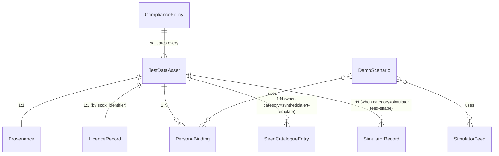
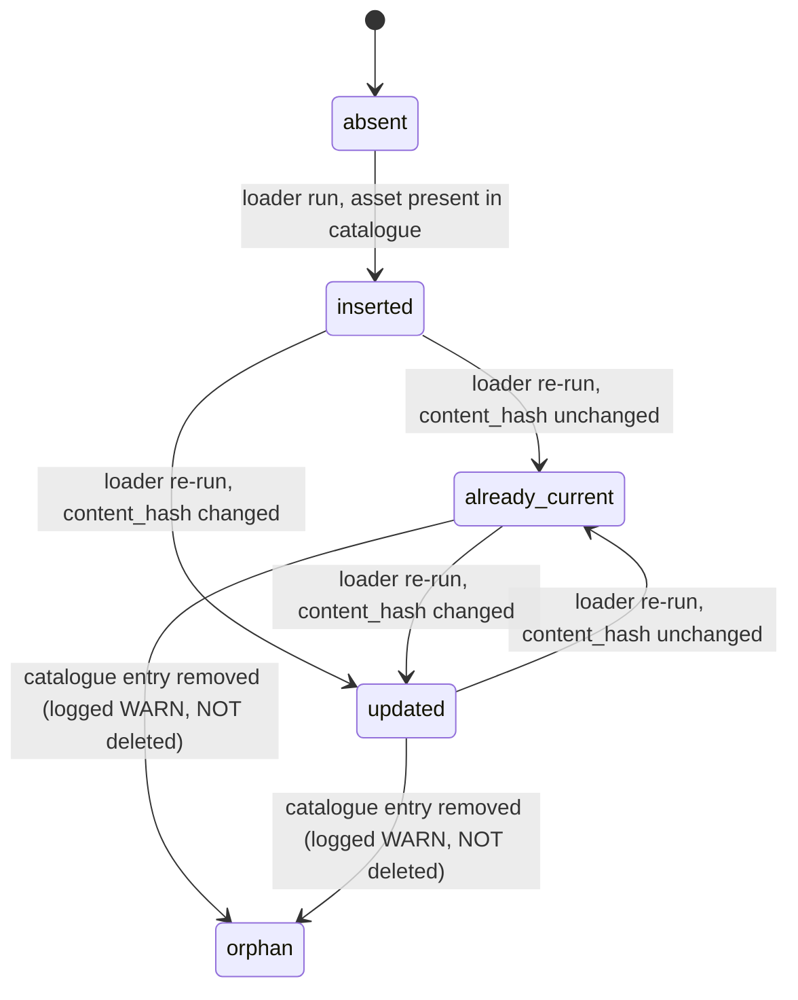

# Phase 1 — Data Model

Spec: [spec.md](./spec.md) · Plan: [plan.md](./plan.md) · Research: [research.md](./research.md)

Pydantic v2 models for the 9 Key Entities listed in the spec. JSON Schemas
derived from these models live under [contracts/](./contracts/) and are the
authoritative wire/contract representation; the Pydantic types here are the
in-Python representation used by the seed loader, generators, simulator
feeds, and lint tools.

All models inherit from `FictitiousMixin` to enforce CL-5's record-level
`fictitious=true` invariant at the type level.

---

## Shared mixins and enums

```python
from __future__ import annotations
from datetime import date, datetime
from enum import Enum
from typing import Annotated, Literal
from pydantic import BaseModel, ConfigDict, Field, HttpUrl

class FictitiousMixin(BaseModel):
    """Every persisted/emitted artefact carries a record-level marker (CL-5)."""
    model_config = ConfigDict(extra="forbid", frozen=True)
    fictitious: Literal[True] = True
    residency: Literal["AU"] = "AU"

class Category(str, Enum):
    SYNTHETIC = "synthetic"
    PUBLIC = "public"
    GENERATOR = "generator"
    MOCK = "mock"
    SIMULATOR_FEED_SHAPE = "simulator-feed-shape"
    ALERT_TEMPLATE = "alert-template"
    PERSONA_BINDING = "persona-binding"

class DomainGroup(str, Enum):
    OPERATIONAL = "operational"
    FIRE = "fire"
    POLICE = "police"
    AMBULANCE = "ambulance"
    SES = "ses"
    MARINE_AVIATION = "marine-aviation"
    COMMONWEALTH = "commonwealth"
    CROSS_SECTOR = "cross-sector"

class PspfMarking(str, Enum):
    OFFICIAL = "OFFICIAL"
    OFFICIAL_SENSITIVE = "OFFICIAL: SENSITIVE"

class RefreshPolicy(str, Enum):
    STATIC = "static"
    REFRESH_ON_PUBLIC_DATASET_UPDATE = "refresh-on-public-dataset-update"
    REGENERATE_EACH_RUN = "regenerate-each-run"

class VolumeTier(str, Enum):
    SMALL = "small"      # 10
    MEDIUM = "medium"    # 100
    LARGE = "large"      # 1 000
    XLARGE = "xlarge"    # 10 000 — never committed (CL-3)
    NA = "n/a"

Sha256Hex = Annotated[str, Field(pattern=r"^[0-9a-f]{64}$")]
KebabId = Annotated[str, Field(pattern=r"^[a-z0-9][a-z0-9\-]{1,127}$")]
SpdxOrInternal = Annotated[str, Field(min_length=1, max_length=128)]
```

---

## Entity 1 — `TestDataAsset`

A single named test-data artefact (FR-001, FR-031). Parent of every other
entity in the manifest.

```python
class TestDataAsset(FictitiousMixin):
    id: KebabId
    name: str = Field(..., min_length=3, max_length=160)
    category: Category
    path: str | None = Field(None, description="POSIX repo-relative; None iff simulator-feed-shape")
    source_shape: str | None = Field(None, pattern=r"^[a-z0-9_.-]+\.v\d+$")
    version: str = Field(..., pattern=r"^\d+\.\d+\.\d+$")
    content_hash: Sha256Hex
    created_or_updated: date
    persona_bindings: list[KebabId] = Field(..., min_length=1)
    domain_group: DomainGroup
    pspf: PspfMarking = PspfMarking.OFFICIAL
    pspf_justification: str | None = None
    licence: SpdxOrInternal
    refresh_policy: RefreshPolicy
    volume_tier: VolumeTier
    record_count: int = Field(..., ge=0)
    cultural_review_required: bool = False
    cultural_review_notes: str | None = None
    feed_version: str | None = None  # required iff category=simulator-feed-shape

    # Relationships (resolved by check_test_data_manifest.py, not by Pydantic):
    #   licence  -> exactly 1 LicenceRecord (by spdx_identifier)
    #   provenance -> exactly 1 Provenance (by id)
    #   persona_bindings -> ≥1 PersonaBinding (by persona_id)
```

**Validation rules** (encoded in the Pydantic `model_validator` and
mirrored in `manifest.schema.json`):

1. `category=public ⇒ provenance.source_url ≠ "n/a" ∧ snapshot_date ≠ "n/a" ∧ dataset_version ≠ "n/a"`.
2. `category=simulator-feed-shape ⇒ source_shape ≠ None ∧ feed_version ≠ None ∧ path == None`.
3. `category != simulator-feed-shape ⇒ path ≠ None`.
4. `pspf == OFFICIAL_SENSITIVE ⇒ pspf_justification ≠ None ∧ len(pspf_justification) ≥ 20`.
5. `volume_tier == XLARGE ⇒ record_count == 0` (xlarge is generator-produced; not committed).
6. `category == GENERATOR ⇒ refresh_policy == REGENERATE_EACH_RUN`.

---

## Entity 2 — `SeedCatalogueEntry`

A static reference record loaded by `scripts/seed_loader.py` (FR-010..FR-016).

```python
class SeedCatalogueEntry(FictitiousMixin):
    id: KebabId
    catalogue: str = Field(..., pattern=r"^[a-z][a-z0-9_]*$")  # e.g. "organisations_australia"
    record_payload: dict  # JSON-serialisable; canonical-JSON-encodable per FR-022
    pspf: PspfMarking = PspfMarking.OFFICIAL
    licence: SpdxOrInternal
    asset_id: KebabId  # FK -> TestDataAsset.id

    # State transitions (loader-side):
    #   absent  -> insert
    #   present + content-hash unchanged  -> already-current
    #   present + content-hash changed    -> update
    #   (Loader NEVER deletes — FR-013, A-12.)
```

---

## Entity 3 — `SimulatorFeed`

A named, versioned simulator feed shape (FR-020, FR-021, FR-027).

```python
class FeedKind(str, Enum):
    BOM = "bom"
    GA = "ga"
    EPA = "epa"
    TRAFFIC = "traffic"
    UTILITY = "utility"
    AMBULANCE_CAD = "ambulance-cad"
    SOCIAL = "social"
    SENSOR = "sensor"
    SYNTHETIC_FALLBACK = "synthetic-fallback"

class FeedParams(BaseModel):
    """Deterministic fault-injection levers (chaos-engineer concern)."""
    model_config = ConfigDict(extra="forbid")
    drop_rate: float = Field(0.0, ge=0.0, le=0.5)
    latency_jitter_us: int = Field(0, ge=0, le=10_000_000)
    malform_rate: float = Field(0.0, ge=0.0, le=0.1)

class SimulatorFeed(FictitiousMixin):
    source_shape: str = Field(..., pattern=r"^[a-z0-9_.-]+\.v\d+$")
    feed_kind: FeedKind
    feed_version: str = Field(..., pattern=r"^v\d+$")
    deterministic: Literal[True] = True
    scenario_ids: list[KebabId] = Field(..., min_length=1)

class SimulatorRecord(FictitiousMixin):
    """Wire envelope (FR-021) for every emitted message."""
    simulated: Literal[True] = True
    scenario_id: KebabId
    seed: int = Field(..., ge=0, le=2**64 - 1)
    source_shape: str
    timestamp: datetime  # ISO-8601 UTC, microsecond precision; from SimulatedClock
    feed_version: str = Field(..., pattern=r"^v\d+$")
    correlation_id: Annotated[str, Field(pattern=r"^[0-9a-f]{32}$")]
    body: dict  # canonical-JSON-encodable; "TEST — DO NOT BROADCAST" required if warning-shaped (FR-046)
```

---

## Entity 4 — `TestDataManifestEntry`

An entry in `docs/test-data/manifest.json`. **Mirrors `TestDataAsset`
exactly** — the manifest is the persisted projection of the in-Python
asset list. Defined as an alias rather than a separate type so the
schema-export pipeline (`pydantic.json_schema()`) produces a single
authoritative schema:

```python
TestDataManifestEntry = TestDataAsset
```

The wrapper at `manifest.json` root is:

```python
class TestDataManifest(BaseModel):
    model_config = ConfigDict(extra="forbid")
    schema_version: Literal["1.0.0"] = "1.0.0"
    generated_at: datetime
    entries: list[TestDataManifestEntry] = Field(..., min_length=1)
```

---

## Entity 5 — `Provenance`

Where the artefact came from (FR-031, FR-034).

```python
class Origin(str, Enum):
    SYNTHETIC = "synthetic"
    PUBLIC = "public"
    GENERATOR_OUTPUT = "generator-output"
    MOCK = "mock"
    SIMULATOR_FEED_SHAPE = "simulator-feed-shape"

class Provenance(BaseModel):
    model_config = ConfigDict(extra="forbid", frozen=True)
    asset_id: KebabId
    origin: Origin
    source_url: HttpUrl | Literal["n/a"]
    snapshot_date: date | Literal["n/a"]
    dataset_version: str | Literal["n/a"] = Field(..., max_length=64)
    attribution_string: str = Field(..., min_length=1, max_length=512)
```

---

## Entity 6 — `LicenceRecord`

SPDX-compatible licence record (FR-031, FR-034).

```python
class LicenceRecord(BaseModel):
    model_config = ConfigDict(extra="forbid", frozen=True)
    spdx_identifier: SpdxOrInternal  # e.g. "CC-BY-4.0", "ODbL-1.0", "CC0-1.0", "proprietary-fictitious-internal"
    licence_text_path: str | None = None  # POSIX repo-relative
    attribution_required: bool
    attribution_string: str | None = None  # required iff attribution_required
```

---

## Entity 7 — `PersonaBinding`

Link between a TestDataAsset and one or more personas (FR-060, A-4).

```python
class BindingKind(str, Enum):
    ORGANISATION_RECORD = "organisation-record"
    SCENARIO_RECORD = "scenario-record"
    GENERATOR_OUTPUT = "generator-output"
    SIMULATOR_FEED = "simulator-feed"
    ALERT_TEMPLATE = "alert-template"
    PERSONA_BINDING = "persona-binding"
    MOCK_RESOURCE = "mock-resource"

class PersonaBinding(BaseModel):
    model_config = ConfigDict(extra="forbid", frozen=True)
    persona_id: KebabId
    domain_group: DomainGroup
    binding_kind: BindingKind
    asset_id: KebabId
    volume_lower_bound: int = Field(..., ge=0)  # FR-062 / A-5
```

The 68 personas are themselves enumerated in
`docs/test-data/personas.json` (see Decision 10 in research.md).

---

## Entity 8 — `DemoScenario`

A named, deterministic end-to-end scenario combining seed entries +
simulator feeds + persona bindings (FR-061, SC-008).

```python
class DemoScenario(BaseModel):
    model_config = ConfigDict(extra="forbid", frozen=True)
    scenario_id: KebabId
    name: str = Field(..., min_length=3, max_length=160)
    domain_group: DomainGroup
    default_seed: int = Field(..., ge=0, le=2**64 - 1)
    participating_personas: list[KebabId] = Field(..., min_length=3)  # SC-008 ≥3
    participating_feeds: list[str] = Field(..., min_length=1)         # source_shape ids
    expected_duration_seconds: int = Field(..., gt=0, le=3600)
    start_iso: datetime  # initial simulated-clock anchor
    fixture_path: str    # POSIX repo-relative — fixtures/sim_replays/<id>.ndjson
    fixture_sha256: Sha256Hex
```

---

## Entity 9 — `CompliancePolicy`

The set of rules every artefact must satisfy (FR-040..FR-046).
Singleton (one row, asserted in CI).

```python
class CompliancePolicy(BaseModel):
    model_config = ConfigDict(extra="forbid", frozen=True)
    pii_forbidden: Literal[True] = True
    pspf_max: Literal["OFFICIAL: SENSITIVE"] = "OFFICIAL: SENSITIVE"
    residency: Literal["AU"] = "AU"
    fictitious_required: Literal[True] = True
    indigenous_denylist_path: str = "tools/lint/data/indigenous_denylist.txt"
    pii_detector_modules: list[str] = Field(default_factory=lambda: [
        "tools.lint.detectors.au_phone",
        "tools.lint.detectors.au_address",
        "tools.lint.detectors.medicare_check_digit",
        "tools.lint.detectors.driver_licence",
        "tools.lint.detectors.email_personal",
    ])
```

---

## Relationship summary



---

## State transitions

The seed loader is the only place state transitions occur. Per FR-013
(upsert-only, no deletion) and SC-004 (idempotent convergence):



The `orphan` state is **observable** (the loader logs `WARN: orphan record
<id> in <catalogue>`) but **not deletable** by this feature; explicit
deletion is out of scope per A-12.
