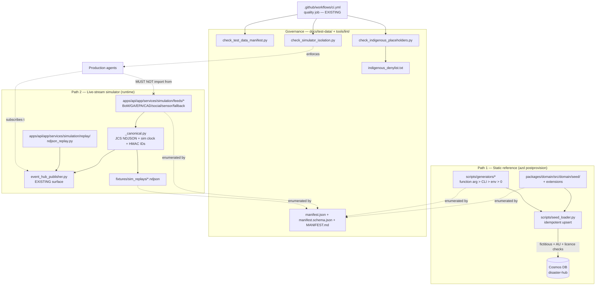

# Implementation Plan: Test Data and Resources Provisioning Review

**Branch**: `038-test-data-provisioning` | **Date**: 2026-05-11 | **Spec**: [spec.md](./spec.md)
**Input**: Feature specification from `/specs/038-test-data-provisioning/spec.md`

## Summary

Deliver an inventoried, gap-closed, governance-attested test-data corpus for the
Autonomous Disaster Response Coordination Hub (AMA), honouring the
**Two-Path Rule**:

- **Path 1 — Static reference data** is loaded by the existing
  `scripts/seed_loader.py` from `packages/domain/src/domain/seed/` and is
  triggered by the existing `azd postprovision` hook.
- **Path 2 — Live-stream / external-feed data** lives **only** under
  `apps/api/app/services/simulation/` and is published onto the existing
  in-process Event Hub publish surface (`event_hub_publisher.py`) plus a
  deterministic file-based replay mode at `fixtures/sim_replays/<scenario>.ndjson`.

The technical approach has three pillars:

1. **Extend in place** — no new Azure resources, no new HTTP endpoints, no new
   CI workflow files. All gates wire into the existing `quality` job in
   `.github/workflows/ci.yml`; all simulator output flows through the existing
   publish surface; all seed data flows through the existing loader.
2. **Canonical, deterministic encoding** — every emitted record (seed,
   generator, simulator) is serialised as canonical JSON / NDJSON
   (UTF-8, RFC 8259, sorted keys, LF terminator, microsecond-precision
   simulated-clock timestamps, HMAC-derived correlation IDs) so that
   byte-equality checks via SHA-256 stream digests prove deterministic
   replay (FR-022, SC-005).
3. **Schema-validated, lint-enforced governance** — a single machine-readable
   manifest at `docs/test-data/manifest.json` validated by
   `docs/test-data/manifest.schema.json`; two new lint scripts
   (`tools/lint/check_test_data_manifest.py`,
   `tools/lint/check_indigenous_placeholders.py`) wired into the existing
   `quality` job; a static dependency-graph check using the project's existing
   `import-linter` to enforce that no production module imports from the
   simulator package (SC-007).

## Technical Context

**Language/Version**: Python 3.12 (apps/api, apps/agents, scripts, tools/lint),
TypeScript 5.8 (apps/web, packages/domain TS sibling).
**Primary Dependencies**: FastAPI, Pydantic v2, `azure.eventhub`,
`azure-cosmos`, `azure-identity`; Next.js 15 / React 19; pytest /
pytest-asyncio / pytest-benchmark / hypothesis; ruff; import-linter; pyyaml;
`jsonschema` (already transitively used); `rfc8785` (JSON Canonicalisation
Scheme RFC 8785) selected in research.md for canonical-JSON encoding.
**Storage**: Cosmos DB (`disaster-hub` database, account `cosmos-ama-zo6bb5`),
Azure Storage (existing containers — no new ones), Azure AI Search,
Event Hub, Service Bus, Event Grid. **No new Azure resources are introduced
by this feature** (per A-11, FR-024, CL-2, CL-7).
**Testing**: pytest with `--basetemp=C:\tmp\...` on Windows (per repo memory);
Playwright for the web; ruff for lint; JSON Schema validators
(`tools/lint/check_test_data_manifest.py`); SHA-256 stream-digest replay tests.
**Target Platform**: Linux containers on Azure Container Apps (Australia East /
Australia Southeast); local-dev on Windows + WSL; CI on GitHub-hosted
ubuntu-latest runners.
**Project Type**: Web service + agents monorepo (apps/, packages/, scripts/,
tools/, infra/, tests/, docs/).
**Performance Goals**: Seed loader idempotent re-run ≤ 60 s on a fresh
subscription (SC-013); simulator must sustain ≥ 1000 NDJSON records/sec on a
single-core CI runner with ≤ 50 MB resident memory (streaming, no full-set
materialisation per CL-3 / "xlarge"); manifest CI lint ≤ 30 s on a 5000-entry
manifest.
**Constraints**: AU residency at rest and in transit (Constitution NN-2 — the
Foundry carve-out is irrelevant here as this feature persists no data outside
seed catalogues and committed fixtures); fictitious-only data (FR-040, FR-041,
FR-045); PSPF default `OFFICIAL`, max `OFFICIAL: SENSITIVE` (FR-043);
Indigenous placeholder enforcement via two-layer denylist + schema cross-check
(FR-044, CL-6); NO outbound network calls to `*.bom.gov.au`, `*.ga.gov.au`,
`*.abs.gov.au`, `*.aurin.org.au`, `*.epa.*`, OSM tile servers, or any
jurisdictional production endpoint from any simulator code path (FR-023, SC-006).
**Scale/Scope**: 68 actor personas; 8 domain groups; ≥ 1 demo scenario per
domain group (SC-008); 4 volume tiers (small=10 / medium=100 / large=1 000 /
xlarge=10 000); ≥ 6 multilingual locales; ~120 seed catalogue files projected
post-extension; ~25 simulator feed shapes; ~14 generator modules; ~5000
manifest entries at maturity.

## Constitution Check

*GATE: Must pass before Phase 0 research. Re-check after Phase 1 design.*

| Principle / NN | Compliance | Notes |
|----------------|------------|-------|
| **I. Primacy of life** | PASS | Test-data feature only; no operational decisions taken. FR-046 explicitly forbids replicating real warnings, with `simulated: true` + "TEST — DO NOT BROADCAST" in message bodies (defence-in-depth against test data leaking into a real warning surface). |
| **II. National EM principles / II-A AIIMS** | PASS | Persona coverage (FR-060, SC-001) explicitly covers all AIIMS functions and all 68 personas across all 11 EM principles' actor groups. |
| **III. Multi-hazard, multi-agency** | PASS | Simulator feed shapes (FR-020) cover bushfire, flood, cyclone, earthquake, tsunami, storm, heat, air-quality, transport, utility, social-media misinformation, sensor telemetry — multi-hazard by design. |
| **IV. Transparency / auditability** | PASS | Every artefact carries provenance, licence, fictitious marker, residency, PSPF, persona binding, content hash (FR-031). Manifest is the audit trail; SHA-256 stream digests provide replay auditability (FR-022). |
| **V. Warnings standards (AWS / 10 principles / TWS)** | PASS | Multilingual alert template extension (FR-070) covers AWS three-tier nesting; placeholder mechanism preserves the trust/scaling principles even where translations are unavailable. |
| **VI. Evacuation framework** | PASS | Evacuation route catalogues, vulnerable-person category records, evacuee registration generators (FR-010, FR-050, FR-062) cover all five evacuation stages. |
| **VII. Recovery support** | PASS | Recovery catalogues (overarching/social/economic/built/natural/evaluation) explicitly named in FR-010. |
| **VIII. Cloud platform / IaC / Azure-native** | PASS | **No new Azure resources introduced** (CL-2, A-11). Simulator re-uses the existing in-process Event Hub publisher; manifest validation re-uses the existing `quality` job in `.github/workflows/ci.yml` (CL-7); local-dev Cosmos emulator decision deferred to research.md but constrained to Azure-native (Azurite for Storage, Cosmos DB Emulator) — no third-party SaaS, no non-Azure clouds. |
| **NN-1. Human-in-the-loop** | PASS | No agent action is taken from this feature; it is data-provisioning only. |
| **NN-2. Data sovereignty (AU)** | PASS | Every artefact carries `residency=AU` (FR-031, FR-042); manifest filter `residency≠AU` MUST return zero (SC-011). |
| **NN-3. Privacy by design** | PASS | `pii=false` is mandatory (FR-031, SC-011); PII detector lint at load/generation rejects matches (FR-045). |
| **NN-4. Interoperability (CAP/EDXL/GeoJSON/OpenAPI)** | PASS | Simulator feed shapes imitate the public-dataset shapes (BoM CAP-shaped warnings, GA quake shapes, GeoJSON for evacuation routes); manifest schema is JSON Schema (open standard). |
| **NN-5. Graceful degradation** | PASS | Simulator's file-based replay mode (`fixtures/sim_replays/*.ndjson`) is a graceful-degradation surface for offline / CI / single-region failure scenarios. |
| **Quality gates (PR lint / IaC plan / lessons)** | PASS | New lints wire into the existing PR `quality` job; no infra changes hence no What-If review; lessons-management feedback unaffected. |

**Result: PASS — no Constitution violations. Complexity Tracking section unused.**

## Project Structure

### Documentation (this feature)

```text
specs/038-test-data-provisioning/
├── plan.md              # This file
├── research.md          # Phase 0 — canonical-JSON, NDJSON streaming, HMAC ID, emulator choice
├── data-model.md        # Phase 1 — Pydantic models for the 9 Key Entities
├── quickstart.md        # Phase 1 — developer walkthrough
├── contracts/           # Phase 1 — JSON Schemas
│   ├── manifest.schema.json
│   ├── simulator_feed.schema.json
│   └── seed_record.schema.json
├── checklists/          # (already present)
│   ├── requirements.md
│   ├── compliance.md
│   ├── seed-catalogue.md
│   ├── simulator-feeds.md
│   ├── test-data-manifest.md
│   └── persona-coverage.md
└── tasks.md             # Phase 2 output — created by /speckit.tasks (NOT by this command)
```

### Source Code (repository root — extensions)

```text
packages/domain/src/domain/seed/                   # PATH 1 — extend in place
├── (existing) jurisdictions_australia.json …
├── recovery-catalogue/                            # (existing) overarching/social/...
├── alert-templates/                               # NEW — multilingual templates (FR-070)
├── evacuation-routes/                             # NEW — route catalogues
├── vulnerable-categories/                         # NEW — category catalogues (no PII)
├── hospital-capability/                           # NEW — capability flag catalogues
├── road-segments/                                 # NEW — generic segment catalogues
├── utility-infrastructure/                        # NEW — generic, no real identifiers
├── volunteer-credentials/                         # NEW — skill/credential categories
├── lemp-memp-templates/                           # NEW — local/municipal EM plan templates
├── inter-government-agreements/                   # NEW — agreement templates
└── _fixture_marker.py                             # NEW — shared marker validator

scripts/
├── seed_loader.py                                 # (existing) extend with marker/idempotency checks
└── generators/                                    # NEW — Path 1 / on-demand
    ├── __init__.py
    ├── _seed_contract.py                          # NEW — function/CLI/env precedence (CL-8)
    ├── incidents.py
    ├── coordination_tasks.py
    ├── signals.py
    ├── audit_entries.py
    ├── risk_register.py
    ├── public_alerts.py
    ├── evacuee_registrations.py
    ├── missing_persons.py
    ├── triage_records.py
    ├── volunteer_registrations.py
    ├── vulnerable_categories.py
    ├── hospital_capacity.py
    ├── transport_assets.py
    └── utility_outages.py

apps/api/app/services/simulation/                  # PATH 2 — extend in place
├── (existing) event_hub_publisher.py
├── data/                                          # (existing) jurisdiction tables, locale tables
├── feeds/                                         # NEW — externally-shaped feeds (FR-020)
│   ├── __init__.py
│   ├── _canonical.py                              # canonical NDJSON + simulated clock + HMAC IDs
│   ├── bom_severe_weather.py
│   ├── bom_fire_weather_fdi.py
│   ├── bom_flood_gauge.py
│   ├── bom_cyclone_track.py
│   ├── ga_earthquake.py
│   ├── ga_tsunami_threat.py
│   ├── epa_air_quality_pm25.py
│   ├── traffic_road_closure.py
│   ├── utility_outage.py
│   ├── ambulance_cad.py
│   ├── social_chatter.py
│   ├── sensor_telemetry.py
│   └── synthetic_fallback.py
└── replay/                                        # NEW — file-based deterministic replay (CL-2)
    └── ndjson_replay.py

fixtures/sim_replays/                              # NEW — committed deterministic replays
└── <scenario>.ndjson                              # one per named demo scenario

docs/test-data/                                    # NEW — manifest + inventory + gap analysis
├── INVENTORY.md                                   # FR-001
├── GAP-ANALYSIS.md                                # FR-002 / FR-003
├── MANIFEST.md                                    # FR-030 (auto-rendered)
├── manifest.json                                  # FR-030 canonical machine-readable
└── manifest.schema.json                           # FR-030 / FR-032 schema

tools/lint/                                        # extend in place — NO new workflow
├── (existing) check_licence_inventory.py …
├── check_test_data_manifest.py                    # NEW — FR-032 wired into `quality` job
├── check_indigenous_placeholders.py               # NEW — FR-044 / CL-6
├── check_simulator_isolation.py                   # NEW — SC-007 dependency-graph gate
└── data/
    └── indigenous_denylist.txt                    # NEW — denylist data (CL-6)

tests/
├── contract/test_manifest_schema.py               # JSON Schema parity
├── contract/test_seed_record_schema.py
├── contract/test_simulator_feed_schema.py
├── integration/test_seed_loader_idempotent.py     # SC-004
├── integration/test_simulator_replay_byte_equal.py # SC-005
├── integration/test_persona_coverage.py           # SC-001 / SC-008
├── integration/test_no_outbound_network.py        # SC-006
└── unit/test_generator_seed_precedence.py         # CL-8
```

**Structure Decision**: Web-service + agents monorepo (Option 2-ish, but
existing). All new code lives under existing top-level directories. No new
top-level apps/packages are introduced.

## Architecture Overview



## Component List (paths)

| Component | Path | New / Existing | Spec ref |
|---|---|---|---|
| Seed catalogue extensions | `packages/domain/src/domain/seed/{alert-templates,evacuation-routes,vulnerable-categories,hospital-capability,road-segments,utility-infrastructure,volunteer-credentials,lemp-memp-templates,inter-government-agreements}/*.json` | NEW (data) | FR-010, FR-070 |
| Seed loader hardening (marker + idempotency rejection) | `scripts/seed_loader.py` | EXTEND | FR-011..FR-016, FR-040, FR-045 |
| Generator framework | `scripts/generators/_seed_contract.py` + 14 generator modules | NEW | FR-050..FR-052, CL-8 |
| Simulator feeds | `apps/api/app/services/simulation/feeds/*.py` (13 modules) | NEW | FR-020 |
| Canonical encoder + simulated clock + HMAC IDs | `apps/api/app/services/simulation/feeds/_canonical.py` | NEW | FR-022, CL-4 |
| File-based replay | `apps/api/app/services/simulation/replay/ndjson_replay.py` | NEW | FR-024, CL-2 |
| Replay fixtures | `fixtures/sim_replays/<scenario>.ndjson` | NEW (data) | FR-024, CL-2 |
| Test-data manifest | `docs/test-data/{MANIFEST.md, manifest.json, manifest.schema.json, INVENTORY.md, GAP-ANALYSIS.md}` | NEW | FR-001..FR-003, FR-030..FR-035 |
| Manifest CI lint | `tools/lint/check_test_data_manifest.py` | NEW | FR-032, CL-7 |
| Indigenous placeholder lint | `tools/lint/check_indigenous_placeholders.py` + `tools/lint/data/indigenous_denylist.txt` | NEW | FR-044, CL-6 |
| Simulator isolation gate | `tools/lint/check_simulator_isolation.py` (using import-linter contract) | NEW | SC-007 |
| CI wiring | new steps in the existing `quality:` job in `.github/workflows/ci.yml` | EXTEND | CL-7 |
| Demo scenarios | `apps/api/app/services/simulation/feeds/scenarios/*.py` (≥ 1 per domain group, 8+ total) | NEW | FR-061, SC-008 |

## Two-Path Rule — Implementation and Enforcement

**Physical separation**:

- Path 1 code lives only under `packages/domain/src/domain/seed/`,
  `scripts/seed_loader.py`, and `scripts/generators/`.
- Path 2 code lives only under `apps/api/app/services/simulation/`.
- Production agents live under `apps/agents/`, `apps/api/app/` (excluding
  `services/simulation/`), and `packages/domain/src/domain/` (excluding
  `seed/`).

**Lint enforcement (`tools/lint/check_simulator_isolation.py`)**: uses the
project's existing `import-linter` (already installed in the `quality` job —
see `ci.yml` line 36 `pip install … import-linter`) plus a contract file
`pyproject.toml [tool.importlinter]` adding two contracts:

1. **`simulator_not_imported_by_production`** — type `forbidden`, source
   modules = everything under `apps/api.app` and `apps/agents` *except*
   `apps/api.app.services.simulation`, forbidden modules =
   `apps.api.app.services.simulation` and its sub-packages.
2. **`seed_not_imported_by_runtime`** — type `forbidden`, source modules =
   `apps/api.app` (excluding the existing seeded boot path),
   forbidden modules = `scripts.generators`.

Additionally `check_simulator_isolation.py` performs an AST grep of
`apps/agents/**` and `apps/api/app/**` (excluding `services/simulation/**`)
for any string match of `apps.api.app.services.simulation` and fails the
build if found — defence-in-depth against runtime-string DI lookups that
import-linter cannot see.

**Manifest enforcement**: `manifest.schema.json` requires every entry
to carry exactly one of `category ∈ {synthetic, public, generator, mock,
simulator-feed-shape, alert-template, persona-binding}`; manifest CI lint
cross-checks that:

- entries with `category=simulator-feed-shape` resolve to a path under
  `apps/api/app/services/simulation/feeds/` or `fixtures/sim_replays/`;
- entries with `category ∈ {synthetic, alert-template, persona-binding}`
  resolve to a path under `packages/domain/src/domain/seed/`;
- entries with `category=generator` resolve to a path under
  `scripts/generators/`.

A miscategorised path therefore fails CI before merge — an entirely separate
guard from the import-linter contract.

## JSON Manifest + JSON-Schema Design

**Manifest path**: `docs/test-data/manifest.json` (canonical, machine-readable,
JSON, sorted keys, LF terminator — same canonical form as the seed loader and
the simulator).
**Schema path**: `docs/test-data/manifest.schema.json` (JSON Schema 2020-12).
**Markdown render**: `docs/test-data/MANIFEST.md` is generated from
`manifest.json` by `tools/lint/check_test_data_manifest.py --render` and is
committed (CI verifies the render is up-to-date by re-rendering and diffing).

**Manifest entry fields** (matches FR-031, extended with CL-6 cultural flag):

| Field | Type | Required | Notes |
|---|---|---|---|
| `id` | string (kebab-case, unique) | ✓ | Stable identifier |
| `name` | string | ✓ | Human-readable |
| `category` | enum | ✓ | `synthetic` / `public` / `generator` / `mock` / `simulator-feed-shape` / `alert-template` / `persona-binding` |
| `path` | string (POSIX, repo-relative) | ✓ unless simulator | File location |
| `source_shape` | string | ✓ if `category=simulator-feed-shape` | e.g. `bom.severe_weather_warning.v1` |
| `persona_bindings` | array of strings (≥ 1) | ✓ | Persona IDs from the consolidated input report |
| `domain_group` | enum | ✓ | `operational` / `fire` / `police` / `ambulance` / `ses` / `marine-aviation` / `commonwealth` / `cross-sector` |
| `fictitious` | const `true` | ✓ | |
| `pii` | const `false` | ✓ | |
| `pspf` | enum | ✓ | `OFFICIAL` (default) / `OFFICIAL: SENSITIVE` (only with justification) |
| `pspf_justification` | string | ✓ if `pspf=OFFICIAL: SENSITIVE` | |
| `residency` | const `AU` | ✓ | |
| `licence` | string (SPDX or `proprietary-fictitious-internal`) | ✓ | |
| `source_url` | URI string or `n/a` | ✓ | Required non-`n/a` for `category=public` |
| `snapshot_date` | ISO-8601 date or `n/a` | ✓ | Required non-`n/a` for `category=public` |
| `dataset_version` | string or `n/a` | ✓ | Required non-`n/a` for `category=public` |
| `refresh_policy` | enum | ✓ | `static` / `refresh-on-public-dataset-update` / `regenerate-each-run` |
| `content_hash` | SHA-256 hex | ✓ | Hash of the canonical-encoded artefact contents |
| `cultural_review_required` | bool (default `false`) | ✓ | CL-6 — set `true` for any artefact whose region or persona binding intersects an Indigenous-cultural zone |
| `cultural_review_notes` | string | optional | "needs cultural-authority review" etc. |
| `volume_tier` | enum or `n/a` | ✓ | `small` / `medium` / `large` / `xlarge` / `n/a` |
| `record_count` | integer ≥ 0 | ✓ | For static fixtures; `0` for generator/simulator entries |
| `created_or_updated` | ISO-8601 date | ✓ | |
| `feed_version` | string | ✓ if simulator | Per FR-027 |

**Schema cross-checks** (encoded as `allOf`/`if`-`then`-`else` in
`manifest.schema.json`, plus belt-and-braces in
`check_test_data_manifest.py`):

1. `category=public ⇒ source_url≠"n/a" ∧ snapshot_date≠"n/a" ∧ dataset_version≠"n/a"`.
2. `pspf="OFFICIAL: SENSITIVE" ⇒ pspf_justification` non-empty.
3. `category=simulator-feed-shape ⇒ source_shape` non-empty ∧ `feed_version` non-empty.
4. `category=generator ⇒ refresh_policy="regenerate-each-run"`.
5. `volume_tier="xlarge" ⇒ record_count=0` (i.e. not committed; produced on demand).
6. Region tag in `persona_bindings` matches an Indigenous-context zone ⇒
   `cultural_review_required=true` (cross-checked by the lint script against
   the denylist's "context zones" section).

## Simulator Extension Design

**Feed shapes** (FR-020): one Python module per feed under
`apps/api/app/services/simulation/feeds/`. Each module exposes a single
generator function

```python
def emit(scenario_id: str, seed: int, clock: SimulatedClock,
         params: FeedParams) -> Iterator[CanonicalRecord]:
    ...
```

returning records that conform to `seed_record.schema.json` augmented with the
mandatory simulator envelope fields per FR-021: `simulated=true`,
`scenario_id`, `seed`, `source_shape`, `timestamp`, `feed_version`.

**Delivery**: each yielded record is fed to `_canonical.encode(record) →ascii
NDJSON line` and then handed to **either**:

- the existing `event_hub_publisher.publish_simulation_event(...)` surface
  (live-publish mode used by the `azd` postprovision demo + integration
  tests against a real Event Hubs namespace), **or**
- the file-based replay writer at `replay/ndjson_replay.py`, which writes to
  `fixtures/sim_replays/<scenario_id>.ndjson` (used by CI deterministic-replay
  tests and offline development).

The replay reader at `replay/ndjson_replay.py:replay()` consumes the same
NDJSON file and re-publishes onto `event_hub_publisher` — so the in-process
publish surface is the **only** delivery surface to production agents,
satisfying FR-024 and CL-2 with **no new Azure resources**.

**Source-shape registry**: a JSON file at
`apps/api/app/services/simulation/feeds/source_shapes.json` enumerates every
shape ID and version (e.g. `bom.severe_weather_warning.v1`,
`ga.earthquake_event.v1`, `epa.pm25.v1`, `synthetic.fallback.v1`). The
manifest CI lint cross-checks that every `simulator-feed-shape` manifest entry
references a registered shape.

## Deterministic Replay Implementation (CL-4)

**Canonical JSON**: use `rfc8785` (RFC 8785 JSON Canonicalisation Scheme,
JCS) — a small (~200 LOC) MIT-licensed Python library that produces UTF-8
output with lexicographically sorted keys, no insignificant whitespace, and
shortest round-trip numeric form. Selected over `canonicaljson` (pure-stdlib
but 0.0001-precision floats round inconsistently) and over hand-rolled
`json.dumps(sort_keys=True, separators=(",", ":"))` (does not normalise
numeric form). See `research.md` § Decision 1.

**NDJSON encoding**: each record is emitted as
`rfc8785.canonicalize(record).decode("utf-8") + "\n"` (single LF, never CRLF).

**Simulated clock** (`apps/api/app/services/simulation/feeds/_canonical.py:SimulatedClock`):

```python
class SimulatedClock:
    def __init__(self, scenario_id: str, seed: int, *, start_iso: str):
        self._scenario_id, self._seed, self._ordinal = scenario_id, seed, 0
        self._start_us = _parse_iso_to_micros(start_iso)
    def tick(self, delta_us: int) -> str:
        self._ordinal += 1
        # Deterministic jitter: seed-derived ±< 1ms wobble, capped, ordinal-monotonic
        jitter = _hmac_int(self._scenario_id, self._seed, self._ordinal) % 999
        ts_us = self._start_us + delta_us + jitter
        return _micros_to_iso8601(ts_us)
```

The clock **never** reads wall-clock; the scenario definition supplies
`start_iso`. Concurrent scenarios use distinct namespaces because the
`(scenario_id, seed)` tuple is part of the HMAC input (FR-026).

**HMAC-derived correlation IDs**:

```python
def correlation_id(scenario_id: str, seed: int, ordinal: int) -> str:
    key = f"ama.sim.{scenario_id}.{seed}".encode("utf-8")
    msg = f"corr.{ordinal}".encode("utf-8")
    return hmac.new(key, msg, hashlib.sha256).hexdigest()[:32]
```

**Stream digest verification** (SC-005 test): the replay-equivalence test
hashes the concatenated canonical NDJSON bytes per feed and asserts equality
across two runs — exact spec from FR-022 / CL-4.

## Generator Deterministic-Seed Contract (CL-8)

A single `scripts/generators/_seed_contract.py` module exposes:

```python
def resolve_seed(*, fn_arg: int | None,
                 cli_arg: int | None,
                 env_var_name: str = "AMA_TEST_SEED",
                 default: int = 0) -> int:
    """Precedence: function-arg > CLI flag > env var > default 0 (warns).
    Validates that the result is a 64-bit unsigned integer.
    """
```

Every generator's primary callable accepts `seed: int | None = None` and
delegates to `resolve_seed(...)`. Every generator's invocation script
(`scripts/generators/<name>.py:main`) registers a `--seed` argparse flag and
delegates likewise. A unit test
(`tests/unit/test_generator_seed_precedence.py`) asserts the precedence and
the warning-on-default behaviour for each generator.

## CI Gate Wiring (CL-7)

Add **three** steps to the existing `quality:` job in
`.github/workflows/ci.yml`, immediately after the existing
`licence-inventory-lint` step:

```yaml
      - name: test-data-manifest-lint
        # Spec 038 FR-032 — manifest ↔ artefact ↔ schema parity
        env:
          PYTHONIOENCODING: utf-8
        run: |
          python tools/lint/check_test_data_manifest.py
          python -c "import jsonschema, json; \
            jsonschema.Draft202012Validator(json.load(open('docs/test-data/manifest.schema.json'))).validate(json.load(open('docs/test-data/manifest.json')))"

      - name: indigenous-placeholder-lint
        # Spec 038 FR-044 / CL-6 — denylist + cultural_review_required gate
        env:
          PYTHONIOENCODING: utf-8
        run: python tools/lint/check_indigenous_placeholders.py

      - name: simulator-isolation-lint
        # Spec 038 SC-007 — production code paths MUST NOT import simulator
        env:
          PYTHONIOENCODING: utf-8
        run: |
          python tools/lint/check_simulator_isolation.py
          lint-imports --config pyproject.toml
```

No new workflow files. No new Azure resources. No new pip dependencies beyond
`rfc8785` (added to `apps/api/pyproject.toml` and `pyproject.toml` extras).

## Indigenous Placeholder Lint Design (CL-6)

`tools/lint/check_indigenous_placeholders.py` (mirrors
`check_licence_inventory.py` style):

1. Loads `tools/lint/data/indigenous_denylist.txt` (one token per line, `#`
   comments allowed). Sections:
   - `[NAMES]` — real Traditional Owner names (sourced from cultural-authority
     custodians named in the manifest's `cultural_review_notes`).
   - `[COMMUNITIES]` — real community names.
   - `[SACRED_COORDS]` — coordinate ranges (lat,lng-rounded boxes) for known
     sacred sites.
   - `[CONTEXT_ZONES]` — region tags that imply Indigenous-cultural context
     (e.g. `nt-central-desert-zone`, `wa-kimberley-zone`).
2. Walks every file under `packages/domain/src/domain/seed/`,
   `scripts/generators/`, `apps/api/app/services/simulation/feeds/`,
   `fixtures/sim_replays/`, and the manifest itself.
3. For every match in `[NAMES]` / `[COMMUNITIES]` / `[SACRED_COORDS]`: **fail**.
4. For every manifest entry whose `persona_bindings`/`regions` include any
   `[CONTEXT_ZONES]` token: **require `cultural_review_required=true`**;
   otherwise fail.
5. Exit 0 → clean, 1 → drift (writes a structured diff to stdout for CI logs).

The denylist file is authored and reviewed by the cultural-authority
custodians named in the manifest's per-artefact `cultural_review_notes` and is
itself listed in the manifest as a `category=mock` artefact (so it cannot be
silently mutated outside review).

## Risks and Mitigations

| # | Risk | Likelihood | Impact | Mitigation |
|---|---|---|---|---|
| R1 | Public-dataset snapshot drift (BoM/GA/ABS refresh their schemas) | Medium | Medium | Snapshot date is per-entry; loader/sim warn but do not fail (Edge Cases §3); refresh-policy field drives a quarterly review cadence; `feed_version` bump is mandatory per FR-027. |
| R2 | Simulator code leaks into production via DI string lookup | Low | High (compliance) | Two layers: import-linter contract + AST-string-grep in `check_simulator_isolation.py`; CI fail on any match. |
| R3 | Demo scenario divergence from canonical replay | Medium | Medium | SHA-256 stream digest stored alongside each `fixtures/sim_replays/*.ndjson` as `<scenario>.sha256`; CI re-runs the simulator and compares; divergence fails the build. |
| R4 | Manifest authoring drift (artefact added without manifest entry) | High (without lint) | Medium | `check_test_data_manifest.py` walks catalogued directories and fails CI if any file is unenumerated. |
| R5 | Indigenous-cultural data leakage | Low (with lint) | Very high | Two-layer enforcement (denylist lint + schema cross-check); custodian-reviewed denylist; CI gate on every PR. |
| R6 | Generator non-determinism via accidental wall-clock or `random.random()` | Medium | High (replay breaks) | Generators MUST receive a `random.Random(seed)` via the contract; ruff rule + targeted unit test asserts no `time.time()`/`datetime.now()` import in `scripts/generators/` or `apps/api/app/services/simulation/feeds/`. |
| R7 | Volume `xlarge` (10 000 records) committed by accident | Low | Low (repo bloat) | Pre-commit + CI lint: any committed `*.ndjson`/`*.json` under `fixtures/sim_replays/` or `seed/` with > 1 000 records fails. |
| R8 | Loader idempotency regressed by future schema change | Medium | Medium | `tests/integration/test_seed_loader_idempotent.py` runs the loader twice in CI and asserts "0 inserts, 0 updates, N already-current" per catalogue. |
| R9 | PII detector false negatives | Medium | Very high | Two-stage: (a) loader/generator-time regex + Luhn + Medicare check-digit; (b) post-load sample audit run on every PR (CI step `pii-detector-lint`, deferred to /speckit.tasks). |
| R10 | New Azure resource accidentally introduced | Low | High (Two-Path / Constitution) | Manifest CI lint asserts the simulator delivery surface is `event_hub_publisher` only; `infra/bicep/**` diff review required for any PR touching `apps/api/app/services/simulation/`. |

## Phased Delivery

| Phase | Scope | Acceptance gate |
|---|---|---|
| **P1 — Seed extensions** | New seed catalogues (alert-templates, evacuation-routes, vulnerable-categories, hospital-capability, road-segments, utility-infrastructure, volunteer-credentials, lemp-memp-templates, inter-government-agreements); seed-loader marker + idempotency hardening; per-record fictitious/AU/licence rejection. | `azd postprovision` runs idempotently on a clean env (SC-002, SC-004); persona-coverage report shows ≥ 1 seed entry per persona for the persona classes covered by reference data. |
| **P2 — Manifest + lints** | `docs/test-data/{INVENTORY,GAP-ANALYSIS,MANIFEST}.md` + `manifest.json` + `manifest.schema.json`; `check_test_data_manifest.py`; `check_indigenous_placeholders.py` + denylist; `check_simulator_isolation.py` + import-linter contracts; CI wiring (3 new steps in `quality` job). | All three new CI steps green on PR; SC-001, SC-003, SC-007, SC-009, SC-011, SC-014, SC-015 pass. |
| **P3 — Simulator extensions** | 13 new feed modules; `_canonical.py` (JCS + sim clock + HMAC IDs); `replay/ndjson_replay.py`; source-shape registry; per-scenario `fixtures/sim_replays/*.ndjson`; replay-equivalence test. | SC-005 (byte-identical replay), SC-006 (no outbound calls) pass. |
| **P4 — Generators + demo scenarios** | 14 generator modules under `scripts/generators/`; ≥ 1 demo scenario per domain group (8+ scenarios); volume-tier streaming xlarge generator; per-persona volume-coverage check. | SC-008, SC-012, SC-013 pass; persona-coverage report = 0 unbacked personas. |

## Technical-Persona Consultation (Step 4 deliverable)

Each paragraph below names a consulted persona, their concern, and how this
plan addresses it. Personas and their guidance files live at
`.github/agents/technical/<persona>.agent.md`.

- **solution-architect** — Concerned that the Two-Path Rule remains a
  cross-cutting NFR with verifiable enforcement, not just a documentation
  convention. *Addressed by:* `check_simulator_isolation.py` + the
  import-linter contracts, the manifest's category-vs-path cross-check, and
  the explicit Constitution Check row for Principle VIII.
- **azure-principal-architect** — Concerned that AVM compliance, AU
  residency, and "no superfluous infra" are honoured. *Addressed by:* the
  zero-new-Azure-resources commitment (CL-2, CL-7), the explicit
  `residency=AU` schema constant, and the manifest filter `residency≠AU ⇒
  empty` check (SC-011).
- **infrastructure-devops** — Concerned that CI plumbing remain consolidated
  and Bicep What-If reviews not be triggered for non-infra PRs. *Addressed
  by:* extending the existing `quality` job in `ci.yml` with three steps
  (no new workflow files), and confirming no `infra/bicep/**` changes are
  required for this feature.
- **data-engineer** *(critical)* — Concerned that ingestion shapes match
  Event Hub message semantics, that NDJSON streaming is memory-bounded,
  and that Cosmos partition keys remain consistent with the existing
  `PARTITION_KEY_MAP` in `seed_loader.py`. *Addressed by:* the canonical
  encoder + `SimulatedClock` design, the streaming xlarge generator
  contract (CL-3, no in-memory materialisation), and explicit re-use of
  the existing `event_hub_publisher` surface so that subscriber semantics
  are unchanged.
- **software-developer** — Concerned that Python typing, ruff, and import
  conventions are honoured. *Addressed by:* all new modules to be authored
  with `from __future__ import annotations`, full Pydantic v2 models for
  every payload (per existing `event_hub_publisher.py` style), ruff +
  import-linter passing on day one.
- **qa-test-engineer** *(critical)* — Concerned that pytest fixture
  organisation respect Windows `--basetemp=C:\tmp\…` (per repo memory),
  that deterministic-replay tests be reproducible across OS, and that
  contract tests sit under `tests/contract/`. *Addressed by:* the
  `tests/{contract,integration,unit}/` layout listed above, LF-only line
  endings in NDJSON replay fixtures (Windows safe), and explicit
  `--basetemp` documentation in `quickstart.md`.
- **security-engineer** *(critical)* — Concerned that PII detectors run at
  load *and* generation, that PSPF marking cap is `OFFICIAL: SENSITIVE`,
  that AU residency is provable per artefact, and that Indigenous data
  cannot leak via either denylist or schema. *Addressed by:* FR-040 / FR-045
  loader rejection, FR-043 PSPF cap with manifest-side justification,
  per-artefact `residency=AU` constant, and the two-layer Indigenous
  enforcement (denylist lint + schema field).
- **compliance-auditor** *(critical)* — Concerned that the manifest is a
  defensible audit trail (provenance, licence, snapshot date, attribution
  string per FR-034) and that the corpus manifest at `docs/corpus/` remains
  authoritative for handbooks. *Addressed by:* FR-035 cross-reference
  policy in the manifest, SPDX licence field, and the per-public-dataset
  attribution string field surfaced in `docs/test-data/MANIFEST.md`.
- **principal-engineer** — Concerned that the design avoids accruing
  technical debt (e.g. parallel manifests, parallel CI workflows). *Addressed
  by:* the explicit "extend in place" commitment, single canonical
  `manifest.json`, single `quality` job extension, and a single shared
  `_canonical.py` encoder used by both the generator and the simulator.
- **sre-engineer** — Concerned that idempotency observability and
  replay-failure SLOs be measurable. *Addressed by:* the loader's
  per-catalogue insert/update/already-current report (FR-014), and the
  replay-equivalence test's SHA-256 digest output being captured as a CI
  artefact for trend tracking.
- **chaos-engineer** — Concerned that simulator feeds support fault-injection
  patterns (delayed records, dropped messages, malformed payloads) so that
  agent resilience can be exercised. *Addressed by:* a `params: FeedParams`
  argument on each `feeds/*.emit()` callable that accepts deterministic
  fault-injection levers (`drop_rate`, `latency_jitter_us`,
  `malform_rate` — all seeded for reproducibility); see `data-model.md`.
- **api-architect** — Concerned that the simulator NOT expose any new HTTP
  endpoint. *Addressed by:* explicit FR-024 / CL-2 commitment to publish
  on the existing in-process Event Hub surface only; no FastAPI router
  changes are introduced by this feature.
- **ai-ml-engineer** — Concerned that eval-fixture conventions for grounding
  tests (under `apps/eval-runner/fixtures/`) remain compatible with the
  manifest. *Addressed by:* `apps/eval-runner/fixtures/` is added to the
  manifest's catalogued directories (it carries record-level fictitious
  markers per CL-5 already), and existing fixtures are enumerated with
  `category ∈ {synthetic, mock}` entries.
- **accessibility-tester** — Concerned that multilingual fixture parity be
  verifiable (every locale has a parallel template). *Addressed by:*
  FR-070's locale set codified in the manifest with the `placeholder=true`
  flag for missing translations, plus a manifest CI lint sub-check that
  every supported locale has either a body or a placeholder for every
  alert template id (deferred concrete implementation to /speckit.tasks).
- **ux-designer** — Concerned that demo scenarios surface coherently in the
  web/app dashboards. *Addressed by:* per-scenario `fixtures/sim_replays/*.ndjson`
  files double as demo recordings (see `quickstart.md` § "trigger a demo
  scenario locally"); the web app's existing scenario picker is unchanged.
- **product-owner-ba** — Concerned that acceptance criteria map to
  testable outcomes. *Addressed by:* the SC-001…SC-015 mapping to the
  P1…P4 phase table above, and the per-checklist coverage already
  present under `specs/038-test-data-provisioning/checklists/`.
- **docker-container-engineer** — Concerned about local emulator choices
  (Azurite vs Cosmos DB Emulator vs in-memory). *Addressed by:*
  `research.md` § Decision 4 — local-dev defaults to in-process fakes
  (already used by `event_hub_publisher.py`'s captured-events fallback);
  Cosmos DB Emulator is the documented opt-in for end-to-end smoke
  tests; Azurite is opt-in for blob-touching tests. **No emulator is a
  required CI dependency**, honouring "no new Azure resources" and the
  existing in-process fallback pattern.

## Complexity Tracking

> **Fill ONLY if Constitution Check has violations that must be justified**

*N/A — no Constitution violations.*

---

## Amendment Cycle 1 — Manifest MD Freshness Gate

> **Scope discipline:** This amendment ONLY adds the FR-036 / SC-016 freshness
> gate (and its CL-9..CL-12 refinements). It changes **zero** entries in the
> manifest, introduces **zero** new Azure resources, **zero** new GitHub
> workflow files, and does **not** touch FR-001..FR-035, FR-040..FR-071, or
> SC-001..SC-015 — those remain authoritative as written in `spec.md`. The
> companion checklist `checklists/manifest-md-freshness.md` (21 binary items)
> is the requirements-quality gate for this cycle.

### A.1 Components

**`tools/lint/render_test_data_manifest_md.py` (existing — Phase 4 / T046)**:
The renderer already exists and already honours the deterministic contract
locked in by FR-036 — confirmed by reading the source: `render()` sorts entries
via `sorted(doc.get("entries", []), key=lambda e: (e["category"], e["id"]))`,
emits a 7-column subset (`id`, `path`/`source_shape`, `domain_group`,
`persona_bindings`, `pspf`, `licence`, `cultural_review_required`) per category
section, writes `\n`-joined output, and `main()` calls
`out.write_bytes(render(doc).replace("\r\n", "\n").encode("utf-8"))` so the
on-disk file is guaranteed LF + UTF-8. The amendment adds a `--check` flag:
when set, the renderer re-renders to an in-memory buffer, reads the committed
file's bytes, applies `\r\n`→`\n` normalisation to the committed bytes, and
exits `0` on byte-exact equality, `1` on divergence (printing a unified diff
truncated to a sensible line budget plus the exact remediation command
`python tools/lint/build_test_data_manifest.py && python tools/lint/render_test_data_manifest_md.py`),
and `0` with a stderr skip notice if `manifest.json` is missing (CL-10
N/A-on-pre-Phase-1-branches behaviour).

**`tools/lint/check_manifest_md_fresh.py` (new — thin wrapper)**:
A 10–20 LOC wrapper that imports `render_test_data_manifest_md` and invokes
its `--check` mode. We add this script even though the `--check` flag alone is
sufficient, because it preserves naming symmetry with the four existing
`tools/lint/check_*.py` scripts (`check_test_data_manifest.py`,
`check_indigenous_placeholders.py`, `check_simulator_isolation.py`,
`check_licence_inventory.py`, `check_rag_optout_bindings.py`,
`check_golden_set_canonical.py`) — every CI lint step today invokes a script
named `check_*.py`, and adding a `render_*.py --check` invocation would break
that convention. **Decision: implement BOTH** the `--check` flag (because the
amendment text in `spec.md` references the renderer directly) AND the wrapper
(because CI invokes `check_*.py` scripts).

### A.2 CI wiring (single new step in existing `quality:` job)

`.github/workflows/ci.yml` currently has the `quality:` job at line 15 with
`simulator-isolation-lint` at line 83. The amendment adds **exactly one** new
step named `manifest-md-freshness-lint` immediately after
`simulator-isolation-lint`, so the four spec-038 lint steps sit consecutively
in the job (test-data manifest schema → indigenous placeholders → simulator
isolation → manifest MD freshness). Step body:
`python tools/lint/check_manifest_md_fresh.py`. **No new workflow file is
created** (FR-036 explicit prohibition; CL-9 confirmation; Constitution
Principle VIII — additive-only infra discipline).

### A.3 TDD tests (failing-first)

- **`tests/contract/spec038/test_manifest_md_freshness_lint.py`** — the
  spec-038 contract test for the lint script. Four sub-tests:
  (a) **green path** — given a fresh `manifest.json` and a freshly-rendered
  `MANIFEST.md` in a tmp repo root, the lint exits `0` with no diff output;
  (b) **drift detection** — when the committed `MANIFEST.md` is mutated
  (entry removed, row reordered, or field changed), the lint exits non-zero
  AND its stdout contains both the unified diff and the exact remediation
  command from FR-036;
  (c) **missing-manifest skip (CL-10)** — when `docs/test-data/manifest.json`
  is absent, the lint exits `0` and writes a skip notice to stderr;
  (d) **CRLF tolerance** — when the committed `MANIFEST.md` is rewritten with
  `\r\n` line endings (simulating a Windows `core.autocrlf=true` checkout)
  but is otherwise byte-equal to the renderer output after LF normalisation,
  the lint exits `0`.

- **`tests/integration/test_manifest_md_committed_in_sync.py`** — a
  whole-repo integration test that runs the lint against the actual
  `docs/test-data/manifest.json` and `docs/test-data/MANIFEST.md` on the
  current commit and asserts exit `0`. This is the regression test for
  OBJ-001 itself — without this test, the 105-vs-134 drift could re-emerge
  silently between runs of the lint in CI.

### A.4 Renderer determinism guarantees (lock-in test)

**`tests/unit/spec038/test_renderer_determinism.py`** — fixture-based
golden test: load a small fixed `manifest.json` (≤10 entries spanning ≥3
categories) committed under `tests/unit/spec038/fixtures/`, call
`render_test_data_manifest_md.render(doc)` twice, assert the two outputs
are byte-equal AND assert `sha256(output) == <committed_golden_sha>`. This
catches any inadvertent change to sort order, header text, column set,
spacing, or trailing newline policy. If a future contributor legitimately
needs to evolve the renderer's contract, they must update the golden hash
AND FR-036 in the same PR — the test failure will force the conversation.

### A.5 Risks and mitigations

| Risk | Mitigation |
|---|---|
| Contributor regenerates `manifest.json` but forgets `MANIFEST.md` | FR-036 lint in CI fails the PR with the exact remediation command (A.2 + A.3a/b) |
| Line-ending drift on Windows checkouts (`core.autocrlf=true`) produces false positives | Lint applies `\r\n`→`\n` normalisation to the committed file before byte compare; covered by A.3d |
| Renderer change inadvertently alters output format (header text, spacing, column order) | Golden-hash determinism test (A.4) + FR-036 contract clause requiring co-update |
| `--check` flag and wrapper drift apart over time | Wrapper is a 1-line dispatch into the renderer's `main()` with `--check` injected; no parallel implementation |
| Pre-Phase-1 branches without `manifest.json` would otherwise fail CI | CL-10 N/A skip — lint exits `0` with stderr notice (covered by A.3c) |

### A.6 F-004 enumeration re-run

Phase 6 of the original plan absorbed F-004 (in-process mock enumeration
into the manifest). The amendment **adds zero new manifest entries** — it
adds only a CI lint and its tests. The F-004 enumeration completed in the
original plan therefore remains valid as-is; no re-run is required. (The
forthcoming MANIFEST.md regeneration in task A5 below brings the rendered
artefact back into sync with the existing 134-entry manifest — it does
not enumerate new entries.)

### A.7 Phasing — Phase A (single phase, 6 tasks)

| Task | Description | TDD posture |
|---|---|---|
| **A1** | Author `tests/contract/spec038/test_manifest_md_freshness_lint.py`, `tests/integration/test_manifest_md_committed_in_sync.py`, and `tests/unit/spec038/test_renderer_determinism.py` (with fixture + golden SHA) — all four sub-tests + integration + determinism failing | RED |
| **A2** | Add `--check` flag to `tools/lint/render_test_data_manifest_md.py` (re-render, normalise CRLF on committed file, byte-compare, unified diff + remediation on diff, exit-0 skip on missing manifest) | GREEN for A1 contract sub-tests |
| **A3** | Add `tools/lint/check_manifest_md_fresh.py` thin wrapper (delegates to renderer `main()` with `--check`) | GREEN for naming-symmetry path |
| **A4** | Add one new step `manifest-md-freshness-lint` to the existing `quality:` job in `.github/workflows/ci.yml`, immediately after `simulator-isolation-lint` | wiring only |
| **A5** | Run `python tools/lint/build_test_data_manifest.py && python tools/lint/render_test_data_manifest_md.py` to regenerate `docs/test-data/MANIFEST.md` (105 → 134 entries) and commit the regenerated file — closes the OBJ-001 root-cause drift | GREEN for A.3-integration test |
| **A6** | Verification sweep: `pytest tests/contract/spec038 tests/integration/test_manifest_md_committed_in_sync.py tests/unit/spec038`, full `tools/lint/check_*.py` lint sweep, `lint-imports` (import-linter), and the spec-038 verification harness from `verification.md` — all green | verification |

### A.8 Constitution check (post-amendment)

- **Principle I (Two-Path Rule)** — unaffected; no agent/AI behaviour change.
- **Principle II (AU residency)** — unaffected; no data movement, no new
  resources, no region-bound artefact changes.
- **Principle III (PSPF / OFFICIAL marking)** — unaffected; renderer already
  emits the `pspf` column; the amendment doesn't alter marking semantics.
- **Principle IV (auditability)** — **strengthened**. `MANIFEST.md` is the
  human-readable audit artefact auditors use for SC-010's <30-min walkthrough;
  FR-036 / SC-016 closes the silent-drift gap that OBJ-001 identified.
- **Principle V (cultural-safety / Indigenous placeholders)** — unaffected;
  separate `check_indigenous_placeholders.py` lint remains authoritative.
- **Principle VI (TDD)** — honoured: A1 lands failing tests before any
  implementation in A2/A3 (RED → GREEN ordering preserved).
- **Principle VII (no new external deps)** — honoured; the lint uses only
  `argparse`, `json`, `difflib`, `pathlib`, `hashlib` from the stdlib.
- **Principle VIII (additive infra only — no new workflows / no new Azure
  resources)** — honoured: ONE new step in the EXISTING `quality:` job; no
  new `.github/workflows/*.yml` file; zero Azure resources.

**Constitution check status: PASS.**

### A.9 Open technical questions

None. The renderer already exists with the locked deterministic contract;
the schema already requires `domain_group`; `data-model.md` already declares
`domain_group: DomainGroup` on PersonaBinding (lines 89, 264, 285) so CL-12
is already reflected in the entity schema. No `research.md` addendum is
required for this cycle.

